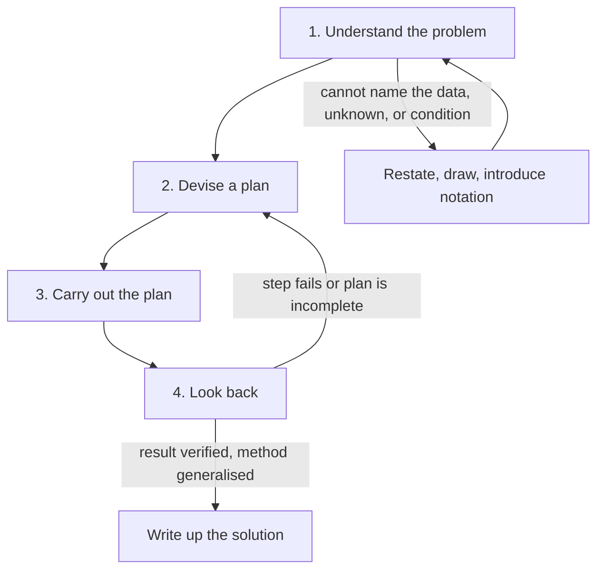
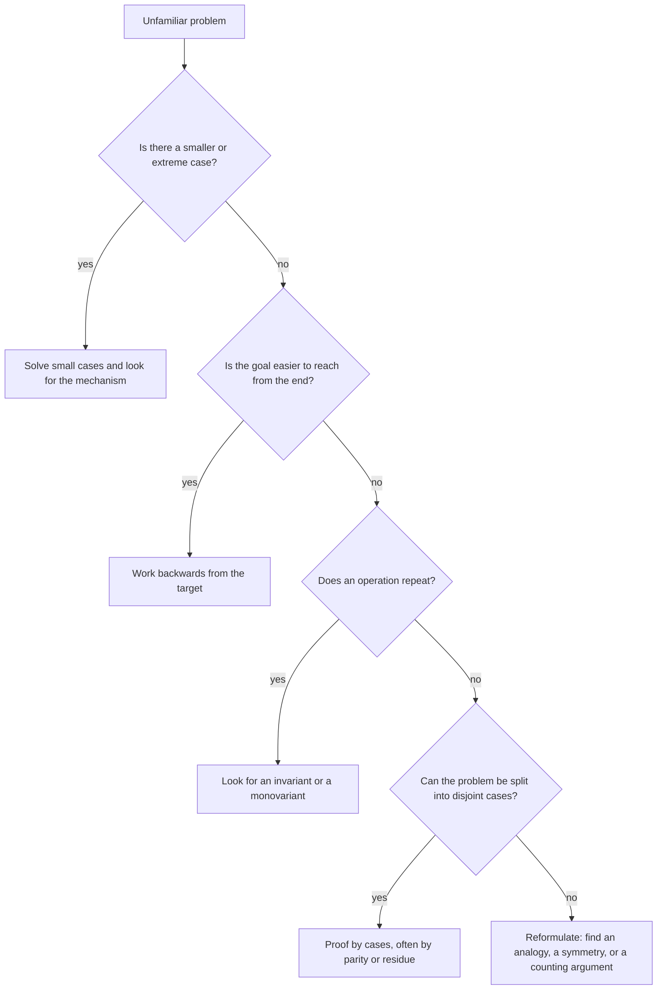

# Mathematical Thinking and Problem Solving

> Foundations · Level: Beginner · Prerequisites: school arithmetic and elementary algebra (no repository tutorial exists yet) · Estimated time: 90 min

## 1. Introduction

Most people meet mathematics as a list of procedures: multiply, factor, differentiate, plug in. That
is the visible surface. Underneath sits something more durable: the habit of turning a vague question
into a precise claim, testing that claim, and then constructing an argument that settles it for every
case at once.

This tutorial is about that habit. It is not a topic in the usual sense — there is no single theorem
to learn — but it is the prerequisite for every other topic in this repository. A reader who can
compute but cannot read a definition, test a guess, or write a proof will stall at algebra, and a
reader who has those skills can pick up almost anything.

Three activities recur throughout mathematics:

* **Modelling.** Replace a messy situation by a precise object: numbers, shapes, sets, functions. Keep
  what matters; discard what does not.
* **Conjecturing.** Guess a general truth from examples and partial reasoning.
* **Proving.** Convert the guess into an argument that no counterexample can survive.

The third step is what separates mathematics from opinion. A guess supported by a thousand examples
is still a guess; a proof settles the matter permanently, because it does not depend on how many
cases were checked.

A question to keep in mind while reading: *why is a proof worth more than a large pile of
confirmations?* By the end of Section 7 you should be able to answer that precisely, with an example
where the obvious pattern fails.

## 2. Prerequisites

You need:

* **Arithmetic with integers.** Addition, subtraction, multiplication, division with remainder. You
  should be able to compute $7 \times 8$, $100 - 37$, and $17 \div 5 = 3$ remainder $2$ without
  hesitating.
* **Fractions.** Adding $\frac{1}{2} + \frac{1}{3} = \frac{5}{6}$ and simplifying
  $\frac{6}{8} = \frac{3}{4}$.
* **Elementary algebra.** Substituting a value into an expression ($3n + 1$ at $n = 4$ gives $13$),
  expanding brackets ($(a+b)^2 = a^2 + 2ab + b^2$), and solving a linear equation such as
  $2x + 3 = 11$.
* **Familiarity with a variable.** Understanding that "$n$" is a placeholder for a number, not a label
  for a specific one.
* **Patience.** Some sections ask you to sit with a problem before its solution appears. That is
  deliberate; the discomfort is the learning.

No repository tutorial yet covers arithmetic or algebra, so there are no links to give for those.
Any school textbook will do. Everything else in this tutorial is developed from scratch.

## 3. Learning Objectives

After working through this tutorial and its exercises, you will be able to:

1. Distinguish a definition, an axiom, a theorem, a conjecture, and a counterexample, and say what
   each one is for.
2. Explain what abstraction is and identify the common skeleton of two problems from different
   domains.
3. Test a universal claim and refute it with a single counterexample.
4. Recognise when a pattern suggested by finitely many cases needs proof, and produce a proof or a
   failure case.
5. Apply Pólya's four phases to an unfamiliar problem and describe what each phase requires.
6. Work backwards from a stated goal when the forward direction is awkward.
7. Use small and extreme cases to generate a conjecture or to eliminate possibilities.
8. Find an invariant or a parity argument that makes an impossibility proof immediate.
9. Produce an order-of-magnitude estimate and use it to reject an implausible answer.
10. Read a short proof, locate its hypotheses, and check each step; write your own proofs in a
    conventional structure.

## 4. Intuition

Think about the difference between a photograph and a subway map. The photograph shows everything and
is useless for navigation. The map throws away nearly all of the information — colours, textures,
building heights — and keeps only what a traveller needs: stations, lines, connections. The map is
*more useful because it contains less*.

Mathematics is the map-making business. A statement such as "the sum of two odd numbers is even" is
not about sheep, coins, or days of the week. It is about the *structure* that all those situations
share: a quantity that leaves remainder $1$ when divided by $2$. Once you see the structure, one
argument covers every instance at once.

Here is the second intuition, about proof. In a courtroom, the prosecution can call many witnesses,
and each one may point at the accused. That is evidence. But evidence can be misleading; a case is
decided when the story is shown to be the only one consistent with the facts. Examples are witnesses.
A proof is the closed case.

The two activities feel different and are learned differently:

* To **discover**, you want many examples, small cases, drawings, extreme values, and a willingness to
  guess.
* To **verify**, you want definitions, hypotheses, and a chain of implications with no gaps.

A common failure is to do the first and believe you have done the second. A second failure is to try
to verify before you understand, which produces symbol-pushing in the dark. Pólya's framework, in
Section 7.5, exists to keep both activities in the right order.

## 5. Formal Definition

The words below are used throughout the repository. Each is stated with its quantifiers explicit;
loose usage later causes confusion.

**Definition 1 (Statement).** A *statement* (or *proposition*) is a declarative sentence that is
either true or false, but not both. "$7$ is prime" and "$7$ is even" are statements. "Solve for $x$"
and "this sentence is false" are not.

**Definition 2 (Definition).** A *definition* assigns a precise meaning to a term by specifying
exactly which objects the term applies to. A definition is neither true nor false; it is a convention,
and it must be used consistently.

**Definition 3 (Axiom).** An *axiom* is a statement assumed without proof, as a starting point. Axioms
are not arbitrary: they are chosen so that the resulting theory describes the intended objects and is
consistent (no statement and its negation are both derivable).

**Definition 4 (Theorem, proposition, lemma, corollary).** A *theorem* is a statement that has been
proved from axioms, definitions, and previously proved statements. A *proposition* is a theorem of
secondary importance; a *lemma* is a theorem whose main purpose is to support a later theorem; a
*corollary* is a theorem that follows quickly from a preceding one. The hierarchy is social, not
logical: all four are proved statements.

**Definition 5 (Proof).** A *proof* of a statement $S$ is a finite sequence of statements ending in
$S$, in which every statement is an axiom, a definition, a previously proved result, a hypothesis of
the problem, or follows from earlier statements by a valid rule of inference.

**Definition 6 (Conjecture).** A *conjecture* is a statement believed to be true, for which no proof
is currently known. A conjecture becomes a theorem only when a proof is supplied.

**Definition 7 (Counterexample).** Let $S$ be the statement "for every $x$ in $D$, $P(x)$". A
*counterexample* to $S$ is an element $c \in D$ for which $P(c)$ is false. One counterexample is
enough to prove that $S$ is false.

**Definition 8 (Universal and existential statements).** A *universal* statement has the form "for
all $x$ in $D$, $P(x)$", written $\forall x \in D,\ P(x)$. An *existential* statement has the form
"there exists $x$ in $D$ such that $P(x)$", written $\exists x \in D,\ P(x)$. A universal statement is
refuted by one counterexample; an existential statement is proved by one example (called a
*witness*).

**Definition 9 (Even and odd).** An integer $n$ is *even* if $n = 2k$ for some integer $k$, and *odd*
if $n = 2k+1$ for some integer $k$. Every integer is exactly one of these, because division by $2$
leaves remainder $0$ or $1$.

**Definition 10 (Divisibility).** Let $a, b \in \mathbb{Z}$. We say that $a$ *divides* $b$, written
$a \mid b$, if there exists $k \in \mathbb{Z}$ with $b = ak$. We say $a$ is a *divisor* of $b$, and
$b$ is a *multiple* of $a$. Note that every integer divides $0$, and $0$ divides only $0$.

**Definition 11 (Invariant and monovariant).** Let a problem have a set of *states* and a set of
allowed *moves* between states.

* An *invariant* is a quantity, computed from a state, that is unchanged by every allowed move.
* A *monovariant* is a quantity that strictly decreases (or strictly increases) with every allowed
  move.

If two states have different invariant values, no sequence of moves connects them. If a monovariant
takes values in a set with no infinite strictly decreasing sequence (for example $\mathbb{N}$), then
no infinite sequence of moves exists.

**Definition 12 (Necessary and sufficient).** Let $P$ and $Q$ be statements. "$P$ is *sufficient*
for $Q$" means $P \Rightarrow Q$. "$P$ is *necessary* for $Q$" means $Q \Rightarrow P$. "$P$ is
necessary and sufficient for $Q$" means $P \Leftrightarrow Q$. The logic of these words is treated
fully in [Propositional and First-Order Logic](../02-logic/README.md).

## 6. Mathematical Notation

| Symbol | Read aloud | Meaning |
|---|---|---|
| $\mathbb{N}$ | "the natural numbers" | $\{0, 1, 2, 3, \dots\}$ in this repository |
| $\mathbb{Z}$ | "the integers" | $\{\dots, -2, -1, 0, 1, 2, \dots\}$ |
| $\mathbb{Q}$ | "the rationals" | numbers of the form $p/q$ with $p, q \in \mathbb{Z}$, $q \neq 0$ |
| $\mathbb{R}$ | "the reals" | all numbers on the number line |
| $\in$ | "is an element of" | $3 \in \mathbb{Z}$ |
| $\notin$ | "is not an element of" | $\tfrac12 \notin \mathbb{Z}$ |
| $\forall$ | "for all", "for every" | universal quantifier |
| $\exists$ | "there exists" | existential quantifier |
| $\Rightarrow$ | "implies", "if … then …" | material implication |
| $\Leftrightarrow$ | "if and only if", "is equivalent to" | biconditional |
| $\neg$ | "not" | negation |
| $\neq$ | "is not equal to" | inequality |
| $a \mid b$ | "$a$ divides $b$" | $\exists k \in \mathbb{Z}: b = ak$ |
| $a \nmid b$ | "$a$ does not divide $b$" | negation of $a \mid b$ |
| $:=$ | "is defined to be" | introduces a name |
| $\sum_{k=1}^{n} a_k$ | "the sum from $k$ equals one to $n$ of $a_k$" | $a_1 + a_2 + \cdots + a_n$ |
| $n!$ | "$n$ factorial" | $1 \cdot 2 \cdots n$, with $0! := 1$ |
| $\binom{n}{k}$ | "$n$ choose $k$" | number of $k$-element subsets of an $n$-element set |
| $\sqrt{x}$ | "the square root of $x$" | the non-negative $y$ with $y^2 = x$ |
| $\blacksquare$ or $\square$ | "end of proof" | marks the conclusion of an argument |
| WLOG | "without loss of generality" | a symmetry argument removes a case |

Two conventions matter immediately.

* $\mathbb{N}$ contains $0$ in this repository. If a statement needs $n \ge 1$, it says so.
* "$a \mid b$" is a statement about divisibility, not a fraction. Writing $a \mid b$ when $a = 0$ is
  permitted but usually useless: $0 \mid b$ holds only for $b = 0$.

Reading a quantified sentence aloud is a good test of understanding. The sentence
$\exists N\, \forall n > N,\ a_n = L$ reads "there is an $N$ such that, for every $n$ greater than
$N$, the number $a_n$ equals $L$". The order of the quantifiers is part of the meaning; Section 7.6 of
the [logic tutorial](../02-logic/README.md) explains why.

## 7. Core Concepts

### 7.1 What Mathematics Studies

Mathematics studies *patterns and structures*, not any particular collection of objects. Three
examples, from very different areas, illustrate the point:

* **Arithmetic.** The identity $1 + 3 + 5 + \cdots + (2n-1) = n^2$ holds for every $n$. The objects
  are numbers, but the content is a relation between the length of the list and the total.
* **Geometry.** The angles of a triangle sum to $180^\circ$ in the Euclidean plane. The objects are
  figures, but the content is a constraint that survives any deformation preserving straightness.
* **Logic.** From $P \Rightarrow Q$ and $P$ we may infer $Q$. The objects are sentences, but the
  content is a pattern of inference that is valid whatever the sentences mean.

In each case the subject is a *form* that many situations share. That is why a single proof can settle
infinitely many concrete questions.

Mathematics is also cumulative in a specific way: a later statement is justified by earlier ones, and
the chain terminates in definitions and axioms. This is different from an empirical science, where a
theory is supported by observation and can be overturned by a better experiment. A proved theorem
stays proved; what changes is the collection of definitions and axioms people find interesting.

### 7.2 Abstraction: Discarding the Irrelevant

*Abstraction* is the deliberate removal of detail that does not affect the answer. It is not
vagueness; a good abstraction is more precise than the situation it replaces.

Consider three problems.

1. At a meeting of $n$ people, every pair shakes hands exactly once. How many handshakes occur?
2. In a league of $n$ teams, every pair plays exactly one match. How many matches are played?
3. How many two-element subsets does a set with $n$ elements have?

The answers are the same, and so is the reasoning: each unordered pair of distinct objects contributes
exactly one handshake, match, or subset. If $n \ge 1$, the count is

$$
\binom{n}{2} = \frac{n(n-1)}{2}.
$$

Why is this formula correct? Count the *ordered* pairs: the first object can be chosen in $n$ ways and
the second in $n-1$ ways, giving $n(n-1)$ ordered pairs. Each unordered pair $\{a,b\}$ was counted
twice, once as $(a,b)$ and once as $(b,a)$. Therefore the number of unordered pairs is $n(n-1)/2$.

The abstraction step is the sentence "each unordered pair contributes exactly one". Once that is
established, the fact that the objects are people, teams, or sets is irrelevant. Carrying that
irrelevance along would make the argument longer and no stronger.

Abstraction has a risk: if you discard a detail that *does* matter, the model is wrong. A league in
which teams play home and away is not modelled by unordered pairs; the count becomes $n(n-1)$. Good
mathematical practice is to state the assumptions explicitly — here, "every pair meets exactly once" —
so that a reader can check whether the model fits the situation.

### 7.3 Conjectures, Evidence, and Counterexamples

A *conjecture* is a general statement you believe but cannot yet prove. Conjectures are produced by
pattern-spotting (Section 7.4) or by structural intuition. They are the engine of discovery, and they
are worthless until tested.

Testing works asymmetrically:

* **A single counterexample destroys a universal claim.** If someone claims "every prime is odd", the
  number $2$ ends the discussion.
* **No number of examples establishes a universal claim.** Checking $n = 1, 2, \dots, 1000$ shows only
  that the claim survives those cases.

This asymmetry is the reason proof exists. It is also a practical warning: the most dangerous
conjectures are those with a long run of confirming cases, because the run breeds false confidence.

Three examples show the range of what can happen.

* **Refuted quickly.** "Every prime is odd." Counterexample: $2$ is prime and even.
* **Refuted late.** Euler's polynomial $n^2 + n + 41$ is prime for $n = 0, 1, 2, \dots, 39$. At
  $n = 40$ it equals $40^2 + 40 + 41 = 1600 + 40 + 41 = 1681 = 41^2$, which is composite. Forty
  confirming cases, then failure. (There is a reason: $n^2+n+41$ at $n=41$ is divisible by $41$, and
  the run of primes ends just before that. The polynomial is discussed again in the exercises.)
* **Still open.** Goldbach's conjecture: every even integer greater than $2$ is the sum of two primes.
  It has been verified over an enormous range, but the original statement remains unproved. The weaker
  statement that every odd integer greater than $5$ is a sum of three primes was proved by Helfgott in
  2013; it follows from Goldbach's conjecture (given an odd $n > 5$, the number $n - 3$ is even and
  greater than $2$, so $n - 3 = p + q$ would give $n = 3 + p + q$), but it does not imply it. No amount
  of verification upgrades a conjecture to a theorem.

A related open problem, useful for keeping humility: it is unknown whether any *odd perfect number*
exists. A perfect number equals the sum of its proper divisors, for example $6 = 1+2+3$. All known
perfect numbers are even.

**How to test a conjecture.** Before attempting a proof:

1. Check the smallest cases allowed by the hypotheses ($n = 0, 1, 2$).
2. Check a case just outside the hypotheses, to see whether the hypothesis is really needed.
3. Check an extreme case ($n$ very large, a degenerate shape, an empty collection).
4. Try to build a counterexample deliberately: what would it take to violate the conclusion?

If step 4 succeeds, you have saved yourself a wasted proof attempt. If it fails repeatedly, you
usually learn *why* it fails, and that "why" is often the core of the proof.

### 7.4 Patterns and Generalization

A *pattern* is a regularity observed in several instances. A *generalization* is a statement that
extends the pattern to all instances. The step from one to the other is the risky one.

**Example.** Compute the sum of the first $n$ odd numbers:

$$
1 = 1,\quad 1+3 = 4,\quad 1+3+5 = 9,\quad 1+3+5+7 = 16.
$$

The totals are $1, 4, 9, 16$ — perfect squares. Conjecture:

$$
1 + 3 + 5 + \cdots + (2n-1) = n^2.
$$

The pattern is real, and Theorem 2 in Section 8 proves it. Note what the proof adds: it explains why
the pattern cannot break at $n = 10^{6}$.

**A pattern that breaks.** Place $n$ points on a circle and join every pair by a chord, with no three
chords passing through a common interior point. Count the regions into which the chords divide the
disk:

| $n$ | 1 | 2 | 3 | 4 | 5 | 6 |
|---|---|---|---|---|---|---|
| regions | 1 | 2 | 4 | 8 | 16 | 31 |

The first five values are $2^{n-1}$. A hasty generalizer concludes that the count is always $2^{n-1}$
and predicts $32$ regions for $n = 6$. The correct value is $31$. Example 7 in Section 9 derives the
formula $R(n) = \binom{n}{2} + \binom{n}{4} + 1$ and shows where the extra structure comes from. The
sequence $1, 2, 4, 8, 16, 31, 57, \dots$ is known as Moser's circle problem.

**How to generalize responsibly.**

* State the conjecture in full, with its domain of validity ("for all integers $n \ge 1$").
* Prove it, or find the smallest failing case.
* If the pattern came from a geometric or counting argument, identify the mechanism that produces it.
  A pattern with a mechanism is a proof in waiting; a pattern without one is a coincidence.
* Sometimes it pays to generalize *more* than the evidence suggests: a stronger statement can be
  easier to prove because it gives a stronger hypothesis to work with. A classic instance is proving
  "for all $n$, property $P(n)$" by induction where the induction hypothesis must be strengthened.

### 7.5 Pólya's Four Phases

George Pólya's *How to Solve It* (1945) describes problem solving as four phases. They are not a
recipe — you will move back and forth — but they name the things that must happen.

**Phase 1: Understand the problem.**

* What is the unknown? What are the data? What is the condition linking them?
* Restate the problem in your own words.
* Introduce notation for the unknown.
* Draw a picture, or write out a small case.
* Is the condition sufficient to determine the unknown? Is it redundant? Contradictory?
* Separate the parts of the condition; can you write each one down?

**Phase 2: Devise a plan.**

* Have you seen this problem before, or one like it?
* Do you know a related theorem?
* Look at the unknown. Do you know a problem with the same or a similar unknown?
* Here is a problem related to yours and solved before: can you use it? Can you use its method? Can
  you introduce an auxiliary element to make the analogy work?
* Can you restate the problem? Can you restate it differently? Go back to definitions.
* If you cannot solve the proposed problem, solve a related one first: a special case, a more general
  case, an analogous problem, a part of the problem. (This is the source of the heuristics in Sections
  7.6–7.9.)

**Phase 3: Carry out the plan.**

* Check each step. Can you see clearly that the step is correct? Can you prove that it is correct?
* Keep the plan visible; if a step fails, return to Phase 2 rather than forcing it.
* Record what you have assumed at each point.

**Phase 4: Look back.**

* Can you check the result? Can you check the argument?
* Can you derive the result differently? Can you see it at a glance?
* Can you use the result, or the method, for some other problem?
* Does the solution generalize? What was the essential idea?
* Would a weaker hypothesis suffice? Is any hypothesis unused?

The fourth phase is the one most often skipped, and it is where most of the learning happens. A solved
problem that is not examined yields one answer; a solved problem that is examined yields a method.

A useful diagnostic: if you are stuck, identify which phase you are in. Students who are stuck in
Phase 1 often try to compute; students stuck in Phase 2 often keep re-reading the statement. Naming
the phase usually suggests the move.

### 7.6 Working Backwards

Some processes are easy to run forwards and hard to invert; others are easy to invert and hard to run
forwards. When the goal state is specified and the start is not, running the process backwards from
the goal can turn a search into a computation.

**Example.** "I think of a number, multiply it by $3$, add $5$, double the result, subtract $4$, and
get $30$. What was the number?"

Forwards, the unknown passes through four operations and you would have to solve an equation.
Backwards, each operation is undone in reverse order:

$$
30 \;\xrightarrow{+4}\; 34 \;\xrightarrow{\div 2}\; 17 \;\xrightarrow{-5}\; 12
\;\xrightarrow{\div 3}\; 4.
$$

Check forwards: $4 \mapsto 12 \mapsto 17 \mapsto 34 \mapsto 30$. Correct.

**Why backwards works.** If every step is a bijection (invertible, one input per output), the forward
chain has exactly one preimage and undoing is legitimate. If a step is not injective — squaring, for
instance — the backward chain produces *candidates*, and each must be checked in the original problem.
This is exactly the source of extraneous solutions in algebra: solving $\sqrt{x} = x - 2$ by squaring
produces $x = 4$ and $x = 1$, but only $x = 4$ satisfies the original equation, because squaring is
not injective on $\mathbb{R}$.

Backwards reasoning is also the natural way to plan: start from what must be shown, ask what would
suffice for it, and continue until you reach something known or assumed. This is sometimes called
*regressive analysis*, and it is how most proofs of hard statements are actually found (the written
proof then runs forwards).

### 7.7 Special Cases, Extremes, and Small Cases

When a general problem resists, specialize. Three specializations are especially productive.

**Small cases.** Compute $n = 1, 2, 3$ by hand. Not only do the numbers suggest a formula; the
*computations* often reveal the mechanism. In the Moser problem above, drawing the cases $n = 4$ and
$n = 5$ shows a new chord being cut into pieces by the chords it crosses — the mechanism behind the
formula.

**Extreme cases.** Push a parameter to $0$, to $1$, or to infinity. Extreme cases expose hidden
assumptions: a "triangle" with two equal vertices is degenerate; a "list" of length $0$ has no first
element. If a claimed theorem fails in an extreme case, either the theorem needs a hypothesis or the
claim is false.

**The smallest counterexample.** To prove a universal statement, assume it fails and choose the
smallest object for which it fails. The minimality gives you extra information: all smaller objects
satisfy the statement, so you can compare. This is the logical engine behind *infinite descent* and
behind strong induction, and it is used in the Challenge exercises.

**Without loss of generality.** If a problem is symmetric, you may restrict to one representative
case. The phrase "WLOG $a \le b$" is legitimate only when swapping $a$ and $b$ yields a genuinely
equivalent problem. If the conclusion treats $a$ and $b$ differently, the symmetry does not hold and
the phrase is an error.

### 7.8 Invariants and Monovariants

An invariant is a quantity that no allowed move can change. It answers *impossibility* questions: if
the start and the target have different invariant values, no sequence of moves connects them.

**Example (sum invariant).** The numbers $1, 2, \dots, 10$ are written on a board. A move erases two
numbers and writes their sum. What single number remains at the end?

The sum of all numbers on the board never changes, because erasing $a$ and $b$ and writing $a+b$
preserves the total. Initially the sum is $1 + 2 + \cdots + 10 = 55$. At the end one number remains,
and the total is that number. So the final number is $55$, whatever order the moves are made in.

**Example (parity invariant).** A $3 \times 3$ grid of lamps has some on and some off. A move flips
two lamps that share an edge. Then the parity of the number of lit lamps is invariant: flipping two
lamps changes the count by $-2$, $0$, or $+2$. So from a position with $5$ lit lamps you can never
reach a position with $4$ lit lamps. (You also cannot reach $0$ from $5$, since both $5$ and $0$ would
have to have the same parity.)

**Monovariants and termination.** A monovariant is a quantity that always strictly moves in one
direction, which rules out infinite processes. Euclid's algorithm for the greatest common divisor of
two positive integers repeatedly replaces the pair $(a,b)$ with $(b, r)$, where $r$ is the remainder of
$a$ divided by $b$, with $0 \le r < b$. The second entry strictly decreases at each step, and it is a
non-negative integer, so the process must stop at $r = 0$. Termination is a theorem about a
monovariant, not an empirical observation.

**Finding an invariant.** Ask: what does the move preserve? Common answers are total sum, parity,
colour counts, a difference modulo $m$, a product, a determinant, or a polynomial evaluated at the
state. When a problem says "can you reach", suspect an invariant; when it says "does it always stop",
suspect a monovariant.

### 7.9 Parity Arguments

Parity is the simplest invariant: everything is reduced to "remainder $0$ or $1$ on division by $2$".
It is crude and surprisingly powerful.

The arithmetic of parity is worth memorizing as lemmas (proved in Section 8):

| $+$ | even | odd |
|---|---|---|
| **even** | even | odd |
| **odd** | odd | even |

| $\times$ | even | odd |
|---|---|---|
| **even** | even | even |
| **odd** | even | odd |

In words: the sum of two integers is even exactly when they have the same parity; the product is odd
exactly when both factors are odd.

**Classic uses.**

* **Refuting equations.** The equation $x^2 + y^2 = 4z + 3$ has no integer solutions. A square is
  congruent to $0$ or $1$ modulo $4$ (Section 8, Theorem 4), so the left side is one of $0, 1, 2$
  modulo $4$, while the right side is $3$.
* **Irrationality of $\sqrt{2}$.** If $\sqrt{2} = p/q$ in lowest terms, then $p^2 = 2q^2$. The right
  side is even, so $p^2$ is even, so $p$ is even. Write $p = 2r$; then $4r^2 = 2q^2$, so $q^2 = 2r^2$
  and $q$ is even. But $p$ and $q$ were supposed to have no common factor. Contradiction. Example 5
  in Section 9 gives the full proof with every step justified.
* **Chessboard colouring.** Colour cell $(i,j)$ black when $i+j$ is even and white when $i+j$ is odd.
  A domino covers one black and one white square. Any tiling condition can therefore be tested by
  counting the two colours.

The deeper lesson: parity is the first of a family of *modular* invariants. Replacing "even/odd" by
"remainder modulo $m$" gives finer information, and most of the arguments above survive with $\mathbb{Z}$
replaced by $\mathbb{Z}/m\mathbb{Z}$.

### 7.10 Counting Arguments: Double Counting and Pigeonhole

Two counting principles appear constantly in problem solving.

**Double counting.** If the same finite set is counted in two different ways, the two counts are equal.
The technique proves identities without algebra, because each side counts something concrete.

*Example (the handshake lemma).* In a group of people, count the pairs consisting of a person together
with one of that person's handshakes. Summing over people gives $\sum_v \deg(v)$, where $\deg(v)$ is
the number of handshakes person $v$ had. Summing over handshakes gives $2E$, where $E$ is the number of handshakes,
because each handshake has two participants. Hence

$$
\sum_{v} \deg(v) = 2E.
$$

The right side is even, so the number of people with odd degree is even. In particular, "everyone
shook hands with exactly three others" is impossible for nine people: the sum of nine odd numbers
would be odd, but it must equal $2E$.

**Pigeonhole principle.** If $n$ objects are placed in $k$ containers and $n > k$, then some container
holds at least two objects. The proof is one line: if every container held at most one object, there
would be at most $k$ objects.

The *generalized* form: if $n$ objects are placed in $k$ containers, some container holds at least
$\lceil n/k \rceil$ objects. Both forms are refutations in disguise — they show that a proposed
distribution is impossible.

*Example.* Among any $n+1$ integers chosen from $\{1, 2, \dots, 2n\}$, two have the property that one
divides the other. Write each chosen integer as $2^a \cdot m$ with $m$ odd. The odd part $m$ lies in
the set of $n$ odd numbers $\{1, 3, \dots, 2n-1\}$. With $n+1$ integers and only $n$ possible odd
parts, two integers share an odd part; then one is a power of $2$ times the other, so one divides the
other (Exercise 27 asks for the write-up).

### 7.11 Estimation and Sanity Checks

An estimate is a calculation you can do in your head that is accurate enough to reject wrong answers.
It is not a guess; it is a coarse computation with explicit assumptions.

**Orders of magnitude.** Work with powers of ten and keep one or two significant figures. Useful
anchors:

$$
2^{10} = 1024 \approx 10^3, \qquad 10^3 \approx 2^{10}, \qquad \pi \approx 3, \qquad
\sqrt{10} \approx 3.16.
$$

**Example: how many digits does $2^{100}$ have?** Since $2^{10} = 1024 = 1.024 \times 10^3$,

$$
2^{100} = (2^{10})^{10} = (1.024 \times 10^3)^{10} = 1.024^{10} \times 10^{30}.
$$

Now $1.024^{10} \approx 1.27$; the binomial estimate gives
$1 + 10(0.024) + 45(0.024)^2 \approx 1.266$ as a check. So $2^{100} \approx 1.27 \times 10^{30}$,
which has $31$ digits, since it lies between $10^{30}$ and $10^{31}$. The exact value is $1267650600228229401496703205376$, confirming the count.

**Fermi decomposition.** Estimate a large quantity by writing it as a product of smaller quantities
you can guess, each within a factor of a few. Errors partially cancel, and the result is usually
within a factor of ten.

*Example: piano tuners in a city of three million.* About one household per three people gives
$10^6$ households; suppose one in twenty owns a piano, giving $5 \times 10^4$ pianos; each is tuned
about once a year, giving $5 \times 10^4$ tunings per year; a tuner does four tunings a day on $250$
working days, giving $10^3$ tunings per year. Then the number of tuners is
$5 \times 10^4 / 10^3 = 50$. An answer of $5000$ would be wrong by two orders of magnitude, which is
the point of the exercise.

**Sanity checks.** After computing, run cheap tests:

* **Parity and last digit.** $49 \times 51$ must end in $9$, since $9 \times 1 = 9$. A claimed result
  of $2399$ passes this test but fails the sharper check $(50-1)(50+1) = 2500 - 1 = 2499$.
* **Order of magnitude.** A $3$-digit number times a $3$-digit number has $5$ or $6$ digits, not $9$.
* **Sign and units.** A distance cannot be negative; a speed of $300$ m/s for a car is absurd.
* **Extreme cases.** If a formula gives a bizarre answer at $n = 0$ or $n = 1$, suspect the formula.
* **Symmetry.** If the problem is symmetric in two variables, the answer must be symmetric in them.

**Averages need care.** A car travels $60$ km at $60$ km/h and returns at $30$ km/h. The average
speed is *not* $45$ km/h. The trip out takes $1$ hour and the return takes $2$ hours, so the total is
$120$ km in $3$ hours, i.e. $40$ km/h. The arithmetic mean of the speeds is only correct when the
*trip times* are equal, not the distances. Sanity check: the answer must be below $45$, because the car
spends more time at the slower speed.

### 7.12 Reading a Proof

A proof is a text with a job: to make the conclusion inevitable given the hypotheses. Read it the way
you would read a legal argument, not the way you read a novel.

A practical procedure:

1. **Identify the claim.** What exactly is being proved? Write it as a quantified statement.
2. **List the hypotheses.** Which of them are used, and where? A hypothesis that is never used is
   either redundant or a sign that the proof has a gap.
3. **Find the spine.** Most proofs have one central idea (an invariant, a construction, an algebraic
   identity, a clever auxiliary object) and a routine shell around it. Locate the idea.
4. **Justify each transition.** For every "hence", "therefore", "it follows", ask: follows from what?
   If you cannot answer, mark the line.
5. **Test with an example.** Run the proof on the smallest concrete case. If it breaks there, you have
   found either an error or a missing hypothesis.
6. **Check the edge cases.** What happens at $n = 0$, at the empty set, at equality?

An annotated example:

> **Claim.** The sum of two consecutive integers is odd.
>
> **Proof.** Let the integers be $n$ and $n+1$, where $n \in \mathbb{Z}$. [*Set-up: an arbitrary
> integer, not a specific one.*] Their sum is $n + (n+1) = 2n + 1$. [*Algebra: associative and
> commutative laws.*] By Definition 9, an integer of the form $2n+1$ with $n \in \mathbb{Z}$ is odd.
> Hence the sum is odd. $\blacksquare$ [*The definition is used in the direction "form $2n+1$
> implies odd".*]

Notice what makes this a proof and not an example: $n$ was arbitrary. Had we written "$3 + 4 = 7$,
which is odd", we would have verified one case.

### 7.13 Writing a Proof

Writing is not the transcription of a proof you already have; it is the final stage of making the
argument exact. The conventions are stable across mathematics.

**Structure of a written proof.**

1. **State the claim** (or refer to it by number).
2. **Set up.** Introduce the objects, name the variables, state the hypotheses, and say "let $x$ be
   arbitrary" when the claim is universal.
3. **Body.** A sequence of assertions, each justified. Use display equations for computations that a
   reader must check. Say which definition or theorem you are using.
4. **Conclusion.** State that the claim is proved, and mark the end.

**Habits that separate good from bad.**

* *Use the definitions.* Most elementary proofs consist of unpacking a definition and repacking it.
* *Never write "clearly" or "obviously" unless the step is one line and you could write it out.* Those
  words are the most common hiding place for errors.
* *Quantify.* "Let $\varepsilon > 0$" is a hypothesis; "for all $\varepsilon > 0$" is a claim. They are
  not interchangeable.
* *Do not assume the conclusion.* A proof that starts from the statement to be proved and manipulates
  until it reaches something true is valid only if every step is reversible; otherwise it proves
  nothing. (Section 11 lists this as a common mistake.)
* *Respect symmetry.* Justify every "WLOG".
* *Check the boundary.* If the proof divides by something, say why it is nonzero; if it takes a square
  root, say why the quantity is non-negative.
* *Write for a skeptical reader who knows less than you.* If a step can be misread, rewrite it.

**A bad and a good version of the same argument.**

Bad: "$n^2 + n = n(n+1)$ is even because one of $n$, $n+1$ is even, so the product is even. Hence
true."

Good: "Let $n \in \mathbb{Z}$. Among the two consecutive integers $n$ and $n+1$, exactly one is even
and one is odd. By the multiplication table for parity (Section 7.9), an even factor makes the product
even. Since $n^2 + n = n(n+1)$, the number $n^2+n$ is even."

The difference is not length; it is that every clause of the good version names its justification and
its quantifier.

### 7.14 How to Study Mathematics

The following protocol is more useful than any amount of re-reading.

1. **Attempt before reading.** Read the statement of an example or exercise, close the book, and try.
   Even a failed attempt makes the solution readable; reading a solution first creates an illusion of
   understanding.
2. **Give a problem 20–30 minutes.** Struggle is not wasted time; it is when the problem's structure
   becomes visible. If you are still stuck, write down what you have tried and where you are blocked,
   then look at a hint (not the full solution).
3. **Write full solutions.** Not "I see how it goes" — the complete argument, in sentences, with
   justifications. The gaps you did not notice become visible when you write.
4. **Keep an error log.** One page per error: the statement, your attempt, the mistake, the corrected
   argument, and the *type* of mistake (misread hypothesis, algebra slip, unjustified step). Review the
   log before exams or before starting the next topic.
5. **Space the practice.** Three sessions of 40 minutes on different days beat one session of two
   hours. Retrieval after a delay is what builds durable memory.
6. **Interleave.** Mix problem types rather than doing twenty of the same kind; choosing the method is
   the skill you actually need.
7. **Explain aloud.** Say the proof to an imaginary student. Every place where you say "and then,
   obviously" is a place to check.
8. **Vary the examples.** After understanding a proof, change a hypothesis and see what breaks. This is
   how you learn which hypotheses are doing work.
9. **Use the fourth phase.** After each solved exercise, ask what method was used and where else it
   might apply. One line of reflection is enough.

## 8. Formulas and Properties

Each statement below is followed by a proof or a derivation. Hypotheses are stated explicitly; several
of the proofs use only the definitions from Section 5.

**Theorem 1 (sum of the first $n$ integers).** For every integer $n \ge 1$,

$$
\sum_{k=1}^{n} k = \frac{n(n+1)}{2}.
$$

*Proof.* Let $S = 1 + 2 + \cdots + n$. Write the same sum in reverse:

$$
S = 1 + 2 + \cdots + n, \qquad S = n + (n-1) + \cdots + 1.
$$

Adding the two expressions term by term is legitimate because addition of integers is commutative and
associative, and because both expressions have exactly $n$ terms. The $k$-th term from the left in the
first line and the $k$-th term from the left in the second line add to $k + (n+1-k) = n+1$. Hence

$$
2S = \underbrace{(n+1) + (n+1) + \cdots + (n+1)}_{n \text{ terms}} = n(n+1),
$$

and dividing by $2$ gives $S = n(n+1)/2$. $\blacksquare$

*Remark.* The same identity follows by induction: the case $n = 1$ is $1 = 1 \cdot 2/2$, and if
$\sum_{k=1}^{n} k = n(n+1)/2$ then $\sum_{k=1}^{n+1} k = n(n+1)/2 + (n+1) = (n+1)(n+2)/2$. The pairing
argument explains *why* the formula holds; the induction only confirms it.

**Theorem 2 (sum of the first $n$ odd numbers).** For every integer $n \ge 1$,

$$
\sum_{k=1}^{n} (2k-1) = n^2.
$$

*First proof (telescoping).* For each integer $k \ge 1$,

$$
k^2 - (k-1)^2 = k^2 - (k^2 - 2k + 1) = 2k - 1.
$$

Summing this identity for $k = 1, 2, \dots, n$ gives

$$
\sum_{k=1}^{n} (2k-1) = \sum_{k=1}^{n} \left(k^2 - (k-1)^2\right) = n^2 - 0^2 = n^2,
$$

because every intermediate square cancels: $(1^2 - 0^2) + (2^2 - 1^2) + \cdots + (n^2 - (n-1)^2)$.
$\blacksquare$

*Second proof (from Theorem 1).* The odd numbers $1, 3, \dots, 2n-1$ are the numbers $2k-1$ for
$k = 1, \dots, n$, so

$$
\sum_{k=1}^{n}(2k-1) = 2\sum_{k=1}^{n} k - \sum_{k=1}^{n} 1 = 2 \cdot \frac{n(n+1)}{2} - n
= n^2 + n - n = n^2. \qquad \blacksquare
$$

**Theorem 3 (parity lemmas).** For all integers $a, b$:

1. even $+$ even $=$ even;
2. odd $+$ odd $=$ even;
3. even $+$ odd $=$ odd;
4. even $\times$ any integer $=$ even;
5. odd $\times$ odd $=$ odd.

*Proof.* Write $a = 2m$ or $a = 2m+1$ according to parity, and similarly $b = 2n$ or $b = 2n+1$.

1. $2m + 2n = 2(m+n)$.
2. $(2m+1) + (2n+1) = 2(m+n+1)$.
3. $2m + (2n+1) = 2(m+n) + 1$.
4. $(2m)b = 2(mb)$.
5. $(2m+1)(2n+1) = 4mn + 2m + 2n + 1 = 2(2mn + m + n) + 1$, which has the form $2k+1$.

In each case the result has the required form with an integer witness. $\blacksquare$

**Corollary (square parity).** For every integer $n$: $n^2$ is even if and only if $n$ is even.

*Proof.* If $n = 2m$ then $n^2 = 4m^2 = 2(2m^2)$ is even. If $n = 2m+1$ then
$n^2 = 4m^2+4m+1 = 2(2m^2+2m)+1$ is odd. These are the only two cases, so the equivalence holds.
$\blacksquare$

**Theorem 4 (squares modulo $4$).** For every integer $n$, $n^2 \equiv 0$ or $1 \pmod 4$.

*Proof.* If $n = 2m$ then $n^2 = 4m^2 \equiv 0$. If $n = 2m+1$ then
$n^2 = 4m^2 + 4m + 1 = 4(m^2+m) + 1 \equiv 1$. $\blacksquare$

*Consequence.* If $x, y \in \mathbb{Z}$ then $x^2 + y^2 \equiv 0, 1,$ or $2 \pmod 4$. Hence an
equation $x^2 + y^2 = 4z + 3$ has no integer solutions: the left side is never $3$ modulo $4$.

**Theorem 5 (handshake lemma).** Let $G$ be a finite set of people, and let acquaintance be a
symmetric relation on $G$ (if $A$ knows $B$ then $B$ knows $A$; nobody is counted as knowing
themselves). If $\deg(v)$ denotes the number of people $v$ knows, then

$$
\sum_{v \in G} \deg(v) = 2E,
$$

where $E$ is the number of acquaintance pairs. Consequently the number of people with odd degree is
even.

*Proof.* Count the set $T = \{(v, \{v,w\}) : v \in G,\ w \text{ is acquainted with } v\}$ in two ways.
Grouping by $v$ gives $|T| = \sum_v \deg(v)$, because $v$ contributes one element for each of its
acquaintances. Grouping by the pair $\{v,w\}$ gives $|T| = 2E$, because each pair contributes exactly
two elements, $(v,\{v,w\})$ and $(w,\{v,w\})$. Hence the sums are equal. For the consequence: a sum of
integers is even exactly when it has an even number of odd summands (apply Theorem 3 repeatedly), and
the sum equals $2E$, which is even. $\blacksquare$

**Theorem 6 (mutilated chessboard).** An $8 \times 8$ board with two opposite corner squares removed
cannot be tiled by $1 \times 2$ dominoes.

*Proof.* Colour the board so that cell $(i,j)$ is black when $i+j$ is even and white otherwise, for
$1 \le i, j \le 8$. Adjacent cells have opposite colours, so every domino covers exactly one black and
one white square. A tiling by $D$ dominoes would therefore cover $D$ black and $D$ white squares, so
the numbers of black and white squares in the mutilated board would be equal.

Now count. The full board has $32$ black and $32$ white squares. The corners $(1,1)$ and $(8,8)$ both
satisfy $i+j$ even, so both are black. Removing them leaves $30$ black and $32$ white squares. Since
$30 \neq 32$, no tiling exists. $\blacksquare$

**Theorem 7 (a bound used in estimation).** For every real number $x > 0$,

$$
x + \frac{1}{x} \ge 2,
$$

with equality if and only if $x = 1$.

*Proof.* For every real $x$, $(x-1)^2 \ge 0$, with equality iff $x = 1$. Expanding,

$$
x^2 - 2x + 1 \ge 0 \quad\Longrightarrow\quad x^2 + 1 \ge 2x.
$$

Since $x > 0$, dividing by $x$ preserves the inequality and gives $x + \frac{1}{x} \ge 2$. Equality in
the first step holds exactly when $x = 1$, and division by $x > 0$ introduces no new equality cases.
$\blacksquare$

*Use.* This is the two-variable case of the arithmetic mean–geometric mean inequality. It quickly
bounds quantities of the form $x + 1/x$, which appear whenever a quantity and its reciprocal are both
present.

**Theorem 8 (an order-of-magnitude identity).** $2^{10} = 1024$, so $2^{10} = 1.024 \times 10^3$ and

$$
2^{100} = (1.024)^{10} \times 10^{30} \approx 1.2677 \times 10^{30}.
$$

*Justification.* $(2^{10})^{10} = 2^{100}$ by the power rule. Numerically $1.024^{10} \approx 1.2677$;
the binomial expansion gives $1 + 10(0.024) + 45(0.024)^2 + \cdots \approx 1.266$ as a check. Since
$10^{30} \le 2^{100} < 10^{31}$, the number $2^{100}$ has exactly $31$ digits.

## 9. Step-by-Step Examples

Each example is written in Pólya's phases: the strategy is stated before the computation, and the
reflection afterwards records what generalizes.

### Example 1 (easy): Sum of the First Hundred Integers

**Problem.** Compute $1 + 2 + \cdots + 100$.

**Strategy.** Look for structure rather than adding. Pair the smallest with the largest.

**Execution.** Pair $1$ with $100$, $2$ with $99$, and so on. Each pair sums to $101$. Since there are
$100$ numbers, there are $50$ pairs, so

$$
1 + 2 + \cdots + 100 = 50 \times 101 = 5050.
$$

**Reflection.** The pairing is exactly the proof of Theorem 1 with $n = 100$. The same computation
gives $\frac{100 \cdot 101}{2} = 5050$. Note that the method did not depend on $100$; it works for any
$n$.

### Example 2 (easy): Working Backwards Through a Number Machine

**Problem.** A number is multiplied by $3$, then $5$ is added, then the result is doubled, then $4$ is
subtracted. The final value is $30$. Find the number.

**Strategy.** Every operation is invertible, so run the chain backwards, undoing in reverse order.

**Execution.** Undo "subtract $4$" by adding $4$: $30 + 4 = 34$. Undo "double" by halving: $34/2 = 17$.
Undo "add $5$" by subtracting $5$: $17 - 5 = 12$. Undo "multiply by $3$" by dividing: $12/3 = 4$.

**Check.** $4 \times 3 = 12$; $12 + 5 = 17$; $17 \times 2 = 34$; $34 - 4 = 30$. Correct.

**Second approach.** Let $x$ be the number. Then $2(3x+5) - 4 = 30$, so $2(3x+5) = 34$, $3x + 5 = 17$,
$3x = 12$, $x = 4$. The algebraic route is the same computation written forwards-then-solved; the
backwards route avoids the equation entirely.

**Reflection.** Backwards reasoning is reliable here because every step is a bijection of
$\mathbb{R}$. If one step were "square", the backwards pass would produce candidates that still need
checking.

### Example 3 (easy–medium): $n^2 + n$ Is Always Even

**Problem.** Prove that $n^2 + n$ is even for every integer $n$.

**Strategy.** Factor first; the product of consecutive integers contains an even factor.

**Execution.** For every integer $n$,

$$
n^2 + n = n(n+1).
$$

The integers $n$ and $n+1$ are consecutive. Exactly one of them is even: if $n = 2k$ then the first is
even; if $n = 2k+1$ then $n+1 = 2k+2 = 2(k+1)$ is even. By Theorem 3(4), a product with an even factor
is even. Hence $n(n+1)$ is even.

**Second approach (cases modulo 2).** If $n$ is even, $n^2$ is even and $n$ is even, so $n^2+n$ is even
by Theorem 3(1). If $n$ is odd, $n^2$ is odd and $n$ is odd, so $n^2+n$ is even by Theorem 3(2).

**Reflection.** The factorization proof is shorter and explains more: it exhibits the even factor. The
case proof is more mechanical and generalizes to "the product of $k$ consecutive integers is divisible
by $k!$".

### Example 4 (medium): A Board That Cannot Be Tiled

**Problem.** A $5 \times 5$ board has the four corners removed. Can the remaining $21$ squares be
tiled by $1 \times 2$ dominoes?

**Strategy.** Try parity. Colour the board like a chessboard and count colours.

**Execution.** Colour cell $(i,j)$ black when $i+j$ is even. In a $5 \times 5$ board there are $13$
black and $12$ white squares (the four corners and the centre are black; check: the black squares are
those with $i+j$ even, and among $1 \le i,j \le 5$ there are $3 \times 3 + 2 \times 2 = 13$ of them).

The four corners are $(1,1), (1,5), (5,1), (5,5)$, and each has $i+j$ even, so all four are black.
Removing them leaves $13 - 4 = 9$ black and $12$ white squares. A domino covers one black and one
white square, so any tiling would need equal numbers of each. Since $9 \neq 12$, no tiling exists.

**Reflection.** The invariant is the difference between the colour counts. It is unchanged by removing
a domino, so it can only decrease in steps of $0$. The same argument shows that an $8 \times 8$ board
with two opposite corners removed is untileable (Theorem 6). Note the *necessary* condition is not
always sufficient: for tilings one must also construct, not only count. Section 11 warns about
confusing the two.

### Example 5 (medium–hard): $\sqrt{2}$ Is Irrational

**Problem.** Prove that there is no rational number $r$ with $r^2 = 2$.

**Strategy.** Suppose a rational solution exists, write it in lowest terms, and derive a parity
contradiction. The hypothesis "lowest terms" is essential: it is the condition that eventually fails.

**Execution.**

*Step 1: set up.* Suppose, for contradiction, that $\sqrt{2} = p/q$ with $p, q \in \mathbb{Z}$,
$q \neq 0$, and $\gcd(p,q) = 1$ (the fraction is in lowest terms; every rational has such a
representation).

*Step 2: clear denominators.* Squaring gives $2 = p^2/q^2$, hence

$$
p^2 = 2q^2.
$$

*Step 3: $p$ is even.* The right side $2q^2$ is even, so $p^2$ is even. By the corollary to Theorem 3,
$p$ is even. Write $p = 2r$ with $r \in \mathbb{Z}$.

*Step 4: $q$ is even.* Substituting, $4r^2 = 2q^2$, so $q^2 = 2r^2$. The right side is even, so $q^2$
is even, so $q$ is even.

*Step 5: contradiction.* Now $2 \mid p$ and $2 \mid q$, contradicting $\gcd(p,q) = 1$. Therefore no
such $p/q$ exists. $\blacksquare$

**Reflection.** Three ingredients were used and each matters: (i) every rational can be written in
lowest terms, (ii) an even square forces an even root, (iii) an integer cannot be both even and odd.
Removing any one of them breaks the proof. The same template proves $\sqrt{3}$ irrational (Exercise
25), with "divisible by $3$" in place of "even"; a version for $\sqrt{4}$ would fail, correctly, since
$\sqrt{4} = 2$.

### Example 6 (medium): Estimating and Checking an Average

**Problem.** A cyclist rides $30$ km at $30$ km/h, then $30$ km at $10$ km/h. A friend claims the
average speed is $20$ km/h, the arithmetic mean. Is the claim plausible? Compute the true value.

**Strategy.** Average speed is total distance over total time, not the mean of the speeds. Estimate
before computing: the cyclist spends three times as long at the slow speed, so the answer must be
closer to $10$ than to $30$.

**Execution.** The first leg takes $30/30 = 1$ hour. The second takes $30/10 = 3$ hours. Total
distance $= 60$ km, total time $= 4$ hours, so the average speed is

$$
\bar{v} = \frac{60}{4} = 15 \ \text{km/h}.
$$

**Sanity check.** $15$ lies below the arithmetic mean $20$, as predicted, and above the harmonic mean
of the two speeds, $\frac{2 \cdot 30 \cdot 10}{30 + 10} = 15$. The equality of average speed and
harmonic mean is a general fact for two equal distances: if the distances are equal, the average speed
is $2v_1v_2/(v_1+v_2)$.

**Reflection.** "Average" is ambiguous between mean of the values and mean weighted by time. The
correct weight is revealed by the definition: distance over time. The plausibility check cost ten
seconds and caught an error of $33\%$.

### Example 7 (hard): Regions from Chords, and a Pattern That Fails

**Problem.** Choose $n \ge 1$ points on a circle and join every pair by a chord. Assume no three chords
pass through a common interior point (the *general position* hypothesis). Let $R(n)$ be the number of
regions into which the disk is divided. Compute $R(1), \dots, R(6)$ and find a formula.

**Strategy.** Compute small cases by drawing, guess, then *count* the contributions of chords instead
of trusting the pattern.

**Execution, small cases.** For $n = 1$ there is no chord and the disk is one region. For $n = 2$ the
single chord splits it into $2$. For $n = 3$ the triangle's three chords give $4$ regions. Computing
$n = 4$ by drawing a quadrilateral with both diagonals gives $8$; $n = 5$ gives $16$.

The pattern $1, 2, 4, 8, 16$ suggests $2^{n-1}$ and predicts $R(6) = 32$. Draw the case $n = 6$: the
count is $31$.

**Execution, formula.** Add the chords one at a time, in any order, and track the increase in the
number of regions. A new chord is cut by the chords it crosses into $j+1$ pieces if it meets $j$
already-drawn chords at $j$ distinct points; each piece splits one existing region into two, so the
increase is $j+1$.

Therefore

$$
R(n) = 1 + \sum_{\text{chords } c} \bigl(j_c + 1\bigr) = 1 + \binom{n}{2} + \sum_{\text{chords } c} j_c,
$$

since there are $\binom{n}{2}$ chords. The sum $\sum_c j_c$ counts the pairs of chords that cross, and
each crossing pair comes from exactly one set of four points on the circle (the four endpoints). Under
the general-position hypothesis, distinct four-point sets give distinct interior crossing points and no
crossing is counted twice. Hence

$$
R(n) = 1 + \binom{n}{2} + \binom{n}{4}.
$$

**Check.** $n = 4$: $1 + 6 + 1 = 8$. $n = 5$: $1 + 10 + 5 = 16$. $n = 6$: $1 + 15 + 15 = 31$. All
agree with the drawings.

**Where the hypothesis matters.** For the regular hexagon, the three long diagonals pass through the
centre, so three chords meet at one interior point. The new chord is then cut into fewer pieces than
the crossing count suggests, and the count is $30$, not $31$. The formula is a theorem about points in
general position; applied to the regular hexagon without change it would be wrong.

**Reflection.** The formula is a *mechanism*: it says exactly where each region comes from. The powers
of two match for $n \le 5$ because $\binom{n}{4} = 0$ for $n \le 3$ and grows slowly at first, so the
two formulas agree by accident over a short range. This is the standard warning against extrapolating
from a short pattern.

## 10. Visual Explanations

### 10.1 The Pólya Cycle

The arrow from "look back" back to "devise a plan" is not a failure state; it is the normal working
cycle. The arrow to "write up" is a decision, not a formality: writing exposes gaps that thinking does
not.

### 10.2 Choosing a Heuristic

The diagram is a checklist, not an algorithm: most hard problems require several passes through it.

### 10.3 Which Proof Obligation Does the Claim Impose?

| Shape of the claim | What a proof must do |
|---|---|
| $\forall x \in D,\ P(x)$ | Let $x$ be arbitrary in $D$; derive $P(x)$ |
| $\exists x \in D,\ P(x)$ | Exhibit a witness $c \in D$ and verify $P(c)$ |
| $P \Rightarrow Q$ | Assume $P$; derive $Q$ |
| $P \Leftrightarrow Q$ | Prove $P \Rightarrow Q$ and $Q \Rightarrow P$ |
| $\neg P$ | Assume $P$; derive a contradiction |
| $\forall x,\ P(x) \Rightarrow Q(x)$ | Let $x$ with $P(x)$; derive $Q(x)$ |
| "no object with property $P$" | Assume such an object exists; derive a contradiction |
| "cannot reach state $T$ from $S$" | Find an invariant matching $S$ but not $T$ |

This table is the practical content of Section 5 and links directly to the proof-flow diagram in the
[logic tutorial](../02-logic/README.md), where the same obligations are derived from the meaning of the
connectives.

### 10.4 The Cost of Guessing Without Proof

The Moser sequence, plotted as a table, shows the danger concretely:

| $n$ | 1 | 2 | 3 | 4 | 5 | 6 | 7 |
|---|---|---|---|---|---|---|---|
| $2^{n-1}$ | 1 | 2 | 4 | 8 | 16 | 32 | 64 |
| $R(n)$ | 1 | 2 | 4 | 8 | 16 | 31 | 57 |

Five agreements, then a difference of one, then seven. A conjecture confirmed five times can still be
false.

## 11. Common Mistakes

**1. Proving a universal statement by examples.** "It works for $1, 2, 3$, so it works always." A
universal claim needs an arbitrary object. A single counterexample is enough to refute it. *Fix:* write
"let $n$ be an arbitrary integer" and derive the claim.

**2. Assuming the converse.** "If it rains, the ground is wet; the ground is wet, so it rained." The
converse of $P \Rightarrow Q$ is $Q \Rightarrow P$, and it need not hold (a sprinkler wets the
ground). *Fix:* the logic tutorial's truth tables make the failure visible; always check which
direction you have.

**3. Dividing by something that might be zero.** From $a(x-1) = b(x-1)$ one may not conclude $a = b$
without knowing $x \neq 1$. *Fix:* state the condition before dividing, or split into cases.

**4. Squaring both sides and forgetting to check.** Squaring is not injective: $\sqrt{x} = x-2$ squared
gives $x = (x-2)^2$, hence $x^2 - 5x + 4 = 0$, hence $x = 1$ or $x = 4$. Only $x = 4$ satisfies the
original equation. *Fix:* every non-invertible step creates candidate solutions; substitute back.

**5. Multiplying inequalities by a negative number.** From $a \le b$ one may not infer $ac \le bc$ when
$c < 0$; the inequality reverses. *Fix:* state the sign of every multiplier.

**6. Ignoring the edge cases.** A formula proved for $n \ge 2$ need not hold at $n = 1$; an empty sum
is $0$, an empty product is $1$, and a triangle with two equal vertices is degenerate. *Fix:* check
$n = 0, 1$ and the extreme configurations before declaring a result.

**7. Using "clearly" to skip the hard step.** The word usually marks the only part of the argument that
needed work. *Fix:* replace "clearly" by the justification, or admit it as a gap.

**8. Proving the conclusion from itself.** Starting with the statement to be proved and manipulating
until something true appears proves nothing unless every step is reversible. *Fix:* work from the
hypotheses towards the conclusion, or use an explicitly reversible chain and say so.

**9. Confusing necessary with sufficient.** "A number is even, therefore it is divisible by $4$" uses a
necessary condition as if it were sufficient. *Fix:* ask which direction the definition gives.

**10. Reporting a number without its order of magnitude.** An answer of $2^{100} = 1.27 \times 10^{30}$
is checkable in seconds; an answer of $2^{100} = 1.27 \times 10^{20}$ would have been rejected by the
same check. *Fix:* estimate before computing and compare afterwards.

**11. Believing a pattern found in five cases.** See Moser's circle problem. *Fix:* demand a mechanism
or a proof.

**12. Using "WLOG" without a symmetry.** "WLOG $a \ge b$" is invalid if the conclusion distinguishes
$a$ from $b$. *Fix:* name the transformation under which the problem is invariant.

## 12. Applications

**Computer science.**

* *Correctness proofs and loop invariants.* A loop invariant is a statement true before and after every
  iteration; it is exactly the invariant of Section 7.8. Proving "the array is sorted after the loop"
  means showing the invariant holds initially, is preserved, and implies the goal when the loop ends.
* *Error detection.* A parity bit detects any odd number of flipped bits; the ISBN-10 check digit is a
  weighted sum congruent to $0$ modulo $11$, so a single wrong digit or a transposition is detected.
  These are modular invariants in hardware.
* *Algorithm analysis.* Estimating $2^{100}$ or $n!$ by orders of magnitude decides whether an
  algorithm is feasible: $n!$ grows past $10^{18}$ already at $n = 20$.

**Engineering and physical sciences.**

* *Dimensional analysis.* A formula whose two sides have different units is wrong, no matter how the
  algebra looks. Checking units is a sanity check that catches most modelling errors.
* *Fermi estimation.* Design decisions (how many servers, how much shielding, how many staff) are
  usually made from order-of-magnitude calculations before any detailed computation.
* *Tolerance and edge cases.* Engineering artifacts fail at extremes: zero load, maximum load, empty
  tank. The extreme-case heuristic of Section 7.7 is standard practice.

**Finance and everyday reasoning.**

* *The rule of 72.* Money growing at $r\%$ per year doubles in roughly $72/r$ years. The exact time is
  $\ln 2 / \ln(1+r/100)$; for small $r$ this is about $69.3/r$, and $72$ is used because it is divisible
  by many small integers. This is estimation with a stated model, not a magic number.
* *Checking a claim.* "The average return was $8\%$" may mean the arithmetic mean of yearly returns or
  the compound annual growth rate; the two differ, and the difference is the same one as in Example 6.
* *Reading statistics.* A headline that reports a percentage change without a base is untestable. The
  habit of asking "compared to what, and how large is it?" is a sanity check.

**Mathematics itself.** Every later topic uses these habits: definitions before theorems, hypotheses
before conclusions, counterexamples before conjectures, and invariants before impossibility claims.
The next topic, [Propositional and First-Order Logic](../02-logic/README.md), makes the notion of a
valid inference precise, which is what a proof has been using informally throughout this tutorial.

## 13. Exercises

The problem set is in [exercises.md](exercises.md). It contains 33 problems in four levels:

* **Beginner (1–12):** direct use of the definitions, parity, sums, estimation, and first
  counterexamples.
* **Intermediate (13–22):** two-step arguments, working backwards, invariants, a flawed proof to
  diagnose.
* **Advanced (23–29):** pigeonhole, colouring invariants, irrationality, divisibility, and estimates
  with proof.
* **Challenge (30–33):** infinite descent, a conjectured formula with proof, a Ramsey-type argument,
  and the divergence of the harmonic series.

Attempt each problem on paper before consulting [solutions.md](solutions.md). A solution read without
an attempt teaches much less than a solution read after twenty minutes of honest work.

## 14. Solutions

Complete worked solutions, with the strategy and every significant step, are in
[solutions.md](solutions.md). Where a problem admits two natural approaches, both are given or the
second is described.

## 15. Summary

* Mathematics studies patterns and structures; computation is a tool, not the subject.
* Abstraction discards irrelevant detail; a good abstraction is more precise than the situation it
  replaces, not less.
* A universal claim is refuted by one counterexample and is never established by examples alone.
* Patterns suggest conjectures; only a proof, or a mechanism, turns a conjecture into a theorem.
* Pólya's four phases — understand, plan, execute, look back — name the work that solving requires.
  The fourth phase is where methods are learned.
* Working backwards is valid when the steps are invertible; otherwise it produces candidates that must
  be checked.
* Small cases, extreme cases, and symmetry reduce a general problem to one you can compute.
* An invariant proves impossibility; a monovariant proves termination.
* Parity is the simplest invariant and settles many existence questions in one line.
* Double counting proves identities; pigeonhole proves that a distribution is impossible.
* Estimation and sanity checks catch errors that algebra hides.
* A proof is a finite chain of justified statements; reading one means locating the claim, the
  hypotheses, the central idea, and the justification of every step.
* Studying mathematics means attempting before reading, writing full solutions, spacing practice, and
  keeping an error log.

## 16. Further Learning

**Next in this repository.** [Propositional and First-Order Logic](../02-logic/README.md) formalises
the inference patterns used here: truth tables, quantifiers, and the rules that make a proof step
valid.

**Books.**

* G. Pólya, *How to Solve It* — the source of the four-phase framework and the heuristics in Sections
  7.5–7.7. Short, and worth re-reading at every level.
* D. Velleman, *How to Prove It: A Structured Approach* — the standard bridge from computation to
  proof; covers logic, quantifiers, and proof techniques in the same order as this repository.
* R. Hammack, *Book of Proof* — freely available, with many exercises and full solutions.
* T. Tao, *Solving Mathematical Problems: A Personal Perspective* — worked solutions to competition
  problems with the reasoning made explicit.
* A. Engel, *Problem-Solving Strategies* — a catalogue of heuristics with graded problems.
* P. Zeitz, *The Art and Craft of Problem Solving* — broad, readable, and strong on strategy.

**Practice.** Competition archives and recreational problem sites are useful *if* you attempt problems
before reading solutions and write up your attempts. Solving one problem completely, and reflecting on
the method, is worth more than skimming twenty solutions.

**What comes next after logic.** With the material of these two topics you are ready for sets,
functions, and the construction of the number systems, where the same habits — precise definitions,
explicit quantifiers, counterexamples, invariants — are applied to the objects that the rest of
mathematics is built from.
