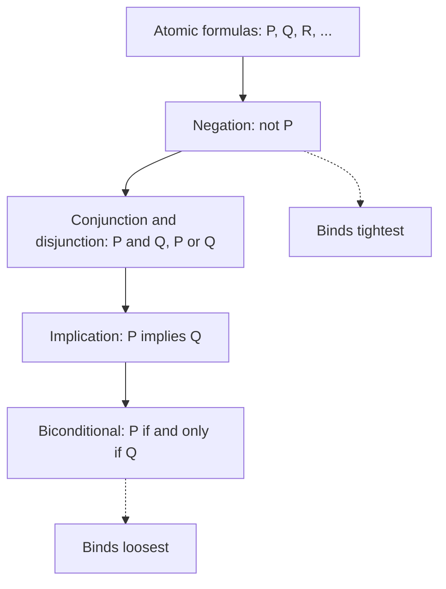
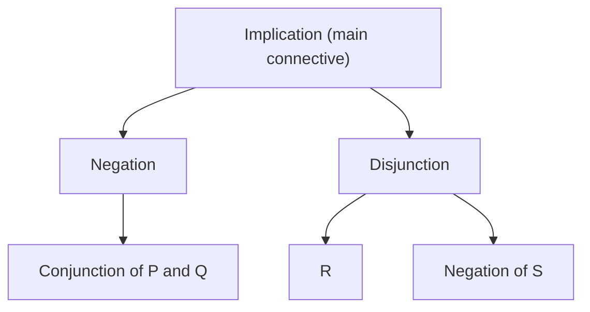
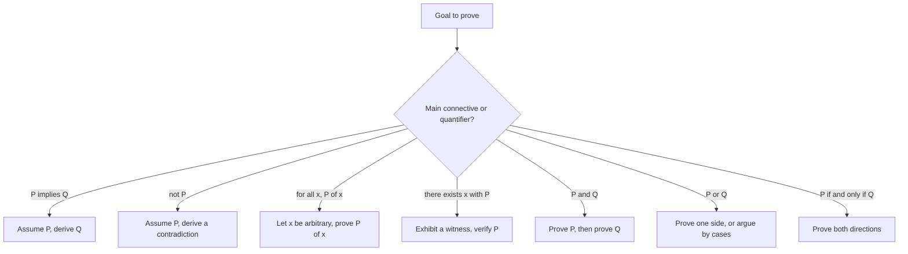
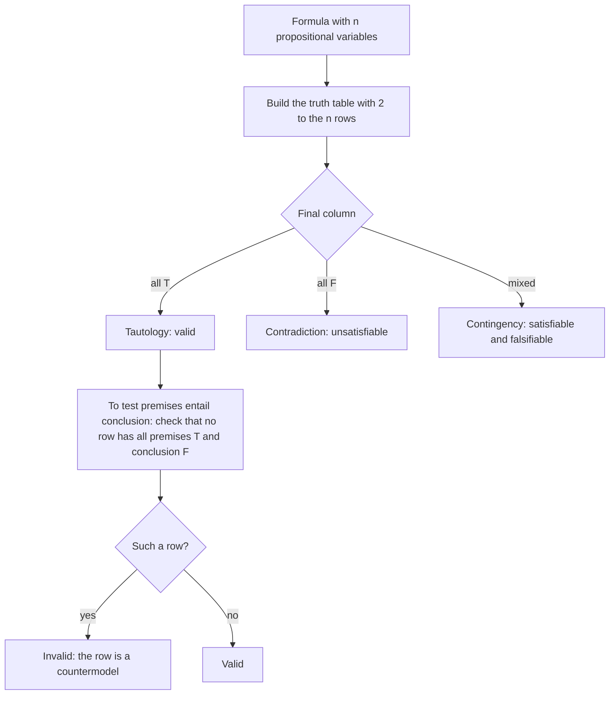

# Propositional and First-Order Logic

> Foundations · Level: Beginner → Intermediate · Prerequisites: [Mathematical Thinking and Problem Solving](../01-mathematical-thinking/README.md) · Estimated time: 120 min

## 1. Introduction

A proof is supposed to compel assent. What exactly makes a step compelling? This topic answers that
question by studying *form* rather than content: the patterns of reasoning that remain valid whatever
the sentences involved.

Two layers are developed.

* **Propositional logic** treats whole statements as atoms and studies how they combine through
  "not", "and", "or", "if … then", "if and only if". It gives a mechanical method — the truth table —
  that decides whether a formula is always true.
* **First-order logic** adds predicates and quantifiers, so that statements about all objects or some
  object can be represented. This is the logic in which ordinary mathematics is written: "for every
  $\varepsilon > 0$ there is $\delta > 0$ such that …".

The payoff is practical as well as theoretical. Every proof technique taught later — direct proof,
contrapositive, contradiction, proof by cases, quantifier manipulation — is an inference rule or an
equivalence in this topic. Errors in proofs are almost always errors in logic, and most of them are
visible in a truth table or a countermodel.

The chapter is organised as follows: Section 7 builds the semantics of the connectives, then the
algebra of equivalences, then implication and its relatives, then quantifiers, then validity and the
rules of inference, then the fallacies those rules exclude, and finally the connection to proof.

## 2. Prerequisites

* **Mathematical statements and definitions** — [Mathematical Thinking and Problem Solving](../01-mathematical-thinking/README.md),
  Sections 5 and 7. In particular, the definitions of statement, proof, conjecture, counterexample,
  and the distinction between universal and existential claims.
* **Elementary algebra**, used only to build algebraic examples: substitution, expansion, and integer
  arithmetic.
* **Parity vocabulary** (even, odd, divisible) — same tutorial, Section 7.9. It supplies a ready-made
  supply of predicates for the quantifier examples.

Nothing else is assumed. No prior course in logic is needed, and no proof system is presupposed: the
syntax and semantics are built from scratch.

## 3. Learning Objectives

After this tutorial and its exercises, you will be able to:

1. Decide whether a sentence is a statement, and distinguish statements from predicates and commands.
2. Write the truth table of any propositional formula and classify it as a tautology, a contradiction,
   or a contingency.
3. Read and write formulas using $\neg, \land, \lor, \to, \leftrightarrow$, respecting precedence and
   parentheses.
4. Prove or refute logical equivalences by truth table, and use the standard equivalences (De Morgan,
   distributivity, contrapositive, exportation) in calculations.
5. Distinguish a conditional from its converse, inverse, and contrapositive, and say which of these
   are equivalent.
6. Translate between English and quantified formulas in both directions.
7. Negate a quantified statement correctly, including nested quantifiers.
8. Explain the difference between validity and satisfiability, and test both with truth tables and
   countermodels.
9. Use the standard rules of inference, and identify the common fallacies that resemble them.
10. Explain why each proof technique (direct, contrapositive, contradiction, cases, universal and
    existential proof) is sound, by reducing it to the semantics of the connectives and quantifiers.

## 4. Intuition

Think of a statement as a switch that is either on (true) or off (false). A connective is a circuit
built from switches:

* $\neg P$ flips the switch;
* $P \land Q$ is on only when both are on — two switches in series;
* $P \lor Q$ is on when at least one is on — two switches in parallel;
* $P \to Q$ is a device that fails only in one situation: $P$ on and $Q$ off.

This is not a metaphor for the connectives; it is their definition, and it is exactly how logic gates
in a computer work. The truth table is the wiring diagram's specification.

The second intuition is about implication, because that is where beginners stumble. A conditional is a
*promise*: "if you press this button, the alarm sounds". The promise is kept (true) in three cases:
you press and the alarm sounds; you do not press and the alarm sounds; you do not press and it stays
silent. The promise is broken in exactly one case: you press and nothing happens. That is the truth
table of $P \to Q$: false only when $P$ is true and $Q$ is false.

In particular, a conditional with a false antecedent is true, no matter what the consequent says. This
is called *vacuous truth*. "If $2 + 2 = 5$, then I am the king of France" is a true conditional, because
the antecedent is false. It sounds strange, but the alternative — making it false — would break the
rule that substituting equal quantities preserves truth and would make the algebra of propositions
inconsistent.

The third intuition is about quantifiers. $\forall x$ is a challenge: "give me any $x$ and I will
deliver $P(x)$". $\exists x$ is a claim that a witness exists: "somewhere there is an $x$ with
$P(x)$". Negation swaps the roles: refuting a universal claim means producing a counterexample;
refuting an existential claim means showing that no witness can exist.

## 5. Formal Definition

**Definition 1 (Statement, proposition).** A *statement* is a declarative sentence that is either true
or false, not both. Its *truth value* is T (true) or F (false). Questions, commands, and sentences
such as "this sentence is false" are not statements.

**Definition 2 (Propositional variables and formulas).** Fix a set of *propositional variables*
$P, Q, R, \dots$, each standing for an unspecified statement. The set of *formulas* (well-formed
formulas) is defined inductively:

1. every propositional variable is a formula;
2. $\top$ (the constant true) and $\bot$ (the constant false) are formulas;
3. if $\varphi$ is a formula, then $\neg \varphi$ is a formula;
4. if $\varphi$ and $\psi$ are formulas, then $(\varphi \land \psi)$, $(\varphi \lor \psi)$,
   $(\varphi \to \psi)$, and $(\varphi \leftrightarrow \psi)$ are formulas;
5. nothing else is a formula.

*Convention.* Outermost parentheses are omitted, and precedence is $\neg$ tightest, then $\land$, then
$\lor$, then $\to$, then $\leftrightarrow$. Implication is right-associative:
$P \to Q \to R$ means $P \to (Q \to R)$.

**Definition 3 (Valuation).** A *valuation* (or *truth assignment*) is a function $v$ from the
propositional variables to $\{\mathrm{T}, \mathrm{F}\}$. It extends uniquely to all formulas by the
rules in Section 7.2.

**Definition 4 (Truth in a valuation).** For a formula $\varphi$ and valuation $v$, we write
$v \models \varphi$ ("$v$ satisfies $\varphi$") when $\varphi$ evaluates to T under $v$.

**Definition 5 (Tautology, contradiction, contingency).** Let $\varphi$ be a formula.

* $\varphi$ is a *tautology* (or *valid*) if $v \models \varphi$ for every valuation $v$. We write
  $\models \varphi$.
* $\varphi$ is a *contradiction* (or *unsatisfiable*) if $v \not\models \varphi$ for every valuation.
* $\varphi$ is a *contingency* if it is true under at least one valuation and false under at least one.

**Definition 6 (Logical equivalence).** Formulas $\varphi$ and $\psi$ are *logically equivalent*,
written $\varphi \equiv \psi$, if they have the same truth value under every valuation. Equivalently,
$\varphi \leftrightarrow \psi$ is a tautology.

**Definition 7 (Predicate and domain).** A *predicate* is an expression $P(x)$ with a placeholder for
an object, which becomes a statement when the placeholder is filled by an object from a fixed
*domain of discourse* $D$. A predicate may have several places, as in $R(x,y)$ for "$x < y$". The
domain is part of the meaning: "$x^2 \ge x$" is true for all integers but false for $x = 1/2$.

**Definition 8 (Quantifiers, free and bound variables).** For a formula $\varphi(x)$:

* $\forall x\, \varphi(x)$ is true in a domain $D$ if $\varphi(a)$ is true for every $a \in D$;
* $\exists x\, \varphi(x)$ is true in $D$ if $\varphi(a)$ is true for at least one $a \in D$.

An occurrence of $x$ is *bound* if it lies inside the scope of a quantifier on $x$, and *free*
otherwise. A formula with no free variables is a *sentence*. Only sentences have truth values in a
domain; a formula with a free variable defines a predicate.

**Definition 9 (Satisfiability of a set of formulas).** A set $\Gamma$ of formulas is *satisfiable* if
there is a valuation (or, in first-order logic, a domain and an interpretation of the predicates) under
which every formula in $\Gamma$ is true. Such a valuation is a *model* of $\Gamma$.

**Definition 10 (Semantic consequence, valid argument).** Let $\Gamma$ be a set of formulas and
$\varphi$ a formula. We say $\varphi$ is a *semantic consequence* of $\Gamma$, written
$\Gamma \models \varphi$, if every valuation that satisfies all formulas in $\Gamma$ also satisfies
$\varphi$. An argument with premises $\Gamma$ and conclusion $\varphi$ is *valid* exactly when
$\Gamma \models \varphi$. Validity is about form: it does not require the premises to be true.

**Definition 11 (Derivability).** A *proof system* is a collection of axioms and inference rules. We
write $\Gamma \vdash \varphi$ if there is a finite derivation of $\varphi$ from $\Gamma$ using the
rules. The symbol $\vdash$ is syntactic (a derivation exists); $\models$ is semantic (truth is
preserved). Two standard theorems connect them for classical logic:

* **Soundness.** If $\Gamma \vdash \varphi$ then $\Gamma \models \varphi$.
* **Completeness.** If $\Gamma \models \varphi$ then $\Gamma \vdash \varphi$ (Gödel, 1929, for
  first-order logic; for propositional logic it is elementary).

This tutorial works mainly with $\models$; Section 7.11 explains the connection.

## 6. Mathematical Notation

| Symbol | Read aloud | Meaning |
|---|---|---|
| $\neg P$ | "not $P$" | negation |
| $P \land Q$ | "$P$ and $Q$" | conjunction |
| $P \lor Q$ | "$P$ or $Q$" | disjunction (inclusive) |
| $P \oplus Q$ | "$P$ exclusive or $Q$" | true when exactly one is true |
| $P \to Q$ | "if $P$ then $Q$", "$P$ implies $Q$" | material implication |
| $P \leftrightarrow Q$ | "$P$ if and only if $Q$" | biconditional |
| $\top,\ \bot$ | "true", "false" | truth constants |
| $\equiv$ | "is logically equivalent to" | same truth value in every valuation |
| $\models \varphi$ | "$\varphi$ is valid" | true in every valuation |
| $\Gamma \models \varphi$ | "$\Gamma$ entails $\varphi$" | every model of $\Gamma$ satisfies $\varphi$ |
| $\vdash$ | "is derivable" | syntactic provability |
| $\forall x$ | "for all $x$" | universal quantifier |
| $\exists x$ | "there exists $x$" | existential quantifier |
| $\exists! x$ | "there exists a unique $x$" | existence and uniqueness |
| $\therefore$ | "therefore" | marks a conclusion |
| $x \in D$ | "$x$ is in $D$" | membership in the domain |
| $\mathbb{N}, \mathbb{Z}, \mathbb{Q}, \mathbb{R}$ | number sets | as in the notation table of the prerequisite tutorial |

**Precedence, from tightest to loosest:** $\neg$, then $\land$, then $\lor$, then $\to$, then
$\leftrightarrow$. When in doubt, parenthesise: a reader should never have to guess.

**Reading formulas aloud.** "$P \land Q \to R$" reads "if $P$ and $Q$, then $R$", not "($P$ and $Q$)
implies $R$" without the parentheses — which is why the convention above is stated explicitly. Similarly
"$\forall x\,(P(x) \to Q(x))$" reads "for every $x$, if $P(x)$ then $Q(x)$", and it is not the same as
"$\forall x\, P(x) \to Q(x)$", whose $Q$ is outside the scope of the quantifier.

## 7. Core Concepts

### 7.1 Statements and Truth Values

Logic begins by restricting attention to sentences that are true or false. This excludes:

* questions ("is $7$ prime?");
* commands ("solve for $x$");
* exclamations;
* sentences whose truth value depends on context ("it is raining" — context-dependent, so it is a
  predicate of time and place, not a statement until the context is fixed);
* paradoxical sentences ("this sentence is false"), which cannot consistently be assigned either
  value.

The restriction is not a limitation but a precondition for the algebra: if a sentence has no truth
value, no truth table can be built for it. In mathematics, statements are built from definitions and
quantifiers precisely so that their truth values are determined.

A statement may be *true but unproved* (Goldbach's conjecture), or *false but believed* — the truth
value is independent of our knowledge.

### 7.2 Connectives and Truth Tables

A truth table lists the value of a compound formula for every possible combination of values of its
variables. With $n$ variables there are $2^n$ rows.

**Negation.** $\neg P$ is true exactly when $P$ is false.

**Conjunction.** $P \land Q$ is true exactly when both are true. In English, "and" sometimes implies
sequence ("she married and had a child") or contrast ("but"); logic keeps only the truth-functional
core.

**Disjunction.** $P \lor Q$ is true when at least one is true, including both. This is *inclusive* or.
The *exclusive* or, $P \oplus Q$, is true when exactly one is true. Mathematical English usually means
inclusive or; when exclusivity is intended it is stated ("either … or …, but not both").

**Implication.** $P \to Q$ is false exactly when $P$ is true and $Q$ is false. All other combinations
give true. Section 7.5 discusses why.

**Biconditional.** $P \leftrightarrow Q$ is true when $P$ and $Q$ have the same truth value.

The combined table:

| $P$ | $Q$ | $\neg P$ | $P \land Q$ | $P \lor Q$ | $P \to Q$ | $P \leftrightarrow Q$ | $P \oplus Q$ |
|---|---|---|---|---|---|---|---|
| T | T | F | T | T | T | T | F |
| T | F | F | F | T | F | F | T |
| F | T | T | F | T | T | F | T |
| F | F | T | F | F | T | T | F |

Each column is a *truth function*: a rule assigning T or F to each combination of inputs. A unary
connective has $2^2 = 4$ possible truth functions (two constant functions, identity, negation), and a
binary connective has $2^{2^2} = 16$. The table above names five of the sixteen; the others include
$P$, $Q$, $\neg P$, $\neg Q$, and the two constants.

**How to build a truth table.** Add one column per subformula, working from the innermost outward. For
$P \land (Q \lor R)$:

| $P$ | $Q$ | $R$ | $Q \lor R$ | $P \land (Q \lor R)$ |
|---|---|---|---|---|
| T | T | T | T | T |
| T | T | F | T | T |
| T | F | T | T | T |
| T | F | F | F | F |
| F | T | T | T | F |
| F | T | F | T | F |
| F | F | T | T | F |
| F | F | F | F | F |

Reading the last column: true exactly when $P$ is true and at least one of $Q, R$ is true, which is
what the formula says.

### 7.3 Tautologies, Contradictions, Contingencies

A formula whose final column is all T is a tautology; all F, a contradiction; mixed, a contingency.

* $P \lor \neg P$ — the *law of excluded middle* — is a tautology (two rows, both T).
* $P \land \neg P$ is a contradiction.
* $P \to Q$ is a contingency (one F, three T).

Tautologies are the "laws of logic": they are true no matter what the variables stand for. This is why
they can be used inside any proof without justification beyond their derivation. The most useful ones
are collected in Section 8.

**Terminology.** "Tautology" is sometimes used for any valid propositional formula; in first-order
logic, formulas valid because of quantifier structure (such as
$\forall x\,P(x) \to \forall x\,(P(x) \lor Q(x))$) are valid but not tautologies in the strict
propositional sense. The exercises use "valid" for the general notion and "tautology" for the
propositional one.

### 7.4 Logical Equivalence and the Algebra of Propositions

Two formulas are equivalent when their truth tables agree column by column. Equivalence is an
equivalence relation on formulas: reflexive, symmetric, and transitive.

The *substitution principle*: if $\varphi \equiv \psi$, then replacing an occurrence of $\varphi$ by
$\psi$ inside a larger formula produces an equivalent formula. This is what makes algebraic
calculation with propositions legitimate: one may rewrite subformulas one at a time, exactly as one
rewrites $x + x$ as $2x$ in algebra.

The basic laws (each is verified in Section 8):

| Name | Law |
|---|---|
| Double negation | $\neg\neg P \equiv P$ |
| Idempotence | $P \land P \equiv P$, $P \lor P \equiv P$ |
| Commutativity | $P \land Q \equiv Q \land P$, $P \lor Q \equiv Q \lor P$ |
| Associativity | $(P \land Q) \land R \equiv P \land (Q \land R)$; same for $\lor$ |
| Distributivity | $P \land (Q \lor R) \equiv (P \land Q) \lor (P \land R)$; $P \lor (Q \land R) \equiv (P \lor Q) \land (P \lor R)$ |
| De Morgan | $\neg(P \land Q) \equiv \neg P \lor \neg Q$; $\neg(P \lor Q) \equiv \neg P \land \neg Q$ |
| Absorption | $P \lor (P \land Q) \equiv P$; $P \land (P \lor Q) \equiv P$ |
| Implication | $P \to Q \equiv \neg P \lor Q$ |
| Contrapositive | $P \to Q \equiv \neg Q \to \neg P$ |
| Exportation | $(P \land Q) \to R \equiv P \to (Q \to R)$ |
| Negated implication | $\neg(P \to Q) \equiv P \land \neg Q$ |
| Biconditional | $P \leftrightarrow Q \equiv (P \to Q) \land (Q \to P)$ |
| Biconditional, second form | $P \leftrightarrow Q \equiv (P \land Q) \lor (\neg P \land \neg Q)$ |
| Exclusive or | $P \oplus Q \equiv \neg(P \leftrightarrow Q)$ |
| Tautology and contradiction | $P \lor \top \equiv \top$, $P \land \top \equiv P$, $P \lor \bot \equiv P$, $P \land \bot \equiv \bot$ |

Note that both distributive laws hold in logic, unlike in ordinary arithmetic, where
$a + (b \cdot c) \neq (a+b)(a+c)$ in general. The reason is that $\land$ and $\lor$ are not arithmetic
operations: each distributes over the other because of the meaning of "and" and "or", read as "both"
and "at least one".

**Duality.** Interchanging $\land$ with $\lor$ and $\top$ with $\bot$ in a valid equivalence produces
another valid equivalence. So the two De Morgan laws are duals, as are the two distributive laws and
the two absorption laws.

### 7.5 Implication, Converse, Inverse, Contrapositive

**Why the table is what it is.** $P \to Q$ is defined to be false only in the case $P$ true, $Q$ false.
Three arguments support the definition:

1. *The promise reading.* "If $P$ then $Q$" is a commitment that is violated only by $P$ happening
   without $Q$.
2. *The deduction reading.* $P \to Q$ should be true exactly when $Q$ is derivable from $P$; when $P$
   is false, there is nothing to derive, and the conditional is vacuously true.
3. *The algebraic reading.* We need $P \to Q \equiv \neg P \lor Q$ for the algebra to work; the table is
   exactly that disjunction.

**Related statements.** For a conditional $P \to Q$:

| Name | Form | Equivalent to $P \to Q$? |
|---|---|---|
| Conditional | $P \to Q$ | — |
| Converse | $Q \to P$ | No |
| Inverse | $\neg P \to \neg Q$ | No |
| Contrapositive | $\neg Q \to \neg P$ | Yes |

The converse and the inverse are contrapositives of each other, so they are equivalent to each other
but not to the original. The classic illustration: "if it is raining, the ground is wet" is true, while
its converse "if the ground is wet, it is raining" can fail (a sprinkler).

**English forms that hide a conditional.**

| English | Formal | Comment |
|---|---|---|
| If $P$, then $Q$ | $P \to Q$ | direct |
| $P$ implies $Q$ | $P \to Q$ | direct |
| $Q$ if $P$ | $P \to Q$ | "if" introduces the antecedent |
| $P$ only if $Q$ | $P \to Q$ | "only if" introduces the consequent |
| $P$ is sufficient for $Q$ | $P \to Q$ | $P$ is enough |
| $Q$ is necessary for $P$ | $P \to Q$ | $Q$ is required |
| $P$ unless $Q$ | $\neg Q \to P$ | equivalently $P \lor Q$ |
| $P$ if and only if $Q$ | $P \leftrightarrow Q$ | both directions |
| Not $P$ unless $Q$ | $\neg Q \to \neg P$ | i.e. $P \to Q$ |

The pair "only if" / "if" is the most common source of error. "$P$ only if $Q$" means $Q$ is necessary
for $P$, so $P$ cannot hold without $Q$: $P \to Q$. "$P$ if $Q$" means $Q$ is sufficient for $P$:
$Q \to P$.

### 7.6 Quantifiers

Quantifiers turn predicates into statements, relative to a domain.

* $\forall x \in D,\ P(x)$: true if every element of $D$ satisfies $P$.
* $\exists x \in D,\ P(x)$: true if at least one element of $D$ satisfies $P$.
* $\exists! x \in D,\ P(x)$: true if exactly one element satisfies $P$.

**The domain is part of the statement.** "$\forall x,\ x^2 \ge x$" is true for $x \in \mathbb{Z}$ and
false for $x \in \mathbb{R}$ (take $x = 1/2$). A quantified statement without a stated domain is
incomplete; in practice the domain is fixed by context, and it should be stated when ambiguity is
possible.

**Empty domains.** If $D = \varnothing$, then $\forall x \in D,\ P(x)$ is true (vacuously) and
$\exists x \in D,\ P(x)$ is false. This is forced by the definitions: "every element" makes no demand
when there are none, and "some element" demands a witness.

**Negation.** The two rules, with their justifications:

$$
\neg \forall x\, P(x) \equiv \exists x\, \neg P(x), \qquad
\neg \exists x\, P(x) \equiv \forall x\, \neg P(x).
$$

*Justification of the first.* $\neg \forall x\,P(x)$ says "it is not the case that every element
satisfies $P$". That is exactly "some element fails $P$", i.e. $\exists x\,\neg P(x)$. The second is
the dual and follows by applying the first to $\neg P$ and using double negation.

**Negating a universal conditional.** In mathematics most statements have the form "all $A$ are $B$",
i.e. $\forall x\,(A(x) \to B(x))$. Its negation is *not* "no $A$ are $B$". Compute:

$$
\neg \forall x\,(A(x) \to B(x))
\equiv \exists x\, \neg(A(x) \to B(x))
\equiv \exists x\,(A(x) \land \neg B(x)).
$$

So the negation is "some $A$ is not $B$". In words: refuting "all students passed" requires a student
who did not pass, not a claim that no student passed.

**Nested quantifiers.** Order matters.

$$
\forall x\, \exists y\, R(x,y) \quad \text{versus} \quad \exists y\, \forall x\, R(x,y).
$$

The first says: for each $x$ there is a (possibly different) $y$ related to it. The second says: there
is a single $y$ that works for every $x$. The second implies the first, never the other way round. Over
$\mathbb{R}$ with $R(x,y)$ meaning $y > x$: the first is true (take $y = x+1$), the second is false (no
real number exceeds every real number).

Negating nested quantifiers is mechanical: move the negation inward, flipping each quantifier.

$$
\neg \forall x\, \exists y\, R(x,y) \equiv \exists x\, \forall y\, \neg R(x,y).
$$

### 7.7 Predicates, Domains, and Translation

Translation is a skill with a small number of reliable patterns.

| English | Formula | Notes |
|---|---|---|
| All $A$ are $B$ | $\forall x\,(A(x) \to B(x))$ | conditional, not conjunction |
| Some $A$ is $B$ | $\exists x\,(A(x) \land B(x))$ | conjunction, not conditional |
| No $A$ is $B$ | $\forall x\,(A(x) \to \neg B(x))$ | equivalently $\neg \exists x(A \land B)$ |
| Some $A$ is not $B$ | $\exists x\,(A(x) \land \neg B(x))$ | refutes "all $A$ are $B$" |
| Only $A$ are $B$ | $\forall x\,(B(x) \to A(x))$ | "$B$ only if $A$" |
| The $A$ that is $B$ … | $\exists x\,(A(x) \land B(x) \land \forall y((A(y) \land B(y)) \to y = x) \land \dots)$ | uniqueness is explicit |

Two rules of thumb:

* $\forall$ pairs with $\to$; $\exists$ pairs with $\land$. Getting this backwards produces statements
  that are true for the wrong reason: $\forall x(A(x) \land B(x))$ says everything is both $A$ and $B$,
  which is far stronger than "all $A$ are $B$"; $\exists x(A(x) \to B(x))$ is true whenever some object
  fails to be $A$, which is far weaker than "some $A$ is $B$".
* The scope of a quantifier is the subformula that follows it, up to the end of the formula or the
  matching parenthesis. Variables outside that scope are not bound by it.

**Example.** "Every student has a supervisor who is a professor", with $S(x)$: $x$ is a student,
$P(y)$: $y$ is a professor, $R(x,y)$: $y$ supervises $x$:

$$
\forall x\,\bigl(S(x) \to \exists y\,(P(y) \land R(x,y))\bigr).
$$

Its negation:

$$
\exists x\,\bigl(S(x) \land \forall y\,(P(y) \to \neg R(x,y))\bigr),
$$

i.e. "some student has no professor as a supervisor".

**Example with mixed quantifiers.** "There is a student who has read every book in the library", with
$L(b)$: $b$ is a book in the library, $S(x)$: $x$ is a student, $R(x,b)$: $x$ has read $b$:

$$
\exists x\,\bigl(S(x) \land \forall b\,(L(b) \to R(x,b))\bigr).
$$

Note the $\exists$ followed by $\land$, and the $\forall$ followed by $\to$.

### 7.8 Validity, Satisfiability, and Semantic Consequence

Three notions must be kept apart.

* A formula is **valid** if true in every valuation (a tautology, in the propositional case).
* A formula is **satisfiable** if true in at least one valuation.
* A set of formulas is **satisfiable** if some valuation makes all of them true simultaneously.

Immediate relations:

* $\varphi$ is valid iff $\neg\varphi$ is unsatisfiable.
* $\varphi$ is satisfiable iff $\neg\varphi$ is not valid.
* If $\varphi$ is valid then $\varphi$ is satisfiable, but not conversely.
* $\Gamma \models \varphi$ iff $\Gamma \cup \{\neg \varphi\}$ is unsatisfiable: assuming the premises
  and denying the conclusion leads to a contradiction in every case.

The last equivalence is the bridge between logic and proof by contradiction: to show that a conclusion
follows from premises, it suffices to show that premises plus negation of the conclusion cannot all be
true.

**The countermodel method.** To show that $\Gamma \not\models \varphi$, exhibit one valuation (or one
domain and interpretation) in which every formula of $\Gamma$ is true and $\varphi$ is false. This is
the formal version of "finding a counterexample", and it is how invalid arguments are refuted.

**Checking validity of an argument form.** For propositional arguments, build a truth table with one
column per premise and one for the conclusion; the argument is valid exactly when no row has all
premises T and the conclusion F. With many variables the table grows exponentially, which is why
proof systems and SAT solvers exist.

**First-order validity.** Truth tables are not available; one reasons semantically (arbitrary domain,
arbitrary interpretation) or syntactically (derivation). Countermodels are the main refutation tool.
For example, $\forall x\,\exists y\, R(x,y) \not\models \exists y\, \forall x\, R(x,y)$: take
$D = \mathbb{N}$ and $R(x,y)$ meaning $y > x$. The premise is true, the conclusion false.

### 7.9 Rules of Inference

A rule of inference licenses a step from premises to conclusion. A rule is *sound* when the conclusion
is a semantic consequence of the premises; each rule below can be checked by a truth table (for the
propositional ones) or by the semantics of quantifiers.

| Rule | Premises | Conclusion | Why it is sound |
|---|---|---|---|
| Modus ponens | $P$, $P \to Q$ | $Q$ | the only false row of $P\to Q$ has $Q$ false and $P$ true, excluded by the premises |
| Modus tollens | $\neg Q$, $P \to Q$ | $\neg P$ | contrapositive of $P \to Q$ plus modus ponens |
| Hypothetical syllogism | $P \to Q$, $Q \to R$ | $P \to R$ | if $P$ then $Q$ then $R$ |
| Disjunctive syllogism | $P \lor Q$, $\neg P$ | $Q$ | the disjunction leaves only $Q$ |
| Conjunction | $P$, $Q$ | $P \land Q$ | both are true |
| Simplification | $P \land Q$ | $P$ | a conjunction entails each conjunct |
| Addition | $P$ | $P \lor Q$ | a true disjunct makes the disjunction true |
| Resolution | $P \lor Q$, $\neg P \lor R$ | $Q \lor R$ | case split on $P$ |
| Universal instantiation | $\forall x\, P(x)$ | $P(c)$ for any $c \in D$ | definition of $\forall$ |
| Universal generalization | $P(c)$ for arbitrary $c \in D$ | $\forall x\, P(x)$ | $c$ was arbitrary |
| Existential instantiation | $\exists x\, P(x)$ | $P(c)$ for a fresh $c$ | a witness exists; the name must be new |
| Existential generalization | $P(c)$ for some $c \in D$ | $\exists x\, P(x)$ | the witness is exhibited |

**Two rules worth checking in full.**

*Modus ponens.* The table for $P \to Q$ has T in rows (T,T), (F,T), (F,F) and F in row (T,F). The
premises require $P$ true and $P \to Q$ true; the only row with $P$ true and $P \to Q$ true is (T,T),
where $Q$ is true. So $Q$ follows.

*Resolution.* Suppose $P \lor Q$ and $\neg P \lor R$ are both true. If $P$ is true, then $\neg P$ is
false, so $R$ must be true (second premise); if $P$ is false, then $Q$ must be true (first premise). In
both cases $Q \lor R$ is true.

**Restrictions matter.** Existential instantiation requires a *fresh* name: from $\exists x\,P(x)$ and
$\exists x\,Q(x)$ one may not conclude $P(c) \land Q(c)$ for the same $c$ — the two witnesses may be
different objects. Universal generalization requires that $c$ be arbitrary: a fact proved about one
special element does not generalize.

### 7.10 Common Fallacies

Each fallacy below is an argument form that resembles a valid rule but is invalid; the third column
gives a valuation under which the premises are true and the conclusion false.

| Fallacy | Form | Countermodel |
|---|---|---|
| Affirming the consequent | $P \to Q$, $Q$ $\therefore$ $P$ | $P = \mathrm{F}$, $Q = \mathrm{T}$ |
| Denying the antecedent | $P \to Q$, $\neg P$ $\therefore$ $\neg Q$ | $P = \mathrm{F}$, $Q = \mathrm{T}$ |
| Illicit conversion | $\forall x(A(x) \to B(x))$ $\therefore$ $\forall x(B(x) \to A(x))$ | $D = \{1,2\}$, $A = \{1\}$, $B = \{1,2\}$ |
| Quantifier swap | $\forall x\,\exists y\,R(x,y)$ $\therefore$ $\exists y\,\forall x\,R(x,y)$ | $D = \mathbb{N}$, $R(x,y)$: $y > x$ |
| Negating the conditional wrongly | $\neg(P \to Q)$ $\therefore$ $P \to \neg Q$ | $P = \mathrm{F}$, $Q = \mathrm{T}$ |
| Undistributed middle | $\forall x(A \to B)$, $\forall x(C \to B)$ $\therefore$ $\forall x(A \to C)$ | dogs and cats are animals |

**Remarks.**

* Affirming the consequent and denying the antecedent are the two ways to confuse a conditional with
  its converse or inverse. They are the most frequent logical errors in ordinary argument.
* The "negating the conditional" fallacy is a *wrong negation*: the correct negation of $P \to Q$ is
  $P \land \neg Q$, not $P \to \neg Q$. Check with $P$ false, $Q$ true: $P \to Q$ is true, so its
  negation is false; $P \to \neg Q$ is true. Different truth values, so the forms are not equivalent.
* The undistributed middle is the classic syllogistic error: "all dogs are animals, all cats are
  animals, therefore all dogs are cats".
* A fallacy is not the same as a false conclusion. An invalid argument may have a true conclusion; what
  fails is the guarantee.

### 7.11 Why Logic Underpins Proof

A mathematical proof is a derivation in first-order logic from definitions and previously proved
statements. The standard proof techniques are not extra assumptions; they are combinations of the
rules above.

**Direct proof of $P \to Q$.** Assume $P$; derive $Q$; conclude $P \to Q$ by implication introduction
(the rule "if $Q$ follows from $P$, then $P \to Q$"). This is the *deduction theorem*, and it is what
the phrase "assume $P$" accomplishes.

**Proof by contrapositive.** Prove $\neg Q \to \neg P$ and use the equivalence
$P \to Q \equiv \neg Q \to \neg P$.

**Proof by contradiction.** To prove $P$, assume $\neg P$ and derive a contradiction; conclude
$\neg\neg P$, hence $P$ by double negation (classical logic). To prove $P \to Q$ by contradiction,
assume $P$ and $\neg Q$ and derive a contradiction — which is precisely the negation of $P \to Q$,
namely $P \land \neg Q$.

**Proof by cases.** From $P \lor Q$, $P \to R$, $Q \to R$, conclude $R$ (constructive dilemma). The
cases must exhaust the possibilities; this is the content of "every integer is even or odd".

**Universal proof.** To prove $\forall x\,P(x)$, let $c$ be an arbitrary element and prove $P(c)$;
conclude by universal generalization. The word "arbitrary" is essential: if the argument uses a
property of $c$ beyond membership in the domain, the generalization is invalid.

**Existential proof.** To prove $\exists x\,P(x)$, exhibit a witness $c$ and verify $P(c)$; conclude by
existential generalization.

**Uniqueness proof.** To prove $\exists! x\,P(x)$, prove existence (a witness) and uniqueness (if
$P(a)$ and $P(b)$ then $a = b$).

**Soundness and the meaning of "rigorous".** Since every rule preserves truth, a derivation from true
premises yields a true conclusion. This is the theorem that makes proofs worth writing. Conversely,
completeness says that every semantically valid entailment has a derivation, so the rules are strong
enough to capture all valid reasoning. Both are metatheorems *about* the proof system, not theorems
inside it.

**Two caveats.** First, the classical logic used here assumes every statement is true or false (the law
of excluded middle) and that double negation cancels. Intuitionistic logic drops these assumptions, and
some arguments in this repository would not be acceptable there. Second, first-order logic is not
decidable in general: there is no algorithm that, given an arbitrary first-order sentence, decides
whether it is valid (Church–Turing). Propositional validity, by contrast, is decidable — the truth
table is an algorithm — although it is computationally expensive (the satisfiability problem is
NP-complete).

## 8. Formulas and Properties

Each equivalence is stated with a justification: either a two-line truth-table check or a reference to
an earlier result.

**Proposition 1 (double negation).** $\neg\neg P \equiv P$.

Two rows: if $P$ is T then $\neg P$ is F and $\neg\neg P$ is T; if $P$ is F then $\neg P$ is T and
$\neg\neg P$ is F.

**Proposition 2 (De Morgan's laws).** $\neg(P \land Q) \equiv \neg P \lor \neg Q$ and
$\neg(P \lor Q) \equiv \neg P \land \neg Q$.

*Proof of the first.* Build the table.

| $P$ | $Q$ | $P \land Q$ | $\neg(P \land Q)$ | $\neg P$ | $\neg Q$ | $\neg P \lor \neg Q$ |
|---|---|---|---|---|---|---|
| T | T | T | F | F | F | F |
| T | F | F | T | F | T | T |
| F | T | F | T | T | F | T |
| F | F | F | T | T | T | T |

The fourth and seventh columns coincide. The second law is the dual: interchange $\land$ with $\lor$ and
negate the variables, or check the table directly. $\blacksquare$

**Proposition 3 (distributivity).** $P \land (Q \lor R) \equiv (P \land Q) \lor (P \land R)$ and
$P \lor (Q \land R) \equiv (P \lor Q) \land (P \lor R)$.

*Proof of the first.* Both sides are true exactly when $P$ is true and at least one of $Q, R$ is true.
Formally, check the eight-row table: in every row the two columns agree (this is the table in Section
7.2, with the right-hand side computed in two extra columns). $\blacksquare$

**Proposition 4 (implication as disjunction).** $P \to Q \equiv \neg P \lor Q$.

*Proof.* The table of Section 7.2 gives $P \to Q$ as T, F, T, T for the rows (T,T), (T,F), (F,T), (F,F).
The formula $\neg P \lor Q$ evaluates to T (since $\neg P$ is F and $Q$ is T) in row (T,T); F (both
disjuncts false) in row (T,F); T (since $\neg P$ is T) in rows (F,T) and (F,F). The columns agree.
$\blacksquare$

**Proposition 5 (contrapositive).** $P \to Q \equiv \neg Q \to \neg P$.

*Proof.* By Proposition 4 applied twice,

$$
\neg Q \to \neg P \;\equiv\; \neg\neg Q \lor \neg P \;\equiv\; Q \lor \neg P \;\equiv\; \neg P \lor Q
\;\equiv\; P \to Q.
$$

$\blacksquare$

**Proposition 6 (negated implication).** $\neg(P \to Q) \equiv P \land \neg Q$.

*Proof.* $\neg(P \to Q) \equiv \neg(\neg P \lor Q) \equiv \neg\neg P \land \neg Q \equiv P \land \neg Q$
by De Morgan and double negation. $\blacksquare$

**Proposition 7 (exportation).** $(P \land Q) \to R \equiv P \to (Q \to R)$.

*Proof.* $(P \land Q) \to R \equiv \neg(P \land Q) \lor R \equiv \neg P \lor \neg Q \lor R$, and
$P \to (Q \to R) \equiv \neg P \lor (\neg Q \lor R)$, which is the same disjunction by associativity.
$\blacksquare$

**Proposition 8 (biconditional decomposition).** $P \leftrightarrow Q \equiv (P \to Q) \land (Q \to P)$
and $P \leftrightarrow Q \equiv (P \land Q) \lor (\neg P \land \neg Q)$.

*Proof.* The first says "same truth value" is "each implies the other", which is immediate from the
table. For the second: if $P, Q$ are both true the second formula is true; if both false, the second
disjunct is true; if they differ, both disjuncts are false. This matches $P \leftrightarrow Q$.
$\blacksquare$

**Proposition 9 (quantifier negation).** $\neg\forall x\,P(x) \equiv \exists x\,\neg P(x)$ and
$\neg\exists x\,P(x) \equiv \forall x\,\neg P(x)$.

*Proof.* Semantically, as in Section 7.6. $\neg\forall x\,P(x)$ holds in a domain $D$ iff it is not the
case that every $a \in D$ satisfies $P$; iff some $a \in D$ fails $P$; iff $\exists x\,\neg P(x)$ holds.
The second law follows by replacing $P$ with $\neg P$ in the first and applying double negation.
$\blacksquare$

**Proposition 10 (quantifier distribution).** If $x$ is not free in $P$, then

$$
\forall x\,(P \land Q(x)) \equiv P \land \forall x\,Q(x), \qquad
\exists x\,(P \lor Q(x)) \equiv P \lor \exists x\,Q(x),
$$

$$
\forall x\,(P \lor Q(x)) \equiv P \lor \forall x\,Q(x), \qquad
\exists x\,(P \land Q(x)) \equiv P \land \exists x\,Q(x).
$$

Also $\forall x\,(P(x) \land Q(x)) \equiv \forall x\,P(x) \land \forall x\,Q(x)$ and
$\exists x\,(P(x) \lor Q(x)) \equiv \exists x\,P(x) \lor \exists x\,Q(x)$.

*Proof.* Each side is true under exactly the same conditions; the condition "$x$ not free in $P$" is
needed so that the truth of $P$ does not vary with the choice of $x$. $\blacksquare$

**Proposition 11 (non-distribution).** The following are *not* equivalences:

$$
\forall x\,(P(x) \lor Q(x)) \not\equiv \forall x\,P(x) \lor \forall x\,Q(x), \qquad
\exists x\,(P(x) \land Q(x)) \not\equiv \exists x\,P(x) \land \exists x\,Q(x).
$$

*Counterexamples.* Take $D = \mathbb{N}$, $P(x)$: "$x$ is even", $Q(x)$: "$x$ is odd". Then
$\forall x\,(P(x) \lor Q(x))$ is true, while $\forall x\,P(x)$ and $\forall x\,Q(x)$ are both false, so
the right side is false. For the second, $\exists x\,(P(x) \land Q(x))$ is false (no integer is both
even and odd), while $\exists x\,P(x)$ and $\exists x\,Q(x)$ are both true, so the right side is true.

**Proposition 12 (functional completeness of $\{\neg, \land\}$).** Every truth function of $n$ variables
can be expressed using only $\neg$ and $\land$.

*Proof sketch.* Given a truth function $f$, consider each row where $f$ is T. For such a row, form the
conjunction $L_1 \land \cdots \land L_n$, where $L_i$ is $P_i$ if the row assigns T to $P_i$ and
$\neg P_i$ otherwise. This conjunction is true in exactly that row. Taking the disjunction of these
conjunctions over all true rows gives a formula true exactly where $f$ is true (a *disjunctive normal
form*). Finally, eliminate $\lor$ using De Morgan: $A \lor B \equiv \neg(\neg A \land \neg B)$. If $f$
is false in every row, use $\bot$, which is $P \land \neg P$ for any $P$. $\blacksquare$

*Corollary.* $\{\neg, \lor\}$, $\{\neg, \to\}$, and the single connective NAND are also functionally
complete. For example $P \lor Q \equiv \neg P \to Q$ and $\neg P \equiv P \to \bot$.

**Proposition 13 (equivalence and validity).** For formulas $\varphi, \psi$:
$\varphi \equiv \psi$ iff $\models \varphi \leftrightarrow \psi$. For a finite set
$\Gamma = \{\gamma_1, \dots, \gamma_n\}$: $\Gamma \models \varphi$ iff
$\models (\gamma_1 \land \cdots \land \gamma_n) \to \varphi$.

*Proof.* Both are restatements of Definition 10: an entailment holds exactly when every valuation
satisfying the premises satisfies the conclusion, which is exactly when the corresponding conditional is
true in every valuation. $\blacksquare$

## 9. Step-by-Step Examples

### Example 1 (easy): A Truth Table and a Classification

**Problem.** Build the truth table of $(P \land \neg Q) \to P$ and classify it.

**Strategy.** Add columns for $\neg Q$, then $P \land \neg Q$, then the implication. Watch the
precedence: $\neg$ binds tighter than $\land$, which binds tighter than $\to$.

**Execution.**

| $P$ | $Q$ | $\neg Q$ | $P \land \neg Q$ | $(P \land \neg Q) \to P$ |
|---|---|---|---|---|
| T | T | F | F | T |
| T | F | T | T | T |
| F | T | F | F | T |
| F | F | T | F | T |

**Reflection.** The formula is a tautology. There is a reason: the consequent is $P$ itself, and the
antecedent $P \land \neg Q$ entails $P$ (simplification). Any formula whose antecedent entails $P$ and
whose consequent is $P$ is valid. This is a check worth doing before building a table: if the conclusion
is visibly a consequence of the premises, no table is needed.

### Example 2 (easy–medium): De Morgan by Table

**Problem.** Show $\neg(P \lor Q) \equiv \neg P \land \neg Q$.

**Strategy.** Compute both sides in one table; compare the columns; state the conclusion in terms of
Definition 6.

**Execution.**

| $P$ | $Q$ | $P \lor Q$ | $\neg(P \lor Q)$ | $\neg P$ | $\neg Q$ | $\neg P \land \neg Q$ |
|---|---|---|---|---|---|---|
| T | T | T | F | F | F | F |
| T | F | T | F | F | T | F |
| F | T | T | F | T | F | F |
| F | F | F | T | T | T | T |

The fourth and seventh columns are identical, so the formulas are equivalent.

**Reflection.** The law says that negating "at least one" gives "neither". In ordinary language:
"it is not the case that it is raining or snowing" means "it is not raining and not snowing". The
dual, $\neg(P \land Q) \equiv \neg P \lor \neg Q$, says negating "both" gives "at least one fails".
Together they are the most used laws in proofs and in programming.

### Example 3 (medium): Translating and Negating a Quantified Sentence

**Problem.** Formalise "every student who studies passes the exam" and negate it, in symbols and in
English.

**Strategy.** Identify the predicates, use the $\forall$ with $\to$ pattern, then push the negation
inward using Proposition 9 and Proposition 6.

**Execution.** Let $S(x)$: "$x$ is a student", $T(x)$: "$x$ studies", $E(x)$: "$x$ passes the exam".
Then

$$
\forall x\,\bigl((S(x) \land T(x)) \to E(x)\bigr).
$$

Negate:

$$
\neg \forall x\,\bigl((S(x) \land T(x)) \to E(x)\bigr)
\equiv \exists x\, \neg\bigl((S(x) \land T(x)) \to E(x)\bigr)
\equiv \exists x\,\bigl(S(x) \land T(x) \land \neg E(x)\bigr).
$$

In English: "some student studies and does not pass the exam".

**Reflection.** The negation is not "no student who studies passes". The universal conditional has the
form $\forall x\,(A(x) \to B(x))$; its negation is $\exists x\,(A(x) \land \neg B(x))$, a single
counterexample-student. Note also how the conjunction $S \land T$ became part of the antecedent and then
survived the negation as a conjunction, because $\neg(A \to B) \equiv A \land \neg B$.

### Example 4 (medium): A Valid and an Invalid Argument

**Problem.** (a) Test the argument: "If it rains, the match is cancelled. The match was cancelled.
Therefore it rained." (b) Test: "If it rains, the match is cancelled. It did not rain. Therefore the
match was not cancelled." (c) Test: "If it rains, the match is cancelled. The match was not cancelled.
Therefore it did not rain."

**Strategy.** Formalise each with $P$: it rains, $Q$: the match is cancelled. Compare with the rule
schemas, then confirm with a countermodel.

**Execution.**

(a) $P \to Q$, $Q$, therefore $P$. This is affirming the consequent, and it is invalid: take $P$ false,
$Q$ true (the match was cancelled for another reason, say a power failure). The premises are true
($P \to Q$ is vacuously true) and the conclusion false.

(b) $P \to Q$, $\neg P$, therefore $\neg Q$. This is denying the antecedent, and it is invalid: take
$P$ false, $Q$ true. Again the premises hold and the conclusion fails.

(c) $P \to Q$, $\neg Q$, therefore $\neg P$. This is modus tollens, and it is valid: the contrapositive
of $P \to Q$ is $\neg Q \to \neg P$, and modus ponens on that conditional with premise $\neg Q$ gives
$\neg P$.

**Reflection.** All three arguments have the same first premise and look similar; only the third is
valid. This is why formalisation matters: the difference is in which part is affirmed or denied, not in
the subject matter. Notice that in (a) and (b) the countermodel is the same valuation, which is not an
accident: affirming the consequent and denying the antecedent are equivalent errors (one is the
contrapositive of the other).

### Example 5 (medium): Order of Quantifiers

**Problem.** Over the domain $\mathbb{R}$, with $R(x,y)$ meaning $y > x$, decide the truth values of
$\forall x\,\exists y\,R(x,y)$ and $\exists y\,\forall x\,R(x,y)$.

**Strategy.** Read the quantifiers in order; for the first, produce a $y$ depending on $x$; for the
second, ask whether a single $y$ can beat every $x$.

**Execution.** For the first: let $x \in \mathbb{R}$ be arbitrary and take $y = x + 1$. Then
$y > x$, so the statement is true.

For the second: suppose some $y_0 \in \mathbb{R}$ satisfied $y_0 > x$ for every $x \in \mathbb{R}$.
Taking $x = y_0$ would give $y_0 > y_0$, which is false. So no such $y_0$ exists, and the statement is
false.

**Reflection.** The second statement implies the first (if one $y$ works for all $x$, then for each $x$
there is a $y$), but not conversely. The pattern $\forall\exists$ asserts a *function* $x \mapsto y(x)$;
the pattern $\exists\forall$ asserts a *uniform bound*. Most confusions between "for every $\varepsilon$
there is $\delta$" and "there is $\delta$ for every $\varepsilon$" are instances of this distinction.

### Example 6 (medium–hard): Hypothetical Syllogism Is Valid

**Problem.** Show $\models \bigl((P \to Q) \land (Q \to R)\bigr) \to (P \to R)$.

**Strategy.** A semantic argument is shorter than an eight-row table: assume the antecedent and derive
the consequent.

**Execution (semantic).** Let $v$ be any valuation with $v \models (P \to Q) \land (Q \to R)$. We must
show $v \models P \to R$, i.e. if $v(P) = \mathrm{T}$ then $v(R) = \mathrm{T}$.

So assume $v(P) = \mathrm{T}$. From $v \models P \to Q$ and $v(P) = \mathrm{T}$, the only way for
$P \to Q$ to be true is $v(Q) = \mathrm{T}$ (modus ponens). From $v \models Q \to R$ and
$v(Q) = \mathrm{T}$, similarly $v(R) = \mathrm{T}$. Hence $P \to R$ is true in $v$. Since $v$ was
arbitrary, the conditional is valid. $\blacksquare$

**Second approach (equivalences).**

$$
(P \to Q) \land (Q \to R) \;\equiv\; (\neg P \lor Q) \land (\neg Q \lor R).
$$

Suppose this is true and $P$ is true. Then $\neg P$ is false, so $Q$ must be true; then $\neg Q$ is
false, so $R$ must be true. Thus $P \to R$ holds. Equivalently, expanding the whole formula with
Proposition 4 and distributing gives a disjunction containing $\neg P$ and $R$, which is a tautology.

**Reflection.** The semantic argument is a proof by cases hidden in the truth table: the only relevant
case is $P$ true. The truth table has eight rows; the argument visits two of them. This is the general
lesson: to prove validity, do not enumerate valuations unless the formula is small or the structure is
unclear.

### Example 7 (hard): Functionally Complete Sets

**Problem.** Show that $\{\neg, \land\}$ is functionally complete by expressing $\lor$, $\to$, and
$\leftrightarrow$ using only $\neg$ and $\land$.

**Strategy.** Use De Morgan for $\lor$, the implication law plus De Morgan for $\to$, and the
biconditional decomposition for $\leftrightarrow$.

**Execution.**

$$
P \lor Q \equiv \neg(\neg P \land \neg Q),
$$

$$
P \to Q \equiv \neg P \lor Q \equiv \neg\bigl(\neg\neg P \land \neg Q\bigr) \equiv \neg(P \land \neg Q),
$$

$$
P \leftrightarrow Q \equiv (P \land Q) \lor (\neg P \land \neg Q)
\equiv \neg\bigl(\neg(P \land Q) \land \neg(\neg P \land \neg Q)\bigr).
$$

Each right-hand side uses only $\neg$ and $\land$. Since every formula can be written with
$\neg, \land, \lor, \to, \leftrightarrow$, and each of the last three can be eliminated, every formula is
equivalent to one using only $\neg$ and $\land$.

**Reflection.** The deeper statement (Proposition 12) is that *any* truth function whatsoever, including
ones with no name, is expressible; the DNF construction gives an algorithm. The practical consequence is
that a single logic gate type suffices to build any circuit: NAND alone is enough, which is why
manufacturing uses it.

## 10. Visual Explanations

### 10.1 The Hierarchy of Connectives and an Example Parse

The diagram is a precedence ladder: a formula is read from the tightest binding outward. For
$\neg(P \land Q) \to (R \lor \neg S)$, the parse is:

The main connective determines the shape of any proof: a formula whose main connective is $\to$ is
proved by assuming its antecedent; one whose main connective is $\land$ is proved by proving both
conjuncts; one whose main connective is $\forall$ is proved by taking an arbitrary element.

### 10.2 Choosing a Proof Strategy from the Goal's Shape

This is the same table as Section 10.3 of the [mathematical thinking tutorial](../01-mathematical-thinking/README.md),
now derived from the semantics rather than stated as a list.

### 10.3 A Decision Procedure for Propositional Formulas

### 10.4 The Truth Tables Side by Side

| $P$ | $Q$ | $\neg P$ | $P \land Q$ | $P \lor Q$ | $P \to Q$ | $P \leftrightarrow Q$ |
|---|---|---|---|---|---|---|
| T | T | F | T | T | T | T |
| T | F | F | F | T | **F** | F |
| F | T | T | F | T | T | F |
| F | F | T | F | F | T | T |

The single bold F is the whole content of implication: everything else follows from it. Every proof
technique involving $\to$ is a way of avoiding that one row.

## 11. Common Mistakes

**1. Reading "or" as exclusive.** $P \lor Q$ includes the case where both are true. *Fix:* use
$\oplus$ when exclusivity is meant, and state it in words.

**2. Believing a conditional with a false antecedent is false.** "If $2+2=5$ then I am the king" is
true. *Fix:* remember the promise reading: only $P$ true, $Q$ false breaks it.

**3. Negating an implication as another implication.** The negation of $P \to Q$ is
$P \land \neg Q$, not $P \to \neg Q$. *Fix:* use Proposition 6, and check with the valuation $P$
false, $Q$ true.

**4. Confusing converse and contrapositive.** $Q \to P$ is not equivalent to $P \to Q$;
$\neg Q \to \neg P$ is. *Fix:* for each conditional you write, name its contrapositive and check that
you used the right one.

**5. Reversing "only if".** "$P$ only if $Q$" is $P \to Q$, not $Q \to P$. *Fix:* translate "only if"
as "necessary condition": $Q$ is necessary for $P$.

**6. Writing "all $A$ are $B$" as a conjunction.** $\forall x(A(x) \land B(x))$ says everything is both;
the correct form is $\forall x(A(x) \to B(x))$. *Fix:* $\forall$ pairs with $\to$, $\exists$ with
$\land$.

**7. Writing "some $A$ is $B$" as a conditional.** $\exists x(A(x) \to B(x))$ is true as soon as some
object is not $A$. *Fix:* use $\exists x(A(x) \land B(x))$.

**8. Negating a universal as a universal.** "Not all students passed" means "some student did not
pass", not "no student passed". *Fix:* push the negation inside and flip the quantifier.

**9. Swapping quantifier order.** $\forall x \exists y$ is weaker than $\exists y \forall x$. *Fix:*
ask whether the witness may depend on $x$; usually it may.

**10. Forgetting the domain.** "For all $x$, $x^2 \ge x$" is true over $\mathbb{Z}$ and false over
$\mathbb{R}$. *Fix:* state the domain of every quantifier.

**11. Treating validity as truth.** A formula is valid if true in every valuation; a premise is true in
one intended interpretation. An argument can be valid with false premises, and invalid with true
premises. *Fix:* separate the two questions: "is the form valid?" and "are the premises true?".

**12. Using a proof rule outside its side conditions.** Existential instantiation needs a fresh name;
universal generalization needs an arbitrary element. *Fix:* check the side condition before every such
step.

**13. Dropping parentheses in a chain of implications.** $P \to Q \to R$ is $P \to (Q \to R)$, not
$(P \to Q) \to R$. *Fix:* parenthesise; the two are not equivalent.

**14. Assuming classical logic without saying so.** Proof by contradiction and double negation are
valid classically but not intuitionistically. *Fix:* in this repository, classical logic is the default;
mention it when it matters.

## 12. Applications

**Digital circuits.** Logic gates implement the connectives: NOT, AND, OR, NAND, NOR, XOR. Truth tables
are the specification of a circuit, and De Morgan's laws are the standard tool for converting between
AND-NOT and OR-NOT designs. Functional completeness (Proposition 12) is why a chip can be built from
NAND gates alone. Simplifying a formula with the laws of Section 8 reduces gate count, which is
measured in silicon area and power.

**Programming.** Every `if` condition is a formula. Short-circuit evaluation mirrors the semantics:
`P && Q` evaluates `Q` only if `P` is true; `P || Q` evaluates `Q` only if `P` is false. De Morgan's
laws are used constantly to simplify conditions: `!(a && b)` becomes `!a || !b`. A subtlety worth
knowing: in some languages the condition may have side effects, so rewriting a formula is not always
semantics-preserving in the operational sense, even when it is truth-functionally equivalent.

**Databases.** `WHERE` clauses are propositional formulas over columns, with `NULL` adding a third truth
value — an example of a non-classical logic. Query optimisation uses exactly the equivalences of
Section 8: pushing negations inward, distributing conjunctions over disjunctions, and recognising
tautological conditions.

**Verification and scheduling.** Model checking tests whether a system satisfies a specification
expressed in temporal logic; SAT solvers decide satisfiability of propositional formulas with millions
of variables. Boolean satisfiability was the first problem proved NP-complete (Cook, 1971), and modern
solvers are used for hardware verification, planning, and program analysis.

**Artificial intelligence and knowledge representation.** Rule-based systems store facts and
implications, and derive conclusions by modus ponens and resolution. Databases of facts with quantifiers
are first-order theories; query answering is entailment.

**Law and ordinary argument.** The distinction between a conditional and its converse is the core of
many invalid legal and political arguments; the quantifier rules clarify statements such as "all
employees must wear a badge" (a universal conditional, whose negation is one employee without a badge).

**Mathematics itself.** Every definition is a formula, every theorem is a sentence, and every proof is a
derivation. The proof techniques of Section 7.11 are the practical content of this tutorial, and the
equivalences of Section 8 are used in every algebraic manipulation of statements.

**Set theory — an analogy worth knowing.** There is a precise dictionary between propositional logic
and the algebra of subsets of a fixed set $X$:

| Logic | Sets |
|---|---|
| $P$ | a subset $A \subseteq X$ |
| $\neg P$ | the complement $X \setminus A$ |
| $P \land Q$ | the intersection $A \cap B$ |
| $P \lor Q$ | the union $A \cup B$ |
| $\top$ | $X$ |
| $\bot$ | $\varnothing$ |
| $P \to Q$ | $(X \setminus A) \cup B$ |
| $P \equiv Q$ | $A = B$ |

Under this dictionary, De Morgan's laws become the set identities $(A \cap B)^c = A^c \cup B^c$, and
distributivity becomes $A \cap (B \cup C) = (A \cap B) \cup (A \cap C)$. This is not a coincidence: both
are Boolean algebras. Set theory is developed in a later part of the repository; the table is included
here to show that the laws are structural, not verbal.

## 13. Exercises

The problem set is in [exercises.md](exercises.md). It contains 34 problems in four levels:

* **Beginner (1–12):** truth tables, classification, simple translations, and the meanings of the
  connectives.
* **Intermediate (13–22):** equivalences, validity tests, quantifier translation and negation, and
  derivations with the rules of inference.
* **Advanced (23–29):** resolution, quantifier laws with countermodels, functional completeness, and
  formalised arguments.
* **Challenge (30–34):** expressive power of connectives, soundness, quantifier games, and a formal
  treatment of Euclid's theorem.

Work each problem on paper before reading [solutions.md](solutions.md). For every truth table, write the
subformula columns; most errors in logic exercises are column-alignment errors rather than conceptual
ones.

## 14. Solutions

Complete worked solutions are in [solutions.md](solutions.md). Each solution states the strategy, shows
the table or derivation, and flags the pitfall that the problem is designed to expose.

## 15. Summary

* A statement has exactly one truth value; connectives are truth functions, and a truth table lists
  all cases.
* $P \to Q$ is false only when $P$ is true and $Q$ is false; a false antecedent makes the conditional
  vacuously true.
* Tautologies are true in every valuation, contradictions in none, contingencies in some but not all.
* Logical equivalence is agreement of truth tables; it licenses substitution inside larger formulas.
* De Morgan, distributivity, contrapositive, exportation, and the negation of an implication are the
  working laws of the subject.
* A conditional is equivalent to its contrapositive, not to its converse or its inverse.
* $\forall$ pairs with $\to$ and $\exists$ with $\land$ when translating "all $A$ are $B$" and "some
  $A$ is $B$".
* Negation flips quantifiers: $\neg\forall \equiv \exists\neg$ and $\neg\exists \equiv \forall\neg$.
* Quantifier order changes meaning: $\forall x\exists y$ is weaker than $\exists y\forall x$.
* An argument is valid when every valuation satisfying the premises satisfies the conclusion; an
  invalid argument is refuted by a single countermodel.
* $\Gamma \models \varphi$ iff $\Gamma \cup \{\neg\varphi\}$ is unsatisfiable — the logical basis of
  proof by contradiction.
* The rules of inference are sound; the fallacies are the nearby invalid forms, and each has a
  two-line countermodel.
* Every standard proof technique is a combination of these rules: direct proof, contrapositive,
  contradiction, cases, universal and existential proof, uniqueness.
* Logic is the grammar of proof; it explains why a rigorous argument transfers truth from hypotheses to
  conclusion.

## 16. Further Learning

**Earlier in this repository.** [Mathematical Thinking and Problem Solving](../01-mathematical-thinking/README.md)
supplies the problem-solving context and the definitions of statement, proof, and counterexample used
here.

**Books.**

* D. Velleman, *How to Prove It* — Chapters 1–3 cover propositional logic, quantifiers, and the proof
  techniques of Section 7.11 in exactly this order.
* R. Hammack, *Book of Proof* — freely available; the logic chapters have many exercises with
  solutions.
* H. Enderton, *A Mathematical Introduction to Logic* — the standard rigorous treatment of
  propositional and first-order logic, including soundness and completeness.
* D. van Dalen, *Logic and Structure* — compact and precise; good for a second pass.
* G. Boolos, J. Burgess, R. Jeffrey, *Computability and Logic* — connects logic to computability,
  including the undecidability of first-order validity.
* P. D. Magnus et al., *forall x: Calgary* — a free open textbook with a gentle introduction to natural
  deduction.
* R. Smullyan, *First-Order Logic* — short and elegant, for tableaux and model theory.

**Practice.** Translate the definitions and theorems of any mathematics text into logical notation; the
exercise exposes ambiguities that ordinary prose hides. Then negate each one — the negations are usually
the hypotheses needed for a proof by contradiction.

**What comes next.** Sets, relations, and functions are built on the quantifier language of this topic:
a function is a relation with a uniqueness condition, and a relation is a set of ordered pairs. The
pattern "for every $x$ there is exactly one $y$" is $\forall x\,\exists! y$, and it is the logical
content of the definition of a function.
