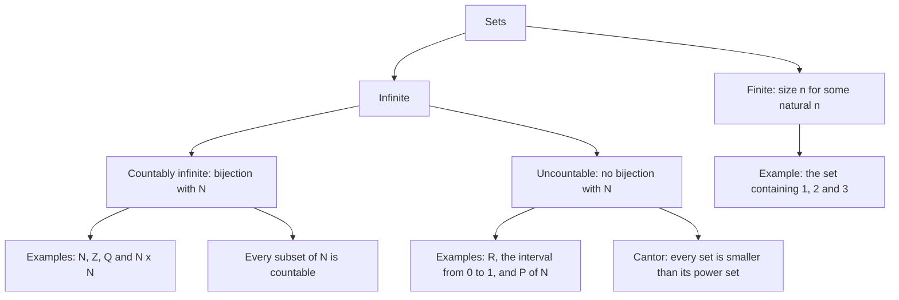
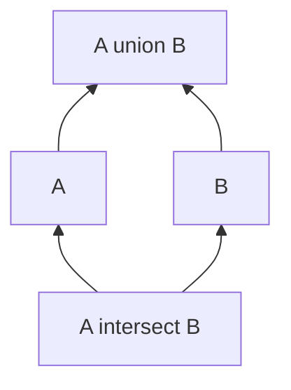

# Set Theory

> [Foundations](../README.md) · Level: Beginner → Intermediate · Prerequisites: arithmetic with integers and rational numbers, elementary algebra · Estimated time: 120 min

## 1. Introduction

Almost every sentence in modern mathematics contains the word *set*. A function is a rule between
sets, a solution is an element of a set, an interval is a set of real numbers, a probability is a
measure on a set of outcomes. Learning set theory means learning the grammar of the language that
the rest of this repository is written in.

There are two sides to the subject.

* **The practical side.** Notation for collections, a calculus for combining them (union,
  intersection, difference, complement), and reliable techniques for proving that two descriptions
  name the same collection. This is the everyday toolkit, and it is what most of this tutorial
  teaches.
* **The foundational side.** Once you ask "which collections are sets?", the naive picture breaks
  down: the collection of all sets leads to a contradiction (Russell's paradox, §7.13). The
  standard repair is an axiomatic theory, ZFC, sketched in §7.14. The same circle of ideas produces
  the distinction between *countable* and *uncountable* infinities, one of the great discoveries of
  the nineteenth century.

Both sides are treated here. The practical material is self-contained; the foundational material is
presented honestly, with proofs, and with pointers to the standard texts.

## 2. Prerequisites

You should be comfortable with:

* **Integer arithmetic** — addition, subtraction, multiplication, and *division with remainder*.
* **Rational numbers** — that a rational number can be written as $p/q$ with integers $p$ and
  $q \neq 0$, and that $\tfrac{1}{2} = \tfrac{2}{4}$.
* **Elementary algebra** — expanding products such as $(a+b)(a-b) = a^2 - b^2$, and solving linear
  equations.
* **Basic order language** — "greater than", "at most", and the idea of a number line.

No previous exposure to set notation is assumed: every symbol is defined in §5 and §6. The proofs in
this tutorial are written in full, step by step, so that you can read them before studying proof
technique formally. The logical vocabulary of connectives, quantifiers and negation is developed
systematically in [Propositional and First-Order Logic](../02-logic/README.md); here it is used
informally and explained as it appears. If you want the *methods* behind the proofs — direct proof,
contrapositive, contradiction, cases, induction — read the companion topic
[Proof Techniques](../04-proof-techniques/README.md) next.

## 3. Learning Objectives

After working through this tutorial you will be able to:

1. Read and write sets in roster notation and in set-builder notation, and convert between them.
2. Decide membership ($x \in A$) and inclusion ($A \subseteq B$) questions and justify the answer
   from the definitions.
3. Compute union, intersection, difference, complement and symmetric difference, and describe the
   eight regions of a three-set Venn diagram.
4. List all subsets of a small set, and prove that a set with $n$ elements has exactly $2^n$
   subsets.
5. Prove set identities by element chasing and by truth tables, including both De Morgan laws.
6. Form Cartesian products, decide when two ordered pairs are equal, and count finite products.
7. Interpret an indexed family $\{A_i\}_{i \in I}$ and evaluate $\bigcup_{i \in I} A_i$ and
   $\bigcap_{i \in I} A_i$, including over infinite index sets.
8. Define equinumerosity, give bijections that prove two sets have the same cardinality, and
   distinguish finite, countably infinite and uncountable sets.
9. Reproduce Cantor's diagonal argument that $\mathbb{R}$ is uncountable, and Cantor's theorem that
   $|A| < |\mathcal{P}(A)|$ for every set $A$.
10. Explain Russell's paradox, state why unrestricted comprehension is inconsistent, and describe
    in outline how ZFC avoids it.

## 4. Intuition

A **set** is a collection of objects, regarded as a single object. The objects are its **elements**
or **members**.

Think of a guest list at a venue. Three features of the list matter:

* For each person, the list decides *yes* or *no*: you are on it or you are not. There is no
  "partly on the list".
* Nobody appears twice. Asking "is Alice on the list?" cannot have the answer "twice".
* The order of the names is irrelevant. A list written in alphabetical order and the same list
  written in the order people arrived describe the same set of guests.

Those three features are, in order: membership is a yes/no question, repetitions collapse, and order
does not matter. Formally, all three are consequences of one axiom: a set is determined by its
elements (Axiom 5.1 below).

There are two ways to specify a guest list.

* **By listing the names**: "Alice, Bob, Carol".
* **By a rule**: "everyone who bought a ticket before Friday".

The second style is more powerful — it can describe infinitely many people — but it requires the
rule to be *unambiguous*: given any person, we must be able to decide whether the rule applies. If
the rule is vague ("the interesting people"), it does not define a set in the mathematical sense.

Collections of collections behave like folders inside folders. A folder can contain other folders,
and a set can contain other sets; this nesting is what makes the power set (§7.3) and Russell's
paradox (§7.13) possible. But the folder picture also misleads in one respect: in mathematics there
is no folder containing *all* folders. Asking for "the set of all sets" creates a contradiction, and
the axiomatic treatment of §7.14 explains exactly which collections are allowed.

## 5. Formal Definition

The definitions below are the whole vocabulary of elementary set theory. Each is stated with
explicit quantifiers so that proofs can refer to them mechanically.

**Definition 5.1 (Set and membership).** A *set* is a mathematical object $A$ together with a
definite criterion that decides, for every object $x$, whether $x$ is an element of $A$ (written
$x \in A$) or not (written $x \notin A$). "Definite" means that in principle the question has a
yes-or-no answer; it does not mean that we can compute the answer in practice.

**Axiom 5.1 (Extensionality).** Two sets are equal exactly when they have the same elements:

$$\forall A\ \forall B\ \bigl(A = B \;\leftrightarrow\; \forall x\,(x \in A \leftrightarrow x \in B)\bigr).$$

A consequence worth spelling out: order and repetition in a description carry no information. For
example $\{1,2,3\} = \{3,1,2\} = \{1,1,2,3\}$, because every $x$ that belongs to one of these sets
belongs to all of them.

**Definition 5.2 (Roster and set-builder notation).**

* *Roster notation* lists the elements between braces: $\{a_1, a_2, \dots, a_n\}$.
* *Set-builder notation* names the elements by a property:
  $\{x : P(x)\}$ is the set of all $x$ for which $P(x)$ holds, and
  $\{x \in S : P(x)\}$ is the set of those $x$ **already in $S$** for which $P(x)$ holds. The second,
  restricted form is the one sanctioned by the axioms (§7.14).

**Definition 5.3 (Subset).** $A$ is a *subset* of $B$, written $A \subseteq B$, if

$$\forall x\,(x \in A \rightarrow x \in B).$$

$A$ is a *proper subset* of $B$, written $A \subsetneq B$, if $A \subseteq B$ and $A \neq B$. Two sets
are equal if and only if each is a subset of the other (this is just Axiom 5.1 rewritten).

**Definition 5.4 (Empty set).** The *empty set* $\varnothing$ is the set with no elements:
$\forall x\,(x \notin \varnothing)$. The Axiom of Empty Set asserts that such an object exists. It is
unique: if $E_1$ and $E_2$ both have no elements, then $x \in E_1$ and $x \in E_2$ are both false for
every $x$, so $x \in E_1 \leftrightarrow x \in E_2$ holds for every $x$, and extensionality gives
$E_1 = E_2$.

Two different objects should not be confused: $\varnothing$ has no elements, whereas
$\{\varnothing\}$ has exactly one element, namely $\varnothing$.

**Definition 5.5 (Power set).** The *power set* of $A$ is

$$\mathcal{P}(A) = \{\,S : S \subseteq A\,\},$$

the set of all subsets of $A$. For example $\mathcal{P}(\varnothing) = \{\varnothing\}$.

**Definition 5.6 (Set operations).** Let $A$ and $B$ be sets, and fix a *universe* $U$ containing
both (so that complements are defined).

| Operation | Notation | Membership criterion |
|---|---|---|
| Union | $A \cup B$ | $x \in A \cup B \iff x \in A$ or $x \in B$ |
| Intersection | $A \cap B$ | $x \in A \cap B \iff x \in A$ and $x \in B$ |
| Difference | $A \setminus B$ | $x \in A \setminus B \iff x \in A$ and $x \notin B$ |
| Complement | $A^{c}$ | $x \in A^{c} \iff x \in U$ and $x \notin A$ |
| Symmetric difference | $A \triangle B$ | $x \in A \triangle B \iff$ exactly one of $x \in A$, $x \in B$ holds |

$A$ and $B$ are *disjoint* if $A \cap B = \varnothing$. Note that the first two operations are
defined by the logical connectives "or" and "and"; this is why set identities mirror logical
identities (§8).

**Definition 5.7 (Ordered pair; Cartesian product).** The *ordered pair* $(a,b)$ is characterised by

$$(a,b) = (c,d) \quad \leftrightarrow \quad a = c \text{ and } b = d.$$

The *Cartesian product* of $A$ and $B$ is $A \times B = \{\,(a,b) : a \in A,\ b \in B\,\}$. An ordered
pair is not a two-element set: $\{a,b\} = \{b,a\}$ but $(a,b) \neq (b,a)$ when $a \neq b$.

**Definition 5.8 (Family, indexed union and intersection).** An *indexed family* is a collection of
sets $\{A_i\}_{i \in I}$ tagged by the elements of an *index set* $I$. Its union and intersection are

$$\bigcup_{i \in I} A_i = \{\,x : \exists i \in I,\ x \in A_i\,\}, \qquad
\bigcap_{i \in I} A_i = \{\,x : \forall i \in I,\ x \in A_i\,\}.$$

The index set may be infinite, and that is the point of the definition. Edge cases: if the index set
is empty then $\bigcup_{i \in \varnothing} A_i = \varnothing$, while the corresponding intersection
$\bigcap_{i \in \varnothing} A_i$ is the whole universe $U$ (every $x$ satisfies the vacuous condition
"for all $i \in \varnothing$").

**Definition 5.9 (Function; injective, surjective, bijective).** A *function* $f : A \to B$ assigns
to each $a \in A$ exactly one element $f(a) \in B$. The set $A$ is the *domain* and $B$ the
*codomain*.

* $f$ is *injective* (one-to-one) if $f(a_1) = f(a_2)$ implies $a_1 = a_2$ for all $a_1,a_2 \in A$.
* $f$ is *surjective* (onto) if for every $b \in B$ there exists $a \in A$ with $f(a) = b$.
* $f$ is *bijective* if it is both injective and surjective.

These notions are used in §7.9 to compare the sizes of sets; no other property of functions is
needed here.

## 6. Mathematical Notation

| Symbol | Meaning | Read aloud |
|---|---|---|
| $\in$, $\notin$ | is an element of, is not an element of | "x is in A", "x is not in A" |
| $\{\,\cdot\, : \,\cdot\,\}$ | the set of objects satisfying a property | "the set of x such that …" |
| $\varnothing$ | the empty set | "the empty set" |
| $\subseteq$, $\subsetneq$ | subset, proper subset | "A is contained in B" |
| $\cup$, $\cap$ | union, intersection | "A union B", "A intersect B" |
| $\setminus$ | set difference | "A minus B" |
| $A^{c}$ | complement in the ambient universe | "A complement" |
| $\triangle$ | symmetric difference | "A symmetric difference B" |
| $\mathcal{P}(A)$ | power set of $A$ | "the power set of A" |
| $A \times B$ | Cartesian product | "A cross B" |
| $(a,b)$ | ordered pair | "the pair a comma b" |
| $\bigcup_{i \in I} A_i$ | union of an indexed family | "the union over i in I of A-i" |
| $\bigcap_{i \in I} A_i$ | intersection of an indexed family | "the intersection over i in I" |
| $\lvert A \rvert$ | cardinality (number of elements) | "the size of A" |
| $\lvert A \rvert = \lvert B \rvert$ | there is a bijection $A \to B$ | "A and B are equinumerous" |
| $\lvert A \rvert \le \lvert B \rvert$ | there is an injection $A \to B$ | "A is no larger than B" |
| $f : A \to B$, $a \mapsto f(a)$ | a function and its action on an element | "f from A to B sends a to f of a" |
| $\mathbb{N}$, $\mathbb{Z}$, $\mathbb{Q}$, $\mathbb{R}$ | natural, integer, rational, real numbers | "en, zed, cue, arr" |
| $\{0,1\}^{A}$ | set of all functions $A \to \{0,1\}$ | "zero-one to the A" |
| $\lvert A \rvert < \lvert B \rvert$ | $\lvert A \rvert \le \lvert B \rvert$ and $\lvert A \rvert \neq \lvert B \rvert$ | "A is strictly smaller than B" |

Conventions: $\mathbb{N} = \{0,1,2,3,\dots\}$ and $\mathbb{Z}_{>0} = \{1,2,3,\dots\}$ in this
repository. When complements appear, an ambient universe $U$ is always named explicitly.

## 7. Core Concepts

### 7.1 Sets and Membership

Anything can be an element of a set: numbers, letters, points, functions, and sets themselves. Since
a set is an object, we may ask whether $A \in A$. In the standard axioms the answer is always *no*
(§7.14, Foundation), but the question is meaningful, and the naive theory that allowed arbitrary
answers is where Russell's paradox lives.

Three distinctions are worth memorising.

* **Element versus subset.** $2 \in \{1,2,3\}$ is true; $2 \subseteq \{1,2,3\}$ is not the kind of
  statement we make about a number — a subset is a set, so we only write $\subseteq$ between sets.
  Sets of sets make the difference vivid: $\{1\} \in \{\{1\},2\}$ is true, but
  $\{1\} \subseteq \{\{1\},2\}$ is **false**, because $1$ is an element of $\{1\}$ and $1$ is not an
  element of $\{\{1\},2\}$.
* **Empty set versus set containing the empty set.** $\varnothing$ has zero elements;
  $\{\varnothing\}$ has one.
* **Membership is not graded.** An object either belongs or does not; there is no "mostly belongs".

### 7.2 Roster and Set-Builder Notation

Roster notation is usable only for small finite sets. Ellipses rely on a pattern the reader is
expected to continue:

$$\{2,4,6,\dots,100\}$$

is acceptable because "even numbers up to 100" is unambiguous, whereas $\{3,5,7,\dots\}$ is not a
specification at all until we say where the list stops.

Set-builder notation is more expressive, and safer when it names its domain:

$$\{x \in \mathbb{R} : x^2 = 4\} = \{-2, 2\}, \qquad
\{n \in \mathbb{N} : n \text{ is even}\} = \{0,2,4,6,\dots\}.$$

Two descriptions may name the same set; that is the content of the Axiom of Extensionality. For
instance

$$\{x \in \mathbb{Z} : x^2 < 5\} = \{-2,-1,0,1,2\} = \{n \in \mathbb{Z} : -2 \le n \le 2\}.$$

A contradictory property gives the empty set: $\{x \in \mathbb{R} : x^2 < 0\} = \varnothing$.

The unrestricted form $\{x : P(x)\}$ — without a domain — is the dangerous one. It is exactly the
principle (called *unrestricted comprehension*) that produces Russell's paradox; the restricted form
$\{x \in S : P(x)\}$ is what ZFC permits. Since most of this tutorial works inside a fixed universe,
the difference rarely matters in practice, but it matters enormously in §7.13.

### 7.3 Subsets and Power Sets

**How to prove $A \subseteq B$.** By Definition 5.3 you must show that every element of $A$ is an
element of $B$. The template is:

> Let $x \in A$ be arbitrary. *(argument using the definitions)* Hence $x \in B$.

Because $x$ was arbitrary, the conclusion holds for all $x \in A$. This is called *element chasing*,
and it is the workhorse of the subject.

Three basic facts, each a one-line element chase:

* $\varnothing \subseteq A$ for every set $A$ — the statement "for all $x$, if $x \in \varnothing$
  then $x \in A$" is vacuously true, because the hypothesis $x \in \varnothing$ is never satisfied.
* $A \subseteq A$ for every set $A$.
* If $A \subseteq B$ and $B \subseteq C$ then $A \subseteq C$: take $x \in A$; then $x \in B$; then
  $x \in C$.

**Power sets.** $\mathcal{P}(A)$ is the set of subsets of $A$. Compute small examples by hand:

$$\mathcal{P}(\varnothing) = \{\varnothing\}, \qquad
\mathcal{P}(\{a\}) = \{\varnothing, \{a\}\}, \qquad
\mathcal{P}(\{a,b\}) = \{\varnothing, \{a\}, \{b\}, \{a,b\}\}.$$

Notice the pattern: each element of $A$ may be *in* or *out* of a subset, independently. That gives
two choices per element, hence $2^n$ subsets. The following theorem turns that counting argument into
a proof.

**Theorem 7.1.** If $A$ is a finite set with $|A| = n$, then $|\mathcal{P}(A)| = 2^{n}$.

*Proof.* We use the principle of mathematical induction: if a set $S \subseteq \mathbb{N}$ contains
$0$ and satisfies "$k \in S$ implies $k+1 \in S$" for every $k \in \mathbb{N}$, then
$S = \mathbb{N}$. (The principle is discussed in [Proof Techniques](../04-proof-techniques/README.md);
here we only need its statement.)

*Base case $n = 0$.* Then $A = \varnothing$, whose only subset is $\varnothing$, so
$\mathcal{P}(A) = \{\varnothing\}$ and $|\mathcal{P}(A)| = 1 = 2^{0}$.

*Inductive step.* Assume the claim holds for all sets with $n$ elements, and let $|A| = n+1$. Choose
$a \in A$, which exists because $n + 1 \ge 1$, and put $B = A \setminus \{a\}$, so $|B| = n$.
Split the subsets of $A$ into two classes:

$$\mathcal{P}_0 = \{\,S \subseteq A : a \notin S\,\}, \qquad
\mathcal{P}_1 = \{\,S \subseteq A : a \in S\,\}.$$

Every subset of $A$ lies in exactly one of the two classes, so
$|\mathcal{P}(A)| = |\mathcal{P}_0| + |\mathcal{P}_1|$.

First, $\mathcal{P}_0 = \mathcal{P}(B)$: a subset of $A$ that omits $a$ is precisely a subset of $B$.
By the inductive hypothesis, $|\mathcal{P}_0| = 2^{n}$.

Second, the map $\varphi : \mathcal{P}(B) \to \mathcal{P}_1$, $S \mapsto S \cup \{a\}$, is a
bijection. It is injective: if $S \cup \{a\} = T \cup \{a\}$ with $a \notin S$ and $a \notin T$, then
removing $a$ from both sides gives $S = T$. It is surjective: given $T \in \mathcal{P}_1$, the set
$T \setminus \{a\}$ lies in $\mathcal{P}(B)$ and maps to $T$. Hence $|\mathcal{P}_1| = 2^{n}$.

Therefore $|\mathcal{P}(A)| = 2^{n} + 2^{n} = 2^{n+1}$, which completes the induction. $\square$

The theorem is only about finite sets. For infinite sets the power set is *strictly larger* than the
original — Cantor's theorem, §7.12 — and the notation $2^{|A|}$ for $|\mathcal{P}(A)|$ is standard in
both cases.

### 7.4 Set Operations

The definitions were given in Definition 5.6; here is how the operations behave on a concrete
example. Take

$$U = \{1,2,3,4,5,6,7,8\}, \qquad A = \{1,2,3,4\}, \qquad B = \{3,4,5,6\}.$$

| Expression | Value | Reason |
|---|---|---|
| $A \cup B$ | $\{1,2,3,4,5,6\}$ | elements in at least one of $A$, $B$ |
| $A \cap B$ | $\{3,4\}$ | elements in both |
| $A \setminus B$ | $\{1,2\}$ | in $A$ but not in $B$ |
| $B \setminus A$ | $\{5,6\}$ | in $B$ but not in $A$ |
| $A^{c}$ | $\{5,6,7,8\}$ | in $U$ but not in $A$ |
| $A \triangle B$ | $\{1,2,5,6\}$ | in exactly one of $A$, $B$ |

Two observations that hold in general:

* $A \setminus B$ and $B \setminus A$ are different sets in general. Difference is not commutative.
* $A \triangle B = (A \setminus B) \cup (B \setminus A)$. Both sides collect exactly the
  elements that belong to exactly one of the sets, so the equality follows from the definitions
  by element chasing.

Union and intersection *are* commutative and associative, and they distribute over each other; the
full list of identities is in §8.

### 7.5 Venn Diagrams as Tables

A Venn diagram records, for each region of the picture, which sets an element of that region belongs
to. For two sets there are four regions, and for three sets there are eight. Because membership is
yes/no, a diagram with $n$ sets has one region for each of the $2^n$ possible membership patterns;
this is the same count as in Theorem 7.1.

For sets $A, B, C$ inside a universe $U$, the eight regions are:

| Region | Set-theoretic description | $A$? | $B$? | $C$? |
|---|---|---|---|---|
| $R_0$ | $(A \cup B \cup C)^{c}$ | no | no | no |
| $R_1$ | $A \setminus (B \cup C)$ | yes | no | no |
| $R_2$ | $B \setminus (A \cup C)$ | no | yes | no |
| $R_3$ | $C \setminus (A \cup B)$ | no | no | yes |
| $R_4$ | $(A \cap B) \setminus C$ | yes | yes | no |
| $R_5$ | $(A \cap C) \setminus B$ | yes | no | yes |
| $R_6$ | $(B \cap C) \setminus A$ | no | yes | yes |
| $R_7$ | $A \cap B \cap C$ | yes | yes | yes |

The table is a *complete* description: every element of $U$ lies in exactly one row, and the rows
are disjoint. This is what makes truth tables work as proofs in §8.2 — a table that covers all
$2^n$ membership patterns is a proof by exhaustive cases, not merely a picture.

Diagrams guide intuition; they do not replace proofs. A common error is to "prove" a set identity by
drawing two overlapping circles and declaring the shaded parts equal. The picture presupposes the
identity in the way it is drawn. Use the picture to guess, then prove by element chasing or by a
truth table.

### 7.6 Set Identities and How to Prove Them

Set identities are equations between expressions built from $\cup$, $\cap$, $\setminus$,
${}^{c}$ and $\triangle$. Three proof methods are used, and all three are legitimate.

**(a) Element chasing (double inclusion).** To prove $X = Y$, prove $X \subseteq Y$ and
$Y \subseteq X$. Each inclusion is proved by taking an arbitrary element of the left side and
deriving membership in the right side. Example — the *difference law* $A \setminus B = A \cap B^{c}$:

> Let $x \in A \setminus B$. By definition, $x \in A$ and $x \notin B$. Since $x \notin B$ we have
> $x \in B^{c}$, so $x \in A \cap B^{c}$. This proves $A \setminus B \subseteq A \cap B^{c}$.
> Conversely, let $x \in A \cap B^{c}$. Then $x \in A$ and $x \in B^{c}$, i.e. $x \notin B$. Hence
> $x \in A \setminus B$. So $A \cap B^{c} \subseteq A \setminus B$. Both inclusions give the
> equality. $\square$

**(b) Truth tables.** Enumerate the $2^{n}$ membership patterns of the $n$ sets involved and check
that the two expressions have the same truth value in every row. This is a proof by exhaustive
cases, and it is the method used for De Morgan's laws in §8.2.

**(c) Algebraic derivation.** Chain already-proved identities. For instance, using the difference
law and De Morgan's law,

$$A \setminus (B \cup C) = A \cap (B \cup C)^{c} = A \cap (B^{c} \cap C^{c}) = (A \cap B^{c}) \cap (A \cap C^{c}),$$

so $A \setminus (B \cup C) = (A \setminus B) \cap (A \setminus C)$. An algebraic derivation is
valid only if every step is an identity that has already been proved (or is an axiom); otherwise the
argument is circular.

### 7.7 Cartesian Products

Definition 5.7 introduced ordered pairs and the product $A \times B$. Three points deserve emphasis.

* **Order matters.** $A \times B$ and $B \times A$ are different sets unless $A = B$ or one of them
  is empty. For $A = \{1,2\}$ and $B = \{x,y\}$,

  $$A \times B = \{(1,x), (1,y), (2,x), (2,y)\}, \qquad
  B \times A = \{(x,1), (x,2), (y,1), (y,2)\},$$

  and $(1,x) \in A \times B$ but $(1,x) \notin B \times A$, because $1 \notin B$.

* **Products with the empty set.** $A \times \varnothing = \varnothing$ for every $A$: there is no
  pair whose second coordinate lies in $\varnothing$. In particular
  $\varnothing \times \varnothing = \varnothing$.

* **The plane is a product.** $\mathbb{R} \times \mathbb{R}$, written $\mathbb{R}^2$, is the set of
  ordered pairs of real numbers, i.e. the coordinate plane. This is the source of the name
  "Cartesian".

**Theorem 7.2.** If $A$ and $B$ are finite with $|A| = m$ and $|B| = n$, then $|A \times B| = mn$.

*Proof.* Write $A = \{a_1, \dots, a_m\}$. For each $i$, let
$R_i = \{a_i\} \times B = \{(a_i, b) : b \in B\}$ be the $i$-th "row" of the product. The map
$b \mapsto (a_i, b)$ is a bijection $B \to R_i$, so $|R_i| = n$. The rows are pairwise disjoint: if
$(x,y) \in R_i \cap R_j$ then $x = a_i$ and $x = a_j$, hence $i = j$. Every element of $A \times B$
is $(a_i,b)$ for exactly one $i$ and one $b$, so $A \times B = R_1 \cup \dots \cup R_m$. Adding the
sizes of the disjoint rows gives $|A \times B| = n + \dots + n = mn$. $\square$

The definition extends to $n$-tuples: $A_1 \times \dots \times A_n$ is the set of ordered $n$-tuples
$(a_1,\dots,a_n)$ with $a_i \in A_i$, and induction on Theorem 7.2 gives
$|A_1 \times \dots \times A_n| = |A_1| \cdots |A_n|$ for finite sets. Strictly speaking,
$(A \times B) \times C$ and $A \times (B \times C)$ contain differently shaped objects — a pair of a
pair versus a pair with a triple — and mathematicians identify them only through the obvious
bijection.

### 7.8 Families and Indexed Operations

An indexed family $\{A_i\}_{i \in I}$ is a function $i \mapsto A_i$ from the index set $I$ to sets.
It need not be injective: nothing forbids $A_i = A_j$ for $i \neq j$. Indexing is a bookkeeping device
that lets us name *many* sets at once, including infinitely many.

**Example 7.3.** For $n \in \mathbb{Z}_{>0}$ let $A_n = \{k \in \mathbb{N} : k \ge n\}$. Then

$$\bigcup_{n \ge 1} A_n = \mathbb{N}, \qquad \bigcap_{n \ge 1} A_n = \varnothing.$$

For the union: if $k \in \mathbb{N}$ then $k \in A_1$. For the intersection: if $k$ belonged to every
$A_n$, then in particular $k \in A_{k+1}$, which says $k \ge k+1$ — impossible. Note that this
intersection is empty even though every single $A_n$ is infinite and the family is decreasing:
$A_1 \supseteq A_2 \supseteq A_3 \supseteq \dots$.

**Example 7.4 (an uncountable index set).** For each real number $r > 0$ let $I_r$ be the open
interval $(-r, r)$. Then $\bigcup_{r > 0} I_r = \mathbb{R}$, since every real $x$ lies in $I_r$ as soon
as $r > |x|$; and $\bigcap_{r>0} I_r = \{0\}$, since $0$ lies in every $I_r$, while any $x \neq 0$ fails
to lie in $I_{|x|/2}$. The index set here is uncountable, which shows that indexed operations do not
presuppose a countable family.

The operations obey *generalized De Morgan laws*. For any family $\{A_i\}_{i \in I}$ of subsets of a
universe $U$,

$$U \setminus \bigcup_{i \in I} A_i = \bigcap_{i \in I} (U \setminus A_i).$$

*Proof.* Let $x \in U$. Then

$$x \in U \setminus \bigcup_{i \in I} A_i
\iff x \notin \bigcup_{i \in I} A_i
\iff \text{not } (\exists i \in I,\ x \in A_i)
\iff \forall i \in I,\ x \notin A_i
\iff \forall i \in I,\ x \in U \setminus A_i
\iff x \in \bigcap_{i \in I} (U \setminus A_i).$$

Each step is a definition, and the middle step is the logical equivalence
$\neg\exists i\, P(i) \equiv \forall i\, \neg P(i)$. Since the chain holds for every $x \in U$, the
two sets are equal. $\square$

The dual law, $U \setminus \bigcap_{i \in I} A_i = \bigcup_{i \in I} (U \setminus A_i)$, is proved by
the same chain with $\exists$ and $\forall$ exchanged; it is Exercise 26.

### 7.9 Cardinality

To compare sizes of arbitrary sets — including infinite ones — we compare them by *matching*, not by
counting.

**Definition 7.5 (Equinumerous sets; cardinal comparison).**

* $A$ and $B$ are *equinumerous*, written $|A| = |B|$, if there exists a bijection $f : A \to B$.
* $|A| \le |B|$ if there exists an injection $f : A \to B$.
* $|A| < |B|$ if $|A| \le |B|$ and $|A| \neq |B|$.
* $A$ is *finite* if $A = \varnothing$ or there is a bijection $A \to \{1,\dots,n\}$ for some
  $n \in \mathbb{Z}_{>0}$; then $|A| = n$, and $|\varnothing| = 0$.
* $A$ is *infinite* if it is not finite.

**Basic facts.** Each is an exercise in composing functions.

* Equinumerosity is an equivalence relation: the identity map is a bijection; the inverse of a
  bijection is a bijection; a composition of bijections is a bijection.
* $|A| \le |B|$ is reflexive and transitive: the identity is injective, and if $f : A \to B$ and
  $g : B \to C$ are injective, then $g \circ f$ is injective, because
  $g(f(a_1)) = g(f(a_2))$ gives $f(a_1) = f(a_2)$ and then $a_1 = a_2$.
* If $A \subseteq B$ then $|A| \le |B|$: the inclusion map $a \mapsto a$ is injective.

Transitivity and reflexivity do not by themselves make $\le$ a partial order: antisymmetry is a
genuine theorem.

**Theorem 7.6 (Cantor–Schröder–Bernstein, stated).** If $|A| \le |B|$ and $|B| \le |A|$, then
$|A| = |B|$.

We state this theorem without proof; it is proved in every standard set theory text (see §16). Its
role here is to justify writing $|A| = |B|$ whenever injections exist in both directions, which is the
usual way of proving two infinite sets have the same size.

**Remark.** For finite sets, the definitions reduce to ordinary counting: a finite set has exactly
one size, and $|A| \le |B|$ holds exactly when the number of elements of $A$ is at most that of $B$.
The interesting content appears only for infinite sets.

### 7.10 Countable and Uncountable Sets

**Definition 7.7.** A set $A$ is *countably infinite* if $|A| = |\mathbb{N}|$, i.e. if its elements
can be listed as $A = \{a_0, a_1, a_2, \dots\}$ with all $a_n$ distinct. $A$ is *countable* if it is
finite or countably infinite, and *uncountable* if it is not countable.

A countably infinite set is one whose elements can be arranged in a single infinite list, with a
first element, a second element, and so on, hitting everything. The phrase "list" is exactly the
intuition: an enumeration is a bijection $\mathbb{N} \to A$.

**Lemma 7.8.** Every subset of $\mathbb{N}$ is countable.

*Proof.* Let $S \subseteq \mathbb{N}$. If $S$ is finite, it is countable by definition. If $S$ is
infinite, define $s_0 = \min S$ and, having defined $s_0 < s_1 < \dots < s_k$, let
$s_{k+1} = \min (S \setminus \{s_0,\dots,s_k\})$. The minimum exists because every nonempty subset of
$\mathbb{N}$ has a least element, and the set being subtracted is finite, so the remainder is
nonempty. The result is a strictly increasing sequence $s_0 < s_1 < \dots$ of elements of $S$.

It lists every element of $S$: suppose $s \in S$ never appears. The sequence is strictly increasing
and infinite, so there is an index $j$ with $s_j > s$; choose the least such $j$. By construction
$s_j = \min(S \setminus \{s_0,\dots,s_{j-1}\})$. But $s$ never appears, so
$s \in S \setminus \{s_0,\dots,s_{j-1}\}$, and $s < s_j$ — contradicting the minimality of $s_j$.
Hence every element appears, and $k \mapsto s_k$ is a bijection $\mathbb{N} \to S$. $\square$

**Lemma 7.9.** If $X$ is countable and $f : X \to Y$ is surjective, then $Y$ is countable.

*Proof.* If $Y$ is finite we are done. Otherwise fix an enumeration $X = \{x_0, x_1, x_2, \dots\}$
(if $X$ is finite, $Y$ would be finite, so $X$ is countably infinite here). For each $y \in Y$ the
set $\{n : f(x_n) = y\}$ is nonempty, so it has a least element $n(y)$. The map $y \mapsto n(y)$ is
injective: if $n(y) = n(y') = n$ then $y = f(x_n) = y'$. Its image is an infinite subset of
$\mathbb{N}$ (because $Y$ is infinite and the map is injective), so by Lemma 7.8 it can be listed
increasingly as $n_0 < n_1 < \dots$. Then $k \mapsto f(x_{n_k})$ is a bijection $\mathbb{N} \to Y$:
it is injective because the $n_k$ are distinct and $y \mapsto n(y)$ is injective, and it is
surjective because every $y$ equals $f(x_{n(y)})$ and $n(y) = n_k$ for some $k$. $\square$

**Lemma 7.10.** The union of two countable sets is countable.

*Proof.* If $A = B = \varnothing$ the union is empty and there is nothing to prove. Otherwise choose
an element $c \in A \cup B$ and build infinite lists $a_0, a_1, \dots$ and $b_0, b_1, \dots$ as
follows: if a set is countably infinite, list it bijectively; if it is finite and nonempty, list its
elements and then repeat its last element forever; if it is empty, put $a_n = c$ (respectively
$b_n = c$) for every $n$. Then the list of $A$ has range $A$ (vacuously, if $A = \varnothing$), and
likewise for $B$. Hence $f : \mathbb{N} \to A \cup B$ defined by $f(2n) = a_n$ and $f(2n+1) = b_n$ is
surjective, so $A \cup B$ is countable by Lemma 7.9. $\square$

By induction, any finite union of countable sets is countable.

**Theorem 7.11.** $\mathbb{N} \times \mathbb{N}$ is countably infinite.

*Proof.* List the pairs by diagonals, in order of the sum of coordinates:

$$(0,0);\quad (0,1),(1,0);\quad (0,2),(1,1),(2,0);\quad (0,3),(1,2),(2,1),(3,0);\quad \dots$$

Every pair $(m,n)$ lies on the diagonal $m + n = s$, which is a finite list and is reached after
finitely many earlier diagonals. Within a diagonal each pair appears once, so no pair is repeated.
Hence this is a bijection $\mathbb{N} \to \mathbb{N} \times \mathbb{N}$. $\square$

**Theorem 7.12.** $\mathbb{Z}$ and $\mathbb{Q}$ are countably infinite.

*Proof.* For $\mathbb{Z}$, the map $f : \mathbb{N} \to \mathbb{Z}$ given by $f(2k) = k$ and
$f(2k+1) = -(k+1)$ for $k \ge 0$ lists $0, -1, 1, -2, 2, -3, \dots$. It is injective because even
indices produce non-negative values and odd indices produce negative values, with $k \mapsto k$ and
$k \mapsto -(k+1)$ each injective; it is surjective because every non-negative integer is $f(2k)$
and every negative integer $-j$ with $j \ge 1$ is $f(2j-1)$. So $|\mathbb{Z}| = |\mathbb{N}|$.

For $\mathbb{Q}$: let $\mathbb{Q}_{>0}$ be the positive rationals. The map
$\mathbb{Z}_{>0} \times \mathbb{Z}_{>0} \to \mathbb{Q}_{>0}$, $(m,n) \mapsto m/n$, is surjective,
and $\mathbb{Z}_{>0} \times \mathbb{Z}_{>0}$ is countably infinite (it is in bijection with
$\mathbb{N} \times \mathbb{N}$). By Lemma 7.9, $\mathbb{Q}_{>0}$ is countable; it is infinite, hence
countably infinite. The map $x \mapsto -x$ is a bijection $\mathbb{Q}_{>0} \to \mathbb{Q}_{<0}$, so
$\mathbb{Q}_{<0}$ is countably infinite too. Finally
$\mathbb{Q} = \mathbb{Q}_{>0} \cup \{0\} \cup \mathbb{Q}_{<0}$ is a union of two countable sets
($\mathbb{Q}_{>0} \cup \{0\}$ and $\mathbb{Q}_{<0}$), hence countable by Lemma 7.10, and infinite. $\square$

So the rationals, despite being *dense* on the number line — between any two rationals there is
another — form a list. Density and cardinality are different matters.

### 7.11 Cantor's Diagonal Argument

The reals are not listable. Before the proof, one technical point about decimal expansions.

**Lemma 7.13.** Every real number in $[0,1]$ has a decimal expansion $0.a_1a_2a_3\dots$ that does
not end in an infinite string of 9s. Moreover, if two digit sequences $(a_n)$ and $(b_n)$ neither of
which ends in all 9s represent the same number, then $a_n = b_n$ for all $n$.

*Proof.* The existence of an expansion is standard (long division or the completeness of
$\mathbb{R}$); the expansion ending in all 9s can be replaced by the terminating one, e.g.
$0.4999\dots = 0.5000\dots$, which does not end in 9s. For uniqueness, let $k$ be the least index with
$a_k \neq b_k$ and suppose $a_k < b_k$. Then $b_k \ge a_k + 1$, so

$$\sum_{n \ge 1} \frac{b_n}{10^n} - \sum_{n \ge 1} \frac{a_n}{10^n}
\;\ge\; \frac{1}{10^{k}} - \sum_{n > k} \frac{9}{10^{n}}
\;=\; \frac{1}{10^{k}} - \frac{1}{10^{k}} \;=\; 0,$$

where the tail sum is the geometric series $9 \cdot 10^{-k-1}/(1 - 1/10) = 10^{-k}$. Equality can
occur only if $b_k - a_k = 1$ and $b_n - a_n = -9$ for every $n > k$, i.e. only if $a_n = 9$ and
$b_n = 0$ for all $n > k$ — which says that $(a_n)$ ends in all 9s. Since neither sequence does, the
difference is strictly positive and the two numbers are different. $\square$

**Theorem 7.14.** The interval $[0,1]$ is uncountable.

*Proof.* Suppose, for contradiction, that $[0,1]$ is countable. It is infinite, so there is an
enumeration $[0,1] = \{x_0, x_1, x_2, \dots\}$ with all $x_k$ distinct. By Lemma 7.13, choose for
each $k$ a decimal expansion

$$x_k = 0.a_{k1}\,a_{k2}\,a_{k3}\cdots$$

that does not end in 9s. Now define a digit sequence $(d_n)$ by

$$d_n = \begin{cases} 1 & \text{if } a_{nn} = 0, \\ 0 & \text{if } a_{nn} \neq 0. \end{cases}$$

Each $d_n$ is $0$ or $1$, so in particular $d_n \neq 9$; hence $(d_n)$ does not end in all 9s.
Let $x = 0.d_1d_2d_3\cdots$. Then $x \in [0,1]$, so $x = x_k$ for some $k$ by the assumed
enumeration. But the $k$-th digit of $x$ is $d_k$, and $d_k \neq a_{kk}$ by construction, so the two
expansions differ at position $k$. Since both expansions avoid ending in 9s, Lemma 7.13 says they
represent different numbers: $x \neq x_k$. This contradicts $x = x_k$. Therefore no enumeration
exists and $[0,1]$ is uncountable. $\square$

The construction is called *diagonal* because the digit $d_n$ is chosen in opposition to the $n$-th
digit of the $n$-th listed number — one walks down the diagonal of the infinite array $a_{kn}$ and
changes every entry on it.

**Corollary 7.15.** $\mathbb{R}$ is uncountable, and so is $\mathbb{R} \setminus \mathbb{Q}$.

*Proof.* If $\mathbb{R}$ were countable, then $[0,1] \subseteq \mathbb{R}$ would be countable: an
injection $[0,1] \to \mathbb{N}$ is obtained by composing the inclusion with a bijection
$\mathbb{R} \to \mathbb{N}$, and a set that injects into $\mathbb{N}$ is countable by Lemma 7.8.
That contradicts Theorem 7.14. For the irrationals: if $\mathbb{R} \setminus \mathbb{Q}$ were
countable, then $\mathbb{R} = \mathbb{Q} \cup (\mathbb{R} \setminus \mathbb{Q})$ would be the union
of two countable sets, hence countable by Lemma 7.10 — contradiction. $\square$

**Theorem 7.16.** $|(0,1)| = |\mathbb{R}|$.

*Proof.* The map $g(x) = \tan\left(\pi\left(x - \tfrac{1}{2}\right)\right)$ is a bijection
$(0,1) \to \mathbb{R}$: the inner map $x \mapsto \pi(x - \tfrac12)$ is a bijection from $(0,1)$ onto
$(-\tfrac{\pi}{2}, \tfrac{\pi}{2})$, and $\tan$ is a strictly increasing bijection from
$(-\tfrac{\pi}{2}, \tfrac{\pi}{2})$ onto $\mathbb{R}$. A composition of bijections is a
bijection. $\square$

Notice that deleting the endpoints of $[0,1]$ does not change the cardinality. This is typical of
infinite sets and is one of the ways they differ from finite ones (Exercise 32 makes the point
precisely).

### 7.12 Cantor's Theorem

**Theorem 7.17 (Cantor).** For every set $A$ there is no surjection $A \to \mathcal{P}(A)$.

*Proof.* Let $f : A \to \mathcal{P}(A)$ be any function. Define

$$D = \{\,a \in A : a \notin f(a)\,\}.$$

This is a subset of $A$, hence an element of $\mathcal{P}(A)$. Suppose $D = f(a_0)$ for some
$a_0 \in A$. Then, by the definition of $D$,

$$a_0 \in D \iff a_0 \notin f(a_0) = D,$$

which is impossible: a statement cannot be equivalent to its own negation. Therefore $D$ is not in
the image of $f$, and $f$ is not surjective. $\square$

**Corollary 7.18.** For every set $A$, $|A| < |\mathcal{P}(A)|$.

*Proof.* The map $a \mapsto \{a\}$ is an injection $A \to \mathcal{P}(A)$, so
$|A| \le |\mathcal{P}(A)|$. By Theorem 7.17 there is no bijection between the two, so the inequality
is strict. $\square$

Starting from $\mathbb{N}$ and iterating the power set produces an unbounded hierarchy of infinite
sizes:

$$|\mathbb{N}| < |\mathcal{P}(\mathbb{N})| < |\mathcal{P}(\mathcal{P}(\mathbb{N}))| < \cdots$$

**Corollary 7.19.** There is no set of all sets.

*Proof.* Suppose $U$ were a set containing every set. Then every subset of $U$ is a set, hence an
element of $U$, so $\mathcal{P}(U) \subseteq U$. The inclusion map $\mathcal{P}(U) \to U$ is then an
injection, giving $|\mathcal{P}(U)| \le |U|$, which contradicts Corollary 7.18. $\square$

**Remark.** With the Cantor–Schröder–Bernstein theorem one can show
$|\mathcal{P}(\mathbb{N})| = |\mathbb{R}|$: the map $S \mapsto \sum_{k \in S} 3^{-(k+1)}$ is an
injection $\mathcal{P}(\mathbb{N}) \to \mathbb{R}$, and $r \mapsto \{q \in \mathbb{Q} : q < r\}$ is an
injection $\mathbb{R} \to \mathcal{P}(\mathbb{Q}) \cong \mathcal{P}(\mathbb{N})$. So the power set of
$\mathbb{N}$ is exactly as large as the continuum.

### 7.13 Russell's Paradox and the Need for Axioms

The *naive comprehension principle* says: every property $P$ determines a set, namely
$\{x : P(x)\}$.

**Russell's paradox (1901).** Apply the principle to the property $x \notin x$. It yields the set

$$R = \{\,x : x \notin x\,\}.$$

Now ask whether $R \in R$.

* If $R \in R$, then $R$ has the defining property of the elements of $R$, namely $R \notin R$.
* If $R \notin R$, then $R$ satisfies the defining property, so $R \in R$.

Each case implies its own negation, so both are impossible:

$$R \in R \iff R \notin R.$$

There is no way out within naive comprehension. The principle itself must be wrong.

**What exactly is wrong?** Not the idea of a collection, and not the use of properties to describe
elements, but the assumption that *any* property carves out a set. The repair, due to Zermelo, is to
allow comprehension only *inside an existing set*:

$$\text{for a set } S \text{ and a property } P, \quad \{x \in S : P(x)\} \text{ is a set.}$$

This restricted principle is called *Separation* (or Specification). It is enough for all ordinary
mathematics, because in practice one always selects elements from a set that is already known to
exist. And it blocks Russell's argument: with Separation we may form
$R_S = \{x \in S : x \notin x\}$ for any set $S$, but the conclusion is different.

**Proposition 7.20.** For every set $S$, the set $R_S = \{x \in S : x \notin x\}$ satisfies
$R_S \notin S$.

*Proof.* Suppose $R_S \in S$. Then

$$R_S \in R_S \iff \bigl(R_S \in S \text{ and } R_S \notin R_S\bigr) \iff R_S \notin R_S,$$

using $R_S \in S$ for the second equivalence. A statement equivalent to its negation is false, so
the supposition $R_S \in S$ is false. Hence $R_S \notin S$. $\square$

Thus every set $S$ fails to contain a certain subset of itself; in particular no set contains all
sets. Russell's paradox, which looked like a disaster, becomes a theorem about the nonexistence of a
universal set.

### 7.14 A Brief Look at ZFC

The standard axiomatic system for mathematics is called **ZFC**: the Zermelo–Fraenkel axioms plus
the Axiom of Choice. Its primitive notion is membership; everything else is defined. The axioms are
stated informally below.

| Axiom | Informal content |
|---|---|
| Extensionality | Sets with the same elements are equal. |
| Empty Set | $\varnothing$ exists. |
| Pairing | For any $a,b$ the set $\{a,b\}$ exists. |
| Union | The union of the sets in a set exists. |
| Power Set | $\mathcal{P}(A)$ exists for every set $A$. |
| Separation (schema) | $\{x \in S : P(x)\}$ is a set, for each set $S$ and property $P$. |
| Replacement (schema) | The image of a set under a definable function is a set. |
| Infinity | An infinite set exists (equivalently, $\mathbb{N}$ exists). |
| Foundation | Every nonempty set has an element disjoint from it. |
| Choice | Every family of nonempty sets has a choice function. |

A *schema* is an infinite family of axioms, one for each property $P$ expressible in the language.

Three remarks close this section.

1. **Separation blocks Russell.** Without Separation, the argument of §7.13 is unavoidable. With it,
   the "set of all sets that are not elements of themselves" is not available, and Proposition 7.20
   shows the closest legal approximation is harmless.
2. **Foundation implies no self-membership.** If a set $S$ satisfied $S \in S$, apply Foundation to
   the set $\{S\}$: its only element is $S$, so we need $S \cap \{S\} = \varnothing$. But
   $S \in S$ and $S \in \{S\}$, so $S \in S \cap \{S\}$ — contradiction. Thus $x \notin x$ for every
   set $x$ in ZFC, and the property used in Russell's paradox simply never holds. (Exercise 34 asks
   for this argument in detail.)
3. **Choice is genuinely an axiom.** The other axioms are uncontroversial in the sense that they
   describe constructions one can exhibit; Choice asserts the existence of a selection with no rule
   for making it. It is independent of the other axioms and is needed for results such as "every
   vector space has a basis". Nothing in this tutorial depends on it.

The practical mathematics of §§7.1–7.12 does not require the reader to work inside ZFC explicitly.
But every construction used there — power sets, subsets defined by properties, indexed families — is
licensed by the axioms above.

## 8. Formulas and Properties

### 8.1 The Algebra of Sets

Let $A, B, C$ be subsets of a universe $U$. The following identities hold, each with a proof by
element chasing or truth table; the names are standard.

| Name | Identity |
|---|---|
| Commutativity | $A \cup B = B \cup A$, $\quad A \cap B = B \cap A$ |
| Associativity | $(A \cup B) \cup C = A \cup (B \cup C)$, $\quad (A \cap B) \cap C = A \cap (B \cap C)$ |
| Distributivity | $A \cap (B \cup C) = (A \cap B) \cup (A \cap C)$ |
| Distributivity (dual) | $A \cup (B \cap C) = (A \cup B) \cap (A \cup C)$ |
| Idempotence | $A \cup A = A$, $\quad A \cap A = A$ |
| Absorption | $A \cup (A \cap B) = A$, $\quad A \cap (A \cup B) = A$ |
| Identity | $A \cup \varnothing = A$, $\quad A \cap U = A$ |
| Domination | $A \cup U = U$, $\quad A \cap \varnothing = \varnothing$ |
| Complement | $A \cup A^{c} = U$, $\quad A \cap A^{c} = \varnothing$ |
| Double complement | $(A^{c})^{c} = A$ |
| De Morgan | $(A \cup B)^{c} = A^{c} \cap B^{c}$, $\quad (A \cap B)^{c} = A^{c} \cup B^{c}$ |
| Difference | $A \setminus B = A \cap B^{c}$ |
| Symmetric difference | $A \triangle B = (A \cup B) \setminus (A \cap B)$ |

The table is redundant on purpose: many entries follow from a few. For example De Morgan's first law
plus the difference law gives $A \setminus (B \cup C) = (A \setminus B) \cap (A \setminus C)$, as in
§7.6.

### 8.2 Truth-Table Proofs of De Morgan's Laws

A truth table is a table of the $2^n$ membership patterns. We write $1$ for "is an element" and $0$
for "is not an element". Because every $x \in U$ falls into exactly one row, agreement of two
columns in all rows *proves* equality of the corresponding sets.

**First law: $(A \cup B)^{c} = A^{c} \cap B^{c}$.**

| $x \in A$ | $x \in B$ | $x \in A \cup B$ | $x \in (A \cup B)^{c}$ | $x \in A^{c}$ | $x \in B^{c}$ | $x \in A^{c} \cap B^{c}$ |
|---|---|---|---|---|---|---|
| 1 | 1 | 1 | 0 | 0 | 0 | 0 |
| 1 | 0 | 1 | 0 | 0 | 1 | 0 |
| 0 | 1 | 1 | 0 | 1 | 0 | 0 |
| 0 | 0 | 0 | 1 | 1 | 1 | 1 |

The fourth and seventh columns are identical, so the two sets contain exactly the same elements.

**Second law: $(A \cap B)^{c} = A^{c} \cup B^{c}$.**

| $x \in A$ | $x \in B$ | $x \in A \cap B$ | $x \in (A \cap B)^{c}$ | $x \in A^{c}$ | $x \in B^{c}$ | $x \in A^{c} \cup B^{c}$ |
|---|---|---|---|---|---|---|
| 1 | 1 | 1 | 0 | 0 | 0 | 0 |
| 1 | 0 | 0 | 1 | 0 | 1 | 1 |
| 0 | 1 | 0 | 1 | 1 | 0 | 1 |
| 0 | 0 | 0 | 1 | 1 | 1 | 1 |

Again the fourth and seventh columns agree.

**Why this is a proof.** The four rows exhaust the possibilities for a single element: it either
belongs to $A$ or does not, and independently either belongs to $B$ or does not. In each case the table
computes both sides correctly from Definition 5.6. Hence for *every* $x \in U$, $x \in (A \cup B)^{c}$
if and only if $x \in A^{c} \cap B^{c}$, which by extensionality is the equality of the two sets. No
case is missing,
so nothing is assumed.

### 8.3 An Element-Chasing Proof of Distributivity

**Proposition 8.1.** $A \cap (B \cup C) = (A \cap B) \cup (A \cap C)$.

*Proof.* We prove both inclusions.

*($\subseteq$)* Let $x \in A \cap (B \cup C)$. Then $x \in A$, and $x \in B \cup C$, which means
$x \in B$ or $x \in C$. If $x \in B$, then $x \in A \cap B$. If $x \in C$, then $x \in A \cap C$.
Either way $x \in (A \cap B) \cup (A \cap C)$.

*($\supseteq$)* Let $x \in (A \cap B) \cup (A \cap C)$. Then $x \in A \cap B$ or $x \in A \cap C$.
In the first case $x \in A$ and $x \in B \subseteq B \cup C$; in the second $x \in A$ and
$x \in C \subseteq B \cup C$. In both cases $x \in A$ and $x \in B \cup C$, so
$x \in A \cap (B \cup C)$.

Both inclusions hold, so the sets are equal. $\square$

The proof is a direct translation of the logical distributivity of "and" over "or":
$P \wedge (Q \vee R) \equiv (P \wedge Q) \vee (P \wedge R)$. Every set identity has such a logical
counterpart, and that is not an accident — the operations were *defined* by the connectives.

### 8.4 Equivalent Forms of Inclusion

**Proposition 8.2.** For sets $A, B$ the following are equivalent:

1. $A \subseteq B$;
2. $A \cap B = A$;
3. $A \setminus B = \varnothing$.

*Proof.* We prove (1) $\Rightarrow$ (2) $\Rightarrow$ (3) $\Rightarrow$ (1), which establishes all
three equivalences at once.

*(1) $\Rightarrow$ (2).* Assume $A \subseteq B$. We show $A \cap B = A$ by two inclusions.
$A \cap B \subseteq A$ holds always, since every element of the intersection lies in $A$. Conversely,
let $x \in A$. By the hypothesis $x \in B$, so $x \in A \cap B$. Hence $A \subseteq A \cap B$.

*(2) $\Rightarrow$ (3).* Assume $A \cap B = A$. Suppose $x \in A \setminus B$; then $x \in A = A \cap B$,
so $x \in B$, contradicting $x \notin B$. Hence no such $x$ exists and $A \setminus B = \varnothing$.

*(3) $\Rightarrow$ (1).* Assume $A \setminus B = \varnothing$. Let $x \in A$. If $x \notin B$, then
$x \in A \setminus B = \varnothing$, which is impossible. Hence $x \in B$. Since $x \in A$ was
arbitrary, $A \subseteq B$. $\square$

A fourth equivalent form, $A \cup B = B$, is Exercise 12. The pattern of proving a cycle of
implications is worth remembering: it establishes all pairwise equivalences with only three
implications.

### 8.5 Size Formulas for Finite Sets

For finite sets, the operations interact with cardinality in a predictable way.

**Inclusion–exclusion for two sets.** $|A \cup B| = |A| + |B| - |A \cap B|$.

*Proof.* The three sets $A \setminus B$, $B \setminus A$ and $A \cap B$ are pairwise disjoint and
their union is $A \cup B$. Also $A$ is the disjoint union of $A \setminus B$ and $A \cap B$, so
$|A| = |A \setminus B| + |A \cap B|$, and similarly $|B| = |B \setminus A| + |A \cap B|$. Therefore

$$|A \cup B| = |A \setminus B| + |B \setminus A| + |A \cap B|
= \bigl(|A| - |A \cap B|\bigr) + \bigl(|B| - |A \cap B|\bigr) + |A \cap B|
= |A| + |B| - |A \cap B|. \ \square$$

**Inclusion–exclusion for three sets.**

$$|A \cup B \cup C| = |A| + |B| + |C| - |A \cap B| - |A \cap C| - |B \cap C| + |A \cap B \cap C|.$$

*Proof.* Apply the two-set formula twice, to $A \cup B$ and $C$:

$$|A \cup B \cup C| = |A \cup B| + |C| - |(A \cup B) \cap C|.$$

Now $|A \cup B| = |A| + |B| - |A \cap B|$, and distributivity gives
$(A \cup B) \cap C = (A \cap C) \cup (B \cap C)$, whose size by the two-set formula is
$|A \cap C| + |B \cap C| - |A \cap C \cap B \cap C| = |A \cap C| + |B \cap C| - |A \cap B \cap C|$.
Substituting and collecting terms gives the stated formula. $\square$

**Products and power sets.** $|A \times B| = |A| \cdot |B|$ (Theorem 7.2) and
$|\mathcal{P}(A)| = 2^{|A|}$ (Theorem 7.1). Both hold for finite sets; the first fails for infinite
sets in the sense that the product of two infinite sets has the cardinality of the larger one, which
is a different arithmetic (Exercises 28 and 31 explore it).

## 9. Step-by-Step Examples

The five examples below move from notation to a full cardinality argument. Attempt each one before
reading its solution; the solutions are written out completely, including the parts that are easy to
skip.

### Example 9.1 (Roster form and counting subsets)

Let $S = \{x \in \mathbb{Z} : x^2 < 10\}$. Write $S$ in roster form, determine $|S|$ and
$|\mathcal{P}(S)|$, and count the subsets of $S$ that contain $3$.

**Solution.** Since $x$ is an integer, $x^2 < 10$ means $x^2 \le 9$, i.e. $-3 \le x \le 3$. Hence

$$S = \{-3,-2,-1,0,1,2,3\}, \qquad |S| = 7.$$

By Theorem 7.1, $|\mathcal{P}(S)| = 2^{7} = 128$.

For the last question, split the subsets of $S$ according to whether they contain $3$. Those that do
are exactly the sets $T \cup \{3\}$ with $T \subseteq S \setminus \{3\}$, and
$|S \setminus \{3\}| = 6$. The map $T \mapsto T \cup \{3\}$ is a bijection (the same argument as in
the proof of Theorem 7.1), so there are $2^{6} = 64$ such subsets. Sanity check: the subsets
containing $3$ and those omitting $3$ are equally numerous, and $64 + 64 = 128$. ✓

### Example 9.2 (Computing all five operations)

Let $U = \{1,2,\dots,10\}$, let $A$ be the set of even elements of $U$, and let $B$ be the set of
elements of $U$ divisible by $3$. Compute $A \cup B$, $A \cap B$, $A \setminus B$, $B \setminus A$,
$A^{c}$ and $A \triangle B$, and check inclusion–exclusion.

**Solution.** First write both sets in roster form:

$$A = \{2,4,6,8,10\}, \qquad B = \{3,6,9\}.$$

Then, applying the definitions one at a time:

* $A \cup B = \{2,3,4,6,8,9,10\}$ — collect every element of either set.
* $A \cap B = \{6\}$ — the only element of $U$ that is both even and divisible by $3$.
* $A \setminus B = \{2,4,8,10\}$ — elements of $A$ not in $B$; note that $6$ is removed.
* $B \setminus A = \{3,9\}$ — different from $A \setminus B$, as expected.
* $A^{c} = \{1,3,5,7,9\}$ — the odd elements of $U$.
* $A \triangle B = \{2,3,4,8,9,10\}$ — elements in exactly one of the two sets; this is
  the union with the intersection deleted.

Check: $|A \cup B| = 7$ and $|A| + |B| - |A \cap B| = 5 + 3 - 1 = 7$. ✓ Also
$A \triangle B = (A \cup B) \setminus (A \cap B) = \{2,3,4,6,8,9,10\} \setminus \{6\}$,
which is the set listed above. ✓

### Example 9.3 (Element chasing with three sets)

Prove that $A \setminus (B \cup C) = (A \setminus B) \cap (A \setminus C)$.

**Solution.** We prove both inclusions; throughout, $x$ denotes an arbitrary object.

*($\subseteq$)* Assume $x \in A \setminus (B \cup C)$. By the definition of difference, $x \in A$ and
$x \notin B \cup C$. The second statement says that $x$ is in neither $B$ nor $C$: if $x$ were in
$B$, it would be in $B \cup C$, and likewise for $C$. Hence $x \in A$ and $x \notin B$, which gives
$x \in A \setminus B$; and $x \in A$ and $x \notin C$, which gives $x \in A \setminus C$. Therefore
$x \in (A \setminus B) \cap (A \setminus C)$.

*($\supseteq$)* Assume $x \in (A \setminus B) \cap (A \setminus C)$. Then $x \in A \setminus B$, so
$x \in A$ and $x \notin B$; and $x \in A \setminus C$, so $x \notin C$. Since $x \notin B$ and
$x \notin C$, $x$ is not in $B \cup C$. Together with $x \in A$ this gives
$x \in A \setminus (B \cup C)$.

Both inclusions hold, so the sets are equal. $\square$

*Check with numbers.* Take $A = \{1,2,3,4\}$, $B = \{3,5\}$, $C = \{4,5\}$. Then
$B \cup C = \{3,4,5\}$ and $A \setminus (B \cup C) = \{1,2\}$. Also $A \setminus B = \{1,2,4\}$ and
$A \setminus C = \{1,2,3\}$, whose intersection is $\{1,2\}$. ✓

### Example 9.4 (An infinite indexed family)

For $n \in \mathbb{Z}_{>0}$ let $I_n = \left(0, \tfrac{1}{n}\right]$. Determine
$\bigcup_{n \ge 1} I_n$ and $\bigcap_{n \ge 1} I_n$.

**Solution.** We claim

$$\bigcup_{n \ge 1} I_n = (0,1], \qquad \bigcap_{n \ge 1} I_n = \varnothing.$$

*The union.* If $x \in I_n$ for some $n$, then $0 < x \le 1/n \le 1$, so $x \in (0,1]$. Conversely, if
$x \in (0,1]$ then $x \in I_1 = (0,1]$. Hence the union is $(0,1]$.

*The intersection.* Clearly $0 \notin I_n$ for every $n$, so $0$ is not in the intersection, and no
negative number is either. Let $x > 0$ be arbitrary. By the Archimedean property of $\mathbb{R}$ —
for every real $x > 0$ there is a positive integer $n$ with $\tfrac{1}{n} < x$ — choose such an $n$.
Then $x \notin \left(0, \tfrac1n\right] = I_n$, so $x$ is not in the intersection. Since every
$x > 0$ fails and every $x \le 0$ fails, the intersection is empty. $\square$

*Why this is surprising.* Each $I_n$ is an interval of positive length, and the family is nested:
$I_1 \supseteq I_2 \supseteq I_3 \supseteq \cdots$. A nested family of nonempty sets can have empty
intersection — but only when the sets are not closed and bounded in the right way. Compare
$J_n = \left[0, \tfrac1n\right]$: the same argument shows that any $x > 0$ is excluded, but now $0$
belongs to every $J_n$, so $\bigcap_{n \ge 1} J_n = \{0\}$, which is not empty. The single point $0$
makes the difference; this is the one-dimensional case of the nested interval property of analysis.

### Example 9.5 (Characteristic functions and an uncountable power set)

Let $\{0,1\}^{\mathbb{N}}$ denote the set of all functions $f : \mathbb{N} \to \{0,1\}$. Prove that
$|\mathcal{P}(\mathbb{N})| = |\{0,1\}^{\mathbb{N}}|$, and deduce that $\{0,1\}^{\mathbb{N}}$ is
uncountable.

**Solution.** For $S \subseteq \mathbb{N}$ define its *characteristic function*
$\chi_S : \mathbb{N} \to \{0,1\}$ by

$$\chi_S(n) = \begin{cases} 1 & \text{if } n \in S, \\ 0 & \text{if } n \notin S. \end{cases}$$

Define $\Phi : \mathcal{P}(\mathbb{N}) \to \{0,1\}^{\mathbb{N}}$ by $\Phi(S) = \chi_S$.

*$\Phi$ is injective.* Suppose $\chi_S = \chi_T$ as functions. For any $n \in \mathbb{N}$,
$n \in S \iff \chi_S(n) = 1 \iff \chi_T(n) = 1 \iff n \in T$. Hence $S$ and $T$ have the same
elements, so $S = T$ by extensionality.

*$\Phi$ is surjective.* Let $f : \mathbb{N} \to \{0,1\}$ be any function and put
$S_f = \{n \in \mathbb{N} : f(n) = 1\}$. Then for every $n$, $\chi_{S_f}(n) = 1$ exactly when
$f(n) = 1$, so $\chi_{S_f} = f$ because both take values in $\{0,1\}$. Hence $\Phi(S_f) = f$.

Therefore $\Phi$ is a bijection and $|\mathcal{P}(\mathbb{N})| = |\{0,1\}^{\mathbb{N}}|$.

By Cantor's theorem (Theorem 7.17), $|\mathbb{N}| < |\mathcal{P}(\mathbb{N})|$. Since
$\mathbb{N}$ is countably infinite and $\mathcal{P}(\mathbb{N})$ has strictly larger cardinality, the
set $\{0,1\}^{\mathbb{N}}$ is not countable. $\square$

Concretely, the elements of $\{0,1\}^{\mathbb{N}}$ are the infinite binary sequences
$b_0b_1b_2\cdots$; the bijection pairs each sequence with the set of positions at which it shows a
$1$. So "the set of all infinite coin-toss sequences" has the cardinality of the power set of
$\mathbb{N}$, which is strictly bigger than countable.

## 10. Visual Explanations

Two diagrams carry real information here: the classification of sets by cardinality, and the
inclusion lattice generated by two sets.

The second diagram records which of the basic operations is contained in which. An arrow
$X \to Y$ means $X \subseteq Y$; all four implications hold for arbitrary sets $A, B$.

Read together with §8.4, the diagram says that the intersection is the smallest set generated by $A$
and $B$ and the union is the largest. There is no arrow from $A$ to $B$ or from $B$ to $A$, because
neither inclusion holds in general: with $A = \{1\}$ and $B = \{2\}$ we have $1 \in A$ but
$1 \notin B$, and $2 \in B$ but $2 \notin A$.

The eight-region table of §7.5 is the tabular counterpart of a three-circle Venn diagram. It is more
useful than a picture for two reasons: it is unambiguous for elements lying on boundaries (there are
none — the table is purely logical), and every row can be cited in a proof.

## 11. Common Mistakes

1. **Confusing $\in$ with $\subseteq$.** $2 \in \{1,2,3\}$ is true; $\{2\} \subseteq \{1,2,3\}$ is
   true; but $2 \subseteq \{1,2,3\}$ is not a well-formed statement, and
   $\{2\} \in \{1,2,3\}$ is false. Ask yourself: is the thing on the left an *element* or a *set*?

2. **Thinking $\varnothing \in A$ for every set $A$.** The empty set is a *subset* of every set, not
   an element of every set. $\varnothing \in \{\varnothing\}$ is true; $\varnothing \in \{1,2,3\}$ is
   false.

3. **Writing $\{\varnothing\} = \varnothing$.** The left side has one element, the right side has
   none. This is the most common slip in counting arguments about power sets.

4. **Assuming $A \setminus B = B \setminus A$.** Take $A = \{1,2\}$, $B = \{1\}$: the left side is
   $\{2\}$ and the right side is $\varnothing$.

5. **Assuming $A \cup B = U$ forces $A = B^{c}$.** It only forces $B^{c} \subseteq A$. Equality needs
   $A \cap B = \varnothing$ as well.

6. **Using the wrong universe for complements.** $A^{c}$ depends on $U$. The complement of
   $\{1\}$ is $\{2\}$ in $U = \{1,2\}$ but $\{2,3\}$ in $U = \{1,2,3\}$. Always name $U$.

7. **"The Venn diagram proves it."** A picture can only display one configuration; an identity must
   hold in all of them. Draw to guess, prove by element chasing.

8. **Forgetting $\varnothing$ and $A$ when counting subsets.** A set with $n$ elements has $2^n$
   subsets, including the empty set and the whole set. An $n$-element set has $2^{n} - 2$ nonempty
   proper subsets.

9. **Proving only one inclusion.** To show $X = Y$ you need both $X \subseteq Y$ and
   $Y \subseteq X$. Many false "proofs" establish one direction and stop.

10. **Believing all infinite sets have the same size.** $\mathbb{N}$, $\mathbb{Z}$ and $\mathbb{Q}$
    do, but $\mathbb{R}$ and $\mathcal{P}(\mathbb{N})$ do not. Infinite does not mean "equally
    infinite".

11. **Treating a set-builder description as automatically meaningful.** "The set of all sets that are
    not elements of themselves" is not a set in ZFC. A property becomes a set only inside an
    existing set (Separation).

12. **Thinking $\mathcal{P}(A) \subseteq \mathcal{P}(B)$ is weaker than $A \subseteq B$.** It is in
    fact equivalent: if every subset of $A$ is a subset of $B$, then $A$ itself, being a subset of
    $A$, is a subset of $B$ (Exercise 16).

## 12. Applications

**Databases and query languages.** A relational table is a set of tuples, and SQL's `UNION`,
`INTERSECT` and `EXCEPT` are exactly $\cup$, $\cap$ and $\setminus$ on those sets. (SQL tables with
duplicate rows are *multisets*, which is why `UNION ALL` exists; the bag semantics is a different
algebra.) Query optimisation rewrites expressions using the identities of §8.1 — for example pushing
a selection through a union uses distributivity.

**Probability.** The sample space $\Omega$ of an experiment is a set, events are subsets of
$\Omega$, and the event "A or B" is $A \cup B$, "A and B" is $A \cap B$, "not A" is $A^{c}$.
Disjoint events are called mutually exclusive, and $\varnothing$ is the impossible event. Kolmogorov's
axioms are stated in precisely this language, and the inclusion–exclusion formula of §8.5 becomes a
formula for probabilities.

**Formal languages and automata.** An alphabet $\Sigma$ is a set of symbols; a language is a subset
of $\Sigma^{*}$, the set of finite strings. Union, intersection and complement of languages are the
set operations. The fact that $|\Sigma^{*}|$ is countably infinite (for finite $\Sigma$) is what
makes it possible to enumerate programs, and the uncountability of $\{0,1\}^{\mathbb{N}}$ is the
starting point for Turing's argument that most real numbers are not computable.

**Combinatorics.** "How many subsets of size $k$ does an $n$-element set have?" and "how many
functions are there from a $k$-element set to an $n$-element set?" are questions about power sets and
products; the counting starts from $|\mathcal{P}(A)| = 2^{n}$ and $|A \times B| = mn$.

**Analysis.** Intervals are sets, and operations on them are set operations:
$[0,1] \setminus \{1\} = [0,1)$, or $\bigcup_{n} (0, 1/n] = (0,1]$. The distinction between
countable and uncountable sets is what separates measure theory from cardinality — the rationals are
countable and have measure zero, while $[0,1]$ is uncountable and has measure one. Cardinality alone
does not determine measure, but the two notions are intertwined.

**Verification and type systems.** Refinement types and set-based specifications describe program
states as sets; checking that one specification implies another is a subset check, and combining
specifications uses intersection. Automated tools decide such questions by exactly the logical
translations used in §8.2.

## 13. Exercises

The problem set is in [exercises.md](exercises.md). It contains 34 problems arranged in four levels:
**Beginner** (notation and computation, 11 problems), **Intermediate** (two-step proofs, 10
problems), **Advanced** (full proofs involving index families and cardinality, 9 problems) and
**Challenge** (4 problems, including an explicit bijection between $[0,1]$ and $(0,1)$ and the
comparison of $\mathcal{P}(\mathbb{N})$ with $\mathbb{R}$). Problems are numbered continuously from
1 to 34; the level labels are there to help you choose, not to limit you.

Attempt the problems with the tutorial closed. Only the definitions, theorems and proof templates of
§§5–8 are needed, and each problem says which part of the tutorial it draws on.

## 14. Solutions

Full worked solutions are in [solutions.md](solutions.md), with the same numbering. Each solution
states the strategy first ("why start this way"), then carries out every significant step, and for
proof problems gives a complete proof — not a sketch. Where a problem admits a second approach, the
alternative is shown or described, and the pitfalls that the problem is designed to expose are
flagged in place.

Read a solution only after making a genuine attempt; the value of these problems lies in the attempt,
and a solution read too early teaches much less than one read after a failure.

## 15. Summary

* A set is determined by its elements (extensionality); order and repetition are irrelevant.
* Notation: roster form for small finite sets, set-builder form otherwise, always with a domain when
  using comprehension.
* $A \subseteq B$ means every element of $A$ is an element of $B$; $x \in A$ and $A \subseteq B$ are
  different relations. To prove $A \subseteq B$, take an arbitrary $x \in A$ and derive $x \in B$.
* $\mathcal{P}(A)$ is the set of subsets of $A$; a finite set with $n$ elements has $2^{n}$ subsets,
  proved by splitting subsets according to whether they contain a fixed element.
* The five operations are defined elementwise; union and intersection are "or" and "and" in
  disguise, which is why every set identity has a logical counterpart.
* Set identities are proved by double inclusion (element chasing), by truth tables over all
  membership patterns, or by chaining already-proved identities. De Morgan's laws have explicit
  four-row truth-table proofs.
* $A \subseteq B$ is equivalent to $A \cap B = A$, to $A \setminus B = \varnothing$, and to
  $A \cup B = B$.
* $A \times B$ consists of ordered pairs; $|A \times B| = |A||B|$ for finite sets.
* An indexed family $\{A_i\}_{i \in I}$ may have an infinite index set; unions and intersections are
  defined by $\exists i$ and $\forall i$, and generalized De Morgan laws follow from the negation
  rules for quantifiers.
* Cardinality compares sets by bijections: $|A| = |B|$ means a bijection exists, $|A| \le |B|$ means
  an injection exists. Cantor–Schröder–Bernstein turns mutual injections into a bijection.
* $\mathbb{N}$, $\mathbb{Z}$, $\mathbb{Q}$ and $\mathbb{N} \times \mathbb{N}$ are countably infinite;
  $\mathbb{R}$, $[0,1]$ and $\mathcal{P}(\mathbb{N})$ are uncountable.
* Cantor's diagonal argument produces, from any proposed list of reals in $[0,1]$, a real that is
  not on the list.
* Cantor's theorem: no function $A \to \mathcal{P}(A)$ is surjective, so $|A| < |\mathcal{P}(A)|$.
  In particular there is no universal set.
* Russell's paradox shows that unrestricted comprehension is inconsistent; ZFC restricts
  comprehension to subsets of existing sets (Separation) and forbids self-membership (Foundation).

## 16. Further Learning

**Next in this repository.** [Proof Techniques](../04-proof-techniques/README.md) turns the proof
patterns used here — element chasing, double inclusion, contradiction, cases, the induction
principle — into an explicit toolkit, and proves in full several results this tutorial quoted
(irrationality of $\sqrt{2}$, Euclid's theorem on primes). The repository index is at
[Mathematics](../../README.md).

**Standard texts.**

* Paul Halmos, *Naive Set Theory* — short, elegant, and the classic first book. Chapters on unions,
  intersections, complements and the axiom of choice match §§7–8 closely.
* Herbert Enderton, *Elements of Set Theory* — a careful development of ZFC with excellent
  exercises; the right second book.
* Karel Hrbacek and Thomas Jech, *Introduction to Set Theory* — accessible but thorough; covers
  cardinal arithmetic and the diagonal argument in detail.
* Thomas Jech, *Set Theory* — the standard reference for the advanced theory, including
  independence results.
* Kenneth Kunen, *Set Theory: An Introduction to Independence Proofs* — rigorous treatment of ZFC,
  ordinals and cardinals.

**Topics to study next.** Functions and relations (the next layer of the foundations), order
relations and lattices (the algebra behind §8.1), countable and uncountable structures in analysis,
and the arithmetic of infinite cardinals, where $|A \times B| = \max(|A|, |B|)$ for infinite sets
under the axiom of choice.
