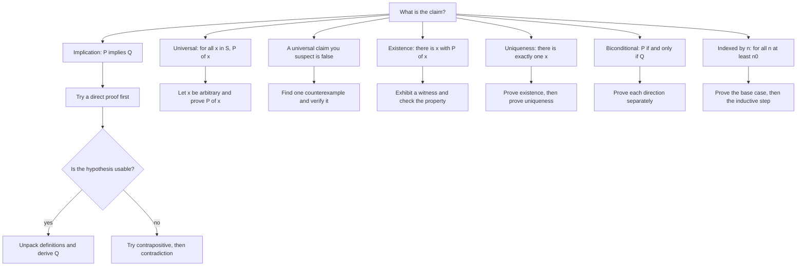

# Proof Techniques

> [Foundations](../README.md) · Level: Beginner → Intermediate · Prerequisites: [Set Theory](../03-set-theory/README.md), elementary algebra, arithmetic of integers · Estimated time: 120 min

## 1. Introduction

Mathematics differs from other sciences not in what it studies but in how it justifies its claims. A
physicist confirms a theory by experiment; a mathematician establishes a theorem by *proof*. A proof
is a chain of reasoning in which every step is licensed by a definition, an axiom, or a result already
proved. Nothing is accepted because it looks right, because it holds in many examples, or because an
authority says so.

This tutorial is about the *methods* by which such chains are built. The methods are few, and they are
learned by using them:

* **direct proof** — assume the hypothesis, derive the conclusion;
* **contrapositive** — prove "if not $Q$ then not $P$" instead of "if $P$ then $Q$";
* **contradiction** — assume the negation of what you want and derive an impossibility;
* **cases** — split the situation into finitely many exhaustive alternatives;
* **existence and uniqueness** — exhibit an object, then show there is no other;
* **biconditional** — prove both directions of an "if and only if";
* **induction** — a separate method for statements indexed by the natural numbers, previewed here;
* **counterexample** — the way to *disprove* a universal claim.

The two showcase results of this tutorial are proved completely: the irrationality of $\sqrt{2}$ and
Euclid's theorem that there are infinitely many primes. Both are ancient, both are short, and both
display the techniques in their purest form.

Set notation is used throughout; if it is unfamiliar, read
[Set Theory](../03-set-theory/README.md) first. In particular, the difference between an element and a
subset, and the meaning of $\varnothing$, will be assumed.

## 2. Prerequisites

* **Arithmetic and algebra** — expanding products, factoring, adding fractions, and the fact that a
  product of nonzero real numbers is nonzero.
* **Integers and divisibility** — you should be able to write an even integer as $2k$ and an odd one
  as $2k+1$ without hesitation.
* **Rational numbers** — that a rational number is a quotient $p/q$ of integers with $q \neq 0$, and
  that common factors may be cancelled.
* **Set notation** — elements, subsets, unions, intersections; see
  [Set Theory](../03-set-theory/README.md).
* **Elementary logic** — the words "and", "or", "not", "implies", "for all", "there exists". They are
  defined here, but prior exposure helps; the systematic treatment is
  [Propositional and First-Order Logic](../02-logic/README.md).

No previous experience with writing proofs is assumed. The tutorial is designed for a reader who can
follow a calculation but has never had to justify one rigorously.

## 3. Learning Objectives

By the end of this tutorial you will be able to:

1. Identify the hypothesis and the conclusion of a statement, and rewrite it in quantified form.
2. Write the converse, the contrapositive and the negation of a given implication, and say which of
   them are logically equivalent to the original.
3. Give a direct proof of a simple claim about integers, divisibility or parity.
4. Prove an implication by contrapositive when the direct route is awkward.
5. Prove a statement by contradiction, including the irrationality of $\sqrt{2}$ and the infinitude
   of the primes.
6. Prove existence and uniqueness statements with the standard two-part structure.
7. Distinguish constructive from non-constructive existence proofs, and explain what each establishes.
8. Structure a proof by cases and verify that the cases are exhaustive and mutually exclusive.
9. Prove a biconditional by proving both directions, and prove a chain of equivalences efficiently.
10. State the principle of induction and carry out a simple induction proof.
11. Disprove a universal statement with a counterexample, and explain why an example never proves a
    universal statement.
12. Recognise the standard logical errors — affirming the consequent, circular reasoning, division by
    zero, misuse of quantifiers — in your own and others' arguments.

## 4. Intuition

Think of a proof as a route on a map. The starting point is what you are given (the hypothesis, the
definitions, the axioms); the destination is what you must establish (the conclusion). A route is
valid if every step follows a road; a proof is valid if every step follows a rule.

Three consequences of this picture matter.

* **Different routes can reach the same place.** A theorem about even integers might be proved
  directly, by contrapositive, or by contradiction. All are acceptable; some are shorter. Choosing the
  route is the craft of proof writing, and it improves with practice.
* **A single broken step invalidates the whole route.** Unlike a physical journey, where a detour may
  still get you there, a proof with one unjustified step proves nothing. "It works for $n = 1,2,3$"
  is not a road; it is a guess.
* **The route must start where the reader is.** A proof may use only what has been established.
  Invoking a theorem that itself depends on the result being proved is circular — the route loops back
  on itself.

Another useful picture: a proof is a **conversation with a sceptic**. The sceptic grants you the
definitions and the axioms, and grants each step only if it follows by a rule. Your job is to leave no
gap where the sceptic can say "why?". This is why proofs spell out that an even number is $2k$, that a
prime greater than $1$ has no divisors other than $1$ and itself, and that a nonzero factor may be
cancelled.

Finally, a proof is not a summary of why you believe a statement. It is a *public* object: any
competent reader, following the same rules, must be able to check it and be compelled by it. That
publicity is what makes mathematics cumulative.

## 5. Formal Definition

**Definition 5.1 (Statement).** A *statement* (or *proposition*) is a sentence that is either true or
false, but not both. "7 is prime" and "$\sqrt{2} > 1$" are statements; "is 7 prime?" and "let $x$ be
a number" are not.

**Definition 5.2 (Predicate).** A *predicate* is a sentence $P(x)$ containing a variable $x$ (or
several variables); it becomes a statement when the variables are given values or are quantified. For
example $P(n)$: "$n$ is even" is a predicate on integers.

**Definition 5.3 (Quantifiers).** Let $S$ be a set and $P(x)$ a predicate.

* $\forall x \in S,\ P(x)$ means: for every element $x$ of $S$, $P(x)$ holds.
* $\exists x \in S,\ P(x)$ means: there is at least one $x \in S$ for which $P(x)$ holds.
* $\exists! x \in S,\ P(x)$ means: there is exactly one such $x$.

**Definition 5.4 (Implication and its relatives).** An *implication* has the form
$P \Rightarrow Q$, read "$P$ implies $Q$" or "if $P$ then $Q$". $P$ is the *hypothesis* (or
antecedent) and $Q$ the *conclusion* (or consequent).

* The *converse* of $P \Rightarrow Q$ is $Q \Rightarrow P$.
* The *contrapositive* is $(\neg Q) \Rightarrow (\neg P)$.
* The *negation* is $P \wedge (\neg Q)$, i.e. "$P$ and not $Q$".

Only the contrapositive is logically equivalent to the original (truth table in §8.1). The converse is
a different statement, and confusing the two is one of the most common errors in mathematics.

**Definition 5.5 (Axiom, definition, theorem, lemma, proposition, corollary, conjecture).**

* An *axiom* is a statement assumed without proof, as part of the description of the objects under
  study. The field axioms and the ZFC axioms are examples.
* A *definition* fixes the meaning of a term. It is not true or false; it is a convention, and it must
  be used exactly as stated.
* A *theorem* is a statement that has been proved.
* A *lemma* is a theorem proved mainly as a stepping stone to a larger result.
* A *proposition* is a theorem, usually of moderate importance; some authors use the word for any
  statement whatever (Definition 5.1), so context decides.
* A *corollary* is a theorem that follows quickly from another.
* A *conjecture* is a statement believed true but not proved. It is not a theorem, and it may not be
  used as one.

**Definition 5.6 (Proof).** A *proof* of a statement $S$ is a finite sequence of statements
$S_1, S_2, \dots, S_n = S$ such that each $S_i$ is

1. an axiom,
2. a definition used correctly,
3. a statement already proved (a theorem, lemma, or previously established line of this proof), or
4. a consequence of earlier statements obtained by a valid rule of inference.

A statement is *proved* when such a sequence has been exhibited. A step that satisfies none of
1–4 is a *gap*, and a proof containing a gap is not a proof.

**Definition 5.7 (Rules of inference used in this tutorial).** The following are the rules we shall
cite explicitly.

* *Modus ponens:* from $P$ and $P \Rightarrow Q$, conclude $Q$.
* *Modus tollens:* from $\neg Q$ and $P \Rightarrow Q$, conclude $\neg P$.
* *Conjunction:* from $P$ and $Q$, conclude $P \wedge Q$; conversely, from $P \wedge Q$ conclude $P$
  (and conclude $Q$).
* *Universal instantiation:* from $\forall x \in S,\ P(x)$ and $a \in S$, conclude $P(a)$.
* *Existential generalisation:* from $a \in S$ and $P(a)$, conclude $\exists x \in S,\ P(x)$.

Every other technique in this tutorial is a *strategy* for arranging these rules, not an additional
rule.

## 6. Mathematical Notation

| Symbol | Meaning | Read aloud |
|---|---|---|
| $\Rightarrow$ | implies | "if … then …" |
| $\Leftarrow$ | is implied by | "only if" |
| $\Leftrightarrow$ | if and only if | "iff" |
| $\neg$ | not | "not" |
| $\wedge$ | and | "and" |
| $\vee$ | or (inclusive) | "or" |
| $\forall$ | for all | "for every" |
| $\exists$ | there exists | "there is" |
| $\exists!$ | there exists exactly one | "there is a unique" |
| $\therefore$ | therefore | "therefore" |
| $\square$ or $\blacksquare$ | end of proof | (nothing) |
| $\mid$ | divides | "a divides b" |
| $a \equiv b \pmod{n}$ | congruent modulo $n$ | "a is congruent to b mod n" |
| $\in$, $\notin$ | element of, not an element of | "is in", "is not in" |
| $:=$ or $\overset{\text{def}}{=}$ | is defined to be | "is defined as" |
| WLOG | without loss of generality | "without loss of generality" |
| $\mathbb{N}, \mathbb{Z}, \mathbb{Q}, \mathbb{R}$ | number sets | "en, zed, cue, arr" |

Two conventions of exposition. First, "$P \Rightarrow Q$" is read as a promise: *if* $P$ holds, *then*
$Q$ holds. Nothing is asserted about the case where $P$ fails; a false hypothesis makes the
implication true, whatever $Q$ says. Second, "or" in mathematics is always inclusive unless stated
otherwise: "$P$ or $Q$" allows both.

## 7. Core Concepts

### 7.1 The Anatomy of a Statement

Before proving anything, rewrite the statement in a form where the quantifiers and the implication are
visible. Most failed proofs fail at this step.

**Example 7.1.** "Every square of an odd integer is odd" becomes

$$\forall n \in \mathbb{Z},\ \bigl(n \text{ odd}\bigr) \Rightarrow \bigl(n^2 \text{ odd}\bigr).$$

The hypothesis is "$n$ is odd"; the conclusion is "$n^2$ is odd"; both are predicates on an arbitrary
integer $n$.

**Example 7.2.** "There is no largest prime" is not an implication; its logical form is

$$\neg\,\exists p \in \mathbb{N},\ \bigl(p \text{ prime} \wedge \forall q \in \mathbb{N},\ (q \text{ prime} \wedge q > p) \Rightarrow \bot\bigr),$$

which is equivalent to $\forall p,\ \exists q > p$ with $q$ prime. Rewriting "there is no largest" as
"for every prime there is a larger one" turns a negative statement into a positive one and makes a
direct proof possible.

**Guidelines for the rewrite.**

1. Identify the quantifiers and their order; §8.3 shows that order matters.
2. Identify hypothesis and conclusion if the statement is an implication.
3. Write "even" as $2k$, "odd" as $2k+1$, "$a$ divides $b$" as $b = ak$, "rational" as $p/q$ — with
   the quantifier on $k$ or $p,q$ made explicit.
4. Check whether the statement is really an implication, a conjunction, a disjunction, or an
   existence claim. Each has a different proof shape.

### 7.2 Axioms, Definitions and Theorems

A proof is relative: it establishes a statement *from* something. The something is the axioms and the
definitions. Changing them changes what is provable.

**Axioms.** In this tutorial we use the ordinary arithmetic and order properties of $\mathbb{Z}$,
$\mathbb{Q}$ and $\mathbb{R}$ without comment: addition and multiplication are associative and
commutative, multiplication distributes over addition, $a \cdot 0 = 0$, $a \cdot 1 = a$, nonzero
elements have multiplicative inverses, and the order is compatible with arithmetic
($a < b \Rightarrow a + c < b + c$; $a < b$ and $c > 0$ $\Rightarrow ac < bc$).

**Definitions are not optional.** If a problem says "prove that $n$ is even", the proof must exhibit
$k$ with $n = 2k$. "It is divisible by $2$" is only a synonym; the definition is the thing to use.
Similarly, to prove that a prime $p$ divides a product, you may not invoke properties of primes that
have not been proved.

**Earlier theorems may be used.** Once the irrationality of $\sqrt{2}$ is proved, it may be quoted in
later proofs. Quoting a theorem whose proof used the statement you are now proving is circular.

**A worked illustration of the hierarchy.** The chain

> definition of divisibility $\to$ lemma: if $a \mid b$ and $b \mid c$ then $a \mid c$ $\to$
> theorem about prime divisors

is typical: small lemmas about divisibility support larger theorems about primes. Each link is proved
separately, and each is checked before it is used.

### 7.3 Direct Proof

A direct proof of $P \Rightarrow Q$ assumes $P$ and derives $Q$ by ordinary reasoning. It is the
default method, and it should be tried first.

**Theorem 7.3.** For all integers $m$ and $n$: if $m$ and $n$ are even, then $m + n$ is even.

*Proof.* Assume $m$ and $n$ are even. By definition there exist integers $a$ and $b$ with $m = 2a$ and
$n = 2b$. Then

$$m + n = 2a + 2b = 2(a + b).$$

Since $a + b \in \mathbb{Z}$, the number $m + n$ is twice an integer, hence even. $\square$

Notice the shape: hypothesis, unpacking by definition, algebra, repacking by definition. Every direct
proof about parity or divisibility has this shape.

**Theorem 7.4.** For all integers $m$ and $n$: if $m$ and $n$ are odd, then $mn$ is odd.

*Proof.* Write $m = 2a + 1$ and $n = 2b + 1$ with $a, b \in \mathbb{Z}$. Then

$$mn = (2a+1)(2b+1) = 4ab + 2a + 2b + 1 = 2(2ab + a + b) + 1.$$

The bracket is an integer, so $mn$ has the form $2k + 1$ and is odd. $\square$

**Theorem 7.5 (transitivity of divisibility).** For all integers $a, b, c$: if $a \mid b$ and
$b \mid c$, then $a \mid c$.

*Proof.* By definition, $a \mid b$ means $b = ak$ for some $k \in \mathbb{Z}$, and $b \mid c$ means
$c = b\ell$ for some $\ell \in \mathbb{Z}$. Substituting,

$$c = b\ell = (ak)\ell = a(k\ell).$$

Since $k\ell \in \mathbb{Z}$, this says $a \mid c$. $\square$

**When direct proof is awkward.** If the hypothesis gives you little to work with but the negation of
the conclusion is concrete, try contrapositive or contradiction. The next two subsections are exactly
that.

### 7.4 Proof by Contrapositive

The implication $P \Rightarrow Q$ is logically equivalent to $(\neg Q) \Rightarrow (\neg P)$ (§8.1).
So proving the contrapositive proves the original. This is useful when $\neg Q$ is a *positive*
statement — "even" is easier to handle than "not odd", for instance.

**Theorem 7.6.** For every integer $n$: if $n^2$ is even, then $n$ is even.

*Proof by contrapositive.* We prove: if $n$ is odd, then $n^2$ is odd. Let $n = 2k + 1$ with
$k \in \mathbb{Z}$. Then

$$n^2 = (2k+1)^2 = 4k^2 + 4k + 1 = 2(2k^2 + 2k) + 1,$$

which is odd. This is the contrapositive of the statement, so the statement is proved. $\square$

The direct approach would start "suppose $n^2 = 2m$" and would have to extract information about $n$
from a statement about $n^2$ — possible, but harder. The contrapositive goes with the grain of the
definitions.

**Theorem 7.7.** For every integer $n$: if $3n + 2$ is odd, then $n$ is odd.

*Proof by contrapositive.* Assume $n$ is even, $n = 2k$. Then

$$3n + 2 = 6k + 2 = 2(3k + 1),$$

which is even, i.e. not odd. This proves "if $n$ is not odd then $3n+2$ is not odd", which is the
contrapositive. $\square$

**Warning.** The contrapositive is not the converse. "$n$ even $\Rightarrow$ $n^2$ even" and
"$n^2$ even $\Rightarrow$ $n$ even" are different statements; Theorem 7.6 proves the second, using the
contrapositive "if $n$ is odd then $n^2$ is odd". The converse of Theorem 7.6 is also true — if $n$ is
even then $n^2$ is even — but it is a separate statement and needs its own (easy) proof.

### 7.5 Proof by Contradiction

To prove $S$ by contradiction, assume $\neg S$ and derive a statement known to be false — a
*contradiction*, often written $\bot$. Since a true statement cannot imply a falsehood, $\neg S$ must
be false, so $S$ is true.

To prove an implication $P \Rightarrow Q$ by contradiction, assume $P \wedge \neg Q$ (Definition 5.4)
and derive a contradiction.

**Theorem 7.8.** There is no rational number $r$ with $r^2 = 2$.

*Proof.* Suppose, for contradiction, that such an $r$ exists. Write $r = p/q$ with integers $p$ and
$q$, where $q \neq 0$, and with the fraction in lowest terms: $\gcd(p,q) = 1$. (Any rational has
such a representation: cancel all common factors.) Squaring gives $p^2/q^2 = 2$, hence

$$p^2 = 2q^2. \qquad (\ast)$$

We use the following fact, proved in Theorem 7.6: *if an integer's square is even, the integer is
even.* Since $p^2 = 2q^2$ is even, $p$ is even; write $p = 2m$ with $m \in \mathbb{Z}$. Substituting
into $(\ast)$,

$$(2m)^2 = 2q^2, \qquad 4m^2 = 2q^2, \qquad q^2 = 2m^2.$$

So $q^2$ is even, and by the same fact $q$ is even. Hence $2 \mid p$ and $2 \mid q$, contradicting
$\gcd(p,q) = 1$. Therefore no rational $r$ has $r^2 = 2$; equivalently, $\sqrt{2}$ is irrational.
$\square$

**Theorem 7.9 (Euclid).** There are infinitely many primes.

We first record a lemma.

**Lemma 7.10.** Every integer $n > 1$ has a prime divisor.

*Proof.* Suppose not, and let $m > 1$ be the least integer with no prime divisor; such an $m$ exists
by the well-ordering principle if the set of counterexamples is nonempty. The number $m$ is not prime,
because a prime is divisible by itself. Hence $m$ is composite: $m = ab$ with integers
$1 < a < m$ and $1 < b < m$. Since $a > 1$ and $a < m$, the minimality of $m$ says that $a$ has a
prime divisor $p$. Then $p \mid a$ and $a \mid m$, so $p \mid m$ by Theorem 7.5 — contradicting the
choice of $m$. Hence no counterexample exists. $\square$

*Proof of Theorem 7.9.* Suppose, for contradiction, that there are only finitely many primes, and list
them all: $p_1, p_2, \dots, p_n$. Consider

$$N = p_1 p_2 \cdots p_n + 1.$$

Then $N > 1$, so by Lemma 7.10 it has a prime divisor $p$. Since the list contains all primes,
$p = p_i$ for some $i$. Now $p_i$ divides $p_1p_2\cdots p_n$ (it is one of the factors) and $p_i$
divides $N$ (by choice of $p$), so $p_i$ divides the difference

$$N - p_1p_2\cdots p_n = 1.$$

No prime divides $1$, since primes are at least $2$. This contradiction shows that the list cannot be
complete. Therefore there are infinitely many primes. $\square$

Two remarks. First, $N$ itself need not be prime — the number $2\cdot3\cdot5\cdot7\cdot11\cdot13 + 1$
equals $30031 = 59 \cdot 509$ — and the proof does not claim it is; it only uses that $N$ has *some*
prime divisor outside the list. Second, the argument is constructive in spirit: given any finite list
of primes, it produces a prime not on the list.

### 7.6 Existence and Uniqueness Proofs

A statement of the form $\exists! x \in S,\ P(x)$ asserts two things, and its proof has two parts:

* **Existence:** exhibit an $x \in S$ with $P(x)$ — usually by solving, guessing, or constructing.
* **Uniqueness:** show that if $P(x)$ and $P(y)$ both hold, then $x = y$. Equivalently, there cannot
  be two distinct objects with the property.

**Theorem 7.11.** Let $a, b \in \mathbb{R}$ with $a \neq 0$. The equation $ax + b = 0$ has exactly one
real solution.

*Proof.* *Existence.* Put $x_0 = -b/a$, which is defined because $a \neq 0$. Then

$$a x_0 + b = a\left(-\frac{b}{a}\right) + b = -b + b = 0.$$

So a solution exists.

*Uniqueness.* Let $x_1$ and $x_2$ be real numbers with $a x_1 + b = 0$ and $a x_2 + b = 0$. Subtracting
the second equation from the first,

$$a x_1 - a x_2 = 0, \qquad \text{i.e.} \qquad a(x_1 - x_2) = 0.$$

Since $a \neq 0$, it has a multiplicative inverse $a^{-1}$, and multiplying by it gives
$x_1 - x_2 = 0$, i.e. $x_1 = x_2$. Hence there is at most one solution, and together with existence,
exactly one. $\square$

**Structure to memorise.** Existence first (it tells the reader what the object is), uniqueness second
(it tells the reader that the object just exhibited is the only one). For a statement of the form
"there is exactly one", both parts are mandatory; proving existence alone is a common and serious
error.

**Uniqueness without an explicit formula.** Sometimes existence is proved by a theorem (for example an
intermediate value theorem) and uniqueness by monotonicity. The logical structure is the same.

### 7.7 Constructive versus Non-Constructive Existence

An existence proof is *constructive* if it produces the object, or at least an algorithm that finds it.
It is *non-constructive* if it shows that some object must exist without identifying one.

**Theorem 7.12.** There exist irrational numbers $x$ and $y$ such that $x^{y}$ is rational.

*Proof.* Consider the number $\alpha = \sqrt{2}^{\sqrt{2}}$. By the law of excluded middle, $\alpha$ is
either rational or irrational — one of the two cases holds, and we do not need to know which.

*Case 1: $\alpha$ is rational.* Take $x = y = \sqrt{2}$. Both are irrational (Theorem 7.8), and
$x^{y} = \alpha$ is rational by the case hypothesis.

*Case 2: $\alpha$ is irrational.* Take $x = \alpha$ and $y = \sqrt{2}$. Then $x$ is irrational by the
case hypothesis and $y$ is irrational. Moreover, using the exponent law
$(a^{b})^{c} = a^{bc}$ for $a > 0$ and real $b, c$,

$$x^{y} = \left(\sqrt{2}^{\sqrt{2}}\right)^{\sqrt{2}} = \sqrt{2}^{\sqrt{2}\cdot\sqrt{2}} = \sqrt{2}^{2} = 2,$$

which is rational.

In either case, irrational $x$ and $y$ exist with $x^y$ rational. $\square$

The proof is *non-constructive*: it does not tell us whether the pair is
$(\sqrt2,\sqrt2)$ or $(\sqrt2^{\sqrt2},\sqrt2)$. (In fact $\sqrt{2}^{\sqrt{2}}$ is irrational, by the
Gelfond–Schneider theorem, but that is a much deeper result and is not needed.) A non-constructive
proof is a complete proof: existence is established even though no witness is named.

**Theorem 7.13 (constructive existence).** There exist integers $x$ and $y$ with $7x + 5y = 1$.

*Proof.* Take $x = 3$ and $y = -4$: then $7 \cdot 3 + 5 \cdot (-4) = 21 - 20 = 1$. $\square$

This one exhibits the witness, so it is constructive. Both kinds of proof are acceptable in ordinary
mathematics; constructive proofs are preferred when they are available, and are essential in
computational settings.

### 7.8 Proof by Cases

To prove $S$ by cases, find finitely many statements $C_1, \dots, C_k$ such that

* at least one $C_i$ is always true (*exhaustive*), and
* no two hold simultaneously, or if they do, the argument works anyway (*often mutually exclusive*).

Then prove $C_i \Rightarrow S$ for each $i$.

**Theorem 7.14.** For every integer $n$, $n^2$ leaves remainder $0$ or $1$ on division by $4$.

*Proof by cases.* Every integer is even or odd, and these cases are exhaustive and mutually exclusive.

*Case 1: $n$ is even.* Write $n = 2k$. Then $n^2 = 4k^2$, which leaves remainder $0$.

*Case 2: $n$ is odd.* Write $n = 2k + 1$. Then

$$n^2 = 4k^2 + 4k + 1 = 4(k^2 + k) + 1,$$

which leaves remainder $1$.

In both cases $n^2 \equiv 0$ or $1 \pmod 4$. $\square$

**Choosing the cases.** Good cases mirror the definitions: even/odd for parity, sign for absolute
values and inequalities, $n = 0$ versus $n > 0$ for division, the possible residue classes modulo a
fixed number for divisibility problems. Bad cases overlap or leave a gap; either flaw breaks the proof.

**Theorem 7.15 (triangle inequality, one-dimensional).** For all real $x, y$,
$|x + y| \le |x| + |y|$.

*Proof by cases on signs.* Recall that $|z| = z$ if $z \ge 0$ and $|z| = -z$ if $z < 0$.

*Case 1: $x + y \ge 0$.* Then $|x+y| = x+y$. Also $x \le |x|$ and $y \le |y|$ (check: if $x \ge 0$
then $x = |x|$; if $x < 0$ then $x < 0 < -x = |x|$). Adding gives $x + y \le |x| + |y|$, so
$|x+y| \le |x| + |y|$.

*Case 2: $x + y < 0$.* Then $|x+y| = -(x+y) = (-x) + (-y) \le |x| + |y|$, because $-x \le |x|$ and
$-y \le |y|$ (the same check with signs reversed).

The two cases exhaust all real $x,y$. $\square$

### 7.9 Biconditional Proofs

To prove $P \Leftrightarrow Q$, prove $P \Rightarrow Q$ and $Q \Rightarrow P$. Each direction may use
a different technique.

**Theorem 7.16.** For every integer $n$, $n$ is odd if and only if $n^2$ is odd.

*Proof.* We prove both directions.

*($\Rightarrow$)* Assume $n$ is odd, $n = 2k+1$. Then $n^2 = 2(2k^2+2k) + 1$, which is odd — exactly
the computation of Theorem 7.4 with $m = n$.

*($\Leftarrow$)* We prove the contrapositive: if $n$ is even, then $n^2$ is even. Write $n = 2k$; then
$n^2 = 4k^2 = 2(2k^2)$, even. This is the contrapositive of "$n^2$ odd $\Rightarrow$ $n$ odd", so that
implication holds.

Both directions hold, hence the equivalence. $\square$

**Chains of equivalences.** To prove that three statements $P_1, P_2, P_3$ are equivalent, it suffices
to prove the cycle $P_1 \Rightarrow P_2 \Rightarrow P_3 \Rightarrow P_1$. Three implications give all
six directions, because implications compose. [Set Theory §8.4](../03-set-theory/README.md) uses
exactly this pattern for three characterisations of $A \subseteq B$.

**Common error.** Proving $P \Rightarrow Q$ and then asserting $Q \Rightarrow P$ "by symmetry" when
the situation is *not* symmetric. Symmetry must be justified: either the statement really is symmetric
in its variables, or a separate argument is needed.

### 7.10 Induction Preview

Induction proves a statement $P(n)$ for all $n \in \mathbb{N}$ (or all $n$ beyond some starting
value). It has two parts.

> **Principle of Mathematical Induction.** If $P(0)$ is true, and if for every $k \in \mathbb{N}$ the
> truth of $P(k)$ implies the truth of $P(k+1)$, then $P(n)$ is true for every $n \in \mathbb{N}$.

The principle is a property of $\mathbb{N}$; it is not a definition of "and so on". It is the tool
behind the formula $|\mathcal{P}(A)| = 2^{|A|}$ in
[Set Theory](../03-set-theory/README.md), and it will be developed fully in a later topic. One example
here shows the mechanics.

**Theorem 7.17.** For every $n \ge 1$, the sum of the first $n$ odd positive integers is $n^2$:

$$1 + 3 + 5 + \cdots + (2n-1) = n^2.$$

*Proof by induction.* *Base case $n = 1$:* the left side is $1$ and the right side is $1^2 = 1$. ✓

*Inductive step.* Assume the formula holds for some $n \ge 1$:
$1 + 3 + \cdots + (2n-1) = n^2$. Then

$$1 + 3 + \cdots + (2n-1) + \bigl(2(n+1) - 1\bigr) = n^2 + (2n+1) = (n+1)^2.$$

So the formula holds for $n+1$. By the principle of induction it holds for every $n \ge 1$. $\square$

Two warnings. The base case is not optional — without it the induction proves nothing (consider
"$P(n)$: $n = n+1$", whose inductive step is valid but whose base case fails). And the inductive step
must use the assumption $P(k)$ for a *general* $k$; verifying $P(k) \Rightarrow P(k+1)$ only for one
particular $k$ proves nothing new.

### 7.11 Counterexamples and How to Disprove

A universal statement $\forall x \in S,\ P(x)$ is disproved by a single element $a \in S$ with
$\neg P(a)$. Such an $a$ is a *counterexample*. One counterexample is a complete proof that the
universal statement is false; conversely, no number of confirming examples proves a universal
statement.

**Example 7.18 (three disproofs).**

* "Every prime is odd" is false: $2$ is prime and even.
* "For all real $x$, $x^2 > x$" is false: $x = 0$ gives $0 > 0$, and $x = \tfrac12$ gives
  $\tfrac14 > \tfrac12$, both false.
* "For all integers $n \ge 0$, $n^2 - n + 41$ is prime" is false: at $n = 41$,
  $41^2 - 41 + 41 = 41^2$, which is composite. Indeed for any $k \ge 1$, at $n = 41k$,
  $$n^2 - n + 41 = 41^2k^2 - 41k + 41 = 41(41k^2 - k + 1),$$
  a product of two integers greater than $1$, hence composite. So the statement fails infinitely
  often.

**Disproving an existential statement is different.** To disprove $\exists x \in S,\ P(x)$ you must
prove $\forall x \in S,\ \neg P(x)$ — a universal theorem, not a counterexample. For instance,
"there exists an integer $n$ with $n^2 = 2$" is disproved by proving that no integer squares to $2$,
which requires an argument (the square of an integer is $0, 1, 4, 9, \dots$; more precisely,
$n^2 = 2$ forces $n = \pm\sqrt2$, which is not an integer because $1^2 < 2 < 2^2$ and $n^2$ is
increasing on $n \ge 0$).

**Where counterexamples come from.** Test the boundary cases first: $0$, $1$, negative numbers, the
smallest prime, the empty set, the case of equality. Most false statements fail at a boundary. If a
statement survives many tests, that is evidence but not proof; it is time to look for a proof.

### 7.12 Writing Proofs Well

A proof is read by another person (or by you, in a year). Write it so that the reader can check every
step without reconstructing your thoughts.

**A practical template.**

1. **State what you prove.** "We prove that for all integers $n$, if $n$ is odd then $n^2$ is odd."
   Restating in quantified form removes ambiguity.
2. **Announce the method.** "We argue by contrapositive." "We proceed by contradiction." "We split
   into the cases $n$ even and $n$ odd." This tells the reader what to expect and what is being
   assumed.
3. **Introduce every object with its type and its defining property.** "Let $n = 2k+1$ with
   $k \in \mathbb{Z}$." Never let a symbol appear from nowhere.
4. **Justify each step.** Cite a definition ("by definition of divisibility"), an axiom, or a theorem
   by name or number. Algebra may be compressed, but the *reason* for a non-obvious move should be
   visible.
5. **Do not say "clearly" unless it is.** If a step needs a line, give the line.
6. **Handle all cases and the edge cases.** Did you use $a \neq 0$? Did you divide by something that
   might vanish? Is $n = 0$ covered? Is the set empty?
7. **Close the loop.** State the conclusion explicitly — "therefore $n^2$ is odd, as required" — and
   mark the end with $\square$.

**Two directions of work.** It is legitimate to work *backwards* from the goal to find a route, then
present the proof forwards. What is not legitimate is presenting the backward work as if it were a
proof: starting from the statement to be proved and manipulating until you reach something true proves
nothing unless every step is reversible.

**Length and detail.** A proof should be as long as necessary to be checkable and no longer. A
one-line proof of a one-line claim is fine; a claim whose proof requires a lemma should state and
prove the lemma.

### 7.13 Common Logical Errors

These errors appear in student work, in published papers, and in everyday argument. Learn to recognise
them.

1. **Affirming the consequent.** From $P \Rightarrow Q$ and $Q$, concluding $P$. Invalid: the truth
   table (§8.1) shows $P \Rightarrow Q$ can be true while $P$ is false and $Q$ is true. Example: "If
   it rains, the ground is wet. The ground is wet. Therefore it rained." (It may have been sprinklers.)
2. **Denying the antecedent.** From $P \Rightarrow Q$ and $\neg P$, concluding $\neg Q$. Invalid for
   the same reason.
3. **Confusing a statement with its converse.** "All primes are odd" and "all odd numbers are prime"
   are different claims; the second is false.
4. **Proof by example.** Concluding a universal statement from several instances. $n^2 - n + 41$ is
   prime for $n = 0, 1, \dots, 40$, and fails at $n = 41$: forty-one confirmations, one refutation.
5. **Circular reasoning (begging the question).** Using the statement to be proved, or a result that
   depends on it, as a step in its own proof.
6. **Division by zero.** Cancelling a factor that may be zero. The classic "proof" that $1 = 2$ starts
   with $a = b$ and divides by $a - b = 0$.
7. **Assuming what is to be proved.** "Suppose the theorem is true; then …" followed by a derivation
   of a true statement — this shows only that the theorem implies something true, not that it is true.
8. **Misusing quantifiers.** Treating $\exists y\, \forall x$ as if it were $\forall x\, \exists y$
   (§8.3), or negating $\forall$ incorrectly.
9. **Negating incorrectly.** The negation of "all primes are odd" is "some prime is even", not "all
   primes are even".
10. **Appeal to authority or to consensus.** A theorem is true because it has a proof, not because a
    textbook says so (although a textbook's claim is usually a reason to expect a proof exists).
11. **Not checking edge cases.** Forgetting $n = 0$, the empty set, the case of equality, or the case
    where a denominator vanishes.
12. **Proving only one direction of an "if and only if".** Or proving only one inclusion of a set
    equality ([Set Theory §8.4](../03-set-theory/README.md)).

## 8. Formulas and Properties

### 8.1 The Truth Table of Implication

Here $1$ means true and $0$ false. The table lists every possible combination of truth values.

| $P$ | $Q$ | $P \Rightarrow Q$ | $\neg Q \Rightarrow \neg P$ | $Q \Rightarrow P$ | $\neg P \vee Q$ | $P \wedge \neg Q$ |
|---|---|---|---|---|---|---|
| 1 | 1 | 1 | 1 | 1 | 1 | 0 |
| 1 | 0 | 0 | 0 | 0 | 0 | 1 |
| 0 | 1 | 1 | 1 | 1 | 1 | 0 |
| 0 | 0 | 1 | 1 | 1 | 1 | 0 |

Reading the columns:

* **Contrapositive.** The third and fourth columns are identical, so
  $P \Rightarrow Q \equiv \neg Q \Rightarrow \neg P$. This is the licence for proof by contrapositive.
* **Converse.** The fifth column differs from the third in rows 2 and 3, so $Q \Rightarrow P$ is not
  equivalent to $P \Rightarrow Q$.
* **Disjunction form.** The third and sixth columns coincide: $P \Rightarrow Q \equiv \neg P \vee Q$.
* **Negation.** The seventh column shows $\neg(P \Rightarrow Q) \equiv P \wedge \neg Q$. So to negate an
  implication, keep the hypothesis and negate the conclusion; to *prove* an implication by
  contradiction, assume exactly that.

**Why a false hypothesis makes the implication true.** The statement "if $P$ then $Q$" makes a claim
only in the case where $P$ holds. When $P$ is false, the implication has made no promise and is
recorded as true. This convention is forced by the desire that "if $P$ then $Q$" be equivalent to
"not ($P$ and not $Q$)", which fails only when $P$ is true and $Q$ is false.

### 8.2 Negation Rules

| Statement | Negation |
|---|---|
| $\neg P$ | $P$ |
| $P \wedge Q$ | $\neg P \vee \neg Q$ |
| $P \vee Q$ | $\neg P \wedge \neg Q$ |
| $P \Rightarrow Q$ | $P \wedge \neg Q$ |
| $\forall x \in S,\ P(x)$ | $\exists x \in S,\ \neg P(x)$ |
| $\exists x \in S,\ P(x)$ | $\forall x \in S,\ \neg P(x)$ |
| $\forall x\, \exists y,\ P(x,y)$ | $\exists x\, \forall y,\ \neg P(x,y)$ |
| $\exists x\, \forall y,\ P(x,y)$ | $\forall x\, \exists y,\ \neg P(x,y)$ |

The quantifier rules are the infinite versions of De Morgan's laws: "not all" means "some fails", and
"none" means "all fail". The last two rows show that a negation moves inward and flips each
quantifier it passes.

**Example 8.1.** The negation of "every prime is odd" is "there exists a prime that is not odd", i.e.
"there exists an even prime" — which is true ($2$). Since the negation is true, the original universal
statement is false; this is a counterexample proof in disguise.

**Example 8.2.** The negation of "for every $\varepsilon > 0$ there is $\delta > 0$ such that for all
$x$, $|x| < \delta$ implies $|f(x)| < \varepsilon$" is

$$\exists \varepsilon > 0\ \forall \delta > 0\ \exists x\ \bigl(|x| < \delta \wedge |f(x)| \ge \varepsilon\bigr).$$

Negating such statements mechanically, one quantifier and one connective at a time, is much safer than
doing it "by feel".

### 8.3 Quantifier Order

The order of quantifiers changes the meaning. Compare, over the real numbers:

$$\forall x\ \exists y\ (y > x) \qquad \text{and} \qquad \exists y\ \forall x\ (y > x).$$

The first is true: given any $x$, take $y = x + 1$. The second is false: it claims a single real number
larger than every real number. The first allows $y$ to depend on $x$; the second does not.

This distinction is everywhere in analysis: "for every $\varepsilon$ there is $\delta$" describes
continuity, while "there is $\delta$ for every $\varepsilon$" is a much stronger (and usually false)
claim. When you write a proof of a $\forall x \exists y$ statement, the object $y$ must be constructed
*after* $x$ is known, and may depend on it. When the statement is $\exists y \forall x$, the single
$y$ must be produced first and must work for all $x$.

### 8.4 Proof Templates

| Goal | First line of the proof | What must appear |
|---|---|---|
| $P \Rightarrow Q$, direct | "Assume $P$." | derivation of $Q$ |
| $P \Rightarrow Q$, contrapositive | "We prove the contrapositive: assume $\neg Q$." | derivation of $\neg P$ |
| $P \Rightarrow Q$, contradiction | "Suppose $P$ and $\neg Q$." | an impossibility |
| $S$ (any statement), contradiction | "Suppose $\neg S$." | an impossibility |
| $\forall x \in S,\ P(x)$ | "Let $x \in S$ be arbitrary." | derivation of $P(x)$ depending only on $x \in S$ |
| $\exists x \in S,\ P(x)$ | "Take $x = \cdots$" or "Let $x = \cdots$" | verification that $P(x)$ holds |
| $\exists! x \in S,\ P(x)$ | "Existence: …" | existence, then uniqueness |
| $P \Leftrightarrow Q$ | "($\Rightarrow$)" | both directions |
| $P_1 \Leftrightarrow P_2 \Leftrightarrow P_3$ | "We prove $P_1 \Rightarrow P_2 \Rightarrow P_3 \Rightarrow P_1$." | the cycle |
| $\forall n \ge n_0,\ P(n)$ | "Base case … Inductive step …" | both parts |
| $\neg(\forall x,\ P(x))$ | "Consider $x = \cdots$" | one counterexample |

### 8.5 Valid Argument Forms

The following forms are valid and may be used without comment once the pattern is recognised.

* *Modus ponens:* $P$, $P \Rightarrow Q$ $\therefore$ $Q$.
* *Modus tollens:* $\neg Q$, $P \Rightarrow Q$ $\therefore$ $\neg P$.
* *Transitivity:* $P \Rightarrow Q$, $Q \Rightarrow R$ $\therefore$ $P \Rightarrow R$.
* *Case analysis:* $P \vee Q$, $P \Rightarrow R$, $Q \Rightarrow R$ $\therefore$ $R$.
* *Contradiction:* $\neg S \Rightarrow \bot$ $\therefore$ $S$.
* *Equivalence splitting:* $P \Leftrightarrow Q$ $\therefore$ $P \Rightarrow Q$ and $Q \Rightarrow P$.

The following forms are **invalid**, although they resemble valid ones: $P \Rightarrow Q$, $Q$
$\therefore$ $P$ (affirming the consequent); $P \Rightarrow Q$, $\neg P$ $\therefore$ $\neg Q$ (denying
the antecedent); $P \Rightarrow Q$, $P \Rightarrow R$ $\therefore$ $Q \Rightarrow R$.

## 9. Step-by-Step Examples

### Example 9.1 (Direct proof)

Prove that the sum of any three consecutive integers is divisible by $3$.

**Solution.** Let the integers be $n$, $n+1$, $n+2$ with $n \in \mathbb{Z}$. Their sum is

$$n + (n+1) + (n+2) = 3n + 3 = 3(n+1).$$

Since $n + 1 \in \mathbb{Z}$, the sum is three times an integer, hence divisible by $3$. $\square$

*Note the structure:* introduce the objects with their type, compute, factor out $3$, and interpret the
result through the definition of divisibility.

### Example 9.2 (Proof by contrapositive)

Prove that for every real number $x$: if $x^2$ is irrational, then $x$ is irrational.

**Solution.** We prove the contrapositive: if $x$ is rational, then $x^2$ is rational.

Assume $x$ is rational. Then $x = p/q$ for some $p, q \in \mathbb{Z}$ with $q \neq 0$. Hence

$$x^2 = \frac{p^2}{q^2}.$$

Now $p^2$ and $q^2$ are integers and $q^2 \neq 0$ (a product of nonzero integers is nonzero), so
$x^2$ is a quotient of integers with nonzero denominator, i.e. rational. This proves the
contrapositive, hence the original statement. $\square$

*Why contrapositive:* the hypothesis "$x^2$ is irrational" gives no usable equation, while the
negation "$x$ is rational" immediately provides $p/q$.

### Example 9.3 (Proof by contradiction)

Prove that no integer $n$ satisfies $n^2 \equiv 2 \pmod 4$.

**Solution.** Suppose, for contradiction, that $n^2 \equiv 2 \pmod 4$ for some integer $n$. By
Theorem 7.14, $n^2 \equiv 0$ or $n^2 \equiv 1 \pmod 4$. So $2 \equiv 0$ or $2 \equiv 1 \pmod 4$, which
would mean $4 \mid 2$ or $4 \mid 1$; neither is true. Contradiction. Hence no such $n$ exists. $\square$

*Note:* this proof quotes a previously proved theorem. That is exactly how proofs are built: each new
result stands on the ones before it.

### Example 9.4 (Proof by cases)

Prove that for every real number $x$,
$$|x - 3| + |x + 1| \ge 4.$$

**Solution.** The expressions $x - 3$ and $x + 1$ change sign at $x = 3$ and $x = -1$ respectively, so
we split the real line at those two points. The cases are exhaustive: every real $x$ satisfies exactly
one of $x < -1$, $-1 \le x < 3$, $x \ge 3$.

*Case 1: $x \ge 3$.* Then $x - 3 \ge 0$ and $x + 1 > 0$, so $|x-3| = x-3$ and $|x+1| = x+1$. Hence

$$|x-3| + |x+1| = (x-3) + (x+1) = 2x - 2 \ge 2\cdot 3 - 2 = 4.$$

*Case 2: $-1 \le x < 3$.* Then $x - 3 < 0$ and $x + 1 \ge 0$, so $|x-3| = 3-x$ and $|x+1| = x+1$.
Hence

$$|x-3| + |x+1| = (3-x) + (x+1) = 4 \ge 4.$$

*Case 3: $x < -1$.* Then $x - 3 < 0$ and $x + 1 < 0$, so $|x-3| = 3-x$ and $|x+1| = -(x+1)$. Hence

$$|x-3| + |x+1| = (3-x) - (x+1) = 2 - 2x > 2 - 2(-1) = 4,$$

because $x < -1$ gives $-2x > 2$.

In all three cases the inequality holds. $\square$

*Check:* at $x = 1$ (inside case 2) the sum is $|{-2}| + |2| = 4$; at $x = 5$ it is $2 + 6 = 8$; at
$x = -3$ it is $6 + 2 = 8$. The minimum $4$ is attained exactly on the interval $[-1,3]$.

### Example 9.5 (Existence and uniqueness)

Prove that there is exactly one pair $(x,y)$ of real numbers satisfying
$$x + y = 5, \qquad x - y = 1.$$

**Solution.** *Existence.* Take $x = 3$ and $y = 2$. Then $x + y = 5$ and $x - y = 1$. ✓

*Uniqueness.* Suppose $(x,y)$ and $(x',y')$ are both solutions. Then

$$x + y = 5 = x' + y' \qquad \text{and} \qquad x - y = 1 = x' - y'.$$

Adding the two equations for the unprimed pair gives $2x = 6$, so $x = 3$; subtracting gives $2y = 4$,
so $y = 2$. The same computation for the primed pair gives $x' = 3$ and $y' = 2$. Hence
$(x,y) = (x',y')$. Therefore the solution is unique. $\square$

*Remark:* the uniqueness argument did not use the primed pair at all beyond observing that it satisfies
the same equations; this is the standard shape. Often uniqueness is proved by subtracting the two
systems and showing that the difference must vanish.

### Example 9.6 (Biconditional)

Prove that for every real number $x$,
$$x^2 = x \quad \Longleftrightarrow \quad x \in \{0, 1\}.$$

**Solution.** We prove both directions.

*($\Rightarrow$)* Assume $x^2 = x$. Then $x^2 - x = 0$, i.e. $x(x-1) = 0$. A product of real numbers
is zero only if one of the factors is zero, so $x = 0$ or $x - 1 = 0$. Hence $x \in \{0,1\}$.

*($\Leftarrow$)* Assume $x \in \{0,1\}$. If $x = 0$, then $x^2 = 0 = x$. If $x = 1$, then
$x^2 = 1 = x$. In both cases $x^2 = x$. $\square$

*Remark:* the forward direction used the zero-product property, which is a field axiom; the reverse
direction was a two-case verification. Biconditional proofs often pair a substantive direction with a
trivial one.

## 10. Visual Explanations

The first decision in any proof is *which method fits the shape of the claim*. The flowchart below
encodes the advice of §7; it is a guide, not an algorithm — sometimes two methods both work, and
sometimes the first attempt fails and you backtrack.

The second table records what a finished proof of each shape must *contain*, as opposed to how to find
it. Use it as a checklist before submitting a proof.

| Claim shape | Non-negotiable ingredients |
|---|---|
| $P \Rightarrow Q$ | an explicit assumption of $P$, an explicit derivation of $Q$ |
| $\forall x \in S,\ P(x)$ | an arbitrary $x$, with no special property beyond $x \in S$ |
| $\exists x \in S,\ P(x)$ | a named witness and a verification |
| $\exists! x$ | existence **and** uniqueness, both labelled |
| $P \Leftrightarrow Q$ | both directions, each labelled |
| $\forall n \ge n_0,\ P(n)$ | base case **and** inductive step |
| $\neg(\forall x,\ P(x))$ | one specific counterexample, checked numerically |

## 11. Common Mistakes

1. **Starting from what you want to prove.** Writing "$n^2$ is odd, so $n$ is odd, so …" begins with
   the conclusion. Work backwards to *find* the proof if you like, but write it forwards: from
   hypotheses to conclusion, or from the negation of the conclusion to a contradiction.

2. **Treating a non-reversible step as reversible.** From $x = y$ one may infer $x^2 = y^2$, but not
   conversely. Squaring, multiplying by an expression that might be zero, and taking square roots
   without care are the usual culprits.

3. **Proving the converse by accident.** If the task is "$n^2$ even $\Rightarrow$ $n$ even", the proof
   "assume $n$ even, then $n^2$ even" proves the converse (which here is also true, but irrelevant).
   Check that the first line matches the hypothesis of the actual claim.

4. **Letting a variable depend on what it must not depend on.** In a proof of
   $\exists y\, \forall x$, the value of $y$ must be chosen before $x$ is mentioned. In a proof of
   $\forall x\, \exists y$, the value of $y$ may (and usually must) depend on $x$. Mixing the two is
   the quantifier error of §8.3.

5. **Forgetting the case $n = 0$, the empty set, or $a = 0$.** Division by a quantity that can vanish,
   an induction missing its base case, and a set identity asserted for the empty set without checking
   are all instances. Add the edge case explicitly.

6. **Saying "clearly" where a line is needed.** "Clearly $n^2 + n$ is even" hides a one-line argument
   ($n^2 + n = n(n+1)$, a product of consecutive integers, one of which is even). Give the line.

7. **Proving a special case and claiming the general one.** Checking $n = 1, 2, 3$ establishes three
   cases, not the universal statement. In particular, one example never proves "for all".

8. **Confusing necessary and sufficient conditions.** "If $n$ is divisible by $6$ then $n$ is divisible
   by $3$" is true; "if $n$ is divisible by $3$ then $n$ is divisible by $6$" is false. Knowing which
   direction a hypothesis supplies prevents many errors.

9. **Using a theorem outside its hypotheses.** The formula $\sqrt{ab} = \sqrt a\sqrt b$ requires
   $a, b \ge 0$; the cancellation $ac = bc \Rightarrow a = b$ requires $c \neq 0$. State the
   hypotheses, then check them.

10. **"Without loss of generality" with no symmetry.** WLOG is legitimate only when the cases are
    related by a symmetry that preserves the claim (for example, swapping $x$ and $y$ when the
    statement is symmetric in $x$ and $y$). Otherwise it silently drops cases.

11. **Circular citation.** Using a result whose proof depends on the theorem being proved — or on a
    theorem from a later chapter — is not a proof. Check the dependency order.

12. **Hiding an assumption.** If the argument needs $x \neq 0$, write it. An undisclosed hypothesis is
    a gap: the sceptical reader is entitled to test the boundary case $x = 0$.

## 12. Applications

**Program correctness.** A loop invariant is a statement proved by induction: it holds before the loop
and is preserved by each iteration, so it holds afterwards. Sorting algorithms, binary search and
compilers are verified this way, and tools such as model checkers search for the counterexamples that a
careless proof overlooks. The distinction between "true on all tested inputs" and "true on all inputs"
is exactly the distinction between testing and proof.

**Cryptography and security.** The correctness of RSA is a one-line application of Fermat's little
theorem; its *security* rests on a different kind of statement — that factoring is hard, which is a
conjecture, not a theorem. Distinguishing proved guarantees from conjectured hardness is part of the
discipline, and the language of hypotheses and conclusions makes the distinction precise.

**Algorithm analysis.** Bounds such as "$T(n) \le cn\log n$ for all $n \ge n_0$" are universal
statements, proved by induction or by the master theorem. A single bad input is a counterexample, which
is why worst-case analysis quantifies over *all* inputs rather than a sample.

**Law and policy.** Legal reasoning is explicitly rule-based: a statute supplies the hypothesis, the
facts must satisfy it, and the conclusion follows. Arguments in court are judged by their form as well
as their content — the same modus ponens and the same fallacies (affirming the consequent, appeal to
authority) appear in both disciplines.

**Mathematics itself.** Every theorem in this repository is an application of the techniques here. The
irrationality of $\sqrt2$ (Theorem 7.8) and Euclid's theorem (Theorem 7.9) are two examples; Cantor's
diagonal argument in [Set Theory §7.11](../03-set-theory/README.md) is a third, and it is a proof by
contradiction whose core is a construction.

**Artificial intelligence and formal methods.** Interactive theorem provers (Coq, Lean, Isabelle) and
SMT solvers check proofs mechanically, which forces every step to be explicit — the same standard this
tutorial asks of a human writer. The exercise of formalising a proof is the best cure for hidden
assumptions.

## 13. Exercises

The problem set is in [exercises.md](exercises.md). It contains 34 problems in four levels:
**Beginner** (11 problems on statements, contrapositives, negations and short direct proofs),
**Intermediate** (10 problems on contrapositive, contradiction, cases and biconditionals),
**Advanced** (9 problems, including $\sqrt3$ and $\sqrt2+\sqrt3$ irrationality, a general irrationality
criterion and a no-solution proof) and **Challenge** (4 problems: primes congruent to $3$ modulo $4$,
irrationals in every interval, the $2^n-1$ criterion, and an analysis of a proof that every odd square
is $1$ modulo $8$).

Problems are numbered continuously from 1 to 34. Attempt them with the tutorial closed; each problem
names the section that supplies the needed technique.

## 14. Solutions

Complete worked solutions are in [solutions.md](solutions.md), with the same numbering and the same
level headings. Every solution states its strategy, shows each significant step, and gives a full proof
where the problem asks for one. Where a problem is designed to expose an error, the solution identifies
the exact step at which the error occurs and explains why it is fatal.

## 15. Summary

* A proof is a finite chain of statements, each of which is an axiom, a definition, a previously proved
  result, or a consequence of earlier lines by a valid rule of inference.
* Rewrite a claim in quantified form before proving it: identify the hypothesis, the conclusion and
  the quantifier order.
* Direct proof: assume the hypothesis, unpack the definitions, derive the conclusion.
* Contrapositive: $P \Rightarrow Q$ is equivalent to $\neg Q \Rightarrow \neg P$; prove the latter when
  the negation of the conclusion is more concrete than the hypothesis.
* Contradiction: assume the negation of the claim and derive an impossibility. The irrationality of
  $\sqrt2$ and Euclid's theorem are the canonical examples; both are proved in full in §7.5.
* Existence and uniqueness: exhibit a witness, then show any two candidates coincide.
* Constructive proofs name a witness; non-constructive proofs show that a witness must exist without
  naming one. Both are valid.
* Proof by cases: split into finitely many exhaustive cases and treat each. Verify exhaustiveness
  before starting.
* Biconditional: prove both directions; a cycle of implications proves several equivalences at once.
* Induction: base case plus an inductive step; the principle is a property of $\mathbb{N}$, and its
  full treatment belongs to a later topic.
* Disprove a universal claim with one counterexample; disprove an existential claim by proving a
  universal negative.
* Valid inference forms: modus ponens, modus tollens, transitivity, case analysis, contradiction.
  Invalid forms: affirming the consequent, denying the antecedent, proof by example.
* Write proofs for a sceptic: announce the method, introduce every object, justify each step, check
  edge cases, and close with the conclusion.

## 16. Further Learning

**Next in this repository.** [Set Theory](../03-set-theory/README.md) supplies the language of sets and
the element-chasing technique used in half of all proofs; its §8 contains further worked proofs of
identities. The repository index is at [Mathematics](../../README.md).

**Standard texts.**

* Daniel J. Velleman, *How to Prove It: A Structured Approach* — the standard textbook for this
  material; its chapters on quantifiers, contradiction and induction are especially good.
* Richard Hammack, *Book of Proof* — freely available, with hundreds of exercises and complete
  solutions; close in style to this tutorial.
* Daniel Solow, *How to Read and Do Proofs* — short and practical, organised around the "key question"
  that each proof method answers.
* Peter Eccles, *An Introduction to Mathematical Reasoning* — careful treatment of numbers, sets and
  proof, written for first-year undergraduates.
* George Pólya, *How to Solve It* — not about proofs specifically, but the classic on finding an
  argument before writing it down.

**Topics to study next.** Functions and relations; induction and recursion in full; elementary number
theory (divisibility, primes, congruences), where the techniques of this tutorial are used constantly;
and introductory real analysis, where quantifier order and epsilon-delta arguments become the daily
language. A course in formal logic covers the rules of inference of §8.5 in a fully symbolic setting.

