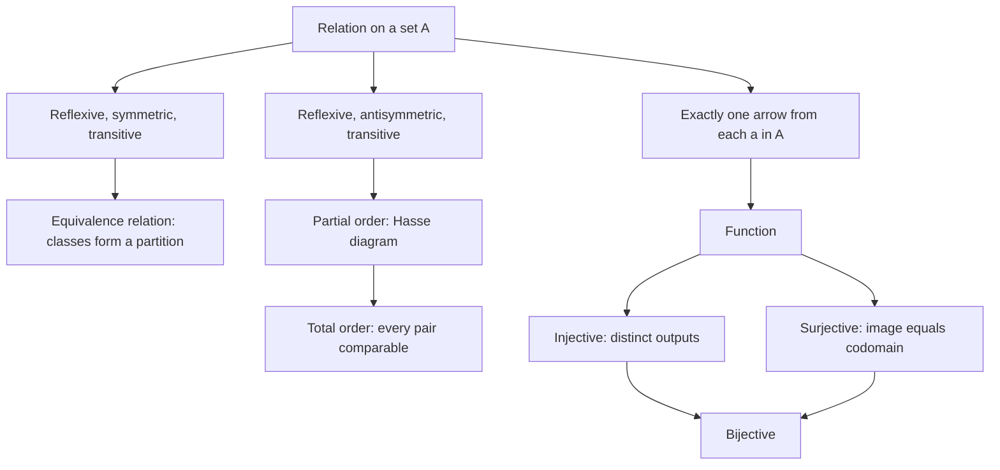
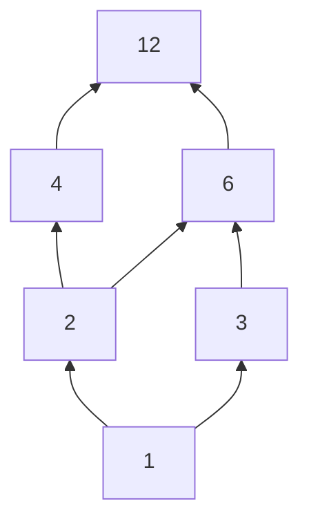

# Relations and Functions

> Mathematics › [Foundations](../README.md) › Relations and Functions · Level: Beginner → Intermediate · Prerequisites: sets and elementary logic (restated in Section 2) · Estimated time: 120 min

## 1. Introduction

A set on its own carries no structure. The set $\{1,2,3\}$ has no order, no arithmetic, no notion of which element is "bigger". All the structure that mathematics studies is added on top of sets, and the cheapest way to add structure is to record **which elements are linked to which**. Such a record is a *relation*.

You already know many relations:

* "$a$ is less than $b$" on numbers;
* "$a$ divides $b$" on the natural numbers;
* "$a$ has the same birthday as $b$" on people;
* "$a$ is a factor of $b$";
* "$(a,b)$ is a point of the circle of radius $5$" on pairs of numbers;
* "$a$ is the mother of $b$".

Each of these can be described by the collection of pairs it links: $(1,2)$ belongs to "less than", $(2,4)$ belongs to "divides", and so on. Turning this into a definition is the first purpose of this topic.

The second purpose is to single out a very special kind of relation. In many situations a relation links every element of a set to **exactly one** element of another set: every person has exactly one birthday, every real number has exactly one square, every order in a shop has exactly one customer. Such a relation is a **function**. The modern definition of a function — a relation with a uniqueness condition — is due to Dirichlet and was made standard in the twentieth century, and it is the definition used everywhere in higher mathematics.

The third purpose is to see that three familiar mathematical ideas are relations with special properties:

* **equivalence relations** ("has the same birthday as") chop a set into disjoint classes, and every partition of a set arises this way;
* **partial orders** ("divides", "is a subset of") organise a set into a hierarchy, drawn as a Hasse diagram;
* **functions** ("the square of") are the relations that can be composed and, when bijective, inverted.

These three ideas are not a random collection. They are the vocabulary in which modern mathematics is written: quotient constructions use equivalence relations, analysis uses orders and functions, and algebra uses all three.

## 2. Prerequisites

No previous topic is assumed. Everything needed from set theory and logic is restated here; the arithmetic facts come from [Natural Numbers](../../01-arithmetic/01-natural-numbers/README.md), and the only ones used are addition, multiplication, divisibility and inequalities.

**Sets.** A *set* is a collection of objects, its *elements*. We write $x \in A$ when $x$ is an element of $A$, and $A \subseteq B$ when every element of $A$ is an element of $B$. The *empty set* is written $\varnothing$. Sets can be described by a rule: $\{x \in A : P(x)\}$ is the set of elements of $A$ that satisfy $P$.

**Operations on sets.** For sets $A$ and $B$:

$$A \cup B = \{x : x \in A \text{ or } x \in B\}, \qquad A \cap B = \{x : x \in A \text{ and } x \in B\},$$
$$A \setminus B = \{x \in A : x \notin B\}.$$

The *power set* $\mathcal{P}(A)$ is the set of all subsets of $A$.

**Logic.** The symbols $\forall$ ("for all"), $\exists$ ("there exists"), $\land$ ("and"), $\lor$ ("or"), $\lnot$ ("not"), $\Rightarrow$ ("implies") and $\iff$ ("if and only if") are used in the usual way. A statement of the form "if $P$ then $Q$" is proved either directly, or by proving its *contrapositive* "if not $Q$ then not $P$", or by *contradiction* (assume $P$ and not $Q$, derive a falsehood).

**Proof patterns used below.** To prove a set equality $X = Y$, prove both inclusions $X \subseteq Y$ and $Y \subseteq X$. To prove that two objects are equal when one is defined as a set of pairs, prove that each pair belongs to one exactly when it belongs to the other. Both patterns appear many times in Section 8.

## 3. Learning Objectives

By the end of this tutorial you will be able to:

1. Form the Cartesian product $A \times B$ and count its elements.
2. State what a relation from $A$ to $B$ is, and find its domain, range and inverse.
3. Decide whether a relation on a set is reflexive, symmetric, antisymmetric or transitive, and justify the answer with a proof or a counterexample.
4. Recognise equivalence relations, compute their equivalence classes, and prove that the classes form a partition.
5. Prove the converse: that every partition of a set comes from exactly one equivalence relation.
6. Recognise partial orders and total orders, and read a Hasse diagram.
7. Explain why a function is a special relation, and check whether a given relation is a function.
8. Decide whether a function is injective, surjective or bijective, and prove your answer.
9. Compose functions and relations, compute inverses, and use the identities $(S \circ R)^{-1} = R^{-1} \circ S^{-1}$ and $(g \circ f)^{-1} = f^{-1} \circ g^{-1}$.
10. Compute images $f(X)$ and preimages $f^{-1}(Y)$, and explain exactly when $f(X \cap Y) = f(X) \cap f(Y)$.
11. Count the functions, injections and bijections between finite sets, and prove the counting formulas.

## 4. Intuition

### 4.1 Arrows between dots

Draw the elements of $A$ as dots in a left-hand column and the elements of $B$ as dots in a right-hand column. A relation from $A$ to $B$ is a set of arrows from left dots to right dots. Any set of arrows is allowed: some left dots may have no arrow leaving them, some may have several, and some right dots may never be hit.

This picture is complete: a relation *is* its set of arrows. Two relations are equal exactly when they have the same arrows.

When $A = B$ the two columns collapse into one, and the arrows run from dots to dots, possibly looping back to the dot they start from. A relation on a set is such a picture. The matrix of dots with arrows is sometimes drawn as a **directed graph**, and that is the mental image behind every definition in this topic.

### 4.2 What makes a relation a function

Look at the arrows and ask: does every left dot have **exactly one** arrow leaving it?

* If yes, the relation is a function. Each input has one output, so the relation can be *used* as a rule: feed in $a$, read off the unique $b$.
* If some left dot has no arrow, the rule is undefined there.
* If some left dot has two arrows, the rule is ambiguous there.

This is the whole content of the definition in Section 5.10. The phrases "well defined" and "a function is a rule" are informal ways of saying "exactly one arrow out of every dot".

### 4.3 Equivalence: the bucket picture

Suppose a relation says of two objects only whether they are "the same in some respect". "The same birthday", "the same remainder modulo $3$", "the same size" are examples. Then the relation should behave like equality: everything is the same as itself, sameness is symmetric, and two things the same as a third are the same as each other.

If you sort the objects into buckets, one bucket for each value of the respect, you get exactly the picture: two objects are related precisely when they land in the same bucket. The buckets are the **equivalence classes**, and the collection of buckets is a **partition** of the set. Section 7.6 proves that this picture is not merely an analogy.

### 4.4 Order: the hierarchy picture

The relation "divides" on the numbers $\{1,2,3,4,6,12\}$ arranges them in levels: $1$ at the bottom, then $2$ and $3$, then $4$ and $6$, then $12$. An arrow points upward from $a$ to $b$ when $a$ divides $b$. Reflexivity is the invisible arrow from each number to itself; antisymmetry says you never have arrows in both directions between two different numbers; transitivity says that a path of two arrows can be replaced by one arrow.

Because the self-arrows and the "shortcut" arrows carry no information, a picture that omits them is enough: that picture is the **Hasse diagram**. Section 7.8 explains how to draw one.

### 4.5 Why the definitions are worth their weight

A definition is useful when it is exactly as strong as it needs to be. The definition of a function as a relation with a uniqueness condition allows us to say what it means for two functions to be equal (same pairs), to count functions (choose one output per input), and to invert them (reverse the pairs). A definition of a function as "a formula" would allow none of these.

## 5. Formal Definition

### 5.1 Ordered pairs

An **ordered pair** $(a,b)$ is determined by its two entries *in order*: $(a,b) = (c,d)$ exactly when $a = c$ and $b = d$.

The essential difference from a two-element set is that ordering matters: $\{a,b\} = \{b,a\}$ but $(a,b) \ne (b,a)$ unless $a = b$.

*Remark.* Ordered pairs can be built from sets alone, for instance by the Kuratowski definition $(a,b) := \{\{a\},\{a,b\}\}$. One then checks that the displayed equality holds. We use the notation $(a,b)$ and never unpack it; the remark only shows that the concept needs no new primitive.

### 5.2 Cartesian product

For sets $A$ and $B$, the **Cartesian product** is $A \times B = \{(a,b) : a \in A \text{ and } b \in B\}$.

Thus $A \times B$ is the set of all ordered pairs with first entry in $A$ and second entry in $B$. If $A$ or $B$ is empty, so is $A \times B$.

### 5.3 Relations

A **relation from $A$ to $B$** is a subset $R \subseteq A \times B$. If $(a,b) \in R$ we write $a \, R \, b$ and say "$a$ is related to $b$". A **relation on $A$** is a relation from $A$ to $A$, that is, a subset of $A \times A$.

The **domain** and **range** of $R$ are

$$\operatorname{dom} R = \{a \in A : \text{there exists } b \in B \text{ with } (a,b) \in R\},$$
$$\operatorname{ran} R = \{b \in B : \text{there exists } a \in A \text{ with } (a,b) \in R\}.$$

The **field** of a relation on $A$ is $\operatorname{fld} R = \operatorname{dom} R \cup \operatorname{ran} R \subseteq A$.

### 5.4 Inverse relation

For $R \subseteq A \times B$, the **inverse relation** is $R^{-1} = \{(b,a) \in B \times A : (a,b) \in R\}$.

It turns every arrow around. Note that $R^{-1}$ is a relation from $B$ to $A$.

### 5.5 Composition of relations

Let $R \subseteq A \times B$ and $S \subseteq B \times C$. Their **composition** $S \circ R$ is the relation from $A$ to $C$ defined by

$$S \circ R = \{(a,c) \in A \times C : \text{there exists } b \in B \text{ with } (a,b) \in R
\text{ and } (b,c) \in S\}.$$

Read $S \circ R$ from right to left: first $R$, then $S$.

### 5.6 Properties of a relation on a set

Let $R$ be a relation on $A$. The following properties are defined for all $a, b, c \in A$.

| Property | Formal statement | Informal reading |
|---|---|---|
| Reflexive | $(a,a) \in R$ for every $a$ | every dot has a loop |
| Irreflexive | $(a,a) \notin R$ for every $a$ | no dot has a loop |
| Symmetric | $(a,b) \in R \Rightarrow (b,a) \in R$ | every arrow can be reversed |
| Antisymmetric | $(a,b) \in R$ and $(b,a) \in R$ $\Rightarrow$ $a = b$ | no two-way street between distinct dots |
| Transitive | $(a,b) \in R$ and $(b,c) \in R$ $\Rightarrow$ $(a,c) \in R$ | two steps can be replaced by one |
| Total | $a \, R \, b$ or $b \, R \, a$ for all $a,b$ | every two dots are comparable |

Reflexivity and irreflexivity are not opposites in a useful sense (a relation can be neither), and symmetry and antisymmetry are not opposites either (a relation can be both: the identity relation on $A$ is symmetric and antisymmetric).

### 5.7 Equivalence relations and classes

A relation $\sim$ on $A$ is an **equivalence relation** if it is reflexive, symmetric and transitive. For $a \in A$, the **equivalence class** of $a$ is $[a] = \{x \in A : x \sim a\}$.

The **quotient set** is $A/{\sim} = \{[a] : a \in A\}$, the set of all equivalence classes.

### 5.8 Partitions

A **partition** of a set $A$ is a collection $\mathcal{P} \subseteq \mathcal{P}(A)$ of subsets of $A$ such that

1. every block $P \in \mathcal{P}$ is nonempty;
2. the blocks cover $A$: $\bigcup_{P \in \mathcal{P}} P = A$;
3. distinct blocks are disjoint: if $P, Q \in \mathcal{P}$ and $P \ne Q$, then $P \cap Q = \varnothing$.

The members of $\mathcal{P}$ are called the **blocks** of the partition.

### 5.9 Orders

A **partial order** on $A$ is a relation $\le$ that is reflexive, antisymmetric and transitive. The pair $(A, \le)$ is a **partially ordered set**, or **poset**. It is a **total order** if in addition $\le$ is total.

The **strict part** of a partial order is the relation $<$ defined by $a < b$ exactly when $a \le b$ and $a \ne b$.

A **strict partial order** is a relation that is irreflexive and transitive.

### 5.10 Functions

A **function** $f$ from $A$ to $B$, written $f : A \to B$, is a relation $f \subseteq A \times B$ such that

1. $\operatorname{dom} f = A$ (every element of $A$ has an arrow), and
2. if $(a,b) \in f$ and $(a,b') \in f$, then $b = b'$ (at most one arrow out of each $a$).

The unique $b$ with $(a,b) \in f$ is written $f(a)$. The set $A$ is the **domain** and $B$ the **codomain**. The **image** of $f$ is $f(A) = \{f(a) : a \in A\} \subseteq B$; it is also called the **range** of the function (a different use of the word "range" from Section 5.3; context decides).

A function is therefore a relation with exactly one arrow out of every left dot.

### 5.11 Injective, surjective, bijective

Let $f : A \to B$.

* $f$ is **injective** (or **one-to-one**) if $f(a) = f(a')$ implies $a = a'$, for all $a, a' \in A$. Equivalently, distinct inputs have distinct outputs.
* $f$ is **surjective** (or **onto**) if for every $b \in B$ there exists $a \in A$ with $f(a) = b$. Equivalently, $f(A) = B$.
* $f$ is **bijective** if it is both injective and surjective.

### 5.12 Images and preimages of sets

Let $f : A \to B$, let $X \subseteq A$ and $Y \subseteq B$. Then

$$f(X) = \{f(x) : x \in X\} \subseteq B, \qquad f^{-1}(Y) = \{a \in A : f(a) \in Y\} \subseteq A.$$

The set $f(X)$ is the **image** of $X$; $f^{-1}(Y)$ is the **preimage** (or **inverse image**) of $Y$. Preimages are defined for every function, whether or not $f$ is injective or surjective. The notation $f^{-1}(Y)$ here is *not* the inverse function; it is a set.

### 5.13 Function sets

For sets $A$ and $B$, the **function set** $B^A$ is the set of all functions from $A$ to $B$.

The notation is chosen so that, for finite sets, $|B^A| = |B|^{|A|}$ (Theorem 8.9).

## 6. Mathematical Notation

| Symbol | Read aloud | Meaning |
|---|---|---|
| $(a,b)$ | "the ordered pair $a$ comma $b$" | a pair with first entry $a$, second $b$ |
| $A \times B$ | "$A$ cross $B$" | all ordered pairs from $A$ and $B$ |
| $R \subseteq A \times B$ | "$R$ is a relation from $A$ to $B$" | a set of pairs |
| $a \, R \, b$ | "$a$ is $R$-related to $b$" | $(a,b) \in R$ |
| $\operatorname{dom} R$ | "the domain of $R$" | first entries that occur |
| $\operatorname{ran} R$ | "the range of $R$" | second entries that occur |
| $R^{-1}$ | "$R$ inverse" | the relation with all arrows reversed |
| $S \circ R$ | "$S$ after $R$" | first $R$, then $S$ |
| $[a]$ | "the class of $a$" | $\{x : x \sim a\}$ |
| $A/{\sim}$ | "$A$ modulo $\sim$" | the set of equivalence classes |
| $f : A \to B$ | "$f$ from $A$ to $B$" | a function with domain $A$, codomain $B$ |
| $f(a)$ | "$f$ of $a$" | the value of $f$ at $a$ |
| $f(A)$ | "the image of $f$" | the set of values of $f$ |
| $f^{-1}(Y)$ | "the preimage of $Y$ under $f$" | $\{a : f(a) \in Y\}$ |
| $B^A$ | "$B$ to the $A$" | the set of functions $A \to B$ |
| $\operatorname{id}_A$ | "the identity on $A$" | $\{(a,a) : a \in A\}$ |
| $a \mid b$ | "$a$ divides $b$" | $b = ak$ for some integer $k$ |
| $\mathcal{P}(A)$ | "the power set of $A$" | the set of all subsets of $A$ |

Two warnings about notation. First, $f^{-1}$ is used in two ways: $f^{-1}(Y)$ for a set $Y$ is always defined (it is a set), while $f^{-1}$ as a function exists only when $f$ is bijective. Second, $S \circ R$ applies $R$ first. Many errors come from reading composition in the wrong order.

## 7. Core Concepts

### 7.1 A relation is its set of pairs

Because a relation is a subset of $A \times B$, everything about it is determined by which pairs it contains. Two relations are equal exactly when they contain the same pairs.

This makes counting relations easy. A relation from $A$ to $B$ is an arbitrary subset of $A \times B$, and a set with $N$ elements has $2^N$ subsets. Hence the number of relations from $A$ to $B$ is $2^{|A| \cdot |B|}$.

On a set with $n$ elements there are $2^{n^2}$ relations. For $n = 3$ that is $2^9 = 512$; the overwhelming majority of them satisfy none of the properties of Section 5.6, which is why the special classes deserve names.

### 7.2 Domain, range, field, and special relations

The domain is the set of first entries that actually occur, and the range is the set of second entries. Neither need be all of $A$ or all of $B$: the relation $R = \{(1,x),(2,x),(3,y)\} \subseteq \{1,2,3,4\} \times \{x,y,z\}$ has $\operatorname{dom} R = \{1,2,3\}$ and $\operatorname{ran} R = \{x,y\}$.

Three relations on a set $A$ deserve names:

* the **empty relation** $\varnothing$, with no pairs;
* the **identity relation** $\operatorname{id}_A = \{(a,a) : a \in A\}$;
* the **universal relation** $A \times A$, containing every pair.

The identity relation is reflexive, symmetric, antisymmetric and transitive; the universal relation is reflexive, symmetric and transitive but not antisymmetric unless $A$ has at most one element.

A **restriction** of $R \subseteq A \times B$ to a subset $X \subseteq A$ is $R \cap (X \times B)$, the part of the relation that starts inside $X$.

### 7.3 The inverse relation

Reversing all arrows gives $R^{-1}$. Two facts are immediate and are proved in Theorem 8.2:

$$\operatorname{dom}(R^{-1}) = \operatorname{ran} R, \qquad \operatorname{ran}(R^{-1}) = \operatorname{dom} R, \qquad (R^{-1})^{-1} = R.$$

The inverse of a *function* need not be a function. If $f = \{(1,x),(2,x)\}$, then $f^{-1} = \{(x,1),(x,2)\}$ has two arrows out of $x$, so it is not a function. The inverse relation is a function exactly when $f$ is injective and its domain covers the codomain — see Section 7.12.

### 7.4 Composition of relations

Composition follows a path of two arrows: $(a,c) \in S \circ R$ when there is some intermediate $b$ with $a \, R \, b$ and $b \, S \, c$. For example, if $R = \{(1,2),(3,4)\}$ and $S = \{(2,5),(4,6)\}$, then $S \circ R = \{(1,5),(3,6)\}$.

Three properties matter.

* **Associativity.** $(T \circ S) \circ R = T \circ (S \circ R)$ (Theorem 8.3). This is why brackets are usually omitted.
* **Non-commutativity.** $S \circ R$ and $R \circ S$ need not even be defined simultaneously, and when they are, they may differ. If $R = \{(1,2)\}$ and $S = \{(2,1)\}$ on $\{1,2\}$, then $S \circ R = \{(1,1)\}$ while $R \circ S = \{(2,2)\}$.
* **Powers.** For a relation $R$ on $A$, define $R^1 = R$ and $R^{n+1} = R^n \circ R$. Then $(a,b) \in R^n$ exactly when $b$ can be reached from $a$ in $n$ steps of $R$. The relation $R$ is transitive exactly when $R^2 \subseteq R$ (Exercise 25).

### 7.5 Checking the five properties

The definitions are checked pair by pair. Two habits prevent most mistakes.

* **Reflexivity is about every element of the set, not about the pairs you can see.** A relation containing $(1,1)$ and $(2,2)$ is not reflexive on $\{1,2,3\}$, because $(3,3)$ is missing.
* **Antisymmetry is a conditional statement.** It forbids two-way arrows between *distinct* elements; it says nothing about the existence of any arrows. Every irreflexive and transitive relation is antisymmetric, vacuously, because no pair $(a,b),(b,a)$ with $a \ne b$ can occur.

A small catalogue on the set $\{1,2,3,4\}$:

| Relation | Reflexive | Symmetric | Antisymmetric | Transitive |
|---|---|---|---|---|
| $a < b$ | no | no | yes (vacuously) | yes |
| $a \le b$ | yes | no | yes | yes |
| $a + b$ even | yes | yes | no | yes |
| $a \mid b$ on $\mathbb{N}^{+}$ | yes | no | yes | yes |
| $a = b$ | yes | yes | yes | yes |
| empty relation | no | yes | yes | yes |

The last two rows show that "symmetric" and "antisymmetric" can both hold, and that the empty relation is symmetric, antisymmetric and transitive but not reflexive.

### 7.6 Equivalence relations and classes

An equivalence relation is meant to behave like equality. The central example is **congruence modulo $m$** on $\mathbb{Z}$: fix $m \ge 1$ and define $a \equiv b \pmod m$ to mean $m \mid (a - b)$.

For $m = 3$: $7 \equiv 1$, because $7 - 1 = 6 = 3 \cdot 2$; $7 \not\equiv 2$, because $7 - 2 = 5$ is not divisible by $3$. The three classes are

$$[0] = \{\dots,-6,-3,0,3,6,\dots\}, \quad [1] = \{\dots,-5,-2,1,4,7,\dots\}, \quad
[2] = \{\dots,-4,-1,2,5,8,\dots\}.$$

Every integer belongs to exactly one of them, and the quotient set $\mathbb{Z}/{\equiv}$ has three elements. Arithmetic can be done on the classes: $[1] + [2] = [0]$ because $1 + 2 = 3 \equiv 0$.

Other examples:

* on people, "has the same birthday as" — the classes are the $366$ possible birthdays;
* on $\mathbb{Z} \times (\mathbb{Z} \setminus \{0\})$, $(a,b) \sim (c,d)$ iff $ad = bc$ — the classes are the rational numbers, and this is how $\mathbb{Q}$ is constructed from $\mathbb{Z}$;
* on $\mathbb{R}$, $x \sim y$ iff $x - y \in \mathbb{Z}$ — the classes are the fractional parts, and the quotient is the circle group $\mathbb{R}/\mathbb{Z}$.

The fundamental theorem (Theorem 8.5) says that the classes of any equivalence relation form a partition of $A$, and conversely (Theorem 8.6) every partition arises from exactly one equivalence relation.

### 7.7 Partitions and the quotient set

A partition chops a set into disjoint nonempty blocks. The number of partitions of an $n$-element set is the $n$-th **Bell number**: $B_0 = 1$, $B_1 = 1$, $B_2 = 2$, $B_3 = 5$, $B_4 = 15$, $B_5 = 52$.

For $n = 3$ the five partitions of $\{1,2,3\}$ are $\{123\}$, $\{1\}\{23\}$, $\{2\}\{13\}$, $\{3\}\{12\}$ and $\{1\}\{2\}\{3\}$.

The correspondence with equivalence relations is exact: the partition above corresponds to, in order, the universal relation, three relations with one two-element class and one singleton, and the identity relation.

Given an equivalence relation, its quotient set $A/{\sim}$ is a new set whose elements are the blocks. This is the standard way to *build* new mathematical objects: quotient $\mathbb{Z}$ by congruence to get $\mathbb{Z}/m\mathbb{Z}$, quotient pairs by cross-multiplication to get $\mathbb{Q}$, quotient a vector space by a subspace to get a quotient space.

### 7.8 Partial orders and Hasse diagrams

A partial order records "below or equal". Examples:

* $(\mathcal{P}(A), \subseteq)$ for any set $A$ — the subset relation;
* $(\mathbb{N}^{+}, \mid)$ — divisibility;
* $(\mathbb{R}, \le)$ — the usual order, which is total;
* on words, the prefix order: $u \le v$ when $u$ is an initial segment of $v$.

In a poset, write $a < b$ when $a \le b$ and $a \ne b$. Say that $b$ **covers** $a$, written $a \prec b$, when $a < b$ and there is no $c$ with $a < c < b$. The **Hasse diagram** has one dot per element, and a line from $a$ up to $b$ exactly when $a \prec b$. Reflexive loops and transitive shortcuts are omitted because they can be reconstructed: $a \le b$ holds exactly when there is an upward path from $a$ to $b$ (possibly of length zero).

For divisibility on $\{1,2,3,4,6,12\}$ the covering pairs are $1 \prec 2$, $1 \prec 3$, $2 \prec 4$, $2 \prec 6$, $3 \prec 6$, $4 \prec 12$, $6 \prec 12$. Notice that $2 \prec 12$ is *not* a covering pair, because $2 < 6 < 12$; the Hasse diagram therefore has no line from $2$ to $12$. Section 10 draws the diagram.

An element $m$ is **maximal** if no element is strictly above it, and **minimal** if no element is strictly below it. A finite poset always has at least one maximal and one minimal element (Exercise 33), but they need not be unique: in $(\mathcal{P}(A), \subseteq)$ the maximal element is $A$ and the minimal element is $\varnothing$, while in the divisibility poset on $\{2,3,5\}$ every element is both maximal and minimal, because no two of them are comparable. A **chain** is a totally ordered subset; in a total order the whole set is a chain.

### 7.9 Functions as relations

A function is a relation in which every element of the domain has exactly one partner. Three consequences are worth spelling out.

* **A formula is not a function.** The formula $x^2 + y^2 = 25$ describes a relation on $\mathbb{R}$ that is not a function, because $x = 3$ is paired with both $y = 4$ and $y = -4$, and $x = 6$ is paired with nothing.
* **The domain and codomain are part of the data.** The rule $x \mapsto x^2$ gives four different functions depending on which sets are chosen; Section 7.10 exploits this.
* **Equality of functions.** Two functions $f, g : A \to B$ are equal exactly when $f(a) = g(a)$ for every $a \in A$. The domain and codomain must also agree for the comparison to make sense.

A relation $R \subseteq A \times B$ fails to be a function in exactly two ways: some $a \in A$ has no partner (the domain is too small), or some $a$ has two partners (the relation is ambiguous). "Checking that a function is well defined" is the standard phrase for verifying that a proposed rule does not depend on a choice of representative — for instance, that a rule on equivalence classes gives the same answer for two representatives of the same class.

### 7.10 Injective, surjective, bijective

The same formula can be injective, surjective, both, or neither, depending on the sets:

| Function | Injective? | Surjective? | Why |
|---|---|---|---|
| $f : \mathbb{R} \to \mathbb{R}$, $f(x) = x^2$ | no | no | $f(2) = f(-2)$; $-1$ is not a value |
| $f : [0,\infty) \to \mathbb{R}$, $f(x) = x^2$ | yes | no | increasing on the domain; no negative values |
| $f : \mathbb{R} \to [0,\infty)$, $f(x) = x^2$ | no | yes | hits every nonnegative value, twice |
| $f : [0,\infty) \to [0,\infty)$, $f(x) = x^2$ | yes | yes | bijective, inverse $\sqrt{\phantom{x}}$ |

For finite sets of equal size, injective and surjective are equivalent (Theorem 8.11); for infinite sets they are not. The map $n \mapsto n+1$ on $\mathbb{N}$ is injective but not surjective (the value $0$ is missed), while on $\mathbb{Z}$ it is bijective. This asymmetry is the first hint that infinite sets have a subtler theory of size than finite ones.

### 7.11 Composition of functions

For $f : A \to B$ and $g : B \to C$, the composition is defined by $(g \circ f)(a) = g(f(a))$.

Composition is associative and has identities: $f \circ \operatorname{id}_A = f$ and $\operatorname{id}_B \circ f = f$. It is not commutative in general: with $f(x) = x + 2$ and $g(x) = 3x$ on $\mathbb{R}$,

$$(g \circ f)(x) = 3(x+2) = 3x + 6, \qquad (f \circ g)(x) = 3x + 2.$$

The two rules for injectivity and surjectivity are proved in Theorem 8.7:

* if $f$ and $g$ are injective, so is $g \circ f$;
* if $f$ and $g$ are surjective, so is $g \circ f$;
* conversely, if $g \circ f$ is injective then $f$ is injective, and if $g \circ f$ is surjective then $g$ is surjective.

The converses are one-sided: $g \circ f$ injective does not force $g$ injective, because $g$ may collapse points outside the image of $f$.

### 7.12 Inverses

If $f : A \to B$ is bijective, define $f^{-1}(b)$ to be the unique $a \in A$ with $f(a) = b$.

Surjectivity guarantees that such an $a$ exists; injectivity guarantees that it is unique. Then

$$f^{-1} \circ f = \operatorname{id}_A, \qquad f \circ f^{-1} = \operatorname{id}_B.$$

Conversely (Theorem 8.8), if there is a function $g : B \to A$ with $g \circ f = \operatorname{id}_A$ and $f \circ g = \operatorname{id}_B$, then $f$ is bijective and $g = f^{-1}$.

The inverse of a composition reverses the order: $(g \circ f)^{-1} = f^{-1} \circ g^{-1}$.

Check it on an example: let $f : [-3/2, \infty) \to [0, \infty)$ be $f(x) = 2x + 3$ and let $g : [0, \infty) \to [0, \infty)$ be $g(x) = x^2$; both are bijections. Then $g \circ f$ sends $x$ to $(2x+3)^2$, so its inverse sends $y$ to $(\sqrt y - 3)/2$, which is exactly what $f^{-1}(g^{-1}(y))$ computes.

### 7.13 Images and preimages

Images and preimages behave differently, and the difference is worth memorising.

* Images respect unions: $f(X \cup Y) = f(X) \cup f(Y)$.
* Images respect intersections only as an inclusion: $f(X \cap Y) \subseteq f(X) \cap f(Y)$, and equality for all $X, Y$ holds exactly when $f$ is injective (Theorem 8.10).
* Preimages respect unions, intersections and complements: $f^{-1}(Y_1 \cup Y_2) = f^{-1}(Y_1) \cup f^{-1}(Y_2)$, $f^{-1}(Y_1 \cap Y_2) = f^{-1}(Y_1) \cap f^{-1}(Y_2)$, and $f^{-1}(B \setminus Y) = A \setminus f^{-1}(Y)$.

The reason for the asymmetry: a preimage collects *all* points that land in $Y$, so no information is lost, while an image forgets which point produced a value, so two different points with the same value cannot be separated again.

### 7.14 Counting functions and relations

For finite sets with $|A| = m$ and $|B| = n$:

| Object | Count | Reason |
|---|---|---|
| relations $A \to B$ | $2^{mn}$ | any subset of $A \times B$ |
| functions $A \to B$ | $n^m$ | each of $m$ inputs chooses one of $n$ outputs |
| injections $A \to B$ | $n(n-1)\cdots(n-m+1)$ for $m \le n$, else $0$ | the $k$-th input must avoid the $k-1$ outputs already used |
| bijections $A \to A$ | $m!$ | injections with $n = m$ |
| subsets of $A$ | $2^m$ | characteristic functions $A \to \{0,1\}$ |

For example, from a $3$-element set to a $4$-element set there are $4^3 = 64$ functions and $4 \cdot 3 \cdot 2 = 24$ injections; on a $3$-element set there are $2^9 = 512$ relations and $3! = 6$ bijections. Note the convention $0^0 = 1$: there is exactly one function from $\varnothing$ to $\varnothing$, namely the empty relation, and it is a bijection.

## 8. Formulas and Properties

Every theorem below is proved from the definitions of Section 5. The proofs are short element chases; learning to write them is the main skill this topic teaches.

### 8.1 Products and intersections

**Proposition 8.1.** *Let $A, B, C, D$ be sets.*

*(a)* If $A$ and $B$ are finite, then $|A \times B| = |A| \cdot |B|$.

*(b)* $(A \times B) \cap (C \times D) = (A \cap C) \times (B \cap D)$.

*Proof.* (a) A pair in $A \times B$ is determined by choosing its first entry from $A$ and, independently, its second entry from $B$; there are $|A|$ choices for the first and $|B|$ for the second, hence $|A| \cdot |B|$ pairs.

(b) For any object $z$,

$$z \in (A \times B) \cap (C \times D)
\iff z \in A \times B \text{ and } z \in C \times D$$
$$\iff z = (x,y) \text{ with } x \in A,\ y \in B,\ x \in C,\ y \in D$$
$$\iff x \in A \cap C \text{ and } y \in B \cap D \iff z \in (A \cap C) \times (B \cap D).$$

$\blacksquare$

Unions do **not** behave this way: with $A = \{1\}$, $B = \{1\}$, $C = \{2\}$, $D = \{2\}$, $(A \times B) \cup (C \times D) = \{(1,1),(2,2)\}$, while $(A \cup C) \times (B \cup D)$ has four elements and also contains $(1,2)$ and $(2,1)$.

### 8.2 Inverting a relation twice

**Proposition 8.2.** *For every relation $R \subseteq A \times B$:*

$$\operatorname{dom}(R^{-1}) = \operatorname{ran} R, \qquad
\operatorname{ran}(R^{-1}) = \operatorname{dom} R, \qquad (R^{-1})^{-1} = R.$$

*Proof.* For the first identity,

$$a \in \operatorname{dom}(R^{-1}) \iff \text{there is } b \text{ with } (a,b) \in R^{-1}
\iff \text{there is } b \text{ with } (b,a) \in R \iff a \in \operatorname{ran} R.$$

The second is the same statement with $R$ replaced by $R^{-1}$ and the two sides exchanged. For the third,

$$(a,b) \in (R^{-1})^{-1} \iff (b,a) \in R^{-1} \iff (a,b) \in R.$$

$\blacksquare$

### 8.3 Composition of relations is associative

**Theorem 8.3.** *Let $R \subseteq A \times B$, $S \subseteq B \times C$ and $T \subseteq C \times D$. Then*

$$(T \circ S) \circ R = T \circ (S \circ R).$$

*Proof.* For $a \in A$ and $d \in D$,

$$(a,d) \in (T \circ S) \circ R
\iff \text{there is } b \in B \text{ with } (a,b) \in R \text{ and } (b,d) \in T \circ S$$
$$\iff \text{there are } b \in B,\ c \in C \text{ with } (a,b) \in R,\ (b,c) \in S,\ (c,d) \in T.$$

The last condition is symmetric in the way it lists the three pairs, so it is also exactly the condition for $(a,d) \in T \circ (S \circ R)$. Hence the two relations contain the same pairs. $\blacksquare$

### 8.4 Inverting a composition

**Proposition 8.4.** *Let $R \subseteq A \times B$ and $S \subseteq B \times C$. Then*

$$(S \circ R)^{-1} = R^{-1} \circ S^{-1}.$$

*Proof.* For $a \in A$ and $c \in C$,

$$(c,a) \in (S \circ R)^{-1}
\iff (a,c) \in S \circ R \iff \text{there is } b \in B \text{ with } (a,b) \in R \text{ and } (b,c) \in S$$
$$\iff \text{there is } b \in B \text{ with } (c,b) \in S^{-1} \text{ and } (b,a) \in R^{-1}
\iff (c,a) \in R^{-1} \circ S^{-1}.$$

$\blacksquare$

The reversal of order is essential: the inverse must undo the last operation first.

### 8.5 Equivalence classes form a partition

**Lemma 8.5a.** *Let $\sim$ be an equivalence relation on $A$. For $a, b \in A$, either $[a] = [b]$ or $[a] \cap [b] = \varnothing$.*

*Proof.* Suppose $[a] \cap [b] \ne \varnothing$ and choose $c$ in the intersection. Then $c \sim a$ and $c \sim b$.

Let $x \in [a]$, so $x \sim a$. Since $c \sim a$, symmetry gives $a \sim c$, and since $c \sim b$, transitivity gives $x \sim b$. Hence $x \in [b]$, so $[a] \subseteq [b]$. The same argument with the roles of $a$ and $b$ exchanged gives $[b] \subseteq [a]$. Therefore $[a] = [b]$. $\blacksquare$

**Lemma 8.5b.** *$[a] = [b]$ if and only if $a \sim b$.*

*Proof.* If $a \sim b$ and $x \in [a]$, then $x \sim a \sim b$, so $x \in [b]$; this gives $[a] \subseteq [b]$, and symmetry gives the reverse inclusion. Conversely, if $[a] = [b]$, then $a \in [a]$ by reflexivity, hence $a \in [b]$, which means $a \sim b$. $\blacksquare$

**Theorem 8.5.** *Let $\sim$ be an equivalence relation on a set $A$. Then the collection $A/{\sim} = \{[a] : a \in A\}$ is a partition of $A$.*

*Proof.* Three conditions must be checked.

*Nonempty.* For every $a$, reflexivity gives $a \sim a$, so $a \in [a]$ and $[a] \ne \varnothing$.

*Covering.* Every $a \in A$ lies in the class $[a]$, so the union of all classes is $A$.

*Disjoint.* Distinct classes are disjoint by Lemma 8.5a.

Hence $A/{\sim}$ is a partition. $\blacksquare$

### 8.6 Every partition comes from an equivalence relation

**Theorem 8.6.** *Let $\mathcal{P}$ be a partition of $A$. Define $a \sim b$ to mean that $a$ and $b$ lie in a common block of $\mathcal{P}$. Then $\sim$ is an equivalence relation on $A$, and its equivalence classes are exactly the blocks of $\mathcal{P}$.*

*Proof.* **Reflexive.** Since the blocks cover $A$, each $a$ lies in some block $P$; then $a$ and $a$ both lie in $P$, so $a \sim a$.

**Symmetric.** The condition "lie in a common block" is symmetric in $a$ and $b$.

**Transitive.** Suppose $a \sim b$ and $b \sim c$, with $a, b \in P$ and $b, c \in Q$. Then $b \in P \cap Q$, so $P \cap Q \ne \varnothing$. Distinct blocks are disjoint, so $P = Q$; hence $a, c \in P$ and $a \sim c$.

**Classes are the blocks.** For $a \in A$, let $P$ be the block containing $a$. If $x \in [a]$ then $x$ and $a$ share a block, which must be $P$ (blocks are disjoint), so $x \in P$; conversely $x \in P$ gives $x \sim a$. Hence $[a] = P$. As $a$ ranges over $A$, every block occurs (it is nonempty), so $A/{\sim} = \mathcal{P}$. $\blacksquare$

Theorems 8.5 and 8.6 say that the constructions "equivalence relation" and "partition" are inverse to each other: the map $\sim \mapsto A/{\sim}$ is a bijection between equivalence relations on $A$ and partitions of $A$.

### 8.7 Composition of functions

**Theorem 8.7.** *Let $f : A \to B$ and $g : B \to C$.*

*(i)* If $f$ and $g$ are injective, then $g \circ f$ is injective.

*(ii)* If $f$ and $g$ are surjective, then $g \circ f$ is surjective.

*(iii)* If $g \circ f$ is injective, then $f$ is injective.

*(iv)* If $g \circ f$ is surjective, then $g$ is surjective.

*Proof.* (i) Suppose $g(f(a)) = g(f(a'))$. Since $g$ is injective, $f(a) = f(a')$; since $f$ is injective, $a = a'$.

(ii) Let $c \in C$. Since $g$ is surjective there is $b \in B$ with $g(b) = c$; since $f$ is surjective there is $a \in A$ with $f(a) = b$. Then $(g \circ f)(a) = g(f(a)) = g(b) = c$.

(iii) Suppose $f(a) = f(a')$. Applying $g$ gives $(g \circ f)(a) = (g \circ f)(a')$, and injectivity of $g \circ f$ gives $a = a'$.

(iv) Let $c \in C$. Since $g \circ f$ is surjective there is $a \in A$ with $g(f(a)) = c$. Put $b = f(a)$; then $g(b) = c$. $\blacksquare$

The remaining implications fail. For (i), if $g \circ f$ is injective, $g$ need not be: take $A = \{1\}$, $B = \{1,2\}$, $C = \{1\}$ and $f(1) = 1$, $g(1) = g(2) = 1$. For (ii), if $g \circ f$ is surjective, $f$ need not be: take $A = \{1\}$, $B = \{1,2\}$, $C = \{1\}$ with $f(1) = 1$ and $g(1) = g(2) = 1$.

### 8.8 Invertible exactly when bijective

**Theorem 8.8.** *A function $f : A \to B$ is bijective if and only if there is a function $g : B \to A$ such that*

$$g \circ f = \operatorname{id}_A \qquad \text{and} \qquad f \circ g = \operatorname{id}_B.$$

*In that case $g$ is unique and $g = f^{-1}$.*

*Proof.* **(⟹)** Suppose $f$ is bijective. For each $b \in B$, surjectivity gives at least one $a$ with $f(a) = b$, and injectivity gives at most one; so there is exactly one, and defining $g(b) = a$ gives a function $g : B \to A$. Then $g(f(a)) = a$ and $f(g(b)) = b$ by construction.

**(⟸)** Suppose such a $g$ exists. If $f(a) = f(a')$, applying $g$ gives $a = g(f(a)) = g(f(a')) = a'$, so $f$ is injective. For $b \in B$, $b = f(g(b)) = f(\text{the value } g(b))$, so $b$ is a value of $f$ and $f$ is surjective.

**Uniqueness.** If $g, h$ both satisfy the two identities, then $g = g \circ \operatorname{id}_B = g \circ f \circ h = \operatorname{id}_A \circ h = h$. Since $g$ satisfies the defining property of $f^{-1}$, $g = f^{-1}$. $\blacksquare$

### 8.9 Counting functions

**Theorem 8.9.** *Let $A$ and $B$ be finite sets with $|A| = m$ and $|B| = n$. Then the number of functions $A \to B$ is $n^m$.*

*Proof.* Induction on $m$. If $m = 0$ then $A = \varnothing$, and the only relation $\varnothing \subseteq \varnothing \times B$ is a function; hence $|B^{\varnothing}| = 1 = n^0$.

For $m \ge 1$, choose $a_0 \in A$ and put $A' = A \setminus \{a_0\}$. The map

$$\Phi : B^A \longrightarrow B \times B^{A'}, \qquad \Phi(f) = \bigl(f(a_0), f|_{A'}\bigr)$$

is a bijection: its inverse sends $(b,h)$ to the function that equals $b$ at $a_0$ and equals $h$ on $A'$. By induction $|B^{A'}| = n^{m-1}$, so

$$|B^A| = |B| \cdot |B^{A'}| = n \cdot n^{m-1} = n^m.$$

$\blacksquare$

**Corollary 8.9a.** *The number of injections $A \to B$ is*

$$n(n-1)(n-2)\cdots(n-m+1) = \dfrac{n!}{(n-m)!}$$

*for $m \le n$, and $0$ for $m > n$.*

*Proof.* If $m > n$, an injection would give $m$ distinct values in an $n$-element set, impossible. For $m \le n$, choose $f(a_0)$ in $n$ ways; the restriction of $f$ to $A'$ must be an injection into the remaining $n-1$ elements, so by induction there are $(n-1)\cdots(n-m+1)$ choices. Multiplying gives the formula. $\blacksquare$

In particular the number of bijections $A \to A$ is $n!$, and the number of subsets of $A$ is $2^{|A|}$, because subsets correspond bijectively to their characteristic functions $A \to \{0,1\}$.

### 8.10 Images and preimages

**Theorem 8.10.** *Let $f : A \to B$, let $X, Y \subseteq A$ and $U, V \subseteq B$.*

*(a)* $f(X \cup Y) = f(X) \cup f(Y)$.

*(b)* $f(X \cap Y) \subseteq f(X) \cap f(Y)$.

*(c)* $f(X \cap Y) = f(X) \cap f(Y)$ for all $X, Y \subseteq A$ if and only if $f$ is injective.

*(d)* $f^{-1}(U \cup V) = f^{-1}(U) \cup f^{-1}(V)$ and $f^{-1}(U \cap V) = f^{-1}(U) \cap f^{-1}(V)$.

*(e)* $f^{-1}(B \setminus U) = A \setminus f^{-1}(U)$.

*(f)* $X \subseteq f^{-1}(f(X))$, with equality for all $X$ if and only if $f$ is injective.

*(g)* $f(f^{-1}(U)) \subseteq U$, with equality for all $U$ if and only if $f$ is surjective.

*Proof.* (a) An element $b$ lies in $f(X \cup Y)$ exactly when $b = f(x)$ for some $x \in X \cup Y$, which happens exactly when $b = f(x)$ for some $x \in X$ or for some $x \in Y$, that is, exactly when $b \in f(X) \cup f(Y)$.

(b) If $b \in f(X \cap Y)$, then $b = f(x)$ with $x \in X \cap Y$; in particular $x \in X$ and $x \in Y$, so $b \in f(X)$ and $b \in f(Y)$.

(c) **If $f$ is injective**, take $b \in f(X) \cap f(Y)$. Then $b = f(x) = f(y)$ with $x \in X$, $y \in Y$; injectivity gives $x = y \in X \cap Y$, so $b \in f(X \cap Y)$. Together with (b) this is equality. **If equality holds for all pairs**, take $a \ne a'$ with $f(a) = f(a')$; put $X = \{a\}$ and $Y = \{a'\}$. Then $X \cap Y = \varnothing$, so $f(X \cap Y) = \varnothing$, while $f(X) \cap f(Y) = \{f(a)\} \ne \varnothing$. That contradicts equality; hence no such pair exists and $f$ is injective.

(d) For the union: $a \in f^{-1}(U \cup V)$ iff $f(a) \in U \cup V$ iff $f(a) \in U$ or $f(a) \in V$ iff $a \in f^{-1}(U) \cup f^{-1}(V)$. The intersection is identical with "or" replaced by "and".

(e) $a \in f^{-1}(B \setminus U)$ iff $f(a) \in B$ and $f(a) \notin U$. Since $f(a) \in B$ always, this is iff $a \notin f^{-1}(U)$, i.e. $a \in A \setminus f^{-1}(U)$.

(f) If $x \in X$ then $f(x) \in f(X)$, so $x \in f^{-1}(f(X))$. For equality, suppose $f$ is injective and $a \in f^{-1}(f(X))$. Then $f(a) = f(x)$ for some $x \in X$, so $a = x \in X$. Conversely, if equality always holds and $f(a) = f(a')$ with $a \ne a'$, take $X = \{a'\}$; then $a \in f^{-1}(f(X)) = X = \{a'\}$, a contradiction.

(g) If $b \in f(f^{-1}(U))$, then $b = f(a)$ with $f(a) \in U$, so $b \in U$. For equality, suppose $f$ is surjective and $b \in U$; write $b = f(a)$; then $a \in f^{-1}(U)$, so $b = f(a) \in f(f^{-1}(U))$. Conversely, if equality always holds, take $U = B$: then $B = f(f^{-1}(B)) = f(A)$, so $f$ is surjective. $\blacksquare$

### 8.11 Finite sets of equal size

**Theorem 8.11.** *Let $A$ and $B$ be finite sets with $|A| = |B| = n$, and let $f : A \to B$. Then the following are equivalent: $f$ is injective; $f$ is surjective; $f$ is bijective.*

*Proof.* It is enough to prove injective $\Rightarrow$ surjective and surjective $\Rightarrow$ injective.

*Injective $\Rightarrow$ surjective.* The map $f$ is a bijection from $A$ onto its image $f(A)$, so $|f(A)| = |A| = n$. Since $f(A) \subseteq B$ and $|B| = n$, a subset of $B$ with $n$ elements must be all of $B$; hence $f(A) = B$.

*Surjective $\Rightarrow$ injective.* For each $b \in B$ let $F_b = \{a \in A : f(a) = b\}$ be the fibre over $b$. The fibres are pairwise disjoint, and their union is $A$ because every $a$ has some image. Surjectivity says every fibre is nonempty. Therefore

$$n = |A| = \sum_{b \in B} |F_b| \ge \sum_{b \in B} 1 = |B| = n.$$

The two ends are equal, so every term $|F_b|$ equals $1$: each $b$ has exactly one preimage, which is injectivity. $\blacksquare$

For infinite sets the theorem fails: $n \mapsto n + 1$ is injective but not surjective on $\mathbb{N}$. The finiteness of $A$ and $B$ is used twice, in comparing cardinalities of subsets.

## 9. Step-by-Step Examples

### Example 1 — A first relation, its domain, range and inverse

Let $A = \{1,2,3\}$ and $B = \{x,y\}$. Then

$$A \times B = \{(1,x),(1,y),(2,x),(2,y),(3,x),(3,y)\},$$

six pairs, as Proposition 8.1 predicts: $3 \cdot 2 = 6$. Note that $B \times A$ is a different set; it contains $(x,1)$ but not $(1,x)$.

Let $R = \{(1,x),(2,x),(3,y)\} \subseteq A \times B$. Then

$$\operatorname{dom} R = \{1,2,3\} = A, \qquad \operatorname{ran} R = \{x,y\} = B, \qquad
R^{-1} = \{(x,1),(x,2),(y,3)\}.$$

$R$ **is** a function $A \to B$: each of $1,2,3$ occurs exactly once as a first entry. It is surjective, because its range is all of $B$, and it is not injective, because $1$ and $2$ both map to $x$.

$R^{-1}$ is **not** a function $B \to A$: the element $x$ is paired with both $1$ and $2$. This is exactly the failure of injectivity, seen from the other side.

### Example 2 — Four relations on the same set

On $A = \{1,2,3,4\}$ consider four relations.

**$R_1 = \{(a,b) : a < b\}$.** No element is related to itself, so $R_1$ is irreflexive. It is transitive: $a < b$ and $b < c$ give $a < c$. It is not symmetric ($1 < 2$ but not $2 < 1$). It is antisymmetric *vacuously*: there are no pairs $(a,b)$ and $(b,a)$ with $a \ne b$.

**$R_2 = \{(a,b) : a \le b\}$.** This is reflexive ($a \le a$), antisymmetric (if $a \le b$ and $b \le a$ then $a = b$), transitive, and total (for any two numbers one is at most the other). So $(A, R_2)$ is a total order.

**$R_3 = \{(a,b) : a + b \text{ is even}\}$.** Reflexive, since $2a$ is even. Symmetric, since $a + b = b + a$. Transitive, because if $a + b$ and $b + c$ are even then $a + c = (a+b) + (b+c) - 2b$ is even. Hence $R_3$ is an equivalence relation. Its classes are $[1] = \{1,3\}$ and $[2] = \{2,4\}$, a partition of $A$ into two blocks.

**$R_4 = \{(1,2),(2,1),(1,1)\}$.** Symmetric: each pair has its reverse present, and $(1,1)$ is its own reverse. Not reflexive: $(2,2)$ is missing. Not transitive: $(2,1)$ and $(1,2)$ are present but $(2,2)$ is not. Not antisymmetric, because $(1,2)$ and $(2,1)$ are both present with $1 \ne 2$.

The example shows that the properties are independent: each one can hold or fail without the others, except where a theorem forces a link (for instance, reflexivity plus transitivity plus symmetry is an equivalence relation, and dropping any one of the three breaks the conclusion).

### Example 3 — Congruence modulo 3

Define, for $a, b \in \mathbb{Z}$,

$$a \equiv b \pmod 3 \quad :\Longleftrightarrow \quad 3 \mid (a - b).$$

**It is an equivalence relation.** Reflexive: $3 \mid (a - a) = 0$. Symmetric: if $a - b = 3k$, then $b - a = 3(-k)$. Transitive: if $a - b = 3k$ and $b - c = 3l$, then $a - c = (a-b) + (b-c) = 3(k+l)$. $\square$

**Its classes.** Three classes, because the remainder on division by $3$ can only be $0$, $1$ or $2$:

$$[0] = \{3k : k \in \mathbb{Z}\}, \qquad [1] = \{3k+1 : k \in \mathbb{Z}\}, \qquad
[2] = \{3k+2 : k \in \mathbb{Z}\}.$$

Every integer is in exactly one of them (division algorithm), so they partition $\mathbb{Z}$. Membership is stable under taking representatives: $-1 = 3(-1) + 2$, so $[-1] = [2]$; and $7 = 3\cdot 2 + 1$, so $[7] = [1]$.

**Restricted to $\{0,1,2,3,4,5,6,7,8\}$** the partition is

$$\{0,3,6\}, \quad \{1,4,7\}, \quad \{2,5,8\}.$$

The quotient set $\mathbb{Z}/{\equiv}$ has three elements, and arithmetic descends to it: $[1] + [2] = [0]$ and $[2] \cdot [2] = [1]$, because $4 \equiv 1 \pmod 3$.

### Example 4 — A divisibility poset and its Hasse diagram

Let $D = \{1,2,3,4,6,12\}$ with $a \le b$ meaning $a \mid b$.

**Order properties.** Reflexive: $a \mid a$. Antisymmetric: if $a \mid b$ and $b \mid a$ with $a, b$ positive, then $a = b$. Transitive: if $b = ak$ and $c = bl$ then $c = a(kl)$. So $(D, \mid)$ is a poset.

**Not total.** $2$ and $3$ are incomparable: $2 \nmid 3$ and $3 \nmid 2$. Likewise $4$ and $6$.

**Covering pairs.** $b$ covers $a$ when $a \mid b$ and there is no element strictly between. Checking each candidate:

| Pair | Covered? | Reason |
|---|---|---|
| $1 \prec 2$ | yes | no element between $1$ and $2$ |
| $1 \prec 3$ | yes | no element between |
| $2 \prec 4$ | yes | $2 \mid 4$, nothing between |
| $2 \prec 6$ | yes | $2 \mid 6$; $3$ is not a multiple of $2$ and $4 \nmid 6$ |
| $3 \prec 6$ | yes | $3 \mid 6$, nothing between |
| $4 \prec 12$ | yes | $4 \mid 12$, no element between |
| $6 \prec 12$ | yes | $6 \mid 12$, nothing between |
| $2 \prec 12$ | no | $2 < 6 < 12$ |
| $3 \prec 12$ | no | $3 < 6 < 12$ |
| $1 \prec 12$ | no | many elements between |

The Hasse diagram therefore has seven lines, drawn in Figure 2 of Section 10. The element $1$ is the only minimal element and $12$ the only maximal element; the subsets $\{1,2,4,12\}$ and $\{1,3,6,12\}$ are chains, while $\{4,6\}$ is an antichain.

### Example 5 — One formula, four functions

Let $f(x) = x^2$. The formula alone does not determine injectivity or surjectivity; the domain and codomain do.

**Case 1: $f : \mathbb{R} \to \mathbb{R}$.** Not injective, because $f(2) = 4 = f(-2)$ with $2 \ne -2$. Not surjective, because $x^2 \ge 0$ for every real $x$, so $-1$ is not a value.

**Case 2: $f : [0,\infty) \to \mathbb{R}$.** Injective: if $x^2 = y^2$ with $x, y \ge 0$, then

$$0 = x^2 - y^2 = (x-y)(x+y),$$

so $x = y$ or $x = -y$; the second alternative forces $x = y = 0$ because both are nonnegative. Not surjective: negative numbers are not values.

**Case 3: $f : \mathbb{R} \to [0,\infty)$.** Surjective: given $y \ge 0$, the number $\sqrt y$ is real and $f(\sqrt y) = y$. Not injective, by the same pair $2, -2$.

**Case 4: $f : [0,\infty) \to [0,\infty)$.** Bijective, being injective by Case 2 and surjective by Case 3. Its inverse is $f^{-1}(y) = \sqrt y$.

The lesson: when asked whether a function is injective or surjective, always write down the domain and the codomain first.

### Example 6 — Composition and inverse of an affine map

Let $f : \mathbb{R} \to \mathbb{R}$ be $f(x) = 2x + 3$.

**$f$ is injective.** If $2x + 3 = 2x' + 3$, subtracting $3$ and dividing by $2$ gives $x = x'$.

**$f$ is surjective.** Given $y \in \mathbb{R}$, put $x = (y-3)/2$; then $f(x) = 2 \cdot \frac{y-3}{2} + 3 = y$.

So $f$ is bijective, with inverse $f^{-1}(y) = (y-3)/2$. Check both identities:

$$f^{-1}(f(x)) = \dfrac{(2x+3) - 3}{2} = x, \qquad f(f^{-1}(y)) = 2 \cdot \dfrac{y-3}{2} + 3 = y.$$

**Composition is not commutative.** With $g(x) = x^2$,

$$(g \circ f)(x) = (2x+3)^2 = 4x^2 + 12x + 9, \qquad (f \circ g)(x) = 2x^2 + 3,$$

which differ at $x = 1$: $25$ versus $5$.

**Inverse of a composition.** Restrict $f$ to $[-3/2, \infty) \to [0, \infty)$ and $g$ to $[0,\infty) \to [0,\infty)$. Both are bijections, and so is $g \circ f : [-3/2,\infty) \to [0,\infty)$. Its inverse is

$$(g \circ f)^{-1}(y) = \dfrac{\sqrt y - 3}{2} = f^{-1}\bigl(g^{-1}(y)\bigr),$$

in agreement with Proposition 8.4 and the function version of Section 7.12.

### Example 7 — Images and preimages of intervals

Let $f : \mathbb{R} \to \mathbb{R}$, $f(x) = x^2$, and let $X = [-2,-1]$, $Y = [1,2]$.

**Images.** Both intervals have the same image:

$$f(X) = \{x^2 : -2 \le x \le -1\} = [1,4], \qquad f(Y) = \{x^2 : 1 \le x \le 2\} = [1,4].$$

So $f(X) \cap f(Y) = [1,4]$. But $X \cap Y = \varnothing$, hence $f(X \cap Y) = \varnothing$. This is the strict inclusion of Theorem 8.10(b), and it shows that equality can fail for a non-injective function.

**Preimages.**

$$f^{-1}([1,9]) = \{x : 1 \le x^2 \le 9\} = [-3,-1] \cup [1,3],$$

because $1 \le x^2 \le 9$ means $1 \le |x| \le 3$. Also

$$f^{-1}((-1,0]) = \{x : -1 < x^2 \le 0\} = \{0\},$$

since $x^2 \ge 0$ always, and $x^2 = 0$ only at $x = 0$.

**Round trip.** $f(X) = [1,4]$, so

$$f^{-1}(f(X)) = [-2,-1] \cup [1,2],$$

which strictly contains $X$. This is exactly the failure of equality in Theorem 8.10(f) for a non-injective $f$.

## 10. Visual Explanations

### Figure 1 — How the special classes of relations fit together

Every arrow in the diagram is a specialisation. A relation becomes an equivalence relation by adding three properties, a partial order by adding three different properties, and a function by adding a single condition on the arrows.

### Figure 2 — Hasse diagram of divisibility on $\{1,2,3,4,6,12\}$

Read the diagram upward: a line means "covers", and a path means "divides". For instance there is a path $1 \to 2 \to 6 \to 12$, which records that $1 \mid 12$ even though there is no direct line. The absence of a path between $4$ and $6$ means they are incomparable.

### Figure 3 — The four behaviours of a relation, as arrow pictures

| Picture | Relation on $\{1,2,3\}$ | Properties |
|---|---|---|
| loops on every dot | $\{(1,1),(2,2),(3,3)\}$ | reflexive, symmetric, antisymmetric, transitive |
| one arrow, no loop | $\{(1,2)\}$ | irreflexive, antisymmetric, transitive |
| two-way arrow, no loops | $\{(1,2),(2,1)\}$ | symmetric, not reflexive, not transitive |
| all nine arrows | $\{1,2,3\} \times \{1,2,3\}$ | reflexive, symmetric, transitive, not antisymmetric |

## 11. Common Mistakes

1. **"Every relation is a function."** A function needs exactly one arrow out of every element of $A$. The relation $\{(1,2),(1,3)\}$ has two arrows out of $1$; $\{(1,2)\}$ on $\{1,2\}$ has none out of $2$.
2. **Confusing codomain with range.** The codomain is the set $B$ that the function is declared to map into; the range is the set of values actually taken. The function $\mathbb{R} \to \mathbb{R}$, $x \mapsto x^2$ has codomain $\mathbb{R}$ and range $[0,\infty)$.
3. **Checking reflexivity only on the elements that appear in some pair.** A relation on $\{1,2,3\}$ containing $(1,1)$ and $(2,2)$ is not reflexive, because $(3,3)$ is missing.
4. **"Symmetric and transitive imply reflexive."** Not on the whole set. The relation $\{(1,1),(1,2),(2,1),(2,2)\}$ on $\{1,2,3\}$ is symmetric and transitive but not reflexive. What is true is that such a relation is reflexive on its field (Exercise 26).
5. **"Antisymmetric means not symmetric."** Antisymmetry forbids two-way arrows between *distinct* elements. The identity relation is both symmetric and antisymmetric, and many irreflexive relations are antisymmetric vacuously.
6. **Reversing composition.** $(g \circ f)(x) = g(f(x))$: the rightmost function acts first. In particular $(g \circ f)^{-1} = f^{-1} \circ g^{-1}$, not $g^{-1} \circ f^{-1}$.
7. **Assuming $S \circ R = R \circ S$.** Even when both compositions are defined they usually differ; $\{(1,1)\}$ versus $\{(2,2)\}$ in Section 7.4.
8. **Assuming $f^{-1}$ is a function.** It is a function exactly when $f$ is bijective. For $f(x) = x^2$ on $\mathbb{R}$, the inverse relation contains both $(4,2)$ and $(4,-2)$.
9. **Assuming $f(X \cap Y) = f(X) \cap f(Y)$.** Only the inclusion $\subseteq$ holds in general; equality characterises injectivity (Theorem 8.10(c)).
10. **Believing injective and surjective are the same for every function.** They coincide only for finite sets of equal size (Theorem 8.11). On $\mathbb{N}$, $n \mapsto n+1$ is injective but not surjective.
11. **Thinking that a value hit twice prevents a relation from being a function.** A function may send two inputs to the same output; that is a failure of injectivity, not of being a function.
12. **Writing $(a,b) = \{a,b\}$.** The set $\{1,2\}$ equals $\{2,1\}$, but $(1,2) \ne (2,1)$; the ordered pair remembers which entry comes first.

## 12. Applications

* **Databases.** A table is a relation: each row is an ordered tuple of the columns. A foreign key is a relation between two tables, and a join is a composition of relations. Relational algebra is literally the algebra of sets of tuples.
* **Type systems and programming.** A function type $A \to B$ is the function set $B^A$; currying uses the bijection between $C^{A \times B}$ and $(C^B)^A$. Injective maps appear as "no information loss", bijections as encodings.
* **Order and scheduling.** Task dependencies form a partial order; a linear extension of that order is a valid execution order, and topological sorting is the algorithm that produces one.
* **Equivalence and quotients.** Modular arithmetic, quotient groups and quotient spaces are all constructions by an equivalence relation. The integers modulo $n$ are the quotient of $\mathbb{Z}$ by congruence.
* **Graphs and reachability.** A directed graph is a relation on its vertex set; the transitive closure is the relation "there is a path", computed by iterating $R \mapsto R \cup R^2 \cup \cdots$.
* **Analysis and topology.** Continuity of $f$ is defined by preimages: the preimage of every open set must be open. Preimages behave well under all set operations (Theorem 8.10), which is exactly why they, and not images, are used in the definition.
* **Combinatorics.** Counting functions, injections and bijections is the beginning of enumeration; $2^{|A|}$ subsets, $n!$ orderings and $n^m$ words all come from Theorem 8.9 and Corollary 8.9a.
* **Cryptography.** A block cipher is a bijection on the set of blocks, and its inverse is the decryption map; the key space is a function set.

## 13. Exercises

The problem set is in [exercises.md](exercises.md): 33 problems in four levels.

* **Beginner** — listing pairs, finding domains and ranges, checking properties, computing images.
* **Intermediate** — equivalence classes, composition, images and preimages, partitions.
* **Advanced** — proofs about injectivity, transitivity, partitions and counting.
* **Challenge** — Cantor's theorem, derangements, and minimal elements of finite posets.

## 14. Solutions

Complete worked solutions for all 33 exercises are in [solutions.md](solutions.md). Each solution gives the strategy, the full argument, and a check where one is possible.

## 15. Summary

* An ordered pair remembers order: $(a,b) = (c,d)$ iff $a = c$ and $b = d$.
* $A \times B$ is the set of all pairs, with $|A \times B| = |A||B|$ for finite sets.
* A relation from $A$ to $B$ is a subset of $A \times B$; its domain and range are the sets of first and second entries that occur, and $R^{-1}$ reverses every pair.
* Composition of relations is associative, and $(S \circ R)^{-1} = R^{-1} \circ S^{-1}$.
* A relation on a set may be reflexive, symmetric, antisymmetric, transitive or total; the four properties used most are reflexive, symmetric, antisymmetric and transitive.
* An equivalence relation's classes partition the set, and every partition arises from exactly one equivalence relation. The quotient set is the set of blocks.
* A partial order is reflexive, antisymmetric and transitive; a Hasse diagram draws only the covering pairs, and paths recover the full order.
* A function is a relation with exactly one arrow out of every element of its domain; the domain and codomain are part of the data.
* Injective means distinct inputs have distinct outputs; surjective means the image is the codomain; bijective means both.
* Composition preserves injectivity and surjectivity, and a function is invertible exactly when it is bijective.
* Images commute with unions but only half-commute with intersections; preimages commute with unions, intersections and complements.
* The number of functions $A \to B$ is $|B|^{|A|}$; injections count $n(n-1)\cdots(n-m+1)$ and bijections of an $n$-set count $n!$.

## 16. Further Learning

* [Natural Numbers](../../01-arithmetic/01-natural-numbers/README.md) develops divisibility, primes and the Euclidean algorithm, which supply the examples of partial orders and equivalence relations used here.
* For a systematic treatment of sets, relations, functions and cardinality, read the first chapters of any introductory text on set theory, for example Halmos's *Naive Set Theory* or Enderton's *Elements of Set Theory*.
* For orders and lattices, Davey and Priestley's *Introduction to Lattices and Order* starts exactly at Hasse diagrams and continues to complete lattices.
* For the role of functions and bijections in the foundations of mathematics, Hrbacek and Jech's *Introduction to Set Theory* treats cardinality and the axiom of choice in detail.

