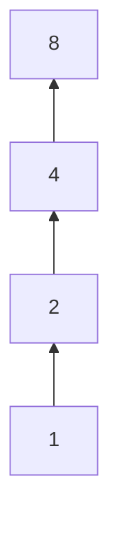

# Relations and Functions — Solutions

> Part of [Relations and Functions](README.md) · Solutions to [exercises.md](exercises.md)

Each solution states the strategy, then the full argument. Where a property is claimed, the check is
written out pair by pair.

---

## Beginner

**1.** *Strategy: write every combination, first entry from the left set.*

$$A \times B = \{(1,a),(1,b),(1,c),(2,a),(2,b),(2,c)\},$$

$$B \times A = \{(a,1),(a,2),(b,1),(b,2),(c,1),(c,2)\}.$$

Each has $2 \cdot 3 = 3 \cdot 2 = 6$ elements, as Proposition 8.1 gives. The sets are **not** equal:
$(1,a) \in A \times B$, but $(1,a) \notin B \times A$, because a pair in $B \times A$ must have its
first entry in $B = \{a,b,c\}$ and $1 \notin B$.

**2.** *Strategy: test each $a \in A$ against the rule $b = 2a$ and keep only values lying in $B$.*

* $a = 1$: $2a = 2 \in B$, so $(1,2) \in R$;
* $a = 2$: $2a = 4 \in B$, so $(2,4) \in R$;
* $a = 3$: $2a = 6 \in B$, so $(3,6) \in R$;
* $a = 4$: $2a = 8 \notin B$, so no pair.

Hence $R = \{(1,2),(2,4),(3,6)\}$, with

$$\operatorname{dom} R = \{1,2,3\}, \qquad \operatorname{ran} R = \{2,4,6\}, \qquad
R^{-1} = \{(2,1),(4,2),(6,3)\}.$$

Note that $\operatorname{dom} R \ne A$: the relation is not defined at $4$.

**3.** *Strategy: solve $x^2 + y^2 = 25$ in integers, bounding $|x| \le 5$.*

Since $x^2 \le 25$, we have $x \in \{-5,-4,\dots,4,5\}$. Check each:

| $x$ | $25 - x^2$ | square? | $y$ |
|---|---|---|---|
| $0$ | $25$ | yes | $\pm 5$ |
| $\pm 1$ | $24$ | no | — |
| $\pm 2$ | $21$ | no | — |
| $\pm 3$ | $16$ | yes | $\pm 4$ |
| $\pm 4$ | $9$ | yes | $\pm 3$ |
| $\pm 5$ | $0$ | yes | $0$ |

That gives $2 + 4 + 4 + 2 = 12$ pairs:

$$R = \{(\pm 5, 0), (0, \pm 5), (\pm 3, \pm 4), (\pm 4, \pm 3)\},$$

with all four sign combinations in the last two families. Then

$$\operatorname{dom} R = \operatorname{ran} R = \{-5,-4,-3,0,3,4,5\}.$$

**4.** *Strategy: check each property against the definition.*

$R = \{(1,1),(2,2),(3,3),(1,2),(2,1)\}$ on $A = \{1,2,3\}$.

* **Reflexive:** $(1,1)$, $(2,2)$, $(3,3)$ are all present. ✓
* **Symmetric:** the only non-diagonal pair is $(1,2)$, and its reverse $(2,1)$ is present; the
  diagonal pairs are their own reverses. ✓
* **Antisymmetric:** fails, because $(1,2) \in R$ and $(2,1) \in R$ but $1 \ne 2$.
* **Transitive:** check the compositions. $(1,2)$ followed by $(2,1)$ gives $(1,1) \in R$;
  $(2,1)$ followed by $(1,2)$ gives $(2,2) \in R$; pairs involving a diagonal entry give back the
  original pair. All required pairs are present. ✓

So $R$ is an equivalence relation, with classes $[1] = \{1,2\}$ and $[3] = \{3\}$.

**5.** *Strategy: $a \mid b$ means $b$ is a multiple of $a$; list the multiples within $A$.*

$$R = \{(1,1),(1,2),(1,3),(1,4),(2,2),(2,4),(3,3),(4,4)\}.$$

* **Reflexive:** $(a,a) \in R$ for every $a$. ✓
* **Symmetric:** no; $(1,2) \in R$ but $(2,1) \notin R$.
* **Antisymmetric:** yes. If $a \mid b$ and $b \mid a$ with $a, b \ge 1$, then $a = b$.
* **Transitive:** yes; if $b = ak$ and $c = bl$ then $c = a(kl)$.
* **Total:** no; $2 \nmid 3$ and $3 \nmid 2$, so $2$ and $3$ are incomparable.

**6.** *Strategy: a relation is a function when every element of the left set appears exactly once
as a first entry.*

(a) Each of $1,2,3$ appears once. Function. ✓

(b) Each of $1,2,3$ appears once (all mapping to $p$). Function. ✓ (It is not injective, but that is
a different question.)

(c) The element $3$ has no partner. Not a function.

(d) The element $1$ appears twice, with partners $p$ and $q$. Not a function.

(e) Each of $1,2,3$ appears once. Function. ✓

**7.** *Strategy: collect the values, then compare their count with the sizes of domain and
codomain.*

The values are $f(1) = a$, $f(2) = c$, $f(3) = a$, $f(4) = b$, so the image is
$\{a,b,c\}$ — all of the codomain. Hence $f$ is **surjective**. It is **not injective**, because
$f(1) = f(3) = a$ while $1 \ne 3$.

**8.** *Strategy: substitute in the correct order; the rightmost function acts first.*

$$(g \circ f)(x) = g(f(x)) = g(x+2) = 3(x+2) = 3x + 6,$$

$$(f \circ g)(x) = f(g(x)) = f(3x) = 3x + 2.$$

At $x = 1$ these give $9$ and $5$. Since two functions are equal only if they agree at every point,
$g \circ f \ne f \circ g$; composition is not commutative.

**9.** *Strategy: prove injectivity by solving $f(x) = f(x')$, prove surjectivity by solving
$f(x) = y$ for $x$, then verify both round trips.*

*Injective.* If $5x - 2 = 5x' - 2$, add $2$ and divide by $5$: $x = x'$.

*Surjective.* Let $y \in \mathbb{R}$ and put $x = (y+2)/5$. Then
$f(x) = 5 \cdot \frac{y+2}{5} - 2 = (y+2) - 2 = y$.

So $f$ is bijective and $f^{-1}(y) = (y+2)/5$. Verification:

$$f^{-1}(f(x)) = \dfrac{(5x-2)+2}{5} = \dfrac{5x}{5} = x, \qquad
f(f^{-1}(y)) = 5 \cdot \dfrac{y+2}{5} - 2 = y + 2 - 2 = y.$$

**10.** *Strategy: two integers are in the same class exactly when their difference is a multiple of
$4$.*

The classes are

$$[0] = \{4k : k \in \mathbb{Z}\}, \quad [1] = \{4k+1 : k \in \mathbb{Z}\}, \quad
[2] = \{4k+2 : k \in \mathbb{Z}\}, \quad [3] = \{4k+3 : k \in \mathbb{Z}\}.$$

Between $-4$ and $8$ inclusive:

* $[0]$: $-4, 0, 4, 8$;
* $[1]$: $-3, 1, 5$;
* $[2]$: $-2, 2, 6$;
* $[3]$: $-1, 3, 7$.

These are $4 + 3 + 3 + 3 = 13$ numbers, which is exactly the number of integers from $-4$ to $8$.
Every one is accounted for exactly once, as a partition requires.

**11.** *Strategy: check which pairs divide, then draw only covering pairs.*

The pairs are $(1,1), (1,2), (1,4), (1,8), (2,2), (2,4), (2,8), (4,4), (4,8), (8,8)$.

The order is a chain $1 \mid 2 \mid 4 \mid 8$: every element divides every larger one, so any two
elements are comparable and the order is **total**. The covering pairs are
$1 \prec 2$, $2 \prec 4$, $4 \prec 8$ (for instance $1 \prec 4$ fails because $1 < 2 < 4$). The
Hasse diagram is a single vertical line:

**12.** *Strategy: each of the three inputs chooses one of four outputs.*

Functions: $4^3 = 64$. Injections: the first input has $4$ choices, the second $3$ (it cannot repeat
the first value), the third $2$, so $4 \cdot 3 \cdot 2 = 24$.

---

## Intermediate

**13.** *Strategy: unfold the definition of $R^{-1}$ and use the corresponding property of $R$.*

Recall $(x,y) \in R^{-1} \iff (y,x) \in R$.

*Reflexive.* Let $a \in A$. Since $R$ is reflexive, $(a,a) \in R$, hence $(a,a) \in R^{-1}$.

*Symmetric.* Suppose $(a,b) \in R^{-1}$. Then $(b,a) \in R$. Since $R$ is symmetric,
$(a,b) \in R$, hence $(b,a) \in R^{-1}$.

*Transitive.* Suppose $(a,b) \in R^{-1}$ and $(b,c) \in R^{-1}$. Then $(b,a) \in R$ and
$(c,b) \in R$. Applying transitivity of $R$ to $(c,b)$ and $(b,a)$ gives $(c,a) \in R$, hence
$(a,c) \in R^{-1}$. $\blacksquare$

**14.** (a) *Strategy: all three properties reduce to divisibility facts about $6$.*

*Reflexive:* $6 \mid (a - a) = 0$. *Symmetric:* if $6 \mid (a-b)$ then $6 \mid (b-a) = -(a-b)$.
*Transitive:* if $a - b = 6k$ and $b - c = 6l$, then $a - c = 6(k+l)$. $\blacksquare$

(b) The class of $2$ consists of all integers of the form $2 + 6k$:

$$[2] = \{\dots,-16,-10,-4,2,8,14,20,26,\dots\}.$$

Between $-10$ and $20$ inclusive: $-10, -4, 2, 8, 14, 20$.

(c) By the division algorithm every integer $n$ can be written $n = 6q + r$ with
$0 \le r \le 5$, so every $n$ lies in one of the six classes $[0], [1], \dots, [5]$. These classes
are distinct: if $r \ne s$ and both lie in $\{0,\dots,5\}$, then $0 < |r - s| < 6$, so $6$ cannot
divide $r - s$, and therefore $r \not\equiv s$. Hence there are exactly six classes.
$\blacksquare$

**15.** (a) *Reflexive:* $x - x = 0 \in \mathbb{Z}$. *Symmetric:* if $x - y \in \mathbb{Z}$ then
$y - x = -(x-y) \in \mathbb{Z}$. *Transitive:* if $x - y \in \mathbb{Z}$ and $y - z \in \mathbb{Z}$
then $x - z = (x-y) + (y-z) \in \mathbb{Z}$. $\blacksquare$

(b) The classes are

$$[0] = \mathbb{Z}, \qquad [1/2] = \{k + \tfrac12 : k \in \mathbb{Z}\}, \qquad
[\sqrt2] = \{\sqrt2 + k : k \in \mathbb{Z}\}.$$

They are distinct: $1/2 \notin \mathbb{Z}$, so $[1/2] \ne [0]$; and $\sqrt2$ is irrational, so
$\sqrt2 \notin \mathbb{Z} = [0]$. Finally $[\sqrt2] \ne [1/2]$, since
$\sqrt2 = 1/2 + k$ would make $\sqrt2$ rational.

Each class is a shifted copy of the integers; the quotient $\mathbb{R}/\mathbb{Z}$ is the circle.

**16.** (a) *Strategy: feed the equality of images into the injectivity of $g$, then into the
injectivity of $f$.*

Suppose $f(a) = f(a')$ for some $a, a' \in A$. Applying $g$ gives
$g(f(a)) = g(f(a'))$, that is, $(g \circ f)(a) = (g \circ f)(a')$. Since $g \circ f$ is injective,
$a = a'$. Hence $f$ is injective. $\blacksquare$

(b) Take $A = \{1\}$, $B = \{1,2\}$, $C = \{1\}$, with $f(1) = 1$ and $g(1) = g(2) = 1$. Then
$g \circ f : \{1\} \to \{1\}$ sends $1$ to $1$ and is injective (a function out of a one-point set
is always injective), but $g$ is not injective because $g(1) = g(2)$.

**17.** *Strategy: use the graph of $x^2$; for preimages, solve the inequality $f(x) \in Y$.*

**$f([-3,2])$:** as $x$ runs over $[-3,2]$, $x^2$ runs over $[0,9]$. The maximum $9$ occurs at
$x = -3$, the minimum $0$ at $x = 0$, and every intermediate value occurs: for $y \in [0,9]$, the
number $\sqrt y$ lies in $[0,3]$; if $\sqrt y \le 2$ then $\sqrt y \in [-3,2]$, and otherwise
$-\sqrt y \in [-3,-2] \subseteq [-3,2]$. Hence $f([-3,2]) = [0,9]$.

**$f^{-1}([1,9])$:** need $1 \le x^2 \le 9$, that is $1 \le |x| \le 3$. Hence

$$f^{-1}([1,9]) = [-3,-1] \cup [1,3].$$

**$f^{-1}((-1,0])$:** need $-1 < x^2 \le 0$. Since $x^2 \ge 0$ always, this forces $x^2 = 0$, so
$f^{-1}((-1,0]) = \{0\}$.

**18.** (a) *Strategy: prove both inclusions using the definition of the inverse relation.*

$(x,y) \in R^{-1} \iff (y,x) \in R$.

If $R$ is symmetric and $(x,y) \in R^{-1}$, then $(y,x) \in R$, so by symmetry $(x,y) \in R$; hence
$R^{-1} \subseteq R$. Conversely, if $(x,y) \in R$ then $(y,x) \in R^{-1}$ by symmetry of $R$, so
$R \subseteq R^{-1}$. Hence $R^{-1} = R$.

Conversely, if $R^{-1} = R$ and $(x,y) \in R$, then $(y,x) \in R^{-1} = R$, so $R$ is symmetric.
$\blacksquare$

(b) $\operatorname{id}_A = \{(a,a) : a \in A\}$. If $R$ is reflexive, every $(a,a)$ belongs to $R$,
so $\operatorname{id}_A \subseteq R$. Conversely, if $\operatorname{id}_A \subseteq R$, then
$(a,a) \in R$ for every $a$, which is exactly reflexivity. $\blacksquare$

---

**19.** (a) *Strategy: prove both inclusions by element chasing.*

Suppose $b \in f(X \cup Y)$. Then $b = f(x)$ for some $x \in X \cup Y$. If $x \in X$ then
$b \in f(X)$; if $x \in Y$ then $b \in f(Y)$. Either way $b \in f(X) \cup f(Y)$, so
$f(X \cup Y) \subseteq f(X) \cup f(Y)$.

Conversely, if $b \in f(X) \cup f(Y)$, then $b = f(x)$ for some $x \in X$ or $b = f(y)$ for some
$y \in Y$; in either case $b = f(z)$ with $z \in X \cup Y$, so $b \in f(X \cup Y)$. Hence
$f(X \cup Y) = f(X) \cup f(Y)$. $\blacksquare$

(b) Take $f : \mathbb{R} \to \mathbb{R}$, $f(x) = x^2$, with $X = [-2,-1]$ and $Y = [1,2]$. Then
$X \cap Y = \varnothing$, so $f(X \cap Y) = \varnothing$, while

$$f(X) = [1,4] = f(Y), \qquad f(X) \cap f(Y) = [1,4] \ne \varnothing.$$

The failure is produced by two distinct points ($-1$ and $1$) with the same value $1$.

**20.** *Strategy: irreflexivity is immediate; for transitivity, rule out $x = z$ using
antisymmetry.*

*Irreflexive:* $x < x$ would require $x \ne x$, which is impossible.

*Transitive:* suppose $x < y$ and $y < z$. Then $xRy$ and $yRz$, so $xRz$ by transitivity of $R$. It
remains to show $x \ne z$. If $x = z$, then $zRy$ and $yRz$; antisymmetry of $R$ gives $y = z$,
contradicting $y < z$ (which requires $y \ne z$). Hence $x \ne z$, so $x < z$. $\blacksquare$

**21.** *Strategy: find the image first; injectivity fails because the graph is a parabola.*

*Not injective:* $f(0) = 1 = f(-2)$ while $0 \ne -2$.

*Not surjective:* $(x+1)^2 \ge 0$ for every real $x$, so $-1$ is not a value. Hence
$f(\mathbb{R}) = [0,\infty)$.

*Restriction:* let $g : [-1,\infty) \to [0,\infty)$ be $g(x) = (x+1)^2$.

*Injective:* if $(x+1)^2 = (y+1)^2$ with $x, y \ge -1$, then $x + 1 \ge 0$ and $y + 1 \ge 0$, and
$|x+1| = |y+1|$ gives $x + 1 = y + 1$, so $x = y$.

*Surjective:* given $t \ge 0$, put $x = \sqrt t - 1 \ge -1$; then $g(x) = (\sqrt t)^2 = t$.

So $g$ is bijective onto $[0,\infty)$, with inverse $g^{-1}(t) = \sqrt t - 1$.

**22.** *Strategy: classify partitions by the number of blocks.*

**One block (1 partition).** $\{1234\}$. The relation is the universal relation $A \times A$: every
pair is related.

**Two blocks (7 partitions).** Splits of type $3+1$: $\{1\}\{234\}$, $\{2\}\{134\}$,
$\{3\}\{124\}$, $\{4\}\{123\}$. Splits of type $2+2$: $\{12\}\{34\}$, $\{13\}\{24\}$,
$\{14\}\{23\}$. In each case the relation consists of all pairs $(x,y)$ with $x$ and $y$ in the same
block; for example $\{12\}\{34\}$ gives
$\{(1,1),(1,2),(2,1),(2,2),(3,3),(3,4),(4,3),(4,4)\}$.

**Three blocks (6 partitions).** One block of size $2$ and two singletons:
$\{12\}\{3\}\{4\}$, $\{13\}\{2\}\{4\}$, $\{14\}\{2\}\{3\}$, $\{23\}\{1\}\{4\}$,
$\{24\}\{1\}\{3\}$, $\{34\}\{1\}\{2\}$. For instance $\{12\}\{3\}\{4\}$ gives
$\{(1,1),(1,2),(2,1),(2,2),(3,3),(4,4)\}$.

**Four blocks (1 partition).** $\{1\}\{2\}\{3\}\{4\}$, giving the identity relation
$\operatorname{id}_A$.

The total is $1 + 7 + 6 + 1 = 15 = B_4$, in agreement with the Bell number quoted in Section 7.7.

---

## Advanced

**23.** *Strategy: one direction is the inclusion already proved; the other uses singleton sets.*

**(⟸)** Suppose $f(X \cap Y) = f(X) \cap f(Y)$ for all $X, Y \subseteq A$. Let $a, a' \in A$ with
$f(a) = f(a')$. Put $X = \{a\}$ and $Y = \{a'\}$. Then

$$f(X \cap Y) = f(X) \cap f(Y) = \{f(a)\} \cap \{f(a')\} = \{f(a)\} \ne \varnothing.$$

Since $f(X \cap Y) \ne \varnothing$, the set $X \cap Y$ is nonempty, so $a = a'$. Hence $f$ is
injective.

**(⟹)** Suppose $f$ is injective. The inclusion $f(X \cap Y) \subseteq f(X) \cap f(Y)$ holds for
every function (Theorem 8.10(b)). For the reverse, let $b \in f(X) \cap f(Y)$. Then $b = f(x) = f(y)$
with $x \in X$ and $y \in Y$. Injectivity gives $x = y \in X \cap Y$, so $b \in f(X \cap Y)$.
Therefore $f(X) \cap f(Y) \subseteq f(X \cap Y)$, and the two sets are equal. $\blacksquare$

**24.** *Strategy: compare cardinalities; for surjectivity use the fibres.*

Since $|A| = |B| = n$, it suffices to prove injective $\Rightarrow$ surjective and surjective
$\Rightarrow$ injective.

**(i)** Let $f$ be injective. Then $f$ is a bijection from $A$ onto its image $f(A)$, so
$|f(A)| = |A| = n$. But $f(A) \subseteq B$ and $|B| = n$; a subset of a finite set that has as many
elements as the set must be the whole set. Hence $f(A) = B$, so $f$ is surjective.

**(ii)** Let $f$ be surjective. For $b \in B$ let $F_b = \{a \in A : f(a) = b\}$. The fibres are
pairwise disjoint, and their union is $A$. Surjectivity says each $F_b$ is nonempty. Hence

$$n = |A| = \sum_{b \in B} |F_b| \ge \sum_{b \in B} 1 = |B| = n.$$

Both ends equal $n$, so every term equals $1$: each $b$ has exactly one preimage, which is
injectivity.

Therefore injective, surjective and bijective are equivalent. $\blacksquare$

**25.** *Strategy: $R \circ R$ is exactly the set of pairs reachable in two steps.*

**(⟹)** Suppose $R$ is transitive and $(a,c) \in R \circ R$. By definition there is $b$ with
$(a,b) \in R$ and $(b,c) \in R$; transitivity gives $(a,c) \in R$. Hence $R \circ R \subseteq R$.

**(⟸)** Suppose $R \circ R \subseteq R$. If $(a,b) \in R$ and $(b,c) \in R$, then
$(a,c) \in R \circ R \subseteq R$, so $R$ is transitive. $\blacksquare$

*Remark.* By induction, $R$ is transitive if and only if $R^n \subseteq R$ for every $n \ge 1$.

**26.** *Strategy: an element of the field appears in some pair; symmetry and transitivity then give
the loop.*

Let $a \in \operatorname{fld} R$. Then $a$ appears as the first or the second entry of some pair of
$R$. If $(a,b) \in R$, symmetry gives $(b,a) \in R$, and transitivity applied to $(a,b)$ and $(b,a)$
gives $(a,a) \in R$. If instead $(c,a) \in R$, symmetry gives $(a,c) \in R$, and transitivity applied
to $(c,a)$ and $(a,c)$ gives $(a,a) \in R$. Either way $(a,a) \in R$, so $R$ is reflexive on its
field. $\blacksquare$

*Example showing that reflexivity on all of $A$ can fail.* On $A = \{1,2,3\}$ let
$R = \{(1,1),(1,2),(2,1),(2,2)\}$. It is symmetric (each pair has its reverse) and transitive (the
only chains of length two are $(1,2),(2,1)$, which produce $(1,1)$, and $(2,1),(1,2)$, which produce
$(2,2)$). Its field is $\{1,2\}$, on which it is reflexive, but $(3,3) \notin R$, so $R$ is not
reflexive on $A$.

**27.** *Strategy: three properties, then the class computation.*

*Reflexive.* Since the blocks cover $A$, each $a$ lies in some block $P$; then $a$ and $a$ both lie
in $P$, so $a \sim a$.

*Symmetric.* The condition "lie in a common block" is unchanged when $a$ and $b$ are exchanged.

*Transitive.* Suppose $a \sim b$ and $b \sim c$. Then $a, b \in P$ and $b, c \in Q$ for blocks
$P, Q$. Since $b \in P \cap Q$, the intersection is nonempty, so $P = Q$ (distinct blocks are
disjoint). Hence $a, c \in P$ and $a \sim c$.

*Classes are the blocks.* Fix $a \in A$ and let $P$ be the block containing $a$. If $x \in [a]$ then
$x$ and $a$ share a block; that block must be $P$, because blocks are disjoint and $a \in P$. Hence
$x \in P$. Conversely, if $x \in P$ then $x \sim a$, so $x \in [a]$. Thus $[a] = P$. Every block
arises, since it is nonempty and contains some $a$. $\blacksquare$

**28.** *Strategy: count the pairs that are forced and the pairs that are free.*

The set $A \times A$ has $n^2$ pairs: $n$ diagonal pairs $(a,a)$ and $n^2 - n$ off-diagonal pairs
$(a,b)$ with $a \ne b$.

(a) **Reflexive relations.** All $n$ diagonal pairs must be present. Each of the $n^2 - n$
off-diagonal pairs may be present or absent independently. So the count is
$2^{n^2-n}$.

(b) **Symmetric relations.** Such a relation is determined by its pairs on and above the diagonal:
the pair $(a,b)$ with $a \ne b$ forces $(b,a)$. The number of unordered pairs $\{a,b\}$ is
$\binom{n}{2}$, and together with the $n$ diagonal pairs this gives
$n + \binom{n}{2} = \frac{n(n+1)}{2}$ independent choices, hence $2^{n(n+1)/2}$ relations.

(c) **Irreflexive relations.** All $n$ diagonal pairs must be absent; the $n^2 - n$ off-diagonal
pairs are free, giving $2^{n^2-n}$.

For $n = 3$ all three counts equal $2^6 = 64$, so the numbers of reflexive, symmetric and irreflexive
relations coincide in that case.

**29.** *Strategy: both sides say "there exist $b$ and $c$ forming a chain"; show the conditions are
the same.*

Let $R \subseteq A \times B$, $S \subseteq B \times C$, $T \subseteq C \times D$. For $a \in A$ and
$d \in D$,

$$(a,d) \in (T \circ S) \circ R
\iff \exists b \in B: (a,b) \in R \text{ and } (b,d) \in T \circ S$$
$$\iff \exists b \in B\ \exists c \in C: (a,b) \in R,\ (b,c) \in S,\ (c,d) \in T.$$

Similarly,

$$(a,d) \in T \circ (S \circ R)
\iff \exists c \in C: (a,c) \in S \circ R \text{ and } (c,d) \in T$$
$$\iff \exists c \in C\ \exists b \in B: (a,b) \in R,\ (b,c) \in S,\ (c,d) \in T.$$

The two conditions differ only in the order of the quantifiers $\exists b$ and $\exists c$, which is
immaterial. Hence the two relations contain exactly the same pairs. $\blacksquare$

---

## Challenge

**30.** (a) *Strategy: build a set that cannot be a value of $f$.*

Suppose $f : A \to \mathcal{P}(A)$ is surjective. Define

$$D = \{a \in A : a \notin f(a)\} \subseteq A.$$

Since $f$ is surjective and $D \in \mathcal{P}(A)$, there is $a_0 \in A$ with $f(a_0) = D$. Now ask
whether $a_0 \in D$:

$$a_0 \in D \iff a_0 \notin f(a_0) \iff a_0 \notin D.$$

Both alternatives lead to a contradiction, so no such $a_0$ exists and no surjection exists.
$\blacksquare$

(b) The map $A \to \mathcal{P}(A)$, $a \mapsto \{a\}$, is injective: if $\{a\} = \{a'\}$ then
$a = a'$. Hence $|A| \le |\mathcal{P}(A)|$. If $|A| = |\mathcal{P}(A)|$, there would be a bijection
$A \to \mathcal{P}(A)$, which is in particular a surjection, contradicting (a). Therefore the
inequality is strict: $|A| < |\mathcal{P}(A)|$.

(c) Associate to each subset $X \subseteq A$ its **characteristic function**
$\chi_X : A \to \{0,1\}$ defined by $\chi_X(a) = 1$ if $a \in X$ and $\chi_X(a) = 0$ otherwise. The
map $X \mapsto \chi_X$ is a bijection from $\mathcal{P}(A)$ onto $\{0,1\}^A$: distinct subsets have
distinct characteristic functions, and every function $A \to \{0,1\}$ is the characteristic function
of $X = \{a : f(a) = 1\}$. Combining this with Theorem 8.9 gives
$|\mathcal{P}(A)| = 2^{|A|}$ for finite $A$.

**31.** (a) Write a permutation as the word $f(1)f(2)f(3)$. The derangements are $231$ and $312$:
in $231$, $1 \mapsto 2$, $2 \mapsto 3$, $3 \mapsto 1$; in $312$, $1 \mapsto 3$, $2 \mapsto 1$,
$3 \mapsto 2$. No element is fixed. The other four permutations ($123$, $132$, $213$, $321$) each
fix at least one element. So there are $2$ derangements of a $3$-element set.

(b) The nine derangements of $\{1,2,3,4\}$, in one-line notation:

$$2143,\quad 2341,\quad 2413,\quad 3142,\quad 3412,\quad 3421,\quad 4123,\quad 4312,\quad 4321.$$

Each has no fixed point; for example $2143$ sends $1 \mapsto 2$, $2 \mapsto 1$, $3 \mapsto 4$,
$4 \mapsto 3$. A systematic count: partition the derangements by the image of $1$. If $f(1) = 2$,
then $f(2) \ne 2$ forces $f(2) \in \{1,3,4\}$; checking the three cases gives $2143$, $2341$,
$2413$. By symmetry the same number occurs for each of the three possible images of $1$, giving
$3 \cdot 3 = 9$.

(c) The formula $4! - 4 \cdot 3! = 24 - 24$ subtracts, for each of the four possible fixed points,
the $3!$ permutations fixing it. A permutation with two fixed points is subtracted twice (once for
each of its fixed points), a permutation with three fixed points three times, and the identity four
times, so the subtraction overcounts the corrections. Inclusion–exclusion repairs this:

$$D_4 = 4! - \binom41 3! + \binom42 2! - \binom43 1! + \binom44 0! = 24 - 24 + 12 - 4 + 1 = 9,$$

in agreement with (b). In general $D_n = n!\sum_{k=0}^{n} \frac{(-1)^k}{k!}$.

**32.** (a) *Reflexive:* $a = 2^0 a$. *Symmetric:* if $b = 2^k a$ then $a = 2^{-k} b$, and $-k \in \mathbb{Z}$. *Transitive:* if $b = 2^k a$ and $c = 2^l b$ then $c = 2^{k+l} a$. $\blacksquare$

(b) On $\mathbb{N}^{+}$,

$$[1] = \{2^k : k \in \mathbb{Z}\} \cap \mathbb{N}^{+} = \{1, 2, 4, 8, 16, \dots\},$$

because negative powers give fractions, which are not in $\mathbb{N}^{+}$. Similarly

$$[3] = \{3 \cdot 2^k : k \in \mathbb{Z}\} \cap \mathbb{N}^{+} = \{3, 6, 12, 24, \dots\}.$$

(c) Every $a \in \mathbb{N}^{+}$ can be written uniquely as $a = 2^j m$ with $j \ge 0$ and $m$ odd
(take $j$ to be the number of factors $2$ in $a$). Then $m = 2^{-j} a$, so $m \sim a$ and
$[a] = [m]$: every class contains an odd number.

If two odd numbers $m, m'$ lie in the same class, then $m' = 2^k m$ for some $k \in \mathbb{Z}$. Since
$m$ and $m'$ are odd, $k = 0$: a nonzero power of $2$ is even. Hence $m = m'$, so each class contains
exactly one odd number. The classes are therefore in bijection with the odd positive integers
$1, 3, 5, 7, \dots$, of which there are infinitely many.

**33.** (a) *Strategy: walk strictly downward; finiteness forces the walk to stop.*

Let $(A, \le)$ be a finite nonempty poset. Choose $a_1 \in A$. If $a_1$ is minimal, stop. Otherwise
there is $a_2 < a_1$. If $a_2$ is minimal, stop; otherwise choose $a_3 < a_2$, and continue.

The elements produced are pairwise distinct. Indeed, if $a_i = a_j$ with $i < j$, then

$$a_i > a_{i+1} > \cdots > a_j = a_i,$$

so by transitivity $a_i < a_i$, which is impossible because $<$ is irreflexive. Since $A$ is finite,
no infinite sequence of pairwise distinct elements exists, so the process must stop at some $a_k$.
That $a_k$ is minimal: the process stops only when there is no element strictly below it.
$\blacksquare$

(b) Let $(A, \le)$ be a finite nonempty total order, and let $m$ be a minimal element, which exists by
(a). For any $a \in A$, comparability gives $m \le a$ or $a \le m$. In the second case, minimality of
$m$ forces $a = m$, so $m \le a$ holds in either case. Hence $m$ is the least element.
$\blacksquare$

(c) The poset $(\mathbb{Z}, \le)$ has no minimal element: for every $m \in \mathbb{Z}$, the element
$m - 1$ is strictly smaller.

For a minimal element without a least one, take $A = \mathbb{N}$ with the order in which $0$ and $1$
are both below every $n \ge 2$, and $0$ and $1$ are incomparable with each other. Formally, $a \le b$
iff $a = b$, or $a \in \{0,1\}$ and $b \ge 2$. This is a partial order: reflexive and antisymmetric
by inspection, and transitive because the only chains of length two start at $0$ or $1$ and end at
some $n \ge 2$, which is again below every $m \ge 2$. Both $0$ and $1$ are minimal (nothing is
strictly below either), but neither is least, since they are incomparable.

