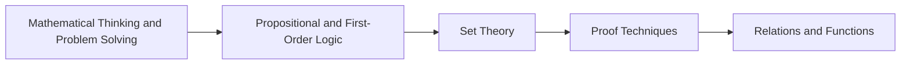

<!-- Generated by tools/build_indexes.py from tools/curriculum.json. Do not edit by hand. -->

# Foundations

*How mathematics itself works*

[Mathematics](../README.md) › Foundations

Mathematical thinking, logic, sets, proof and the language of functions. These are not prerequisites you finish once: they are the grammar that every later subject is written in.

## At a glance

| | |
|---|---|
| Topics | 5 (5 complete, 0 draft, 0 planned) |
| Estimated study time | ~44 hours |
| Prerequisites | None — this is an entry point |

## Study order

The numbers are the recommended order. Study a topic only after the ones before it —
the dependency chain below is the shortest safe route through the discipline.

## Topic inventory

| # | Topic | Level | Est. time | Status | Materials |
|---|---|---|---|---|---|
| 1 | [Mathematical Thinking and Problem Solving](01-mathematical-thinking/README.md) | Beginner | 6 h | Complete | [Tutorial](01-mathematical-thinking/README.md) · [Exercises](01-mathematical-thinking/exercises.md) · [Solutions](01-mathematical-thinking/solutions.md) |
| 2 | [Propositional and First-Order Logic](02-logic/README.md) | Beginner | 8 h | Complete | [Tutorial](02-logic/README.md) · [Exercises](02-logic/exercises.md) · [Solutions](02-logic/solutions.md) |
| 3 | [Set Theory](03-set-theory/README.md) | Beginner | 10 h | Complete | [Tutorial](03-set-theory/README.md) · [Exercises](03-set-theory/exercises.md) · [Solutions](03-set-theory/solutions.md) |
| 4 | [Proof Techniques](04-proof-techniques/README.md) | Beginner | 10 h | Complete | [Tutorial](04-proof-techniques/README.md) · [Exercises](04-proof-techniques/exercises.md) · [Solutions](04-proof-techniques/solutions.md) |
| 5 | [Relations and Functions](05-relations-and-functions/README.md) | Intermediate | 10 h | Complete | [Tutorial](05-relations-and-functions/README.md) · [Exercises](05-relations-and-functions/exercises.md) · [Solutions](05-relations-and-functions/solutions.md) |

### What each topic covers

- **Mathematical Thinking and Problem Solving** — Abstraction, conjecture, counterexample and the heuristics of solving unfamiliar problems.
- **Propositional and First-Order Logic** — Connectives, truth tables, quantifiers, inference rules and the anatomy of a valid argument.
- **Set Theory** — Sets, operations, identities, cardinality and Cantor's diagonal argument.
- **Proof Techniques** — Direct proof, contraposition, contradiction, cases, existence and uniqueness.
- **Relations and Functions** — Ordered pairs, equivalence relations, orders, injections, surjections and bijections.

## Related disciplines

- [09-discrete-mathematics](../09-discrete-mathematics/README.md)
- [24-advanced-topics](../24-advanced-topics/README.md)

## Status key

- **Complete** — tutorial, exercises and full solutions exist and the tutorial meets the
  [authoring standard](../CONTRIBUTING.md).
- **Draft** — some material exists but the topic is not finished.
- **Planned** — identified in the curriculum, not written yet.

Overall progress and the full topic inventory live in [ROADMAP.md](../ROADMAP.md).
