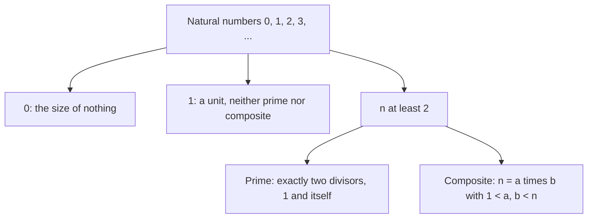
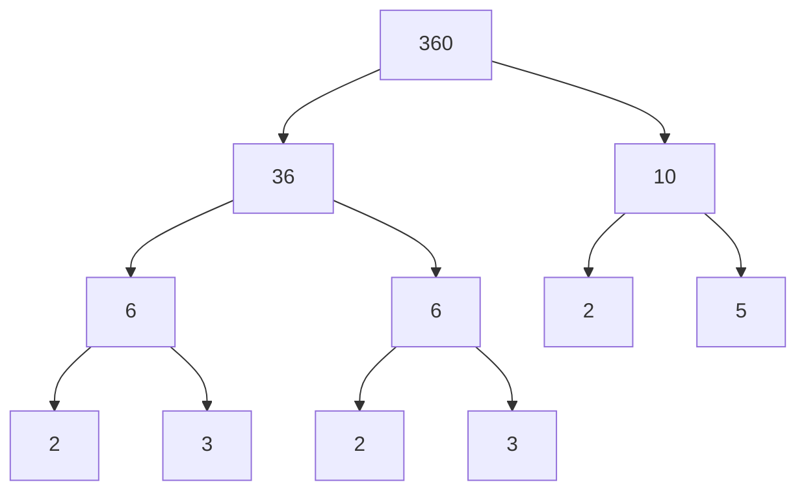
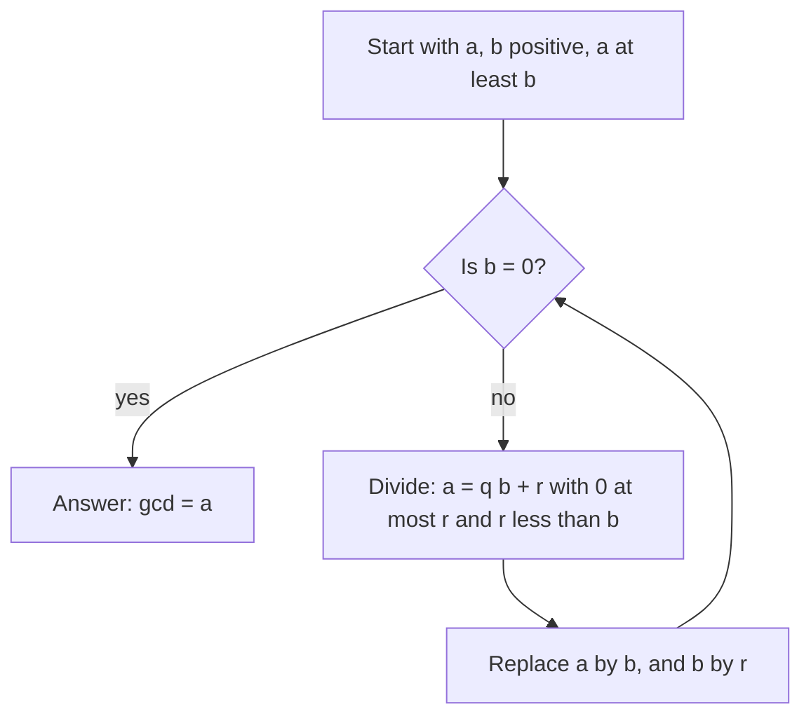

# Natural Numbers

> Mathematics › [Arithmetic](../README.md) › Natural Numbers · Level: Absolute beginner · Prerequisites: none · Estimated time: 90 min

## 1. Introduction

Imagine a shepherd who owns sheep and cannot count. Every morning he lets the flock out; every evening he must know whether all of them came back. He does not need number words for this. He can drop one pebble into a bag as each sheep leaves, and hand one pebble back as each sheep returns. If the pebbles run out exactly when the sheep are all in, nothing was lost. This is counting in its purest form: **matching one collection against another**, without naming any number at all.

Later, people gave names to the sizes they kept meeting — one, two, three — and then wrote them down as symbols: $1$, $2$, $3$. That step is enormous but easy to overlook. The symbol $7$, the Roman numeral VII and the string $111$ written in binary are three different *notations* for the same abstract object. A **numeral** is ink on paper; a **number** is what the ink denotes. This whole tutorial keeps that distinction, because confusing the two is the source of many elementary mistakes.

Modern mathematics takes a third step: instead of asking what a number *is made of*, it asks how numbers *behave*, and writes those behaviours down as rules. The rules are the **Peano axioms** (Section 5). From them one can define addition, multiplication, order — and prove the facts you already use, such as $2+3 = 3+2$. That is the difference between *using* arithmetic and *understanding* it, and it is the destination of this tutorial.

The journey has four parts.

1. **What the natural numbers are.** Counting, the Peano axioms, and the successor.
2. **How we write them.** Place value in base ten, the number line, and other bases.
3. **What we can do with them.** Addition, subtraction, multiplication, division with remainder, and the laws those operations obey.
4. **What is hidden inside them.** Factors, primes, the sieve of Eratosthenes, prime factorisation, greatest common divisors, least common multiples, and the Euclidean algorithm.

## 2. Prerequisites

There are no formal prerequisites. You should be able to read the digits $0$ through $9$ and you should be willing to write calculations out by hand on paper. That is all.

A few conventions used throughout, so that nothing is undefined later:

* A **collection** (or **set**) is just a gathering of objects, called its **elements**. We write $x \in A$ for "$x$ is an element of $A$". No deeper set theory is needed here.
* The phrase **for all** means "for every choice of"; **there exists** means "for at least one choice of".
* A **proof** is a chain of statements, each of which follows from the previous ones by a rule agreed in advance. A proof is not a demonstration on examples: examples illustrate, proofs establish.

If you have already met sets and functions, the later topic [Relations and Functions](../../00-foundations/05-relations-and-functions/README.md) explains how the arithmetic operations fit into a wider framework. It is *not* needed to read this tutorial.

## 3. Learning Objectives

By the end of this tutorial you will be able to:

1. Explain what counting is, and why "same size" can be decided by matching rather than by naming numbers.
2. State the five Peano axioms and say precisely what each one rules out.
3. Read and write natural numbers in base ten using place value and expanded form.
4. Place numbers on the number line, compare them, and use the symbols $<$, $>$, $\le$, $\ge$.
5. Carry out addition, subtraction, multiplication and long division, and explain *why* each step of the standard algorithm is correct.
6. State and apply the division algorithm: for every $a$ and every $b \ne 0$ there are unique $q$ and $r$ with $a = qb + r$ and $0 \le r < b$.
7. Name and use the commutative, associative, distributive, identity and zero laws.
8. Decide whether a number is prime or composite, and generate primes with the sieve of Eratosthenes.
9. Compute prime factorisations and use them to find greatest common divisors, least common multiples and divisor counts.
10. Run the Euclidean algorithm and explain why it terminates and why it gives the gcd.
11. Convert numbers between base ten, binary, octal and hexadecimal, and do arithmetic in binary.
12. Explain the principle of induction and prove a first formula with it.

## 4. Intuition

### 4.1 Counting is matching

Before there were numbers there was matching. A village that wanted to know whether it had as many goats as sacks of grain did not count either pile: it paired them off. If every goat stood next to exactly one sack, and every sack next to exactly one goat, the two collections had the same size. This relation — a perfect pairing — is what "same number of" *means*, and it survives even when the objects are wildly different.

Counting with words is a shortcut for this process. When you say "one, two, three" while pointing, you are pairing objects with a standard collection of sounds. The last sound reached is a *name* for the size of the collection. That is why the answer does not depend on the order in which you point: any two ways of pairing the collection with the standard sounds stop at the same sound.

### 4.2 Place value is bundling

Suppose you count a large pile with tally marks. You soon want to bundle: tie ten sticks together, then tie ten bundles together, and so on. A number written in base ten records exactly how many bundles of each size you have. In $4{,}708$ there are $4$ bundles of a thousand, $7$ bundles of a hundred, $0$ bundles of ten, and $8$ loose sticks. The symbol $0$ is not decoration: it says "there are no tens in this number", which keeps the other digits in their correct positions.

Without place value, every new size of bundle would need a new symbol. That is how Roman numerals work, and it is why arithmetic with them is hard. Place value turns arithmetic into a small set of digit facts plus a carrying rule.

### 4.3 The number line

Arrange the natural numbers in their usual order, equally spaced, on a straight line:

$$0 \quad 1 \quad 2 \quad 3 \quad 4 \quad 5 \quad 6 \quad 7 \quad 8 \quad 9 \quad 10 \quad \cdots$$

Then arithmetic becomes geometry. Adding $3$ is moving three steps to the right; subtracting $3$ is moving three steps to the left; multiplying by $4$ is laying down four copies of the same step; dividing is asking how many copies of one step fit inside another. The line is also a picture of order: $a < b$ exactly when $a$ sits to the left of $b$.

The line is a *picture*, not a proof. It is extremely useful for building intuition and for spotting errors, but every fact we need is also proved from the axioms.

### 4.4 Multiplication is a rectangle, division is a question

Multiplication is repeated addition: $4 \times 3$ means $3 + 3 + 3 + 3$. Arrange the same objects in a rectangle with $4$ rows of $3$; counting by rows gives $4 \times 3$, counting by columns gives $3 \times 4$. The two counts see the same rectangle, which is the visual reason multiplication is commutative.

Division asks a question with a remainder. "How many groups of $6$ fit into $7{,}543$, and what is left over?" The answer is $1{,}257$ groups with $1$ left over. Sometimes nothing is left over; then we say the division is exact.

### 4.5 Primes are the atoms of multiplication

Some numbers can be built by multiplying smaller numbers, and some cannot. The ones that cannot — $2, 3, 5, 7, 11, \dots$ — are the **primes**. Every other number bigger than $1$ is a product of primes, and (this is the surprising part) in exactly one way apart from the order of the factors. That uniqueness is the **fundamental theorem of arithmetic**, and it is what makes primes the "atoms" of the multiplicative world.

## 5. Formal Definition

We now collect the definitions used in the rest of the tutorial. Proofs of the theorems appear in Section 8.

### 5.1 The natural numbers (Peano axioms)

The set of **natural numbers** is written $\mathbb{N}$. It contains a distinguished element $0$ and a **successor** operation $S$, and it satisfies five axioms.

* **(P1)** $0 \in \mathbb{N}$.
* **(P2)** For every $n \in \mathbb{N}$, its successor $S(n)$ is an element of $\mathbb{N}$.
* **(P3)** For every $n \in \mathbb{N}$, $S(n) \ne 0$. (No number has $0$ as its successor.)
* **(P4)** For all $m, n \in \mathbb{N}$, if $S(m) = S(n)$ then $m = n$. (The successor map is injective: different numbers have different successors.)
* **(P5)** **Induction.** If a collection $A \subseteq \mathbb{N}$ satisfies (i) $0 \in A$ and (ii) $n \in A$ implies $S(n) \in A$ for every $n$, then $A = \mathbb{N}$.

Two conventions are in use in the literature: some authors start the natural numbers at $1$ and call $0$ a whole number. This repository uses $\mathbb{N} = \{0, 1, 2, 3, \dots\}$ and writes $\mathbb{N}^{+} = \{1, 2, 3, \dots\}$ when zero must be excluded.

### 5.2 Addition and multiplication

These are *definitions by recursion*, in terms of the successor:

$$a + 0 := a, \qquad a + S(b) := S(a + b), \qquad a \cdot 0 := 0, \qquad a \cdot S(b) := a \cdot b + a.$$

The first clause defines $a+b$ for every $b$ at once, starting from $b = 0$ and stepping through successors. In everyday notation $S(b)$ is $b+1$, so the second clause reads $a + (b+1) = (a+b) + 1$; the definition is a careful way of saying "adding $b+1$ is adding $b$ and then taking one more step". Similarly $a \cdot (b+1) = a\cdot b + a$ is "one more copy of $a$".

### 5.3 Order

For $a, b \in \mathbb{N}$ we define $a \le b$ to mean that there exists $k \in \mathbb{N}$ with $a + k = b$.

We write $a < b$ when $a \le b$ and $a \ne b$. In that case there is a unique positive $k$ with $a + k = b$, and we call $k$ the **difference** $b - a$.

### 5.4 Divisibility, primes, composites

Let $a, b \in \mathbb{N}$ with $a \ne 0$. We say $a$ **divides** $b$, written $a \mid b$, if there is $k \in \mathbb{N}$ with $b = a \cdot k$.

In that case $a$ is a **factor** (or **divisor**) of $b$, and $b$ is a **multiple** of $a$.

A natural number $p$ is **prime** if $p \ge 2$ and the only natural numbers dividing $p$ are $1$ and $p$. A natural number $n \ge 2$ that is not prime is **composite**: then $n = ab$ with $1 < a, b < n$.

The numbers $0$ and $1$ are neither prime nor composite. This is a definition, not an accident; the reasons are discussed in Section 7.9.

### 5.5 The division algorithm

For all $a \in \mathbb{N}$ and all $b \in \mathbb{N}$ with $b \ge 1$ there exist **unique** $q, r \in \mathbb{N}$ such that $a = q \cdot b + r$ and $0 \le r < b$.

The number $q$ is the **quotient**, $r$ the **remainder**, and $b$ the **divisor**.

### 5.6 Greatest common divisor and least common multiple

For $a, b \in \mathbb{N}$, not both zero, the **greatest common divisor** $\gcd(a,b)$ is the largest $d \in \mathbb{N}$ with $d \mid a$ and $d \mid b$. The **least common multiple** $\operatorname{lcm}(a,b)$ is the smallest positive $m$ with $a \mid m$ and $b \mid m$.

It is a theorem, not a definition, that these numbers exist for all such $a$ and $b$; see Sections 7.12 and 8.

### 5.7 Base-$b$ representation

Let $b \ge 2$. A **base-$b$ expansion** of $n \in \mathbb{N}$ is an expression

$$n = d_k b^k + d_{k-1} b^{k-1} + \cdots + d_1 b + d_0,$$

where each **digit** $d_i$ is an integer with $0 \le d_i < b$, and $d_k \ne 0$ unless $n = 0$ (in which case the expansion is just $0$).

For $b = 10$ this is ordinary decimal notation; for $b = 2$ it is binary; $b = 8$ is octal and $b = 16$ is hexadecimal. Every $n \ge 1$ has exactly one such expansion for a fixed $b$ (Theorem 8.10).

### 5.8 Two tools: induction and well-ordering

* **Principle of induction.** This is axiom (P5) above.
* **Well-ordering principle.** Every nonempty collection of natural numbers has a least element.

The two are equivalent; both are used freely in the proofs of Section 8. For a beginner the well-ordering principle is the easier of the two to believe: in any nonempty pile of natural numbers there is a smallest one.

## 6. Mathematical Notation

| Symbol | Read aloud | Meaning |
|---|---|---|
| $\mathbb{N}$ | "the natural numbers" | $\{0,1,2,3,\dots\}$ |
| $\mathbb{N}^{+}$ | "the positive naturals" | $\{1,2,3,\dots\}$ |
| $S(n)$ | "successor of $n$" | the next number after $n$, namely $n+1$ |
| $a + b$ | "$a$ plus $b$" | the sum |
| $a - b$ | "$a$ minus $b$" | defined only when $b \le a$ |
| $a \cdot b$, $ab$ | "$a$ times $b$" | the product |
| $a \div b$, $a/b$ | "$a$ divided by $b$" | quotient, when $b \ne 0$ |
| $a \mid b$ | "$a$ divides $b$" | there is $k$ with $b = ak$ |
| $a \nmid b$ | "$a$ does not divide $b$" | negation of the above |
| $q, r$ | "quotient, remainder" | from $a = qb + r$, $0 \le r < b$ |
| $\gcd(a,b)$ | "gcd of $a$ and $b$" | greatest common divisor |
| $\operatorname{lcm}(a,b)$ | "lcm of $a$ and $b$" | least common multiple |
| $p$ | "p" | usually denotes a prime |
| $n!$ | "$n$ factorial" | $1 \cdot 2 \cdots n$, with $0! = 1$ |
| $d_k \cdots d_1 d_0$ | "digits" | base-$b$ expansion; a subscript $b$ names the base |
| $a \equiv r \pmod{m}$ | "$a$ is congruent to $r$ modulo $m$" | $m \mid (a - r)$ |
| $\sum_{i=1}^{n} a_i$ | "sum from $i$ equals 1 to $n$" | $a_1 + a_2 + \cdots + a_n$ |
| $\prod_{i=1}^{n} a_i$ | "product from $i$ equals 1 to $n$" | $a_1 a_2 \cdots a_n$ |
| $v_p(n)$ | "the $p$-adic valuation" | exponent of prime $p$ in the factorisation of $n$ |

Two remarks on reading notation aloud. First, $a \mid b$ and $a/b$ are different relations: $2 \mid 6$ is true, while $2/6$ is the number $\tfrac13$. Second, the subscript in $(1011)_2$ is not multiplication; it is a label saying which base is in use. We write $1011_2$ or $(1011)_2$ interchangeably.

## 7. Core Concepts

### 7.1 Counting, and why "how many" is well defined

Counting a collection means pairing its elements with the standard sequence $0, 1, 2, 3, \dots$ one at a time, without repetition, until the collection is exhausted. The last number used is the **size** of the collection, written $|A|$ for a finite collection $A$.

Two facts make this procedure trustworthy, and both are worth stating because children discover them and adults forget to prove them.

* The answer does not depend on the order of pairing. If you count the same collection twice you get the same final number.
* Two collections have the same size exactly when their elements can be paired off one-to-one.

The second fact is the deeper one. It says that "having the same number of elements" is a *relation between collections*, not a property of a single collection. It is also the definition that survives into infinite collections, where counting to the end is impossible; the topic [Relations and Functions](../../00-foundations/05-relations-and-functions/README.md) develops this idea systematically.

**What about zero?** Zero is the size of a collection with nothing in it, the **empty collection**. It is a genuine number, and the fact that it has no predecessor among the natural numbers is exactly axiom (P3).

### 7.2 The Peano axioms, read slowly

Each axiom removes one way in which the natural numbers could go wrong.

* **(P1)** says there is a starting point. Without it, the process of counting might have no place to begin.
* **(P2)** says every number has a next number. Without it, the sequence would stop somewhere and there would be only finitely many numbers.
* **(P3)** says the sequence never loops back to the start. It rules out the "clock" picture $0 \to 1 \to 2 \to 0 \to \cdots$, in which every number would eventually repeat.
* **(P4)** says two different numbers never share the same successor. It rules out the picture $0 \to 1 \to 2 \to 2 \to 2 \to \cdots$, in which the sequence merges into itself.
* **(P5)** says there is nothing else in $\mathbb{N}$: any collection that contains $0$ and is closed under taking successors is the whole thing. It rules out "extra" elements hanging around, such as a symbol $\infty$ that is its own successor.

A useful mental model: $\mathbb{N}$ is a queue that starts at $0$, has a first element, has no last element, never revisits a place, and contains nothing but the queue.

From the axioms one defines $1 := S(0)$, $2 := S(1)$, $3 := S(2)$, $4 := S(3)$, and so on.

These are definitions, not discoveries. The symbol "$4$" is shorthand for "$S(S(S(S(0))))$". The reason our everyday counting agrees with this construction is that both satisfy the same five rules, and (P5) forces any two such structures to agree element by element.

### 7.3 Place value and base ten

In base ten, the **positions** of a numeral have weights $\cdots, 10^4, 10^3, 10^2, 10^1, 10^0 = 1$.

Reading from the right, each position is ten times the one before. A numeral such as $47{,}305$ is an abbreviation for the **expanded form**

$$47{,}305 = 4 \cdot 10^4 + 7 \cdot 10^3 + 3 \cdot 10^2 + 0 \cdot 10^1 + 5 \cdot 10^0.$$

The expanded form is not a curiosity: it is the *definition* of what the numeral means, and it is the reason the algorithms of Sections 7.5–7.7 work.

Two conventions:

* **Leading zeros** do not change the value: $007 = 7$. They are sometimes written to line up columns in a calculation. A *trailing* zero does change the value: $70 \ne 7$.
* The digit $0$ is a **placeholder**. In $47{,}305$ the $0$ holds the tens position open. If it were omitted the numeral would be $47{,}35$, which is not even a well-formed numeral; if it were replaced by a $6$ the value would change to $47{,}365$.

The value of a numeral with digits $d_k d_{k-1} \cdots d_1 d_0$ is

$$n = \sum_{i=0}^{k} d_i \cdot 10^i, \qquad 0 \le d_i \le 9.$$

The same recipe with $10$ replaced by another base $b \ge 2$ defines base-$b$ notation; Section 7.13 develops it.

### 7.4 The number line and ordering

Place $0$ at a point, choose a unit step, and put $1, 2, 3, \dots$ at successive points to the right. This is the **number line**. Its two uses:

* **Order.** $a < b$ means $a$ lies strictly to the left of $b$. Because the numbers are laid out in order, comparing two numbers is a matter of comparing their positions.
* **Arithmetic as motion.** Adding $k$ moves $k$ units right; subtracting $k$ (when possible) moves $k$ units left.

Comparison in decimal notation is done from the left. A number with more digits is larger, provided there are no leading zeros. If two numerals have the same number of digits, compare the leftmost digit at which they differ; the numeral with the larger digit there is the larger number. For example $4{,}099 < 4{,}100$ because the thousands digits agree and $0 < 1$ in the hundreds place, and $12{,}345 < 12{,}354$ because the first three digits agree and $4 < 5$ in the tens place.

For all $a, b \in \mathbb{N}$ exactly one of $a < b$, $a = b$, $a > b$ holds. This is the **trichotomy law**; it follows from the definition of order, since the difference $b - a$ (when it exists) is a definite natural number.

### 7.5 Addition and subtraction

**Addition** combines two collections. On the number line it is a move to the right. The written algorithm adds digits in the same position and **carries** when a column reaches $10$:

$$3{,}478 + 2{,}946 = 6{,}424.$$

Why carrying is legitimate follows from the expanded form. Adding the units gives $8 + 6 = 14 = 1 \cdot 10 + 4$: one ten is moved to the tens column and a $4$ is left behind. Adding the tens then gives $7 + 4 + 1 = 12$: one hundred to the hundreds column, a $2$ left behind. The process continues; nothing is lost, only regrouped.

**Subtraction** removes one collection from another and moves left. In $\mathbb{N}$ the expression $a - b$ is defined only when $b \le a$; there is no natural number $-3$. When the units digit of $b$ exceeds that of $a$, we **borrow**: one ten from the next column becomes ten units.

$$6{,}003 - 2{,}478 = 3{,}525.$$

Borrowing is again regrouping, not magic: $6{,}003 = 5 \cdot 10^3 + 9 \cdot 10^2 + 9 \cdot 10 + 13$, after which column-by-column subtraction is possible. Subtraction is the inverse operation of addition: $(a + b) - b = a$ whenever $a, b \in \mathbb{N}$.

### 7.6 Multiplication

Multiplication is repeated addition,

$$a \cdot b = \underbrace{a + a + \cdots + a}_{b \text{ copies}},$$

and geometrically the area of an $a \times b$ rectangle of unit squares. The **area model** justifies the usual algorithm: split each factor according to place value and add the partial products.

$$47 \cdot 38 = 47 \cdot (30 + 8) = 47\cdot 30 + 47 \cdot 8 = 1{,}410 + 376 = 1{,}786.$$

Written the traditional way, $47 \times 38$ produces $47 \times 8 = 376$ and $47 \times 30 = 1{,}410$ (usually written as $1{,}410$ shifted one place left), and the sum $1{,}786$.

Two special rules make place value work:

$$a \cdot 10^k \text{ is } a \text{ followed by } k \text{ zeros}, \qquad a \cdot 1 = a, \qquad a \cdot 0 = 0.$$

The first rule says that multiplying by a power of ten shifts digits, which is why the partial products in the written algorithm are offset by ever longer shifts.

### 7.7 Division with remainder and long division

Division answers: *how many copies of $b$ fit into $a$, and how much is left over?* Formally (Theorem 8.4) there are unique $q$ and $r$ with $a = qb + r$ and $0 \le r < b$.

When $r = 0$ we say $b$ **divides** $a$ and write $b \mid a$; the division is exact.

Long division is the algorithm that finds $q$ and $r$ digit by digit. The idea is to work from the leftmost digit of $a$, keeping a running remainder that is always less than $b$.

**Worked layout: $7{,}543 \div 6$.**

```
       1 2 5 7   remainder 1
     ┌────────────────────
   6 │ 7 5 4 3
     │ 6
     │ ─────────
     │ 1 5
     │ 1 2
     │ ─────────
     │   3 4
     │   3 0
     │ ─────────
     │     4 3
     │     4 2
     │ ─────────
     │       1
```

Step by step:

1. $7 \div 6 = 1$ remainder $1$: write $1$ above the $7$, and carry the remainder $1$ next to the $5$, giving $15$.
2. $15 \div 6 = 2$ remainder $3$: write $2$, carry $3$ next to the $4$, giving $34$.
3. $34 \div 6 = 5$ remainder $4$: write $5$, carry $4$ next to the $3$, giving $43$.
4. $43 \div 6 = 7$ remainder $1$: write $7$, and the remainder $1$ is final.

Hence $7{,}543 = 6 \cdot 1{,}257 + 1$, so $q = 1{,}257$ and $r = 1$. Check: $6 \cdot 1{,}257 = 7{,}542$ and $7{,}542 + 1 = 7{,}543$. Also $0 \le 1 < 6$, as required.

**Division by zero is never allowed.** The equation $a = q \cdot 0 + r$ becomes $a = r$, and the condition $0 \le r < 0$ is impossible; so no remainder can be found. There is no number $a/0$.

### 7.8 The five laws of arithmetic

For all $a, b, c \in \mathbb{N}$:

| Law | Addition | Multiplication |
|---|---|---|
| Commutative | $a + b = b + a$ | $ab = ba$ |
| Associative | $(a+b)+c = a+(b+c)$ | $(ab)c = a(bc)$ |
| Identity | $a + 0 = a$ | $a \cdot 1 = a$ |
| Zero | — | $a \cdot 0 = 0$ |

and the two laws that mix the operations:

$$a(b+c) = ab + ac \qquad \text{and} \qquad (a+b)c = ac + bc,$$

the distributivity of multiplication over addition.

The first four rows can be *proved* from the Peano axioms (Section 8 shows commutativity in full); the distributive law is proved by induction on $c$. None of them is an arbitrary rule to memorise.

These laws are not decoration. They are exactly what licenses the algorithms:

* $47 \cdot 38 = 47 \cdot (30 + 8)$ uses distributivity.
* $2 \cdot 3 \cdot 5 = (2 \cdot 3) \cdot 5 = 2 \cdot (3 \cdot 5)$ uses associativity, so no brackets are needed in a product.
* $17 + 25 + 3 = 25 + 20$ uses commutativity and associativity to regroup ("make ten").

### 7.9 Factors, multiples, primes and composites

Fix $n \in \mathbb{N}$. A **factor** of $n$ is a number $d \ne 0$ with $d \mid n$; a **multiple** of $n$ is a number of the form $nk$. For example the factors of $12$ are $1, 2, 3, 4, 6, 12$, and its multiples are $12, 24, 36, 48, \dots$ Every nonzero number is a factor of $0$ ($0 = d \cdot 0$), and every number is a multiple of $1$.

Prime numbers are the multiplicative building blocks. The first few are $2, 3, 5, 7, 11, 13, 17, 19, 23, 29, 31, 37, 41, 43, 47, \dots$

Why $1$ is excluded from the primes: if $1$ were prime, then $6 = 2 \cdot 3 = 1 \cdot 2 \cdot 3 = 1 \cdot 1 \cdot 2 \cdot 3$ would have infinitely many prime factorisations, and the fundamental theorem of arithmetic (Section 7.11) would be false as stated. Excluding $1$ is what makes the theorem true.

Why $0$ is excluded: $0 = 2 \cdot 0 = 3 \cdot 0 = \cdots$, so it is divisible by everything and has no factorisation into primes at all.

**Divisibility tests.** Because $10 \equiv 0 \pmod 2$ and $10 \equiv 0 \pmod 5$, a number is divisible by $2$ (respectively $5$) exactly when its last digit is. Because $10 \equiv 1 \pmod 3$ and $10 \equiv 1 \pmod 9$, a number is divisible by $3$ or $9$ exactly when the sum of its digits is; this is proved in Exercise 28. For $4$, look at the last two digits, since $100$ is divisible by $4$. For $8$, look at the last three digits, since $1000$ is divisible by $8$.

### 7.10 The sieve of Eratosthenes

To list all primes up to a bound $N$:

1. Write the numbers $2, 3, \dots, N$.
2. The first unmarked number is prime. Circle it.
3. Cross out every multiple of that prime, starting from its square (smaller multiples already have a smaller prime factor).
4. Repeat from step 2 with the next unmarked number, until the next unmarked number exceeds $\sqrt{N}$.
5. Every remaining unmarked number is prime.

Why it suffices to stop at $\sqrt N$: if $n \le N$ is composite, then $n = ab$ with $1 < a, b < n$, and at least one of $a, b$ is at most $\sqrt n \le \sqrt N$; that smaller factor has a prime factor $p \le \sqrt N$, and $p$ crosses $n$ out. The rigorous version is Challenge 31.

Section 10 shows the sieve run up to $50$ as a table.

### 7.11 Prime factorisation

A **prime factorisation** of $n \ge 2$ writes $n$ as a product of primes, for instance $360 = 2 \cdot 2 \cdot 2 \cdot 3 \cdot 3 \cdot 5 = 2^3 \cdot 3^2 \cdot 5$.

Grouping equal primes into powers gives the **canonical form**

$$n = p_1^{e_1} p_2^{e_2} \cdots p_k^{e_k}, \qquad p_1 < p_2 < \cdots < p_k \text{ prime},\ e_i \ge 1.$$

The **fundamental theorem of arithmetic** (Theorem 8.8) says that this canonical form exists and is unique for every $n \ge 2$. Two different-looking factorisations of the same number therefore always agree after sorting and collecting equal primes: $360 = 2^3 \cdot 3^2 \cdot 5 = 3 \cdot 2 \cdot 5 \cdot 3 \cdot 2 \cdot 2$ are the same factorisation written differently.

**How to find one.** Repeatedly divide by the smallest prime that goes in:

$$360 \div 2 = 180, \quad 180 \div 2 = 90, \quad 90 \div 2 = 45, \quad 45 \div 3 = 15,
\quad 15 \div 3 = 5, \quad 5 \div 5 = 1.$$

The primes used, with multiplicity, are $2,2,2,3,3,5$. A **factor tree** (Figure 2 in Section 10) records the same information graphically.

Since every prime in the factorisation is at most $n$, the process always ends at $1$; it cannot continue forever with factors greater than $1$, because the remaining number strictly decreases.

### 7.12 Greatest common divisor and least common multiple

For $a, b \in \mathbb{N}$, not both zero, define $\gcd(a,b)$ to be the largest $d$ with $d \mid a$ and $d \mid b$, and $\operatorname{lcm}(a,b)$ to be the smallest positive $m$ with $a \mid m$ and $b \mid m$.

The canonical forms make both easy to compute. If

$$a = \prod_p p^{v_p(a)}, \qquad b = \prod_p p^{v_p(b)}$$

(where $v_p(n)$ is the exponent of $p$ in $n$, possibly $0$), then

$$\gcd(a,b) = \prod_p p^{\min(v_p(a), v_p(b))}, \qquad
\operatorname{lcm}(a,b) = \prod_p p^{\max(v_p(a), v_p(b))}.$$

For example, $84 = 2^2 \cdot 3 \cdot 7$ and $120 = 2^3 \cdot 3 \cdot 5$, so $\gcd(84,120) = 2^2 \cdot 3 = 12$ and $\operatorname{lcm}(84,120) = 2^3 \cdot 3 \cdot 5 \cdot 7 = 840$.

**The Euclidean algorithm** avoids factoring entirely. It is based on the fact that the common divisors of $a$ and $b$ are exactly the common divisors of $b$ and the remainder $r$ of $a$ on division by $b$, so that $\gcd(a,b) = \gcd(b,r)$ whenever $a = qb + r$.

Repeat until the remainder is $0$; the last nonzero remainder is the gcd. For $1071$ and $462$:

$$1071 = 2 \cdot 462 + 147,$$
$$462 = 3 \cdot 147 + 21,$$
$$147 = 7 \cdot 21 + 0.$$

The last nonzero remainder is $21$, so $\gcd(1071,462) = 21$. The remainders strictly decrease, so the process must stop (Theorem 8.5). Figure 3 in Section 10 shows the loop as a flowchart.

The **extended Euclidean algorithm** runs the same steps backwards to write the gcd as a whole-number combination of $a$ and $b$:

$$21 = 462 - 3 \cdot 147 = 462 - 3(1071 - 2 \cdot 462) = 7 \cdot 462 - 3 \cdot 1071.$$

The fact that such a combination always exists is **Bézout's identity** (Theorem 8.6), and it is the key to proving the fundamental theorem of arithmetic.

Finally, gcd and lcm are linked by $\gcd(a,b) \cdot \operatorname{lcm}(a,b) = a \cdot b$ for positive $a, b$ (Theorem 8.9). For $1071$ and $462$ this says $21 \cdot \operatorname{lcm} = 494{,}802$, so $\operatorname{lcm} = 23{,}562$.

### 7.13 Other bases

Base $10$ is a convention, not a mathematical necessity. In base $b$, digits range from $0$ to $b-1$ and positions are worth $b^0, b^1, b^2, \dots$.

* **Binary** ($b = 2$): digits $0,1$. Used by computers because a wire can be on or off.
* **Octal** ($b = 8$): digits $0$ through $7$.
* **Hexadecimal** ($b = 16$): digits $0$–$9$ and $A = 10$, $B = 11$, $C = 12$, $D = 13$, $E = 14$, $F = 15$.

**Converting from base $b$ to base $10$.** Evaluate the expansion. For example

$$(1101011)_2 = 1\cdot 2^6 + 1\cdot 2^5 + 0\cdot 2^4 + 1\cdot 2^3 + 0 \cdot 2^2 + 1 \cdot 2 + 1
= 64 + 32 + 8 + 2 + 1 = 107.$$

**Converting from base $10$ to base $b$.** Divide repeatedly by $b$ and record the remainders; read them from the last to the first. For $156$ in base $2$:

$$156 = 78 \cdot 2 + 0, \quad 78 = 39 \cdot 2 + 0, \quad 39 = 19 \cdot 2 + 1, \quad
19 = 9 \cdot 2 + 1,$$
$$9 = 4 \cdot 2 + 1, \quad 4 = 2 \cdot 2 + 0, \quad 2 = 1 \cdot 2 + 0, \quad 1 = 0 \cdot 2 + 1.$$

Reading the remainders upwards gives $1\,0011\,100_2$, i.e. $156 = (10011100)_2$. Check: $128 + 16 + 8 + 4 = 156$.

**Arithmetic in binary** uses the same column rules, with carrying at $2$ instead of $10$:

$$1011_2 + 1101_2 = 11000_2 \qquad (11 + 13 = 24),$$
$$1101_2 \times 101_2 = 1000001_2 \qquad (13 \times 5 = 65).$$

### 7.14 A first look at induction

Axiom (P5) is a proof technique. To prove that a statement $P(n)$ holds for every $n \in \mathbb{N}$:

1. **Base case.** Prove $P(0)$.
2. **Induction step.** Assume $P(n)$ (the **induction hypothesis**) and prove $P(n+1)$.
3. Conclude that $P(n)$ holds for all $n$.

The picture is a row of dominoes: the base case knocks over the first domino, and the induction step says that each falling domino knocks over the next. Then all of them fall.

**Example.** Claim: for every $n \ge 1$,

$$1 + 2 + \cdots + n = \dfrac{n(n+1)}{2}.$$

*Base case* $n = 1$: the left side is $1$, the right side is $\frac{1 \cdot 2}{2} = 1$. ✓

*Induction step.* Assume $1 + \cdots + n = \frac{n(n+1)}{2}$. Then

$$1 + \cdots + n + (n+1) = \dfrac{n(n+1)}{2} + (n+1)
= \dfrac{n(n+1) + 2(n+1)}{2} = \dfrac{(n+1)(n+2)}{2},$$

which is the formula for $n+1$. ✓

By induction the claim holds for every $n \ge 1$. Section 8 uses the same technique to prove the laws of arithmetic; Section 7.12's claim that every number has a prime factorisation is proved by a slightly stronger form called *strong induction*, in which one assumes the statement for all values below $n$ rather than only for $n$.

## 8. Formulas and Properties

This section is the rigorous backbone of the tutorial. The statements are the ones used in Section 7; the proofs show where each statement comes from. A reader meeting formal proof for the first time should read the proofs of 8.1–8.4 closely and may take 8.5–8.11 on trust at a first pass.

### 8.1 The basic lemmas of addition

**Proposition 8.1.** *For all $a, b \in \mathbb{N}$:*

*(i)* $0 + n = n$ *for every $n$;*

*(ii)* $S(a) + b = S(a + b)$ *for all $a, b$.*

*Proof.* (i) Induction on $n$. For $n = 0$ the definition of addition gives $0 + 0 = 0$. Suppose $0 + n = n$. Then, by the second clause of the definition with $a = 0$ and $b = n$,

$$0 + S(n) = S(0 + n) = S(n).$$

(ii) Induction on $b$. For $b = 0$,

$$S(a) + 0 = S(a) = S(a + 0).$$

Suppose $S(a) + b = S(a+b)$. Then

$$S(a) + S(b) = S\bigl(S(a) + b\bigr) = S\bigl(S(a+b)\bigr) = S\bigl(a + S(b)\bigr),$$

where the last step is the definition of $a + S(b)$. $\blacksquare$

### 8.2 Addition is commutative

**Theorem 8.2.** *For all $a, b \in \mathbb{N}$, $a + b = b + a$.*

*Proof.* Induction on $b$.

*Base.* $a + 0 = a$ by the definition of addition, and $0 + a = a$ by Proposition 8.1(i). Hence $a + 0 = 0 + a$.

*Step.* Assume $a + b = b + a$. Then

$$a + S(b) = S(a + b) = S(b + a) = b + S(a) = S(b) + a,$$

using in order: the definition of addition, the induction hypothesis, the definition of addition, and Proposition 8.1(ii). $\blacksquare$

The same style of induction proves that addition is associative and that multiplication is commutative and associative; the next proposition records the results used later.

### 8.3 Associativity and distributivity

**Proposition 8.3.** *For all $a, b, c \in \mathbb{N}$:*

*(a)* $(a + b) + c = a + (b + c)$;

*(b)* $a(b + c) = ab + ac$;

*(c)* $a \cdot 1 = a$ and $a \cdot 0 = 0$.

*Proof.* (a) Induction on $c$. For $c = 0$ both sides equal $a + b$. If $(a+b)+c = a+(b+c)$, then

$$(a+b)+S(c) = S\bigl((a+b)+c\bigr) = S\bigl(a+(b+c)\bigr) = a + S(b+c) = a + (b + S(c)).$$

(b) Induction on $c$. For $c = 0$, the left side is $a(b+0) = ab$ and the right side is $ab + a\cdot 0 = ab + 0 = ab$. If $a(b+c) = ab + ac$, then

$$a(b + S(c)) = a\,S(b+c) = a(b+c) + a = (ab + ac) + a = ab + (ac + a) = ab + a\,S(c),$$

using part (a) in the penultimate step. (c) The second identity is the definition; $a \cdot 1 = a \cdot S(0) = a \cdot 0 + a = 0 + a = a$ by Proposition 8.1(i). $\blacksquare$

### 8.4 The division algorithm

**Theorem 8.4 (Division algorithm).** *Let $a \in \mathbb{N}$ and $b \in \mathbb{N}$ with $b \ge 1$. There exist unique $q, r \in \mathbb{N}$ such that $a = qb + r$ and $0 \le r < b$.*

*Proof.* **Existence.** Consider the collection

$$S = \{\, s \in \mathbb{N} : a = qb + s \text{ for some } q \in \mathbb{N} \,\}.$$

It is nonempty because $s = a$ belongs to it (take $q = 0$). By the well-ordering principle $S$ has a least element $r$, say $a = qb + r$. Suppose for contradiction that $r \ge b$. Then $r - b \ge 0$ and

$$a = qb + r = (q+1)b + (r - b),$$

so $r - b \in S$. But $r - b < r$, contradicting the minimality of $r$. Hence $0 \le r < b$.

**Uniqueness.** Suppose $qb + r = q'b + r'$ with $0 \le r, r' < b$. Then

$$(q' - q)b = r - r'.$$

If $q' > q$ then the left side is at least $b$, while $|r - r'| < b$ because both $r$ and $r'$ lie in $[0, b)$. That is impossible. The case $q > q'$ is symmetric. Hence $q = q'$, and then $r = r'$. $\blacksquare$

The proof uses only the well-ordering principle and the order properties of $\mathbb{N}$; no multiplication algorithm is assumed.

### 8.5 The Euclidean algorithm

**Theorem 8.5.** *Let $a, b \in \mathbb{N}$ with $b \ge 1$, and write $a = qb + r$ with $0 \le r < b$. Then $\gcd(a, b) = \gcd(b, r)$.*

*Moreover the Euclidean algorithm terminates, and its last nonzero remainder is $\gcd(a,b)$.*

*Proof.* A number $d$ is a common divisor of $a$ and $b$ exactly when it is a common divisor of $b$ and $r$:

* if $d \mid a$ and $d \mid b$, then $d \mid (a - qb) = r$;
* if $d \mid b$ and $d \mid r$, then $d \mid (qb + r) = a$.

The two collections of common divisors are therefore equal, so their largest elements are equal. This proves $\gcd(a,b) = \gcd(b,r)$.

Now run the algorithm: $r_0 = b$, $r_1 = r$, and $r_{i-1} = q_i r_i + r_{i+1}$ with $0 \le r_{i+1} < r_i$. The remainders form a strictly decreasing sequence of natural numbers. A strictly decreasing sequence of natural numbers cannot be infinite (otherwise its collection of terms would have no least element, contradicting well-ordering), so some remainder is $0$. If $r_k$ is the last nonzero remainder, then repeated application of the identity gives

$$\gcd(a,b) = \gcd(b,r_1) = \cdots = \gcd(r_k, 0) = r_k,$$

because every divisor of $r_k$ divides $0$. $\blacksquare$

### 8.6 Bézout's identity

**Theorem 8.6 (Bézout).** *Let $a, b \in \mathbb{N}$, not both zero. Then there exist integers $x, y$ with $ax + by = \gcd(a,b)$.*

*Proof.* Let

$$S = \{\, ax + by : x, y \in \mathbb{Z} \,\} \cap \mathbb{N}^{+}.$$

This collection is nonempty: if $a \ge 1$ then $a = a \cdot 1 + b \cdot 0 \in S$, and otherwise $b \ge 1$ and $b = a \cdot 0 + b \cdot 1 \in S$. By well-ordering, $S$ has a least element $d = ax_0 + by_0$.

We show that $d$ divides $a$. Divide: $a = qd + r$ with $0 \le r < d$. Then

$$r = a - qd = a - q(ax_0 + by_0) = a(1 - qx_0) + b(-qy_0),$$

which is an integer combination of $a$ and $b$. If $r > 0$ then $r \in S$ and $r < d$, contradicting the minimality of $d$. Hence $r = 0$, that is, $d \mid a$. The same argument gives $d \mid b$, so $d$ is a common divisor.

Finally, if $c$ is any common divisor of $a$ and $b$, then $c$ divides $ax_0 + by_0 = d$, hence $c \le d$. Therefore $d$ is the greatest common divisor. $\blacksquare$

### 8.7 Euclid's lemma

**Lemma 8.7 (Euclid).** *Let $p$ be prime. If $p \mid ab$, then $p \mid a$ or $p \mid b$.*

*Proof.* Suppose $p \mid ab$ and $p \nmid a$. The divisors of the prime $p$ are $1$ and $p$; since $p \nmid a$, the only common divisor of $a$ and $p$ is $1$, so $\gcd(a,p) = 1$. By Bézout there are integers $x, y$ with $ax + py = 1$. Multiplying by $b$,

$$abx + pby = b.$$

Now $p$ divides $abx$ (because $p \mid ab$) and $p$ divides $pby$; hence $p$ divides their sum $b$. $\blacksquare$

**Corollary.** If a prime $p$ divides a product $p_1 p_2 \cdots p_k$ of primes, then $p = p_i$ for some $i$. *Proof:* induction on $k$ using the lemma; when $p \mid p_k$ the two primes coincide because the only divisors of $p_k$ are $1$ and $p_k$.

### 8.8 The fundamental theorem of arithmetic

**Theorem 8.8 (Fundamental theorem of arithmetic).** *Every natural number $n \ge 2$ can be written as a product of primes, and the factorisation is unique up to the order of the factors.*

*Proof.* **Existence.** We use strong induction: assume every $k$ with $2 \le k < n$ has a prime factorisation, and prove it for $n$. If $n$ is prime, $n$ itself is the factorisation. Otherwise $n = ab$ with $1 < a, b < n$; by the induction hypothesis $a$ and $b$ are products of primes, and concatenating the two lists gives a factorisation of $n$. Since $n = 2$ is prime, the base case holds and the induction is complete. (Strong induction is a consequence of axiom (P5): apply (P5) to the collection of $k$ for which all numbers $\le k$ have a factorisation.)

**Uniqueness.** Suppose $p_1 p_2 \cdots p_r = q_1 q_2 \cdots q_s$ with all $p_i, q_j$ prime. Induct on $r$. If $r = 1$ the left side is the single prime $p_1$, so the right side is a product of primes equal to $p_1$. The right side cannot contain two or more factors, because a product of two or more primes is composite, whereas $p_1$ is prime. Hence $s = 1$ and $q_1 = p_1$.

For $r \ge 2$: the prime $p_1$ divides $q_1 q_2 \cdots q_s$, so by the corollary of Lemma 8.7, $p_1 = q_j$ for some $j$. Cancel $p_1$ from both sides (cancellation is valid because multiplication by a positive number is injective — see the order properties). The remaining products have $r - 1$ and $s - 1$ factors, so by the induction hypothesis the remaining multisets of primes agree; adding back $p_1 = q_j$ shows the original multisets agree. $\blacksquare$

Two factorisations that differ only by order, or by the grouping of equal primes into powers, are the same factorisation. This is why the canonical form of Section 7.11 is well defined.

### 8.9 The product of gcd and lcm

**Theorem 8.9.** *For positive integers $a, b$, $\gcd(a,b) \cdot \operatorname{lcm}(a,b) = a \cdot b$.*

*Proof.* Write $a = \prod_p p^{v_p(a)}$ and $b = \prod_p p^{v_p(b)}$ over all primes, allowing exponents $0$. By Theorem 8.8,

$$\gcd(a,b) = \prod_p p^{\min(v_p(a), v_p(b))}, \qquad
\operatorname{lcm}(a,b) = \prod_p p^{\max(v_p(a), v_p(b))}.$$

For every prime $p$ and all integers $m, n \ge 0$ we have $\min(m,n) + \max(m,n) = m + n$. Therefore the product $\gcd(a,b)\operatorname{lcm}(a,b)$ has $p$-exponent $v_p(a) + v_p(b)$, which is the $p$-exponent of $ab$. Two numbers with the same exponent at every prime are equal (Theorem 8.8 again). $\blacksquare$

### 8.10 Base-$b$ expansions

**Theorem 8.10.** *Let $b \ge 2$ and $n \in \mathbb{N}$. Then $n$ has exactly one base-$b$ expansion*

$$n = d_k b^k + \cdots + d_1 b + d_0, \qquad 0 \le d_i < b,$$

*with $d_k \ne 0$ when $n \ge 1$, and the expansion of $0$ is the single digit $0$.*

*Proof.* **Existence.** Induct on $n$. For $n < b$ the single digit $n$ works. For $n \ge b$, apply Theorem 8.4: $n = qb + r$ with $0 \le r < b$, and $q < n$ because $b \ge 2$. By induction $q$ has an expansion $q = \sum_{i=0}^{k} d_i b^i$, and then $n = qb + r = \sum_{i=0}^{k} d_i b^{i+1} + r$, which is an expansion with digits $d_k, \dots, d_0, r$.

**Uniqueness.** Suppose $\sum_{i=0}^{k} d_i b^i = \sum_{i=0}^{l} e_i b^i$ with all digits in $[0,b)$. Reducing modulo $b$, every term with $i \ge 1$ is divisible by $b$, so $d_0 \equiv e_0 \pmod b$. Both $d_0$ and $e_0$ lie in $[0,b)$, so their difference has absolute value less than $b$ and is divisible by $b$; hence $d_0 = e_0$. Subtracting and dividing by $b$ gives $\sum_{i \ge 1} d_i b^{i-1} = \sum_{i \ge 1} e_i b^{i-1}$, and induction on $k$ finishes the proof. $\blacksquare$

### 8.11 There are infinitely many primes

**Theorem 8.11 (Euclid).** *There are infinitely many primes.*

*Proof.* Suppose, for contradiction, that $p_1, p_2, \dots, p_k$ is the complete list of primes and consider $N = p_1 p_2 \cdots p_k + 1$.

Since $N \ge 2$, Theorem 8.8 gives $N$ a prime divisor $p$. By assumption $p = p_i$ for some $i$, so $p_i \mid N$. But $p_i$ also divides $p_1 \cdots p_k$, hence $p_i$ divides $N - p_1\cdots p_k = 1$. No prime divides $1$. Contradiction. $\blacksquare$

The argument is constructive in spirit: given any finite list of primes, it produces a number with a prime factor outside the list. It does **not** say that $p_1 \cdots p_k + 1$ is prime; for instance $2 \cdot 3 \cdot 5 \cdot 7 \cdot 11 \cdot 13 + 1 = 30{,}031 = 59 \cdot 509$.

## 9. Step-by-Step Examples

The examples move from reading a numeral to changing bases. Every arithmetic step is written out; check each one with pencil and paper as you read.

### Example 1 — Reading a numeral (place value)

Write $47{,}305$ in expanded form and say what each digit contributes.

$$47{,}305 = 4 \cdot 10^4 + 7 \cdot 10^3 + 3 \cdot 10^2 + 0 \cdot 10^1 + 5 \cdot 10^0.$$

The contributions are $40{,}000$, $7{,}000$, $300$, $0$ and $5$. The digit $3$ is worth $300$ because it sits in the third position from the right, whose weight is $10^2 = 100$. The digit $0$ contributes nothing but is essential: without it the numeral $47{,}305$ would collapse to $4{,}735$.

The same number in words is "forty-seven thousand three hundred five". Notice that the words encode the same bundling: $47$ thousands, $3$ hundreds, $0$ tens, $5$ units.

### Example 2 — Addition and subtraction with regrouping

**(a)** Compute $4{,}857 + 1{,}376$.

Add column by column from the right, carrying when a column reaches $10$:

* units: $7 + 6 = 13$, write $3$, carry $1$;
* tens: $5 + 7 + 1 = 13$, write $3$, carry $1$;
* hundreds: $8 + 3 + 1 = 12$, write $2$, carry $1$;
* thousands: $4 + 1 + 1 = 6$.

So $4{,}857 + 1{,}376 = 6{,}233$. Check by estimation: $4{,}900 + 1{,}400 = 6{,}300$, and the answer is slightly smaller, as it should be.

**(b)** Compute $6{,}003 - 2{,}478$.

The units column needs $3 - 8$, which is not available in $\mathbb{N}$, so borrow. Because the tens and hundreds digits are $0$, the borrow comes from the thousands:

$$6{,}003 = 5 \cdot 10^3 + 9 \cdot 10^2 + 9 \cdot 10 + 13.$$

Now subtract column by column:

* units: $13 - 8 = 5$;
* tens: $9 - 7 = 2$;
* hundreds: $9 - 4 = 5$;
* thousands: $5 - 2 = 3$.

So $6{,}003 - 2{,}478 = 3{,}525$. Check: $2{,}478 + 3{,}525 = 6{,}003$. ✓

### Example 3 — Multiplication by the area model

Compute $47 \times 38$.

Split $38 = 30 + 8$ and use distributivity:

$$47 \cdot 38 = 47 \cdot 30 + 47 \cdot 8.$$

Now $47 \cdot 8 = 376$ (since $40 \cdot 8 = 320$ and $7 \cdot 8 = 56$), and $47 \cdot 30 = 47 \cdot 3 \cdot 10 = 141 \cdot 10 = 1{,}410$. Adding,

$$376 + 1{,}410 = 1{,}786.$$

The rectangle picture: a $47$ by $38$ rectangle is cut into four smaller rectangles with sides $40$ or $7$ and $30$ or $8$, whose areas $1{,}200$, $210$, $320$, $56$ sum to $1{,}786$. This is exactly the "partial products" layout of the written algorithm.

### Example 4 — Long division with a remainder

Compute $8{,}061 \div 24$.

* The first digit $8$ is less than $24$, so begin with the first two digits, $80$. $80 = 3 \cdot 24 + 8$: write $3$, remainder $8$.
* Bring down the $6$: $86 = 3 \cdot 24 + 14$: write $3$, remainder $14$.
* Bring down the $1$: $141 = 5 \cdot 24 + 21$: write $5$, remainder $21$.

So $8{,}061 = 24 \cdot 335 + 21$: quotient $335$, remainder $21$. Check: $24 \cdot 335 = 8{,}040$ and $8{,}040 + 21 = 8{,}061$, with $0 \le 21 < 24$. ✓

As a word problem: $8{,}061$ sweets shared among $24$ children gives $335$ sweets each and $21$ left over.

### Example 5 — Prime factorisation and the full divisor list

Factor $360$ completely.

$$360 = 36 \cdot 10 = (2^2 \cdot 3^2)(2 \cdot 5) = 2^3 \cdot 3^2 \cdot 5.$$

A divisor of $360$ has the form $2^a 3^b 5^c$ with $0 \le a \le 3$, $0 \le b \le 2$, $0 \le c \le 1$, because a divisor cannot contain a prime that is absent from $360$ and cannot use a higher exponent than $360$ itself. That gives $4 \cdot 3 \cdot 2 = 24$ divisors. Listing them in increasing order:

$$1, 2, 3, 4, 5, 6, 8, 9, 10, 12, 15, 18, 20, 24, 30, 36, 40, 45, 60, 72, 90, 120, 180, 360.$$

There are indeed $24$. Note the pairing: $1 \cdot 360$, $2 \cdot 180$, $3 \cdot 120$, $4 \cdot 90$, $5 \cdot 72$, $6 \cdot 60$, $8 \cdot 45$, $9 \cdot 40$, $10 \cdot 36$, $12 \cdot 30$, $15 \cdot 24$, $18 \cdot 20$ — twelve pairs.

### Example 6 — GCD and LCM by two methods

Find $\gcd(252, 360)$ and $\operatorname{lcm}(252, 360)$.

**Method 1: factorisation.** $252 = 2^2 \cdot 3^2 \cdot 7$ and $360 = 2^3 \cdot 3^2 \cdot 5$. Take the smaller exponent for the gcd and the larger for the lcm:

$$\gcd = 2^2 \cdot 3^2 = 36, \qquad \operatorname{lcm} = 2^3 \cdot 3^2 \cdot 5 \cdot 7 = 2{,}520.$$

**Method 2: Euclidean algorithm for the gcd.**

$$360 = 1 \cdot 252 + 108, \qquad 252 = 2 \cdot 108 + 36, \qquad 108 = 3 \cdot 36 + 0.$$

The last nonzero remainder is $36$. ✓

**Consistency check.** $\gcd \cdot \operatorname{lcm} = 36 \cdot 2{,}520 = 90{,}720$ and $252 \cdot 360 = 90{,}720$. ✓

### Example 7 — Changing base

**(a)** Write $156$ in binary. Divide repeatedly by $2$ and record remainders:

| step | division | quotient | remainder |
|---|---|---|---|
| 1 | $156 = 78 \cdot 2 + 0$ | 78 | 0 |
| 2 | $78 = 39 \cdot 2 + 0$ | 39 | 0 |
| 3 | $39 = 19 \cdot 2 + 1$ | 19 | 1 |
| 4 | $19 = 9 \cdot 2 + 1$ | 9 | 1 |
| 5 | $9 = 4 \cdot 2 + 1$ | 4 | 1 |
| 6 | $4 = 2 \cdot 2 + 0$ | 2 | 0 |
| 7 | $2 = 1 \cdot 2 + 0$ | 1 | 0 |
| 8 | $1 = 0 \cdot 2 + 1$ | 0 | 1 |

Reading the remainders from the bottom up: $156 = (10011100)_2$. Check: $128 + 16 + 8 + 4 = 156$. ✓

**(b)** Convert $(1101011)_2$ to decimal:

$$1 \cdot 64 + 1 \cdot 32 + 0 \cdot 16 + 1 \cdot 8 + 0 \cdot 4 + 1 \cdot 2 + 1 \cdot 1
= 64 + 32 + 8 + 2 + 1 = 107.$$

**(c)** Write $1{,}000$ in hexadecimal. Since $1{,}000 = 3 \cdot 256 + 232$ and $232 = 14 \cdot 16 + 8$, the digits are $3$, $E$ (for $14$) and $8$:

$$1{,}000 = (3E8)_{16}.$$

Check: $3 \cdot 256 + 14 \cdot 16 + 8 = 768 + 224 + 8 = 1{,}000$. ✓

**(d)** Write $200$ in base $5$. The place values are $1, 5, 25, 125, 625, \dots$; the largest one not exceeding $200$ is $125$. Now

$$200 = 1 \cdot 125 + 75, \qquad 75 = 3 \cdot 25 + 0, \qquad 0 = 0 \cdot 5 + 0.$$

The digits, from the $125$-place down to the units, are $1, 3, 0, 0$, so $200 = (1300)_5$. Check: $125 + 3 \cdot 25 = 125 + 75 = 200$. ✓

## 10. Visual Explanations

### Figure 1 — What kind of number is it?



The point of the diagram is that the labels "prime" and "composite" apply only to numbers at least $2$. Everything else in the picture is a special case with its own name.

### Figure 2 — Factor tree for $360$



The leaves are $2, 3, 2, 3, 2, 5$, so $360 = 2 \cdot 3 \cdot 2 \cdot 3 \cdot 2 \cdot 5 = 2^3 \cdot 3^2 \cdot 5$. Every full factor tree for $360$ has the same multiset of leaves; that is the fundamental theorem of arithmetic in action.

### Figure 3 — The Euclidean algorithm as a loop



The loop must stop because the pair $(a,b)$ is replaced by $(b,r)$ with $r < b$: the second entry strictly decreases, and a strictly decreasing sequence of natural numbers cannot continue forever.

### The sieve of Eratosthenes up to 50

Primes are shown in bold; crossed-out entries are composite. The number $1$ is neither.

| | | | | | | | | | |
|---|---|---|---|---|---|---|---|---|---|
| 1 | **2** | **3** | ~~4~~ | **5** | ~~6~~ | **7** | ~~8~~ | ~~9~~ | ~~10~~ |
| **11** | ~~12~~ | **13** | ~~14~~ | ~~15~~ | ~~16~~ | **17** | ~~18~~ | **19** | ~~20~~ |
| ~~21~~ | ~~22~~ | **23** | ~~24~~ | ~~25~~ | ~~26~~ | ~~27~~ | ~~28~~ | **29** | ~~30~~ |
| **31** | ~~32~~ | ~~33~~ | ~~34~~ | ~~35~~ | ~~36~~ | **37** | ~~38~~ | ~~39~~ | ~~40~~ |
| **41** | ~~42~~ | **43** | ~~44~~ | ~~45~~ | ~~46~~ | **47** | ~~48~~ | ~~49~~ | ~~50~~ |

The primes up to $50$ are $2, 3, 5, 7, 11, 13, 17, 19, 23, 29, 31, 37, 41, 43, 47$, fifteen in all. We stopped at $7 = \lfloor\sqrt{50}\rfloor$, after crossing out multiples of $2, 3, 5, 7$; every composite up to $50$ has a prime factor at most $7$.

## 11. Common Mistakes

1. **"$1$ is prime."** No. A prime has exactly two divisors; $1$ has one. Including $1$ would break the uniqueness of prime factorisation.
2. **"$0$ is prime" or "$0$ is composite".** Neither: $0$ is divisible by every positive number and has no prime factorisation at all.
3. **"$2$ is not prime because it is even."** $2$ is prime; it is the only even prime, since every other even number is divisible by $2$.
4. **"$91$ is prime."** $91 = 7 \cdot 13$. A number is prime only if no prime up to its square root divides it; for $91$, $\sqrt{91} < 10$, and $7$ divides it.
5. **Confusing factors and multiples.** $6$ is a factor of $24$; $24$ is a multiple of $6$. "Factor" goes down, "multiple" goes up.
6. **Reading $a \mid b$ as a fraction.** $3 \mid 12$ is a true statement about divisibility; $3/12$ is the number $\tfrac14$. The vertical bar is a relation, not a division sign.
7. **Forgetting the remainder condition $0 \le r < b$.** Writing $17 = 2 \cdot 5 + 7$ is a true equation but not a division with remainder, because $7 \ge 5$. The correct form is $17 = 3 \cdot 5 + 2$.
8. **Division by zero.** $a/0$ is not a number. In long division, $0$ can never be the divisor.
9. **Misaligning place values.** When adding $4{,}857 + 1{,}376$, the $7$ and $6$ must be in the same column. Writing the numbers with the left edges aligned, rather than the right edges, is the most common cause of "impossible" errors.
10. **Borrowing without decreasing the next column.** In $6{,}003 - 2{,}478$, borrowing one thousand must leave $5$ in the thousands column and turn the hundreds into $9$ (and then the tens into $9$, the units into $13$). Half-done borrowing gives answers that fail the check $3{,}525 + 2{,}478 = 6{,}003$.
11. **"$\gcd$ means multiply the common primes as many times as they appear anywhere."** $\gcd(8, 12) = 4$, not $8$: use the *smaller* exponent. Likewise $\operatorname{lcm}$ uses the *larger* exponent, giving $24$, not $4$.
12. **Assuming $\sqrt{ab} = \sqrt a \sqrt b$ generalises to sums.** $\sqrt{9 + 16} = 5$, while $\sqrt 9 + \sqrt{16} = 7$. Square roots distribute over products, not sums.
13. **Thinking a number is prime because no small number "obviously" divides it.** $221$ looks awkward, but $221 = 13 \cdot 17$. Systematic trial division up to $\sqrt n$ decides the question; guesswork does not.
14. **Treating binary digits like decimal digits.** $(1011)_2$ is eleven, not "one thousand eleven". The subscript matters.

## 12. Applications

* **Money and trade.** Prices, change, taxes and interest all use base-ten arithmetic and the division algorithm: an amount of \$1{,}000 split among $24$ people gives \$41 each with \$16 left over.
* **Time and angles.** Seconds and minutes are base $60$: $90$ minutes is $1$ hour $30$ minutes, which is the division algorithm with $b = 60$. Degrees, minutes and seconds of arc use the same system.
* **Computers.** Data is stored in binary, grouped in bytes of eight bits; programmers write hexadecimal because one hex digit encodes exactly four bits. Binary arithmetic is the hardware implementation of the algorithms in Section 7.
* **Cryptography.** RSA and related systems are built on primes, modular arithmetic, and the difficulty of factoring a product of two large primes. The Euclidean algorithm computes the private key.
* **Coding and error correction.** Check digits (ISBN, bank account numbers) are remainders modulo $9$, $10$ or $11$; cyclic redundancy checks are polynomial arithmetic, a direct descendant of division with remainder.
* **Music and measurement.** Octaves are doublings of frequency (powers of $2$); the $12$-tone scale distributes ratios that are rational approximations. Rounding, comparing prices per unit, and splitting bills are everyday applications of place value and the order relation.
* **Foundations of mathematics.** The Peano axioms, induction, and the well-ordering principle are the first tools of mathematical logic and set theory; the construction of $\mathbb{Z}$, $\mathbb{Q}$ and $\mathbb{R}$ from $\mathbb{N}$ begins here.

## 13. Exercises

The problem set is in [exercises.md](exercises.md). It contains 33 problems in four levels:

* **Beginner** — reading, writing and computing with numbers.
* **Intermediate** — the division algorithm, the Euclidean algorithm, bases, and factorisation.
* **Advanced** — proofs about divisibility, gcd and divisors.
* **Challenge** — irrationality, primality testing, and two classic constructions.

Attempt each problem on paper before looking at the solutions. The beginner problems are meant to be done in a few minutes each; the challenge problems may take an hour.

## 14. Solutions

Complete worked solutions for all 33 exercises are in [solutions.md](solutions.md). Each solution states the strategy, writes out every significant step, and checks the answer where a check is possible.

## 15. Summary

* The natural numbers $\mathbb{N} = \{0,1,2,\dots\}$ are characterised by the five Peano axioms: a starting point, a successor, no loop back to $0$, no merging of successors, and induction.
* A numeral is a written symbol; a number is what it denotes. Base-ten notation is a compact encoding of a sum of powers of $10$.
* Order on $\mathbb{N}$ is defined by $a \le b \iff b = a + k$ for some $k$; it is total.
* Addition and multiplication are defined recursively from the successor, and their laws (commutative, associative, distributive, identity, zero) are theorems, not assumptions.
* The division algorithm gives unique $q, r$ with $a = qb + r$ and $0 \le r < b$, for every $b \ge 1$. Long division is its digit-by-digit implementation.
* Every $n \ge 2$ is prime or a product of primes, and the factorisation is unique up to order (fundamental theorem of arithmetic). Primes are the multiplicative atoms.
* The sieve of Eratosthenes lists primes by crossing out multiples, stopping at $\sqrt N$.
* $\gcd$ and $\operatorname{lcm}$ can be computed from factorisations or, without factoring, by the Euclidean algorithm. They satisfy $\gcd(a,b)\operatorname{lcm}(a,b) = ab$.
* Any base $b \ge 2$ gives a place-value system, and conversion both ways uses place value and repeated division.
* Induction is the proof technique that matches the successor axiom: base case plus step gives all cases.

## 16. Further Learning

* Continue with the arithmetic sequence: fractions, integers, and decimals build directly on the division algorithm and place value.
* Read the companion topic [Relations and Functions](../../00-foundations/05-relations-and-functions/README.md) for the language of sets, relations and functions used in more advanced treatments of arithmetic.
* For a second, more formal pass at the Peano axioms, any introductory text on mathematical logic or the foundations of analysis contains a full construction of $\mathbb{N}$, $\mathbb{Z}$ and $\mathbb{Q}$; typical choices are Edmund Landau's *Foundations of Analysis* and the first chapter of Terence Tao's *Analysis I*.
* For primes and factorisation, Hardy and Wright's *An Introduction to the Theory of Numbers* is the classical reference; it begins exactly where Section 7.11 stops.
* For the history of numerals and place value, Georges Ifrah's *The Universal History of Numbers* is readable and thorough.


