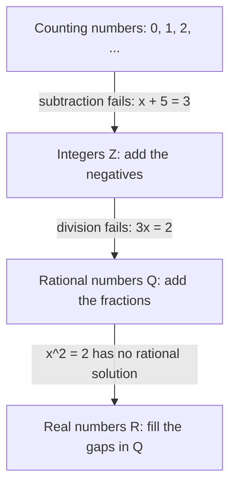
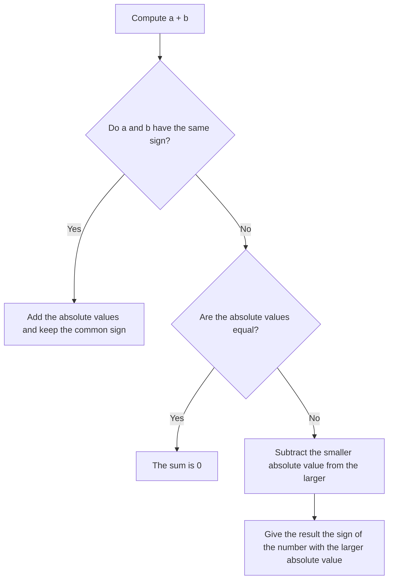

# Integers and Negative Numbers

> [Arithmetic](../README.md) · Level: Beginner · Prerequisites: [Natural Numbers](../01-natural-numbers/README.md) — counting, place value and the four operations · Estimated time: 90 min

## 1. Introduction

The natural numbers $0, 1, 2, 3, \dots$ are good for counting things that exist. They are not good for
everything else. A thermometer in Helsinki in January reads below the zero mark. A bank account can
owe money. A submarine sits below sea level; a valley lies below a mountain pass. A football team can
have a negative point difference. In each case we need a number on the *other side* of zero, and a
numeral to write it.

There is also a purely internal reason. In the natural numbers the equation $x + 5 = 3$ has no
solution: nothing you can add to $5$ gives $3$. Enlarging the number system so that this equation
always has a solution is the single most important idea in this tutorial. The new numbers are the
**negative integers**, and together with the natural numbers they form the **integers**

$$
\mathbb{Z} = \{\dots, -3, -2, -1, 0, 1, 2, 3, \dots\}.
$$

The letter $\mathbb{Z}$ comes from the German *Zahlen* ("numbers"). The symbol is standard everywhere.

What makes the integers harder than the natural numbers is not the arithmetic itself but the *signs*.
Adding two negatives, subtracting a negative, and multiplying two negatives all feel arbitrary until
you see why they are forced. So this tutorial does something that elementary treatments often skip:
it **proves** the sign rules from the basic laws of arithmetic. After that, nothing about $-3$ is a
matter of taste.

Negative numbers also sit at the beginning of a long chain of generalisations. Once subtraction
always works, division still does not ($x \cdot 3 = 2$ has no integer solution), and the repair of
*that* failure produces the rational numbers, the subject of the
[next topic](../03-fractions/README.md).

## 2. Prerequisites

You should be comfortable with the following, all of which belong to the arithmetic of natural
numbers and are covered in [Natural Numbers](../01-natural-numbers/README.md):

* **Counting and place value.** Reading and writing $4072$ as $4 \cdot 1000 + 0 \cdot 100 + 7 \cdot 10 + 2$.
* **Addition and subtraction of natural numbers**, including borrowing, and the fact that addition is
  commutative ($a + b = b + a$) and associative ($(a+b)+c = a+(b+c)$).
* **Multiplication** as repeated addition, and the multiplication table.
* **Division with remainder** in the natural numbers: $17 = 3 \cdot 5 + 2$.
* **The number line** as a picture of the natural numbers, with $0$ at the left end.

No knowledge of algebra is required. When a letter such as $a$ or $b$ appears, it stands for an
arbitrary integer, and a statement containing letters is a claim about *all* integers.

## 3. Learning Objectives

After working through this tutorial you will be able to:

1. Place integers on a number line and order any finite list of them correctly.
2. Compute absolute values and interpret $|a - b|$ as the distance between $a$ and $b$.
3. Add and subtract integers, and explain both operations using movement on the number line.
4. State the sign rules for multiplication and division, and **justify** them from the distributive
   law rather than from memory.
5. Prove from the axioms that $(-1)(-1) = 1$ and that $(-a)(-b) = ab$.
6. Evaluate integer powers, distinguishing $-3^2$ from $(-3)^2$.
7. Apply the order of operations correctly to expressions with nested parentheses, exponents and
   unary minus.
8. Explain how fixed-width integer arithmetic works in a programming language, including overflow and
   the two conventions for integer division.
9. Use parity (even/odd) to prove simple statements about integers.
10. Solve word problems about temperature, money, elevation and position.

## 4. Intuition

Think of the number line as a **thermometer laid on its side**, or as an infinite street with $0$ at
the town hall. Every integer is an address. Positive addresses are to the right of the town hall,
negative addresses to the left, and two addresses at equal distance on opposite sides are
**opposites** of each other.

Three intuitions carry almost all of the subject.

**Adding is walking.** To compute $a + b$, start at $a$ and walk $|b|$ steps: to the right if $b$ is
positive, to the left if $b$ is negative. So $5 + (-8)$ means "start at 5, walk 8 steps left", which
lands on $-3$.

**Subtraction is the gap.** To compute $a - b$, ask "how far, and in which direction, must I walk
from $b$ to reach $a$?" The answer is a signed distance. From $2$ to $9$ the walk is $+7$; from $9$
to $2$ it is $-7$. This is why $a - b = -(b - a)$ and why the *size* of the gap is $|a - b|$.

**Multiplication by $-1$ is a mirror.** Multiplying by $-1$ reflects the line about $0$: it sends
every address $a$ to $-a$, the address equally far away on the other side. Doing it twice puts you
back where you started, which is the intuitive content of $(-1)(-1) = 1$. A mirror is not a
convention; it is a motion, and doing it twice is the identity motion.

The one place where intuition needs help is the product of two negatives. "Negative times negative
equals positive" is not obvious, because you cannot add $-3$ a $-4$ number of times. The honest
answer is that the rule is *forced*: if we want the distributive law $a(b+c) = ab + ac$ to keep
working for negative numbers — and we do, because that law is what makes algebra possible — then
$(-1)(-1)$ has no choice but to equal $1$. Section 8 gives the two-line proof.

## 5. Formal Definition

We take the following as given. They are the familiar laws of arithmetic, checked in childhood on
natural numbers and adopted as the definition of the integers because they are exactly the
properties that make calculation work.

**Definition 5.1 (integers).** The set of **integers** $\mathbb{Z}$ is a set with two operations
$+$ and $\cdot$ and a relation $<$, satisfying axioms (Z1)–(Z8) below, and containing the natural
numbers $\mathbb{N}_0 = \{0,1,2,\dots\}$ as a subset. Its elements are written
$\dots, -2, -1, 0, 1, 2, \dots$.

* **(Z1) Closure.** If $a, b \in \mathbb{Z}$ then $a + b \in \mathbb{Z}$ and $ab \in \mathbb{Z}$.
* **(Z2) Associativity.** $(a+b)+c = a+(b+c)$ and $(ab)c = a(bc)$.
* **(Z3) Commutativity.** $a+b = b+a$ and $ab = ba$.
* **(Z4) Identities.** $a + 0 = a$ and $a \cdot 1 = a$, with $1 \neq 0$.
* **(Z5) Additive inverses.** For every $a$ there is an element $-a$ with $a + (-a) = 0$.
* **(Z6) Distributivity.** $a(b+c) = ab + ac$ for all $a,b,c$.
* **(Z7) No zero divisors.** If $ab = 0$ then $a = 0$ or $b = 0$.
* **(Z8) Order.** For any $a,b$ exactly one of $a<b$, $a=b$, $b<a$ holds; if $a<b$ and $b<c$ then
  $a<c$; if $a<b$ then $a+c < b+c$; if $a<b$ and $0<c$ then $ac < bc$.

An integer $a$ is **positive** when $0 < a$ and **negative** when $a < 0$. Every nonzero integer is
positive or negative by (Z8), never both.

**Definition 5.2 (subtraction).** For integers $a,b$,

$$
a - b \;:=\; a + (-b).
$$

Subtraction is therefore not a new operation: it is addition of the opposite. Everything we prove
about addition transfers to subtraction for free. We write $a - b$ so often that the two symbols
become interchangeable, but the definition above is the one that carries the content.

**Definition 5.3 (order).** We write $a \le b$ when $a < b$ or $a = b$, and $a > b$ when $b < a$.
The **sign** of $a$ is $+$ if $a > 0$, $-$ if $a < 0$, and $0$ if $a = 0$.

**Definition 5.4 (absolute value).** For an integer $a$,

$$
|a| :=
\begin{cases}
a & \text{if } a \ge 0,\\
-a & \text{if } a < 0.
\end{cases}
$$

So $|a|$ is never negative: it is the distance from $a$ to $0$ on the number line. Note the careful
phrasing: when $a < 0$, the number $-a$ is *positive*, e.g. $|{-7}| = -(-7) = 7$.

**Definition 5.5 (powers).** For an integer $a$ and an integer $n \ge 1$,

$$
a^n := \underbrace{a \cdot a \cdots a}_{n \text{ factors}}, \qquad a^0 := 1 \ \ (a \neq 0).
$$

The expression $0^0$ is left undefined, for reasons explained in Section 7.7.

**Definition 5.6 (parity).** An integer $n$ is **even** if $n = 2k$ for some integer $k$, and **odd**
if $n = 2k+1$ for some integer $k$. By the division-with-remainder theorem (Section 7.6) every
integer is exactly one of the two.

**Definition 5.7 (divisibility and remainder).** Let $b > 0$. For any integer $a$ there are unique
integers $q$ (the **quotient**) and $r$ (the **remainder**) with

$$
a = qb + r, \qquad 0 \le r < b.
$$

We write $b \mid a$ ("$b$ divides $a$") when the remainder is $0$.

**Remark 5.8 (why the axioms are not circular).** A reader may object that we "proved" facts about
negative numbers by assuming them. We did not: (Z1)–(Z8) are a *list of properties*, and everything
in Sections 7 and 8 is deduced from that list by pure logic. That is exactly how a mathematician
justifies a definition. What is being justified is the *choice* of definition: any number system in
which the ordinary laws of arithmetic hold and in which subtraction always works must have
$(-1)(-1) = 1$. Consistency of the axioms can be shown by constructing $\mathbb{Z}$ from pairs of
natural numbers; that construction belongs to a later course and is not needed here.

## 6. Mathematical Notation

| Symbol | Meaning | Read aloud |
|---|---|---|
| $\mathbb{N}_0$ | the natural numbers including zero, $0,1,2,\dots$ | "the natural numbers" |
| $\mathbb{Z}$ | the integers $\dots,-2,-1,0,1,2,\dots$ | "the integers" |
| $-a$ | the additive inverse of $a$ | "minus $a$" or "the opposite of $a$" |
| $a - b$ | $a + (-b)$ | "a minus b" |
| $a < b$ | $a$ lies to the left of $b$ | "a is less than b" |
| $a \le b$ | $a < b$ or $a = b$ | "a is at most b" |
| $a > b$ | $b < a$ | "a is greater than b" |
| $\lvert a \rvert$ | absolute value of $a$ | "the absolute value of a" |
| $a^n$ | $a$ multiplied by itself $n$ times | "a to the n" |
| $a \div b$, $\frac{a}{b}$ | the $c$ with $bc = a$ | "a divided by b" |
| $q, r$ | quotient and remainder | "q remainder r" |
| $b \mid a$ | $a = qb$ for some integer $q$ | "b divides a" |
| $\implies$ | "if the left holds, then the right holds" | "implies" |
| $\iff$ | both directions hold | "if and only if" |
| $:= $ | "is defined to be" | "is defined to be" |
| $\blacksquare$ | marks the end of a proof | "end of proof" |

Two conventions about reading signs aloud are worth fixing now. The symbol $-3$ is read "minus
three" or "negative three", and in an expression such as $4 + (-3)$ it is essential to hear the
second term as *negative three*, not as "minus three" acting on nothing. The leading symbol in $-4$
is not an instruction to subtract; it is part of the name of the number.

## 7. Core Concepts

### 7.1 The Number Line and Ordering

Draw a horizontal line, mark a point and call it $0$, mark a unit length, and place the integers at
successive multiples of that unit to the right and to the left. The result is the **number line**. It
converts every question about order into a question about position:

$$
a < b \quad \text{means} \quad a \text{ lies strictly to the left of } b.
$$

This picture is faithful to Definition 5.1 because the order axioms (Z8) say precisely that adding a
constant slides the whole line and that multiplying by a positive number stretches it without
reversing it.

Three consequences are used constantly.

* **Every negative number is less than every positive number**, and both are separated by $0$:
  if $a < 0 < b$ then $a < b$ by transitivity.
* **Reflection reverses order.** If $a < b$ then $-a > -b$. Indeed $b - a > 0$, and
  $(-a) - (-b) = -a + b = b - a > 0$, so $-b < -a$. For example $2 < 5$ but $-2 > -5$.
  A common beginner error is to think $-9 < -4$ "because $9 > 4$"; in fact $-9 < -4$ is true, but
  the reason is that $-9$ lies further *left*. The rule is: among negative numbers, the one with the
  larger absolute value is the smaller number.
* **The integers are discrete.** There is no integer strictly between $n$ and $n+1$. (If there were,
  say $n < m < n+1$, then $0 < m - n < 1$ would be a positive integer smaller than $1$, which is
  impossible since the positive integers start at $1$.) This is why the number line, unlike a real
  line, has visible gaps.

Neither end of the line is reached: there is no largest integer (if $a$ were largest, $a+1$ would be
larger) and no smallest (similarly $a-1$). We say $\mathbb{Z}$ is **unbounded above and below**.

**Reading order from a list.** To sort integers, separate them by sign first. All negatives come
first, ordered by *decreasing* absolute value; then $0$; then the positives in increasing order. For
example, sorting $-7, 3, -1, 0, -5, 2$ gives

$$
-7 < -5 < -1 < 0 < 2 < 3.
$$

### 7.2 Absolute Value and Distance

The absolute value strips the sign and keeps the size:

$$
|{-7}| = 7, \qquad |7| = 7, \qquad |0| = 0, \qquad |-(-4)| = 4.
$$

Two integers with the same absolute value are either equal or opposites: $|a| = |b|$ implies
$a = b$ or $a = -b$. (Proof: if $a \ge 0$ and $b \ge 0$ then $a = |a| = |b| = b$; if $a < 0$ and
$b < 0$ then $-a = |a| = |b| = -b$ so $a = b$; if signs differ, say $a \ge 0 > b$, then
$a = |a| = |b| = -b$ so $a = -b$.)

The important geometric fact is that **absolute value measures distance**:

$$
\text{distance between } a \text{ and } b \;=\; |a - b|.
$$

Check: the distance from $-4$ to $3$ is $|3 - (-4)| = |7| = 7$, which matches the picture (four units
to reach $0$, three more to reach $3$). The distance from $-4$ to $-9$ is
$|-9 - (-4)| = |-5| = 5$. Because distance does not care about direction, $|a-b| = |b-a|$ always.

Three warnings, each of which corresponds to a real and frequent error.

1. $|a|$ is never negative, so an equation such as $|x| = -3$ has **no solution**.
2. $|a + b|$ is usually *not* $|a| + |b|$: with $a = -3$, $b = 5$ we get $|2| = 2$ while
   $3 + 5 = 8$. The correct general statement is the triangle inequality $|a+b| \le |a|+|b|$
   (proved in Section 8).
3. The notation $|a|$ is not "make $a$ positive"; it is "report the distance of $a$ from $0$". For
   $a = -7$ the two descriptions agree, but the second one is the definition.

### 7.3 Addition

Addition on the number line is movement. To add $b$ to $a$, start at $a$ and move $|b|$ units,
rightwards if $b > 0$ and leftwards if $b < 0$. The endpoint is $a + b$.

That single rule covers every case, and it produces the familiar case analysis:

| Signs of the summands | Rule | Example |
|---|---|---|
| both positive | add the absolute values, keep the sign $+$ | $6 + 9 = 15$ |
| both negative | add the absolute values, keep the sign $-$ | $(-6) + (-9) = -15$ |
| opposite signs | subtract the smaller absolute value from the larger, take the sign of the larger | $7 + (-11) = -4$ |
| opposite signs, equal size | the sum is $0$ | $8 + (-8) = 0$ |

Every row is a theorem, not a convention.

**Same sign, both negative.** For $a, b > 0$,

$$
(-a) + (-b) = (-1)a + (-1)b = (-1)(a+b) = -(a+b),
$$

by distributivity and the identity $(-1)x = -x$ (proved as P2 in Section 8). So the sum of two
negatives is negative and its size is the sum of the sizes: $(-6) + (-9) = -15$.

**Opposite signs.** For $a > b > 0$,

$$
a + (-b) = a - b,
$$

which is positive because $b < a$; and $(-a) + b = -(a - b)$, which is negative. This is just
Definition 5.2 read backwards: adding the opposite of $b$ is subtracting $b$. The "subtract the
smaller from the larger" rule is the arithmetic of computing $a - b$ when $a > b$.

**Order is preserved by adding.** If $a < b$ then $a + c < b + c$; this is axiom (Z8). Consequently
adding the same number to both sides of an inequality is always legitimate, a move used constantly
in algebra.

### 7.4 Subtraction as Adding the Opposite

Definition 5.2 says $a - b := a + (-b)$. There is a reason to prefer this definition over "take
away": it makes subtraction a special case of addition, so no separate theory is needed. But we
should check that it computes what we want. The number $a + (-b)$ is characterized by

$$
\bigl(a + (-b)\bigr) + b = a + \bigl((-b) + b\bigr) = a + 0 = a,
$$

so $a + (-b)$ is *the* number which, added to $b$, gives $a$. That is exactly what "$a - b$" is
supposed to mean. Uniqueness is free: if $x + b = a$ and $y + b = a$ then adding $-b$ to both sides
gives $x = a + (-b) = y$.

Two consequences deserve to be memorized because they are used in almost every algebraic
simplification.

* **Subtracting a negative adds.** $a - (-b) = a + \bigl(-(-b)\bigr) = a + b$, using $(-(-b)) = b$
  (P3 in Section 8). Example: $3 - (-11) = 14$.
* **Reversing a difference negates it.** $-(a - b) = b - a$. Example: $-(5 - 12) = -( -7) = 7$ and
  $12 - 5 = 7$.

Subtraction is **not** commutative and **not** associative, and forgetting this is a classic source
of sign errors:

$$
3 - 8 = -5 \neq 5 = 8 - 3, \qquad (5 - 3) - 2 = 0 \neq 4 = 5 - (3 - 2).
$$

The safe habit is to convert every subtraction to addition immediately, then use commutativity and
associativity on additions only.

### 7.5 Multiplication and the Sign Rules

Multiplication by a positive integer is repeated addition:

$$
4 \cdot (-3) = (-3) + (-3) + (-3) + (-3) = -12.
$$

This determines the product whenever exactly one factor is negative. But "add $-3$ to itself $-4$
times" is meaningless, so the product of two negatives needs a different argument. Two independent
arguments give the same answer, which is reassuring.

**Argument 1: pattern continuation.** Look at the multiples of $-4$ as the multiplier decreases by
$1$:

| $n$ | $n \cdot (-4)$ | Change |
|---|---|---|
| $3$ | $-12$ | |
| $2$ | $-8$ | $+4$ |
| $1$ | $-4$ | $+4$ |
| $0$ | $0$ | $+4$ |
| $-1$ | $4$ | $+4$ |
| $-2$ | $8$ | $+4$ |

Each step *down* in the multiplier adds $4$, because removing one copy of $-4$ is the same as adding
$4$. The pattern is forced by the entries above it: the only value of $(-1)\cdot(-4)$ consistent with
the arithmetic progression is $4$. Continuing gives $(-2)(-4) = 8$, $(-3)(-4) = 12$, and in general
$(-a)(-b) = ab$. This is a plausibility argument, not a proof: it shows that any other choice would
break the pattern, but it assumes the pattern must continue.

**Argument 2: distributivity.** The proof is in Section 8 (Theorem 8.2, with P5 for the general
case). The idea in one line: since $(-1) + 1 = 0$,

$$
(-1)\bigl((-1) + 1\bigr) = (-1) \cdot 0 = 0,
$$

while expanding by distributivity gives $(-1)(-1) + (-1) \cdot 1 = (-1)(-1) - 1$. Hence
$(-1)(-1) = 1$. Nothing is assumed about the value of $(-1)(-1)$; it is computed.

**Why we may not simply declare $(-1)(-1) = -1$.** Suppose we did, keeping distributivity and
$0 \cdot a = 0$. Then

$$
(-1)\bigl(1 + (-1)\bigr) = (-1) \cdot 0 = 0,
$$

but expanding the same expression gives $(-1)\cdot 1 + (-1)(-1) = -1 + (-1) = -2$. The two answers
disagree, so the assumption is inconsistent with the rest of arithmetic. A number system with
$(-1)(-1) = -1$ cannot obey distributivity at all; it would not be a number system in which algebra
works. That is the real reason for the rule.

**The sign table.** The results combine into a table that is worth internalizing as
"same signs give $+$, different signs give $-$":

| | $b > 0$ | $b < 0$ |
|---|---|---|
| $a > 0$ | $ab > 0$ | $ab < 0$ |
| $a < 0$ | $ab < 0$ | $ab > 0$ |

**Products of many factors.** Apply the two-factor rule repeatedly. The absolute value of the
product is the product of the absolute values, and the sign is $+$ when the number of negative
factors is even, $-$ when it is odd. Thus

$$
(-2)(3)(-5)(-1) = -30,
$$

because there are three negative factors and $2 \cdot 3 \cdot 5 \cdot 1 = 30$. Any zero factor makes
the whole product zero, by P1: $0 \cdot a = 0$.

### 7.6 Division

**Definition.** Let $a, b$ be integers with $b \neq 0$. We say $a \div b = c$ (equivalently
$\frac{a}{b} = c$) when $bc = a$. Such a $c$, if it exists, is unique: if $bc_1 = a = bc_2$ then
$b(c_1 - c_2) = 0$, and since $b \neq 0$, (Z7) forces $c_1 = c_2$.

Unlike addition, subtraction and multiplication, **division is not always possible inside
$\mathbb{Z}$.** $7 \div 2$ has no integer answer, because $2c = 7$ would make $7$ even. When it does
exist, the sign rules follow from the multiplication table, since $-a = (-1)a$:

$$
\dfrac{-a}{b} = -\dfrac{a}{b}, \qquad \dfrac{a}{-b} = -\dfrac{a}{b}, \qquad \dfrac{-a}{-b} = \dfrac{a}{b}.
$$

For instance $\frac{-45}{-5} = 9$ because $(-5)\cdot 9 = -45$.

**Division by zero is undefined.** For $b = 0$ the equation $0 \cdot c = a$ becomes $0 = a$. If
$a \neq 0$ there is no solution; if $a = 0$ every $c$ is a solution, so there is no unique answer.
Either way $\frac{a}{0}$ cannot be assigned a value. Note the contrast: $\frac{0}{5} = 0$ is perfectly
fine, because $5 \cdot 0 = 0$.

**Division with remainder.** When exact division fails we keep the largest multiple that fits. For a
divisor $b > 0$ and any integer $a$ there are unique integers $q, r$ with

$$
a = qb + r, \qquad 0 \le r < b.
$$

Example: for $a = -23$ and $b = 7$, the multiple of $7$ just below $-23$ is $-28 = (-4)\cdot 7$, so
$q = -4$ and $r = 5$, and indeed $-23 = (-4)\cdot 7 + 5$. Note carefully that $r = 5$, not $-2$:
the remainder is required to be non-negative. This convention is the one used in mathematics and in
Python; it is called **floor division** because $q$ is the *floor* of $a/b$, the greatest integer not
exceeding $a/b$.

**Two conventions in computing.** Many programming languages (C, C++, Java, Go, JavaScript) instead
**truncate toward zero**, keeping the sign of the dividend in the remainder. The results differ
exactly when the signs differ, as the table shows.

| $a$ | $b$ | floor: $q$ | floor: $r$ | truncating: $q$ | truncating: $r$ |
|---|---|---|---|---|---|
| $7$ | $2$ | $3$ | $1$ | $3$ | $1$ |
| $-7$ | $2$ | $-4$ | $1$ | $-3$ | $-1$ |
| $7$ | $-2$ | $-4$ | $-1$ | $-3$ | $1$ |
| $-7$ | $-2$ | $3$ | $-1$ | $3$ | $-1$ |

In every row the identity $a = qb + r$ holds; only the constraint on $r$ changes. As long as you
know which convention your language uses, you can always reconstruct $q$ and $r$ from each other.

### 7.7 Integer Exponents

For $n \ge 1$, $a^n$ is a product of $n$ copies of $a$, and $a^0 = 1$ for $a \neq 0$. The values
alternate in sign when $a$ is negative:

| $n$ | $0$ | $1$ | $2$ | $3$ | $4$ | $5$ | $6$ |
|---|---|---|---|---|---|---|---|
| $(-2)^n$ | $1$ | $-2$ | $4$ | $-8$ | $16$ | $-32$ | $64$ |

**Sign of a power.** For $a < 0$, $a = (-1)|a|$, so

$$
a^n = (-1)^n |a|^n,
$$

and $(-1)^n = 1$ when $n$ is even, $-1$ when $n$ is odd. Hence a negative base raised to an even
exponent is positive, and to an odd exponent is negative. In particular $(-1)^n$ depends only on the
parity of $n$, a fact we use again in the exercises.

**The exponent laws.** For integers $a,b$ and non-negative integers $m,n$:

$$
a^{m+n} = a^m a^n, \qquad (a^m)^n = a^{mn}, \qquad (ab)^n = a^n b^n.
$$

The first holds because both sides are a product of $m+n$ copies of $a$; the second because both
sides are a product of $mn$ copies; the third because multiplication is commutative, so the $n$
copies of $a$ and the $n$ copies of $b$ can be regrouped. These are proofs by counting factors, and
they are complete for $m, n \ge 1$; the case of exponent $0$ follows from $a^0 = 1$.

There is **no** law for $(a+b)^n$. In general $(a+b)^n \neq a^n + b^n$: for instance
$(1+2)^2 = 9$ while $1^2 + 2^2 = 5$. The correct expansion of $(a+b)^2$ is
$a^2 + 2ab + b^2$, and it can be checked on the same numbers: $1 + 4 + 4 = 9$.

**Unary minus and exponents.** The convention is that exponentiation binds more tightly than the
minus sign, so

$$
-3^2 = -(3^2) = -9, \qquad \text{but} \qquad (-3)^2 = 9, \qquad -2^4 = -16, \qquad (-2)^4 = 16.
$$

Read $-3^2$ as "the negative of three squared". Whenever you mean the square of a negative number,
write the parentheses.

**Zero and negative exponents.** $0^n = 0$ for every $n \ge 1$. The expression $0^0$ is left
undefined: the pattern $a^0 = 1$ (valid for $a \neq 0$) and the pattern $0^n = 0$ (valid for
$n \ge 1$) suggest different values, and no choice preserves every expected identity in every context
where $0^0$ can arise, so the expression is simply not assigned a value. Negative exponents are
defined by $a^{-n} := \frac{1}{a^n}$ for $a \neq 0$. For $|a| \ge 2$ the result is not an integer:
$2^{-3} = \frac{1}{8}$. So negative exponents carry us out of $\mathbb{Z}$ into the
[fractions](../03-fractions/README.md) of the next topic, exactly as subtraction once carried us out
of $\mathbb{N}_0$.

### 7.8 Order of Operations

An expression such as $2 + 3 \cdot 4$ is ambiguous unless we agree on a reading. The standard
convention, used by every mathematical and scientific publication and by essentially every
programming language, is:

1. **Grouping symbols** first, innermost outwards: parentheses $(\;)$, brackets $[\;]$, and the
   fraction bar, which groups everything above it and everything below it.
2. **Exponentiation**, right to left if stacked: $2^{3^2} = 2^{9} = 512$.
3. **Multiplication and division**, left to right.
4. **Addition and subtraction**, left to right.

The left-to-right clauses matter:

$$
8 \div 4 \cdot 2 = (8 \div 4) \cdot 2 = 4, \qquad 8 - 4 - 3 = (8-4)-3 = 1.
$$

Unary minus is applied after exponentiation but before multiplication:

$$
-3^2 = -9, \qquad (-3)^2 = 9, \qquad -2 \cdot 3^2 = -18, \qquad (-2 \cdot 3)^2 = 36.
$$

Why adopt these rules at all? Because they make the largest number of common expressions readable
without parentheses. Polynomials such as $3x^2 - 2x + 5$ would need to be written
$(3 \cdot (x^2)) - (2 \cdot x) + 5$ under any other convention. The rules are a *convention*, not a
theorem, but once fixed they must be followed exactly, because a different reading gives a different
number.

Two expressions are notorious for ambiguity and are best avoided:

* $6 \div 2(1+2)$. Under the left-to-right rule this is $6 \div 2 \cdot 3 = 9$, but many readers
  treat $2(1+2)$ as a single product and answer $1$. Writing $\frac{6}{2(1+2)}$ or
  $\frac{6}{2}(1+2)$ removes the doubt.
* $-\frac{3}{4}^{\,2}$ is unclear about the scope of the exponent; write
  $-\left(\frac{3}{4}\right)^2 = -\frac{9}{16}$ if that is what you mean.

### 7.9 Parity

Parity is the simplest arithmetic property beyond the value itself, and it is astonishingly useful.

* $n$ is **even** if $n = 2k$; **odd** if $n = 2k+1$.
* even $+$ even $=$ even, because $2a + 2b = 2(a+b)$.
* odd $+$ odd $=$ even, because $(2a+1) + (2b+1) = 2(a+b+1)$.
* even $+$ odd $=$ odd, because $2a + (2b+1) = 2(a+b) + 1$.
* even $\times$ anything $=$ even, because $(2a)b = 2(ab)$.
* odd $\times$ odd $=$ odd, because $(2a+1)(2b+1) = 4ab + 2a + 2b + 1 = 2(2ab + a + b) + 1$.

Consequently a product is odd exactly when *every* factor is odd, and a product is even as soon as
one factor is even.

**Squares.** $n^2$ has the same parity as $n$: if $n = 2k$ then $n^2 = 4k^2 = 2(2k^2)$ is even; if
$n = 2k+1$ then $n^2 = 4k^2 + 4k + 1 = 2(2k^2 + 2k) + 1$ is odd. A finer fact, also proved by cases:
a square leaves remainder $0$ or $1$ on division by $4$, never $2$ or $3$. A number of the form
$4k+3$ therefore cannot be a perfect square.

**A standard parity proof.** For every integer $n$, the product $n(n+1)$ is even. Proof: if $n$ is
even, the first factor is even and we are done; if $n$ is odd then $n+1$ is even. One of the two
cases always applies, so the product is even. Notice the shape of the argument: a case split that
exhausts all possibilities. Parity arguments are the most accessible form of proof by cases, and
Section 9 and the exercises give several.

### 7.10 Integers in Programming

Machines store integers in a fixed number of **bits**, so they work with a finite set of integers
rather than all of $\mathbb{Z}$.

**Two's complement.** An $n$-bit cell represents the integers from $-2^{n-1}$ to $2^{n-1}-1$. For
$n = 8$ that is $-128$ to $127$. The rule is: add $2^n$ to a negative number to get its stored
pattern, e.g. $-1$ is stored as $255$ and $-128$ as $128$ in 8 bits. The leading bit acts as a sign
bit, and addition is performed by the ordinary binary algorithm with no special case for negatives.
That is why the representation is universal.

**Overflow.** When a result falls outside the range, the extra carry is discarded and the pattern is
reinterpreted, which is the same as reducing modulo $2^n$ and then selecting the representative in
the range. So in 8 bits,

$$
127 + 1 = 128 \;\longmapsto\; 128 - 256 = -128, \qquad -128 - 1 = -129 \;\longmapsto\; 127.
$$

Neither answer is "wrong hardware": the machine computed correctly modulo $256$. It is the
programmer's job to know the range, which is why languages provide types of different widths and why
some provide checked arithmetic that raises an error on overflow.

Two further traps: the negation of the most negative value overflows, $-(-128)$ is $-128$ in 8 bits,
because $128$ is not representable; and taking the absolute value of the most negative value has the
same problem. Both are favourite sources of security bugs.

**Division and remainder.** As shown in Section 7.6, languages differ. In C, C++, Java and Go,
integer division truncates toward zero, so $-7/2$ is $-3$ and $-7 \% 2$ is $-1$. In Python, `//` is
floor division and `%` returns a remainder with the sign of the divisor, so `-7 // 2` is $-4$ and
`-7 % 2` is $1$. In both, `a == (a // b) * b + a % b` holds. Python integers have arbitrary
precision, so they do not overflow; this makes Python convenient for experimentation but means that
code relying on wrap-around will not port to C.

**A note on `/`.** In Python 3, `7 / 2` produces the floating-point number `3.5`, not `3`. Use `//`
when you mean integer division. This is a common first bug, and it is the same distinction as
$\frac{7}{2}$ versus "$7$ divided by $2$ with remainder".

## 8. Formulas and Properties

Every statement below is a theorem about $\mathbb{Z}$, proved from (Z1)–(Z8). The proofs are short
and worth reading once carefully; after that you may use the results freely.

**Lemma 8.1 (uniqueness of the additive inverse).** If $a + b = 0$ then $b = -a$.

*Proof.* $b = b + 0 = b + \bigl(a + (-a)\bigr) = (b + a) + (-a) = 0 + (-a) = -a$, using (Z2), (Z4),
(Z5) and commutativity. $\blacksquare$

This lemma is the workhorse: it converts "this number plus that number is zero" into "$this$ is the
negative of $that$".

**P1 (zero annihilates).** $0 \cdot a = 0$ for every $a$.

*Proof.* $0 \cdot a = (0+0)\cdot a = 0\cdot a + 0\cdot a$ by distributivity. Adding $-(0 \cdot a)$
to both sides gives $0 = 0 \cdot a$. $\blacksquare$

**P2 (multiplication by $-1$ negates).** $(-1)a = -a$.

*Proof.* $a + (-1)a = 1 \cdot a + (-1)a = \bigl(1 + (-1)\bigr)a = 0 \cdot a = 0$ by (Z4), (Z6) and
P1. Lemma 8.1 gives $(-1)a = -a$. $\blacksquare$

**P3 (double negation).** $-(-a) = a$.

*Proof.* $(-a) + a = 0$ by (Z5). Lemma 8.1 with $a$ replaced by $-a$ and $b$ replaced by $a$ gives
$a = -(-a)$. $\blacksquare$

**P4 (moving a sign out of a product).** $(-a)b = -(ab)$ and $a(-b) = -(ab)$.

*Proof.* $ab + (-a)b = \bigl(a + (-a)\bigr)b = 0 \cdot b = 0$, so Lemma 8.1 gives $(-a)b = -(ab)$.
The second identity follows from commutativity. $\blacksquare$

**P5 (product of two negatives).** $(-a)(-b) = ab$ for all integers $a, b$.

*Proof.* By P4 applied with $b$ replaced by $-b$, $(-a)(-b) = -\bigl(a(-b)\bigr)$. By P4 again,
$a(-b) = -(ab)$. Hence $(-a)(-b) = -\bigl(-(ab)\bigr) = ab$ by P3. $\blacksquare$

**Theorem 8.2 (the sign rule, proved).** $(-1)(-1) = 1$.

*Proof.* By distributivity,

$$
(-1)(-1) + (-1)\cdot 1 = (-1)\bigl((-1) + 1\bigr) = (-1) \cdot 0 = 0,
$$

using (Z6), (Z5) and P1. Since $(-1)\cdot 1 = -1$ by (Z4), this reads
$(-1)(-1) + (-1) = 0$, so Lemma 8.1 gives $(-1)(-1) = -(-1) = 1$ by P3. $\blacksquare$

The proof uses only distributivity, the existence of additive inverses, and $0 \cdot a = 0$. There is
no freedom in the value: it is $1$. Combining P5 with P2 gives the general form
$(-a)(-b) = (-1)a \cdot (-1)b = (-1)(-1)ab = ab$.

**P6 (negating a sum).** $-(a+b) = (-a) + (-b)$.

*Proof.* $(a+b) + \bigl((-a)+(-b)\bigr) = \bigl(a+(-a)\bigr) + \bigl(b+(-b)\bigr) = 0+0 = 0$; apply
Lemma 8.1. $\blacksquare$

**P7 (absolute value of a product).** $|ab| = |a|\,|b|$.

*Proof.* Four cases. If $a \ge 0$, $b \ge 0$ then $ab \ge 0$ and both sides equal $ab$. If $a \ge 0$,
$b < 0$ then $ab \le 0$, so $|ab| = -ab = a(-b) = |a|\,|b|$. If $a < 0$, $b \ge 0$ the same
computation with the roles exchanged. If $a < 0$, $b < 0$ then $ab > 0$ by P5, so
$|ab| = ab = (-a)(-b) = |a|\,|b|$. $\blacksquare$

**P8 (triangle inequality).** For all integers $a, b$,

$$
|a + b| \le |a| + |b|.
$$

Equality holds if and only if $ab \ge 0$ (that is, $a$ and $b$ have the same sign, or at least one is
zero).

*Proof.* For any integer $x$, $-|x| \le x \le |x|$. Applying this to $a$ and to $b$ and adding the
two left inequalities and the two right inequalities (addition preserves order by (Z8)) gives

$$
-\bigl(|a| + |b|\bigr) \le a + b \le |a| + |b|.
$$

For any $c \ge 0$, the pair of inequalities $-c \le x \le c$ is equivalent to $|x| \le c$: if
$x \ge 0$ then $x \le c$; if $x < 0$ then $-x \le c$. Taking $c = |a|+|b|$ and $x = a+b$ gives the
claim. Equality requires equality in both additions, which happens exactly when $a$ and $b$ have the
same sign or one of them is zero. $\blacksquare$

Note the practical consequence: $|a + b|$ can be much smaller than $|a| + |b|$ when signs differ
($|{-3} + 5| = 2$ versus $8$), but never larger.

**P9 (sign of a power).** Let $a < 0$ and $n \ge 1$. Then $a^n < 0$ when $n$ is odd and $a^n > 0$
when $n$ is even.

*Proof.* Write $a = (-1)|a|$. Then $a^n = (-1)^n |a|^n$ by commutativity, and $|a|^n > 0$ because a
product of positive integers is positive. The identity $(-1)^n = 1$ for even $n$ and $(-1)^n = -1$
for odd $n$ follows by induction from $(-1)^{n+1} = (-1)^n \cdot (-1)$. $\blacksquare$

**P10 (multiplying by a negative reverses order).** If $a < b$ and $c < 0$ then $ac > bc$.

*Proof.* From $c < 0$ we get $0 < -c$ by (Z8) applied to $c + (-c) < 0 + (-c)$. Since $a < b$ and
$-c > 0$, axiom (Z8) gives $a(-c) < b(-c)$, that is $-ac < -bc$. Adding $ac + bc$ to both sides
preserves the inequality and yields $bc < ac$, i.e. $ac > bc$. $\blacksquare$

This is the algebraic reason for the rule "flip the inequality sign when multiplying by a negative
number", which you will use constantly when solving inequalities.

**P11 (cancellation).** If $ac = bc$ and $c \neq 0$ then $a = b$.

*Proof.* $0 = ac - bc = (a-b)c$ by distributivity. Since $c \neq 0$, (Z7) forces $a - b = 0$, hence
$a = b$. $\blacksquare$

**P12 (parity rules).** The sum of two integers is even when the summands have the same parity and
odd when they differ; the product is odd exactly when both factors are odd. The proofs are the
computations of Section 7.9.

| $a$ | $b$ | $a+b$ | $ab$ |
|---|---|---|---|
| even | even | even | even |
| even | odd | odd | even |
| odd | even | odd | even |
| odd | odd | even | odd |

## 9. Step-by-Step Examples

**Example 9.1 (ordering and absolute value).** Sort $-7, 3, -1, 0, -5, 2$ in increasing order, and
compute the distance between $-7$ and $3$.

*Solution.* Negatives first, ordered by decreasing size: $-7$, then $-5$, then $-1$. Then $0$, then
the positives $2, 3$. So

$$
-7 < -5 < -1 < 0 < 2 < 3.
$$

The distance is $|3 - (-7)| = |3 + 7| = 10$. Sanity check on the line: from $-7$ to $0$ is $7$ units
and from $0$ to $3$ is $3$, total $10$.

**Example 9.2 (addition and subtraction on the line).** Compute $-8 + 15$, $6 + (-14)$, $-9 + (-4)$,
$-5 - 7$, $3 - (-11)$ and $-6 - (-2)$.

*Solution.* Treat every subtraction as addition of the opposite, then use the case rules.

$$
\begin{aligned}
-8 + 15 &= 7 && \text{(opposite signs: } 15 - 8 = 7\text{, sign of } 15)\\
6 + (-14) &= -8 && \text{(opposite signs: } 14 - 6 = 8\text{, sign of } -14)\\
-9 + (-4) &= -13 && \text{(same sign: } 9 + 4 = 13\text{, keep } -)\\
-5 - 7 &= -5 + (-7) = -12\\
3 - (-11) &= 3 + 11 = 14 && \text{(subtracting a negative adds)}\\
-6 - (-2) &= -6 + 2 = -4
\end{aligned}
$$

**Example 9.3 (a product with several negative factors).** Compute $(-2)(3)(-5)(-1)$.

*Solution.* Multiply left to right, tracking the sign.

$$
(-2)(3) = -6, \qquad (-6)(-5) = 30, \qquad (30)(-1) = -30.
$$

Faster check: three negative factors is odd, so the sign is negative, and the magnitude is
$2 \cdot 3 \cdot 5 \cdot 1 = 30$. Answer: $-30$.

**Example 9.4 (using the sign rule).** Compute $(-7)(-9)$, $(-7)(9)$ and $-(-7)$.

*Solution.* By P5, $(-7)(-9) = 7 \cdot 9 = 63$. By P4, $(-7)(9) = -(7 \cdot 9) = -63$. By P3,
$-(-7) = 7$. Note that the first and third answers coincide while the second is their negative; this
is a good way to remember that a *product* of two negatives is positive but a *sum* of two negatives
is not.

**Example 9.5 (order of operations).** Evaluate $4 - 2(3-7)^2 \div (-8)$.

*Solution.* Work innermost outwards.

$$
\begin{aligned}
4 - 2(3-7)^2 \div (-8)
&= 4 - 2(-4)^2 \div (-8) && \text{parentheses first}\\
&= 4 - 2 \cdot 16 \div (-8) && \text{exponent before multiplication}\\
&= 4 - 32 \div (-8) && \text{multiplication and division, left to right}\\
&= 4 - (-4) && \text{division: } 32 \div (-8) = -4\\
&= 8. && \text{subtracting a negative}
\end{aligned}
$$

**Example 9.6 (substituting negative values).** Evaluate $a^2 - 2ab + b^2$ at $a = -3$, $b = 5$.

*Solution.* Substitute with parentheses around every negative value.

$$
a^2 - 2ab + b^2 = (-3)^2 - 2(-3)(5) + 5^2 = 9 - 2 \cdot (-15) + 25 = 9 + 30 + 25 = 64.
$$

Check by a different route: $a^2 - 2ab + b^2 = (a-b)^2 = (-3-5)^2 = (-8)^2 = 64$. Agreement is a
check on both the substitution and the identity.

**Example 9.7 (temperature).** At 6 a.m. the temperature is $-7$ °C. It rises by 2 °C each hour for
five hours, then falls by 9 °C. What is the final temperature?

*Solution.* Rising by 2 °C five times contributes $5 \cdot 2 = 10$; falling by 9 °C contributes
$-9$. So

$$
-7 + 10 - 9 = 3 - 9 = -6.
$$

The final temperature is $-6$ °C. Note that a *drop* is a negative contribution, so a sentence about
falling becomes a subtraction.

**Example 9.8 (bank balance).** An account holds \$320. Two deposits of \$45 and \$120 are made, and
then two withdrawals of \$200 and \$310. What is the balance?

*Solution.* Deposits are positive, withdrawals negative:

$$
320 + 45 + 120 - 200 - 310 = 485 - 510 = -25.
$$

The balance is $-\$25$: the account is overdrawn by \$25. A negative balance is not an error; it is
the exact statement that more was taken out than was there.

**Example 9.9 (two division conventions).** Write $-23$ in the form $7q + r$ with $0 \le r < 7$, and
also with the truncating convention used by C.

*Solution.* For floor division, find the largest multiple of $7$ not exceeding $-23$. Since
$(-4)\cdot 7 = -28$ and $(-3)\cdot 7 = -21 > -23$, we take $q = -4$, and then
$r = -23 - (-28) = 5$. Check: $-28 + 5 = -23$ and $0 \le 5 < 7$.

For truncation, the exact quotient $-23/7$ lies between $-4$ and $-3$ (since $-28 < -23 < -21$), so
truncating toward zero gives $q = -3$, and $r = -23 - (-21) = -2$. Here $r = -2$ is negative, so the
identity holds but the inequality $0 \le r < 7$ fails. The two answers
describe the same division; they differ in which remainder is reported.

**Example 9.10 (8-bit overflow).** In an 8-bit two's complement type, compute $100 + 27$,
$127 + 1$, $100 + 50$ and $-120 - 20$.

*Solution.* The representable range is $-128$ to $127$.

* $100 + 27 = 127$, inside the range, so the answer is $127$.
* $127 + 1 = 128$, one past the maximum; subtract $256$ to obtain $-128$.
* $100 + 50 = 150$; subtract $256$ to obtain $-106$.
* $-120 - 20 = -140$; add $256$ to obtain $116$.

Every one of these is the true sum reduced modulo $256$ and then represented in $[-128, 127]$. A
program that adds two large positive values and obtains a negative one has not found a
counterexample to arithmetic; it has overflowed.

## 10. Visual Explanations

The number systems form a tower, each level created to repair an operation that failed at the level
below. This is the context in which the integers belong.

The decision procedure for adding two integers is worth having as a flowchart, because it is the step
where most sign errors happen.

The decision procedure and the sign rules together cover every case; Sections 7.3 and 7.5 give the
proofs that the procedures are not merely conventions.

## 11. Common Mistakes

**Mistake 1: thinking $-9 > -4$ because $9 > 4$.** The size of a negative number and its position on
the line pull in opposite directions. *Why it is tempting:* you learned to compare $9$ and $4$ first,
and the minus sign gets ignored. *Fix:* draw the line, or apply the rule "for negatives, larger
absolute value means smaller number": $|-9| > |-4|$, so $-9 < -4$.

**Mistake 2: assuming a minus sign always produces a negative number.** $-a$ is negative only when
$a$ is positive. If $a = -5$, then $-a = 5$. *Why it is tempting:* the symbol looks like a minus.
*Fix:* read $-a$ as "the opposite of $a$", and remember $-(-a) = a$ (P3).

**Mistake 3: computing $|{-3} + 5|$ as $|{-3}| + |5| = 8$.** The correct value is $|2| = 2$.
*Why it is tempting:* absolute value looks like a sign-stripping operation that should distribute.
*Fix:* evaluate inside first; if you want to distribute, the only true inequality is
$|a+b| \le |a|+|b|$ (P8).

**Mistake 4: writing $-3^2 = 9$.** Exponentiation binds more tightly than unary minus, so
$-3^2 = -(3^2) = -9$, while $(-3)^2 = 9$. *Why it is tempting:* the negative sign feels attached to
the $3$. *Fix:* when the base is negative, write parentheses every time.

**Mistake 5: computing $5 - (-3)$ as $2$.** Subtracting a negative adds: $5 - (-3) = 5 + 3 = 8$.
*Why it is tempting:* two minus signs in a row look like they should "cancel" into a subtraction.
*Fix:* convert to addition first, $5 - (-3) = 5 + \bigl(-(-3)\bigr) = 5 + 3$, then compute.

**Mistake 6: applying the multiplication sign rule to a sum.** $(-4) + (-6) = -10$, not $+10$; it is
the *product* $(-4)(-6)$ that equals $+24$. *Why it is tempting:* "two negatives make a positive" is
learned as a slogan without its scope. *Fix:* say the rule in full — "the product or quotient of two
numbers with the same sign is positive; the *sum* of two negatives is negative".

**Mistake 7: distributing a minus sign incorrectly, $-(a - b) = -a - b$.** The correct result is
$-a + b = b - a$. *Why it is tempting:* the minus in front of the bracket seems to apply to the first
term only. *Fix:* write $-(a-b) = (-1)(a + (-b)) = -a + (-1)(-b) = -a + b$.

**Mistake 8: writing $(a+b)^2 = a^2 + b^2$.** Test with $a = 1$, $b = 2$: the left side is $9$, the
right side is $5$. *Why it is tempting:* the notation suggests that the exponent distributes.
*Fix:* either expand correctly, $a^2 + 2ab + b^2$, or evaluate numerically to check.

**Mistake 9: assuming $a < b$ implies $a^2 < b^2$.** With $a = -5$ and $b = 2$ we have
$-5 < 2$ but $25 > 4$. *Why it is tempting:* it is true for positive numbers, and most early examples
are positive. *Fix:* squaring is order-preserving only on non-negative numbers; for negatives it
reverses.

**Mistake 10: reading $8 \div 4 \cdot 2$ as $8 \div (4 \cdot 2) = 1$.** Multiplication and division
have equal precedence and are applied left to right, so the value is $4$. *Why it is tempting:* the
juxtaposition suggests grouping. *Fix:* rewrite with parentheses, $(8 \div 4)\cdot 2$, or use a
fraction bar to show what is intended.

**Mistake 11: treating $\frac{0}{0}$ as $1$, or $\frac{5}{0}$ as $0$.** Neither is defined.
$\frac{5}{0}$ would require $0 \cdot c = 5$, which is impossible; $\frac{0}{0}$ would allow every
$c$. *Why it is tempting:* $0/5 = 0$ and $5/5 = 1$ suggest interpolation. *Fix:* remember that
division is defined only for a nonzero divisor.

**Mistake 12: assuming a remainder is always non-negative in code.** In C, C++, Java and Go,
`-7 % 2` is `-1`, not `1`. *Why it is tempting:* mathematics uses the floor convention, and it is
easy to assume every language does. *Fix:* check the specification of your language; when you need a
non-negative remainder, compute `((a % b) + b) % b`.

**Mistake 13: trusting that a computed integer is exact.** Fixed-width integers overflow silently in
many languages, and the wrap-around can turn a positive sum negative. *Why it is tempting:* the
program runs and prints a number, so it looks right. *Fix:* know your type's range, use wider or
arbitrary-precision types when needed, and test boundary values such as $127$ and $-128$ for 8-bit
types.

## 12. Applications

**Weather and climate.** Temperatures below freezing are negative, and daily change is signed
addition: a rise of 3 degrees followed by a fall of 10 is $+3 - 10 = -7$ degrees of net change.
Heating-degree calculations sum such changes over a month.

**Money.** Debits, credits, profit and loss, and account balances are all integers once the currency
unit is fixed (amounts in cents are integers). The identity
$\text{balance} = \text{previous balance} + \text{credits} - \text{debits}$ is the same integer
addition studied above, and an overdraft is simply a negative balance.

**Elevation and navigation.** Heights above and below sea level are signed. A submarine at $-140$ m
that rises $35$ m is at $-105$ m. Latitude and longitude use signs for hemispheres, and displacement
vectors in one dimension are signed quantities.

**Physics and engineering.** Velocity and acceleration in one dimension are signed: a negative
velocity means motion in the negative direction, not "slower". Electric charge is signed, and
current direction is a sign convention. Potential differences are measured relative to a chosen zero,
so the same voltage may be reported as $-5$ V or $+5$ V depending on which terminal is the reference.

**Computing.** Fixed-width integers, two's complement, overflow, array offsets, hashing, and modular
arithmetic all live in $\mathbb{Z}$ with a modulus. Checksums and check digits (bank account numbers,
ISBNs, credit-card numbers) are remainders: the last digit is computed so that a weighted sum is
divisible by a fixed modulus, which detects most typing errors.

**Statistics.** Deviations from the mean are signed, and they always sum to zero:
$\sum_{i=1}^{n} (x_i - \bar{x}) = 0$. A "signed error" is more informative than an absolute error,
because errors in opposite directions cancel.

**Sport and games.** Golf scores relative to par, point differentials in leagues, and rating changes
in games such as chess are all integers that can be negative.

**Coordinate geometry, the next step.** The plane is coordinatised by pairs of integers, and
reflections in the axes are exactly the maps $(x,y) \mapsto (-x,y)$ and $(x,y) \mapsto (x,-y)$. The
rule that two reflections compose to the identity is the geometric form of $(-1)(-1) = 1$.

## 13. Exercises

The corresponding problem set is in [exercises.md](exercises.md). It contains 35 problems grouped as
Beginner, Intermediate, Advanced and Challenge, covering ordering, absolute value, the four
operations, exponents, order of operations, parity proofs, programming semantics and word problems.
Attempt them with the tutorial closed; the point of the exercises is to force recall.

## 14. Solutions

Full worked solutions, with the reasoning and the common pitfalls marked, are in
[solutions.md](solutions.md). Read a solution only after committing to your own answer.

## 15. Summary

* The integers $\mathbb{Z} = \{\dots,-2,-1,0,1,2,\dots\}$ extend the natural numbers so that
  subtraction always has an answer.
* Ordering is position on the number line; among negative numbers, the larger absolute value is the
  smaller number.
* $|a|$ is the distance from $a$ to $0$, and $|a - b|$ is the distance between $a$ and $b$. Absolute
  value is never negative.
* Addition is movement on the line: same signs add the sizes and keep the sign; opposite signs
  subtract the sizes and take the sign of the larger.
* $a - b = a + (-b)$; subtracting a negative adds.
* The product of two negatives is positive because distributivity forces it:
  $(-1)(-1) = 1$ (Theorem 8.2). Division follows the same sign rule.
* $a^n$ is defined by repeated multiplication, alternates in sign for negative $a$, and satisfies
  $a^{m+n} = a^m a^n$, $(a^m)^n = a^{mn}$ and $(ab)^n = a^n b^n$.
* Exponentiation binds more tightly than unary minus: $-3^2 = -9$, not $9$.
* Order of operations: parentheses, then exponents, then multiplication and division left to right,
  then addition and subtraction left to right.
* Parity arguments are proofs by cases on $n = 2k$ versus $n = 2k+1$; they settle many statements
  about sums, products and squares.
* Fixed-width machine integers are $\mathbb{Z}$ modulo $2^n$; division has two conventions, and
  overflow is silent.

## 16. Further Learning

* **Next in this discipline.** [Fractions](../03-fractions/README.md) repairs the next failure: the
  equation $3x = 2$ has no integer solution, so the number system is enlarged again. Everything
  proved here — distributivity, cancellation, the sign rules — is used there without comment.
* **Then.** Elementary algebra, where the letters stand for integers and the manipulations you have
  justified here become the rules for rearranging equations.
* **For extra practice.** Any standard pre-algebra textbook covers the same ground with more drill;
  Serge Lang's *Basic Mathematics* treats the number systems from the axioms in a style close to this
  tutorial.
* **For the construction.** The rigorous construction of $\mathbb{Z}$ from pairs of natural numbers
  (so that $-3$ literally *is* a set of pairs) belongs to a first course in algebra or set theory.
  The axioms used here are exactly the properties that construction guarantees.

