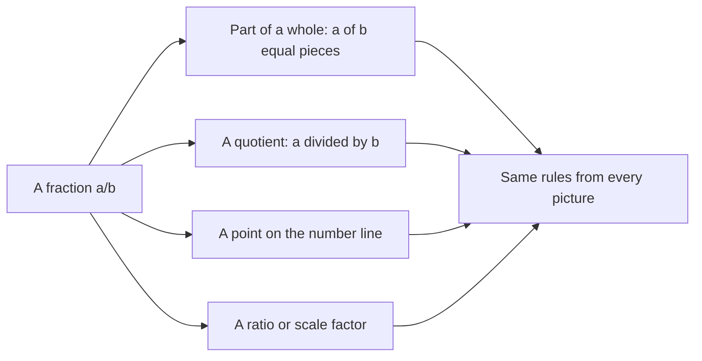
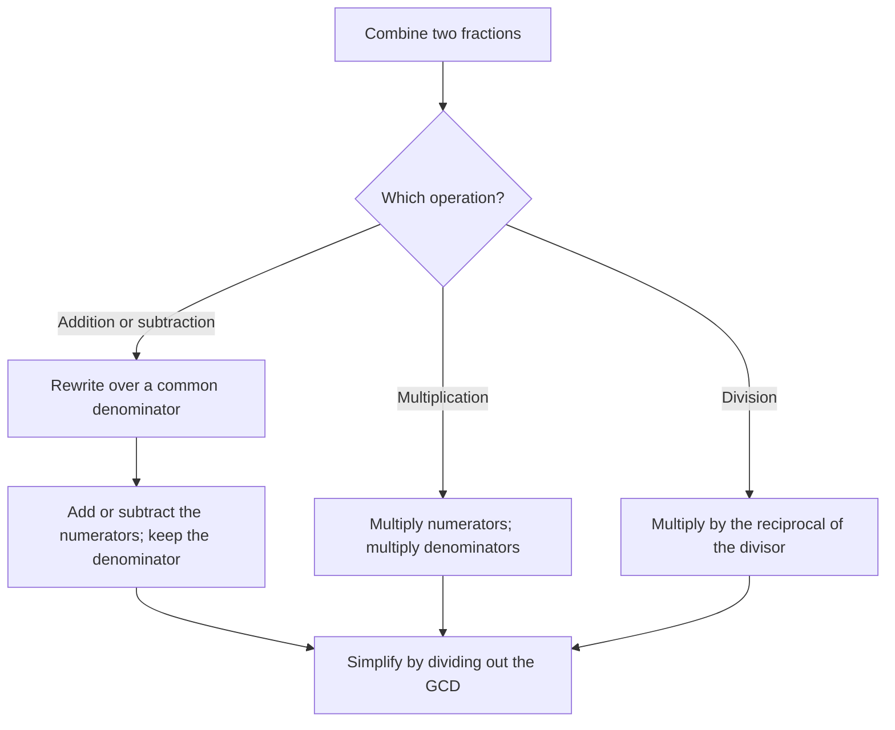

# Fractions

> [Arithmetic](../README.md) · Level: Beginner · Prerequisites: [Integers and Negative Numbers](../02-integers/README.md), multiplication facts, and division with remainder · Estimated time: 120 min

## 1. Introduction

Divide three identical pizzas equally among four people. Each person receives three quarters of a
pizza. The answer is not an integer, and no arrangement of whole pizzas can produce it: this is a
quantity that lies *between* the integers. Halves, thirds, quarters and their relatives are called
**fractions**, and the collection of all such numbers is written $\mathbb{Q}$, for *quotients*.

Fractions arrive from several directions at once, and it helps to see that they are the same object:

* **Sharing.** Three pizzas among four people gives $\frac{3}{4}$ per person.
* **Measurement.** A board cut to length $\frac{5}{8}$ of a metre, or a cup holding $\frac{3}{4}$ of
  a litre. Rulers, measuring cups and clocks are all graduated in fractions because most real
  lengths, volumes and durations are not integer multiples of a unit.
* **Division that does not come out even.** In the [integers](../02-integers/README.md) the equation
  $4x = 3$ has no solution. Fractions are introduced precisely so that it does.
* **Ratios and scaling.** "Three parts in four", a scale of $1{:}50$, a probability of
  $\frac{2}{7}$.

The arithmetic of fractions is often taught as a list of procedures: find a common denominator, add
the tops, flip and multiply. Procedures without reasons are fragile, and the errors people make with
them — adding denominators, cancelling across a plus sign, inverting the wrong fraction — are all
consequences of not knowing what a fraction *is*. This tutorial defines the object precisely, then
derives every rule. In particular it proves:

* why multiplying numerator and denominator by the same nonzero number does not change a fraction;
* why addition requires a common denominator;
* why "invert and multiply" is correct, by two independent arguments.

## 2. Prerequisites

This tutorial assumes the material of [integers and negative numbers](../02-integers/README.md):

* The integers $\mathbb{Z} = \{\dots,-2,-1,0,1,2,\dots\}$ and their ordering.
* Addition, subtraction and multiplication of integers, including the sign rules.
* Division with remainder: for $b > 0$, unique $q, r$ with $a = qb + r$ and $0 \le r < b$.
* The distributive law $a(b+c) = ab + ac$, and the fact that $ab = 0$ implies $a = 0$ or $b = 0$.

In addition you should know the multiplication tables up to about $12 \times 12$, since factoring
numerators and denominators is the main computational skill.

No prior exposure to fractions is assumed. If you have met them before, the definitions in Section 5
will still be new: they explain what the notation means rather than how to manipulate it.

## 3. Learning Objectives

After working through this tutorial you will be able to:

1. Explain four distinct meanings of $\frac{a}{b}$ and move between them.
2. State precisely when two fractions are equal, and prove that multiplying numerator and denominator
   by the same nonzero integer preserves the value.
3. Simplify any fraction to lowest terms using the greatest common divisor, computed by the Euclidean
   algorithm.
4. Compare two fractions by common denominator or cross-multiplication, and justify the method.
5. Convert between mixed numbers and improper fractions, and explain the notation $2\frac{3}{4}$.
6. Add and subtract fractions, and *prove* that the common-denominator rule is correct.
7. Multiply fractions using the area model and justify the rule $\frac{a}{b}\cdot\frac{c}{d}=\frac{ac}{bd}$.
8. Divide fractions and justify "invert and multiply" in two different ways.
9. Solve word problems involving recipes, measurement, sharing and rates.
10. Recognise and avoid the standard errors: adding denominators, cancelling terms, mixing up the
    dividend and the divisor.

## 4. Intuition

Start with a single cake. Cut it into $4$ equal pieces. One piece is **one quarter**, written
$\frac{1}{4}$. Three pieces are **three quarters**, written $\frac{3}{4}$. The bottom number records
*how many equal pieces the whole was cut into*; the top number records *how many pieces you have*.
That is the **part-of-a-whole** picture, and it is the one to keep in mind when a rule puzzles you.

Now cut the same cake into $8$ equal pieces and take $6$ of them. You have exactly the same amount of
cake as before. So

$$
\dfrac{6}{8} = \dfrac{3}{4}.
$$

Nothing was added or removed; only the cutting changed. This is the origin of **equivalent
fractions**: the same quantity admits many descriptions, and the descriptions are related by
subdividing every piece into the same number of smaller pieces. That is why the rule "multiply
numerator and denominator by the same number" is not a trick — it is a finer cut.

The second picture is **division**. If you share $3$ pizzas among $4$ people, each gets
$3 \div 4 = \frac{3}{4}$ of a pizza. So a fraction is also a division that has been written down but
not carried out. This picture explains **improper** fractions: sharing $7$ pizzas among $4$ people
gives $\frac{7}{4} = 1\frac{3}{4}$ each, because four people can first take one pizza each and then
share the remaining three.

The third picture is a **point on the number line**. Between $0$ and $1$, mark the point you reach by
cutting the unit interval into $b$ equal steps and walking $a$ of them. This picture makes comparison
and addition visible: fractions are just numbers, sitting in order, and adding them is adding
lengths.

The fourth is **ratio or scaling**: $\frac{3}{4}$ means "3 of every 4", as in "three out of four
students passed" or "the model is $\frac{1}{50}$ of the real bridge". A scale factor multiplies;
that is the multiplication rule in disguise.

Four pictures, one object. Whenever a rule seems arbitrary, ask which picture makes it obvious.
Common denominators are obvious in the part-of-a-whole picture (cut both wholes the same way).
Invert-and-multiply is obvious in the division picture (how many $\frac{2}{5}$-sized portions fit in
$\frac{3}{4}$ of a pizza?).

## 5. Formal Definition

The informal pictures are useful but do not settle questions such as "is $\frac{6}{8}$ the same
number as $\frac{3}{4}$, or a different number that happens to have the same value?" The formal
definition answers this by building the rationals out of pairs of integers.

**Definition 5.1 (rational number).** Let

$$
S = \{(a,b) : a \in \mathbb{Z},\ b \in \mathbb{Z},\ b \neq 0\}.
$$

Define a relation on $S$ by

$$
(a,b) \sim (c,d) \quad :\Longleftrightarrow \quad ad = bc.
$$

A **rational number** is an equivalence class of pairs under $\sim$. The class of $(a,b)$ is written
$\frac{a}{b}$. The set of all rational numbers is denoted $\mathbb{Q}$.

So $\frac{3}{4}$ is, strictly speaking, the whole family
$\{(3,4), (6,8), (-3,-4), (30,40), \dots\}$. The notation $\frac{a}{b}$ names the family by one of its
members, exactly as a fraction of a cake can be described by one of many cuttings.

**Lemma 5.2 ($\sim$ is an equivalence relation).** The relation is reflexive, symmetric and
transitive.

*Proof.* Reflexive: $ab = ba$. Symmetric: $ad = bc$ is the same equation as $cb = da$. Transitive:
suppose $ad = bc$ and $cf = de$. Multiply the first equation by $f$ and the second by $b$:

$$
adf = bcf, \qquad bcf = bde.
$$

Hence $adf = bde$, and since $d \neq 0$ we may cancel $d$ (cancellation holds in $\mathbb{Z}$) to get
$af = be$, which is $(a,b) \sim (e,f)$. $\blacksquare$

Transitivity is exactly the statement that "same amount of cake" is a consistent notion: if the first
cutting matches the second and the second matches the third, the first matches the third.

**Definition 5.3 (equality, numerator, denominator).** For integers $a, c$ and nonzero integers
$b, d$,

$$
\dfrac{a}{b} = \dfrac{c}{d} \quad :\Longleftrightarrow \quad ad = bc.
$$

In the symbol $\frac{a}{b}$, $a$ is the **numerator** and $b$ the **denominator**. A denominator may
be negative, but we normally rewrite $\frac{a}{-b} = \frac{-a}{b}$ so that the denominator is
positive; then the sign lives in the numerator.

**Definition 5.4 (arithmetic).** For integers $a,b,c,d$ with $b \neq 0$ and $d \neq 0$:

$$
\dfrac{a}{b} + \dfrac{c}{d} := \dfrac{ad + bc}{bd}, \qquad
\dfrac{a}{b} \cdot \dfrac{c}{d} := \dfrac{ac}{bd}, \qquad
\dfrac{a}{b} \div \dfrac{c}{d} := \dfrac{a}{b}\cdot\dfrac{d}{c} \ \ (c \neq 0).
$$

These formulas are definitions; the theorems of Section 8 show that they behave as the pictures
promise. Each is **well defined**: replacing $\frac{a}{b}$ or $\frac{c}{d}$ by an equal fraction gives
the same result. For addition, if $ab' = a'b$ and $cd' = c'd$, then

$$
(ad + bc)(b'd') = (ab')(dd') + (cd')(bb') = (a'b)(dd') + (c'd)(bb') = (a'd' + b'c')(bd),
$$

so $\frac{ad+bc}{bd} = \frac{a'd'+b'c'}{b'd'}$. The check for multiplication is the same computation
without the cross terms: $(ac)(b'd') = (ab')(cd') = (a'b)(c'd) = (a'c')(bd)$.

**Definition 5.5 (order).** For fractions with positive denominators,

$$
\dfrac{a}{b} < \dfrac{c}{d} \quad :\Longleftrightarrow \quad ad < bc.
$$

This too is independent of the representatives: multiplying $ad < bc$ by the positive number $b'd'$
and regrouping gives $a'd'bd < b'c'bd$, and division by the positive $bd$ gives $a'd' < b'c'$.

**Definition 5.6 (terminology).** Let $\frac{a}{b}$ be a fraction with $b > 0$.

* $\frac{a}{b}$ is in **lowest terms** if $\gcd(|a|, b) = 1$, where $\gcd$ is the greatest common
  divisor (Section 7.4).
* $\frac{a}{b}$ is **proper** if $|a| < b$, and **improper** if $|a| \ge b$.
* A **unit fraction** is $\frac{1}{n}$ with $n$ a positive integer.
* The **reciprocal** of a nonzero fraction $\frac{a}{b}$ is $\frac{b}{a}$.
* A **mixed number** $k\frac{a}{b}$ with $k$ an integer and $0 \le a < b$ denotes the sum
  $k + \frac{a}{b}$, written without the plus sign. Thus $2\frac{3}{4} = 2 + \frac{3}{4} = \frac{11}{4}$.

The integers sit inside the rationals by $n = \frac{n}{1}$, so every statement about fractions is
also a statement about integers, and $\mathbb{Z} \subset \mathbb{Q}$.

**Remark 5.7 (why the definition is the right one).** The pair $(a,b)$ records a *cutting*: cut the
unit into $b$ equal pieces and take $a$ of them. Two cuttings represent the same quantity exactly
when $ad = bc$: cross-multiplying compares the two cuttings by subdividing the first into $d$ times
as many pieces and the second into $b$ times as many, after which both are measured in pieces of size
$\frac{1}{bd}$. That is also why the arithmetic formulas involve $bd$: it is the common refinement of
the two cuttings.

## 6. Mathematical Notation

| Symbol | Meaning | Read aloud |
|---|---|---|
| $\frac{a}{b}$ | the rational number $a \div b$ | "a over b" or "a divided by b" |
| $a/b$ | the same, written on one line | "a over b" |
| $a$ | numerator | "numerator" |
| $b$ | denominator | "denominator" |
| $\mathbb{Q}$ | the rational numbers | "the rationals" |
| $2\frac{3}{4}$ | $2 + \frac{3}{4}$, a mixed number | "two and three quarters" |
| $\frac{b}{a}$ | reciprocal of $\frac{a}{b}$ | "the reciprocal of a over b" |
| $\gcd(a,b)$ | greatest common divisor | "gcd of a and b" |
| $\operatorname{lcm}(a,b)$ | least common multiple | "lcm of a and b" |
| $\div$ | division | "divided by" |
| $\approx$ | approximately equal | "is approximately" |
| $\Longleftrightarrow$ | "if and only if" | "if and only if" |
| $\blacksquare$ | marks the end of a proof | "end of proof" |

Two notational warnings. First, the mixed number $2\frac{3}{4}$ means $2 + \frac{3}{4}$, **not**
$2 \cdot \frac{3}{4}$; juxtaposition of a whole number and a fraction is the one place in elementary
mathematics where it denotes addition. Because this is confusing, algebra almost never uses mixed
numbers. Second, in a compound expression such as $\frac{2}{3}x$ the $x$ multiplies the whole
fraction, not the numerator alone. When in doubt, insert parentheses.

## 7. Core Concepts

### 7.1 The Four Meanings of a Fraction

**Part of a whole.** Cut a whole into $b$ equal parts; one part is $\frac{1}{b}$ and $a$ parts are
$\frac{a}{b}$. This requires $a \le b$ to stay inside the whole, which is why it is the least general
picture, but it is the best one for *understanding* the denominator.

**A quotient.** $\frac{a}{b}$ is the result of dividing $a$ by $b$. This works for every $a$ and every
$b \neq 0$, including improper fractions and negatives, and it is the picture that extends to
algebra: $\frac{a}{b}$ is the number $x$ with $bx = a$.

**A point on the number line.** Mark the unit interval and subdivide it into $b$ equal steps; the
$a$-th mark is $\frac{a}{b}$. This picture is the one that makes order and addition visible.

**A ratio or scale factor.** "$\frac{3}{4}$ of the class" means 3 parts in every 4; a scale drawing
at $\frac{1}{50}$ multiplies every length by $\frac{1}{50}$. This picture explains why "of" becomes
multiplication.

The four descriptions agree numerically, and each is useful. A single example shows all four at
once: $\frac{3}{4}$ is three of four equal pieces (whole), the result of $3 \div 4$ (quotient), the
point three quarter-steps to the right of $0$ (number line), and the fraction of a recipe that
remains when one quarter has been used (ratio).

### 7.2 Fractions on the Number Line

To place $\frac{1}{b}$, cut the segment from $0$ to $1$ into $b$ equal pieces and take the first cut
point. To place $\frac{a}{b}$, take the $a$-th such point, counting from $0$. For $a > b$ you pass
$1$ and continue: $\frac{7}{4}$ is the point seven quarter-steps from $0$, which is
$1\frac{3}{4}$.

Two properties follow from this picture and are worth stating because they surprise beginners.

**There is no smallest positive fraction.** Given any positive fraction $\frac{1}{n}$, the fraction
$\frac{1}{n+1}$ is smaller and still positive. Cutting into more pieces always gives smaller pieces.
The rationals have no "next" number after $0$.

**Between any two fractions there is another.** If $x < y$ then their midpoint
$\frac{x+y}{2}$ satisfies $x < \frac{x+y}{2} < y$, because

$$
\dfrac{x+y}{2} - x = \dfrac{y-x}{2} > 0 \quad \text{and} \quad y - \dfrac{x+y}{2} = \dfrac{y-x}{2} > 0.
$$

For example, between $\frac{1}{2}$ and $\frac{2}{3}$ sits
$\frac{1}{2}\left(\frac{1}{2} + \frac{2}{3}\right) = \frac{1}{2}\cdot\frac{7}{6} = \frac{7}{12}$, and
indeed $\frac{6}{12} < \frac{7}{12} < \frac{8}{12}$. Contrast the integers, where between $n$ and
$n+1$ there is nothing. This is the first hint that $\mathbb{Q}$ is a much richer object than
$\mathbb{Z}$, and it is the reason measurement can be as precise as we like.

### 7.3 Equivalent Fractions

**The rule.** For integers $a, b, k$ with $b \neq 0$ and $k \neq 0$,

$$
\dfrac{a}{b} = \dfrac{ak}{bk}.
$$

**Proof.** By Definition 5.3 we must check $a \cdot (bk) = (ak)\cdot b$. Both sides equal $abk$ by
commutativity and associativity. $\blacksquare$

**The converse is also useful.** If $\frac{a}{b} = \frac{c}{d}$ then both fractions equal
$\frac{ad}{bd}$: the first by multiplying numerator and denominator by $d$, the second by multiplying
them by $b$, and the two results agree because $ad = bc$. Hence **any two fractions can be put over a
common denominator**, namely the product of their denominators. This single observation is the engine
of addition, subtraction and comparison.

**Why the rule works, in pictures.** Cutting every piece into $k$ smaller pieces multiplies the
number of pieces by $k$ (numerator) and multiplies the number of pieces in the whole by $k$
(denominator). The *amount* is unchanged, exactly as slicing a cake more finely does not change how
much cake there is.

**What the rule does not say.** It does not say that adding the same number to numerator and
denominator preserves the value. Indeed

$$
\dfrac{1}{2} \neq \dfrac{1+1}{2+1} = \dfrac{2}{3},
$$

because adding one piece to the numerator and one to the denominator changes the *size* of the whole.
Only *multiplication* by a common factor leaves the quantity alone.

### 7.4 Simplifying with the Greatest Common Divisor

A fraction is in **lowest terms** when numerator and denominator have no common factor greater than
$1$. Simplifying means dividing both by their greatest common divisor.

**Definition 7.1 (gcd).** For integers $a, b$ not both zero, $\gcd(a,b)$ is the largest positive
integer that divides both $a$ and $b$. For example $\gcd(12, 18) = 6$ and $\gcd(7, 20) = 1$.

**The Euclidean algorithm.** Repeatedly replace the larger number by its remainder on division by the
smaller:

$$
\gcd(a, b) = \gcd(b, r) \quad \text{where } a = qb + r, \ 0 \le r < b.
$$

*Why it is valid:* a common divisor of $a$ and $b$ divides $a - qb = r$, so it is a common divisor of
$b$ and $r$; conversely a common divisor of $b$ and $r$ divides $qb + r = a$. The two pairs therefore
have exactly the same common divisors, hence the same greatest one. The remainders strictly decrease
and are non-negative, so the process reaches $0$ after finitely many steps; the last nonzero
remainder is the gcd.

**Example.** Simplify $\frac{84}{132}$. Compute

$$
132 = 1 \cdot 84 + 48, \qquad 84 = 1 \cdot 48 + 36, \qquad 48 = 1 \cdot 36 + 12, \qquad 36 = 3 \cdot 12 + 0.
$$

The last nonzero remainder is $12$, so $\gcd(84,132) = 12$. Dividing,

$$
\dfrac{84}{132} = \dfrac{84/12}{132/12} = \dfrac{7}{11}.
$$

The result is in lowest terms because $7$ and $11$ share no factor.

**Uniqueness of lowest terms.** Every rational number has exactly one representation $\frac{a}{b}$ with
$b > 0$ and $\gcd(|a|, b) = 1$. *Sketch:* if $\frac{a}{b} = \frac{c}{d}$ in lowest terms with positive
denominators, then $ad = bc$; from $b \mid ad$ and $\gcd(a,b) = 1$ we get $b \mid d$, and symmetrically
$d \mid b$, so $b = d$ and then $a = c$. The step "$b \mid ad$ and $\gcd(a,b)=1$ imply $b \mid d$" is
Euclid's lemma, which follows from unique prime factorisation.

Simplification is not merely cosmetic: it keeps numbers small, and it makes equality easy to test.

### 7.5 Comparing Fractions

Three methods, in increasing order of sophistication.

**Common denominator.** Rewrite both with the same positive denominator, then compare numerators. Since
$\frac{a}{b} = \frac{ad}{bd}$ and $\frac{c}{d} = \frac{bc}{bd}$, and $bd > 0$, the comparison is
decided by $ad$ against $bc$.

For example, compare $\frac{5}{8}$ and $\frac{7}{12}$. With common denominator $24$:
$\frac{5}{8} = \frac{15}{24}$ and $\frac{7}{12} = \frac{14}{24}$, so $\frac{5}{8} > \frac{7}{12}$.

**Cross-multiplication.** The same computation without writing the common denominator: for positive
$b, d$,

$$
\dfrac{a}{b} < \dfrac{c}{d} \iff ad < bc.
$$

This is Definition 5.5 and it is proved there. For $5$ against $7$: $5 \cdot 12 = 60$ and
$7 \cdot 8 = 56$, so again $\frac{5}{8} > \frac{7}{12}$.

**Benchmarks and other tricks.** Comparing each fraction with $\frac{1}{2}$ is often quickest:
$\frac{5}{8} > \frac{4}{8} = \frac{1}{2}$ while $\frac{7}{12} > \frac{6}{12} = \frac{1}{2}$, which does
not settle this pair. Comparing with $1$ is useful for improper fractions:
$\frac{9}{8} > 1 > \frac{11}{12}$. When numerators are equal, the larger denominator gives the
smaller fraction, because the same number of pieces is spread over finer cuts:
$\frac{3}{7} > \frac{3}{11}$.

**Warning.** Cross-multiplication as stated assumes positive denominators. If a denominator is
negative, first move the sign to the numerator using $\frac{a}{-b} = \frac{-a}{b}$, then compare.
Otherwise the inequality direction must be reversed.

### 7.6 Mixed Numbers

A **mixed number** writes an improper fraction as an integer part plus a proper fraction:

$$
\dfrac{11}{4} = 2 + \dfrac{3}{4} = 2\tfrac{3}{4}, \qquad\text{because } 11 = 2 \cdot 4 + 3.
$$

In general, if $a = qb + r$ with $0 \le r < b$, then

$$
\dfrac{a}{b} = q + \dfrac{r}{b} = q\tfrac{r}{b}.
$$

Going the other way, $q\frac{r}{b} = \frac{qb + r}{b}$; for instance
$3\frac{2}{5} = \frac{3 \cdot 5 + 2}{5} = \frac{17}{5}$.

Mixed numbers are convenient for reporting quantities to humans — "two and three quarter cups" is
easier to picture than "eleven quarters of a cup" — but they are a poor choice for calculation. To
multiply or divide, **convert to improper fractions first**. The classic error is

$$
2\tfrac{1}{2} \cdot 1\tfrac{1}{2} \neq 2\tfrac{1}{4},
$$

whereas the correct computation is $\frac{5}{2}\cdot\frac{3}{2} = \frac{15}{4} = 3\frac{3}{4}$, which is
larger than either factor (multiplying by something greater than $1$ increases the value).

Mixed numbers are also ambiguous in algebra: $2\frac{3}{4}$ means $2 + \frac{3}{4}$, but $2x$ means
$2 \cdot x$. For this reason, mathematics beyond arithmetic writes $\frac{11}{4}$.

### 7.7 Adding and Subtracting Fractions

**The rule for equal denominators.**

$$
\dfrac{a}{c} + \dfrac{b}{c} = \dfrac{a+b}{c} \qquad (c \neq 0).
$$

*Why:* let $x = \frac{a}{c}$ and $y = \frac{b}{c}$, so that $cx = a$ and $cy = b$ (this is the
quotient description of a fraction). Then, by distributivity in $\mathbb{Q}$,

$$
c(x+y) = cx + cy = a + b,
$$

and the number satisfying $c \cdot z = a+b$ is unique, so $x + y = \frac{a+b}{c}$. $\blacksquare$

In words: pieces of the same size can be counted together. Three quarters plus two quarters is five
quarters.

**The rule for different denominators.** Rewrite both fractions over a common denominator and then
add:

$$
\dfrac{a}{b} + \dfrac{c}{d} = \dfrac{ad}{bd} + \dfrac{bc}{bd} = \dfrac{ad + bc}{bd}.
$$

The common denominator $bd$ always works. The **least** common denominator is
$\operatorname{lcm}(b,d)$, which keeps the numbers smaller. For $b, d > 0$,

$$
\operatorname{lcm}(b,d) = \dfrac{bd}{\gcd(b,d)}.
$$

*Why the formula holds:* write $b = \prod p^{e_p}$ and $d = \prod p^{f_p}$ over the primes (the
symbol $\prod$ denotes a product). The gcd uses the smaller exponent of each prime and the lcm the
larger, and $\min(e,f) + \max(e,f) = e + f$ for each prime, so the product of gcd and lcm is $bd$.
(This uses the unique prime factorisation of integers, a standard theorem proved in a later topic.)

**Worked instance.** $\frac{1}{12} + \frac{1}{18}$. Since $12 = 2^2 \cdot 3$ and $18 = 2 \cdot 3^2$,
the lcm is $2^2 \cdot 3^2 = 36$. Then

$$
\dfrac{1}{12} = \dfrac{3}{36}, \qquad \dfrac{1}{18} = \dfrac{2}{36}, \qquad \dfrac{3}{36} + \dfrac{2}{36} = \dfrac{5}{36}.
$$

Subtraction works the same way, since $\frac{a}{b} - \frac{c}{d} = \frac{a}{b} + \frac{-c}{d}$.

**Why the denominators are not added.** The denominator names the size of the pieces. Adding
denominators would mean adding piece sizes, which is meaningless. Concretely,
$\frac{1}{2} + \frac{1}{3} = \frac{5}{6}$, and $\frac{5}{6}$ is just under a whole, whereas the
incorrect $\frac{2}{5}$ is less than half. A quick sanity check catches the error: the sum of two
positive proper fractions must exceed each summand.

### 7.8 Multiplying Fractions

**The rule.**

$$
\dfrac{a}{b} \cdot \dfrac{c}{d} = \dfrac{ac}{bd}.
$$

**Area model.** Draw the unit square and consider proper fractions first. Shade a rectangle
$\frac{a}{b}$ wide and $\frac{c}{d}$ high inside it. Cut the square into $b$ columns and $d$ rows;
there are $bd$ congruent small rectangles, each of area $\frac{1}{bd}$. The shaded overlap occupies
$a$ columns and $c$ rows, hence $ac$ small rectangles, so its area is $\frac{ac}{bd}$. Since the area
of a rectangle is width times height, this is the product. Improper fractions scale the picture up;
the algebraic proof below covers them without change.

**Algebraic proof.** Let $x = \frac{a}{b}$ and $y = \frac{c}{d}$, so $bx = a$ and $dy = c$. Then

$$
(bd)(xy) = (bx)(dy) = ac,
$$

using commutativity and associativity, so $xy = \frac{ac}{bd}$ by the quotient description. $\blacksquare$

**Reading "of".** In word problems, "$\frac{2}{3}$ of $\frac{3}{4}$" means
$\frac{2}{3} \cdot \frac{3}{4} = \frac{6}{12} = \frac{1}{2}$: two thirds of three quarters is one
half. Multiplying by a fraction *less than* $1$ makes a number smaller; multiplying by a fraction
*greater than* $1$ makes it larger. Both facts are visible in the area model.

**Cancelling first.** Since $\frac{ac}{bd} = \frac{a}{b}\cdot\frac{c}{d}$, common factors in the
numerator and denominator may be removed *before* multiplying. For instance

$$
\dfrac{2}{3}\cdot\dfrac{9}{8} = \dfrac{2 \cdot 9}{3 \cdot 8} = \dfrac{2}{8}\cdot\dfrac{9}{3} = \dfrac{1}{4}\cdot 3 = \dfrac{3}{4}.
$$

This keeps the arithmetic small; the value is unchanged by Section 7.3.

**Mixed numbers.** Convert first: $2\frac{1}{2} \cdot \frac{3}{5} = \frac{5}{2}\cdot\frac{3}{5} = \frac{15}{10} = \frac{3}{2}$.

### 7.9 Dividing Fractions: Why "Invert and Multiply"

**The rule.**

$$
\dfrac{a}{b} \div \dfrac{c}{d} = \dfrac{a}{b}\cdot\dfrac{d}{c} = \dfrac{ad}{bc} \qquad (b, c, d \neq 0).
$$

Two independent arguments establish it.

**Argument 1: common denominator.** First consider fractions with the *same* denominator:

$$
\dfrac{a}{b} \div \dfrac{c}{b}.
$$

Both quantities are counts of pieces of size $\frac{1}{b}$: the first is $a$ pieces, the second is $c$
pieces. Asking how many groups of $c$ pieces fit into $a$ pieces is an integer question with answer
$\frac{a}{c}$ (when it does not come out even, the same reasoning applies with a fractional count).
Formally, $\frac{c}{b}\cdot\frac{a}{c} = \frac{ca}{bc} = \frac{a}{b}$, so $\frac{a}{c}$ is the
quotient by Definition 5.4. Hence

$$
\dfrac{a}{b} \div \dfrac{c}{b} = \dfrac{a}{c}.
$$

Now put an arbitrary pair over the common denominator $bd$:

$$
\dfrac{a}{b} \div \dfrac{c}{d} = \dfrac{ad}{bd} \div \dfrac{bc}{bd} = \dfrac{ad}{bc}.
$$

**Argument 2: multiply by the reciprocal.** Let $x = \frac{a}{b} \div \frac{c}{d}$, which by
definition means $\frac{c}{d}\,x = \frac{a}{b}$. Since $\frac{c}{d} \neq 0$, its reciprocal
$\frac{d}{c}$ exists, and

$$
\dfrac{c}{d}\cdot\dfrac{d}{c} = \dfrac{cd}{dc} = 1.
$$

Multiplying both sides of $\frac{c}{d}x = \frac{a}{b}$ by $\frac{d}{c}$ gives

$$
x = \dfrac{a}{b}\cdot\dfrac{d}{c}.
$$

Equivalently, verify directly that $\frac{ad}{bc}$ works:
$\frac{c}{d}\cdot\frac{ad}{bc} = \frac{acd}{bcd} = \frac{a}{b}$, using $c \neq 0$ and $d \neq 0$ to
cancel. $\blacksquare$

**Interpretation.** Dividing by $\frac{2}{5}$ asks how many two-fifths-sized portions fit into the
dividend. Since each portion is less than half a unit, the answer is more than twice the dividend:
$\frac{3}{4} \div \frac{2}{5} = \frac{15}{8} = 1\frac{7}{8}$. Dividing by a number smaller than $1$
always *increases*; dividing by a number larger than $1$ decreases. This is a useful check.

**Special cases.** $\frac{a}{b} \div n = \frac{a}{bn}$ for a nonzero integer $n$, because
$n = \frac{n}{1}$. And $\frac{a}{b} \div \frac{a}{b} = 1$. Division by $0$ remains undefined, in
particular $\frac{c}{d}$ with $c = 0$ cannot be a divisor.

### 7.10 Unit Fractions

A **unit fraction** is $\frac{1}{n}$. Unit fractions are the atoms from which every fraction is built:

$$
\dfrac{a}{b} = a \cdot \dfrac{1}{b} = \underbrace{\dfrac{1}{b} + \cdots + \dfrac{1}{b}}_{a \text{ terms}}.
$$

Their order reverses the denominator: $\frac{1}{2} > \frac{1}{3} > \frac{1}{4} > \cdots > 0$, because
cutting a whole into more pieces makes each piece smaller.

Three identities are worth knowing.

* **Rewriting.** $\frac{1}{n} = \frac{k}{kn}$ for any $k \neq 0$: a finer cut.
* **Difference of consecutive unit fractions.**

$$
\dfrac{1}{n} - \dfrac{1}{n+1} = \dfrac{(n+1) - n}{n(n+1)} = \dfrac{1}{n(n+1)}.
$$

This turns a product denominator into a difference, which makes certain sums collapse:
$$
\dfrac{1}{2} + \dfrac{1}{6} + \dfrac{1}{12} + \dfrac{1}{20} = \left(1 - \dfrac{1}{2}\right) + \left(\dfrac{1}{2} - \dfrac{1}{3}\right) + \left(\dfrac{1}{3} - \dfrac{1}{4}\right) + \left(\dfrac{1}{4} - \dfrac{1}{5}\right) = 1 - \dfrac{1}{5} = \dfrac{4}{5}.
$$

* **Egyptian fractions.** Every positive fraction is a sum of distinct unit fractions. The greedy
algorithm repeatedly subtracts the largest unit fraction not exceeding the remainder. For example
$\frac{7}{10} = \frac{1}{2} + \frac{1}{5}$, since the largest unit fraction below $\frac{7}{10}$ is
$\frac{1}{2}$ and $\frac{7}{10} - \frac{1}{2} = \frac{2}{10} = \frac{1}{5}$. Egyptian scribes wrote
all fractions this way; the representation is never unique
($\frac{1}{2} + \frac{1}{5} = \frac{1}{2} + \frac{1}{6} + \frac{1}{30}$ also works, because
$\frac{1}{5} = \frac{1}{6} + \frac{1}{30}$).

### 7.11 Fractions in Measurement and Cooking

Most everyday uses of fractions are measurements, and measurement is where the arithmetic must be
right.

**Doubling and halving.** To double a recipe, multiply every quantity by $2$; to halve it, multiply by
$\frac{1}{2}$. Doubling $\frac{3}{4}$ cup gives $\frac{3}{2} = 1\frac{1}{2}$ cups; halving
$1\frac{1}{3}$ cups gives $\frac{1}{2}\cdot\frac{4}{3} = \frac{2}{3}$ cup. Notice that halving a mixed
number requires converting it first.

**Adding quantities.** A recipe needs $\frac{3}{4}$ cup of milk for the batter and $\frac{2}{3}$ cup
for the glaze. Over the common denominator $12$,

$$
\dfrac{3}{4} + \dfrac{2}{3} = \dfrac{9}{12} + \dfrac{8}{12} = \dfrac{17}{12} = 1\dfrac{5}{12}\ \text{cups}.
$$

**Changing the yield.** If a recipe serves $4$ and you need $6$ servings, multiply every quantity by
$\frac{6}{4} = \frac{3}{2}$. A quantity of $2\frac{1}{2}$ cups becomes
$\frac{5}{2}\cdot\frac{3}{2} = \frac{15}{4} = 3\frac{3}{4}$ cups. The scaling factor is a fraction,
and the arithmetic is fraction multiplication — the "ratio" picture of Section 7.1 in action.

**Unit conversion.** A fraction of a larger unit is a fraction of the smaller unit after multiplying:
$\frac{3}{4}$ of a cup is $\frac{3}{4}\cdot 16 = 12$ tablespoons in US customary units, and
$\frac{2}{3}$ of an hour is $\frac{2}{3}\cdot 60 = 40$ minutes. Conversely $\frac{3}{8}$ of an inch is
three of the eight equal divisions on a ruler graduated in eighths.

**Estimation.** Before computing, compare each fraction with $\frac{1}{2}$ or $1$. A sum of
$\frac{7}{8}$ and $\frac{5}{6}$ must be close to $2$ but less than $2$; if your answer is
$\frac{12}{14}$ — the result of adding numerators and denominators — something has gone wrong.
Estimation is the practical defence against the errors listed in Section 11.

## 8. Formulas and Properties

Throughout, denominators are nonzero and, where order is involved, positive. Each statement is
proved from Definition 5.3 and Definition 5.4.

**P1 (equivalent fractions).** For $k \neq 0$,

$$
\dfrac{a}{b} = \dfrac{ak}{bk}.
$$

*Proof.* $a(bk) = (ak)b$ by associativity and commutativity, so the cross-products agree. $\blacksquare$

**P2 (common denominator).** $\frac{a}{b} = \frac{ad}{bd}$ and $\frac{c}{d} = \frac{bc}{bd}$, so any
two fractions can be compared or combined over $bd$.

*Proof.* Apply P1 with $k = d$ and $k = b$. $\blacksquare$

**P3 (adding with equal denominators).** $\frac{a}{c} + \frac{b}{c} = \frac{a+b}{c}$.

*Proof.* Let $x = \frac{a}{c}$, $y = \frac{b}{c}$, so $cx = a$ and $cy = b$. Then
$c(x+y) = cx + cy = a+b$ by distributivity, and the solution of $cz = a+b$ is unique, so
$x+y = \frac{a+b}{c}$. $\blacksquare$

**P4 (adding in general).**

$$
\dfrac{a}{b} + \dfrac{c}{d} = \dfrac{ad + bc}{bd}.
$$

*Proof.* By P2, $\frac{a}{b} = \frac{ad}{bd}$ and $\frac{c}{d} = \frac{bc}{bd}$; apply P3. $\blacksquare$

**P5 (multiplication).**

$$
\dfrac{a}{b}\cdot\dfrac{c}{d} = \dfrac{ac}{bd}.
$$

*Proof.* Let $x = \frac{a}{b}$, $y = \frac{c}{d}$, so $bx = a$ and $dy = c$. Then
$(bd)(xy) = (bx)(dy) = ac$, hence $xy = \frac{ac}{bd}$. $\blacksquare$

**P6 (division).** For $c \neq 0$,

$$
\dfrac{a}{b} \div \dfrac{c}{d} = \dfrac{ad}{bc}.
$$

*Proof.* The quotient $x$ is characterized by $\frac{c}{d}x = \frac{a}{b}$. By P5,

$$
\dfrac{c}{d}\cdot\dfrac{ad}{bc} = \dfrac{c \cdot ad}{d \cdot bc} = \dfrac{acd}{bcd} = \dfrac{a}{b},
$$

since $\frac{acd}{bcd} = \frac{a}{b}$ by P1 with $k = cd \neq 0$. Uniqueness of $x$ gives the
claim. $\blacksquare$

**P7 (reciprocal).** For $a \neq 0$, $\frac{a}{b}\cdot\frac{b}{a} = 1$.

*Proof.* By P5, $\frac{a}{b}\cdot\frac{b}{a} = \frac{ab}{ba} = 1$. $\blacksquare$

So "divide by $\frac{c}{d}$" and "multiply by $\frac{d}{c}$" are the same operation, and the
reciprocal is the multiplicative inverse.

**P8 (order).** For $b, d > 0$,

$$
\dfrac{a}{b} < \dfrac{c}{d} \iff ad < bc.
$$

*Proof.* By P2 and P1, both fractions can be written over $bd > 0$. For fractions with a common
positive denominator, the order of the numerators decides the order of the fractions, since
$bd > 0$ and multiplying an inequality by a positive number preserves it. Hence
$\frac{a}{b} < \frac{c}{d} \iff ad < bc$. $\blacksquare$

**P9 (no gaps).** If $\frac{a}{b} < \frac{c}{d}$ with $b, d > 0$, then

$$
\dfrac{a}{b} < \dfrac{a+c}{b+d} < \dfrac{c}{d}.
$$

*Proof.* The middle quantity is the *mediant*. Compute

$$
\dfrac{a+c}{b+d} - \dfrac{a}{b} = \dfrac{b(a+c) - a(b+d)}{b(b+d)} = \dfrac{bc - ad}{b(b+d)} > 0,
$$

because $bc > ad$ by P8 and $b(b+d) > 0$. Similarly

$$
\dfrac{c}{d} - \dfrac{a+c}{b+d} = \dfrac{c(b+d) - d(a+c)}{d(b+d)} = \dfrac{bc - ad}{d(b+d)} > 0.
$$

$\blacksquare$

For example, between $\frac{1}{2}$ and $\frac{2}{3}$ lies the mediant $\frac{3}{5}$, and
$\frac{1}{2} = \frac{5}{10} < \frac{6}{10} = \frac{3}{5} < \frac{8}{12} = \frac{2}{3}$.

**P10 (difference of unit fractions).** For $n \ge 1$,

$$
\dfrac{1}{n} - \dfrac{1}{n+1} = \dfrac{1}{n(n+1)}.
$$

*Proof.* Put both over $n(n+1)$: $\frac{n+1}{n(n+1)} - \frac{n}{n(n+1)} = \frac{1}{n(n+1)}$. $\blacksquare$

**P11 (signs).** For $b \neq 0$,

$$
\dfrac{-a}{b} = \dfrac{a}{-b} = -\dfrac{a}{b}, \qquad \dfrac{-a}{-b} = \dfrac{a}{b}.
$$

*Proof.* Each identity is a cross-multiplication check: $(-a)b = -(ab) = a(-b)$ for the first,
$(-a)(-b) = ab$ for the second, and $-a \cdot b = -(a b)$ for the third. $\blacksquare$

**P12 (powers).** For $n \ge 1$,

$$
\left(\dfrac{a}{b}\right)^n = \dfrac{a^n}{b^n}.
$$

*Proof.* Induction on $n$: for $n = 1$ it is trivial; if it holds for $n$, then by P5

$$
\left(\dfrac{a}{b}\right)^{n+1} = \dfrac{a^n}{b^n}\cdot\dfrac{a}{b} = \dfrac{a^{n+1}}{b^{n+1}}.
$$

$\blacksquare$

**P13 (lowest terms).** Every rational number has a unique representation $\frac{a}{b}$ with $b > 0$
and $\gcd(|a|, b) = 1$.

*Proof.* Existence: given $\frac{p}{q}$ with $q > 0$, let $g = \gcd(|p|, q)$ and divide both by $g$;
this is legitimate by P1. Uniqueness is the sketch of Section 7.4, using Euclid's lemma. $\blacksquare$

## 9. Step-by-Step Examples

**Example 9.1 (equivalent fractions).** Show that $\frac{6}{8} = \frac{3}{4}$, and express
$\frac{3}{4}$ with denominator $20$.

*Solution.* Multiply numerator and denominator of $\frac{3}{4}$ by $2$:
$\frac{3 \cdot 2}{4 \cdot 2} = \frac{6}{8}$. The cross-products agree: $6 \cdot 4 = 24 = 3 \cdot 8$.
For denominator $20$, the multiplier is $k = \frac{20}{4} = 5$, so
$\frac{3}{4} = \frac{3\cdot 5}{4 \cdot 5} = \frac{15}{20}$.

**Example 9.2 (simplifying).** Reduce $\frac{84}{132}$ to lowest terms.

*Solution.* Run the Euclidean algorithm:

$$
132 = 1\cdot 84 + 48, \quad 84 = 1\cdot 48 + 36, \quad 48 = 1\cdot 36 + 12, \quad 36 = 3\cdot 12 + 0,
$$

so $\gcd(84,132) = 12$. Dividing numerator and denominator by $12$,

$$
\dfrac{84}{132} = \dfrac{7}{11}.
$$

Check: $84 = 12\cdot 7$ and $132 = 12 \cdot 11$, and $\gcd(7,11) = 1$, so this is lowest terms.

**Example 9.3 (comparing).** Compare $\frac{5}{8}$ with $\frac{7}{12}$, and $\frac{3}{7}$ with
$\frac{4}{9}$.

*Solution.* Cross-multiply (denominators are positive):

* $5 \cdot 12 = 60$ and $7 \cdot 8 = 56$; since $60 > 56$, $\frac{5}{8} > \frac{7}{12}$.
  Check with denominator $24$: $\frac{15}{24}$ against $\frac{14}{24}$.
* $3 \cdot 9 = 27$ and $4 \cdot 7 = 28$; since $27 < 28$, $\frac{3}{7} < \frac{4}{9}$. Check with
  denominator $63$: $\frac{27}{63}$ against $\frac{28}{63}$.

**Example 9.4 (mixed numbers).** Compute $3\frac{2}{5} + 1\frac{3}{4}$.

*Solution.* Convert to improper fractions:

$$
3\tfrac{2}{5} = \dfrac{3\cdot 5 + 2}{5} = \dfrac{17}{5}, \qquad 1\tfrac{3}{4} = \dfrac{1\cdot 4 + 3}{4} = \dfrac{7}{4}.
$$

The lcm of $5$ and $4$ is $20$:

$$
\dfrac{17}{5} + \dfrac{7}{4} = \dfrac{68}{20} + \dfrac{35}{20} = \dfrac{103}{20}.
$$

Since $103 = 5\cdot 20 + 3$, the result is $5\frac{3}{20}$. Check by a different route: the whole
parts add to $3 + 1 = 4$, and the fractional parts add to
$\frac{2}{5} + \frac{3}{4} = \frac{8}{20} + \frac{15}{20} = \frac{23}{20} = 1\frac{3}{20}$, giving
$4 + 1\frac{3}{20} = 5\frac{3}{20}$.

**Example 9.5 (multiplying).** Compute $\frac{2}{3}\cdot\frac{9}{8}$.

*Solution.* Multiply numerators and denominators, cancelling first:

$$
\dfrac{2}{3}\cdot\dfrac{9}{8} = \dfrac{2 \cdot 9}{3 \cdot 8} = \dfrac{18}{24} = \dfrac{3}{4}.
$$

With cancellation before multiplying: $9$ and $3$ share $3$, giving $\frac{2}{1}\cdot\frac{3}{8} = \frac{6}{8} = \frac{3}{4}$;
or $2$ and $8$ share $2$, giving $\frac{1}{3}\cdot\frac{9}{4} = \frac{9}{12} = \frac{3}{4}$. All
routes agree.

A reasonableness check: the second factor $\frac{9}{8}$ is slightly more than $1$, so the product
$\frac{3}{4}$ should be slightly more than $\frac{2}{3}$, and it is: $\frac{2}{3} = \frac{8}{12}$ and
$\frac{3}{4} = \frac{9}{12}$.

**Example 9.6 (dividing).** Compute $\frac{3}{4} \div \frac{2}{5}$ and check the answer.

*Solution.* Multiply by the reciprocal of the divisor:

$$
\dfrac{3}{4} \div \dfrac{2}{5} = \dfrac{3}{4}\cdot\dfrac{5}{2} = \dfrac{15}{8} = 1\tfrac{7}{8}.
$$

Check by multiplying the answer by the divisor: $\frac{2}{5}\cdot\frac{15}{8} = \frac{30}{40} = \frac{3}{4}$,
which is the dividend. The answer exceeds $\frac{3}{4}$ because we divided by a number less than $1$,
which is consistent with the interpretation "how many fifths-of-a-unit portions fit".

Using the common-denominator argument instead:
$\frac{3}{4} = \frac{15}{20}$ and $\frac{2}{5} = \frac{8}{20}$, so the quotient is
$\frac{15}{8}$ — the same.

**Example 9.7 (multi-step).** Evaluate

$$
\left(\dfrac{5}{6} - \dfrac{1}{4}\right) \div \dfrac{7}{12}.
$$

*Solution.* Parentheses first. The lcm of $6$ and $4$ is $12$:

$$
\dfrac{5}{6} - \dfrac{1}{4} = \dfrac{10}{12} - \dfrac{3}{12} = \dfrac{7}{12}.
$$

Then

$$
\dfrac{7}{12} \div \dfrac{7}{12} = 1,
$$

since a nonzero number divided by itself is $1$. Notice how the problem was designed: the
parenthesis produces exactly the divisor.

**Example 9.8 (recipe scaling, word problem).** A recipe for $4$ servings uses $2\frac{1}{2}$ cups of
flour. How much flour is needed for $6$ servings?

*Solution.* The scaling factor is $\frac{6}{4} = \frac{3}{2}$. Convert the mixed number and multiply:

$$
2\tfrac{1}{2} \cdot \dfrac{3}{2} = \dfrac{5}{2}\cdot\dfrac{3}{2} = \dfrac{15}{4} = 3\tfrac{3}{4}.
$$

So $3\frac{3}{4}$ cups are needed. Check: the amount should grow by half of itself,
$2\frac{1}{2} + 1\frac{1}{4} = 3\frac{3}{4}$.

**Example 9.9 (signs and a complex fraction).** Compute $-\frac{2}{3} + \frac{5}{6}$ and
$\left(-\frac{2}{3}\right) \div \frac{5}{6}$.

*Solution.* Put the first over denominator $6$: $-\frac{2}{3} = -\frac{4}{6}$, so

$$
-\dfrac{2}{3} + \dfrac{5}{6} = -\dfrac{4}{6} + \dfrac{5}{6} = \dfrac{1}{6}.
$$

For the complex fraction, the main bar means division:

$$
\dfrac{-2/3}{5/6} = -\dfrac{2}{3} \div \dfrac{5}{6} = -\dfrac{2}{3}\cdot\dfrac{6}{5} = -\dfrac{12}{15} = -\dfrac{4}{5}.
$$

A complex fraction is not a new object; it is a division written vertically. Clear the small
fractions by multiplying numerator and denominator by the lcm $6$ if you prefer:
$\frac{-4}{5}$ again.

**Example 9.10 (fraction of a fraction, word problem).** A tank is $\frac{2}{5}$ full. Then
$\frac{3}{4}$ of its contents is drawn off. What fraction of the tank remains full?

*Solution.* The amount drawn off is $\frac{3}{4}$ *of* $\frac{2}{5}$:

$$
\dfrac{3}{4}\cdot\dfrac{2}{5} = \dfrac{6}{20} = \dfrac{3}{10}.
$$

The remainder is

$$
\dfrac{2}{5} - \dfrac{3}{10} = \dfrac{4}{10} - \dfrac{3}{10} = \dfrac{1}{10}.
$$

Alternatively, the fraction left in the tank is $\frac{1}{4}$ of the contents:

$$
\dfrac{1}{4}\cdot\dfrac{2}{5} = \dfrac{2}{20} = \dfrac{1}{10}.
$$

Both routes agree. The word "of" is multiplication, and the two computations are the
distributive-law identity $\frac{2}{5} - \frac{3}{4}\cdot\frac{2}{5} = \left(1 - \frac{3}{4}\right)\frac{2}{5}$.

## 10. Visual Explanations

The four meanings of a fraction form the conceptual map that the rest of the topic uses.

Arithmetic with fractions reduces to three procedures, chosen by the operation:

The following table collects the rules in one place, together with the reason each is true.

| Operation | Rule | Reason |
|---|---|---|
| simplify | $\frac{ak}{bk} = \frac{a}{b}$ | finer cutting does not change the amount (P1) |
| compare | $\frac{a}{b} < \frac{c}{d} \iff ad < bc$ | common positive denominator (P8) |
| add | $\frac{a}{b} + \frac{c}{d} = \frac{ad+bc}{bd}$ | pieces must be the same size (P3, P4) |
| multiply | $\frac{a}{b}\cdot\frac{c}{d} = \frac{ac}{bd}$ | area of a rectangle (P5) |
| divide | $\frac{a}{b} \div \frac{c}{d} = \frac{ad}{bc}$ | how many divisor-portions fit (P6) |

## 11. Common Mistakes

**Mistake 1: adding denominators.**

$$
\dfrac{1}{2} + \dfrac{1}{3} \neq \dfrac{2}{5}.
$$

*Why it is tempting:* the pattern "add the tops, add the bottoms" looks symmetrical. *Fix:* the
denominator names the size of the pieces, so different sizes must first be harmonised:
$\frac{1}{2} + \frac{1}{3} = \frac{3}{6} + \frac{2}{6} = \frac{5}{6}$. A sanity check: the sum of two
positive quantities must be larger than each, and $\frac{2}{5} < \frac{1}{2}$.

**Mistake 2: cancelling terms instead of factors.** From $\frac{3+5}{3+7}$ you may not "cancel the
3s" to get $\frac{5}{7}$; the correct value is $\frac{8}{10} = \frac{4}{5}$. Likewise
$\frac{x+2}{x} \neq 2$. *Why it is tempting:* cancellation works so well in $\frac{3\cdot 5}{3 \cdot 7}$
that it is applied everywhere. *Fix:* cancellation requires a *factor common to the whole numerator
and the whole denominator*. Sums must be factored first; $\frac{3+5}{3+7}$ has no common factor.

**Mistake 3: inverting the wrong fraction.** $\frac{3}{4} \div \frac{2}{5}$ is
$\frac{3}{4}\cdot\frac{5}{2}$, not $\frac{4}{3}\cdot\frac{2}{5}$. *Why it is tempting:* both fractions
are in view and one of them must be flipped. *Fix:* say the rule aloud — "keep the dividend, multiply
by the reciprocal of the **divisor**". Equivalently, recall the meaning: how many $\frac{2}{5}$ fit
into $\frac{3}{4}$? The answer must be more than $2$, which excludes $\frac{8}{15}$.

**Mistake 4: multiplying denominators when adding.**

$$
\dfrac{a}{b} + \dfrac{c}{d} = \dfrac{ad + bc}{bd}, \qquad \text{not } \dfrac{a + c}{bd}.
$$

*Why it is tempting:* the multiplication rule $\frac{ac}{bd}$ has the same denominator, so it looks
familiar. *Fix:* remember that the numerator of a sum counts pieces: $ad$ pieces plus $bc$ pieces.

**Mistake 5: multiplying mixed numbers digit by digit.**

$$
2\tfrac{1}{2}\cdot 1\tfrac{1}{2} = 3\tfrac{3}{4}, \qquad \text{not } 2\tfrac{1}{4}.
$$

*Why it is tempting:* $2\cdot 1 = 2$ and $\frac{1}{2}\cdot\frac{1}{2} = \frac{1}{4}$ seems to give
the answer. *Fix:* mixed numbers must be converted first,
$\frac{5}{2}\cdot\frac{3}{2} = \frac{15}{4}$. Note also that the true answer must exceed
$2\frac{1}{2}$, since the multiplier $1\frac{1}{2}$ is greater than $1$.

**Mistake 6: believing $\frac{1}{n}$ grows with $n$.** $\frac{1}{3} < \frac{1}{2}$: cutting into more
pieces makes each piece smaller. *Why it is tempting:* larger numbers are normally "more". *Fix:* for
unit fractions the order is reversed; check with a picture.

**Mistake 7: comparing fractions by denominators alone.** $\frac{3}{7} < \frac{3}{4}$, even though
$7 > 4$. When numerators are equal, the *smaller* denominator gives the larger fraction. *Why it is
tempting:* large denominators "look" large. *Fix:* always compare with a method that is justified —
common denominator, cross-multiplication, or benchmark.

**Mistake 8: cross-multiplying without checking the signs of the denominators.** If a denominator is
negative, the inequality reverses. *Why it is tempting:* the cross-multiplication rule is learned as a
pure pattern. *Fix:* first rewrite so that both denominators are positive, using
$\frac{a}{-b} = \frac{-a}{b}$ (P11).

**Mistake 9: assuming $\frac{a}{b} = \frac{a+k}{b+k}$.** Adding the same integer to numerator and
denominator changes the value: $\frac{1}{2} \neq \frac{2}{3}$. *Why it is tempting:* the analogous
statement for *multiplying* is true, and the two operations are easily confused. *Fix:* remember the
picture; only a common *factor* preserves the amount, never a common summand.

**Mistake 10: simplifying only part of a sum.**
$\frac{4 + 6}{8} = \frac{10}{8} = \frac{5}{4}$, but a common factor drawn from one term and the
denominator gives nonsense: "cancelling" $2$ from $4$ and $8$ produces $\frac{2+6}{4} = 2$, and
"cancelling" $2$ from $6$ and $8$ produces $\frac{4+3}{4} = \frac{7}{4}$; neither equals
$\frac{5}{4}$. *Why it is tempting:* the factor $2$ is visibly present in two of the three numbers.
*Fix:* factor the entire numerator first: $\frac{2(2+3)}{8} = \frac{2 \cdot 5}{8} = \frac{5}{4}$.

**Mistake 11: mishandling zero in a fraction.** $\frac{0}{5} = 0$ is fine, but $\frac{5}{0}$ is
undefined and $\frac{0}{0}$ is undefined. *Why it is tempting:* a zero looks harmless. *Fix:* a
denominator of zero would require solving $0 \cdot x = 5$, which has no solution.

**Mistake 12: losing the integer part when converting.** $3\frac{2}{5} = \frac{17}{5}$, not
$\frac{6}{5}$. *Why it is tempting:* the eye focuses on the fractional part. *Fix:* use the formula
$\frac{qb + r}{b}$ and check that the improper fraction is larger than $q$.

## 12. Applications

**Cooking and baking.** Recipes are written in fractions because measuring cups are graduated in
halves, thirds, quarters and eighths. Scaling a recipe is multiplication by a fraction; combining two
partial measures is addition over a common denominator; splitting a batch is division by an integer.

**Construction and engineering.** Inches are divided into halves, quarters, eighths and sixteenths,
and a tape measure is a physical number line. Adding $\frac{3}{8}$ and $\frac{1}{2}$ inch means
$\frac{3}{8} + \frac{4}{8} = \frac{7}{8}$ inch. Tolerances are quoted as fractions or thousandths and
combined with the same rules.

**Music.** Note values are fractions of a whole note: a half note is $\frac{1}{2}$, a quarter note
$\frac{1}{4}$, a dotted note is $\frac{3}{2}$ times its base value. Time signatures such as
$\frac{6}{8}$ count eighths of a measure, and the arithmetic of fitting notes into a bar is fraction
addition.

**Probability and statistics.** A probability is a fraction of equally likely outcomes: the
probability of drawing a heart from a standard deck is $\frac{13}{52} = \frac{1}{4}$. Relative
frequencies are fractions, and simplifying them to lowest terms makes comparisons readable.

**Percentages, decimals and money.** A percentage is a fraction with denominator $100$:
$75\% = \frac{75}{100} = \frac{3}{4}$. Interest rates, discounts and tax rates are fractions, and
converting between the three notations is an application of equivalent fractions and of division.

**Scales and maps.** A map at scale $\frac{1}{25000}$ means every length is multiplied by
$\frac{1}{25000}$; a distance of $4$ cm on the map is $4 \cdot 25000 = 100000$ cm $= 1$ km on the
ground.

**Medicine and dosage.** Doses are often given per kilogram of body weight, so a child's dose is a
fraction of an adult dose, computed by multiplication.

**Mathematics itself.** Fractions are the first example of a *field*: every nonzero element has a
multiplicative inverse. The same axioms reappear for real and complex numbers, and the technique of
forming equivalence classes of pairs — exactly Definition 5.1 — is reused to construct the rational
functions in algebra and the field of fractions of an integral domain.

## 13. Exercises

The problem set is in [exercises.md](exercises.md). It contains 36 problems in four difficulty bands,
covering equivalence, simplification, comparison, mixed numbers, all four operations, unit fractions,
measurement and word problems. Work through the Beginner band without a calculator; the Intermediate
band is where the method choices start to matter.

## 14. Solutions

Complete worked solutions are in [solutions.md](solutions.md). Each solution states the strategy
before the computation and flags the error that the problem is designed to catch.

## 15. Summary

* A rational number is an equivalence class of pairs $(a,b)$ with $b \neq 0$, where
  $(a,b) \sim (c,d) \iff ad = bc$; we write the class as $\frac{a}{b}$.
* $\frac{a}{b} = \frac{c}{d}$ exactly when $ad = bc$, so multiplying numerator and denominator by the
  same nonzero number preserves the value (P1).
* Simplify by dividing out $\gcd(|a|,b)$, computed with the Euclidean algorithm; lowest terms are
  unique.
* For positive denominators, $\frac{a}{b} < \frac{c}{d} \iff ad < bc$.
* A mixed number $q\frac{r}{b}$ means $q + \frac{r}{b}$; convert to $\frac{qb+r}{b}$ before
  multiplying or dividing.
* $\frac{a}{b} + \frac{c}{d} = \frac{ad+bc}{bd}$: pieces must be the same size before they can be
  counted together.
* $\frac{a}{b}\cdot\frac{c}{d} = \frac{ac}{bd}$: the area model; "of" means multiply.
* $\frac{a}{b} \div \frac{c}{d} = \frac{ad}{bc}$: invert the divisor and multiply, justified both by
  the common-denominator argument and by multiplying by the reciprocal.
* Between any two fractions there is another; there is no smallest positive fraction.
* Unit fractions satisfy $\frac{1}{n} - \frac{1}{n+1} = \frac{1}{n(n+1)}$, and every positive fraction
  is a sum of distinct unit fractions.
* Dividing by a fraction less than $1$ increases the value; dividing by one greater than $1$
  decreases it. This is the quickest check on a division answer.

## 16. Further Learning

* **Backwards.** [Integers and negative numbers](../02-integers/README.md) contains the sign rules
  and the order axioms used here, including the proof that $(-1)(-1) = 1$, which underlies P11.
* **Sideways.** Decimal notation is a convention for writing fractions with denominators that are
  powers of $10$; percentages rewrite them with denominator $100$. Both are applications of
  equivalent fractions.
* **Forwards.** Algebra treats $\frac{a}{b}$ as a symbol to be manipulated, and the rules proved here
  become the rules for algebraic fractions. Solving equations with fractions uses the same
  common-denominator technique.
* **The next enlargement.** The rationals still have gaps: $x^2 = 2$ has no rational solution (the
  parity argument of the integers topic, Exercise 33, shows this). Filling those gaps produces the
  real numbers, a later topic in this repository.
* **Classical reference.** Euclid's *Elements*, Book VII, contains the Euclidean algorithm and the
  theory of ratios in essentially the form used here; it is the oldest surviving systematic treatment
  of the subject.

