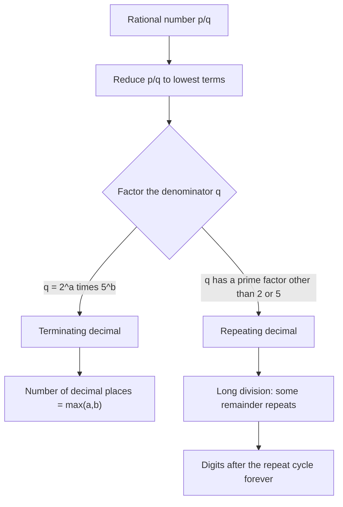

# Decimals
> [Mathematics](../../README.md) › Arithmetic · Level: Beginner · Prerequisites: whole-number place value, fractions, division with remainder · Estimated time: 90 min
## 1. Introduction
Whole numbers cannot express a quantity smaller than one. The moment we cut a metre into tenths, share three pizzas among four people, or read a price of ninety-nine cents, we need a way to write parts of a whole. **Decimal notation** does this by extending the place-value system of ordinary numbers to the right of a marker called the *decimal point*.

The idea is simple but powerful. In the number $347$, the digit $7$ means seven ones, the digit $4$ means four tens, and the digit $3$ means three hundreds: moving one place left multiplies the value of a digit by ten. Decimal notation continues the same rule to the right: moving one place right divides the value by ten. Thus in $347.285$,

$$
347.285 \;=\; 3\cdot 10^{2}+4\cdot 10^{1}+7\cdot 10^{0}+2\cdot 10^{-1}+8\cdot 10^{-2}+5\cdot 10^{-3}.
$$

The digit $2$ is worth two tenths, the digit $8$ is worth eight hundredths, and the digit $5$ is worth five thousandths. Nothing new is happening — only the place-value pattern is being continued in the other direction.

Decimals matter because they are the standard language of measurement, money, science, and computing. A laboratory reports a mass as $0.035$ kg; a bank records a balance as $\$1{,}204.73$; a data table stores a measurement as $9.81$. In each case the number of digits after the point carries information about precision, not just about size. Decimals also reveal a striking distinction: some fractions produce finite decimals, such as $\tfrac{3}{8}=0.375$, while others produce infinite repeating decimals, such as $\tfrac{1}{3}=0.333\ldots$. Understanding exactly *which* fractions do which — and why — is one of the central results of this tutorial. That result is also the first place where a beginner meets a genuine theorem with a complete proof.

The same questions reappear, in sharper form, inside every computer. Digital machines store numbers in binary, not decimal, and most decimal fractions cannot be stored exactly. Section 7.13 explains why a computer may report that $0.1+0.2$ is not $0.3$, and why that is not a bug in the usual sense but a consequence of the mathematics of place value.
## 2. Prerequisites
You should be comfortable with the following, all of which are developed earlier in the Arithmetic sequence of this repository:

* **Whole-number place value.** Reading $4{,}708$ as $4$ thousands, $7$ hundreds, $0$ tens and $8$ ones, and knowing that each place is ten times the place to its right.
* **Fractions.** The meaning of $\tfrac{a}{b}$ as $a$ parts of a whole divided into $b$ equal parts, equivalent fractions ($\tfrac{1}{2}=\tfrac{2}{4}$), and simplification to lowest terms.
* **Multiplication and division facts.** Fluency with times tables and with multi-digit multiplication is assumed; the algorithms are reviewed here only where decimals change them.
* **Division with remainder.** Writing, for example, $17=5\cdot 3+2$, so that $17\div 5$ has quotient $3$ and remainder $2$. The decimal expansion of a fraction is produced by repeating exactly this operation.
* **Powers of ten.** $10^{0}=1$, $10^{1}=10$, $10^{2}=100$, and $10^{-1}=\tfrac{1}{10}=0.1$, $10^{-2}=\tfrac{1}{100}=0.01$. The negative exponents are defined in Section 6.

No knowledge of percentages is needed here; percentages are the subject of the next topic, [Percentages](../05-percentages/README.md), and rest on the decimal ideas developed below.
## 3. Learning Objectives
By the end of this tutorial you will be able to:

1. Write any finite decimal as a sum of place values and as a fraction whose denominator is a power of ten, and reduce that fraction to lowest terms.
2. Explain, with a complete proof, why a fraction in lowest terms has a terminating decimal expansion exactly when its denominator has the form $2^{a}5^{b}$.
3. Convert a repeating decimal such as $0.\overline{27}$ or $2.3\overline{81}$ into a fraction in lowest terms.
4. Prove that $0.\overline{9}=1$, and explain why this is an equality rather than an approximation.
5. Compare, order, and round decimals correctly, including cases where rounding produces a carry through several nines.
6. Count significant figures and use them to report a calculated result at an appropriate precision.
7. Carry out addition, subtraction, multiplication, and division of decimals, and justify why the decimal points are aligned for addition but not for multiplication.
8. Write numbers in scientific notation, estimate their magnitude, and perform simple calculations with them.
9. Explain in outline how binary floating-point representation causes rounding error, and why $0.1+0.2$ can fail to equal $0.3$ in a computer.
## 4. Intuition
Imagine a ruler marked only in metres. To measure a length shorter than a metre you divide the metre into ten equal parts, then divide one of those parts into ten again. Each refinement adds one digit to the right of the decimal point. The decimal point is therefore not a mysterious separator; it is a signpost that says *the place values to my left count ones and larger, and the place values to my right count tenths and smaller*.

A second analogy is money. One dollar is the unit. A dime is one tenth of a dollar, a cent is one hundredth. The amount $\$3.47$ is three dollars, four dimes, and seven cents. Written as a fraction,

$$
3.47 = 3 + \frac{4}{10}+\frac{7}{100} = \frac{347}{100}.
$$

This is why prices have two decimal places: the smallest unit in common use is one hundredth of a dollar. A price of $\$3.470$ would be the same amount of money but would suggest a precision of one thousandth of a dollar, which is usually meaningless for cash.

A third analogy explains *repeating* decimals. Suppose you share $1$ litre of juice equally among $3$ people. Each person gets $\tfrac{1}{3}$ litre. If you try to write this in decimal, you first give each person $3$ tenths, leaving $1$ tenth to share; then $3$ hundredths, leaving $1$ hundredth; and so on forever. The same remainder keeps reappearing, so the same digit keeps reappearing. The decimal never stops because the division never comes out evenly. A decimal that repeats is simply the fingerprint of a division whose remainder cycles.

Finally, think of a decimal as a recipe for approximating a number. The truncations

$$
0.3,\quad 0.33,\quad 0.333,\quad 0.3333,\quad \ldots
$$

get closer and closer to $\tfrac{1}{3}$. The infinite decimal $0.333\ldots$ is defined to be the number that these truncations approach. This "approach" language will be made precise in Section 5; for now it is enough to know that the infinite string is not a process that stops, but a name for a single limiting value.
## 5. Formal Definition
### 5.1 Finite Decimals
Let $k$ be a non-negative integer and let $d_{1},d_{2},\ldots,d_{k}$ be digits, each in $\{0,1,2,\ldots,9\}$. A **finite decimal** with integer part $n$ is the expression

$$
n.d_{1}d_{2}\cdots d_{k},
$$

and its value is defined to be

$$
n + \frac{d_{1}}{10}+\frac{d_{2}}{10^{2}}+\cdots+\frac{d_{k}}{10^{k}}
\;=\; n+\sum_{i=1}^{k} d_{i}10^{-i}.
$$

The digits after the point may include leading and trailing zeros. For example, $0.50$ and $0.5$ both equal $\tfrac{5}{10}$, so they denote the same real number. The notation records precision, but the value does not depend on trailing zeros.

If $k=0$ the expression is just the integer $n$. A **negative** finite decimal $-n.d_{1}\cdots d_{k}$ denotes the negative of the value of $n.d_{1}\cdots d_{k}$. The number $0.000\ldots$ with infinitely many zeros denotes $0$.
### 5.2 Infinite Decimals
Let $d_{1},d_{2},d_{3},\ldots$ be an infinite sequence of digits. For each $n\ge 1$ define the $n$-th **truncation**

$$
T_{n}=\sum_{i=1}^{n} d_{i}10^{-i}.
$$

The infinite decimal $0.d_{1}d_{2}d_{3}\ldots$ denotes the real number $L$ with the property that for every $\varepsilon>0$ there is an index $N$ such that $|T_{n}-L|<\varepsilon$ for all $n\ge N$. In words: the truncations approach $L$ arbitrarily closely. Such an $L$ exists and is unique. For a non-negative decimal, the sequence $T_{n}$ is increasing and bounded above by $1$, so it has a least upper bound by the completeness property of the real numbers; that least upper bound is $L$. (A reader who has not met limits may read "$L$ is the number that the truncations approach" and skip the formal sentence; nothing later depends on the distinction.)
### 5.3 Terminating and Repeating
A real number has a **terminating decimal expansion** if it can be written as a finite decimal. A real number has a **repeating decimal expansion** if it can be written as

$$
n.d_{1}d_{2}\cdots d_{m}\overline{b_{1}b_{2}\cdots b_{k}},
$$

where the overline means that the block $b_{1}\cdots b_{k}$ repeats forever. The block is called the **repetend** or **period block**, and $k$ is its **period length** (not necessarily the shortest possible block). If $m=0$ the expansion is called **pure repeating**; otherwise it is **mixed repeating**. Thus $0.\overline{36}=0.363636\ldots$ is pure repeating, while $0.1\overline{6}=0.16666\ldots$ is mixed repeating.

A decimal expansion is **eventually periodic** if it is either terminating or repeating. The terminology is slightly inconsistent across books: a terminating expansion may be regarded as eventually periodic with repeating block $0$, or as not periodic at all. This tutorial says "eventually periodic" only when it wants to include both cases, and states which convention is in force.
### 5.4 Decimal Expansions of Arbitrary Real Numbers
Every real number has a decimal expansion, obtained by writing its integer part and then generating digits by repeated multiplication of the remainder by $10$. For a rational number this is ordinary long division. The expansion may terminate, repeat, or — for an irrational number — do neither; $\pi=3.14159\ldots$ and $\sqrt{2}=1.41421\ldots$ are the standard examples. The main theorem of this tutorial, Theorem 7.1, characterises exactly which rationals terminate.
## 6. Mathematical Notation
| Symbol | Meaning | Read aloud |
|---|---|---|
| $n.d_{1}d_{2}\cdots d_{k}$ | finite decimal with integer part $n$ | "n point d-one d-two … d-k" |
| $d_{i}$ | the $i$-th digit after the decimal point | "d sub i" |
| $10^{-i}$ | $\dfrac{1}{10^{i}}$, the place value of the $i$-th digit | "ten to the minus i" |
| $0.\overline{b_{1}\cdots b_{k}}$ | the block $b_{1}\cdots b_{k}$ repeats forever | "zero point b-one … b-k repeating" |
| $\approx$ | is approximately equal to | "is approximately equal to" |
| $a\times 10^{n}$ | scientific notation, with $1\le\lvert a\rvert<10$ | "a times ten to the n" |
| $2^{a}5^{b}$ | a product of powers of $2$ and $5$, with $a,b\ge 0$ | "two to the a times five to the b" |
| $\varepsilon$ | an arbitrary positive error tolerance | "epsilon" |
| $T_{n}$ | the truncation after $n$ decimal places | "T sub n" |
| $p/q$ | a fraction with integer numerator $p$ and positive integer denominator $q$ | "p over q" |
| s.f. | significant figures | "significant figures" |

Two notational conventions deserve warning. First, the overline is not a minus sign and does not mean "approximately": $0.\overline{9}$ is exactly $1$, as Theorem 8.3 proves. Second, in this repository a decimal point is written as a full stop, not as a comma; the comma is reserved for separating thousands in long numbers, as in $1{,}000{,}000$.
## 7. Core Concepts
### 7.1 Place Value Beyond the Decimal Point
The decimal point separates the units place from the tenths place. To the left, the place values are $10^{0},10^{1},10^{2},\ldots$; to the right they are $10^{-1},10^{-2},10^{-3},\ldots$. The following table reads the number $305.047$.

| Place | Hundreds | Tens | Units | Tenths | Hundredths | Thousandths |
|---|---:|---:|---:|---:|---:|---:|
| Place value | $10^{2}=100$ | $10^{1}=10$ | $10^{0}=1$ | $10^{-1}=0.1$ | $10^{-2}=0.01$ | $10^{-3}=0.001$ |
| Digit | $3$ | $0$ | $5$ | $0$ | $4$ | $7$ |
| Contribution | $300$ | $0$ | $5$ | $0$ | $0.04$ | $0.007$ |

Adding the contributions gives $305.047$. Observe that the zero in the tenths place is essential: it records that there are no tenths, and it keeps the $4$ in the hundredths place. Removing it would change the number to $305.47$, which is ten times larger. In contrast, the zero at the end of $305.0470$ changes nothing at all.

Multiplying by $10$ shifts every digit one place to the left, so the decimal point moves one place to the right: $305.047\times 10=3050.47$. Dividing by $10$ shifts every digit one place to the right: $305.047\div 10=30.5047$. This is the same rule as for whole numbers, and it is the reason the decimal point "moves" when you multiply or divide by powers of ten. The point itself does not move; the digits do.
### 7.2 Decimals as Fractions with Denominator $10^{k}$
A finite decimal with $k$ digits after the point is a fraction with denominator $10^{k}$:

$$
n.d_{1}\cdots d_{k}
= \frac{n\cdot 10^{k}+d_{1}10^{k-1}+\cdots+d_{k}}{10^{k}}.
$$

The numerator is the integer obtained by deleting the decimal point; the denominator is $10^{k}$. For example,

$$
0.375=\frac{375}{1000},\qquad
12.34=\frac{1234}{100},\qquad
0.047=\frac{47}{1000}.
$$

The last example shows that leading zeros after the point must be counted when choosing $k$: there are three digits after the point, so the denominator is $10^{3}=1000$, even though the numerator $47$ has only two digits. Writing the numerator with leading zeros, $0.047=\tfrac{047}{1000}$, makes the count visible.

Conversely, any fraction of the form $\tfrac{N}{10^{k}}$ can be written as a decimal: write $N$ with at least $k+1$ digits, inserting leading zeros if necessary, and place the decimal point so that the last $k$ digits are to its right. Thus $\tfrac{47}{1000}=0.047$ and $\tfrac{1234}{100}=12.34$. This correspondence is the bridge between decimals and fractions, and we will use it constantly.

A finite decimal need not be in lowest terms as a fraction. Reducing often reveals a simpler denominator:

$$
0.375=\frac{375}{1000}=\frac{3}{8},\qquad
0.36=\frac{36}{100}=\frac{9}{25},\qquad
12.5=\frac{125}{10}=\frac{25}{2}.
$$

Reduction is not merely cosmetic. Theorem 7.1, which decides whether a fraction terminates, is stated for fractions in lowest terms, and it is false without that hypothesis: $\tfrac{6}{12}$ has denominator $12=2^{2}\cdot 3$, yet it equals $0.5$, a terminating decimal. The factor $3$ cancels.
### 7.3 Terminating Versus Repeating Expansions
Some fractions produce finite decimals:

$$
\frac{1}{2}=0.5,\qquad \frac{1}{4}=0.25,\qquad \frac{1}{8}=0.125,\qquad \frac{3}{8}=0.375.
$$

Others produce infinite repeating decimals:

$$
\frac{1}{3}=0.333\ldots=0.\overline{3},\qquad
\frac{2}{3}=0.666\ldots=0.\overline{6},\qquad
\frac{1}{7}=0.142857142857\ldots=0.\overline{142857}.
$$

The difference comes from the long-division process. To expand $\tfrac{1}{4}$, divide $1$ by $4$: the first digit is $2$ tenths with remainder $2$ tenths, the second digit is $5$ hundredths with remainder $0$. After two digits the remainder is $0$, so the process stops. To expand $\tfrac{1}{3}$, divide $1$ by $3$: the first digit is $3$ with remainder $1$; the next digit is again $3$ with remainder $1$; the remainder never becomes $0$. The digit $3$ repeats forever.

The key observation is that **the digits are determined by the remainder**. At each step, the current remainder is multiplied by $10$, divided by the divisor, and the new remainder is what is left. Since there are only finitely many possible remainders, some remainder must eventually repeat; once a remainder repeats, the entire subsequent string of digits repeats. This is the content of Theorem 8.1, and it explains why *every* rational number has an eventually periodic decimal expansion. Irrational numbers, by contrast, have expansions that neither terminate nor repeat.

A repeating decimal can have a long period. The fraction $\tfrac{1}{7}$ has period $6$:

$$
\frac{1}{7}=0.\overline{142857}.
$$

### 7.4 The Denominator Criterion for Terminating Decimals
**Theorem 7.1 (terminating decimal criterion).** Let $\tfrac{p}{q}$ be a fraction in lowest terms with $q>0$. Then $\tfrac{p}{q}$ has a terminating decimal expansion if and only if

$$
q=2^{a}5^{b}
$$

for some integers $a,b\ge 0$.

*Proof.* ($\Rightarrow$) Suppose $\tfrac{p}{q}$ terminates. Then for some $k\ge 0$,

$$
\frac{p}{q}=\frac{N}{10^{k}}=\frac{N}{2^{k}5^{k}}
$$

for some integer $N$. Reducing the right-hand fraction cannot introduce new prime factors into the denominator; it can only cancel factors. Hence the denominator $q$ of the reduced fraction divides $10^{k}=2^{k}5^{k}$, so every prime factor of $q$ is either $2$ or $5$. Therefore $q=2^{a}5^{b}$ with $0\le a,b\le k$.

($\Leftarrow$) Suppose $q=2^{a}5^{b}$. Let $k=\max(a,b)$. Then

$$
\frac{10^{k}}{q}=\frac{2^{k}5^{k}}{2^{a}5^{b}}=2^{k-a}5^{k-b}
$$

is an integer, because $k-a\ge 0$ and $k-b\ge 0$. Call this integer $m$. Then

$$
\frac{p}{q}=\frac{pm}{qm}=\frac{pm}{10^{k}},
$$

which is a finite decimal with $k$ digits after the point. $\square$

The proof also tells us *how many* decimal places are needed: if $q=2^{a}5^{b}$ in lowest terms, the number of decimal places is exactly $\max(a,b)$. For example, $40=2^{3}\cdot 5^{1}$, so $\tfrac{1}{40}$ should need $\max(3,1)=3$ places: indeed $\tfrac{1}{40}=0.025$. The denominator $8=2^{3}$ needs three places, and $\tfrac{1}{8}=0.125$. The denominator $25=5^{2}$ needs two places, and $\tfrac{1}{25}=0.04$.

Here is the criterion in action:

| Fraction | Reduced denominator | Factorisation | Terminating? | Decimal |
|---:|---:|---|---|---|
| $\tfrac{3}{8}$ | $8$ | $2^{3}$ | yes | $0.375$ |
| $\tfrac{7}{20}$ | $20$ | $2^{2}\cdot 5$ | yes | $0.35$ |
| $\tfrac{5}{12}$ | $12$ | $2^{2}\cdot 3$ | no | $0.41\overline{6}$ |
| $\tfrac{2}{15}$ | $15$ | $3\cdot 5$ | no | $0.1\overline{3}$ |
| $\tfrac{13}{200}$ | $200$ | $2^{3}\cdot 5^{2}$ | yes | $0.065$ |
| $\tfrac{6}{12}=\tfrac{1}{2}$ | $2$ | $2$ | yes | $0.5$ |

A common error is to apply the criterion to the denominator *before* reducing. The fraction $\tfrac{6}{12}$ is the standard counterexample: $12$ contains a factor $3$, but the fraction terminates because the reduced denominator is $2$.
### 7.5 Converting Repeating Decimals to Fractions
A repeating decimal is rational, and there is a mechanical way to find its fraction. The idea is to multiply the decimal by a suitable power of $10$ so that the repeating blocks line up, then subtract.

**Pure repeating decimals.** Let $x=0.\overline{b_{1}\cdots b_{k}}$ and let $N$ be the integer formed by the block $b_{1}\cdots b_{k}$ (leading zeros allowed). Then

$$
10^{k}x=N+\underbrace{0.\overline{b_{1}\cdots b_{k}}}_{x},
$$

so $(10^{k}-1)x=N$ and therefore

$$
x=\frac{N}{10^{k}-1}.
$$

For example,

$$
0.\overline{36}=\frac{36}{99}=\frac{4}{11},\qquad
0.\overline{027}=\frac{27}{999}=\frac{1}{37}.
$$

The formula works even when the block begins with zeros, provided the numerator is interpreted with the same number of digits: $0.\overline{027}$ uses the three-digit block $027$, so $N=27$ and the denominator is $999$.

**Mixed repeating decimals.** Let $x=0.a_{1}\cdots a_{m}\overline{b_{1}\cdots b_{k}}$. Multiply by $10^{m}$ to move the non-repeating part to the left of the point:

$$
10^{m}x=a_{1}\cdots a_{m}.\overline{b_{1}\cdots b_{k}}.
$$

Now the decimal part is purely repeating, so multiplying by $10^{k}$ shifts one full block:

$$
10^{m+k}x=a_{1}\cdots a_{m}b_{1}\cdots b_{k}.\overline{b_{1}\cdots b_{k}}.
$$

Subtracting the first equation from the second eliminates the repeating tail:

$$
\left(10^{m+k}-10^{m}\right)x
=\bigl(\text{integer formed by }a_{1}\cdots a_{m}b_{1}\cdots b_{k}\bigr)
-\bigl(\text{integer formed by }a_{1}\cdots a_{m}\bigr).
$$

Hence

$$
x=\frac{\bigl(\text{all digits before the overline, as an integer}\bigr)
-\bigl(\text{non-repeating digits, as an integer}\bigr)}
{10^{m}\left(10^{k}-1\right)}.
$$

For a concrete case, take $x=0.4\overline{5}$. Here $m=1$ and $k=1$, so

$$
10x=4.\overline{5},\qquad 100x=45.\overline{5}.
$$

Subtracting gives $90x=41$, hence $x=\tfrac{41}{90}$. The formula gives the same result: the digits before the overline are $45$, the non-repeating digits are $4$, and the denominator is $10^{1}(10^{1}-1)=90$, so $x=\tfrac{45-4}{90}=\tfrac{41}{90}$.

The procedure is not magic; it is a finite computation with a proof. The equation $10^{k}x=N+x$ is an ordinary linear equation, and solving it gives the fraction. The only subtle point is that we are treating the infinite decimal as a number, not as a process; Section 5.2 justified that.
### 7.6 Comparing Decimals
To compare two finite decimals, compare their integer parts first. If the integer parts are equal, compare the tenths digits; if those are equal, compare the hundredths digits; and so on. The first place at which the digits differ decides. This is exactly the rule for whole numbers, continued to the right.

For example, to compare $0.6$ and $0.58$, write both with the same number of decimal places:

$$
0.6=0.60,\qquad 0.58=0.58.
$$

The tenths digits are $6$ and $5$; since $6>5$, we get $0.60>0.58$, that is, $0.6>0.58$. The hundredths digits never need to be examined, because the first difference already decides the comparison. The lesson is to compare digit by digit from left to right, not to count digits.

A longer decimal is **not** automatically larger. The number $0.089$ has more digits than $0.12$, but $0.089<0.12$ because $0$ tenths is less than $1$ tenth. Similarly, $0.1000=0.1$ is not larger than $0.1$; it is the same number written with more precision.

For negative numbers the order reverses: $-0.7<-0.2$ because $0.7>0.2$. A number line makes this visible: further right means larger, and negative numbers lie to the left of zero with their absolute values increasing as you move left.

**Density.** Between any two distinct decimals there is another decimal. For instance, between $0.12$ and $0.13$ lies $0.125$, and between $0.12$ and $0.125$ lies $0.123$. In fact, the average $\tfrac{a+b}{2}$ of two terminating decimals is again a terminating decimal, because $\tfrac{a+b}{2}$ has denominator $2\cdot 10^{k}$ (after writing $a$ and $b$ with $k$ places), which is still of the form $2^{a}5^{b}$. Repeating this process shows that there are infinitely many decimals between any two distinct decimals, however close together they are.
### 7.7 Rounding
Rounding replaces a number by a nearby number with fewer digits. The rule for rounding to $n$ decimal places is:

1. Look at the digit in position $n+1$ (the first digit to be discarded).
2. If it is $0,1,2,3,4$, leave the first $n$ digits unchanged.
3. If it is $5,6,7,8,9$, add $1$ to the last retained digit, carrying if necessary.
4. Delete all digits after position $n$.

This convention is called **round half up** (more precisely, round half away from zero for negative numbers). Some computer systems use **round half to even**, also called banker's rounding, in which a tie is resolved by choosing the even last digit: $2.5$ rounds to $2$, $3.5$ rounds to $4$. Both conventions are legitimate; the important thing is to state which one is in use. In this tutorial, unless stated otherwise, ties round away from zero.

Examples:

* $3.14159$ to $2$ decimal places is $3.14$ (third digit $1<5$).
* $3.14159$ to $3$ decimal places is $3.142$ (fourth digit $5$, so the $1$ becomes $2$).
* $3.14159$ to $4$ decimal places is $3.1416$ (fifth digit $9$).
* $9.9995$ to $3$ decimal places is $10.000$: the fourth digit is $5$, so $9.999$ becomes $10.000$ after carrying through all the nines.
* $0.0045678$ to $3$ significant figures is $0.00457$.

Rounding is **not** associative: rounding twice can give a different answer from rounding once. For example, $1.45$ to $1$ decimal place is $1.5$ (the discarded digit is $5$), and $1.5$ to $0$ decimal places is $2$ (the discarded digit is $5$). But $1.45$ directly to $0$ decimal places is $1$, because the first discarded digit is $4$. The order in which rounding is performed matters. In calculations, round only at the end, and keep full precision in intermediate steps.

Rounding also does not commute with arithmetic. The sum of the rounded values need not equal the rounded sum: $1.4+1.4=2.8$, but rounding each to the nearest integer first gives $1+1=2$, while rounding the exact sum gives $3$. This is a source of small discrepancies in accounting and measurement, and it is one reason significant-figure rules are needed.
### 7.8 Significant Figures
**Significant figures** count the digits that carry information about the precision of a measurement. The rules are:

1. Every nonzero digit is significant.
2. Zeros between nonzero digits are significant: $4.007$ has four significant figures.
3. Leading zeros are never significant: $0.00456$ has three significant figures ($4,5,6$).
4. Trailing zeros after a decimal point are significant: $0.004560$ has four significant figures (the final zero says the measurement is precise to the millionths place).
5. Trailing zeros in an integer without a decimal point are ambiguous: $1200$ could have two, three, or four significant figures. Scientific notation removes the ambiguity: $1.2\times 10^{3}$ has two, $1.20\times 10^{3}$ has three, and $1.200\times 10^{3}$ has four.

Significant figures are not the same as decimal places. The number $0.00456$ has five decimal places but only three significant figures. The number $1200$ has no decimal places and an ambiguous number of significant figures.

When multiplying or dividing measurements, the result should be reported with as many significant figures as the factor with the fewest significant figures. When adding or subtracting, the result should be reported to the same number of decimal places as the term with the fewest decimal places. These are conventions for reporting, not exact laws of arithmetic; they reflect the fact that a measurement has an uncertainty in its last digit.
### 7.9 Addition and Subtraction: Why the Points Align
To add $12.7+0.45+3.008$, write the numbers so that the decimal points are vertically aligned:

$$
\begin{array}{r}
12.700\\
0.450\\
3.008\\
\hline
16.158
\end{array}
$$

The alignment puts tenths under tenths, hundredths under hundredths, and thousandths under thousandths. This is exactly what the place-value definition requires: we may add digits only when they have the same place value. The trailing zeros in $12.700$ and $0.450$ do not change the values; they merely fill empty places so that the columns line up.

The same idea in fraction form:

$$
12.7+0.45+3.008
=\frac{12700}{1000}+\frac{450}{1000}+\frac{3008}{1000}
=\frac{16158}{1000}
=16.158.
$$

The common denominator is $10^{3}$, the largest number of decimal places among the terms. Aligning the decimal points is a shorthand for converting all terms to that common denominator.

Subtraction works the same way, with borrowing across the decimal point when necessary. For example, $5.02-0.7$ is written as

$$
\begin{array}{r}
5.02\\
-0.70\\
\hline
4.32
\end{array}
$$

One borrow converts $5.02$ to $4$ ones plus $10$ tenths plus $2$ hundredths. Subtracting $7$ tenths leaves $3$ tenths, and the hundredths digit stays $2$, so the result is $4.32$. The decimal point never "blocks" borrowing; it is only a marker.

A common mistake is to align the right edges of the numerals instead of the decimal points. That is correct for whole numbers, where the units digit is always rightmost, but wrong for decimals: $12.7+0.45$ aligned by right edge would give $12.70+0.45$ correctly, but $12.7+0.045$ aligned by right edge would put the $7$ above the $4$ and produce nonsense. Always align the points.
### 7.10 Multiplication: Counting Decimal Places
To multiply decimals, ignore the points, multiply the resulting integers, and then insert a decimal point so that the product has as many decimal places as the two factors combined.

For example,

$$
1.2\times 0.03 = \frac{12}{10}\times\frac{3}{100}=\frac{36}{1000}=0.036.
$$

The factors have $1$ and $2$ decimal places; the product has $1+2=3$ decimal places. The integer product is $12\cdot 3=36$, and placing three decimal places gives $0.036$.

Why does the rule work? Write $a=\tfrac{A}{10^{m}}$ and $b=\tfrac{B}{10^{n}}$, where $A$ and $B$ are integers and $m,n$ are the numbers of decimal places. Then

$$
ab=\frac{A}{10^{m}}\cdot\frac{B}{10^{n}}=\frac{AB}{10^{m+n}}.
$$

The denominators multiply, and powers of ten add their exponents. The product $AB$ is an integer; dividing it by $10^{m+n}$ places the decimal point $m+n$ places from the right. If $AB$ has fewer than $m+n$ digits, insert leading zeros: $0.2\times 0.3=0.06$, not $0.6$.

Trailing zeros in the product may be dropped without changing the value: $2.5\times 0.4=1.00=1$. The rule "count decimal places" gives $1+1=2$ places, hence $1.00$; the two trailing zeros are then removed. This is a place where the value and the reported precision diverge: if the factors are exact measurements, $1.00$ may be the correct way to report the product, whereas $1$ suggests a coarser measurement.
### 7.11 Division: Making the Divisor an Integer
Division is the trickiest of the four operations with decimals, but it rests on one idea: multiplying the dividend and the divisor by the same power of ten does not change the quotient. Indeed,

$$
\frac{a}{b}=\frac{10^{k}a}{10^{k}b}
$$

for any $k$, because the factor $10^{k}$ cancels. To divide by a decimal, choose $k$ large enough to make the divisor an integer, apply the same shift to the dividend, and then use ordinary long division.

For example,

$$
4.8\div 0.06=\frac{4.8}{0.06}=\frac{480}{6}=80.
$$

Here multiplying both numbers by $100$ turned $0.06$ into $6$ and $4.8$ into $480$. The quotient is exact. In the standard layout, move the decimal point in the divisor two places to the right (until it is an integer), and move the point in the dividend the same two places (adding zeros if needed). The decimal point in the quotient then sits directly above the new decimal point in the dividend.

If the division does not terminate, the quotient is a repeating decimal, and the long-division process reveals the repeating block. For instance, $5\div 6=0.8\overline{3}$: the remainders cycle $2,2,2,\ldots$ after the first step, so the digit $3$ repeats.

A common mistake is to shift the decimal point in only one of the two numbers. That changes the quotient by a factor of $10^{k}$ and produces an answer that is off by a power of ten. A second mistake is to put the decimal point in the quotient by counting digits rather than by aligning it with the shifted dividend. Both are avoided by writing the division as a fraction first and multiplying numerator and denominator by the same power of ten.
### 7.12 Scientific Notation and Magnitude
**Scientific notation** writes a nonzero number as

$$
a\times 10^{n},
\qquad 1\le |a|<10,\quad n\in\mathbb{Z}.
$$

The number $a$ is called the **significand** (or mantissa) and $n$ is the **exponent**. Every nonzero real number has exactly one such representation: $n$ is determined by the number of places the decimal point must move.

Examples:

$$
47{,}000=4.7\times 10^{4},\qquad
0.000305=3.05\times 10^{-4},\qquad
-8{,}200{,}000=-8.2\times 10^{6}.
$$

The exponent tells you the **order of magnitude**: $10^{4}$ means "tens of thousands", $10^{-4}$ means "a few ten-thousandths". To multiply numbers in scientific notation, multiply the significands and add the exponents:

$$
(2.5\times 10^{-4})(8\times 10^{9})=(2.5\cdot 8)\times 10^{-4+9}=20\times 10^{5}=2.0\times 10^{6}.
$$

If the product of the significands is not between $1$ and $10$, adjust by one power of ten, as in $20\times 10^{5}=2.0\times 10^{6}$. To divide, divide the significands and subtract the exponents:

$$
\frac{3.6\times 10^{5}}{1.2\times 10^{-2}}=3.0\times 10^{5-(-2)}=3.0\times 10^{7}.
$$

For a quick magnitude estimate, round each significand to one digit and keep only the powers of ten. The product $(4.9\times 10^{3})(2.1\times 10^{-5})$ is approximately $(5\times 10^{3})(2\times 10^{-5})=10\times 10^{-2}=10^{-1}=0.1$. The exact product is $1.029\times 10^{-1}$, so the estimate is correct to within about $3\%$. This skill is invaluable for catching calculator errors: if a computation about the mass of a molecule produces $10^{40}$ kg instead of $10^{-26}$ kg, an order-of-magnitude check exposes the mistake immediately.
### 7.13 Binary Floating Point: A First Look
Computers store numbers in binary, using base $2$ instead of base $10$. The same place-value principle applies, but the available digits are $0$ and $1$, and the place values to the right of the binary point are $\tfrac{1}{2},\tfrac{1}{4},\tfrac{1}{8},\ldots$. A finite binary expansion therefore represents a fraction whose denominator is a power of $2$.

By the binary analogue of Theorem 7.1, a fraction has a terminating binary expansion exactly when its reduced denominator is a power of $2$. The number $0.1=\tfrac{1}{10}$ has reduced denominator $10=2\cdot 5$, which contains the factor $5$, so its binary expansion does not terminate:

$$
0.1_{10}=0.0001100110011001100\ldots_{2}.
$$

A computer cannot store this infinite expansion. The IEEE 754 **double-precision** format stores $64$ bits: one sign bit, $11$ exponent bits, and $52$ stored fraction bits, with an implicit leading $1$ that gives $53$ bits of precision. The nearest double to $0.1$ is

$$
0.1000000000000000055511151231257827021181583404541015625,
$$

which differs from $0.1$ by about $5.55\times 10^{-18}$. This is tiny, but it is not zero. Adding $0.1$ and $0.2$ and rounding the result to the nearest double gives

$$
0.3000000000000000444089209850062616169452667236328125,
$$

which is displayed by most programming languages as `0.30000000000000004`. The discrepancy is a rounding error, not a bug in the arithmetic: the computer is faithfully computing with the nearest representable numbers to $0.1$ and $0.2$.

Numbers whose denominators are powers of $2$, such as $0.5=\tfrac{1}{2}$, $0.25=\tfrac{1}{4}$, and $0.125=\tfrac{1}{8}$, are stored exactly, because their binary expansions terminate. This is why financial software often stores amounts in integer cents or uses a decimal arithmetic library rather than binary floating point. The general lesson is that *any* finite representation of a real number involves rounding, and the choice of base determines which numbers are exact.

The precision of a double is often summarised by the **machine epsilon** $\varepsilon_{\text{mach}} =2^{-52}\approx 2.22\times 10^{-16}$, the gap between $1$ and the next larger double, and the **unit roundoff** $u=2^{-53}\approx 1.11\times 10^{-16}$, the maximum relative error in rounding a real number to the nearest double. These numbers explain why double-precision arithmetic is accurate to about $15$–$17$ significant decimal digits, and why accumulating millions of operations can produce visible error even when each individual operation is almost exact.
## 8. Formulas and Properties
This section collects the main results in one place, with their hypotheses and proofs. The first result is the translation between decimals and fractions; the second and third together classify which rational numbers have repeating expansions; the fourth settles the famous identity $0.\overline{9}=1$; the remainder give the arithmetic and rounding rules used in calculations.
### 8.1 The Place-Value Formula
**Proposition 8.1.** Let $n.d_{1}d_{2}\cdots d_{k}$ be a finite decimal. Then

$$
n.d_{1}d_{2}\cdots d_{k}
=\frac{n\cdot 10^{k}+d_{1}10^{k-1}+d_{2}10^{k-2}+\cdots+d_{k}}{10^{k}}.
$$

*Proof.* By definition,

$$
n.d_{1}\cdots d_{k}
=n+\frac{d_{1}}{10}+\cdots+\frac{d_{k}}{10^{k}}.
$$

Writing all terms over the common denominator $10^{k}$ gives

$$
n\cdot\frac{10^{k}}{10^{k}}
+\frac{d_{1}10^{k-1}}{10^{k}}
+\cdots+\frac{d_{k}}{10^{k}}
=\frac{n\cdot10^{k}+d_{1}10^{k-1}+\cdots+d_{k}}{10^{k}}.
$$

$\square$

This is the formula used to convert a decimal to a fraction: delete the point to get the numerator, and put $10^{k}$ in the denominator, where $k$ is the number of digits after the point.
### 8.2 Rational Numbers Have Eventually Periodic Expansions
**Theorem 8.1 (periodicity of rationals).** Let $p$ and $q$ be integers with $q>0$. Then the decimal expansion of $\tfrac{p}{q}$ is eventually periodic.

*Proof.* Perform long division. Write

$$
p=q\cdot a_{0}+r_{0},\qquad 0\le r_{0}<q,
$$

so that $a_{0}$ is the integer part and $r_{0}$ is the first remainder. For $i=1,2,3,\ldots$, define the digit $d_{i}$ and the new remainder $r_{i}$ by

$$
10r_{i-1}=q\cdot d_{i}+r_{i},\qquad 0\le r_{i}<q.
$$

This is exactly the usual long-division step: multiply the current remainder by $10$, divide by $q$, and record the quotient digit $d_{i}$ and the new remainder $r_{i}$.

After $n$ steps, repeated substitution gives

$$
\frac{p}{q}
=a_{0}+\frac{d_{1}}{10}+\frac{d_{2}}{10^{2}}+\cdots+\frac{d_{n}}{10^{n}}
+\frac{r_{n}}{q\cdot 10^{n}}.
$$

Since $0\le r_{n}<q$, the final term lies between $0$ and $10^{-n}$, so the truncations converge to $\tfrac{p}{q}$. Thus the digits $d_{1}d_{2}\ldots$ are the decimal expansion of $\tfrac{p}{q}$.

Now consider the sequence of remainders $r_{0},r_{1},r_{2},\ldots$. Each $r_{i}$ belongs to the finite set $\{0,1,\ldots,q-1\}$, which has $q$ elements. If some $r_{i}=0$, then from that point on every digit is $0$ and the expansion terminates. Otherwise all remainders lie in the $(q-1)$-element set $\{1,\ldots,q-1\}$. Among the $q+1$ remainders

$$
r_{0},r_{1},\ldots,r_{q}
$$

the pigeonhole principle guarantees two equal values: $r_{i}=r_{j}$ with $0\le i<j\le q$. Once a remainder repeats, the long-division rule is deterministic, so the block of digits $d_{i+1}\cdots d_{j}$ repeats forever. Hence the expansion is eventually periodic. $\square$

The proof is constructive: it says that the repeating block can be found by continuing long division until a remainder repeats, and that this must happen within $q+1$ remainders.

**Theorem 8.2 (converse).** Every eventually periodic decimal represents a rational number.

*Proof.* Suppose first that the decimal is pure repeating, $x=0.\overline{b_{1}\cdots b_{k}}$. Let $N$ be the integer formed by the block, with leading zeros allowed. Multiplying by $10^{k}$ shifts one complete block:

$$
10^{k}x=N+0.\overline{b_{1}\cdots b_{k}}=N+x.
$$

Hence $(10^{k}-1)x=N$ and $x=\dfrac{N}{10^{k}-1}$, a rational number.

For a mixed decimal $x=I.a_{1}\cdots a_{m}\overline{b_{1}\cdots b_{k}}$, where $I$ is the integer part, multiply by $10^{m}$ and then by $10^{m+k}$:

$$
10^{m}x=A.\overline{b_{1}\cdots b_{k}},\qquad
10^{m+k}x=B.\overline{b_{1}\cdots b_{k}},
$$

where $A$ is the integer whose digits are those of $I$ followed by $a_{1}\cdots a_{m}$, and $B$ is the integer whose digits are those of $A$ followed by $b_{1}\cdots b_{k}$. Subtracting eliminates the repeating tail:

$$
\left(10^{m+k}-10^{m}\right)x=B-A,
$$

so

$$
x=\frac{B-A}{10^{m}\left(10^{k}-1\right)},
$$

a quotient of integers. A terminating decimal is already a fraction with denominator $10^{k}$. Therefore every eventually periodic decimal is rational. $\square$

Theorems 8.1 and 8.2 together say:

$$
\text{a real number is rational} \iff \text{its decimal expansion is eventually periodic.}
$$

An irrational number therefore has a decimal expansion that neither terminates nor repeats. This is a characterisation, not a definition; irrationality is defined by the impossibility of writing the number as a quotient of integers.
### 8.3 The Identity $0.\overline{9}=1$
**Theorem 8.3.** $0.\overline{9}=1$.

This is an equality of real numbers, not an approximation. There are several proofs, each illuminating a different aspect.

*Proof 1 (algebraic, for intuition).* Let $x=0.\overline{9}$. Then

$$
10x=9.\overline{9}=9+0.\overline{9}=9+x.
$$

Subtracting $x$ from both sides gives $9x=9$, hence $x=1$. This argument is correct, but it assumes that $10x$ can be manipulated as an ordinary real number; the next two proofs justify that step.

*Proof 2 (truncations).* The $n$-th truncation is

$$
T_{n}=\frac{9}{10}+\frac{9}{10^{2}}+\cdots+\frac{9}{10^{n}}.
$$

Compute it by multiplying by $1-\tfrac{1}{10}$:

$$
\left(1-\frac{1}{10}\right)T_{n}
=\frac{9}{10}-\frac{9}{10^{n+1}},
$$

because all intermediate terms cancel. Hence

$$
\frac{9}{10}T_{n}=\frac{9}{10}\left(1-\frac{1}{10^{n}}\right),
\qquad
T_{n}=1-\frac{1}{10^{n}}.
$$

For every $\varepsilon>0$ choose $n$ so large that $10^{-n}<\varepsilon$. Then

$$
1-\varepsilon<T_{n}<1.
$$

Since $\varepsilon$ was arbitrary, the truncations approach $1$; by the definition of an infinite decimal, $0.\overline{9}=1$.

*Proof 3 (no room on the number line).* Suppose, for contradiction, that $x=0.\overline{9}<1$. Put $\delta=1-x>0$. Choose $n$ with $10^{-n}<\delta$. Then

$$
T_{n}=1-10^{-n}>1-\delta=x.
$$

But every truncation $T_{n}$ is at most the least upper bound $x$ of the truncations, a contradiction. Therefore $x$ cannot be less than $1$. Since $x\le 1$ by construction, $x=1$. $\square$

The confusion behind "$0.999\ldots<1$" is the belief that the infinite decimal is a sequence that is "still moving". It is not: it denotes a single real number, namely the limit of its truncations. The truncations approach $1$, so the number is $1$. There is no positive real number between $0.\overline{9}$ and $1$, and the real line has no gaps.
### 8.4 Every Nonzero Terminating Decimal Has Exactly Two Expansions
**Theorem 8.4.** A real number has two distinct decimal expansions if and only if it is a nonzero terminating decimal. In that case the two expansions are the terminating one and the one obtained by decreasing the last nonzero digit by $1$ and appending infinitely many $9$s. The number $0$ is the only terminating decimal with a single expansion, namely $0.000\ldots$.

*Proof.* Let $x=N/10^{k}>0$ be a terminating decimal, with $N$ a positive integer. Then

$$
x=\frac{N-1}{10^{k}}+\frac{1}{10^{k}}
=\frac{N-1}{10^{k}}+0.\underbrace{00\cdots0}_{k\text{ zeros}}999\ldots,
$$

so $x$ has the second expansion obtained from $\frac{N-1}{10^{k}}$ by appending $9$s. For example, $0.5=0.4\overline{9}$ and $0.25=0.24\overline{9}$.

Conversely, suppose $x$ has two distinct expansions $0.d_{1}d_{2}\ldots$ and $0.e_{1}e_{2}\ldots$. (Subtract the common integer part if necessary, so that both expansions lie in $[0,1)$.) Let $j$ be the first position at which they differ, and assume without loss of generality that $d_{j}>e_{j}$. Then

$$
0=\sum_{i=j}^{\infty}(d_{i}-e_{i})10^{-i}
\ge (d_{j}-e_{j})10^{-j}-9\sum_{i=j+1}^{\infty}10^{-i}
=(d_{j}-e_{j})10^{-j}-10^{-j}.
$$

The right-hand side is at least $0$, with equality only when $d_{j}-e_{j}=1$ and every later difference is $-9$. Thus $d_{j}=e_{j}+1$, and for all $i>j$ we have $d_{i}=9$ and $e_{i}=0$. Therefore one expansion terminates (the $e$-expansion) and the other ends in repeating $9$s (the $d$-expansion). $\square$

This theorem explains why the ambiguity is confined to terminating decimals. The number $\tfrac{1}{3}=0.\overline{3}$ has only one decimal expansion; the number $\tfrac{1}{2}$ has two, $0.5$ and $0.4\overline{9}$.
### 8.5 The Decimal-Place Rule for Multiplication
**Proposition 8.2.** Let $a=\dfrac{A}{10^{m}}$ and $b=\dfrac{B}{10^{n}}$, where $A,B$ are integers and $m,n\ge 0$. Then

$$
ab=\frac{AB}{10^{m+n}}.
$$

In particular, the product has $m+n$ decimal places before any trailing zeros are removed.

*Proof.* Multiply the fractions:

$$
\frac{A}{10^{m}}\cdot\frac{B}{10^{n}}
=\frac{AB}{10^{m}10^{n}}
=\frac{AB}{10^{m+n}}.
$$

$\square$

The rule is a consequence of the law of exponents $10^{m}10^{n}=10^{m+n}$, not of a separate decimal convention. If $AB$ has fewer than $m+n$ digits, the missing positions are filled with leading zeros after the decimal point.
### 8.6 Rounding: Error Bound
**Proposition 8.3.** Let $n\ge 0$ and let $h=10^{-n}$. If $r$ is the result of rounding $x$ to $n$ decimal places (round half away from zero), then

$$
|x-r|\le\frac{h}{2}.
$$

*Proof.* The numbers with $n$ decimal places are the integer multiples of $h$. Rounding replaces $x$ by the nearest such multiple, or by the away-from-zero one when $x$ is exactly halfway between two multiples. In either case the distance to the chosen multiple is at most $\tfrac{h}{2}$. $\square$
### 8.7 Uniqueness of Scientific Notation
**Proposition 8.4.** Every nonzero real number $x$ can be written uniquely as $x=a\times10^{n}$ with $1\le|a|<10$ and $n\in\mathbb{Z}$.

*Proof.* **Existence.** The powers of $10$ are unbounded above and below, so there is a unique integer $n$ with $10^{n}\le|x|<10^{n+1}$. Set $a=x/10^{n}$. Then $1\le|a|<10$, and $x=a\times10^{n}$.

**Uniqueness.** Suppose $a\times10^{m}=b\times10^{n}$ with $1\le|a|,|b|<10$. If $m<n$, then

$$
|b|=|a|\,10^{m-n}<10\cdot10^{-1}=1,
$$

contradicting $|b|\ge1$. Similarly $n<m$ is impossible. Hence $m=n$, and then $a=b$. $\square$
## 9. Step-by-Step Examples
The examples below move from place value to scientific notation. Each step is written out; resist the temptation to skip the intermediate lines, because most decimal mistakes happen in the bookkeeping rather than in the arithmetic.
### Example 9.1 — Reading and Converting a Decimal
Consider $412.063$.

**Step 1: Write the place-value expansion.**

$$
412.063
=4\cdot100+1\cdot10+2\cdot1+0\cdot0.1+6\cdot0.01+3\cdot0.001.
$$

**Step 2: Convert to a fraction.** There are three digits after the point, so the denominator is $10^{3}=1000$, and the numerator is obtained by deleting the point:

$$
412.063=\frac{412063}{1000}.
$$

**Step 3: Check whether it is in lowest terms.** The denominator is $2^{3}5^{3}$. The numerator $412063$ is odd, so it is not divisible by $2$; its last digit is $3$, so it is not divisible by $5$. Hence no factor $2$ or $5$ cancels, and the fraction is already in lowest terms.

**Step 4: Multiply by $100$.** Shifting the point two places right gives $41206.3$. In fraction form, $\tfrac{412063}{1000}\cdot100=\tfrac{412063}{10}=41206.3$. Both descriptions agree.
### Example 9.2 — Fractions to Decimals and Back
**(a)** $0.875=\dfrac{875}{1000}$. Divide numerator and denominator by $125$:

$$
\frac{875}{1000}=\frac{7}{8}.
$$

Since $8=2^{3}$, the decimal terminates after $\max(3,0)=3$ places, which it does.

**(b)** $\dfrac{13}{25}$. Since $25=5^{2}$, multiply numerator and denominator by $2^{2}=4$:

$$
\frac{13}{25}=\frac{52}{100}=0.52.
$$

**(c)** $\dfrac{7}{40}$. Since $40=2^{3}\cdot5$, the number of places is $\max(3,1)=3$. Multiply by $5^{2}=25$ to make the denominator $10^{3}$:

$$
\frac{7}{40}=\frac{7\cdot25}{40\cdot25}=\frac{175}{1000}=0.175.
$$

**(d)** $\dfrac{7}{15}$. The denominator $15=3\cdot5$ contains a factor $3$, so the decimal repeats. Long division gives $7\div15=0.46666\ldots=0.4\overline{6}$.
### Example 9.3 — Comparing and Ordering Decimals
Order $0.4$, $0.38$, and $0.409$ from smallest to largest.

**Step 1: Pad to the same length.** Write

$$
0.400,\qquad 0.380,\qquad 0.409.
$$

**Step 2: Compare tenths.** The numbers $0.400$ and $0.409$ have $4$ tenths, while $0.380$ has $3$ tenths. Since $3<4$, the number $0.380$ is the smallest.

**Step 3: Compare the remaining two.** Both have $4$ tenths. The hundredths digits are $0$ and $0$, equal. The thousandths digits are $0$ and $9$; since $0<9$, $0.400<0.409$.

**Conclusion.**

$$
0.38<0.4<0.409.
$$

Notice that $0.409$ has three decimal places and $0.4$ has one, but it is not the number of digits that decides the order; the first differing place does.
### Example 9.4 — Rounding and Significant Figures
**(a)** Round $8.6472$ to $2$ decimal places. The first discarded digit (third decimal place) is $7\ge5$, so increase the second decimal digit: $8.65$.

**(b)** Round $8.6472$ to $3$ significant figures. The significant digits are $8,6,4$; the next digit is $7\ge5$, so $8.65$. (Here $2$ decimal places and $3$ significant figures happen to give the same numeral, but they are different specifications.)

**(c)** Round $8.6472$ to $2$ significant figures. The first two significant digits are $8,6$; the next digit is $4<5$, so $8.6$.

**(d)** Round $0.009995$ to $2$ significant figures. The first two significant digits are $9,9$; the next digit is $9\ge5$, so $99$ becomes $100$ with a carry. The result is $0.010$, or $1.0\times10^{-2}$. The trailing zero in $0.010$ is significant: it records that the result is known to two significant figures.

**(e)** Round $999.5$ to $3$ significant figures. The first three significant digits are $9,9,9$; the next digit is $5$, so the number rounds up. The carry propagates through all three nines: $999.5\to1000$, written with three significant figures as $1.00\times10^{3}$.
### Example 9.5 — Arithmetic with Decimals
**(a)** $7.4+0.086-2.35$. Align the points and pad:

$$
\begin{array}{r}
7.400\\
0.086\\
-2.350\\
\hline
5.136
\end{array}
$$

**(b)** $0.25\times1.6$. Ignore the points: $25\times16=400$. The factors have $2$ and $1$ decimal places, so the product has $3$: $0.400=0.4$.

**(c)** $3.6\div0.045$. Multiply numerator and denominator by $1000$:

$$
\frac{3.6}{0.045}=\frac{3600}{45}=80.
$$

**(d)** $2.4\div0.08+0.6\times0.05$. Do the division and multiplication first:

$$
\frac{2.4}{0.08}=30,\qquad 0.6\times0.05=0.030,
$$

so the result is $30.03$.
### Example 9.6 — Repeating Decimals to Fractions
**(a)** $x=0.\overline{18}$. The block has length $2$, so

$$
100x=18.\overline{18}=18+x.
$$

Thus $99x=18$ and $x=\tfrac{18}{99}=\tfrac{2}{11}$.

**(b)** $x=0.2\overline{7}$. The non-repeating part has length $1$ and the block has length $1$:

$$
10x=2.\overline{7},\qquad 100x=27.\overline{7}.
$$

Subtracting gives $90x=25$, so $x=\tfrac{25}{90}=\tfrac{5}{18}$.

**(c)** $x=1.4\overline{36}$. Multiply by $10$ and by $1000$:

$$
10x=14.\overline{36},\qquad 1000x=1436.\overline{36}.
$$

Subtracting gives $990x=1422$, so

$$
x=\frac{1422}{990}.
$$

Divide numerator and denominator by $18$: $1422\div18=79$ and $990\div18=55$, so $x=\tfrac{79}{55}=1.4\overline{36}$. As a check, $79\div55=1.43636\ldots$.
### Example 9.7 — Scientific Notation and Magnitude Estimates
**(a)** Write $0.000582$ in scientific notation. Move the point four places right to get $5.82$; moving right corresponds to a negative exponent, so $0.000582=5.82\times10^{-4}$.

**(b)** Compute $(1.5\times10^{-3})(4\times10^{7})$. Multiply significands and add exponents:

$$
(1.5\cdot4)\times10^{-3+7}=6.0\times10^{4}.
$$

**(c)** Compute $\dfrac{8.4\times10^{6}}{2.1\times10^{-3}}$. Divide significands and subtract exponents:

$$
\frac{8.4}{2.1}\times10^{6-(-3)}=4.0\times10^{9}.
$$

**(d)** Estimate $(2.9\times10^{3})(3.1\times10^{-5})$. Round to one significant figure:

$$
(3\times10^{3})(3\times10^{-5})=9\times10^{-2}=0.09.
$$

The exact product is $8.99\times10^{-2}=0.0899$, so the estimate is within about $0.1\%$ — good enough to catch a misplaced decimal point.
## 10. Visual Explanations
The diagram summarises the classification of a rational number by its reduced denominator. It is a decision procedure: reduce, factor, decide.

## 11. Common Mistakes
1. **"More digits means a larger number."** $0.089$ has more digits than $0.12$ but is smaller. Compare place by place from the left, not by counting digits.
2. **Aligning the right edges when adding.** Align decimal points, which aligns place values; right-edge alignment works only for integers, whose units digits are rightmost.
3. **Counting decimal places from the wrong end in multiplication.** $0.2\times0.3=0.06$, not $0.6$; the integer product $2\cdot3=6$ needs two places, so a leading zero is required.
4. **Forgetting leading zeros after the point.** $0.047$ has three decimal places, so its denominator is $1000$, not $100$. The zero in the tenths place is doing real work.
5. **Applying the terminating criterion before reducing.** $\tfrac{6}{12}$ terminates even though $12$ has a factor $3$; the reduced denominator is $2$.
6. **Rounding twice, or truncating instead of rounding.** Rounding $1.45$ to one decimal place and then to an integer gives $2$, whereas rounding $1.45$ directly gives $1$; and cutting $9.9995$ to three places gives $9.999$, not $10.000$.
7. **Confusing decimal places with significant figures.** $0.00456$ has five decimal places but three significant figures. The leading zeros locate the point; they do not add precision.
8. **Reporting every calculator digit as meaningful, or writing $\pi=3.14$.** Round to the precision of the inputs and use $\approx$ when a value has been rounded.
9. **Shifting the decimal point in only one number when dividing.** To compute $4.8\div0.06$, both numbers must be multiplied by $100$; shifting only the divisor gives $0.8$, wrong by a factor of $100$.
10. **Testing floating-point equality directly.** Because most decimal fractions are not exactly representable in binary, `0.1 + 0.2 == 0.3` is false in double precision. Compare with a tolerance such as $10^{-12}$.
## 12. Applications
**Finance.** Money is recorded to the nearest cent, that is, to two decimal places. Interest calculations produce fractions of a cent that must be rounded according to a stated convention. Banks often use exact decimal arithmetic rather than binary floating point precisely because $0.01$ is not a binary fraction; accumulating rounding errors over millions of transactions would be unacceptable. A quoted annual rate of $3.5\%$ is itself a decimal, $0.035$, and compounding multiplies such factors repeatedly.

**Science and measurement.** A measurement of $9.81\ \text{m/s}^{2}$ has three significant figures; writing $9.810$ would claim four, and writing $9.8$ would claim only two. Significant-figure rules tell you how to report a computed quantity without overstating precision. In chemistry, molar masses are given to several decimal places, and the number of digits retained in a calculation is governed by the least precise input.

**Data and statistics.** Averages, rates, and probabilities are commonly reported as decimals. A survey result of $0.42$ means $42$ out of $100$ respondents; a probability of $0.001$ means one in a thousand. The number of decimal places in a reported table signals the precision of the underlying estimate, and rounding too early can bias a statistical analysis.

**Computing.** Binary floating point is used for graphics, simulations, and machine learning. Understanding that $0.1$ is not exact explains why repeated additions may drift, why comparisons need tolerances, and why financial systems use integer cents or decimal libraries. The same place-value reasoning applies in base $2$: a fraction is exactly representable in binary only when its reduced denominator is a power of $2$.
## 13. Exercises
The problem set is in [exercises.md](exercises.md). It contains $36$ problems arranged from direct practice in place value, conversion, rounding, and arithmetic through proof exercises on the denominator criterion and periodic expansions, to challenge problems on floating-point behaviour. Attempt the problems before looking at the solutions.
## 14. Solutions
Full worked solutions to every problem are in [solutions.md](solutions.md). Each solution states the strategy, shows the intermediate steps, and flags the mistakes most likely to occur at that point.
## 15. Summary
* A decimal extends place value to the right of the point: the $i$-th digit after the point has place value $10^{-i}$.
* A finite decimal with $k$ digits after the point equals a fraction with denominator $10^{k}$; reducing that fraction may reveal a simpler denominator.
* A fraction in lowest terms with denominator $q$ terminates exactly when $q=2^{a}5^{b}$. The number of decimal places is then $\max(a,b)$.
* A pure repeating decimal with block $N$ of length $k$ equals $\dfrac{N}{10^{k}-1}$; mixed decimals require shifting the non-repeating part first.
* $0.\overline{9}=1$ exactly. The identity follows from the definition of an infinite decimal as the limit of its truncations.
* Every nonzero terminating decimal has exactly two decimal expansions, one terminating and one ending in repeating $9$s; no other nonzero real number has two.
* Addition and subtraction require aligned decimal points because only digits of the same place value can be combined.
* Multiplication uses the rule $10^{m}\cdot10^{n}=10^{m+n}$: the product has $m+n$ decimal places before trailing zeros are removed.
* Division by a decimal is performed by multiplying dividend and divisor by the same power of ten, which leaves the quotient unchanged.
* Rounding introduces an error of at most half a unit in the last retained place; it is neither additive nor associative, so round only once, at the end.
* Scientific notation writes a nonzero number uniquely as $a\times10^{n}$ with $1\le|a|<10$; the exponent gives the order of magnitude.
* Binary floating point cannot represent most decimal fractions exactly. In double precision, $0.1+0.2$ rounds to $0.30000000000000004$, not $0.3$.
## 16. Further Learning
The natural next topic is [Percentages](../05-percentages/README.md), which uses decimals to express ratios per hundred and is the language of finance, data, and everyday comparison. After that, the Arithmetic sequence turns to ratios and proportional reasoning, where the same multiplicative ideas appear in a more general setting.

For a deeper treatment of the number theory behind repeating decimals, any standard introduction to elementary number theory will discuss the order of $10$ modulo $n$ and the period of $1/n$. G. H. Hardy and E. M. Wright, *An Introduction to the Theory of Numbers*, is the classical reference; the relevant material is in the early chapters on decimal expansions and congruences.

For floating-point arithmetic, the standard reference is David Goldberg, "What Every Computer Scientist Should Know about Floating-Point Arithmetic", *ACM Computing Surveys* 23(1), 1991. The IEEE 754 standard defines the formats and rounding rules used by essentially all modern hardware.

