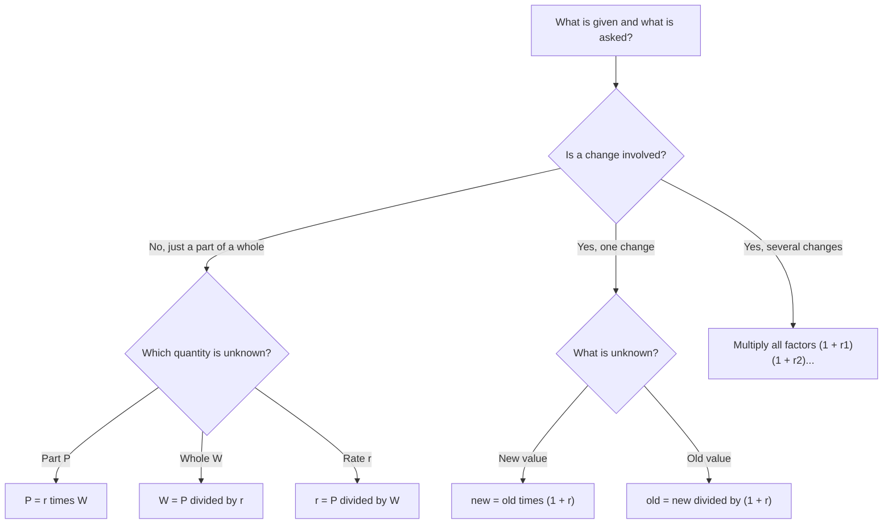

# Percentages
> [Mathematics](../../README.md) › Arithmetic · Level: Beginner · Prerequisites: fractions, decimals, multiplication and division · Estimated time: 90 min

## 1. Introduction
A **percentage** is a ratio expressed as a number of hundredths. When a shop advertises "20% off", when a report says that unemployment fell from 6.5% to 6.0%, or when a bank quotes an annual interest rate of 3.5%, the same idea is at work: a quantity is being compared with a whole, and the comparison is scaled so that the whole counts as $100\%$.

The word comes from the Latin *per centum*, "by the hundred". Fifty per cent means fifty out of every hundred, which is the same as one half. The whole is assigned the value $100\%$, so every comparison is a fraction of that whole expressed in hundredths. Twenty-five per cent means twenty-five out of every hundred, which is the same as one quarter. The notation $25\%$ is shorthand for the fraction $\tfrac{25}{100}$, or the decimal $0.25$. Nothing more mysterious is involved, but the shorthand is so convenient that percentages have become the default language of comparison in finance, science, medicine, sport, and everyday news.

Percentages are also a rich source of error. A pay cut of $10\%$ followed by a pay rise of $10\%$ does not restore the original salary. Two successive discounts of $20\%$ and $10\%$ are not the same as a single discount of $30\%$. A rate that rises from $2\%$ to $3\%$ has risen by one **percentage point**, but by $50\%$ in relative terms. Nearly every one of these traps comes from a single mistake: adding or subtracting percentages when the correct operation is multiplication, or using the wrong quantity as the base of the comparison. This tutorial teaches the correct operations and explains why they are correct.

The mathematics here rests on decimals and fractions, which are developed in [Decimals](../04-decimals/README.md). A percentage is just a decimal with the decimal point moved two places, so everything about place value, rounding, and exact arithmetic carries over. What is new is the habit of asking, for every percentage statement, *percentage of what?* Once that question becomes automatic, most percentage problems reduce to one multiplication or one division.

## 2. Prerequisites
You should be comfortable with the following:

* **Fractions and equivalent fractions.** In particular, that $\tfrac{25}{100}=\tfrac{1}{4}$ and that a fraction can be simplified by cancelling common factors.
* **Decimals and place value.** Converting between fractions and decimals, rounding, and the fact that dividing by $100$ moves the decimal point two places to the left. The topic [Decimals](../04-decimals/README.md) develops these ideas in full.
* **Multiplication and division of decimals.** For example, $0.18\times250=45$ and $63\div0.45=140$.
* **Solving a one-step equation.** If $0.18W=45$, then $W=45\div0.18=250$. No algebra beyond this is needed; every percentage problem in this tutorial is solved by multiplying or dividing.
* **The meaning of a ratio.** A ratio compares two quantities multiplicatively; a percentage is a ratio whose second term has been normalised to $100$.

## 3. Learning Objectives
By the end of this tutorial you will be able to:

1. Explain what a percentage is and convert freely among fractions, decimals, and percentages.
2. Compute a percentage of a quantity, and solve the three basic percentage problems: find the part, find the whole, and find the rate.
3. Calculate percentage increases and decreases using multipliers, and explain why the multiplier method is more reliable than adding or subtracting percentages.
4. Compute the net effect of two or more successive percentage changes, and explain why the individual percentages do not simply add.
5. Find the original amount before a percentage change, given the final amount and the rate.
6. Distinguish percentage points from percent changes, and compute both.
7. Handle markups, discounts, sales tax, and tips, including successive discounts and the order of operations.
8. Compare simple and compound growth, derive the compound formula for integer time periods, and compute an effective annual rate.
9. Recognise and avoid the standard percentage fallacies, including the asymmetry between "A is $p\%$ more than B" and "B is $p\%$ less than A".

## 4. Intuition
Imagine a square divided into a $10\times10$ grid of $100$ small squares. The whole square represents the base quantity. Shading $37$ of the small squares represents $37\%$: thirty-seven parts out of one hundred. If the whole square represents $\$80$, then each small square represents $\$0.80$, and $37$ squares represent $37\times\$0.80=\$29.60$. This is exactly the computation $0.37\times80=29.6$.

The grid makes two facts obvious. First, $100\%$ is the whole, not "all of everything in the universe": $100\%$ of a quantity is that quantity. Second, percentages of different wholes are not comparable until the wholes are known. $50\%$ of a small company may be fewer people than $1\%$ of a large one. A percentage always answers the question "per hundred of *what*?".

A second intuition is that a percentage is an **operator**, not a quantity. The expression "$20\%$" on its own is a number, $0.2$. But in the phrase "$20\%$ of $\$250$", it is an instruction: multiply $\$250$ by $0.2$. The word "of" is the multiplication sign. Thus

$$
20\%\text{ of }\$250 = 0.2\times\$250=\$50.
$$

When a price is increased by $20\%$, the new price is the old price plus $20\%$ of the old price:

$$
\text{new}=100\%\text{ of old}+20\%\text{ of old}=120\%\text{ of old}=1.2\times\text{old}.
$$

This is the **multiplier** idea. A $20\%$ increase multiplies by $1.2$; a $20\%$ decrease multiplies by $0.8$; a $5\%$ increase multiplies by $1.05$. Once a percentage change is written as a multiplier, successive changes become successive multiplications, and the correct order of operations becomes automatic.

A third intuition explains why successive percentages do not add. Suppose a quantity increases by $10\%$, then decreases by $10\%$. The increase is computed on the original quantity, but the decrease is computed on the *larger* intermediate quantity. The $10\%$ decrease therefore removes more than the $10\%$ increase added. In multipliers:

$$
1.1\times0.9=0.99,
$$

a net decrease of $1\%$, not $0\%$. The missing $1\%$ is the product of the two rates, $0.1\times0.1=0.01$. Section 8 makes this precise.

## 5. Formal Definition
### 5.1 Percent
Let $p$ be a real number. The expression **$p$ percent**, written $p\%$, denotes the real number

$$
p\%=\frac{p}{100}.
$$

Thus $25\%=0.25$, $100\%=1$, $150\%=1.5$, and $0.5\%=0.005$. A percentage may exceed $100$ (when the quantity is more than the whole) or be negative (when a change is a decrease). The symbol $\%$ is not a unit like a metre or a kilogram; it is a shorthand for division by $100$.

### 5.2 Base, Part, and Rate
Let $W$ be a **base** (the whole), and let $r$ be a **rate** written as a decimal. The **part** $P$ is defined by

$$
P=rW.
$$

If the rate is given as a percentage $p\%$, then $r=p/100$ and $P=\dfrac{p}{100}W$. For example, with $W=250$ and $p=18$, the part is $P=0.18\cdot250=45$.

The same equation has two other forms, obtained by dividing:

$$
r=\frac{P}{W}\qquad (W\ne0),
\qquad
W=\frac{P}{r}\qquad (r\ne0).
$$

These three forms correspond to the three basic percentage problems: finding the part, finding the rate, and finding the whole.

### 5.3 Percentage Change
Let a quantity change from an old value $W_{0}>0$ to a new value $W_{1}$. The **absolute change** is $W_{1}-W_{0}$. The **relative change**, or **percentage change**, is

$$
\text{percentage change}=100\cdot\frac{W_{1}-W_{0}}{W_{0}}\ \%.
$$

The change is an increase if $W_{1}>W_{0}$ and a decrease if $W_{1}<W_{0}$. Equivalently, the **multiplier** is

$$
1+r=\frac{W_{1}}{W_{0}},
\qquad r=\frac{W_{1}-W_{0}}{W_{0}},
$$

so that $W_{1}=W_{0}(1+r)$. Here $r$ is the rate as a decimal; the percentage change is $100r\%$.

### 5.4 Percentage Points
Suppose a rate changes from $p_{1}\%$ to $p_{2}\%$. The **change in percentage points** is $p_{2}-p_{1}$, measured in percentage points (abbreviated pp). The **relative change** of the rate is

$$
100\cdot\frac{p_{2}-p_{1}}{p_{1}}\ \%,
$$

provided $p_{1}\ne0$. These are different quantities. A change from $6.5\%$ to $7.8\%$ is a change of $1.3$ percentage points, but a relative increase of $20\%$ in the rate.

### 5.5 Markup, Discount, Tax, and Tip
Let $C$ be a cost, $M$ a marked price, and $S$ a sale price.

* A **markup** of rate $m$ on cost sets the price $M=C(1+m)$.
* A **discount** of rate $d$ on a marked price sets the sale price $S=M(1-d)$.
* A **tax** of rate $t$ on a price adds $t$ times the price, so the total is $M(1+t)$.
* A **tip** of rate $t$ on a bill is computed similarly; the total paid is $B(1+t)$, where $B$ is the bill.

All rates are decimals in these formulas. A markup of $40\%$ means $m=0.4$; a discount of $25\%$ means $d=0.25$.

### 5.6 Simple and Compound Interest
Let $P_{0}$ be an initial amount (the principal), $r$ an annual interest rate as a decimal, and $t$ a time in years.

* **Simple interest** pays interest only on the principal: $I=P_{0}rt$ and the final amount is $A=P_{0}(1+rt)$.
* **Compound interest**, compounded once per year, pays interest on the principal and on previously accumulated interest: $A=P_{0}(1+r)^{t}$.

If interest is compounded $n$ times per year at the same nominal annual rate, the amount is $A=P_{0}\left(1+\frac{r}{n}\right)^{nt}$, and the **effective annual rate** is $\left(1+\frac{r}{n}\right)^{n}-1$.

## 6. Mathematical Notation
| Symbol | Meaning | Read aloud |
|---|---|---|
| $\%$ | division by $100$ | "per cent" |
| $p$ | a percentage value, so $p\%=p/100$ | "p per cent" |
| $r$ | a rate written as a decimal, $r=p/100$ | "r" |
| $W$ | the base or whole | "W" |
| $P$ | the part, $P=rW$ | "P" |
| $W_{0},W_{1}$ | old and new values of a quantity | "W nought, W one" |
| $m$ | markup rate | "m" |
| $d$ | discount rate | "d" |
| $t$ | tax rate, tip rate, or time in years (context makes it clear) | "t" |
| $\text{pp}$ | percentage points | "percentage points" |
| $P_{0}$ | initial principal | "P nought" |
| $A$ | final amount | "A" |
| $n$ | number of compounding periods per year | "n" |
| $\Delta$ | change in a quantity | "delta" |

The symbol $\%$ is always read "per cent", never "percent of". The phrase "$5\%$ of $x$" is read "five per cent of $x$" and means $0.05x$. The abbreviation "pp" is used only for percentage points, never for percent: a rise from $3\%$ to $5\%$ is $2$ pp, not $2\%$.

## 7. Core Concepts
### 7.1 Percent as "Per Hundred"
A percentage compares a part with a whole by asking how many hundredths of the whole the part represents. If a class has $40$ students and $10$ of them wear glasses, the fraction is $\tfrac{10}{40}=\tfrac{1}{4}$, and the percentage is

$$
\frac{10}{40}\cdot100\%=25\%.
$$

The calculation can be read as "what number out of $100$ has the same ratio to $100$ as $10$ has to $40$?" The answer is $25$ out of $100$. This is why a percentage is a **normalised ratio**: it puts every comparison on the same scale, with the whole set to $100$.

The normalisation is what makes percentages convenient and what makes them dangerous. Convenient, because $25\%$ of one quantity can be compared with $25\%$ of another without knowing the sizes of the quantities. Dangerous, because a percentage without a stated base is incomplete. "Sales rose $10\%$" is not a complete statement until we know whether the base is last year's sales, last quarter's sales, or the sales of one particular product.

### 7.2 Converting Among Fractions, Decimals, and Percentages
The three representations are related by powers of $100$:

$$
\text{fraction}\;\longleftrightarrow\;\text{decimal}\;\longleftrightarrow\;\text{percentage}.
$$

* **Percent to decimal:** divide by $100$; move the decimal point two places left. Thus $37\%=0.37$ and $7.5\%=0.075$.
* **Decimal to percent:** multiply by $100$; move the point two places right. Thus $0.6=60\%$ and $0.045=4.5\%$.
* **Percent to fraction:** write the percentage over $100$ and reduce. Thus $40\%=\tfrac{40}{100}=\tfrac{2}{5}$.
* **Fraction to percent:** multiply the fraction by $100\%$. Thus $\tfrac{3}{8}=0.375=37.5\%$.

Some conversions are worth knowing by heart:

| Fraction | Decimal | Percentage |
|---:|---:|---:|
| $\tfrac{1}{2}$ | $0.5$ | $50\%$ |
| $\tfrac{1}{4}$ | $0.25$ | $25\%$ |
| $\tfrac{3}{4}$ | $0.75$ | $75\%$ |
| $\tfrac{1}{5}$ | $0.2$ | $20\%$ |
| $\tfrac{1}{8}$ | $0.125$ | $12.5\%$ |
| $\tfrac{1}{10}$ | $0.1$ | $10\%$ |
| $\tfrac{1}{3}$ | $0.333\ldots$ | $33\tfrac{1}{3}\%$ |
| $\tfrac{2}{3}$ | $0.666\ldots$ | $66\tfrac{2}{3}\%$ |

The repeating decimals for $\tfrac{1}{3}$ and $\tfrac{2}{3}$ are exact in fraction form but cannot be written as finite decimals or finite percentages. Writing $33.33\%$ is an approximation; $33\tfrac{1}{3}\%$ is exact.

### 7.3 Finding a Percentage of a Quantity
To find $p\%$ of $W$, convert the percentage to a decimal and multiply:

$$
P=\frac{p}{100}W.
$$

For example, $18\%$ of $250$ is $0.18\cdot250=45$. A useful mental shortcut is to compute $10\%$ by moving the decimal point one place left, then build other percentages from it. Thus $10\%$ of $250$ is $25$; $5\%$ is half of that, $12.5$; and $18\%$ is $10\%+5\%+3\%=25+12.5+7.5=45$. The decomposition method is a good check on a calculator result.

### 7.4 The Three Basic Percentage Problems
Every elementary percentage problem is one of three forms of the same equation $P=rW$.

1. **Find the part.** Given the whole $W$ and the rate $r$, compute $P=rW$. Example: $18\%$ of $250$ is $45$.
2. **Find the rate.** Given the part $P$ and the whole $W$, compute $r=P/W$, then multiply by $100$ to express it as a percentage. Example: $42$ is what percentage of $350$? $\tfrac{42}{350}=0.12=12\%$.
3. **Find the whole.** Given the part $P$ and the rate $r$, compute $W=P/r$. Example: $63$ is $45\%$ of what number? $W=\tfrac{63}{0.45}=140$.

The hardest part is usually identifying which quantity is the whole. The whole is the quantity that corresponds to $100\%$; the part is the quantity being compared with it. In the sentence "$42$ is $12\%$ of $350$", the whole is $350$ and the part is $42$. In the sentence "$42$ is $12\%$ less than $350$", the whole is still $350$; the $42$ is the amount removed, and the amount remaining is $308$. The rate $12\%$ refers to the $42$ removed, not to $308$.

### 7.5 Percentage Increase and Decrease
An increase of rate $r$ adds $rW$ to $W$:

$$
\text{new}=W+rW=W(1+r).
$$

A decrease of rate $r$ subtracts $rW$:

$$
\text{new}=W-rW=W(1-r).
$$

The multiplier $1+r$ or $1-r$ is the key object. A $15\%$ increase multiplies by $1.15$; a $12\%$ decrease multiplies by $0.88$. To reverse the operation, divide by the multiplier.

The language "increase by $p\%$" must be distinguished from three similar phrases:

* "$p\%$ of $W$" means $0.01pW$.
* "$W$ increased by $p\%$" means $W+0.01pW=W(1+0.01p)$.
* "$W$ increased to $p\%$ of its original value" means that the final value is $0.01pW$; the word "to" signals a final percentage of the original, not an amount added on top.

For example, $150\%$ of $80$ is $120$; an increase of $150\%$ from $80$ is $80+120=200$; and an increase *to* $150\%$ of $80$ is $120$. The first and third agree; the second is different.

### 7.6 Successive Percentage Changes
If a quantity changes by rate $r_{1}$ and then by rate $r_{2}$, the final value is

$$
W(1+r_{1})(1+r_{2}).
$$

The net rate $r_{\text{net}}$ satisfies

$$
1+r_{\text{net}}=(1+r_{1})(1+r_{2})
=1+r_{1}+r_{2}+r_{1}r_{2},
$$

so

$$
r_{\text{net}}=r_{1}+r_{2}+r_{1}r_{2}.
$$

The cross term $r_{1}r_{2}$ is the reason the percentages do not simply add. For two increases of $10\%$,

$$
r_{\text{net}}=0.1+0.1+0.01=0.21=21\%,
$$

not $20\%$. For a $10\%$ increase followed by a $10\%$ decrease,

$$
r_{\text{net}}=0.1-0.1-0.01=-0.01=-1\%,
$$

so the net result is a $1\%$ decrease. The order of the two changes does not matter: multiplication is commutative, so $(1+r_{1})(1+r_{2})=(1+r_{2})(1+r_{1})$. What matters is that both factors use the running value, not the original value.

### 7.7 Reverse Percentages
Suppose a quantity is increased by rate $r$ and the final value is $F$. To find the original value $W$, undo the multiplication:

$$
F=W(1+r)\quad\Longrightarrow\quad W=\frac{F}{1+r}.
$$

For a decrease, replace $1+r$ by $1-r$:

$$
W=\frac{F}{1-r}.
$$

This is the **reverse percentage** problem. The common error is to subtract $p\%$ of the final value instead of dividing by $1+r$. For example, if a price after a $20\%$ discount is $\$64$, the original price is

$$
W=\frac{64}{1-0.2}=\frac{64}{0.8}=80,
$$

not $64+20\%$ of $64=76.80$. The discount was $20\%$ of the original $\$80$, namely $\$16$, and $80-16=64$.

### 7.8 Percentage Points Versus Percent
A **percentage point** is the unit of difference between two percentages. If a rate moves from $p_{1}\%$ to $p_{2}\%$, the change is $p_{2}-p_{1}$ percentage points. The relative change is

$$
\frac{p_{2}-p_{1}}{p_{1}}\cdot100\%.
$$

For example, an unemployment rate rising from $6.5\%$ to $7.8\%$ rises by $1.3$ percentage points, and the relative increase is

$$
\frac{7.8-6.5}{6.5}=\frac{1.3}{6.5}=0.2=20\%.
$$

Both statements are correct, but they answer different questions. "The rate rose by $1.3\%$" is ambiguous: it could mean $1.3$ percentage points, or a relative increase of $1.3\%$ (which would take $6.5\%$ only to $6.5845\%$). Professional writing uses "percentage points" when it means the arithmetic difference of two percentages.

### 7.9 Markups, Discounts, Tax, and Tips
A **markup** is a percentage increase applied to a cost to obtain a selling price. If the cost is $C$ and the markup rate is $m$, the marked price is $M=C(1+m)$. A **discount** is a percentage decrease applied to a marked price: a discount rate $d$ gives the sale price $S=M(1-d)$. The profit is $S-C$, and as a percentage of cost it is

$$
\frac{S-C}{C}\cdot100\%.
$$

The multipliers combine: $S=C(1+m)(1-d)$. The markup and discount percentages do not cancel unless $(1+m)(1-d)=1$; the order of the two operations does not matter, but both factors act on the running price.

For two successive discounts $d_{1}$ and $d_{2}$, the single equivalent discount $d$ satisfies

$$
1-d=(1-d_{1})(1-d_{2}),
\qquad
d=1-(1-d_{1})(1-d_{2})=d_{1}+d_{2}-d_{1}d_{2}.
$$

Thus $20\%$ followed by $10\%$ is equivalent to $1-0.8\cdot0.9=1-0.72=0.28$, a $28\%$ discount, not $30\%$.

Sales tax and tips are percentage increases. A tax of $8.25\%$ on $\$240$ adds $0.0825\cdot240=\$19.80$, for a total of $\$259.80$. A $15\%$ tip on a $\$64$ bill is $\$9.60$, for a total of $\$73.60$. When both a discount and a tax apply, the order does not matter mathematically, because

$$
W(1-d)(1+t)=W(1+t)(1-d);
$$

what matters is that each rate is applied to the correct base. A discount applies to the pre-tax price, and a tax applies to the discounted price. Adding the discount rate and the tax rate is wrong.

### 7.10 Simple Versus Compound Growth
Simple interest is linear in time:

$$
A=P_{0}(1+rt).
$$

Compound interest is exponential:

$$
A=P_{0}(1+r)^{t}.
$$

For $r>0$ and $t>1$, compound growth exceeds simple growth, because interest earns interest. For example, $\$1{,}000$ at $5\%$ for $10$ years grows to

$$
1000(1+0.05\cdot10)=1500
$$

under simple interest, but to

$$
1000(1.05)^{10}=1628.89
$$

under annual compounding, a difference of $\$128.89$.

The compound formula for integer $t$ follows by repeated multiplication: after one year the amount is $P_{0}(1+r)$; after two years it is $P_{0}(1+r)^{2}$; and so on. Section 8 proves the inequality $(1+r)^{t}\ge1+rt$ for positive integer $t$, which is the mathematical statement that compound growth is at least as fast as simple growth when $r>0$.

When interest is compounded $n$ times per year, each period earns the rate $r/n$, and there are $nt$ periods:

$$
A=P_{0}\left(1+\frac{r}{n}\right)^{nt}.
$$

The **effective annual rate** is the single annual rate that would produce the same growth in one year:

$$
r_{\text{eff}}=\left(1+\frac{r}{n}\right)^{n}-1.
$$

For a nominal rate of $6\%$ compounded monthly, $r/n=0.005$ and

$$
r_{\text{eff}}=(1.005)^{12}-1\approx0.061678=6.1678\%.
$$

The effective rate is higher than the nominal rate because each month's interest earns interest in later months. As $n$ grows without bound, the effective rate approaches $e^{r}-1$; this is the continuous-compounding limit, mentioned here only as a preview.

### 7.11 Comparing Quantities with Percentages
The phrase "$A$ is $p\%$ more than $B$" means

$$
A=B(1+r),\qquad r=\frac{p}{100}.
$$

The phrase "$B$ is $q\%$ less than $A$" means

$$
B=A(1-s),\qquad s=\frac{q}{100}.
$$

These are not symmetric. If $A$ is $25\%$ more than $B$, then $A=1.25B$, so $B=\tfrac{1}{1.25}A=0.8A$: $B$ is $20\%$ less than $A$, not $25\%$ less. The base switches from $B$ to $A$, and the percentage changes with it. Section 8 derives the general relation $q=\dfrac{100p}{100+p}$ for this situation.

The same asymmetry appears in pay negotiations. A $10\%$ pay cut followed by a $10\%$ pay rise leaves $0.9\cdot1.1=0.99$ of the original salary, a $1\%$ loss. To restore the original salary after a $10\%$ cut requires a rise of

$$
\frac{1}{0.9}-1=0.1111\ldots=11.11\%,
$$

not $10\%$.

### 7.12 Weighted Averages of Percentages
Percentages cannot be averaged by simply averaging the percentage values unless the bases are equal. If group $1$ has size $W_{1}$ and rate $r_{1}$, and group $2$ has size $W_{2}$ and rate $r_{2}$, the overall rate is the total part divided by the total base:

$$
r_{\text{overall}}=\frac{r_{1}W_{1}+r_{2}W_{2}}{W_{1}+W_{2}}.
$$

For example, if a group of $30$ students has a pass rate of $80\%$ and a group of $20$ students has a pass rate of $90\%$, the overall pass rate is

$$
\frac{0.8\cdot30+0.9\cdot20}{30+20}=\frac{24+18}{50}=0.84=84\%,
$$

not the unweighted average $(80\%+90\%)/2=85\%$. The larger group carries more weight, and it has the lower rate, so the overall rate is closer to $80\%$ than to $90\%$.

## 8. Formulas and Properties
### 8.1 The Basic Equation
**Proposition 8.1.** For a base $W\ne0$ and a rate $r$, the part is $P=rW$. Equivalently, $r=P/W$ and $W=P/r$ (the latter provided $r\ne0$).

*Proof.* The first equation is the definition of the part. Dividing both sides by $W$ gives $r=P/W$; dividing both sides by $r$ gives $W=P/r$. $\square$

If the rate is given as a percentage $p\%$, use $r=p/100$. Thus $P=\dfrac{p}{100}W$.

### 8.2 Percentage Change
**Proposition 8.2.** If a quantity changes from $W_{0}>0$ to $W_{1}$, then

$$
W_{1}=W_{0}(1+r),
\qquad
r=\frac{W_{1}-W_{0}}{W_{0}},
$$

where the percentage change is $100r\%$.

*Proof.* Divide the equation $W_{1}=W_{0}+(W_{1}-W_{0})$ by $W_{0}$:

$$
\frac{W_{1}}{W_{0}}=1+\frac{W_{1}-W_{0}}{W_{0}}=1+r.
$$

Multiplying by $W_{0}$ gives the first equation; solving for $r$ gives the second. $\square$

### 8.3 Successive Changes
**Theorem 8.3.** If a quantity undergoes changes with rates $r_{1},r_{2},\ldots,r_{k}$, applied in that order, the final value is

$$
W_{\text{final}}=W_{\text{initial}}\prod_{i=1}^{k}(1+r_{i}).
$$

For two changes, the net rate is

$$
r_{\text{net}}=r_{1}+r_{2}+r_{1}r_{2}.
$$

*Proof.* After the first change the value is $W(1+r_{1})$. After the second, the new value is multiplied by $(1+r_{2})$, giving $W(1+r_{1})(1+r_{2})$. Induction extends this to $k$ changes. Expanding the product for two changes,

$$
(1+r_{1})(1+r_{2})=1+r_{1}+r_{2}+r_{1}r_{2},
$$

so $r_{\text{net}}=r_{1}+r_{2}+r_{1}r_{2}$. $\square$

**Corollary 8.4.** An increase of $p\%$ followed by a decrease of $p\%$ produces a net decrease of

$$
\frac{p^{2}}{100}\%.
$$

*Proof.* Put $r_{1}=p/100$ and $r_{2}=-p/100$. Then

$$
(1+r_{1})(1+r_{2})=1-\frac{p^{2}}{10000},
$$

so the net rate is $-p^{2}/10000$, which as a percentage is $-p^{2}/100\%$. $\square$

For example, $p=10$ gives a net decrease of $10^{2}/100=1\%$, and $p=20$ gives $4\%$.

### 8.4 Reverse Percentages
**Proposition 8.5.** If a quantity is increased by rate $r$ to a final value $F$, the original value is $W=F/(1+r)$. If it is decreased by rate $r$, the original value is $W=F/(1-r)$.

*Proof.* In the increase case $F=W(1+r)$; divide both sides by $1+r$. In the decrease case $F=W(1-r)$; divide both sides by $1-r$. $\square$

The denominators must be nonzero. In the increase formula, $1+r=0$ corresponds to $r=-1$, a $100\%$ decrease; in the decrease formula, $1-r=0$ corresponds to $r=1$, also a $100\%$ decrease. In either case the final value is $0$, so the original value cannot be recovered from the final value alone.

### 8.5 The Asymmetry of Percent More and Percent Less
**Proposition 8.6.** If $A$ is $p\%$ more than $B$, then $B$ is $q\%$ less than $A$, where

$$
q=\frac{100p}{100+p}.
$$

*Proof.* The hypothesis is $A=B(1+p/100)=B\cdot\dfrac{100+p}{100}$. Hence

$$
\frac{B}{A}=\frac{100}{100+p}
=1-\frac{p}{100+p}.
$$

The fraction by which $B$ is less than $A$ is $\dfrac{p}{100+p}$, so the percentage is $\dfrac{100p}{100+p}$. $\square$

For $p=25$, $q=2500/125=20$. For $p=10$, $q=1000/110=9.09\ldots$, so a $10\%$ lead one way is a $9.09\%$ deficit the other way. The two percentages are equal only when $p=0$.

### 8.6 Equivalent Discounts
**Proposition 8.7.** Two successive discounts $d_{1}$ and $d_{2}$ are equivalent to the single discount

$$
d=1-(1-d_{1})(1-d_{2})=d_{1}+d_{2}-d_{1}d_{2}.
$$

*Proof.* The final price after both discounts is $M(1-d_{1})(1-d_{2})$. A single discount $d$ gives $M(1-d)$. Equating and dividing by $M$ gives $1-d=(1-d_{1})(1-d_{2})$. Expanding the right-hand side gives $1-d_{1}-d_{2}+d_{1}d_{2}$, hence $d=d_{1}+d_{2}-d_{1}d_{2}$. $\square$

For $d_{1}=0.20$ and $d_{2}=0.15$, the single equivalent discount is $0.20+0.15-0.03=0.32$, or $32\%$, not $35\%$.

### 8.7 Simple Versus Compound Growth
**Proposition 8.8 (Bernoulli's inequality).** For every real $r\ge-1$ and every integer $n\ge1$,

$$
(1+r)^{n}\ge1+nr.
$$

If $r>0$ and $n>1$, the inequality is strict.

*Proof.* For $n=1$ both sides equal $1+r$. Suppose the inequality holds for some $n\ge1$. Since $1+r\ge0$, multiplying by $1+r$ preserves the inequality:

$$
(1+r)^{n+1}\ge(1+nr)(1+r)=1+(n+1)r+nr^{2}\ge1+(n+1)r.
$$

By induction, the inequality holds for all $n\ge1$. If $r>0$, the term $nr^{2}$ is positive, so the final inequality is strict for $n+1\ge2$. $\square$

**Corollary 8.9.** For a positive annual rate $r$ and an integer number of years $t>1$, compound interest exceeds simple interest:

$$
(1+r)^{t}>1+rt.
$$

This is Bernoulli's inequality with $n=t$. For $t=1$ the two are equal, which is why the difference appears only after the first year.

### 8.8 Effective Annual Rate
**Proposition 8.10.** If a nominal annual rate $r$ is compounded $n$ times per year, the effective annual rate is

$$
r_{\text{eff}}=\left(1+\frac{r}{n}\right)^{n}-1.
$$

For $r>0$ and $n>1$, $r_{\text{eff}}>r$.

*Proof.* One year contains $n$ compounding periods, each with rate $r/n$, so one unit of principal grows to $(1+r/n)^{n}$. The effective rate is the relative increase, hence the formula. Bernoulli's inequality with $r$ replaced by $r/n$ gives

$$
\left(1+\frac{r}{n}\right)^{n}\ge1+n\cdot\frac{r}{n}=1+r,
$$

so $r_{\text{eff}}\ge r$, with strict inequality when $r>0$ and $n>1$. $\square$

### 8.9 Weighted Averages of Percentages
**Proposition 8.11.** Suppose a population is divided into groups of sizes $W_{1},\ldots,W_{k}$ with rates $r_{1},\ldots,r_{k}$. The overall rate is

$$
r_{\text{overall}}=\frac{\sum_{i=1}^{k}r_{i}W_{i}}{\sum_{i=1}^{k}W_{i}}.
$$

*Proof.* The number of "successes" in group $i$ is $r_{i}W_{i}$. The total number of successes is the sum, and the total population is the sum of the $W_{i}$. The overall rate is total successes divided by total population. $\square$

If the group sizes are equal, the overall rate is the ordinary average of the rates. If they are not, the rates must be weighted by the group sizes.

### 8.10 Percent Error
If a measured value $x_{\text{meas}}$ is compared with a true value $x_{\text{true}}\ne0$, the **percent error** is

$$
\text{percent error}=\frac{|x_{\text{meas}}-x_{\text{true}}|}{|x_{\text{true}}|}\cdot100\%.
$$

The absolute value in the numerator measures the size of the error regardless of direction; the denominator is the true value, because the error is being expressed as a fraction of the true value. For example, a measurement of $9.8$ against a true value of $9.81$ has percent error

$$
\frac{|9.8-9.81|}{9.81}\cdot100\%=\frac{0.01}{9.81}\cdot100\%\approx0.102\%.
$$

## 9. Step-by-Step Examples
### Example 9.1 — Conversions in Both Directions
**(a)** $0.375$ as a percentage: $0.375\cdot100\%=37.5\%$. As a fraction, $0.375=\tfrac{375}{1000}=\tfrac{3}{8}$.

**(b)** $\tfrac{7}{20}$ as a decimal and a percentage: $\tfrac{7}{20}=0.35=35\%$.

**(c)** $6\%$ as a decimal and a fraction: $6\%=0.06=\tfrac{6}{100}=\tfrac{3}{50}$.

**(d)** $125\%$ as a decimal and a fraction: $125\%=1.25=\tfrac{125}{100}=\tfrac{5}{4}$.

### Example 9.2 — Finding a Percentage of a Quantity
**(a)** $24\%$ of $350$:

$$
0.24\cdot350=84.
$$

**(b)** $7.5\%$ of $80$:

$$
0.075\cdot80=6.
$$

**(c)** $0.5\%$ of $1200$:

$$
0.005\cdot1200=6.
$$

In each case the percentage was converted to a decimal before multiplying. Multiplying by $18$ and then dividing by $100$ gives the same answer and is often safer mentally.

### Example 9.3 — The Three Basic Problems
**(a) Find the rate.** $56$ is what percentage of $400$?

$$
\frac{56}{400}=0.14=14\%.
$$

**(b) Find the whole.** $84$ is $35\%$ of what number?

$$
W=\frac{84}{0.35}=240.
$$

**(c) Find the part.** What is $45\%$ of $80$?

$$
0.45\cdot80=36.
$$

In each case the equation is $P=rW$, with the unknown in a different position.

### Example 9.4 — Increase and Decrease
**(a)** Increase $80$ by $15\%$:

$$
80(1+0.15)=80\cdot1.15=92.
$$

**(b)** Decrease $150$ by $12\%$:

$$
150(1-0.12)=150\cdot0.88=132.
$$

**(c)** Increase $40$ by $150\%$:

$$
40(1+1.5)=40\cdot2.5=100.
$$

Compare this with $150\%$ of $40$, which is $1.5\cdot40=60$. The word "by" makes the rate an increase on top of the original; the phrase "of" makes it a direct multiple.

### Example 9.5 — Successive Changes
**(a)** $80$ increased by $10\%$, then decreased by $10\%$:

$$
80\cdot1.1\cdot0.9=80\cdot0.99=79.2.
$$

The net change is $79.2-80=-0.8$, which is $-1\%$ of $80$. The two $10\%$ changes do not cancel.

**(b)** $80$ increased by $10\%$ twice:

$$
80\cdot1.1\cdot1.1=80\cdot1.21=96.8,
$$

a net increase of $21\%$.

**(c)** Successive discounts of $20\%$ and $15\%$:

$$
1-(0.8)(0.85)=1-0.68=0.32.
$$

The single equivalent discount is $32\%$, not $35\%$.

### Example 9.6 — Reverse Percentages
**(a)** After a $25\%$ discount, a price is $\$72$. Find the original price:

$$
W=\frac{72}{1-0.25}=\frac{72}{0.75}=96.
$$

**(b)** A price including $20\%$ VAT is $\$144$. Find the price before tax:

$$
W=\frac{144}{1+0.2}=\frac{144}{1.2}=120.
$$

The tax is $\$24$, which is $20\%$ of $\$120$, not $20\%$ of $\$144$.

**(c)** After a $25\%$ increase, a quantity is $150$. Find the original:

$$
W=\frac{150}{1.25}=120.
$$

### Example 9.7 — Markup, Discount, and Profit
A shop buys an item for $\$60$, marks it up by $40\%$, then discounts the marked price by $25\%$.

Marked price:

$$
60(1+0.4)=60\cdot1.4=84.
$$

Sale price:

$$
84(1-0.25)=84\cdot0.75=63.
$$

Profit:

$$
63-60=3,
$$

which is $\dfrac{3}{60}=0.05=5\%$ of the cost. The markup and discount factors combine as $1.4\cdot0.75=1.05$, a net $5\%$ increase over cost, not $40\%-25\%=15\%$.

### Example 9.8 — Simple Versus Compound Growth
$\$2{,}500$ is invested at $6\%$ per year for $5$ years.

Simple interest:

$$
2500(1+0.06\cdot5)=2500\cdot1.3=3250.
$$

Annual compounding:

$$
2500(1.06)^{5}=2500\cdot1.3382255776=3345.56.
$$

The difference is $\$95.56$. For comparison, a nominal $4\%$ compounded quarterly has effective annual rate

$$
(1.01)^{4}-1=1.04060401-1=0.04060401=4.0604\%.
$$

### Example 9.9 — Percentage Points and Weighted Averages
**(a)** A rate rises from $3.2\%$ to $4.0\%$. The change in percentage points is $4.0-3.2=0.8$ pp. The relative change is

$$
\frac{0.8}{3.2}=0.25=25\%.
$$

**(b)** In a school, a group of $20$ students has a pass rate of $70\%$ and a group of $30$ students has a pass rate of $90\%$. The overall pass rate is

$$
\frac{0.7\cdot20+0.9\cdot30}{50}=\frac{14+27}{50}=\frac{41}{50}=0.82=82\%.
$$

The unweighted average of $70\%$ and $90\%$ is $80\%$, which is not the overall rate because the groups have different sizes.

## 10. Visual Explanations
The following decision diagram summarises which formula to use. It is not a substitute for understanding the base, but it is a reliable checklist once the base has been identified.

The multiplier table is worth memorising. Each row is an operator: multiply by the right-hand number to apply the change.

| Change | Multiplier | Change | Multiplier |
|---|---:|---|---:|
| $+5\%$ | $1.05$ | $-5\%$ | $0.95$ |
| $+10\%$ | $1.10$ | $-10\%$ | $0.90$ |
| $+20\%$ | $1.20$ | $-20\%$ | $0.80$ |
| $+25\%$ | $1.25$ | $-25\%$ | $0.75$ |
| $+50\%$ | $1.50$ | $-50\%$ | $0.50$ |
| $+100\%$ | $2.00$ | $-100\%$ | $0$ |

The next table separates the two meanings that are most often confused.

| Statement | Arithmetic meaning |
|---|---|
| The rate rose from $6.5\%$ to $7.8\%$ | an increase of $1.3$ percentage points |
| The rate rose by $20\%$ | a relative increase, $6.5\%\to7.8\%$ |
| Sales rose by $10\%$ | new sales are $1.10$ times old sales |
| Sales rose to $110\%$ of last year | the same statement as the previous row |

## 11. Common Mistakes
1. **Adding successive percentages.** A $10\%$ increase followed by a $10\%$ increase is $21\%$, not $20\%$. A $10\%$ increase followed by a $10\%$ decrease is a $1\%$ decrease, not $0\%$.
2. **Using the wrong base.** After a price rises by $20\%$, a further $10\%$ increase applies to the new price, not the original. The base changes at every step.
3. **Reversing a percentage by subtracting it.** A price of $\$64$ after a $20\%$ discount has original price $\$64/0.8=\$80$, not $\$64+20\%$ of $\$64=\$76.80$.
4. **Confusing percentage points with percent.** A change from $2\%$ to $3\%$ is $1$ pp but a $50\%$ relative increase. Say which one you mean.
5. **Assuming "more than" and "less than" are symmetric.** If $A$ is $25\%$ more than $B$, then $B$ is $20\%$ less than $A$, not $25\%$ less.
6. **Confusing "percent of" with "percent increase".** $150\%$ of $80$ is $120$; a $150\%$ increase from $80$ is $200$.
7. **Adding a discount rate and a tax rate.** A $20\%$ discount followed by $8\%$ tax multiplies by $0.8\cdot1.08=0.864$, not by $1-0.20+0.08=0.88$.
8. **Averaging percentages without weighting.** A class with $30$ students at $80\%$ and $20$ at $90\%$ has overall rate $84\%$, not $85\%$.
9. **Taking a percentage of a percentage as a percentage of the whole.** $20\%$ of $30\%$ is $0.2\cdot0.3=0.06=6\%$ of the whole, not $50\%$ or $600\%$.
10. **Rounding intermediate percentages.** Round only the final answer; rounding a rate at each step can change the last digit of a financial result.
11. **Treating a $100\%$ increase as "twice as much" only.** A $100\%$ increase doubles the quantity; a $200\%$ increase triples it; $200\%$ of a quantity also doubles it. The words "increase" and "of" change the meaning.
12. **Forgetting that a percentage needs a base.** "Sales are up $10\%$" is incomplete without saying $10\%$ of what.

## 12. Applications
**Finance.** Interest rates, inflation, investment returns, and loan charges are all percentages. A nominal annual rate compounded monthly has a higher effective rate than the nominal rate, and a $1\%$ fee on a loan can be much more than $1\%$ of the amount actually received. Percentage changes of a portfolio are not additive: a $50\%$ loss requires a $100\%$ gain to recover, because the recovery is computed on the smaller remaining balance.

**Retail and personal finance.** Discounts, markups, sales tax, and tips are percentage changes applied in sequence. A "$20\%$ off, then an extra $10\%$ off" sale is a $28\%$ discount, not $30\%$. A price that includes $20\%$ VAT is not reduced by $20\%$ when the VAT is removed; it is divided by $1.2$.

**Data and journalism.** News reports mix percentage points and percent changes, often without saying which. A poverty rate falling from $12\%$ to $9\%$ has fallen by $3$ percentage points, or by $25\%$ relative to its previous value. Both are true; they answer different questions. A statement such as "crime doubled" means a $100\%$ increase, while "crime rose by $200\%$" means it tripled.

**Science and medicine.** Concentrations are often mass percentages, and percent error measures the accuracy of a measurement. In medicine, a relative risk reduction of $50\%$ can sound large even when the absolute risk falls from $2\%$ to $1\%$, a change of one percentage point. Both the relative and absolute descriptions are needed for an honest comparison.

**Sport and education.** Batting averages, pass rates, and free-throw percentages are proportions reported per hundred. Combining them across groups requires weighting by the number of attempts. A player who makes $8$ of $10$ shots and one who makes $80$ of $100$ both have an $80\%$ rate, but the second is based on ten times as many attempts, so it is a more reliable estimate. The percentage alone does not report the sample size.

## 13. Exercises
The problem set is in [exercises.md](exercises.md). It contains $36$ problems arranged from direct conversion and calculation through multi-step financial and data problems to proof and counterexample challenges. Attempt the problems before reading the solutions.

## 14. Solutions
Full worked solutions to every problem are in [solutions.md](solutions.md). Each solution identifies the base, states the multiplier or equation used, and shows every arithmetic step.

## 15. Summary
* A percentage is a ratio per hundred: $p\%=p/100$.
* The basic equation is $P=rW$; it can be solved for the part, the rate, or the whole.
* A percentage increase or decrease is a multiplier: $1+r$ for an increase, $1-r$ for a decrease.
* Successive changes multiply; the net rate is $r_{1}+r_{2}+r_{1}r_{2}$, not $r_{1}+r_{2}$.
* An increase of $p\%$ followed by a decrease of $p\%$ gives a net decrease of $p^{2}/100\%$.
* Reverse percentages divide by the multiplier: original $=$ final $/(1+r)$ for an increase, and final $/(1-r)$ for a decrease.
* Percentage points measure the arithmetic difference of two percentages; percent measures relative change.
* Two successive discounts combine as $d=d_{1}+d_{2}-d_{1}d_{2}$.
* Compound growth is $(1+r)^{t}$; simple growth is $1+rt$; compound exceeds simple for $r>0$ and $t>1$.
* The effective annual rate for $n$ compounding periods is $(1+r/n)^{n}-1$.
* Percentages from different groups must be weighted by group size before averaging.
* Always ask "percentage of what?" before computing.

## 16. Further Learning
The next topics in the Arithmetic sequence apply percentages to ratios and proportional reasoning, and then to exponents and roots, where compound growth reappears as exponential growth. The topic [Decimals](../04-decimals/README.md) is the natural prerequisite if any of the conversion work felt uncertain.

For financial applications, any standard text on personal finance or corporate finance will develop present value, annual percentage rates, and amortisation. For the mathematics of growth, an introductory algebra or precalculus text covers exponential functions and the number $e$. For the statistical side, a first course in statistics treats weighted averages, risk, and the difference between absolute and relative change.

