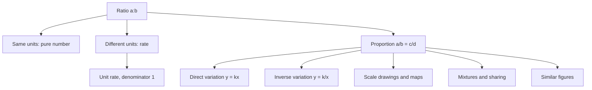
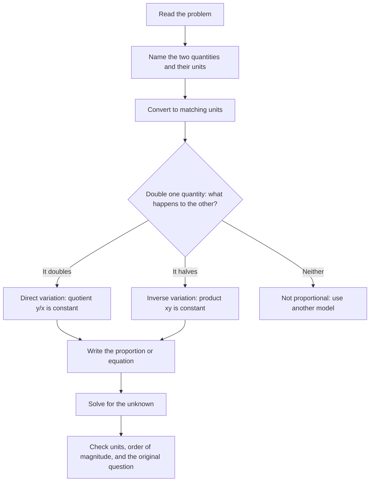

# Ratios, Rates and Proportions

> [Arithmetic](../README.md) · Level: Beginner · Prerequisites: [Fractions](../03-fractions/README.md), [Decimals](../04-decimals/README.md), multiplication and division of whole numbers, and solving equations of the form $ax=b$ · Estimated time: 90 min

## 1. Introduction

A **ratio** compares two quantities by division. It answers questions such as "how many times as large is $A$ compared with $B$?" or "how much of $A$ goes with each unit of $B$?" — not "how much is there altogether?". A **rate** is a ratio whose two quantities are measured in different units, such as kilometres and hours. A **proportion** is a statement that two ratios are equal. Together these three ideas form *proportional reasoning*, the habit of thinking multiplicatively about the world.

The same mathematics appears under many disguises:

- A recipe uses 2 cups of flour for every 3 cups of milk.
- A map says that 1 cm on paper represents 5 km on the ground.
- A class contains 14 boys and 21 girls, so the ratio of boys to girls is $14:21$.
- A car covers 240 km in 3 hours, a rate of 80 km per hour.
- Paint is mixed from 5 parts white and 3 parts blue.
- A medicine dose is 15 mg per kilogram of body mass.
- Two triangles have the same shape but different sizes.

In every case the central question is *multiplicative*: if one quantity is scaled by a factor, how is the other quantity scaled? This is why ratios matter far beyond arithmetic. Percentages, probability, similarity, trigonometry, concentrations in chemistry, exchange rates, scaling in computer graphics, and the definition of the derivative all rest on comparisons of ratios.

The topic is organised as follows. Sections 5 and 6 fix the vocabulary and notation. Section 7 develops ratios, rates, proportions, direct and inverse variation, scales, unit conversion, mixtures, and similar figures. Section 8 states the main formulas and proves them. Sections 9–12 apply the ideas and warn about the standard errors. The exercises in [exercises.md](exercises.md) are graded from routine fluency to competition-style arguments, and [solutions.md](solutions.md) contains a complete solution for every problem.

## 2. Prerequisites

You need the following arithmetic, all of which is used repeatedly below. Each item is recalled here so that the tutorial can be read on its own.

**Multiplication and division.** A ratio is a quotient, so division must be fluent. Recall that $a/b$ means $a \div b$, and that dividing by zero is undefined. For example, $84/12 = 7$ because $7 \cdot 12 = 84$.

**Equivalent fractions.** Multiplying the numerator and denominator of a fraction by the same nonzero number does not change its value (the full treatment is in [Fractions](../03-fractions/README.md)):

$$
\frac{2}{3} = \frac{2 \cdot 4}{3 \cdot 4} = \frac{8}{12}.
$$

This is the single most-used fact in the whole topic.

**Simplifying fractions.** Divide numerator and denominator by a common factor. For example, $\frac{18}{24} = \frac{18 \div 6}{24 \div 6} = \frac{3}{4}$.

**Decimals and place value.** You should be able to write $0.36 = \frac{36}{100}$ and to move between decimals, fractions, and percentages (see [Decimals](../04-decimals/README.md)). A ratio such as $2.4:0.36$ is easier to handle after clearing decimals.

**Units of measurement.** Length (mm, cm, m, km), mass (mg, g, kg), time (s, min, h), volume (mL, L), and money. A ratio of quantities in *different* units is a rate, so unit handling is part of the subject rather than an afterthought.

**Solving a linear equation of the form $ax=b$.** If $a \neq 0$, divide both sides by $a$ to obtain $x = b/a$. For example, $12x = 588$ gives $x = 49$. This is exactly what cross-multiplication will require.

Signed-number arithmetic (the rules for negative numbers) is covered in [Integers](../02-integers/README.md); this topic works almost exclusively with positive quantities, but the algebra remains valid for negative values wherever the expressions are defined.

## 3. Learning Objectives

After working through this tutorial you will be able to:

1. Write a ratio in the notations $a:b$, $a/b$, and "$a$ to $b$", and explain the difference between part-to-part and part-to-whole comparisons.
2. Reduce a ratio of integers to simplest form, including ratios with decimals, fractions, or mixed units.
3. Decide whether two ratios are equivalent, and justify the decision using cross products or a common multiplier.
4. Compute a unit rate from a given rate, and use unit rates to compare prices, speeds, densities, and productivities.
5. Set up a proportion that matches a word problem, including aligning the units correctly, and solve it by cross-multiplication, the unitary method, or a scale factor.
6. Explain *why* cross-multiplication is valid, and identify situations in which it must not be used.
7. Recognise and model direct variation $y=kx$ and inverse variation $y=k/x$, including determining the constant from data.
8. Use a scale drawing or map to convert between drawing lengths and actual lengths, and between drawing areas and actual areas.
9. Convert units by dimensional analysis, arranging conversion factors so that unwanted units cancel.
10. Solve sharing and mixture problems by reasoning about parts and totals.
11. Use a similarity ratio to find unknown sides, perimeters, and areas of similar figures.
12. Recognise common proportional-reasoning errors and correct them.

## 4. Intuition

Imagine a recipe that says "two parts flour to three parts milk". If you use two cups of flour, use three cups of milk. If you double the recipe, use four cups of flour and six cups of milk. The *relationship* between flour and milk stays the same even though the amounts change. That relationship — "for every two of these, three of those" — is a ratio.

The word **per** is the everyday signal of a rate. Kilometres *per* hour, dollars *per* kilogram, grams *per* cubic centimetre, words *per* minute. "Per" means "for each one", which is division: 240 km in 3 hours is $240 \div 3 = 80$ km for each hour.

A **proportion** is what you get when two ratios describe the same relationship at different sizes. A small batch and a large batch of the same recipe are in proportion: every ingredient has been multiplied by the same number. A map and the landscape it represents are in proportion: every distance has been multiplied by the same scale factor.

The crucial mental shift is from *adding* to *multiplying*. Suppose two children are 10 and 12 years old. Their ages are in the ratio $10:12 = 5:6$. Five years later they are 15 and 17, a ratio of $15:17$, which is *not* $5:6$. Adding the same amount to both quantities does not preserve a ratio. Multiplying both quantities by the same amount does. Proportional reasoning is multiplicative reasoning.

The same shift explains inverse relationships. If you drive a fixed distance, then doubling your speed halves your travel time. Here the two quantities do not rise and fall together; their *product* (speed times time, which equals distance) stays constant. Recognising whether a relationship preserves a quotient or a product is the main skill in variation problems.

Finally, ratios are the language of shape. Two figures are similar when one is a scaled copy of the other. Every length in the copy is multiplied by the same factor, so corresponding sides form equal ratios. Angles do not change, perimeters scale like lengths, and areas scale like the *square* of the factor — a preview of the geometry that will be developed later.

## 5. Formal Definition

Throughout this topic, quantities are positive real numbers unless stated otherwise, and every denominator is nonzero.

**Definition 5.1 (Ratio).** Let $a$ and $b$ be quantities measured in the same unit, with $b \neq 0$. The **ratio of $a$ to $b$** is the quotient $a/b$, also written $a:b$. It is a pure number: the common unit cancels. When the quantities have different units, the quotient is called a rate (Definition 5.4), and the colon notation is still used.

**Definition 5.2 (Part-to-part and part-to-whole).** Suppose a collection consists of $a$ items of type $A$ and $b$ items of type $B$, with $a+b>0$. The **part-to-part ratio** is $A:B = a:b$. The **part-to-whole ratio** of $A$ to the entire collection is $a:(a+b)$. The **fraction of the whole** that is of type $A$ is $\frac{a}{a+b}$.

**Definition 5.3 (Equivalent ratios).** Two ratios $a:b$ and $c:d$ (with $b,d \neq 0$) are **equivalent** if there is a nonzero number $k$ such that $c = ka$ and $d = kb$. Equivalently, $a/b = c/d$. A ratio of integers is in **simplest form** when the two terms have no common factor greater than $1$.

**Definition 5.4 (Rate and unit rate).** A **rate** is a ratio of two quantities measured in different units, such as distance per time or cost per mass. A **unit rate** is a rate whose second quantity is $1$, for example $80$ km per $1$ hour, written $80$ km/h.

**Definition 5.5 (Proportion).** A **proportion** is an equation of the form

$$
\frac{a}{b} = \frac{c}{d},
$$

where $b \neq 0$ and $d \neq 0$. In the notation $a:b = c:d$, the numbers $a$ and $d$ are called the **extremes**, and $b$ and $c$ the **means**. The products $ad$ and $bc$ are the **cross products**.

**Definition 5.6 (Direct variation).** A quantity $y$ **varies directly** with a quantity $x$ if there is a constant $k \neq 0$ such that

$$
y = kx
$$

for all relevant $x$. The number $k$ is the **constant of proportionality** or **constant of variation**. One also says "$y$ is proportional to $x$" and writes $y \propto x$.

**Definition 5.7 (Inverse variation).** A quantity $y$ **varies inversely** with $x$ if there is a constant $k \neq 0$ such that

$$
y = \frac{k}{x}
$$

for all relevant $x \neq 0$. Equivalently, $xy = k$.

**Definition 5.8 (Scale).** A **scale drawing** represents an object with every length multiplied by the same positive factor. A scale of $1:n$ means that one unit on the drawing represents $n$ units in reality, so

$$
\frac{\text{drawing length}}{\text{actual length}} = \frac{1}{n}.
$$

The number $n$ is the **scale factor** from the drawing to the object.

**Definition 5.9 (Similar figures, preview).** Two plane figures are **similar** if corresponding angles are equal and corresponding side lengths are all multiplied by the same positive factor $k$. The number $k$ is the **similarity ratio** (or scale factor) from the first figure to the second.

## 6. Mathematical Notation

| Symbol | Meaning | Read aloud |
|---|---|---|
| $a:b$ | ratio of $a$ to $b$ | "$a$ to $b$" |
| $\frac{a}{b}$ | the quotient $a \div b$; also the ratio $a:b$ | "$a$ over $b$" or "$a$ divided by $b$" |
| $a:b:c$ | three quantities compared together | "$a$ to $b$ to $c$" |
| $a \propto b$ | $a$ is proportional to $b$ | "$a$ is proportional to $b$" |
| $k$ | constant of proportionality | "constant $k$" |
| $\frac{a}{b}=\frac{c}{d}$ | a proportion | "$a$ over $b$ equals $c$ over $d$" |
| $ad=bc$ | equality of cross products | "$a d$ equals $b c$" |
| $1:n$ | scale of a drawing | "one to $n$" |
| km/h | kilometres per hour | "kilometres per hour" |
| \$/kg | dollars per kilogram | "dollars per kilogram" |
| $\approx$ | approximately equal | "approximately equals" |
| $[L]$ | dimension of length (used informally) | "dimension length" |

Two notational conventions deserve emphasis. First, a ratio written with a colon is an *ordered* pair: $2:3$ and $3:2$ are different. Second, ratios are dimensionless only when the quantities share a unit. Writing $2\text{ m} : 50\text{ cm}$ is legal, but to simplify it you must first convert to a common unit, obtaining $200:50 = 4:1$. The colon notation is a convenience, not a licence to ignore units.

## 7. Core Concepts

### 7.1 Ratio as Comparison

A ratio compares two quantities of the same kind. In a class of 14 boys and 21 girls:

- the part-to-part ratio of boys to girls is $14:21 = 2:3$;
- the part-to-whole ratio of boys to students is $14:(14+21) = 14:35 = 2:5$;
- the fraction of the class that is boys is $\frac{14}{35} = \frac{2}{5}$.

Notice that $2:3$ and $2:5$ answer different questions. The first says "for every 2 boys there are 3 girls"; the second says "2 out of every 5 students are boys". Confusing them is the most common ratio error in everyday life. If a problem asks for "the ratio of boys to girls", use part-to-part; if it asks "what fraction of the class is boys", use part-to-whole.

A ratio can compare more than two quantities. A concrete mix of 1 part cement, 2 parts sand, and 3 parts gravel is written $1:2:3$. The total is $1+2+3=6$ parts, so cement is $\frac{1}{6}$ of the mixture by volume, sand is $\frac{2}{6}=\frac{1}{3}$, and gravel is $\frac{3}{6}=\frac{1}{2}$.

Three-term ratios obey the same scaling rule as two-term ratios: multiplying every term by the same nonzero number gives an equivalent ratio. Thus $1:2:3 = 2:4:6 = 10:20:30$.

Order matters. A ratio of adults to children of $3:1$ describes a different group from a ratio of $1:3$. Always write down which quantity each position represents, preferably as a label: $\text{adults}:\text{children} = 3:1$.

### 7.2 Equivalent Ratios and Simplest Form

Two ratios are equivalent when one can be obtained from the other by multiplying both terms by the same nonzero number. Starting from $2:3$:

$$
2:3 = 4:6 = 6:9 = 20:30.
$$

A **ratio table** records this pattern and is often the clearest way to organise a problem:

| Flour (cups) | 2 | 4 | 6 | 8 | 10 |
|---|---|---|---|---|---|
| Milk (cups) | 3 | 6 | 9 | 12 | 15 |

Each column is the same recipe at a different size. The entry in the second row is always $\frac{3}{2}$ times the entry in the first row.

To reduce a ratio to simplest form, divide both terms by their greatest common divisor. For $18:24$, the greatest common divisor is $6$, so

$$
18:24 = \frac{18}{6}:\frac{24}{6} = 3:4.
$$

If the terms are decimals, first multiply both by a power of ten to clear the decimals, then simplify:

$$
2.4:0.36 = 240:36 = \frac{240}{12}:\frac{36}{12} = 20:3.
$$

If the terms are fractions, multiply both by a common denominator:

$$
\frac{1}{2}:\frac{2}{3} = \left(\frac{1}{2}\cdot 6\right):\left(\frac{2}{3}\cdot 6\right) = 3:4.
$$

If the terms carry units, convert to a common unit first:

$$
45\text{ min}:2\text{ h} = 45\text{ min}:120\text{ min} = 45:120 = 3:8.
$$

A ratio is in simplest form only when its terms are integers with no common factor. The ratios $0.4:1$ and $\frac{2}{5}:1$ have non-integer terms, although both are equivalent to the simplest integer ratio $2:5$. In practice, "simplest form" means what the context needs; for a scale $1:25000$ the terms are already coprime, and the odds ratio $3:2$ is also coprime.

**Testing equivalence.** To check whether $a:b$ and $c:d$ are equivalent, check whether $a/b = c/d$, or equivalently whether $ad = bc$. For example, $6:8$ and $9:12$ are equivalent because $6 \cdot 12 = 72 = 8 \cdot 9$. The ratio $2:3$ and $3:4$ are not equivalent because $2 \cdot 4 = 8 \neq 9 = 3 \cdot 3$.

### 7.3 Rates and Unit Rates

A rate compares quantities with different units. Examples:

- A car travels $240$ km in $3$ h: rate $= 240/3 = 80$ km/h.
- Twelve pens cost $\$7.80$: rate $= 7.80/12 = \$0.65$ per pen.
- A block of metal has mass $54$ g and volume $20$ cm$^3$: density $= 54/20 = 2.7$ g/cm$^3$.
- A tap delivers $18$ L in $3$ min: flow rate $= 6$ L/min.
- A student reads $250$ words per minute.

Every rate can be converted to a **unit rate** by dividing the first quantity by the second, so that the second quantity becomes $1$. Unit rates are the fair way to compare offers.

**Example (comparison).** A shop sells $500$ g of coffee for $\$4.20$ and $750$ g for $\$6.30$. The unit prices are

$$
\frac{4.20}{500} = 0.0084\ \text{\$/g}, \qquad \frac{6.30}{750} = 0.0084\ \text{\$/g}.
$$

The unit prices are equal; neither package is a better deal per gram. The larger package simply costs more because it contains more coffee.

**Average speed.** Average speed is *total distance divided by total time*, not the average of the separate speeds. If you drive $60$ km/h for $2$ h and $80$ km/h for $3$ h, the total distance is $120+240=360$ km and the total time is $5$ h, so the average speed is $360/5 = 72$ km/h. The naive average of $60$ and $80$ is $70$ km/h, which is wrong because the car spent more time at the higher speed.

**Rates with fractions.** If $\frac{3}{4}$ km is covered in $\frac{1}{2}$ h, the unit rate is

$$
\frac{3/4}{1/2} = \frac{3}{4}\cdot\frac{2}{1} = \frac{3}{2} = 1.5\ \text{km/h}.
$$

Dividing by a fraction is the same as multiplying by its reciprocal; this is the same "invert and multiply" rule used for fractions.

### 7.4 Proportional Reasoning and Proportions

A proportion is an equation between two ratios. The central skill is *setting it up* so that the two sides compare corresponding quantities in the same order and the same units.

**Example.** If $7$ identical notebooks cost $\$12$, how much do $84$ notebooks cost?

Let $x$ be the cost in dollars. Notebooks and dollars correspond in that order on both sides:

$$
\frac{7\ \text{notebooks}}{12\ \text{dollars}} = \frac{84\ \text{notebooks}}{x\ \text{dollars}}.
$$

Now cross-multiply:

$$
7x = 12 \cdot 84 = 1008, \qquad x = \frac{1008}{7} = 144.
$$

So $84$ notebooks cost $\$144$. The check $84/7 = 12$ shows the number of notebooks grew by a factor of $12$, so the cost must grow by the same factor: $12 \cdot 12 = 144$.

**Why cross-multiplication works.** Suppose $\frac{a}{b}=\frac{c}{d}$ with $b \neq 0$ and $d \neq 0$. Multiply both sides of the equation by $bd$:

$$
\frac{a}{b}\cdot bd = \frac{c}{d}\cdot bd.
$$

On the left, $b$ cancels with $bd$ to leave $ad$; on the right, $d$ cancels to leave $bc$. Hence

$$
ad = bc.
$$

Conversely, if $ad=bc$, divide both sides by $bd \neq 0$ to recover $\frac{a}{b}=\frac{c}{d}$. Cross-multiplication is therefore not a magic rule: it is the result of multiplying an equation by the product of the denominators. It is valid precisely because the denominators are nonzero. Section 8 states this as Theorem 8.1.

**Three methods, same answer.** The proportion $\frac{7}{12}=\frac{x}{84}$ can be solved in three equivalent ways.

1. *Cross-multiplication*: $12x = 7 \cdot 84 = 588$, so $x=49$.
2. *Unitary method*: $84$ is $7$ times $12$, so $x$ is $7$ times $7$, namely $49$.
3. *Scale factor*: the right denominator is $84 = 12 \cdot 7$, so the right numerator is $7 \cdot 7 = 49$.

The unitary method and the scale-factor method are the same idea: find how many times larger one side is, then scale the other side by that factor. Cross-multiplication is the most mechanical and the least prone to arithmetic slips when the numbers are awkward, but it hides the multiplicative structure; use the other methods when the numbers are friendly, and cross-multiplication otherwise.

**Setting up correctly.** A proportion is only as good as its matching. Suppose $3$ workers build a wall in $4$ days. How long do $6$ workers take? Writing $\frac{3}{4} = \frac{6}{x}$ would be wrong, because the relationship is inverse: more workers means fewer days. The correct equation comes from the constant product $3 \cdot 4 = 6x$, giving $x=2$ days. The next two subsections make this distinction systematic.

### 7.5 Direct Variation

Two quantities vary **directly** when one is a constant multiple of the other:

$$
y = kx, \qquad k \neq 0.
$$

Equivalently, for $x \neq 0$, the quotient $y/x$ is constant and equals $k$. Doubling $x$ doubles $y$; tripling $x$ triples $y$; halving $x$ halves $y$. The graph of $y=kx$ is a straight line through the origin with slope $k$.

Examples of direct variation:

- Cost at a fixed unit price: $C = pn$, where $p$ is the price per item.
- Distance at constant speed: $d = vt$, where $v$ is the speed.
- Circumference and diameter of a circle: $C = \pi d$.
- Mass and volume of a uniform material: $m = \rho V$, where $\rho$ is the density.
- The amount of paint needed for a wall and the area of the wall.

A relationship of the form $y = kx + b$ with $b \neq 0$ is *linear but not proportional*. A taxi that charges $\$3$ to start and $\$2$ per kilometre costs $y = 2x+3$ for $x$ kilometres. The ratio $y/x = 2 + 3/x$ changes with $x$: a $10$ km ride costs $\$23$ ($2.30$ per km), while a $20$ km ride costs $\$43$ ($2.15$ per km). Only the per-kilometre part is proportional. Always check whether $(0,0)$ belongs to the relationship; if it does not, the relationship is not a direct variation.

**Finding the constant.** If $y=45$ when $x=9$ and $y$ varies directly with $x$, then

$$
k = \frac{y}{x} = \frac{45}{9} = 5,
$$

so $y=5x$. When $x=12$, $y=60$; when $y=100$, $x=20$. Once $k$ is known, every other pair can be computed.

### 7.6 Inverse Variation

Two quantities vary **inversely** when their product is constant:

$$
y = \frac{k}{x} \quad\text{or, equivalently,}\quad xy = k, \qquad k \neq 0.
$$

Doubling $x$ halves $y$; tripling $x$ divides $y$ by $3$. The graph is a hyperbola; for positive $k$ and positive $x$ it decreases and never touches either axis, because $x$ and $y$ must remain nonzero.

Examples of inverse variation:

- A fixed distance: $v t = d$, so for fixed $d$, speed and time vary inversely.
- A fixed amount of work: workers $\times$ days $=$ total work, so for fixed work the number of workers and the number of days vary inversely.
- A fixed budget: price $\times$ quantity $=$ budget, so price and quantity vary inversely.
- Boyle's law for a fixed amount of gas at constant temperature: pressure $\times$ volume is constant.

**Distinguishing direct from inverse.** Given a table of data, test whether the *quotients* $y/x$ are constant (direct) or the *products* $xy$ are constant (inverse). For example:

| $x$ | 2 | 4 | 8 |
|---|---|---|---|
| $y$ | 20 | 10 | 5 |

The quotients are $10$, $2.5$, and $0.625$, which vary; the products are $40$, $40$, and $40$, which are constant. The relationship is inverse, with $k=40$, so $y=40/x$.

With $x=16$, $y=40/16 = 2.5$; with $y=0.5$, $x=40/0.5 = 80$. In an inverse relationship, large values of one quantity correspond to small values of the other, but neither quantity can be zero.

### 7.7 Scale Drawings and Maps

A scale drawing multiplies every length by the same factor. A scale of $1:25000$ means

$$
\frac{\text{drawing length}}{\text{actual length}} = \frac{1}{25000}.
$$

Equivalently, actual length $=$ drawing length $\times 25000$, provided both lengths are measured in the same unit. A distance of $6.4$ cm on the map corresponds to

$$
6.4 \text{ cm} \times 25000 = 160000 \text{ cm} = 1600 \text{ m} = 1.6 \text{ km}.
$$

Going the other way, an actual distance of $12$ km at scale $1:200000$ becomes

$$
\frac{12\text{ km}}{200000} = \frac{1200000\text{ cm}}{200000} = 6\text{ cm}.
$$

**Areas scale by the square of the scale factor.** If every length is multiplied by $n$, then both the length and the width of a rectangle are multiplied by $n$, so its area is multiplied by $n \cdot n = n^2$. The same holds for any plane figure, as Section 8 proves. At scale $1:25000$, an area of $12$ cm$^2$ on the map represents

$$
12 \text{ cm}^2 \times (25000)^2 = 12 \times 625000000 \text{ cm}^2 = 7.5 \times 10^9 \text{ cm}^2.
$$

Since $1 \text{ m}^2 = 10000 \text{ cm}^2$ and $1 \text{ km}^2 = 1000000 \text{ m}^2$,

$$
7.5 \times 10^9 \text{ cm}^2 = 750000 \text{ m}^2 = 0.75 \text{ km}^2.
$$

A useful check: a $3$ cm by $4$ cm rectangle on the map has area $12$ cm$^2$; in reality it is $0.75$ km by $1$ km, with area $0.75$ km$^2$. The linear dimensions grew by $25000$, but the area grew by $25000^2$.

**Scale bars.** Many maps show a scale bar instead of a numerical ratio. If a bar represents $5$ km and is $2$ cm long, then $1$ cm represents $2.5$ km, and the scale is $1:250000$ because $2.5$ km $=250000$ cm. Converting the bar to a ratio is always worthwhile: ratios are easier to use in calculations.

### 7.8 Unit Conversion and Dimensional Analysis

A conversion factor is a ratio of two equal quantities expressed in different units. For example,

$$
\frac{1000\text{ m}}{1\text{ km}} = 1, \qquad \frac{1\text{ h}}{3600\text{ s}} = 1.
$$

Multiplying by $1$ does not change a quantity, so multiplying by a conversion factor changes only the units, not the value. **Dimensional analysis** means arranging the factors so that unwanted units cancel like algebraic symbols.

**Example (speed).** Convert $90$ km/h to metres per second.

$$
90\ \frac{\text{km}}{\text{h}} \times \frac{1000\text{ m}}{1\text{ km}} \times \frac{1\text{ h}}{3600\text{ s}}
= \frac{90 \cdot 1000}{3600}\ \frac{\text{m}}{\text{s}}
= 25\ \frac{\text{m}}{\text{s}}.
$$

The "km" in the numerator cancels the "km" in the denominator of the first factor, and the "h" in the denominator cancels the "h" in the numerator of the second factor. The only units left are metres per second.

**Example (density).** Convert $2.7$ g/cm$^3$ to kg/m$^3$.

$$
2.7\ \frac{\text{g}}{\text{cm}^3} \times \frac{1\text{ kg}}{1000\text{ g}} \times \frac{10^6\text{ cm}^3}{1\text{ m}^3}
= \frac{2.7 \cdot 10^6}{1000}\ \frac{\text{kg}}{\text{m}^3}
= 2700\ \frac{\text{kg}}{\text{m}^3}.
$$

Here $1\text{ m}^3 = (100\text{ cm})^3 = 10^6\text{ cm}^3$, a fact worth remembering: volume conversion factors are cubes of length conversion factors.

**Example (chained conversion).** Convert $55$ miles per hour to feet per second, given $1$ mile $=5280$ feet.

$$
55\ \frac{\text{mi}}{\text{h}} \times \frac{5280\text{ ft}}{1\text{ mi}} \times \frac{1\text{ h}}{3600\text{ s}}
= \frac{55 \cdot 5280}{3600}\ \frac{\text{ft}}{\text{s}}
= \frac{242}{3}\ \frac{\text{ft}}{\text{s}} \approx 80.67\ \frac{\text{ft}}{\text{s}}.
$$

**A sanity check.** If the units of the answer are not the units you wanted, a factor was probably inverted. Multiplying $90$ km/h by $3600/1000$ instead of $1000/3600$ gives $324$, and the leftover units do not reduce to m/s; the correct value is $25$ m/s. Always carry the units through the calculation and ask what the final unit means.

### 7.9 Mixtures and Sharing

**Sharing in a given ratio.** To divide a total $T$ in the ratio $a:b:c$, first add the parts: $S=a+b+c$. Each part of the ratio corresponds to $T/S$ units of the total. The shares are

$$
\frac{aT}{S}, \qquad \frac{bT}{S}, \qquad \frac{cT}{S}.
$$

For example, $\$840$ shared in the ratio $3:4:5$ has $S=12$, so one part is $\$840/12 = \$70$. The shares are $\$210$, $\$280$, and $\$350$; they sum to $\$840$, as they must.

**Mixtures.** A mixture problem specifies a part-to-part ratio and asks what happens when one component is added or removed. The key discipline is to track the *absolute* amounts, not just the ratio, because adding to one component changes both the ratio and the total.

Take $40$ L of paint mixed white:blue $=5:3$. The total is $8$ parts, so one part is $5$ L; there are $25$ L of white and $15$ L of blue.

- If $8$ L of blue are added, the amounts become $25$ L white and $23$ L blue, so the new ratio is $25:23$. The ratio has changed because only one component changed.
- If we want the new ratio to be $5:4$ by adding blue, let $x$ be the litres of blue added. Then
$$
\frac{25}{15+x} = \frac{5}{4}, \qquad 100 = 75+5x, \qquad x=5.
$$
Adding $5$ L of blue gives $25:20 = 5:4$, as required.

**Concentrations.** A $20\%$ saline solution contains $20$ g of salt per $100$ mL of solution. The ratio of salt to solution is $20:100 = 1:5$; the ratio of salt to water is $20:80 = 1:4$. Confusing these two ratios is a classic error: a $20\%$ solution is *not* $20$ g of salt per $100$ mL of water.

**Mixing two concentrations.** How many litres of $20\%$ and $50\%$ saline solution make $30$ L of $30\%$ solution? Let $x$ be the litres of $20\%$ solution and $y$ the litres of $50\%$ solution. Then $x+y=30$, and the salt content gives $0.20x+0.50y=0.30 \cdot 30=9$. Substituting $y=30-x$:

$$
0.20x + 0.50(30-x) = 9, \qquad 15 - 0.30x = 9, \qquad x=20.
$$

So $20$ L of the $20\%$ solution and $10$ L of the $50\%$ solution are needed. The ratio is $2:1$. A quick check: the salt is $0.20 \cdot 20 + 0.50 \cdot 10 = 4+5=9$ g, which is $30\%$ of $30$ L. The same computation can be organised as a *weighted average*: the final concentration $30\%$ lies between $20\%$ and $50\%$, and its position determines the ratio of the amounts.

### 7.10 Similar Figures Preview

Two figures are similar when one is a scaled copy of the other: corresponding angles are equal and every corresponding length is multiplied by the same factor $k$. For rectangles, similarity simply means that the ratio of length to width is the same; a $6 \times 9$ rectangle is similar to a $10 \times 15$ rectangle because $6/9 = 10/15 = 2/3$.

If the similarity ratio is $k$, then:

- every corresponding length is multiplied by $k$;
- the perimeter is multiplied by $k$, because it is a sum of lengths;
- the area is multiplied by $k^2$, because area is two-dimensional;
- the volume of a similar solid is multiplied by $k^3$, because volume is three-dimensional.

For a $6 \times 9$ rectangle enlarged by $k=2.5$, the sides become $15$ and $22.5$, the perimeter changes from $30$ to $75$ (a factor of $2.5$), and the area changes from $54$ to $337.5$ (a factor of $6.25 = 2.5^2$).

Triangles are similar if two pairs of corresponding angles are equal (the *AA criterion*); the third pair is then automatically equal because the angles of a triangle sum to $180^\circ$. Once similarity is known, corresponding sides form equal ratios, which is exactly a proportion. For example, if a triangle with sides $6,8,10$ is similar to a triangle whose shortest side is $15$, the similarity ratio is $15/6=2.5$, so the other sides are $8 \cdot 2.5=20$ and $10 \cdot 2.5=25$.

The full theory of similar figures belongs to geometry. Here the point is that a similarity statement is a proportional statement about every pair of corresponding lengths, and that areas require the *square* of the similarity ratio. Maps and scale drawings are the everyday case: a map is (approximately) a similar copy of a region of the Earth's surface.

## 8. Formulas and Properties

This section collects the results used above, states their hypotheses explicitly, and proves them. All variables are real numbers, and all denominators that appear are nonzero.

**Theorem 8.1 (Cross-multiplication).** Let $a,b,c,d \in \mathbb{R}$ with $b \neq 0$ and $d \neq 0$. Then

$$
\frac{a}{b}=\frac{c}{d} \quad\Longleftrightarrow\quad ad=bc.
$$

*Proof.* ($\Rightarrow$) Assume $\frac{a}{b}=\frac{c}{d}$. Multiply both sides by $bd$, which is nonzero:

$$
\frac{a}{b}\cdot bd = \frac{c}{d}\cdot bd.
$$

Since $\frac{a}{b}\cdot b = a$ and $\frac{c}{d}\cdot d = c$, this becomes $ad=bc$.

($\Leftarrow$) Assume $ad=bc$. Divide both sides by $bd \neq 0$:

$$
\frac{ad}{bd}=\frac{bc}{bd}, \qquad\text{so}\qquad \frac{a}{b}=\frac{c}{d}.
$$

Both directions hold, so the equivalence is proved. $\square$

**Theorem 8.2 (Scaling a ratio).** For $a,b \in \mathbb{R}$ with $b \neq 0$ and any $k \neq 0$,

$$
\frac{a}{b}=\frac{ka}{kb}.
$$

*Proof.* By the definition of fraction multiplication, $\frac{ka}{kb} = \frac{k}{k}\cdot\frac{a}{b} = 1\cdot\frac{a}{b} = \frac{a}{b}$. Alternatively, cross-multiply: $a(kb) = b(ka)$, which is true because both sides equal $kab$. $\square$

**Theorem 8.3 (Adding corresponding terms).** If $\frac{a}{b}=\frac{c}{d}$ with $b,d \neq 0$ and $b+d \neq 0$, then

$$
\frac{a+c}{b+d}=\frac{a}{b}.
$$

*Proof.* Let $k=\frac{a}{b}=\frac{c}{d}$. Then $a=kb$ and $c=kd$. Adding,

$$
a+c = kb+kd = k(b+d).
$$

Dividing by $b+d \neq 0$ gives $\frac{a+c}{b+d}=k=\frac{a}{b}$. $\square$

For positive fractions that are unequal, the same kind of argument shows that $\frac{a+c}{b+d}$ lies between $\frac{a}{b}$ and $\frac{c}{d}$; this number is called the *mediant*. It is not the arithmetic mean of the two fractions. For example, the mediant of $\frac{1}{2}$ and $\frac{2}{3}$ is $\frac{3}{5}$, which lies between $0.5$ and $0.666\ldots$, whereas the arithmetic mean is $\frac{7}{12}\approx 0.583$.

**Theorem 8.4 (Criterion for direct variation).** Let $x \neq 0$. A quantity $y$ varies directly with $x$ if and only if the quotient $\frac{y}{x}$ is constant; that constant is $k$ in $y=kx$.

*Proof.* If $y=kx$, then $\frac{y}{x}=\frac{kx}{x}=k$ for every $x \neq 0$, so the quotient is constant. Conversely, if $\frac{y}{x}=k$ for all $x \neq 0$, multiply by $x$ to obtain $y=kx$. $\square$

**Theorem 8.5 (Criterion for inverse variation).** Let $x \neq 0$. A quantity $y$ varies inversely with $x$ if and only if the product $xy$ is constant; that constant is $k$ in $y=k/x$.

*Proof.* If $y=k/x$, then $xy=k$ for every $x \neq 0$. Conversely, if $xy=k$, divide by $x \neq 0$ to obtain $y=k/x$. $\square$

**Theorem 8.6 (Sharing formula).** Suppose a total $T$ is divided into amounts proportional to $a_1,a_2,\ldots,a_n$, where each $a_i>0$ and $S=a_1+\cdots+a_n$. Then the $i$-th share is

$$
T\cdot\frac{a_i}{S}.
$$

*Proof.* Let one "part" be $u$. The amounts are $a_1u,\ldots,a_nu$, and their sum is $T$:

$$
a_1u+\cdots+a_nu = (a_1+\cdots+a_n)u = Su.
$$

Thus $u=T/S$, and the $i$-th amount is $a_i u = T a_i/S$. The shares sum to $T$ because $\sum_i T a_i/S = T\sum_i a_i/S = T$. $\square$

**Theorem 8.7 (Effect of a scale factor on length, perimeter, and area).** Let a plane figure be scaled by a factor $k>0$. Then every length is multiplied by $k$, the perimeter is multiplied by $k$, and the area is multiplied by $k^2$.

*Proof.* Lengths are multiplied by $k$ by the definition of scaling. The perimeter is a sum of side lengths, so it is multiplied by $k$: $\sum k\ell_i = k\sum \ell_i$. For area, first consider a rectangle with sides $\ell$ and $w$. Its scaled copy has sides $k\ell$ and $kw$, hence area

$$
(k\ell)(kw)=k^2\ell w,
$$

which is $k^2$ times the original area. Any polygon can be divided into triangles. Scaling sends each triangle to a similar triangle with base and height both multiplied by $k$, so each triangle's area $\frac12 bh$ is multiplied by $k^2$. The sum of the triangle areas is therefore multiplied by $k^2$. Curved figures are handled by approximating them with polygons and taking a limit; the factor $k^2$ persists in the limit. $\square$

**Theorem 8.8 (Scaling of similar solids, stated).** If a solid is scaled by a factor $k>0$, its volume is multiplied by $k^3$. The proof is the three-dimensional analogue of the area argument: decompose into rectangular boxes, each of whose three dimensions is multiplied by $k$. We state it here for reference; the detailed treatment belongs to geometry.

**Principle 8.9 (Unit conversion).** If two expressions denote the same physical quantity, their ratio is $1$. Multiplying a quantity by such a ratio changes its units but not its value. Consequently, conversion factors may be chained, and units may be cancelled algebraically.

*Justification.* The statement is the definition of a conversion factor: $\frac{1000\text{ m}}{1\text{ km}}=1$ because $1000$ m and $1$ km are the same length. Multiplying by $1$ preserves value. Cancellation of units is the same operation as cancelling numerical factors, since the units are labels attached to those factors. $\square$

**Corollary 8.10 (Adding $1$ to both sides of a proportion).** If $\frac{a}{b}=\frac{c}{d}$ with $b,d \neq 0$, then

$$
\frac{a+b}{b}=\frac{c+d}{d}.
$$

*Proof.* Add $1$ to both sides: $\frac{a}{b}+1=\frac{c}{d}+1$, so $\frac{a+b}{b}=\frac{c+d}{d}$. $\square$

This corollary is often useful in mixture problems: if two mixtures have the same concentration, then the combined mixture has that concentration as well.

## 9. Step-by-Step Examples

The examples progress from routine rate calculations to multi-step modelling. Every significant step is shown, and every answer is checked.

### Example 1 (Unit rates and comparison)

(a) Twelve pens cost $\$7.80$. Find the unit price.
(b) Coffee is sold as $500$ g for $\$4.20$ or $750$ g for $\$6.30$. Which is the better buy?

**Solution.**

(a) Divide the cost by the number of pens:

$$
\frac{7.80}{12} = 0.65.
$$

The unit price is $\$0.65$ per pen.

(b) Compute both unit prices in dollars per gram:

$$
\frac{4.20}{500}=0.0084, \qquad \frac{6.30}{750}=0.0084.
$$

The unit prices are equal, so neither package is a better buy per gram. The larger package is better only if its total price fits the budget or if it avoids a second purchase.

**Check.** $12 \cdot 0.65 = 7.80$, and $500 \cdot 0.0084=4.20$, $750 \cdot 0.0084=6.30$.

### Example 2 (Solving a proportion)

Solve $\frac{7}{12}=\frac{x}{84}$ and verify the result.

**Solution.** Cross-multiply:

$$
7 \cdot 84 = 12x.
$$

Since $7 \cdot 84 = 588$,

$$
12x = 588, \qquad x = \frac{588}{12}=49.
$$

**Verification.** $\frac{49}{84} = \frac{49 \div 7}{84 \div 7} = \frac{7}{12}$. Alternatively, $84 = 12 \cdot 7$, so the numerator must be $7 \cdot 7 = 49$.

**Why the method is legitimate.** The equation $\frac{7}{12}=\frac{x}{84}$ is multiplied on both sides by $12 \cdot 84 \neq 0$, producing $7 \cdot 84 = 12x$. This is exactly Theorem 8.1.

### Example 3 (Scaling a recipe)

A recipe for 4 people uses flour, milk, and sugar in the ratio $3:2:1$. How much of each is needed for 10 people?

**Solution.** The scale factor is

$$
\frac{10}{4}=2.5.
$$

Multiply every term of the ratio by $2.5$:

$$
3:2:1 \;\longrightarrow\; 7.5:5:2.5.
$$

So 10 people need $7.5$ cups of flour, $5$ cups of milk, and $2.5$ cups of sugar (if the original unit is a cup).

**Check.** The total for 4 people is $3+2+1=6$ parts; for 10 people it is $7.5+5+2.5=15$ parts, and $15/6=2.5$, the same scale factor.

### Example 4 (Direct variation)

Suppose $y$ varies directly with $x$, and $y=45$ when $x=9$. Find the constant of proportionality, then find $y$ when $x=12$ and $x$ when $y=100$.

**Solution.** Direct variation means $y=kx$. Substituting the known pair,

$$
45 = k \cdot 9, \qquad k=\frac{45}{9}=5.
$$

Hence $y=5x$. When $x=12$,

$$
y=5 \cdot 12=60.
$$

When $y=100$,

$$
100=5x, \qquad x=20.
$$

**Check.** The quotient $y/x$ is $45/9=5$, $60/12=5$, and $100/20=5$; it is constant, as direct variation requires.

### Example 5 (Inverse variation and model selection)

The table shows $y$ as a function of $x$:

| $x$ | 2 | 4 | 8 |
|---|---|---|---|
| $y$ | 20 | 10 | 5 |

(a) Decide whether the relationship is direct or inverse. (b) Find the constant and the formula. (c) Find $y$ when $x=16$ and $x$ when $y=0.5$.

**Solution.**

(a) The quotients are $20/2=10$, $10/4=2.5$, and $5/8=0.625$; they are not constant, so the relationship is not direct. The products are $2 \cdot 20=40$, $4 \cdot 10=40$, and $8 \cdot 5=40$; they are constant, so the relationship is inverse.

(b) The constant product is $k=40$, so

$$
xy=40 \qquad\text{or}\qquad y=\frac{40}{x}.
$$

(c) When $x=16$,

$$
y=\frac{40}{16}=2.5.
$$

When $y=0.5$,

$$
0.5=\frac{40}{x}, \qquad x=\frac{40}{0.5}=80.
$$

**Check.** $16 \cdot 2.5=40$ and $80 \cdot 0.5=40$.

### Example 6 (Maps and scale factors)

A map has scale $1:25000$.

(a) Two towns are $6.4$ cm apart on the map. Find the actual distance in kilometres.
(b) A lake has area $12$ cm$^2$ on the map. Find its actual area in square kilometres.
(c) On a different map with scale $1:200000$, an actual distance of $12$ km should appear as what length?

**Solution.**

(a) Actual length $=6.4 \text{ cm} \times 25000 = 160000$ cm. Since $100$ cm $=1$ m and $1000$ m $=1$ km,

$$
160000\text{ cm} = 1600\text{ m} = 1.6\text{ km}.
$$

(b) Areas scale by the square of the linear scale factor:

$$
12 \text{ cm}^2 \times (25000)^2 = 12 \times 625000000 = 7.5 \times 10^9 \text{ cm}^2.
$$

Convert: $7.5 \times 10^9 \text{ cm}^2 = 750000 \text{ m}^2 = 0.75 \text{ km}^2$.

(c) Divide the actual distance by the scale factor, in matching units:

$$
\frac{12\text{ km}}{200000} = \frac{1200000\text{ cm}}{200000}=6\text{ cm}.
$$

**Check.** In (a), $1.6$ km $=160000$ cm, and $160000/25000=6.4$ cm. In (b), a $3$ cm by $4$ cm map rectangle becomes $0.75$ km by $1$ km in reality, with area $0.75$ km$^2$. In (c), $6$ cm $\times 200000 = 1200000$ cm $=12$ km.

### Example 7 (Mixtures)

A painter has $40$ L of paint mixed white:blue $=5:3$.

(a) If $8$ L of blue paint are added, what is the new ratio?
(b) Instead, how much blue paint must be added to make the ratio $5:4$?

**Solution.** The total is $5+3=8$ parts, so one part is $40/8=5$ L. There are $25$ L of white and $15$ L of blue.

(a) Adding $8$ L of blue gives $23$ L of blue while white stays at $25$ L. The new ratio is $25:23$.

(b) Let $x$ be the litres of blue added. The white amount is unchanged at $25$ L, and the blue amount becomes $15+x$. We require

$$
\frac{25}{15+x}=\frac{5}{4}.
$$

Cross-multiply:

$$
25 \cdot 4 = 5(15+x), \qquad 100=75+5x, \qquad 5x=25, \qquad x=5.
$$

So $5$ L of blue must be added.

**Check.** After adding $5$ L, the amounts are $25$ L white and $20$ L blue, and $25/20=5/4$. In part (a), $25/23 \approx 1.087$, which differs from $5/3 \approx 1.667$; this is expected because only blue was added.

### Example 8 (Similar figures)

(a) A rectangle is $6$ cm by $9$ cm. It is enlarged by a factor of $2.5$. Find the new sides, perimeter, and area.
(b) A triangle has sides $6$, $8$, and $10$ cm. A similar triangle has shortest side $15$ cm. Find its other two sides.

**Solution.**

(a) The new sides are

$$
6 \cdot 2.5=15\text{ cm}, \qquad 9 \cdot 2.5=22.5\text{ cm}.
$$

The new perimeter is

$$
2(15+22.5)=75\text{ cm},
$$

which is $2.5$ times the original perimeter $2(6+9)=30$ cm. The new area is

$$
15 \cdot 22.5 = 337.5\text{ cm}^2,
$$

which is $2.5^2=6.25$ times the original area $6 \cdot 9=54$ cm$^2$. Indeed $54 \cdot 6.25=337.5$.

(b) The shortest sides correspond, so the similarity ratio is

$$
k=\frac{15}{6}=2.5.
$$

The other sides are $8 \cdot 2.5=20$ cm and $10 \cdot 2.5=25$ cm.

**Check.** In (a), $75/30=2.5$ and $337.5/54=6.25=2.5^2$. In (b), the side ratios are $15/6=20/8=25/10=2.5$.

## 10. Visual Explanations

The first diagram shows how the ideas in this topic depend on one another. A ratio is the primitive notion; rates, proportions, variation, and scaling are all built from it.

The second diagram is a decision procedure for word problems. The decisive question is multiplicative: what happens to the second quantity when the first is doubled? If the answer is "it doubles", the model is direct variation; if it is "it halves", the model is inverse variation; if it is neither, the problem is not proportional and needs a different tool.

A compact table contrasts the two variation models; it is the fastest diagnostic when data are given.

| Feature | Direct variation | Inverse variation |
|---|---|---|
| Equation | $y=kx$ | $y=k/x$ |
| Constant quantity | quotient $y/x = k$ | product $xy = k$ |
| Effect of doubling $x$ | $y$ doubles | $y$ halves |
| Graph (for $k>0$) | straight line through origin | decreasing hyperbola |
| Typical example | cost at fixed unit price | speed and time for fixed distance |

The table also explains why "proportional" alone is ambiguous in ordinary speech: it usually means direct proportionality, but inverse proportionality is also a proportionality of a different kind.

## 11. Common Mistakes

**1. Confusing part-to-part with part-to-whole.** In a class with 2 boys for every 3 girls, boys are $\frac{2}{5}$ of the class, not $\frac{2}{3}$. The ratio $2:3$ compares boys with girls; the fraction $\frac{2}{5}$ compares boys with the whole. Always ask "compared with what?".

**2. Adding the same number to both terms.** From $2:3$, adding $1$ to each term gives $3:4$, and $\frac{3}{4} \neq \frac{2}{3}$. Ratios are preserved by *multiplication* by a common factor, not by addition. This is the additive-thinking error in its purest form.

**3. Mixing units before simplifying.** The ratio $2\text{ m}:50\text{ cm}$ is not $2:50$. Convert first: $200\text{ cm}:50\text{ cm}=4:1$.

**4. Reversing the correspondence in a proportion.** If $3$ workers take $4$ days, writing $\frac{3}{4}=\frac{6}{x}$ assumes that more workers take *more* days. The correct model is the inverse one, $3 \cdot 4=6x$, giving $x=2$. Label both sides of the proportion with their units before solving.

**5. Treating every linear relationship as proportional.** A taxi fare $y=2x+3$ is linear but not proportional. Proportional relationships pass through $(0,0)$ and have a constant quotient $y/x$. If the quotient changes, the relationship is not direct variation.

**6. Averaging speeds without weighting by time.** Driving $60$ km/h for $2$ h and $80$ km/h for $3$ h gives an average speed of $360/5=72$ km/h, not $(60+80)/2=70$ km/h. The correct average is total distance divided by total time.

**7. Using the linear scale factor for area.** At scale $1:25000$, an area on the map is multiplied by $25000^2$, not by $25000$. A $12$ cm$^2$ region represents $0.75$ km$^2$; using the linear factor would give a value $25000$ times too small. Decide whether the problem is about lengths, areas, or volumes before choosing the power of the scale factor.

**8. Inverting a conversion factor.** To convert $90$ km/h to m/s, multiply by $\frac{1000}{3600}$, obtaining $25$ m/s. Multiplying by $\frac{3600}{1000}$ gives $324$, which is numerically absurd for a car and has the wrong units. Let the units cancel; they will tell you which way the factor goes.

**9. Forgetting that a ratio describes a relationship, not exact counts.** A ratio of $2:3$ does not mean there are exactly 2 and 3 objects; it means the quantities are in that proportion. There could be $20$ and $30$, or $200$ and $300$.

**10. Confusing concentration ratios.** A $20\%$ saline solution has salt:solution $=1:5$ and salt:water $=1:4$. Saying "20 g of salt per 100 mL of water" describes a different, stronger solution. Read the denominator of a percentage carefully.

## 12. Applications

**Cooking and baking.** Recipes are lists of ratios. Scaling a recipe means multiplying every ingredient by the same factor; changing only one ingredient changes the ratio and therefore the result.

**Shopping and personal finance.** Unit prices convert every offer to a common basis (dollars per kilogram, per litre, per sheet). Exchange rates are rates: converting currency is multiplying by a ratio. Interest rates and tax rates are also ratios, usually expressed per hundred.

**Maps, navigation, and geography.** Scale factors convert map distances and areas to real ones. Population density (people per square kilometre) is a rate. Fuel consumption (litres per 100 km) is a rate used to compare vehicles.

**Medicine and health.** Doses are frequently prescribed per kilogram of body mass or per square metre of body surface. A dose of $15$ mg/kg for a $24$ kg child is $15 \cdot 24=360$ mg. Concentrations of drugs in solution are ratios of mass to volume.

**Science.** Speed, density, pressure, molar concentration, and electric current are all rates or ratios of quantities. Dimensional analysis is the standard technique for checking that a physical formula is at least dimensionally consistent.

**Engineering and construction.** Scale drawings, models, and blueprints are proportional representations. Concrete and mortar are specified by part ratios (for example $1:2:3$ cement:sand:gravel). Similar figures determine how loads and areas scale in structural models.

**Computing and design.** Screen aspect ratios ($16:9$, $4:3$) are ratios. Resizing an image while preserving its aspect ratio is a proportional scaling; resizing only one dimension distorts it. Sampling rates (samples per second) and data rates (bits per second) are unit rates.

## 13. Exercises

The problem set is in [exercises.md](exercises.md). It contains 36 problems numbered continuously and grouped into four levels:

- **Beginner (1–12):** simplifying ratios, unit rates, direct proportions, straightforward conversions.
- **Intermediate (13–22):** sharing, mixtures, inverse variation, map scales, similarity, density conversion.
- **Advanced (23–31):** proofs, multi-step modelling, worker and fuel problems, similar-area arguments, higher-level dimensional analysis.
- **Challenge (32–36):** competition-style ratio arguments, candle and mixture puzzles, and a proportional proof.

Attempt the problems before opening the solutions. Write out the units at every stage; most errors in this topic are unit or correspondence errors, not arithmetic errors.

## 14. Solutions

Complete worked solutions are in [solutions.md](solutions.md). Each solution restates the strategy, shows every significant step, checks the answer, and points out the pitfall that the problem is designed to expose.

## 15. Summary

- A **ratio** $a:b$ compares two quantities by division. It is ordered, and it is simplified by multiplying or dividing both terms by the same nonzero number — never by adding.
- **Part-to-part** and **part-to-whole** ratios answer different questions: $2:3$ versus $2:5$ in a group with 2 of one kind and 3 of another.
- A **rate** compares quantities with different units; a **unit rate** has denominator $1$ and is the fair basis for comparison.
- A **proportion** is an equation $\frac{a}{b}=\frac{c}{d}$. **Cross-multiplication** $ad=bc$ is valid because both sides are multiplied by $bd \neq 0$.
- Set up proportions with matching units and matching order; label both sides before solving.
- **Direct variation** $y=kx$ has a constant quotient $y/x$; its graph is a line through the origin.
- **Inverse variation** $y=k/x$ has a constant product $xy$; doubling one quantity halves the other.
- **Scale drawings** use a linear factor $1:n$ for lengths, but areas scale by $n^2$ and volumes by $n^3$.
- **Dimensional analysis** converts units by multiplying by conversion factors equal to $1$ and cancelling units.
- **Similar figures** have equal angles and proportional sides; perimeters scale by $k$ and areas by $k^2$.
- The unifying idea is multiplicative comparison: equal ratios mean equal quotients, and a change of scale multiplies every relevant quantity by the same factor.

## 16. Further Learning

The next topic in this discipline is [Exponents and Roots](../07-exponents-and-roots/README.md), which continues the study of multiplicative structure: repeated multiplication, the laws of exponents, and the roots that undo powers. Proportional reasoning reappears there in scientific notation and in the scaling of areas and volumes.

Later topics that build directly on this one include percentages (a ratio with denominator $100$), algebra (proportions become linear equations), coordinate geometry (direct variation is a line through the origin), and geometry (similarity and trigonometry). Each of these is a new language for the same underlying comparison of ratios.

- OpenStax, *Prealgebra 2e* — chapters on ratios, rates, proportions, and measurement.
- L. S. Van de Walle, K. S. Karp, and J. M. Bay-Williams, *Elementary and Middle School Mathematics: Teaching Developmentally* — an extended treatment of proportional reasoning and its classroom misconceptions.
- R. Rusczyk, D. Patrick, and R. Boppana, *Art of Problem Solving, Prealgebra* — concise explanations with competition-style exercises.
