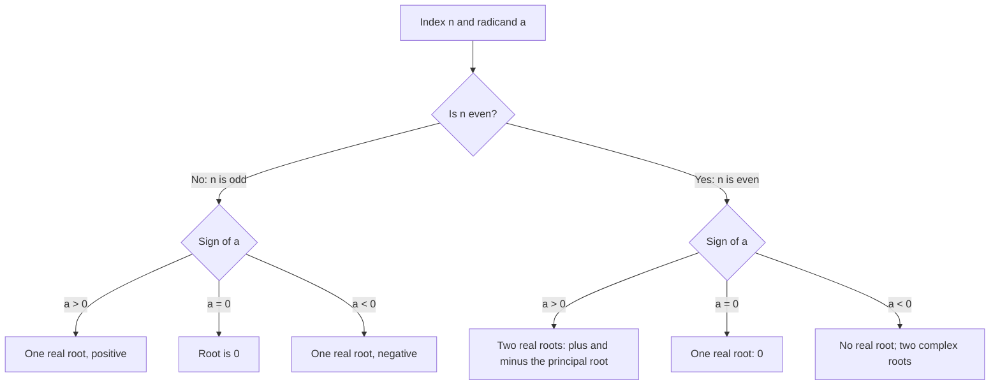

# Exponents and Roots

> [Arithmetic](../README.md) · Level: Beginner · Prerequisites: [Integers](../02-integers/README.md), [Fractions](../03-fractions/README.md), multiplication and division, order of operations, substitution into algebraic expressions · Estimated time: 120 min

## 1. Introduction

Repeated multiplication is one of the most common patterns in mathematics, and writing it out in full quickly becomes impractical. The product $2 \cdot 2 \cdot 2 \cdot 2 \cdot 2$ is better written $2^5$. The raised number records *how many copies of the base are multiplied together*. This shorthand is called an **exponent** or a **power**, and it turns cumbersome products into compact objects with clean algebraic rules.

Exponents and roots appear throughout mathematics and its applications. The area of a square of side $s$ is $s^2$, and the volume of a cube is $s^3$. A population that doubles every year is multiplied by $2^n$ after $n$ years. Computer memory is organised in powers of two: $2^{10}=1024$ bytes is one kibibyte. Compound interest multiplies a balance by $(1+r)^n$. Scientific notation writes $6.02 \times 10^{23}$ instead of a 24-digit integer, and logarithmic scales for earthquake intensity or sound loudness are built from powers of ten.

Roots reverse the process. If a square has area $25$, its side is $\sqrt{25}=5$; if a cube has volume $64$, its edge is $\sqrt[3]{64}=4$. The radical symbol asks "what number, multiplied by itself the indicated number of times, produces the radicand?". Roots let us undo powers, solve equations such as $x^2=2$, and simplify expressions involving radicals.

The topic has three interlocking parts: the **laws of exponents**, which reduce products, quotients, and powers of powers to arithmetic on exponents; **roots and fractional exponents**, which extend the same laws beyond whole numbers, since $\sqrt a=a^{1/2}$; and **scientific notation and orders of magnitude**, which use powers of ten to tame very large and very small numbers. A recurring theme is *consistency*: $a^0=1$ and $a^{-n}=1/a^n$ are not arbitrary conventions but the only definitions that keep the exponent laws true.

A warning before we begin: powers grow extremely fast, and notation is unforgiving. The difference between $(-2)^4$ and $-2^4$, or between $2^{3^2}$ and $(2^3)^2$, is not cosmetic; it changes the value. Sections 6 and 11 make these distinctions explicit.

## 2. Prerequisites

**Multiplication and division.** A power is a product, so multiplication must be fluent. The commutative and associative laws, $ab=ba$ and $(ab)c=a(bc)$, are used constantly.

**Fractions.** You should be able to multiply, divide, and simplify fractions, and to evaluate expressions such as $\left(\frac23\right)^2=\frac23\cdot\frac23=\frac49$. The full treatment is in [Fractions](../03-fractions/README.md).

**Signed numbers.** The product of two negatives is positive, and the product of three negatives is negative. For example, $(-2)^2=4$ but $(-2)^3=-8$. The rules are developed in [Integers](../02-integers/README.md).

**Order of operations.** Exponents are evaluated before multiplication and division, and parentheses override the usual order: $2+3^2=11$, while $(2+3)^2=25$. Powers bind more tightly than a leading minus sign: $-3^2=-(3^2)=-9$, whereas $(-3)^2=9$.

**Substitution.** If $x=3$, then $x^2+2x=9+6=15$. You will evaluate algebraic expressions at particular values to check identities.

**Simple equations.** You will solve equations such as $x^2=49$ by taking a square root. The fact that such an equation can have two solutions is treated carefully in Section 7.

## 3. Learning Objectives

After working through this tutorial you will be able to:

1. Interpret $a^n$ as repeated multiplication and identify the base and exponent.
2. Evaluate powers with natural, zero, negative, and fractional exponents, including powers of fractions and negative bases.
3. State and prove the product, quotient, power-of-a-power, power-of-a-product, and power-of-a-quotient laws for natural exponents.
4. Explain why $a^0=1$ and $a^{-n}=1/a^n$ are forced by consistency, and state the restriction $a\neq0$.
5. Convert between radical notation and fractional exponents, and explain the principal square root.
6. Evaluate perfect squares and cubes, and simplify radicals by extracting perfect powers.
7. Rationalize denominators of the form $\sqrt a$ and $a\pm\sqrt b$.
8. Estimate square roots and cube roots without a calculator and refine an estimate by Newton's method.
9. Prove that $\sqrt2$ is irrational and explain why $\sqrt p$ is irrational for every prime $p$.
10. Convert to and from scientific notation, compute with it, and compare orders of magnitude.
11. Recognise and correct common exponent and radical errors.
12. Explain why an even root of a negative number is not real and requires complex numbers.

## 4. Intuition

Think of a power as a stack of copies. The expression $3^4$ means four copies of $3$ multiplied together: $3 \cdot 3 \cdot 3 \cdot 3=81$. The base $3$ is *what* is multiplied; the exponent $4$ is *how many copies*. This picture makes the product law obvious: five copies multiplied by three more copies gives eight copies, so $3^5\cdot3^3=3^8$. The product law is counting.

The pattern becomes clearer as the exponent decreases by one. Compute the powers of $3$: $3^4=81$, $3^3=27$, $3^2=9$, $3^1=3$. Each step divides by $3$. If the pattern continues, the next value must be $3^0=1$, and then $3^{-1}=\frac13$. This is the intuition behind $a^0=1$ and $a^{-1}=1/a$: they are the values that make the sequence continue smoothly. Section 7 turns the pattern into an algebraic argument.

Roots reverse the stacking. A square of area $25$ has side $s$ with $s^2=25$, so $s=5$; we write $\sqrt{25}=5$. A square of area $2$ has side $\sqrt2$, a number that cannot be written as a fraction of integers. Its geometric existence is easy to see; the arithmetic fact that no fraction equals it is a genuine theorem, proved in Section 7.10. This is one of the first places where mathematics forces us beyond the rational numbers.

Fractional exponents express the same reversal. If the exponent laws are to hold, then $(9^{1/2})^2=9^{1/2\cdot2}=9$, so $9^{1/2}$ must be a number whose square is $9$. The nonnegative choice is $3$, so $9^{1/2}=\sqrt9=3$. Scientific notation applies the same idea to the decimal system: multiplying by $10$ shifts the decimal point one place, so $10^n$ shifts it $n$ places, and the exponent records the size class of the number.

## 5. Formal Definition

Throughout, $\mathbb{R}$ denotes the real numbers and $\mathbb{C}$ the complex numbers, mentioned only in Section 7.12.

**Definition 5.1 (Natural exponent).** Let $a\in\mathbb{R}$ and $n\in\mathbb{N}=\{1,2,3,\ldots\}$. The **$n$-th power of $a$** is the product of $n$ factors equal to $a$:

$$
a^n=\underbrace{a\cdot a\cdots a}_{n\text{ factors}}.
$$

Equivalently, $a^1=a$ and $a^{n+1}=a^n a$ for every $n\ge1$. The number $a$ is the **base**, and $n$ is the **exponent**.

**Definition 5.2 (Zero and negative integer exponents).** Let $a\in\mathbb{R}$ with $a\neq0$, and let $n\in\mathbb{N}$. Then $a^0=1$ and $a^{-n}=1/a^n$. The expression $0^0$ is **undefined**, and $0^{-n}$ is undefined because it requires division by zero. Section 7.3 shows why the convention $a^0=1$ is forced.

**Definition 5.3 ($n$-th root).** Let $n\ge2$ be an integer and $a\in\mathbb{R}$. A number $b\in\mathbb{R}$ is an **$n$-th root of $a$** if $b^n=a$.

**Definition 5.4 (Principal root and radical notation).** Let $n\ge2$ be an integer. If $n$ is even and $a>0$, the equation $b^n=a$ has exactly two real solutions, one positive and one negative; if $a=0$, the only solution is $b=0$. In either case the **principal $n$-th root** $\sqrt[n]{a}$ is the nonnegative solution. If $n$ is even and $a<0$, there is no real solution, so $\sqrt[n]{a}$ is not real. If $n$ is odd and $a\in\mathbb{R}$, there is exactly one real solution, and $\sqrt[n]{a}$ denotes it; it has the same sign as $a$. In $\sqrt[n]{a}$, the number $n$ is the **index**, $a$ is the **radicand**, and $\sqrt{\phantom{x}}$ is the **radical sign**. The index is omitted for square roots: $\sqrt a=\sqrt[2]{a}$. The cases $n=2$ and $n=3$ are the **square root** and **cube root**.

**Definition 5.5 (Rational exponents).** Let $a>0$, let $m$ be an integer, and let $n\ge2$ be an integer. Then $a^{m/n}=(\sqrt[n]{a})^m$. For $a=0$ and $m>0$, set $0^{m/n}=0$; $0^0$ and negative exponents of $0$ are undefined. For odd $n$, the definition extends to negative $a$ via the real $n$-th root; for even $n$, $a^{m/n}$ is not real when $a<0$. When $a<0$, the exponent must be in lowest terms before the definition is applied; for example, $(-8)^{1/3}=-2$, but $(-8)^{2/6}$ is not interpreted by taking a sixth root of a negative number.

**Definition 5.6 (Scientific notation).** A nonzero real number $x$ is in **scientific notation** when $x=a\times10^n$, where $1\le|a|<10$ and $n$ is an integer. The number $a$ is the **coefficient** and $n$ is the **exponent**. The number $0$ is written simply as $0$ and has no normalized scientific form.

**Definition 5.7 (Order of magnitude).** For $x=a\times10^n$ in scientific notation with $1\le a<10$, the integer $n$ is its **order of magnitude**. Two positive quantities differ by $k$ **orders of magnitude** when their ratio is approximately $10^k$. Some disciplines round the coefficient and report the nearest power of ten; state the convention when comparing.

## 6. Mathematical Notation

| Symbol | Meaning | Read aloud |
|---|---|---|
| $a^n$ | $a$ multiplied by itself $n$ times | "$a$ to the $n$" |
| $a^2$, $a^3$ | $a\cdot a$, $a\cdot a\cdot a$ | "$a$ squared", "$a$ cubed" |
| $a^{-n}$ | $1/a^n$ | "$a$ to the minus $n$" |
| $a^{1/n}$ | principal $n$-th root of $a$ | "$a$ to the one-$n$" |
| $a^{m/n}$ | $(\sqrt[n]{a})^m$ | "$a$ to the $m$ over $n$" |
| $\sqrt a$ | principal square root of $a$ | "the square root of $a$" |
| $\sqrt[3]{a}$, $\sqrt[n]{a}$ | cube root, $n$-th root | "the cube root of $a$", "the $n$-th root of $a$" |
| $\pm$ | both signs | "plus or minus" |
| $\lvert a\rvert$ | absolute value of $a$ | "the absolute value of $a$" |
| $a\times10^n$ | scientific notation | "$a$ times ten to the $n$" |
| $\approx$ | approximately equal | "approximately equals" |
| $\mathbb{R}$, $\mathbb{C}$ | real numbers, complex numbers | "the real numbers", "the complex numbers" |

Two conventions cause most notational confusion. First, $\sqrt9$ means the **principal** square root, which is $3$, not $-3$. The equation $x^2=9$ has two solutions, $x=\pm\sqrt9=\pm3$, but the radical symbol alone never produces the negative value; write $-\sqrt9=-3$ if that is intended. Second, exponentiation is **right-associative**: $2^{3^2}$ means $2^{(3^2)}=2^9=512$, not $(2^3)^2=64$. Add parentheses when in doubt. A minus sign in front of a power without parentheses applies afterwards: $-2^4=-(2^4)=-16$, while $(-2)^4=16$.

## 7. Core Concepts

### 7.1 Powers as Repeated Multiplication

In $a^n$, the **base** $a$ is the repeated factor and the **exponent** $n$ counts the factors: $a^n$ is the product of $n$ copies of $a$. For example, $2^5=32$ and $\left(\frac34\right)^3=\frac{27}{64}$. The exponent $1$ gives $a^1=a$; for natural exponents, $0^n=0$ and $1^n=1$. A negative base must be enclosed in parentheses if the exponent applies to it:

$$
(-2)^4=16, \qquad -2^4=-16, \qquad (-2)^3=-8.
$$

An even exponent makes a negative base positive; an odd exponent keeps it negative. Powers grow quickly: the powers of $2$ are $1,2,4,8,16,32,64,128,256,512,1024$ for $n=0,1,\ldots,10$. Each step doubles, which is why exponential growth outpaces linear growth.

### 7.2 The Laws of Exponents for Natural Exponents

Let $a,b\in\mathbb{R}$ and $m,n\in\mathbb{N}$. The laws are:

$$
a^m a^n=a^{m+n}, \qquad \frac{a^m}{a^n}=a^{m-n}\ (m>n,\ a\neq0),
$$

$$
(a^m)^n=a^{mn}, \qquad (ab)^n=a^n b^n, \qquad \left(\frac ab\right)^n=\frac{a^n}{b^n}\ (b\neq0).
$$

Each is a counting statement. The product $a^m a^n$ has $m+n$ factors of $a$. A quotient cancels $n$ of $m$ factors. The power $(a^m)^n$ is $n$ blocks of $m$ factors, hence $mn$ factors. The product $(ab)^n$ has $n$ copies of $a$ and $n$ copies of $b$, which can be regrouped. The quotient law is the same regrouping applied to fractions.

Numerical checks:

$$
2^3\cdot2^4=8\cdot16=128=2^7, \qquad \frac{5^7}{5^4}=5^3=125,
$$

$$
(2^3)^4=2^{12}=4096, \qquad (2\cdot5)^3=2^3\cdot5^3=1000.
$$

The laws do **not** apply across different bases, and they do not distribute over addition:

$$
2^3\cdot3^2=8\cdot9=72\neq6^5, \qquad 2^3+2^4=8+16=24\neq2^7=128.
$$

### 7.3 Why $a^0=1$ and $a^{-n}=1/a^n$

List the powers of $3$ downwards: $3^4=81$, $3^3=27$, $3^2=9$, $3^1=3$. Each step divides by $3$, so continuing the pattern gives $3^0=1$, $3^{-1}=\frac13$, $3^{-2}=\frac19$. Algebraically, if the product law is to hold with exponent $0$, then for $a\neq0$,

$$
a^n a^0=a^{n+0}=a^n,
$$

and dividing by $a^n$ gives $a^0=1$. Similarly, if negative exponents are to obey the product law, then $a^{-n}a^n=a^0=1$, so $a^{-n}$ must be the reciprocal of $a^n$:

$$
a^{-n}=\frac{1}{a^n}.
$$

The pattern and the algebra agree. Two caveats: $0^0$ is undefined because the rules $0^n=0$ and $a^0=1$ conflict at $0$; and $0^{-n}$ is undefined because it would require division by zero. A negative exponent does not make a result negative: $2^{-3}=\frac18$, while $(-2)^{-3}=\frac{1}{-8}=-\frac18$.

### 7.4 Roots and Radical Notation

A **square root** of $a\ge0$ is a number whose square is $a$. Every positive $a$ has two real square roots, $b$ and $-b$; the symbol $\sqrt a$ denotes the nonnegative **principal** root. Thus $\sqrt{49}=7$, $-\sqrt{49}=-7$, and $\sqrt0=0$. The equation $x^2=49$ has two solutions, $x=\pm7$; the $\pm$ is essential, but $\sqrt{49}$ alone is unambiguously $7$.

For every real $a$,

$$
\sqrt{a^2}=|a|.
$$

For example, $\sqrt{(-5)^2}=5=|-5|$, not $-5$. If $a\ge0$, then $|a|=a$; if the sign of $a$ is unknown, the absolute value cannot be dropped.

Odd roots are defined for all real numbers and preserve the sign: $\sqrt[3]{27}=3$, $\sqrt[3]{-27}=-3$, $\sqrt[5]{-32}=-2$. If $n$ is even and $a<0$, no real number $b$ satisfies $b^n=a$, so $\sqrt{-4}$ and $\sqrt[4]{-16}$ are not real; they become meaningful as complex numbers (Section 7.12). Radicals do not distribute over sums: $\sqrt{9+16}=5$, while $\sqrt9+\sqrt{16}=7$.

### 7.5 Fractional Exponents

The exponent laws force the meaning of $a^{1/n}$. If $(a^{1/n})^n=a^{(1/n)\cdot n}=a$, then $a^{1/n}$ must be an $n$-th root of $a$. For $a\ge0$ it is the principal root:

$$
a^{1/n}=\sqrt[n]{a}.
$$

For odd $n$ this extends to negative $a$; for even $n$, $a^{1/n}$ is real only when $a\ge0$. A general rational exponent is

$$
a^{m/n}=\left(\sqrt[n]{a}\right)^m=\sqrt[n]{a^m} \qquad (a\ge0),
$$

with the same extension to odd roots. Taking the root first usually keeps the numbers smaller. Examples:

$$
27^{2/3}=(\sqrt[3]{27})^2=3^2=9, \qquad 16^{3/4}=(\sqrt[4]{16})^3=2^3=8,
$$

$$
16^{-3/4}=\frac{1}{16^{3/4}}=\frac18, \qquad \left(\frac{8}{125}\right)^{2/3}=\left(\frac25\right)^2=\frac{4}{25}.
$$

The expression $(-16)^{1/2}$ is not real, because no real number squares to $-16$. Writing the exponent as $2/4$ does not help: reduce to lowest terms before interpreting a negative base. Negative fractional exponents follow $a^{-m/n}=1/a^{m/n}$; for example, $8^{-2/3}=1/4$.

### 7.6 Perfect Squares and Perfect Cubes

A **perfect square** is an integer $n^2$; a **perfect cube** is an integer $n^3$. Recognising them speeds up roots and simplification.

| $n$ | 1 | 2 | 3 | 4 | 5 | 6 | 7 | 8 | 9 | 10 | 11 | 12 | 13 | 14 | 15 |
|---|---|---|---|---|---|---|---|---|---|---|---|---|---|---|---|
| $n^2$ | 1 | 4 | 9 | 16 | 25 | 36 | 49 | 64 | 81 | 100 | 121 | 144 | 169 | 196 | 225 |

| $n$ | 1 | 2 | 3 | 4 | 5 | 6 | 7 | 8 | 9 | 10 |
|---|---|---|---|---|---|---|---|---|---|---|
| $n^3$ | 1 | 8 | 27 | 64 | 125 | 216 | 343 | 512 | 729 | 1000 |

For example, $\sqrt{144}=12$, $\sqrt[3]{216}=6$, and $\sqrt[3]{1000}=10$. Some numbers are both squares and cubes: $64=8^2=4^3=2^6$ and $729=27^2=9^3=3^6$. If a positive integer is not a perfect square, its square root is irrational (Section 7.10).

### 7.7 Simplifying Radicals

The product property of square roots is the main simplification tool:

$$
\sqrt{ab}=\sqrt a\,\sqrt b \qquad (a\ge0,\ b\ge0).
$$

Both sides are nonnegative and have the same square, namely $ab$. Similarly, $\sqrt{a/b}=\sqrt a/\sqrt b$ for $a\ge0$ and $b>0$. To simplify $\sqrt n$, factor out the largest perfect square:

$$
\sqrt{72}=\sqrt{36\cdot2}=6\sqrt2, \qquad \sqrt{50}=\sqrt{25\cdot2}=5\sqrt2,
$$

$$
\sqrt{12x^4}=2x^2\sqrt3\ (x\ge0), \qquad \sqrt[3]{54}=\sqrt[3]{27\cdot2}=3\sqrt[3]{2},
$$

$$
\sqrt[3]{16x^5}=\sqrt[3]{8\cdot2\cdot x^3\cdot x^2}=2x\sqrt[3]{2x^2}.
$$

For even roots, use $\sqrt{x^{2k}}=|x|^k$: for example, $\sqrt{x^4}=x^2$ and $\sqrt{x^2}=|x|$. For odd roots no absolute value is needed, since $\sqrt[3]{x^3}=x$ for all real $x$. Only **like** radicals combine: $2\sqrt3+5\sqrt3=7\sqrt3$, but $\sqrt2+\sqrt3$ cannot be simplified.

### 7.8 Rationalizing Denominators

A fraction is in standard form when its denominator is rational. For $b>0$,

$$
\frac{1}{\sqrt b}=\frac{\sqrt b}{b}, \qquad \frac{6}{\sqrt3}=\frac{6\sqrt3}{3}=2\sqrt3, \qquad \frac{3}{2\sqrt5}=\frac{3\sqrt5}{10}.
$$

For a binomial denominator, multiply by the **conjugate**. Since $(\sqrt a+\sqrt b)(\sqrt a-\sqrt b)=a-b$,

$$
\frac{1}{\sqrt7-\sqrt3}\cdot\frac{\sqrt7+\sqrt3}{\sqrt7+\sqrt3}
=\frac{\sqrt7+\sqrt3}{7-3}=\frac{\sqrt7+\sqrt3}{4}.
$$

Rationalizing makes fractions easier to compare and to approximate by hand. It uses the identity $(x+y)(x-y)=x^2-y^2$; the multiplier is always a form of $1$.

### 7.9 Estimating Roots

Locate a square root between consecutive perfect squares. Since $7^2=49<50<64=8^2$, we have $7<\sqrt{50}<8$. Squaring candidate decimals refines the interval: $7.0^2=49$ and $7.1^2=50.41$, so $\sqrt{50}$ lies between $7.0$ and $7.1$; since $7.05^2=49.7025<50$, it lies between $7.05$ and $7.1$.

Newton's method (the Babylonian algorithm) systematises this. Starting from a guess $x_0>0$, iterate

$$
x_{k+1}=\frac12\left(x_k+\frac{N}{x_k}\right).
$$

If $x_k$ is too small, $N/x_k$ is too large, and their average is closer to $\sqrt N$. For $N=50$ and $x_0=7$:

$$
x_1=\frac12\left(7+\frac{50}{7}\right)=\frac{99}{14}\approx7.0714286,
$$

$$
x_2=\frac12\left(\frac{99}{14}+\frac{700}{99}\right)=\frac{19601}{2772}\approx7.0710678.
$$

This is already accurate to seven decimal places. Cube roots are estimated similarly: $3^3=27<50<64=4^3$, so $3<\sqrt[3]{50}<4$, and cubing candidates refines the interval.

### 7.10 Irrationality of $\sqrt2$ and $\sqrt p$

A **rational number** is a fraction $p/q$ of integers with $q\neq0$; a number that is not rational is **irrational**.

**Theorem.** $\sqrt2$ is irrational.

*Proof.* Suppose $\sqrt2=p/q$ with integers $p,q$, $q\neq0$, and $\gcd(p,q)=1$ (the fraction is in lowest terms). Squaring gives $2=p^2/q^2$, so

$$
p^2=2q^2.
$$

Thus $p^2$ is even. The square of an odd integer is odd: if $p=2k+1$, then $p^2=4k^2+4k+1$. Hence $p$ is even; write $p=2r$. Substituting,

$$
4r^2=2q^2, \qquad q^2=2r^2.
$$

So $q^2$ is even, and the same argument shows $q$ is even. Both $p$ and $q$ are divisible by $2$, contradicting $\gcd(p,q)=1$. Therefore no such fraction exists, and $\sqrt2$ is irrational. $\square$

**Theorem.** If $p$ is prime, then $\sqrt p$ is irrational.

*Proof.* Suppose $\sqrt p=a/b$ in lowest terms, with $b\neq0$. Squaring gives $a^2=p b^2$, so $p\mid a^2$. Since $p$ is prime, Euclid's lemma implies $p\mid a$: a prime dividing a product divides one of the factors. Write $a=pc$. Then

$$
p^2c^2=p b^2, \qquad b^2=p c^2,
$$

so $p\mid b^2$ and hence $p\mid b$. Thus $p$ divides both $a$ and $b$, contradicting lowest terms. Therefore $\sqrt p$ is irrational. $\square$

Euclid's lemma follows from unique prime factorization. The same argument shows that $\sqrt n$ is either an integer or irrational for every positive integer $n$: if $\sqrt n=a/b$ in lowest terms, then $a^2=n b^2$, so $b^2\mid a^2$; since $\gcd(a^2,b^2)=1$, this forces $b=1$. Thus the square root of a non-square integer is never a fraction, only an approximation such as $\sqrt2\approx1.414$.

### 7.11 Scientific Notation and Orders of Magnitude

Scientific notation writes a nonzero number as $a\times10^n$ with $1\le|a|<10$. For example, $45{,}300=4.53\times10^4$ and $0.00072=7.2\times10^{-4}$. The form $34\times10^5$ is not normalized; it equals $3.4\times10^6$.

To multiply or divide, operate on the coefficients and add or subtract the exponents:

$$
(3.2\times10^5)(2.5\times10^{-3})=8.0\times10^2=800,
$$

$$
\frac{6.4\times10^6}{8\times10^{-2}}=0.8\times10^8=8\times10^7.
$$

To add or subtract, first match the exponents:

$$
3.4\times10^3+5.6\times10^2=3.4\times10^3+0.56\times10^3=3.96\times10^3.
$$

A power raises the coefficient and multiplies the exponent: $(2\times10^3)^4=2^4\times10^{12}=1.6\times10^{13}$.

The exponent measures the size class. The Sun's diameter is about $1.4\times10^9$ m and the Earth's about $1.28\times10^7$ m; their ratio is $(1.4/1.28)\times10^2\approx110$, so the Sun is about two orders of magnitude wider. Orders of magnitude are for quick comparison; the coefficient carries the precision.

### 7.12 Complex Numbers: A Forward Look

No real number squares to a negative number, so an even root of a negative number is not real. For example, no real $x$ satisfies $x^2=-4$. Mathematics extends the real numbers to the **complex numbers** by defining the imaginary unit $i$ with $i^2=-1$. Then $\sqrt{-4}=2i$ and $\sqrt{-9}=3i$. A complex number has the form $a+bi$ with $a,b\in\mathbb{R}$; arithmetic extends to these numbers, and every nonzero complex number has two square roots. Complex numbers are essential in algebra, geometry, signal processing, electrical engineering, and quantum mechanics, and are developed later in the curriculum; see [Complex Numbers](../../03-algebra/13-complex-numbers/README.md).

One caution: the radical product property requires nonnegative radicands. With complex numbers, $\sqrt{-4}\sqrt{-9}=(2i)(3i)=-6$, while $\sqrt{(-4)(-9)}=\sqrt{36}=6$; the identity fails. The principal square root of $-a$ with $a>0$ is $i\sqrt a$ by convention, so $\sqrt{-4}=2i$ rather than $-2i$. Neither subtlety affects the real-number work in the rest of this topic.

## 8. Formulas and Properties

The laws are stated with their hypotheses and proved. The natural-exponent proofs use induction, which makes the "counting factors" argument rigorous.

**Theorem 8.1 (Product law).** For every $a\in\mathbb{R}$ and all $m,n\in\mathbb{N}$, $a^m a^n=a^{m+n}$.

*Proof.* Induct on $n$. For $n=1$, the recursive definition gives $a^m a^1=a^m a=a^{m+1}$. If $a^m a^k=a^{m+k}$, then

$$
a^m a^{k+1}=a^m(a^k a)=(a^m a^k)a=a^{m+k}a=a^{m+k+1}.
$$

So the identity holds for all $n\in\mathbb{N}$. $\square$

**Theorem 8.2 (Power of a power).** For every $a\in\mathbb{R}$ and all $m,n\in\mathbb{N}$, $(a^m)^n=a^{mn}$.

*Proof.* Induct on $n$. For $n=1$, $(a^m)^1=a^m=a^{m\cdot1}$. If $(a^m)^k=a^{mk}$, then

$$
(a^m)^{k+1}=(a^m)^k a^m=a^{mk}a^m=a^{mk+m}=a^{m(k+1)},
$$

using Theorem 8.1. $\square$

**Theorem 8.3 (Power of a product).** For all $a,b\in\mathbb{R}$ and $n\in\mathbb{N}$, $(ab)^n=a^n b^n$.

*Proof.* Induct on $n$. For $n=1$, $(ab)^1=ab=a^1b^1$. If $(ab)^k=a^kb^k$, then

$$
(ab)^{k+1}=(ab)^k(ab)=(a^kb^k)(ab)=(a^ka)(b^kb)=a^{k+1}b^{k+1},
$$

using commutativity and associativity, and Theorem 8.1. $\square$

**Theorem 8.4 (Quotient law).** Let $a\neq0$ and $m,n\in\mathbb{N}$. If $m>n$, then $a^m/a^n=a^{m-n}$; if $m=n$, the quotient is $1$; if $m<n$, then $a^m/a^n=1/a^{n-m}$.

*Proof.* If $m>n$, then $m-n\in\mathbb{N}$ and $a^n a^{m-n}=a^m$ by Theorem 8.1; divide by $a^n$. If $m=n$, numerator and denominator are equal and nonzero. If $m<n$, the first case applied to $a^n/a^m$ gives $a^{n-m}$, and taking reciprocals gives the claim. $\square$

**Theorem 8.5 (Power of a quotient).** For $a\in\mathbb{R}$, $b\neq0$, and $n\in\mathbb{N}$,

$$
\left(\frac ab\right)^n=\frac{a^n}{b^n}.
$$

*Proof.* The product of $n$ copies of $\frac ab$ multiplies $n$ copies of $a$ in the numerator and $n$ copies of $b$ in the denominator. $\square$

**Theorem 8.6 (Integer exponents).** For $a,b\neq0$ and $m,n\in\mathbb{Z}$, the product, quotient, power, and product-power laws hold with integer exponents.

*Proof.* The nonnegative cases are Theorems 8.1–8.5. If $m=-r$ and $n=-s$ with $r,s>0$, then

$$
a^m a^n=a^{-r}a^{-s}=\frac{1}{a^r}\cdot\frac{1}{a^s}=\frac{1}{a^{r+s}}=a^{-(r+s)}=a^{m+n}.
$$

If $m\ge0$ and $n=-s<0$, then $a^m a^{-s}=a^m/a^s$. If $m\ge s$, this equals $a^{m-s}=a^{m+n}$; if $m<s$, it equals $1/a^{s-m}=a^{-(s-m)}=a^{m+n}$. The other laws follow by the same case check. $\square$

**Theorem 8.7 (Rational exponents).** For $a>0$ and $r,s\in\mathbb{Q}$,

$$
a^r a^s=a^{r+s}, \qquad (a^r)^s=a^{rs}, \qquad (ab)^r=a^r b^r\ (b>0).
$$

*Proof sketch.* Write $r=m/k$ and $s=n/k$ over a common denominator. Then

$$
a^r a^s=(a^{1/k})^m(a^{1/k})^n=(a^{1/k})^{m+n}=a^{(m+n)/k}=a^{r+s}
$$

by Theorem 8.1. For the power law, write $r=m/k$ and $s=p/q$; then $(a^{m/k})^{p/q}=a^{mp/(kq)}=a^{rs}$. The product law follows from Theorem 8.3 applied to $a^{1/k}$ and $b^{1/k}$. The hypothesis $a>0$ ensures real principal roots; for negative bases only odd denominators are allowed. $\square$

**Theorem 8.8 (Radical properties).** For $a,b\ge0$ and $b>0$,

$$
\sqrt{ab}=\sqrt a\,\sqrt b, \qquad \sqrt{\frac ab}=\frac{\sqrt a}{\sqrt b}.
$$

*Proof.* Both sides of the first identity are nonnegative and have square $ab$; a nonnegative number is determined by its square. The second follows from the first applied to $a=(a/b)b$, divided by $\sqrt b>0$. $\square$

**Theorem 8.9 (Root of a square).** For every $a\in\mathbb{R}$, $\sqrt{a^2}=|a|$.

*Proof.* If $a\ge0$, the nonnegative square root of $a^2$ is $a=|a|$. If $a<0$, then $-a>0$ and $(-a)^2=a^2$, so the nonnegative square root is $-a=|a|$. $\square$

**Theorem 8.10 (Irrationality).** $\sqrt2$ is irrational, and $\sqrt p$ is irrational for every prime $p$. The proofs are in Section 7.10.

**Scientific notation.** For $x=a\times10^m$ and $y=b\times10^n$ with $1\le|a|,|b|<10$,

$$
xy=(ab)\times10^{m+n}, \qquad \frac xy=\frac ab\times10^{m-n}, \qquad x^k=a^k\times10^{mk}.
$$

Renormalize afterwards so the coefficient lies in $[1,10)$. For addition, rewrite both numbers with the same exponent and add the coefficients.

## 9. Step-by-Step Examples

### Example 1 (Evaluating powers)

Evaluate (a) $2^5$, (b) $(-3)^4$, (c) $-3^4$, (d) $\left(\frac23\right)^3$, (e) $5^0$, (f) $2^{-3}$.

**Solution.** (a) $2^5=2\cdot2\cdot2\cdot2\cdot2=32$. (b) The base is $-3$, so $(-3)^4=81$; four negative factors give a positive product. (c) The exponent applies only to $3$, so $-3^4=-(3^4)=-81$. (d) $\left(\frac23\right)^3=\frac{2^3}{3^3}=\frac{8}{27}$. (e) $5^0=1$, since $5\neq0$. (f) $2^{-3}=\frac{1}{2^3}=\frac18$.

**Check.** In (b) and (c) the parentheses change $81$ to $-81$. In (f), $2^{-3}\cdot2^3=\frac18\cdot8=1$, as a negative exponent should.

### Example 2 (Simplifying with exponent laws)

Simplify (a) $\dfrac{x^3x^5}{x^2}$, (b) $(2a^3)^2(3a^{-1})$, (c) $\left(x^4y^{-2}\right)^{-3}$.

**Solution.** (a) $x^3x^5=x^8$, so the quotient is $x^{8-2}=x^6$ for $x\neq0$. (b) $(2a^3)^2=4a^6$, so the product is $4a^6\cdot3a^{-1}=12a^5$ for $a\neq0$. (c) Multiplying exponents by $-3$ gives $x^{-12}y^6=y^6/x^{12}$ for $x,y\neq0$.

**Check.** With $x=2$ in (a): $2^3\cdot2^5/2^2=8\cdot32/4=64=2^6$. With $a=1$ in (b): $4\cdot3=12$. With $x=y=1$ in (c): $1$.

### Example 3 (Fractional and negative exponents)

Evaluate (a) $27^{2/3}$, (b) $16^{-3/4}$, (c) $\left(\frac{8}{125}\right)^{2/3}$, (d) $(-8)^{1/3}$, and explain why $(-16)^{1/2}$ is not real.

**Solution.** (a) $\sqrt[3]{27}=3$, so $27^{2/3}=9$. (b) $16^{1/4}=2$, so $16^{3/4}=8$ and $16^{-3/4}=\frac18$. (c) $\sqrt[3]{\frac{8}{125}}=\frac25$, so the value is $\frac{4}{25}$. (d) Since $(-2)^3=-8$, we have $(-8)^{1/3}=-2$. The expression $(-16)^{1/2}$ asks for a real number whose square is $-16$; no real number has a negative square, so it is not real (it equals $4i$ in the complex numbers).

**Check.** (a) $9^{3/2}=(\sqrt9)^3=27$. (b) $(1/8)^{-4/3}=8^{4/3}=16$. (c) $(4/25)^{3/2}=(2/5)^3=8/125$. (d) $(-2)^3=-8$.

### Example 4 (Simplifying radicals)

Simplify (a) $\sqrt{72}$, (b) $\sqrt{50x^3}$ for $x\ge0$, (c) $\sqrt[3]{54}$, (d) $\sqrt[3]{16x^5}$.

**Solution.** (a) $72=36\cdot2$, so $\sqrt{72}=6\sqrt2$. (b) $50x^3=25x^2\cdot2x$, so $\sqrt{50x^3}=5x\sqrt{2x}$ for $x\ge0$. (c) $54=27\cdot2$, so $\sqrt[3]{54}=3\sqrt[3]{2}$. (d) $16x^5=8\cdot2\cdot x^3\cdot x^2$, so $\sqrt[3]{16x^5}=2x\sqrt[3]{2x^2}$.

**Check.** $(6\sqrt2)^2=72$; $(5x\sqrt{2x})^2=50x^3$; $(3\sqrt[3]2)^3=54$; $(2x\sqrt[3]{2x^2})^3=16x^5$.

### Example 5 (Rationalizing denominators)

Rationalize (a) $\dfrac{6}{\sqrt3}$, (b) $\dfrac{3}{2\sqrt5}$, (c) $\dfrac{1}{\sqrt7-\sqrt3}$.

**Solution.** (a) Multiply by $\frac{\sqrt3}{\sqrt3}$: $\frac{6\sqrt3}{3}=2\sqrt3$. (b) $\frac{3}{2\sqrt5}\cdot\frac{\sqrt5}{\sqrt5}=\frac{3\sqrt5}{10}$. (c) Multiply by the conjugate $\sqrt7+\sqrt3$:

$$
\frac{1}{\sqrt7-\sqrt3}\cdot\frac{\sqrt7+\sqrt3}{\sqrt7+\sqrt3}
=\frac{\sqrt7+\sqrt3}{7-3}=\frac{\sqrt7+\sqrt3}{4}.
$$

**Check.** (a) $2\sqrt3\approx3.464$ and $6/\sqrt3\approx3.464$. (b) Both sides are about $0.6708$. (c) $1/(2.6458-1.7321)\approx1.0944$, and $(2.6458+1.7321)/4\approx1.0945$, differing only by rounding.

### Example 6 (Estimating a root)

Show that $7<\sqrt{50}<8$ and refine the estimate.

**Solution.** Since $7^2=49<50<64=8^2$, the square root lies between $7$ and $8$. Newton's method with $x_0=7$ gives

$$
x_1=\frac12\left(7+\frac{50}{7}\right)=\frac{99}{14}\approx7.0714286,
$$

$$
x_2=\frac12\left(\frac{99}{14}+\frac{700}{99}\right)=\frac{19601}{2772}\approx7.0710678.
$$

Since $\sqrt{50}\approx7.071067812$, two iterations give seven correct decimal places. The value is irrational because $50$ is not a perfect square.

**Check.** $7.0710678^2\approx49.9999998$.

### Example 7 (Scientific notation)

Compute (a) $(3.2\times10^5)(2.5\times10^{-3})$, (b) $\dfrac{6.4\times10^6}{8\times10^{-2}}$, (c) $3.4\times10^3+5.6\times10^2$.

**Solution.** (a) Multiply coefficients and add exponents: $(3.2)(2.5)\times10^{2}=8.0\times10^2=800$. (b) Divide coefficients and subtract exponents: $(6.4/8)\times10^{8}=0.8\times10^8=8.0\times10^7$. (c) Match exponents: $3.4\times10^3+0.56\times10^3=3.96\times10^3$.

**Check.** (a) $320000\cdot0.0025=800$. (b) $6.4$ million divided by $0.08$ is $80$ million $=8\times10^7$. (c) $3400+560=3960=3.96\times10^3$.

## 10. Visual Explanations

The classification of real roots depends only on the parity of the index and the sign of the radicand. The flowchart is a complete decision procedure.

The number systems are built by adding operations that are not always defined in the smaller system. Each arrow names the operation that forces the extension.

The table of perfect squares and cubes in Section 7.6 is a third practical visual aid: most simplification and estimation begins by recognising a nearby perfect power.

## 11. Common Mistakes

**1. Mixing the product law with the power-of-a-power law.** The product law adds exponents; the power-of-a-power law multiplies them:

$$
x^2x^3=x^5, \qquad (x^2)^3=x^6.
$$

In particular, $x^{a+b}=x^a x^b$ is true by the product law, but $x^{ab}=x^a x^b$ is false in general (for $x=2$, $a=2$, $b=3$: $2^6=64\neq32=2^2\cdot2^3$), and there is no law that turns $x^{a+b}$ into $x^a+x^b$.

**2. Squaring a sum term by term.** $(x+y)^2=x^2+2xy+y^2$, not $x^2+y^2$. With $x=3$ and $y=4$: $(3+4)^2=49$, while $3^2+4^2=25$. The cross term $2xy$ is not optional.

**3. Distributing a square root over a sum.** $\sqrt{a+b}\neq\sqrt a+\sqrt b$ in general. With $9$ and $16$: $\sqrt{9+16}=5$, while $\sqrt9+\sqrt{16}=7$. The product property is valid for nonnegative factors; the sum property is not.

**4. Writing $\sqrt{a^2}=a$.** The principal square root is nonnegative, so $\sqrt{(-3)^2}=3=|-3|$, not $-3$. The correct identity is $\sqrt{a^2}=|a|$.

**5. Confusing $-a^n$ with $(-a)^n$.** The first negates after the power; the second uses $-a$ as the base: $-3^2=-9$, but $(-3)^2=9$.

**6. Treating a negative exponent as a negative value.** A negative exponent means reciprocal: $2^{-3}=\frac18$, not $-8$.

**7. Evaluating a tower of exponents from the bottom.** Exponentiation is right-associative: $2^{3^2}=2^9=512$, not $(2^3)^2=64$.

**8. Combining powers with different bases.** The product law requires the same base. There is no simplification of $2^3\cdot3^2$ into a single power; numerically it is $8\cdot9=72$.

**9. Taking an even root of a negative number and calling it real.** $\sqrt{-9}$ is not real, because no real number squares to a negative value. In contrast, $\sqrt[3]{-8}=-2$ is real.

**10. Adding scientific-notation numbers without matching exponents.** Rewrite first:

$$
3\times10^2+4\times10^3=0.3\times10^3+4\times10^3=4.3\times10^3.
$$

The answer is not $7\times10^5$.

**11. Leaving the coefficient outside $[1,10)$.** Scientific notation requires $1\le|a|<10$, so $34\times10^5=3.4\times10^6$.

**12. Applying the radical product property to negative radicands.** $\sqrt{ab}=\sqrt a\sqrt b$ requires $a,b\ge0$. With complex numbers, $\sqrt{-4}\sqrt{-9}=(2i)(3i)=-6$, while $\sqrt{(-4)(-9)}=\sqrt{36}=6$; the identity fails.

## 12. Applications

**Finance.** Compound interest multiplies a balance by $(1+r)^n$. A $5\%$ annual rate over $10$ years multiplies the principal by $1.05^{10}\approx1.629$, a $62.9\%$ increase. Loan payments, inflation, and present values all use powers.

**Population and decay.** A population growing by a fixed percentage is modelled by $P_0(1+r)^t$; radioactive decay and drug clearance use repeated halving, with a half-life for each substance.

**Geometry.** Area scales as the square of a length and volume as the cube. Doubling the side of a cube multiplies its volume by $8=2^3$. The Pythagorean theorem, $a^2+b^2=c^2$, uses squares and requires a square root to find the hypotenuse.

**Physics.** Kinetic energy is $\frac12mv^2$, gravitational attraction falls off as $1/r^2$, and the period of a pendulum is proportional to $\sqrt{L/g}$. Dimensional analysis of formulas repeatedly involves powers and roots.

**Computing.** Binary representation is built on powers of two: $2^{10}=1024$, $2^{20}\approx10^6$, $2^{30}\approx10^9$. Algorithm running times are compared by growth rates such as $n^2$ and $2^n$.

**Astronomy, chemistry, and biology.** Scientific notation is the working language of the physical sciences: the Sun's mass is about $1.99\times10^{30}$ kg and Avogadro's number is about $6.02\times10^{23}$ per mole. The surface-area-to-volume ratio of a body scales like $1/L$, which constrains the size of cells and the heat loss of animals.

## 13. Exercises

The problem set is in [exercises.md](exercises.md). It contains 36 problems numbered continuously: **Beginner (1–12)** on evaluation and fluency, **Intermediate (13–22)** on negative and fractional exponents, radicals, and scientific notation, **Advanced (23–31)** on proofs, irrationality, radical equations, and estimation, and **Challenge (32–36)** on harder irrationality and exponent arguments.

For proofs, a numerical example is not a proof; the solutions model the expected rigour.

## 14. Solutions

Complete worked solutions are in [solutions.md](solutions.md). Each solution gives the strategy, every significant step, a verification, and a note on the likely pitfall.

## 15. Summary

- $a^n$ means $n$ factors of $a$ multiplied together; $a$ is the base and $n$ the exponent.
- The product law is $a^m a^n=a^{m+n}$, the power law is $(a^m)^n=a^{mn}$, and the product-power law is $(ab)^n=a^n b^n$; all are proved by counting factors.
- $a^0=1$ for $a\neq0$, and $a^{-n}=1/a^n$ for $a\neq0$; both are forced by consistency with the product law.
- $0^0$ and $0^{-n}$ are undefined.
- $\sqrt[n]{a}$ is the principal $n$-th root: nonnegative for even $n$ with $a\ge0$, and the unique real root for odd $n$.
- An even root of a negative number is not real; it requires complex numbers.
- $a^{1/n}=\sqrt[n]{a}$ and $a^{m/n}=(\sqrt[n]{a})^m$; reduce a fractional exponent before interpreting a negative base.
- $\sqrt{ab}=\sqrt a\sqrt b$ and $\sqrt{a/b}=\sqrt a/\sqrt b$ for nonnegative radicands and positive denominators.
- $\sqrt{a^2}=|a|$, not $a$.
- Rationalizing multiplies by a form of $1$: $\sqrt b/\sqrt b$ for a single radical, or the conjugate for a binomial.
- $\sqrt2$ and $\sqrt p$ (for prime $p$) are irrational; the proof uses contradiction and lowest terms.
- Scientific notation writes $x=a\times10^n$ with $1\le|a|<10$; multiplication adds exponents, division subtracts them, and addition requires matching exponents.
- Orders of magnitude compare exponents and give a quick sense of scale.

## 16. Further Learning

The previous topic in this discipline is [Ratios, Rates and Proportions](../06-ratios-and-proportions/README.md); its scaling arguments explain why areas grow like the square and volumes like the cube of a length factor, the same square-cube relationship that appears in the exponent laws.

The natural next steps are **elementary algebra** (polynomials, factoring, and quadratic equations, where the exponent laws become the grammar of manipulation), **logarithms** (the inverse operation to exponentiation, which makes equations such as $2^x=7$ solvable), **complex numbers** (which give meaning to $\sqrt{-1}$ and to every even root of a negative number), and **calculus** (power functions $x^n$ and exponential functions $a^x$).

For further reading:

- OpenStax, *Elementary Algebra* — exponent rules, radicals, and quadratic equations.
- I. M. Gelfand and A. Shen, *Algebra* — a concise treatment of powers, roots, and algebraic identities.
- R. Rusczyk, D. Patrick, and R. Boppana, *Art of Problem Solving, Prealgebra* — careful explanations and competition-style exercises.

When you can prove the exponent laws, explain why $\sqrt2$ cannot be a fraction, and move confidently between radical and exponent notation, you have the foundation that algebra, geometry, and the sciences assume.

