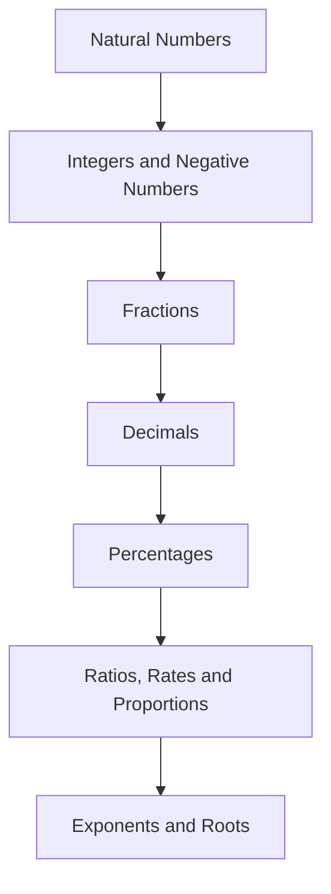

<!-- Generated by tools/build_indexes.py from tools/curriculum.json. Do not edit by hand. -->

# Arithmetic

*Number and operation from the ground up*

[Mathematics](../README.md) › Arithmetic

Counting, the integers, fractions, decimals, percentages, ratios and powers. Arithmetic is not a preliminary to mathematics; it is where the number systems are built, and every later subject leans on it.

## At a glance

| | |
|---|---|
| Topics | 7 (7 complete, 0 draft, 0 planned) |
| Estimated study time | ~47 hours |
| Prerequisites | None — this is an entry point |

## Study order

The numbers are the recommended order. Study a topic only after the ones before it —
the dependency chain below is the shortest safe route through the discipline.

## Topic inventory

| # | Topic | Level | Est. time | Status | Materials |
|---|---|---|---|---|---|
| 1 | [Natural Numbers](01-natural-numbers/README.md) | Beginner | 6 h | Complete | [Tutorial](01-natural-numbers/README.md) · [Exercises](01-natural-numbers/exercises.md) · [Solutions](01-natural-numbers/solutions.md) |
| 2 | [Integers and Negative Numbers](02-integers/README.md) | Beginner | 6 h | Complete | [Tutorial](02-integers/README.md) · [Exercises](02-integers/exercises.md) · [Solutions](02-integers/solutions.md) |
| 3 | [Fractions](03-fractions/README.md) | Beginner | 8 h | Complete | [Tutorial](03-fractions/README.md) · [Exercises](03-fractions/exercises.md) · [Solutions](03-fractions/solutions.md) |
| 4 | [Decimals](04-decimals/README.md) | Beginner | 6 h | Complete | [Tutorial](04-decimals/README.md) · [Exercises](04-decimals/exercises.md) · [Solutions](04-decimals/solutions.md) |
| 5 | [Percentages](05-percentages/README.md) | Beginner | 6 h | Complete | [Tutorial](05-percentages/README.md) · [Exercises](05-percentages/exercises.md) · [Solutions](05-percentages/solutions.md) |
| 6 | [Ratios, Rates and Proportions](06-ratios-and-proportions/README.md) | Beginner | 7 h | Complete | [Tutorial](06-ratios-and-proportions/README.md) · [Exercises](06-ratios-and-proportions/exercises.md) · [Solutions](06-ratios-and-proportions/solutions.md) |
| 7 | [Exponents and Roots](07-exponents-and-roots/README.md) | Beginner | 8 h | Complete | [Tutorial](07-exponents-and-roots/README.md) · [Exercises](07-exponents-and-roots/exercises.md) · [Solutions](07-exponents-and-roots/solutions.md) |

### What each topic covers

- **Natural Numbers** — Place value, the operations and their properties, primes, GCD and LCM, other bases.
- **Integers and Negative Numbers** — Signed numbers, absolute value and the real reason negative times negative is positive.
- **Fractions** — Fractions as numbers, equivalent forms, the four operations and why the rules work.
- **Decimals** — Place value beyond the point, repeating decimals, rounding, scientific notation.
- **Percentages** — Percent as a ratio, increases and decreases, successive changes, reverse percentages.
- **Ratios, Rates and Proportions** — Comparison, unit rates, proportional reasoning, scaling and dimensional analysis.
- **Exponents and Roots** — The exponent laws and their proofs, radicals, rational exponents, irrationality.

## Related disciplines

- [02-pre-algebra](../02-pre-algebra/README.md)
- [12-number-theory](../12-number-theory/README.md)

## Status key

- **Complete** — tutorial, exercises and full solutions exist and the tutorial meets the
  [authoring standard](../CONTRIBUTING.md).
- **Draft** — some material exists but the topic is not finished.
- **Planned** — identified in the curriculum, not written yet.

Overall progress and the full topic inventory live in [ROADMAP.md](../ROADMAP.md).
