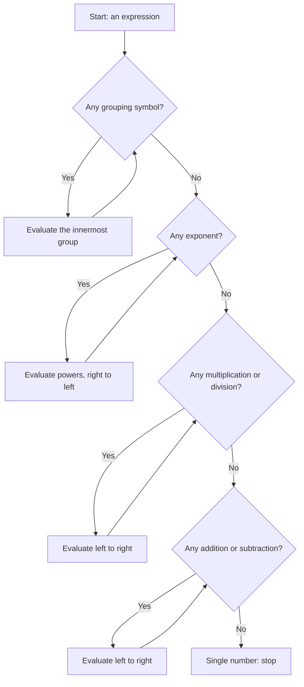
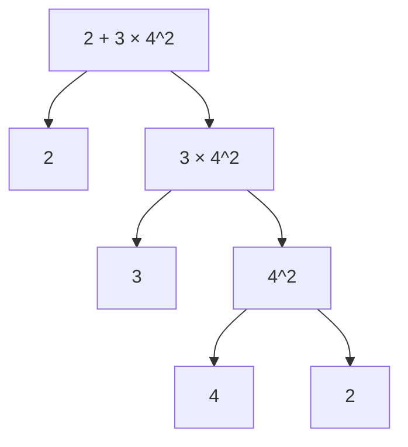
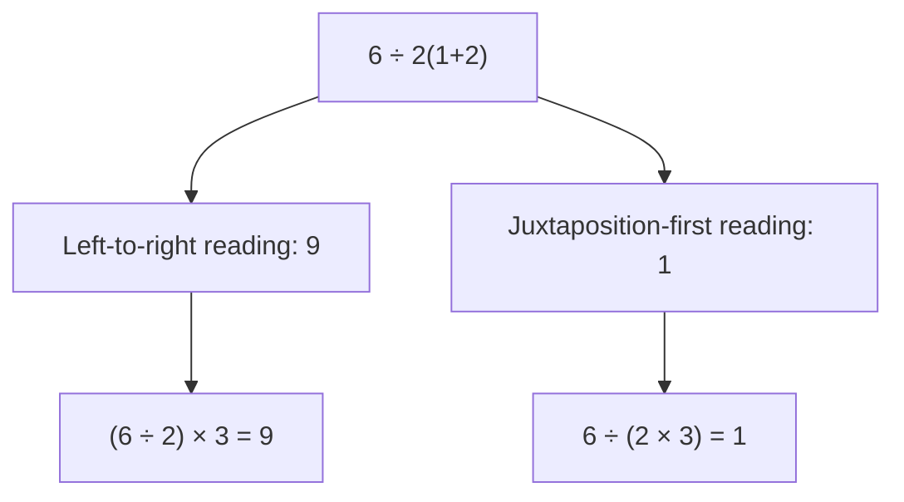

# Order of Operations

> [Mathematics](../../README.md) · [Pre-Algebra](../README.md) · Level: Beginner · Prerequisites: [Arithmetic](../../01-arithmetic/README.md) · Estimated time: 3 h

## 1. Introduction

Arithmetic gives us symbols for combining numbers, but symbols alone do not tell us **which combination to do first**. The string of symbols

$$2 + 3 \times 4$$

could reasonably be read as "add $2$ and $3$, then multiply by $4$", giving $20$, or as "multiply $3$ by $4$, then add $2$", giving $14$. Both readings use the same numbers and the same operations. If mathematics is going to be a language in which every calculation has one answer, the language needs a rule that decides between them.

The **order of operations** is that rule. It is a *convention* — a human agreement, like driving on one side of the road — not a theorem that can be proved from the nature of numbers. What *can* be proved is that the convention is consistent, that it always produces exactly one value, and that it meshes with the algebraic laws (especially the distributive property) that make algebra work.

The convention matters in practice. Every spreadsheet, programming language, calculator and computer algebra system implements some version of it. When two of them disagree — and sometimes they do — the result is not a mathematical mystery but a difference in conventions, usually about the unary minus or about "implicit" multiplication such as $2(3)$.

## 2. Prerequisites

You should be comfortable with:

* **The four operations** on whole numbers, including division with remainder: [Natural Numbers](../../01-arithmetic/01-natural-numbers/README.md).
* **Negative numbers** and the number line: adding, subtracting, multiplying and dividing signed numbers: [Integers](../../01-arithmetic/02-integers/README.md).
* **Fractions**: simplifying, adding, multiplying and dividing. For example, $\frac{2}{3} + \frac{1}{6} = \frac{5}{6}$: [Fractions](../../01-arithmetic/03-fractions/README.md).
* **Decimals** and converting between fractions and decimals: [Decimals](../../01-arithmetic/04-decimals/README.md).
* **Squares and cubes** of small integers, and the meaning of a root: [Exponents and Roots](../../01-arithmetic/07-exponents-and-roots/README.md).

All of these belong to the arithmetic course that precedes this one in the curriculum. Nothing in this tutorial depends on algebra beyond reading a letter as a placeholder for a number.

## 3. Learning Objectives

By the end of this tutorial you will be able to:

1. Explain why an order-of-operations convention is necessary, using an example where two readings give different values.
2. State the precedence of grouping symbols, exponentiation, multiplication/division and addition/subtraction.
3. Apply the left-to-right rule for operations of equal precedence, and explain why it is needed.
4. Evaluate expressions containing nested parentheses, brackets and braces.
5. Treat a fraction bar, a radical sign and absolute-value bars as grouping symbols.
6. Distinguish $(-3)^2$ from $-3^2$ and compute each correctly.
7. Evaluate an expression after substituting given values for its variables, including negative and fractional values.
8. Explain why $6 \div 2(1+2)$ is ambiguous in ordinary usage and resolve it by an explicit convention.
9. Identify the order in which a spreadsheet or programming language will evaluate a formula.

## 4. Intuition

Think of an expression as a set of instructions that have been written without line breaks. Some instructions are "tighter" than others: multiplication is repeated addition, and exponentiation is repeated multiplication, so exponentiation is the tightest of the three, multiplication next, addition loosest. Grouping symbols are a way for the author to say "ignore the default tightness here; do this part first".

A useful analogy is grammar. The sentence "I saw the man with the telescope" has two meanings because English does not mark which words belong together. Parentheses are punctuation for mathematics: they mark the grouping that the default word order would otherwise leave ambiguous. The precedence rules are the default word order.

The left-to-right rule handles the remaining ties. Subtraction and division are not associative: $10 - 4 - 3$ and $10 - (4-3)$ differ. We need a convention for a chain of equal-precedence operations, and the convention is to read the chain from left to right, exactly as we read the symbols on the page.

## 5. Formal Definition

We first say precisely what an *expression* is, then what its value is.

**Definition 5.1 (Numerical expression).** A *numerical expression* is a finite string built from:

* numerals such as $2$, $17$, $0.5$ or $\frac{3}{4}$;
* the operation symbols $+$, $-$, $\times$, $\div$ and $^$ (exponentiation);
* grouping symbols $(\;)$, $[\;]$, $\{\;\}$, the fraction bar, the radical sign $\sqrt{\phantom{x}}$ and absolute-value bars $\lvert\;\rvert$,

according to the usual grammar: a numeral is an expression; if $E$ and $F$ are expressions, then $(E)$, $-E$, $\sqrt{E}$, $\lvert E\rvert$, $E+F$, $E-F$, $E\times F$, $E\div F$ and $E^F$ are expressions; and nothing else is.

**Definition 5.2 (Standard interpretation).** The value of an expression is computed by repeatedly applying, in this order, the first rule that applies:

1. **Grouping symbols.** Evaluate the contents of the innermost grouping symbol first. A fraction bar groups its entire numerator and its entire denominator; a radical sign groups everything under the roof; absolute-value bars group everything between them.
2. **Exponentiation**, from right to left: in $a^{b^c}$, first compute $b^c$, then raise $a$ to that result.
3. **Multiplication and division**, from left to right.
4. **Addition and subtraction**, from left to right.

Rules 3 and 4 are applied to the expression that remains after all tighter operations have been replaced by their values.

**Definition 5.3 (Equation).** An *equation* is a statement that two expressions have the same value, written $E=F$. It is true or false (or, if it contains variables, true for some values of the variables). An expression by itself has a value; an equation asserts something. "Evaluate" applies to expressions, "solve" to equations.

## 6. Mathematical Notation

| Symbol | Name | Meaning | Read aloud |
|---|---|---|---|
| $+$ | plus | addition | "plus" |
| $-$ | minus | subtraction, or negation when placed before a single expression | "minus" / "negative" |
| $\times$, $\cdot$, juxtaposition | times | multiplication | "times" |
| $\div$, $\dfrac{a}{b}$ | divided by | division | "divided by" |
| $a^n$ | power | $n$ factors of $a$ multiplied together | "a to the n" |
| $\sqrt{\phantom{x}}$ | radical | non-negative square root | "the square root of" |
| $\lvert x\rvert$ | absolute value | distance of $x$ from $0$ | "the absolute value of x" |
| $(~)$, $[~]$, $\{~\}$ | grouping symbols | evaluate inside first | "parentheses", "brackets", "braces" |
| $=$ | equals | the two sides have the same value | "equals" |
| $\approx$ | approximately equals | equal after rounding | "is approximately" |

The minus sign does three different jobs, and telling them apart is half the battle:

* **binary subtraction**: $7 - 3$ (an operation between two numbers);
* **unary negation**: $-3$ (the opposite of $3$);
* **sign inside a numeral**: $(-3)^2$ (the number negative three, squared).

Juxtaposition — writing $2x$ or $2(1+2)$ with no symbol — means multiplication, and it has the same precedence as $\times$ and $\div$. That last sentence is a convention, and not every author or calculator agrees with it; see Section 11.

## 7. Core Concepts

### 7.1 Why a convention is needed

Consider all the ways to parenthesize $2+3\times4$:

$$(2+3)\times4 = 20, \qquad 2+(3\times4)=14.$$

Both are legal groupings of the same symbols. Without a rule, the expression has no single value.

The same problem appears with chains of one operation. Subtraction is **not associative**:

$$(10-4)-3 = 3, \qquad 10-(4-3)=9.$$

Division is not associative either:

$$(48\div 4)\div 2 = 6, \qquad 48\div(4\div 2)=24.$$

So a convention must settle both *which operation goes first* and *which way a chain is read*. The standard answer is: tighter operations first, and equal-precedence operations left to right.

### 7.2 The precedence hierarchy

| Priority | Operations | Associativity | Example |
|---|---|---|---|
| 1 (highest) | grouping symbols | innermost first | $[2(3+4)]^2$ |
| 2 | exponentiation $a^n$ | right to left | $2^{3^2}=2^9=512$ |
| 3 | multiplication and division | left to right | $48\div 2\times 3 = 72$ |
| 4 (lowest) | addition and subtraction | left to right | $10-4+3=9$ |

"Higher priority" means "performed earlier". Parentheses override everything, which is why they are the escape hatch for any expression you want read differently.

### 7.3 Exponentiation is right-associative

In a tower of powers, the top is evaluated first:

$$2^{3^2} = 2^{(3^2)} = 2^9 = 512, \qquad (2^3)^2 = 8^2 = 64.$$

These differ, so the convention matters. The reason for choosing right associativity is that the alternative makes the notation useless: if $a^{b^c}$ meant $(a^b)^c$, then by the laws of exponents it would equal $a^{bc}$, and we could write $a^{bc}$ directly. The tower notation is reserved for the genuinely different quantity $a^{(b^c)}$, which grows extremely fast. For example, $2^{3^2}=512$ but $2^{2^3}=256$ and $3^{2^2}=81$.

### 7.4 Unary minus and powers

Exponentiation binds more tightly than negation, so

$$-3^2 = -(3^2) = -9, \qquad (-3)^2 = 9.$$

Read the first as "the negative of three squared", the second as "negative three, squared". The distinction matters constantly in algebra, where $-x^2$ must mean $-(x^2)$, not $(-x)^2$.

For products and powers of negative numbers, count the minus signs:

$$(-a)^n = \underbrace{(-a)(-a)\cdots(-a)}_{n\text{ factors}}.$$

Each pair of minus signs cancels, so $(-a)^n$ is positive when $n$ is even and negative when $n$ is odd. In particular $(-2)^3=-8$, $(-2)^4=16$, and $-2^3=-(2^3)=-8$ (the last happens to have the same value because the exponent is odd; the expressions are still different in meaning).

### 7.5 Multiplication and division share one level

Multiplication and division have the same priority, so a chain is read left to right:

$$48\div 2\times 3 = (48\div 2)\times 3 = 24\times 3 = 72.$$

It is **not** $48\div(2\times 3)=8$. A useful way to remember this is that division by $2$ then multiplication by $3$ is the same as multiplying by $\frac{3}{2}$; reading right to left would silently move the $3$ into the denominator.

Two identities make the left-to-right rule easy to apply:

$$a-b-c = a-(b+c), \qquad a\div b\div c = a\div(b\times c)\quad(b,c\neq0).$$

So a left-to-right chain of subtractions subtracts the *sum* of the later terms, and a left-to-right chain of divisions divides by the *product* of the later divisors.

### 7.6 Grouping symbols, visible and invisible

Parentheses, brackets and braces are the visible grouping symbols. They are interchangeable in meaning; using different shapes merely helps the eye pair them. Evaluate the innermost pair first and work outward.

Three other symbols group silently:

| Written | Means | Why |
|---|---|---|
| $\dfrac{a+b}{c+d}$ | $(a+b)\div(c+d)$ | the bar extends over the whole numerator and denominator |
| $\sqrt{a+b}$ | the root of the whole sum | the roof extends over everything under it |
| $\lvert a+b\rvert$ | the absolute value of the whole sum | the bars enclose everything between them |

A fraction bar is especially important because it is *both* a division sign and a grouping symbol. In $\frac{12-3\times2}{4+2}$ the numerator is $(12-3\times2)$ and the denominator is $(4+2)$; the divisions implied by the bar happen only after both have been evaluated.

An exponent can group too: in $(a+b)^2$ the parentheses keep the sum together; writing $a+b^2$ means something entirely different.

### 7.7 Evaluating by substitution

When an expression contains letters, *substituting* a value means replacing every occurrence of the letter by that value, wrapped in parentheses. The parentheses are not optional: substituting $x=-3$ into $x^2$ must produce $(-3)^2=9$, never $-3^2=-9$.

**Procedure.** (i) Rewrite the expression with each variable replaced by its value in parentheses. (ii) Evaluate the resulting numerical expression by the standard rules. (iii) If the values are fractions, keep them as fractions rather than rounding early.

### 7.8 Expressions versus equations

An expression such as $3x^2-5$ is a recipe: give it an $x$, it gives you a number. An equation such as $3x^2-5=22$ is a claim: it says the recipe produces $22$ for some value of $x$. We *evaluate* expressions and *solve* equations. Confusing the two is a common source of errors, especially when a problem asks "find the value of the expression" but the reader starts "solving" it.

## 8. Formulas and Properties

**Property 1 (Existence and uniqueness of the value).** Every well-formed expression without variables has exactly one value under the standard interpretation.

*Why.* Each application of a rule replaces a sub-expression by a number, so the number of operation symbols strictly decreases. The process cannot continue forever, and when no operation symbol remains the expression is a single number. At each stage the rule to apply is determined by the expression's structure, so the result does not depend on choices. (This is an informal induction on the number of operation symbols.)

**Property 2 (Left-to-right identities).** For all numbers $a,b,c$,

$$a-b-c=a-(b+c), \qquad a\div b\div c=a\div(b\cdot c)\ \ (b,c\neq0).$$

*Why.* Subtracting $b$ and then $c$ removes $b+c$ altogether. Dividing by $b$ and then by $c$ is multiplying by $\frac{1}{b}\cdot\frac{1}{c}=\frac{1}{bc}$.

**Property 3 (Removing parentheses after a minus sign).** For all numbers $a,b,c$,

$$a-(b+c)=a-b-c, \qquad a-(b-c)=a-b+c.$$

*Why.* $a-(b+c)$ is the number that, added to $b+c$, gives $a$. Both $a-b-c$ and $a-b+c$ have that property; uniqueness of subtraction does the rest. Numerically, $10-(4-6)=10-(-2)=12$ and $10-4+6=12$.

**Property 4 (Sign of a power).** For $a>0$ and integer $n\ge1$,

$$(-a)^n=(-1)^n a^n=\begin{cases}a^n,&n\text{ even},\\ -a^n,&n\text{ odd}.\end{cases}$$

*Why.* $(-a)^n$ is a product of $n$ factors each equal to $-a$; pairing the minus signs gives the sign $(-1)^n$.

**Property 5 (Distributive property).** For all numbers $a,b,c$,

$$a(b+c)=ab+ac.$$

*Why this makes the precedence rule convenient.* The distributive property is the bridge between multiplication and addition. Because multiplication is performed before addition, an expression like $3x+5x$ can be read as $(3+5)x=8x$ without writing parentheses. If addition came first, polynomials — the central objects of algebra — would be unreadable.

**Property 6 (Fraction arithmetic).** For $b,d\neq0$,

$$\dfrac{a}{b}\cdot\dfrac{c}{d}=\dfrac{ac}{bd}, \qquad \dfrac{a}{b}\div\dfrac{c}{d}=\dfrac{a}{b}\cdot\dfrac{d}{c}=\dfrac{ad}{bc}\quad(c\neq0).$$

*Why.* The first is the definition of fraction multiplication. The second holds because dividing by $\frac{c}{d}$ is multiplying by its reciprocal $\frac{d}{c}$: $\frac{c}{d}\cdot\frac{d}{c}=1$.

**Property 7 (Roots do not distribute over sums).** For $a,b\ge0$,

$$\sqrt{ab}=\sqrt{a}\,\sqrt{b}, \qquad \sqrt{a+b}\neq\sqrt{a}+\sqrt{b}\ \text{ in general}.$$

*Why the second fails.* $\sqrt{9+16}=\sqrt{25}=5$, while $\sqrt9+\sqrt{16}=3+4=7$. The first holds because squaring both sides of $\sqrt a\,\sqrt b$ gives $ab$.

## 9. Step-by-Step Examples

### Example 1 (Easy): $7+3\times4^2\div8-5$

There are no grouping symbols. Exponentiation comes first:

$$4^2=16, \qquad\text{so the expression becomes } 7+3\times16\div8-5.$$

Multiplication and division, left to right: $3\times16=48$, then $48\div8=6$:

$$7+6-5.$$

Addition and subtraction, left to right: $7+6=13$, then $13-5=8$.

$$\boxed{8}$$

### Example 2 (Easy): $(5+3)^2\div4-2^3$

Innermost grouping symbol first: $5+3=8$. The expression becomes

$$8^2\div4-2^3.$$

Exponentiation: $8^2=64$ and $2^3=8$, so

$$64\div4-8.$$

Division: $64\div4=16$. Then $16-8=8$.

$$\boxed{8}$$

### Example 3 (Medium): the fraction bar as a grouping symbol

$$\dfrac{12-3\times2}{4+2}.$$

The bar groups the whole numerator and the whole denominator. Treat it as $(12-3\times2)\div(4+2)$.

Numerator: multiplication first, $3\times2=6$, then $12-6=6$. Denominator: $4+2=6$. Therefore

$$\dfrac{6}{6}=1.$$

$$\boxed{1}$$

Note the contrast with $12-3\times2\div4+2$, which has no fraction bar: it equals $12-1.5+2=12.5$.

### Example 4 (Medium): a radical as a grouping symbol

$$\sqrt{25-9}+2\times3.$$

The radical encloses $25-9$. Inside it, $25-9=16$, so $\sqrt{16}=4$. Then

$$4+2\times3=4+6=10.$$

$$\boxed{10}$$

The common error is $\sqrt{25}-\sqrt9+2\times3=5-3+6=8$; see Section 11.

### Example 5 (Medium): nested grouping symbols

$$2\{3+2[4-(6-4)^2]\}.$$

Work from the innermost outward. Innermost: $6-4=2$, so

$$2\{3+2[4-2^2]\}.$$

Inside the brackets, exponentiate: $2^2=4$, then subtract: $4-4=0$:

$$2\{3+2[0]\}=2\{3+0\}.$$

Then $3+0=3$ and $2\times3=6$.

$$\boxed{6}$$

### Example 6 (Hard): substitution with negative numbers

Evaluate $a^2-2ab+b^2$ when $a=-2$ and $b=3$.

Substitute with parentheses:

$$(-2)^2-2(-2)(3)+3^2.$$

Compute each term: $(-2)^2=4$; $-2(-2)(3)=+12$; $3^2=9$. Therefore

$$4+12+9=25.$$

$$\boxed{25}$$

Check: the expression equals $(a-b)^2$, and $a-b=-2-3=-5$, whose square is $25$. The check confirms both the arithmetic and the identity.

### Example 7 (Hard): fractions at every level

$$\dfrac{2}{3}+\dfrac{1}{6}\div\dfrac{1}{3}.$$

Division before addition. Dividing by $\frac13$ is multiplying by $3$:

$$\dfrac{1}{6}\div\dfrac{1}{3}=\dfrac{1}{6}\times3=\dfrac{3}{6}=\dfrac12.$$

Now add: $\frac23+\frac12=\frac46+\frac36=\frac76$.

$$\boxed{\dfrac{7}{6}}$$

A tempting wrong path is to add $\frac23+\frac16$ first because the plus sign appears first on the page; that ignores the precedence of division.

### Example 8 (Discussion): the viral expression $6\div2(1+2)$

Here the grouping symbol must be evaluated first: $1+2=3$, leaving $6\div2(3)$.

The expression is now $6\div2\times3$, a chain of equal-precedence operations. Under the standard left-to-right convention,

$$6\div2\times3=(6\div2)\times3=3\times3=9.$$

But many people (and some calculators) read juxtaposition $2(3)$ as binding more tightly than $\div$, which produces $6\div(2\times3)=6\div6=1$. Both readings are defensible *as conventions*; the notation itself is ambiguous. The lesson is not that one camp is arithmetically incompetent, but that **an author who writes $6\div2(1+2)$ has written an unclear expression**. If $9$ is intended, write

$$(6\div2)(1+2)\quad\text{or}\quad \dfrac{6}{2}(1+2).$$

If $1$ is intended, write

$$\dfrac{6}{2(1+2)}.$$

In this repository we adopt the left-to-right convention, so $6\div2(1+2)=9$; but we avoid the notation whenever a reader could reasonably differ.

## 10. Visual Explanations

The evaluation procedure is a decision sequence applied until a single number remains:

The same expression can be pictured as a tree. The tree for $2+3\times4^2$ shows why the exponent is computed first: it sits deepest.

Reading the tree from the bottom up, $4^2=16$, then $3\times16=48$, then $2+48=50$. A different tree would represent a different expression, not a different evaluation of the same expression.

Finally, the ambiguity in Section 9's Example 8 is best seen as two possible trees:

## 11. Common Mistakes

| Mistake | Why it is tempting | Correct treatment |
|---|---|---|
| $2+3\times4=20$ | reading left to right as if all operations were equal | multiplication first: $2+12=14$ |
| $-3^2=9$ | squaring the minus sign too | exponent first: $-(3^2)=-9$ |
| $48\div2\times3=8$ | multiplying before dividing | equal precedence, left to right: $72$ |
| $6\div2(1+2)=1$ without comment | treating juxtaposition as tighter than $\div$ | ambiguous notation; parenthesize |
| $2^{3^2}=64$ | left-to-right reading of a power tower | right to left: $2^9=512$ |
| $\sqrt{9+16}=3+4=7$ | distributing a root over a sum | $\sqrt{25}=5$ |
| $\frac{2+4}{2}=2+2=4$ | cancelling the $2$ in the denominator against one term only | numerator is a single quantity: $6\div2=3$ |
| $-x^2$ evaluated at $x=-3$ as $9$ | substituting without parentheses | $-(-3)^2=-9$ |
| $10-4-3=10-(4-3)$ | assuming subtraction is associative | $(10-4)-3=3$ |
| rounding $1/3$ early in a calculator | believing the display | keep fractions exact, round once at the end |
| $5-(2-7)=5-2-7$ | dropping the sign change | $5-2+7=10$ |

A reliable habit: whenever you substitute a negative number, write the parentheses first, then evaluate. Whenever you see a fraction bar, draw a mental box around the entire numerator and the entire denominator before doing anything else.

## 12. Applications

**Spreadsheets.** Excel, Google Sheets and LibreOffice all evaluate `=2+3*4` as $14$. They also have quirks worth knowing: Excel reads `=-2^2` as $(-2)^2=4$, whereas standard mathematical notation gives $-4$. Written-out formulas should therefore use explicit parentheses for every negative base.

**Programming.** Python, C, Java and JavaScript all give multiplication and division higher precedence than addition, and Python's `**` is right-associative, so `2**3**2` is $512$. In Python `-2**2` is $-4$, matching mathematical notation. When in doubt, compilers and style guides recommend parentheses: `(a + b) / 2` rather than `a + b / 2`.

**Finance.** Compound interest is $A=P(1+r/n)^{nt}$. The grouping symbols matter: $(1+r/n)$ is computed first, then raised to the power $nt$, then multiplied by $P$. Writing $P\,(1+r/n)^{nt}$ is not the same as $P\,(1+r/n)\cdot nt$.

**Engineering and science.** Unit-conversion chains and formula evaluation (for example $v=\frac{d}{t}$, or the ideal-gas law $PV=nRT$) depend on reading the fraction bar as grouping. A missing parenthesis in a control system's formula is a real failure mode, not a pedantic one.

**Computer science.** Parsing arithmetic is the standard first example of a grammar and of an abstract syntax tree. The precedence rules are exactly the grammar's precedence declarations, and "left-associative" versus "right-associative" are parser settings.

## 13. Exercises

The problem set is in [exercises.md](exercises.md). It contains 32 problems grouped as Beginner (1–11), Intermediate (12–21), Advanced (22–28) and Challenge (29–32), including drills, substitution problems, error analysis and two open-ended construction puzzles.

## 14. Solutions

Full worked solutions for every problem are in [solutions.md](solutions.md). Attempt the exercises before reading them: the value of an exercise is in the attempt, and a solution read too early replaces your reasoning with someone else's.

## 15. Summary

* The order of operations is a **convention** whose purpose is to give every expression one value.
* Priority from highest to lowest: grouping symbols, exponentiation, multiplication/division, addition/subtraction.
* Operations of equal precedence are read **left to right**; exponentiation is the exception and is read **right to left**.
* A fraction bar, radical sign and absolute-value bars are grouping symbols even though they do not look like parentheses.
* Exponentiation binds more tightly than unary minus: $-3^2=-9$ but $(-3)^2=9$.
* Substitute negative values with parentheses: $x^2$ at $x=-3$ is $(-3)^2=9$.
* $6\div2(1+2)$ is ambiguous in ordinary notation; the left-to-right convention gives $9$, but the honest response is to rewrite the expression with explicit parentheses.
* Every calculator and language implements a convention, and they occasionally differ; parentheses are always safe.

## 16. Further Learning

The natural next topic is [Variables and Algebraic Expressions](../02-variables-and-expressions/README.md), where the same rules are applied to expressions containing letters.

For extended practice, any standard pre-algebra textbook covers this material; OpenStax's *Prealgebra* and the Khan Academy "Arithmetic" course both contain large exercise sets on order of operations, and both are freely available online. When you meet a new programming language, read its operator-precedence table — comparing it with the table in Section 7.2 is an excellent way to see which parts of the convention are universal and which are local choices.
