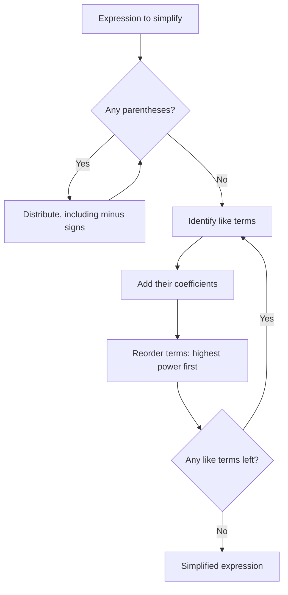
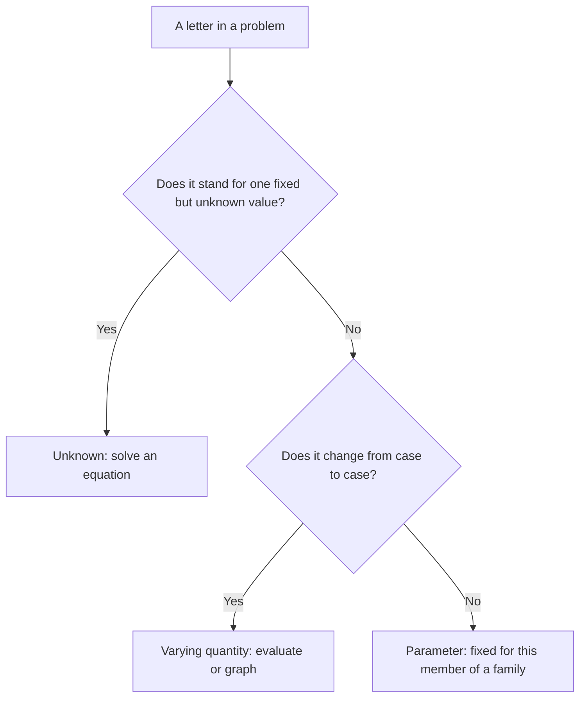

# Variables and Algebraic Expressions

> [Mathematics](../../README.md) · [Pre-Algebra](../README.md) · Level: Beginner · Prerequisites: [Order of Operations](../01-order-of-operations/README.md) · Estimated time: 5 h

## 1. Introduction

Arithmetic works with numbers that are written down: $3+5$, $12\div4$, $\frac{2}{3}\times\frac{9}{4}$. Algebra begins when we stop insisting that every number be known in advance and use a **letter** to stand for it. The letter is called a **variable**, and a combination of numbers, variables and operations is called an **algebraic expression**.

This sounds like a small change. It is enormous. Once a number can be named without being known, we can:

* state a pattern that holds for *every* number, such as $n+(n+1)=2n+1$ for consecutive integers;
* write a formula that applies to *many* situations, such as $A=\pi r^2$ for the area of any circle;
* translate a word problem into a single expression and then manipulate it;
* describe how one quantity depends on another, such as the cost $C=3.50+1.25m$ of a taxi ride of $m$ miles.

This tutorial builds the vocabulary — variable, term, coefficient, constant, like terms — and the one algebraic law that does most of the work, the **distributive property**. Everything else here is practice in reading, writing and evaluating expressions. Equations come in the next tutorial; for now an expression is a *recipe*, not a claim.

## 2. Prerequisites

You need:

* **The order of operations** — grouping symbols, powers, multiplication/division, addition/subtraction, left to right. See [Order of Operations](../01-order-of-operations/README.md).
* **Signed numbers**: $-3+7=4$, $(-2)(-5)=10$, $-(-4)=4$: [Integers](../../01-arithmetic/02-integers/README.md).
* **Fraction arithmetic**, including multiplying and simplifying: [Fractions](../../01-arithmetic/03-fractions/README.md).
* **Powers** with whole-number exponents: $x^3=x\cdot x\cdot x$: [Exponents and Roots](../../01-arithmetic/07-exponents-and-roots/README.md).
* The **commutative** ($a+b=b+a$, $ab=ba$) and **associative** ($(a+b)+c=a+(b+c)$) laws for addition and multiplication: [Natural Numbers](../../01-arithmetic/01-natural-numbers/README.md).

## 3. Learning Objectives

By the end of this tutorial you will be able to:

1. Explain the different roles a variable can play: unknown, varying quantity, parameter.
2. Translate an English phrase into an algebraic expression, including the reversed phrases "less than" and "subtracted from".
3. Identify the terms, coefficients and constant term of an expression.
4. Decide whether two terms are *like terms* and combine them, citing the distributive property.
5. Expand expressions using the distributive property, including distribution of a negative number.
6. Remove parentheses preceded by a minus sign, changing every interior sign.
7. Evaluate an expression at given values of its variables, including negative and fractional values.
8. Write a formula as an expression and interpret each part.
9. Test whether two expressions are equivalent, using both counterexamples and algebraic justification.

## 4. Intuition

A numerical expression is a recipe with all the quantities fixed: "3 cups flour, 2 eggs". An algebraic expression is a recipe with a slot: "3 cups flour, $e$ eggs". You can cook it once you choose $e$.

There are three common reasons to leave a slot unfilled.

* **The value is unknown but fixed.** "I am thinking of a number; five less than twice it is $17$." The letter $x$ names the number while we work out what it is. This is the *unknown* role, and it leads to equations.
* **The value varies.** "A taxi charges \$3.50 plus \$1.25 per mile." The number of miles $m$ is not one fixed mystery; the formula must work for every possible trip. This is the *varying quantity* role, and it leads to functions and graphs.
* **The value is fixed but not specified.** In $A=\pi r^2$, the number $\pi$ is a fixed constant whose decimal expansion we never finish writing. In $y=mx+b$, $m$ and $b$ are fixed for a given line but differ from line to line. These are *parameters*.

The same letter can play different roles in different problems, so read the surrounding sentence, not just the symbol. What never changes is the grammar: an expression is built from numbers, variables and operations, and it has a value once every variable has a value.

A second intuition is **pattern compression**. In a row of squares made of matchsticks, the first square uses 4 sticks and each additional square uses 3 more. The counts are $4,7,10,13,\dots$, and instead of writing a table we write $3n+1$ for $n$ squares. Check: $n=1$ gives $4$, $n=2$ gives $7$. The expression is a compact description of infinitely many arithmetic computations.

## 5. Formal Definition

**Definition 5.1 (Variable and constant).** A *variable* is a symbol (usually a letter) that stands for an element of an agreed set of numbers, called its *domain*. A *constant* is a quantity that does not vary; a *constant term* is a term containing no variables.

**Definition 5.2 (Algebraic expression).** Fix a set of variables, say $x$ and $y$. An *algebraic expression* is a finite string built from numbers, variables and the operations $+,-,\times,\div$ and exponentiation with whole-number exponents, according to the grammar of [Order of Operations](../01-order-of-operations/README.md) Section 5. For example, $3x^2-5x+2$ and $\frac{x+y}{2}$ are expressions; $3x^2-5x+2=0$ is not an expression but an equation.

**Definition 5.3 (Term).** Write the expression as a sum of quantities, treating subtraction as addition of the opposite. Each summand is a **term**. In
$$7x^2-4xy+3y-8$$
the terms are $7x^2$, $-4xy$, $3y$ and $-8$. The sign in front of a term belongs to that term.

**Definition 5.4 (Coefficient).** The **coefficient** of a term is its numerical factor. In $7x^2$ the coefficient is $7$; in $-4xy$ it is $-4$; in $3y$ it is $3$; in $-8$ it is $-8$. A term written without a visible numerical factor, such as $x$, has coefficient $1$; a term such as $-x$ has coefficient $-1$. The remaining factor, such as $x^2$ or $xy$, is the **variable part**.

**Definition 5.5 (Like terms).** Two terms are **like terms** if their variable parts are identical — the same variables, each raised to the same exponent. Thus $5x^2$ and $-3x^2$ are like terms; $5x^2$ and $5x$ are not (exponents differ); $4xy$ and $4x$ are not (variables differ).

**Definition 5.6 (Evaluation).** To *evaluate* an expression at given values of its variables, replace each variable by its value, enclose the value in parentheses, and compute by the order of operations.

**Definition 5.7 (Equivalent expressions).** Two expressions are **equivalent** if they have the same value for every assignment of values from their common domain. An equation that holds for every value of its variables is called an **identity**; for example, $2(x+3)=2x+6$ is an identity.

## 6. Mathematical Notation

| Notation | Meaning | Read aloud |
|---|---|---|
| $x$, $n$, $t$ | variables | "x", "n", "t" |
| $2x$ | $2\cdot x$ | "two x" |
| $xy$ | $x\cdot y$ | "x y" |
| $x^2$ | $x\cdot x$ | "x squared" |
| $3x^2$ | $3\cdot x^2$, not $(3x)^2$ | "three x squared" |
| $-x$ | $(-1)\cdot x$ | "negative x" |
| $\frac{x}{2}$, $x/2$ | $x\div2$ | "x over two" |
| $=$ | the two sides have equal value | "equals" |
| $\neq$ | not equal | "is not equal to" |
| $x\approx3.14$ | approximately equal | "x is approximately 3.14" |
| $P=2l+2w$ | a formula relating variables | "P equals two l plus two w" |

An important reading rule: $3x^2$ means $3(x^2)$, not $(3x)^2$. Exponentiation binds more tightly than multiplication, exactly as in the previous tutorial.

## 7. Core Concepts

### 7.1 Three roles of a variable

| Role | Example | What we do with it |
|---|---|---|
| Unknown | $3x+5=20$ | solve for the value that makes the equation true |
| Varying quantity | $d=60t$ | evaluate or graph for many values of $t$ |
| Parameter | $y=mx+b$ | treat as fixed while studying the family of lines |

The distinction is about intent, not notation. In $3x+5=20$ the letter $x$ is a single unknown; in $d=60t$ the letter $t$ ranges over all non-negative times. The algebra is the same; the questions we ask differ.

### 7.2 Translating words into expressions

The hardest part of word problems is usually the translation. A small dictionary:

| Words | Expression |
|---|---|
| a number $n$ increased by $7$ | $n+7$ |
| $7$ more than $n$ | $n+7$ |
| $7$ less than $n$ | $n-7$ |
| $n$ less than $7$ | $7-n$ |
| $7$ subtracted from $n$ | $n-7$ |
| the difference of $n$ and $7$ | $n-7$ |
| the product of $7$ and $n$ | $7n$ |
| twice $n$ | $2n$ |
| half of $n$ | $\frac{n}{2}$ |
| the quotient of $n$ and $7$ | $\frac{n}{7}$ |
| $7$ divided by $n$ | $\frac{7}{n}$ |
| the sum of $n$ and $7$, multiplied by $3$ | $3(n+7)$ |
| three consecutive integers | $n,\ n+1,\ n+2$ |
| three consecutive even integers | $n,\ n+2,\ n+4$ (with $n$ even) |

Two warnings. First, "less than" and "subtracted from" **reverse** the order: "five less than $x$" is $x-5$, not $5-x$. Second, punctuation matters: "the sum of $n$ and $7$, multiplied by $3$" is $3(n+7)$; without the comma, "the sum of $n$ and $7$ multiplied by $3$" is ambiguous and should be rewritten.

### 7.3 Terms, coefficients and constants

Consider $7x^2-4xy+3y-8$. It is a sum of four terms:

| Term | Coefficient | Variable part |
|---|---|---|
| $7x^2$ | $7$ | $x^2$ |
| $-4xy$ | $-4$ | $xy$ |
| $3y$ | $3$ | $y$ |
| $-8$ | $-8$ | none (constant term) |

The constant term is $-8$, not $8$: the minus sign belongs to the term. When an expression is rearranged, each term carries its sign.

### 7.4 Like terms and why we may combine them

Like terms may be added by adding their coefficients:

$$5x+3x=(5+3)x=8x.$$

The justification is the distributive property, read right to left: $5x+3x=5\cdot x+3\cdot x=(5+3)\cdot x$. This is not a new rule; it is distribution in reverse. The same reasoning gives

$$7x^2-2x^2=5x^2,\qquad -4xy+9xy=5xy,\qquad 3y-y=2y.$$

Unlike terms cannot be combined because no distributive step applies. $3x+4y$ is already as simple as it gets: $x$ and $y$ are different variables, and $3x+4y=7xy$ is simply false. At $x=y=1$ both sides happen to equal $7$, which is a coincidence of that single substitution; at $x=2$, $y=1$ the two sides are $10$ and $14$.

### 7.5 The distributive property

For all numbers $a,b,c$,

$$a(b+c)=ab+ac.$$

The number $a$ is distributed to each term inside. The property works with subtraction too, because $b-c=b+(-c)$:

$$a(b-c)=ab-ac.$$

If $a$ is negative, both signs inside change:

$$-3(x-4)=-3x+12.$$

A useful check on any expansion: substitute a simple number such as $x=1$ into both the original and the expanded form. For $-3(x-4)$: original $-3(1-4)=-3(-3)=9$; expanded $-3(1)+12=9$. Agreement at one point is evidence, not proof, but disagreement is a certain error.

### 7.6 Removing parentheses after a minus sign

Because $a-(b+c)=a-b-c$ and $a-(b-c)=a-b+c$, a minus sign in front of a parenthesis changes **every** sign inside:

$$5-(2x-7)=5-2x+7=12-2x,$$
$$-(x-3)=-x+3.$$

Think of $-(x-3)$ as $(-1)(x-3)$ and distribute the $-1$.

### 7.7 Evaluating expressions

The procedure is mechanical; the errors are almost always sign errors. Write the substitution with parentheses, then follow the order of operations.

Evaluate $2x^2-3xy+y^2$ at $x=-2$, $y=3$:

$$2(-2)^2-3(-2)(3)+(3)^2=2\cdot4+18+9=8+18+9=35.$$

Note three separate sign decisions: $(-2)^2=+4$; $-3(-2)(3)=+18$; $(3)^2=9$.

### 7.8 Formulas as expressions

A formula is an equation in which one variable is expressed in terms of others. The expression is the right-hand side.

| Formula | Expression | Meaning |
|---|---|---|
| $P=2l+2w$ | $2l+2w$ | perimeter of a rectangle |
| $A=\pi r^2$ | $\pi r^2$ | area of a circle |
| $d=rt$ | $rt$ | distance at constant rate |
| $F=\frac95C+32$ | $\frac95C+32$ | Fahrenheit from Celsius |
| $I=Prt$ | $Prt$ | simple interest |

Formulas are the bridge from algebra to science: each letter has a physical meaning and a unit, and the expression tells you how the quantities combine.

### 7.9 Checking equivalence

To show two expressions are **not** equivalent, one counterexample suffices. To show they **are** equivalent, a counterexample can never suffice; you need an algebraic argument using the laws of arithmetic.

For example, $3(x+2)$ and $3x+2$ look similar. At $x=1$ they give $9$ and $5$, so they are not equivalent. On the other hand, $2(x+3)$ and $2x+6$ are equivalent, because distribution gives $2(x+3)=2x+6$ for every $x$.

## 8. Formulas and Properties

**Property 1 (Commutative and associative laws).** For all numbers $a,b,c$,
$$a+b=b+a,\qquad ab=ba,\qquad (a+b)+c=a+(b+c),\qquad (ab)c=a(bc).$$
These allow us to reorder and regroup sums and products. They do **not** allow us to reorder subtraction or division.

**Property 2 (Distributive property).** For all numbers $a,b,c$,
$$a(b+c)=ab+ac,\qquad (b+c)a=ba+ca.$$

*Why it is true.* If $a$ is a positive whole number, $a(b+c)$ means $a$ copies of $b+c$ added together:
$$a(b+c)=\underbrace{(b+c)+\cdots+(b+c)}_{a\text{ copies}}.$$
Collecting the $a$ copies of $b$ and the $a$ copies of $c$ gives $ab+ac$. The area model pictures the same count: a rectangle of sides $a$ and $b+c$ is cut by a vertical line into rectangles of areas $ab$ and $ac$. For general real numbers the property is an axiom of the real number system; every proof of an algebraic identity ultimately rests on it.

**Property 3 (Combining like terms).** For any number $c$ and any variable expression $X$,
$$cX+dX=(c+d)X.$$
*Why.* Distribute $(c+d)$ across $X$: $(c+d)X=cX+dX$. Reading the identity backwards gives the combination rule.

**Property 4 (Subtraction as addition of the opposite).** For all $a,b$,
$$a-b=a+(-b),$$
and therefore
$$a-(b+c)=a-b-c,\qquad a-(b-c)=a-b+c.$$
*Why.* $a-b$ is defined as the number that added to $b$ gives $a$; that number is $a+(-b)$. Applying this to $b+c$ and to $b-c$ and distributing the $-1$ gives the two identities.

**Property 5 (Sign rules for distribution).** For all $a,b$,
$$-(a+b)=-a-b,\qquad -(a-b)=-a+b.$$
*Why.* Multiply by $-1$ and distribute.

**Property 6 (Non-identities worth remembering).** In general,
$$(x+y)^2\neq x^2+y^2,\qquad \sqrt{x+y}\neq\sqrt x+\sqrt y,\qquad \dfrac{x+y}{z}\neq\dfrac{x}{z}+y\quad(z\neq0).$$
The last one is the error of dividing only the first term by $z$; the correct identity is $\frac{x+y}{z}=\frac{x}{z}+\frac{y}{z}$. Each statement fails for simple numbers: for example $(3+4)^2=49$ but $3^2+4^2=25$, and $\frac{2+4}{2}=3$ but $\frac22+4=5$.

**Property 7 (Equivalence test).** Two expressions $E$ and $F$ are equivalent exactly when $E-F$ simplifies to $0$. In practice one expands both sides and collects like terms.

## 9. Step-by-Step Examples

### Example 1 (Easy): translate and evaluate

Write "five less than twice a number" as an expression, then evaluate it at $n=7$.

"Twice a number" is $2n$. "Five less than" that quantity subtracts $5$ from it:

$$2n-5.$$

At $n=7$: $2(7)-5=14-5=9$.

$$\boxed{2n-5;\quad 9}$$

The reversed phrase is the trap: "five less than $2n$" is $2n-5$, not $5-2n$.

### Example 2 (Easy): identify the parts

For $4x^2-3x+7-2x^2$, list the terms, coefficients and constant term; then simplify.

The terms are $4x^2$, $-3x$, $7$ and $-2x^2$. The coefficients are $4$, $-3$ and $-2$; the constant term is $7$. The like terms $4x^2$ and $-2x^2$ combine:

$$(4-2)x^2-3x+7=2x^2-3x+7.$$

$$\boxed{2x^2-3x+7}$$

### Example 3 (Easy): combine like terms with justification

Simplify $7x+4-3x+9$.

Reorder and regroup using the commutative and associative laws, then distribute:

$$7x-3x+4+9=(7-3)x+(4+9)=4x+13.$$

$$\boxed{4x+13}$$

The constants $4$ and $9$ are like terms (both have empty variable part), so they combine too.

### Example 4 (Medium): distribute and collect

Simplify $3(2x-5)+4(x+2)$.

Distribute each product:

$$3(2x-5)=6x-15,\qquad 4(x+2)=4x+8.$$

Add and collect like terms:

$$6x-15+4x+8=(6+4)x+(-15+8)=10x-7.$$

$$\boxed{10x-7}$$

### Example 5 (Medium): a minus sign before a parenthesis

Simplify $5-2(x-3)$.

Distribute the $-2$ over both terms inside; the second product is $(-2)(-3)=+6$:

$$5-2x+6=11-2x.$$

$$\boxed{11-2x}$$

A frequent error is $5-2x-6=-2x-1$, which forgets that subtracting a negative quantity adds.

### Example 6 (Medium): evaluate a two-variable expression

Evaluate $2x^2-3xy+y^2$ at $x=-1$, $y=4$.

Substitute with parentheses:

$$2(-1)^2-3(-1)(4)+(4)^2.$$

Compute each term: $2(1)=2$; $-3(-1)(4)=+12$; $4^2=16$. Therefore

$$2+12+16=30.$$

$$\boxed{30}$$

### Example 7 (Medium): a formula in context

A taxi charges \$3.50 plus \$1.25 per mile. Write an expression for the cost of a ride of $m$ miles, and evaluate it for $m=8$.

The fixed charge is a constant; the mileage charge is $1.25$ times the number of miles:

$$C=3.50+1.25m.$$

At $m=8$: $C=3.50+1.25(8)=3.50+10.00=13.50$. The ride costs \$13.50.

$$\boxed{C=3.50+1.25m;\quad \$13.50}$$

The constant term $3.50$ is what you pay even for a zero-mile ride; the coefficient $1.25$ is the rate of change of cost per mile.

### Example 8 (Hard): factor by using distribution backwards

Write $12x+18$ as a constant times an expression. Then check the result.

The coefficients $12$ and $18$ have greatest common factor $6$, and both terms are divisible by $6$:

$$12x+18=6(2x)+6(3)=6(2x+3).$$

Check by distributing: $6(2x+3)=12x+18$. A check at $x=1$: left $30$, right $6\cdot5=30$.

$$\boxed{6(2x+3)}$$

Factoring is the distributive property read right to left, just as combining like terms is. The greatest common factor is studied systematically in [Factors, Multiples, GCD and LCM](../03-factors-and-multiples/README.md).

## 10. Visual Explanations

The simplification workflow is a loop that ends when no rule applies:

The three roles of a variable are easier to keep apart as a classification:

A table of values is often more informative than a diagram for an expression. For $3n+1$:

| $n$ | $3n+1$ |
|---|---|
| $0$ | $1$ |
| $1$ | $4$ |
| $2$ | $7$ |
| $3$ | $10$ |
| $4$ | $13$ |

The constant difference $3$ between successive values is the coefficient of $n$; the value at $n=0$ is the constant term. This is the beginning of the idea of a linear function.

## 11. Common Mistakes

| Mistake | Why it is tempting | Correct treatment |
|---|---|---|
| $3x+4y=7xy$ | adding everything in sight | unlike terms do not combine; leave $3x+4y$ |
| $2x+3=5x$ | treating the constant as a like term | $3$ has no $x$; cannot combine |
| $x+x=x^2$ | confusing addition with multiplication | $x+x=2x$; $x\cdot x=x^2$ |
| $3(x+2)=3x+2$ | distributing only to the first term | $3(x+2)=3x+6$ |
| $-(x-3)=-x-3$ | dropping the sign change | $-x+3$ |
| $5-(2x-7)=5-2x-7$ | treating the minus as applying only to $2x$ | $5-2x+7=12-2x$ |
| $(x+3)^2=x^2+9$ | squaring each term | $x^2+6x+9$ |
| "5 less than $x$" → $5-x$ | translating word order literally | $x-5$ |
| $3x^2$ at $x=-2$ → $-12$ | squaring before applying the minus | $3(-2)^2=12$ |
| $\frac{x+4}{2}=x+2$ | cancelling the $2$ against one term | numerator is one quantity; divide the whole sum |
| checking with one value and concluding "equivalent" | one success feels like proof | a single counterexample disproves; proof needs algebra |

## 12. Applications

**Geometry and measurement.** $A=\pi r^2$, $V=\frac43\pi r^3$, $P=2l+2w$ and $C=2\pi r$ are expressions with geometric meaning. Substituting a value and evaluating is how a spreadsheet computes the area of a whole column of circles.

**Science.** $F=ma$, $v=u+at$ and $E=\frac12mv^2$ are formulas whose variables have units. Checking that both sides of a formula have the same units is a powerful error detector.

**Finance.** Revenue is $R=pq$ (price times quantity), cost might be $C=500+3q$, and profit is $R-C=pq-(500+3q)$. Simplifying such expressions is the first step in break-even analysis.

**Spreadsheets.** A cell reference such as `B2` is a variable whose value lives in another cell; a formula such as `=3*B2+1` is exactly the expression $3n+1$, with `B2` playing the role of $n$. Filling the formula down the column evaluates it at many values.

**Programming.** Variables in code are names for stored values; expressions are evaluated by the language's precedence rules. A mathematical identity such as $a(b+c)=ab+ac$ corresponds to a compiler optimization (common subexpression elimination), and a mis-parenthesized expression such as `a+b/2` instead of `(a+b)/2` is a classic bug.

**Statistics.** The mean of $n$ numbers is $\frac{x_1+x_2+\cdots+x_n}{n}$, an expression built from variables and a constant.

## 13. Exercises

The problem set is in [exercises.md](exercises.md): 32 problems in four levels. It includes translation, identification of terms and coefficients, simplification, distribution, evaluation, factoring, a proof of the distributive property by area, and two challenge problems on patterns and parity.

## 14. Solutions

Full worked solutions are in [solutions.md](solutions.md). Each solution names the property used at every step, because the point of this topic is not the answer but the justification.

## 15. Summary

* A variable is a letter standing for a number; it may be an unknown, a varying quantity or a parameter.
* An expression is a recipe; an equation is a claim. We evaluate expressions and solve equations.
* The terms of $7x^2-4xy+3y-8$ are $7x^2$, $-4xy$, $3y$ and $-8$; their coefficients are $7,-4,3,-8$.
* Like terms have identical variable parts and combine by adding coefficients, justified by the distributive property.
* $a(b+c)=ab+ac$; a minus sign in front of parentheses changes every interior sign.
* To evaluate, substitute with parentheses and follow the order of operations.
* Formulas are expressions with meaning attached to each letter.
* To disprove equivalence, one counterexample suffices; to prove it, use the laws of arithmetic.
* Expressions such as $3x+4y$, $x+x^2$ and $(x+y)^2-x^2-y^2$ cannot be "simplified" by wishful thinking. Each simplification must cite a law.

## 16. Further Learning

Next: [Factors, Multiples, GCD and LCM](../03-factors-and-multiples/README.md), where the coefficients and constant terms of expressions are analysed through divisibility, and [Introduction to Equations](../04-introduction-to-equations/README.md), where expressions are set equal and solved.

For more practice, OpenStax's *Prealgebra* has extensive sections on algebraic expressions and the distributive property; Khan Academy's "Algebra basics" course covers the same ground with interactive exercises. A useful habit after every simplification is to evaluate original and result at one or two simple values of the variable — not as proof, but as a cheap error detector.
