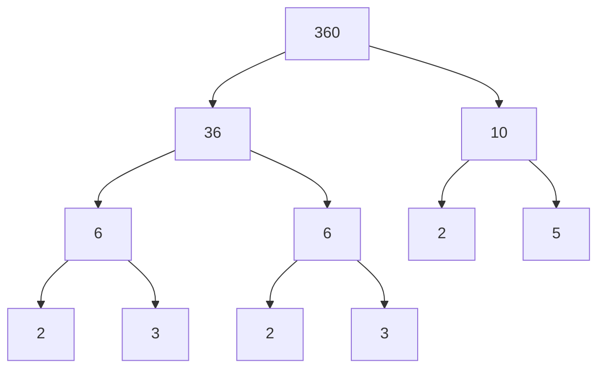
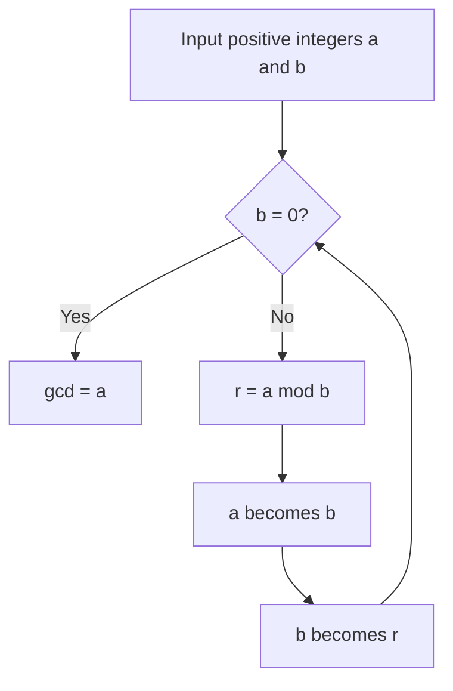
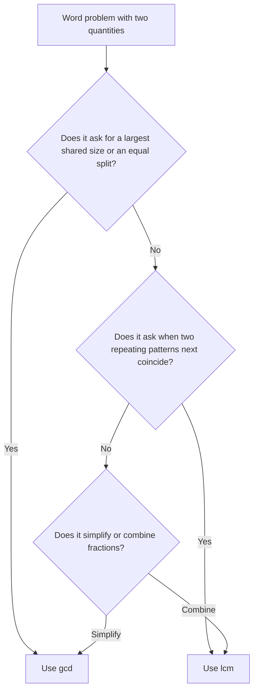

# Factors, Multiples, GCD and LCM

> [Mathematics](../../README.md) · [Pre-Algebra](../README.md) · Level: Beginner · Prerequisites: [Order of Operations](../01-order-of-operations/README.md), [Variables and Algebraic Expressions](../02-variables-and-expressions/README.md) · Estimated time: 5 h

## 1. Introduction

Multiplication links numbers in two directions. From $3\times4=12$ we can say that $3$ and $4$ are **factors** of $12$, and that $12$ is a **multiple** of $3$ (and of $4$). Questions about factors and multiples are among the oldest in mathematics, and they are still among the most useful: they decide whether a fraction can be simplified, whether a large number is prime, when two repeating events coincide, how to tile a floor without cutting tiles, and how modern cryptography keeps messages secret.

Two quantities organise almost all of these questions:

* the **greatest common divisor** $\gcd(a,b)$ — the largest number dividing both $a$ and $b$;
* the **least common multiple** $\operatorname{lcm}(a,b)$ — the smallest positive number divisible by both.

They are computed either from prime factorizations or, much more efficiently for large numbers, by the **Euclidean algorithm**, a procedure over two thousand years old that is still the standard method inside computers.

## 2. Prerequisites

You need:

* **Multiplication and division** of whole numbers, including division with remainder: $47=9\cdot5+2$: [Natural Numbers](../../01-arithmetic/01-natural-numbers/README.md).
* **The order of operations** and evaluation of expressions: [Order of Operations](../01-order-of-operations/README.md).
* **Variables and algebraic expressions**, since the proofs below use letters: [Variables and Algebraic Expressions](../02-variables-and-expressions/README.md).
* Familiarity with the **positive integers** $1,2,3,\dots$, the **integers** $\mathbb{Z}$, and the notation $a\mid b$ introduced in Section 5.

## 3. Learning Objectives

By the end of this tutorial you will be able to:

1. Decide whether one integer divides another, using the definition and the standard divisibility rules.
2. Prove the divisibility rules for $3$, $4$, $9$ and $11$.
3. Compute the prime factorization of an integer by a factor tree or by division by primes.
4. State the fundamental theorem of arithmetic and explain why $1$ is not called prime.
5. Compute $\gcd$ and $\operatorname{lcm}$ by listing, by prime factorization, and by the Euclidean algorithm.
6. Prove that the Euclidean algorithm is correct and that it terminates.
7. Use the identity $\gcd(a,b)\operatorname{lcm}(a,b)=ab$ and state the condition under which $\operatorname{lcm}(a,b)=ab$.
8. Solve word problems about tiling, scheduling and fractions by choosing $\gcd$ or $\operatorname{lcm}$ correctly.
9. Count the positive divisors of an integer from its prime factorization.
10. Explain how divisibility appears in programming and in cryptography.

## 4. Intuition

**Tiles and lengths.** A divisor of $n$ is a tile length that fits exactly $n$ units: $3$ is a divisor of $12$ because four $3$-unit tiles make $12$. A multiple of $n$ is a length you can reach by laying $n$-unit tiles end to end: $12$ is a multiple of $3$ because four tiles of length $3$ reach $12$.

With this picture, $\gcd(180,240)$ is the largest tile that fits both a $180$-unit and a $240$-unit strip, and $\operatorname{lcm}(12,18)$ is the shortest length that both a $12$-unit and an $18$-unit tile can reach exactly. The two notions are dual: divisors go *into* a number, multiples come *out of* it.

**Atoms of arithmetic.** Prime numbers are the atoms from which multiplication builds every integer. Just as chemistry's atoms combine in only one way to make a given molecule (ignoring isotopes), primes combine in only one way to make a given integer. That uniqueness is the content of the fundamental theorem of arithmetic, and it is what makes prime factorization a reliable tool rather than a convenient accident.

## 5. Formal Definition

**Definition 5.1 (Divisibility).** Let $a,b\in\mathbb{Z}$ with $a\neq0$. We say that **$a$ divides $b$**, written $a\mid b$, if there exists an integer $k$ such that
$$b=ak.$$
In that case $a$ is a **factor** or **divisor** of $b$, and $b$ is a **multiple** of $a$. If no such integer exists, we write $a\nmid b$.

Examples: $6\mid 42$ because $42=6\cdot7$; $7\nmid 30$; every nonzero integer divides $0$ because $0=a\cdot0$; and $0$ divides nothing, which is why the definition excludes $a=0$.

**Definition 5.2 (Prime and composite).** An integer $p>1$ is **prime** if its only positive divisors are $1$ and $p$. An integer $n>1$ that is not prime is **composite**. The number $1$ is neither prime nor composite; it is called a **unit**.

**Definition 5.3 (Greatest common divisor).** Let $a,b$ be integers, not both zero. The **greatest common divisor** $\gcd(a,b)$ is the largest positive integer $d$ such that $d\mid a$ and $d\mid b$. If $\gcd(a,b)=1$, the numbers $a$ and $b$ are **coprime**.

**Definition 5.4 (Least common multiple).** Let $a,b$ be positive integers. The **least common multiple** $\operatorname{lcm}(a,b)$ is the smallest positive integer $m$ such that $a\mid m$ and $b\mid m$.

**Definition 5.5 (Prime factorization).** A **prime factorization** of $n>1$ is an expression
$$n=p_1^{e_1}p_2^{e_2}\cdots p_k^{e_k}$$
where $p_1<\dots<p_k$ are primes and each $e_i\ge1$. The exponents are the **multiplicities** of the primes.

**Definition 5.6 (Remainder).** For integers $a$ and $b\ge1$, the **division algorithm** gives unique integers $q$ and $r$ with
$$a=bq+r,\qquad 0\le r<b.$$
We call $q$ the quotient and $r$ the remainder; in programming, $r$ is written `a % b` (for non-negative $a$).

## 6. Mathematical Notation

| Notation | Meaning | Read aloud |
|---|---|---|
| $a\mid b$ | $a$ divides $b$ | "a divides b" |
| $a\nmid b$ | $a$ does not divide $b$ | "a does not divide b" |
| $\gcd(a,b)$ | greatest common divisor | "gcd of a and b" |
| $\operatorname{lcm}(a,b)$ | least common multiple | "lcm of a and b" |
| $p$ | usually a prime | "p" |
| $p^k$ | $k$ factors of $p$ | "p to the k" |
| $a\equiv b\pmod m$ | $m\mid(a-b)$ | "a is congruent to b modulo m" |
| $a=bq+r$ | division with remainder | "a equals bq plus r" |

The congruence notation is a convenient shorthand: $a\equiv b\pmod m$ means exactly that $m$ divides the difference $a-b$. We use it only as an abbreviation for divisibility, never as a new kind of arithmetic.

## 7. Core Concepts

### 7.1 The division algorithm

For any integer $a$ and any positive integer $b$ there are unique integers $q,r$ with $a=bq+r$ and $0\le r<b$. The quotient is $q=\lfloor a/b\rfloor$ (for $a\ge0$), and the remainder is what is left over.

*Why.* Among the multiples $\dots,-2b,-b,0,b,2b,\dots$ choose the largest one not exceeding $a$; call it $qb$. Then $r=a-qb\ge0$, and $r<b$ because $(q+1)b>a$. Uniqueness follows because two different remainders in $[0,b)$ would differ by less than $b$ but would have to be a multiple of $b$.

Example: $47=9\cdot5+2$, so $47\bmod5=2$.

### 7.2 Divisibility rules

| Divisor | Test | Example |
|---|---|---|
| $2$ | last digit even | $4{,}572$ yes |
| $5$ | last digit $0$ or $5$ | $7{,}215$ yes |
| $10$ | last digit $0$ | $7{,}210$ yes |
| $4$ | last two digits form a multiple of $4$ | $4{,}572$: $72$ yes |
| $8$ | last three digits form a multiple of $8$ | $4{,}576$: $576$ yes |
| $3$ | digit sum divisible by $3$ | $8{,}145$: $18$ yes |
| $9$ | digit sum divisible by $9$ | $8{,}145$: $18$ yes |
| $6$ | divisible by $2$ and by $3$ | $4{,}572$ yes |
| $11$ | alternating digit sum divisible by $11$ | $4{,}917$: $7-1+9-4=11$ yes |

"Alternating digit sum" means adding the digits in the units, hundreds, ten-thousands, … positions and subtracting the digits in the tens, thousands, … positions.

### 7.3 Prime factorization

Two mechanical methods produce the same answer.

**Factor tree.** Split $n$ into any two factors larger than $1$ and repeat until every leaf is prime. For $360$:



Reading the leaves gives $360=2\cdot3\cdot2\cdot3\cdot2\cdot5=2^3\cdot3^2\cdot5$.

**Division by primes.** Divide repeatedly by $2$, then $3$, then $5$, and so on:
$$360\div2=180,\quad 180\div2=90,\quad 90\div2=45,\quad 45\div3=15,\quad 15\div3=5,\quad 5\div5=1.$$
The divisors used are $2,2,2,3,3,5$, the same factorization.

### 7.4 The fundamental theorem of arithmetic

**Theorem (FTA).** Every integer $n\ge2$ can be written as a product of primes, and the factorization is unique up to the order of the factors.

Existence is proved by strong induction: if $n$ is prime, it is already a product of one prime; if not, $n=ab$ with $1<a,b<n$, and both $a$ and $b$ factor by the induction hypothesis. Uniqueness needs Euclid's lemma, proved in Section 8.

Two consequences deserve emphasis:

* **$1$ is not prime.** If $1$ were prime, then $6=2\cdot3=1\cdot2\cdot3=1\cdot1\cdot2\cdot3$ would be several distinct prime factorizations, and uniqueness would collapse. Declaring $1$ a unit is what saves the theorem.
* **Every divisor is built from the same primes.** If $n=2^3\cdot3^2\cdot5$ then every positive divisor of $n$ has the form $2^a3^b5^c$ with $0\le a\le3$, $0\le b\le2$, $0\le c\le1$. This is why the gcd and lcm recipes below work.

### 7.5 GCD by factorization

For $84=2^2\cdot3\cdot7$ and $132=2^2\cdot3\cdot11$, a common divisor can use only primes appearing in both factorizations, with an exponent no larger than either. Hence
$$\gcd(84,132)=2^2\cdot3=12.$$
The rule is: **take the minimum exponent of each common prime**.

### 7.6 LCM by factorization

A common multiple must contain every prime of both numbers, with an exponent at least as large as in either. Hence
$$\operatorname{lcm}(84,132)=2^2\cdot3\cdot7\cdot11=924.$$
The rule is: **take the maximum exponent of each prime appearing**. Check: $924=84\cdot11=132\cdot7$.

### 7.7 The Euclidean algorithm

Repeated division gives the gcd without any factorization. The key identity is
$$\gcd(a,b)=\gcd(b,\,a\bmod b),$$
proved in Section 8. Apply it until the remainder is zero:

$$\begin{aligned}
1071 &= 2\cdot462+147\\
462 &= 3\cdot147+21\\
147 &= 7\cdot21+0
\end{aligned}$$

The last nonzero remainder, $21$, is $\gcd(1071,462)$.



The algorithm terminates because the remainders are non-negative and strictly decrease: $b>r\ge0$ at each step. It is fast: the number of steps is at most about five times the number of decimal digits of the smaller input.

### 7.8 GCD, LCM and word problems

* **Largest square tile for an $a\times b$ rectangle:** side $\gcd(a,b)$. A $180\times240$ floor takes tiles of side $60$, and the count is $(180/60)(240/60)=12$.
* **Two periodic events:** they coincide after $\operatorname{lcm}$ of the periods. Buses every $12$ and $18$ minutes, both leaving at 9:00, next leave together at $9{:}36$.
* **Simplifying a fraction:** divide numerator and denominator by their gcd. $\frac{84}{126}$ becomes $\frac{2}{3}$ because $\gcd(84,126)=42$.
* **Adding fractions:** use the lcm of the denominators as the least common denominator. $\frac{5}{12}+\frac{3}{8}$ uses $24$.

The choice is not arbitrary. "Largest tile", "greatest shared", "split into equal groups" call for gcd. "First time they meet again", "smallest common", "repeating in step" call for lcm.

### 7.9 Counting divisors

If $n=p_1^{e_1}\cdots p_k^{e_k}$, a divisor is determined by choosing each exponent independently from $0$ to $e_i$. There are $e_i+1$ choices for the $i$-th exponent, so the number of positive divisors is
$$\tau(n)=(e_1+1)(e_2+1)\cdots(e_k+1).$$
For $360=2^3\cdot3^2\cdot5$: $\tau(360)=4\cdot3\cdot2=24$. For $1071=3^2\cdot7\cdot17$: $\tau(1071)=3\cdot2\cdot2=12$.

### 7.10 Divisibility in programming

The remainder operator `%` turns divisibility into a comparison: `n % k == 0` means $k\mid n$. Two consequences are used constantly:

* **Primality testing.** If $n=ab$ with $a\le b$, then $a\le\sqrt n$. So it is enough to test divisors up to $\sqrt n$, which makes trial division practical for numbers of moderate size.
* **Computing gcd.** The Euclidean algorithm in a loop:

```python
def gcd(a, b):
    while b != 0:
        a, b = b, a % b
    return a

def lcm(a, b):
    return a // gcd(a, b) * b   # divide first: avoids overflow
```

Dividing before multiplying matters in languages with fixed-size integers: $a\cdot b$ can overflow even when the lcm is small.

## 8. Formulas and Properties

**Property 1 (Basic divisibility facts).** For integers $a,b,c$ with $a\neq0$:
$$a\mid b \text{ and } b\mid c\implies a\mid c;$$
$$a\mid b \text{ and } a\mid c\implies a\mid (bx+cy)\ \text{for all }x,y\in\mathbb{Z}.$$
*Why.* If $b=ak$ and $c=am$, then $c=a(km)$ and $bx+cy=a(kx+my)$.

**Property 2 (The Euclidean step).** For $a=bq+r$,
$$\gcd(a,b)=\gcd(b,r).$$
*Why.* Let $S$ be the set of common divisors of $a$ and $b$, and $T$ the set of common divisors of $b$ and $r$. If $d\in S$, then $d\mid a$ and $d\mid b$, so $d\mid(a-qb)=r$, hence $d\in T$. If $d\in T$, then $d\mid b$ and $d\mid r$, so $d\mid(qb+r)=a$, hence $d\in S$. Thus $S=T$, and two equal sets have the same greatest element.

**Property 3 (Termination and correctness).** The Euclidean algorithm terminates and returns $\gcd(a,b)$.
*Why.* The remainders satisfy $b>r_1>r_2>\cdots\ge0$, a strictly decreasing sequence of non-negative integers, so it reaches $0$ after finitely many steps. By Property 2, every step preserves the gcd, and $\gcd(d,0)=d$, so the last nonzero remainder is the original gcd.

**Property 4 (Bézout's identity).** For integers $a,b$ not both zero there exist integers $x,y$ with
$$ax+by=\gcd(a,b).$$
*Why.* Run the Euclidean algorithm and substitute backwards. In the example of Section 7.7,
$$21=462-3\cdot147=462-3(1071-2\cdot462)=7\cdot462-3\cdot1071.$$
By induction, every remainder is an integer combination of $a$ and $b$, so the last one is too.

**Property 5 (Euclid's lemma).** If $p$ is prime and $p\mid ab$, then $p\mid a$ or $p\mid b$.
*Why.* Suppose $p\nmid a$. The only positive divisors of $p$ are $1$ and $p$, so $\gcd(p,a)=1$. By Bézout, $1=px+ay$ for some integers $x,y$. Multiply by $b$:
$$b=pbx+aby.$$
Both terms on the right are divisible by $p$: the first obviously, the second because $p\mid ab$. Hence $p\mid b$.

**Property 6 (Uniqueness of prime factorization).** The prime factorization of an integer $n\ge2$ is unique up to order.
*Why.* Suppose $p_1\cdots p_r=q_1\cdots q_s$. The prime $p_1$ divides the product $q_1\cdots q_s$, so by Euclid's lemma it divides some $q_j$. Since $q_j$ is prime, $p_1=q_j$. Cancel $p_1$ from both sides and repeat; the lists must match term by term.

**Property 7 (GCD times LCM).** For positive integers $a,b$,
$$\gcd(a,b)\cdot\operatorname{lcm}(a,b)=ab.$$
*Why.* Write $a=gA$, $b=gB$ where $g=\gcd(a,b)$; then $\gcd(A,B)=1$. The number $gAB$ is a common multiple. Let $m$ be any common multiple, say $m=a k=b l$. Then $gAk=gBl$, so $Ak=Bl$. Since $\gcd(A,B)=1$ and $A\mid Bl$, Euclid's lemma gives $A\mid l$; write $l=Am'$. Then $m=gBAm'=gABm'\ge gAB$. Hence $gAB$ is the least common multiple, and $ab=g^2AB=g\cdot\operatorname{lcm}(a,b)$.

**Property 8 (Coprime factors).** If $\gcd(a,b)=1$, $a\mid c$ and $b\mid c$, then $ab\mid c$.
*Why.* Write $c=ak$. From $b\mid ak$ and $\gcd(a,b)=1$, Euclid's lemma gives $b\mid k$; write $k=bm$. Then $c=abm$.

**Property 9 (Divisibility rule for 3 and 9).** An integer is divisible by $3$ (respectively $9$) exactly when its digit sum is.
*Why.* Write $n=\sum_i d_i10^i$. Then
$$n-\sum_i d_i=\sum_i d_i(10^i-1).$$
Each $10^i-1=\underbrace{99\cdots9}_{i\text{ nines}}=9\cdot\underbrace{11\cdots1}_{i\text{ ones}}$ is divisible by $9$, hence by $3$. Therefore $n$ and its digit sum differ by a multiple of $9$; one is divisible by $3$ or $9$ exactly when the other is.

**Property 10 (Divisibility rule for 4 and 8).** An integer is divisible by $4$ exactly when its last two digits form a multiple of $4$, and by $8$ exactly when its last three digits form a multiple of $8$.
*Why.* Write $n=100q+r$ with $0\le r<100$. Since $100=4\cdot25$, $4\mid100q$, so $4\mid n\iff4\mid r$. For $8$, write $n=1000q+r$ with $0\le r<1000$ and use $1000=8\cdot125$.

**Property 11 (Divisibility rule for 11).** An integer is divisible by $11$ exactly when its alternating digit sum is.
*Why.* For each $i$, $10^i-(-1)^i$ is divisible by $10-(-1)=11$ (factor $x^i-y^i$ with $x=10$, $y=-1$). Hence
$$n-\sum_i d_i(-1)^i=\sum_i d_i\bigl(10^i-(-1)^i\bigr)$$
is divisible by $11$, so $n$ and the alternating sum have the same divisibility status.

**Property 12 (Divisor count).** If $n=p_1^{e_1}\cdots p_k^{e_k}$, then $\tau(n)=\prod_{i=1}^k(e_i+1)$.
*Why.* Every divisor has the form $\prod p_i^{a_i}$ with $0\le a_i\le e_i$, and by unique factorization distinct exponent tuples give distinct divisors. There are $e_i+1$ choices for each $a_i$.

## 9. Step-by-Step Examples

### Example 1 (Easy): a full divisibility report for $8{,}145$

Digits: $8,1,4,5$; digit sum $18$; last digit $5$; last two digits $45$; last three digits $145$; alternating sum $5-4+1-8=-6$.

| Divisor | Verdict | Reason |
|---|---|---|
| $2$ | no | last digit odd |
| $3$ | yes | $18$ is a multiple of $3$ |
| $4$ | no | $45$ is not a multiple of $4$ |
| $5$ | yes | last digit $5$ |
| $6$ | no | not even |
| $8$ | no | $145$ is not a multiple of $8$ |
| $9$ | yes | $18$ is a multiple of $9$ |
| $10$ | no | last digit not $0$ |
| $11$ | no | $-6$ is not a multiple of $11$ |

Indeed $8145=3^2\cdot5\cdot181$.

### Example 2 (Easy): prime factorizations

$$360=36\cdot10=(2^2\cdot3^2)(2\cdot5)=2^3\cdot3^2\cdot5.$$
$$1001=7\cdot143=7\cdot11\cdot13.$$
The second is worth remembering: $1001$ looks prime but is not.

### Example 3 (Medium): gcd and lcm by factorization

$$84=2^2\cdot3\cdot7,\qquad 132=2^2\cdot3\cdot11.$$
Common primes: $2$ with minimum exponent $2$, and $3$ with minimum exponent $1$. Hence
$$\gcd(84,132)=2^2\cdot3=12.$$
For the lcm take every prime appearing, with maximum exponent:
$$\operatorname{lcm}(84,132)=2^2\cdot3\cdot7\cdot11=924.$$
Check with Property 7: $84\cdot132=11{,}088$ and $12\cdot924=11{,}088$.

### Example 4 (Medium): the Euclidean algorithm with Bézout

Compute $\gcd(1071,462)$ and express it as a combination of $1071$ and $462$.

$$\begin{aligned}
1071&=2\cdot462+147\\
462&=3\cdot147+21\\
147&=7\cdot21+0
\end{aligned}$$

The last nonzero remainder is $21$. Back-substitute:
$$21=462-3\cdot147=462-3(1071-2\cdot462)=7\cdot462-3\cdot1071.$$
Check: $7\cdot462=3234$, $3\cdot1071=3213$, and $3234-3213=21$.

### Example 5 (Medium): tiling a floor

A rectangular floor measures $180$ cm by $240$ cm. What is the largest square tile that covers it exactly, and how many tiles are needed?

The tile side must divide both $180$ and $240$, and we want the largest such side:
$$\gcd(180,240)=60.$$
A tile of side $60$ cm fits $180/60=3$ times along one side and $240/60=4$ times along the other, so the count is $3\cdot4=12$ tiles. No larger square works, because its side would be a common divisor larger than $60$.

### Example 6 (Medium): two repeating events

Bus $A$ leaves every $12$ minutes and bus $B$ every $18$ minutes. Both leave at 9:00. When do they next leave together?

The common departure times are common multiples of $12$ and $18$:
$$\operatorname{lcm}(12,18)=36.$$
They next leave together $36$ minutes later, at 9:36. After that they coincide every $36$ minutes: 10:12, 10:48, and so on.

### Example 7 (Medium): fractions

Reduce $\frac{84}{126}$ and compute $\frac{5}{12}+\frac{3}{8}$.

For the first, $\gcd(84,126)=42$, so
$$\dfrac{84}{126}=\dfrac{84/42}{126/42}=\dfrac{2}{3}.$$
For the second, $\operatorname{lcm}(12,8)=24$:
$$\dfrac{5}{12}+\dfrac{3}{8}=\dfrac{10}{24}+\dfrac{9}{24}=\dfrac{19}{24}.$$
Both operations use the same pair of tools; only the choice of gcd versus lcm differs.

### Example 8 (Hard): counting divisors

How many positive divisors does $360$ have? How many does $1071$ have?

$$360=2^3\cdot3^2\cdot5\implies\tau(360)=(3+1)(2+1)(1+1)=24.$$
$$1071=3^2\cdot7\cdot17\implies\tau(1071)=(2+1)(1+1)(1+1)=12.$$
The twenty-four divisors of $360$ are $1,2,3,4,5,6,8,9,10,12,15,18,20,24,30,36,40,45,60,72,90,120,180,360$; the formula counts them without listing.

### Example 9 (Hard): a proof with the Euclidean step

Show that if $n$ is an integer, then $\gcd(3n+2,\,2n+1)=1$.

Apply the Euclidean step: $3n+2=1\cdot(2n+1)+n+1$, so
$$\gcd(3n+2,2n+1)=\gcd(2n+1,n+1).$$
Again, $2n+1=1\cdot(n+1)+n$, so
$$\gcd(2n+1,n+1)=\gcd(n+1,n)=\gcd(n,1)=1.$$
The result is $1$ for every $n$. This trick — reducing a symbolic gcd until a constant appears — is the standard way to prove that two expressions are always coprime.

## 10. Visual Explanations

The factor tree in Section 7.3 and the Euclidean flowchart in Section 7.7 carry the two computational methods. A third picture organises the choice between gcd and lcm:



A table of the first multiples makes the lcm visible as the first shared entry:

| $n$ | multiples |
|---|---|
| $6$ | $6,12,18,24,30,36,42,\dots$ |
| $8$ | $8,16,24,32,40,48,\dots$ |

The first common entry is $24$, so $\operatorname{lcm}(6,8)=24$. The first common divisor is found similarly by listing divisors, which is why the Euclidean algorithm is preferred for large numbers.

## 11. Common Mistakes

| Mistake | Why it is tempting | Correct treatment |
|---|---|---|
| calling $1$ prime | it has no divisors other than $1$ and itself | $1$ is a unit; primes are $>1$ |
| $\gcd(12,18)=6$ but $\operatorname{lcm}(12,18)=6$ | using one word for both | lcm is $36$; gcd goes in, lcm comes out |
| $\operatorname{lcm}(a,b)=ab$ always | true for coprime pairs | only when $\gcd(a,b)=1$ |
| testing divisibility by $3$ from the last digit | confusing with $2$ and $5$ | use the digit sum |
| stopping a factor tree at $91$ because it "looks prime" | $91$ has no small factor except $7$ | $91=7\cdot13$ |
| $\gcd(0,0)=0$ | pattern from $\gcd(0,n)=n$ | $\gcd(0,0)$ is undefined |
| dividing only the numerator when simplifying | forgetting the denominator | divide both by the same gcd |
| cancelling terms rather than factors | $\frac{x+2}{2}=x+1$ looks like cancellation | only factors cancel; this fraction does not simplify |
| using lcm for "largest tile" | keyword matching instead of meaning | largest shared size is gcd |
| assuming $\sqrt n$ rounding is safe | testing $d<\sqrt n$ misses $d=\sqrt n$ | use $d\cdot d\le n$ |

## 12. Applications

**Fractions.** Every simplification and every common denominator is a gcd or lcm computation. This is the main use in elementary mathematics, and the reason the topic precedes algebra.

**Scheduling.** Repeating events — traffic lights, bus routes, shift rotations, computer timers — coincide at multiples of the lcm of their periods. The same idea underlies the design of periodic waveforms in music and signal processing.

**Engineering.** Gear teeth must mesh, so gear ratios are built from divisors; a gear with $12$ teeth driving one with $18$ teeth returns to its starting alignment after $\operatorname{lcm}(12,18)=36$ teeth have passed, which is $3$ turns of the first gear and $2$ of the second.

**Cryptography.** RSA encryption uses two large primes $p$ and $q$, publishes $n=pq$, and relies on the fact that factoring $n$ is believed to be computationally infeasible when $p$ and $q$ are large. The correctness of RSA uses Euclid's lemma and Bézout's identity (to compute private exponents).

**Check digits.** ISBN-10 and many identification numbers use weighted sums modulo $11$; a single mistyped digit changes the sum by a nonzero multiple and is detected. The same principle appears in barcodes and in error-correcting codes.

**Programming.** Remainders implement cyclic buffers, hashing, calendar arithmetic and divisibility tests. The Euclidean algorithm is one of the oldest algorithms still in daily use, and `math.gcd` in modern languages is a library call to it.

## 13. Exercises

The problem set is in [exercises.md](exercises.md): 32 problems covering divisibility tests, prime factorization, gcd and lcm by three methods, word problems, four proofs, and a programming-oriented challenge about trial division.

## 14. Solutions

Complete worked solutions, including full proofs, are in [solutions.md](solutions.md). For the proof exercises, a correct solution must state the definitions used and handle the general case, not only an example.

## 15. Summary

* $a\mid b$ means $b=ak$ for some integer $k$; $a$ is a factor of $b$ and $b$ is a multiple of $a$.
* Primes are the integers $p>1$ whose only positive divisors are $1$ and $p$; $1$ is a unit, not a prime.
* Every integer $n\ge2$ has a prime factorization, unique up to order (fundamental theorem of arithmetic).
* $\gcd$ takes the minimum exponent of common primes; $\operatorname{lcm}$ takes the maximum exponent of all primes.
* The Euclidean algorithm uses $\gcd(a,b)=\gcd(b,a\bmod b)$; it terminates and is fast.
* Bézout's identity, $\gcd(a,b)=ax+by$, follows from the Euclidean algorithm and proves Euclid's lemma.
* $\gcd(a,b)\operatorname{lcm}(a,b)=ab$, so $\operatorname{lcm}(a,b)=ab$ exactly when $a$ and $b$ are coprime.
* Divisibility rules are proved by writing numbers in base $10$ and factoring $10^i\pm1$.
* $\tau(n)=\prod(e_i+1)$ counts positive divisors.
* In programming, `%` tests divisibility, trial division only needs divisors up to $\sqrt n$, and lcm should be computed as `a // gcd(a,b) * b`.

## 16. Further Learning

Next: [Introduction to Equations](../04-introduction-to-equations/README.md), where the algebra of expressions is turned into a method for finding unknowns, and [The Coordinate Plane](../05-the-coordinate-plane/README.md).

For deeper study, any elementary number theory text develops these ideas into modular arithmetic and the RSA algorithm; *Elementary Number Theory* by David Burton and the freely available *An Introduction to the Theory of Numbers* by Hardy and Wright are standard references. For the computational side, the documentation of Python's `math.gcd` and `sympy.ntheory` shows how the algorithms of this tutorial appear as library functions.
