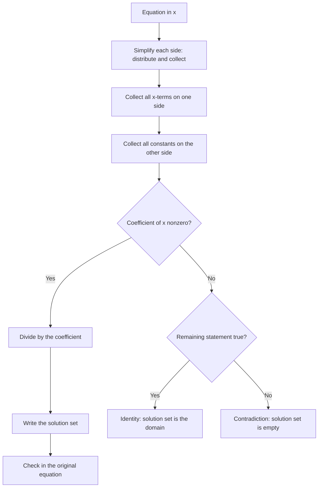
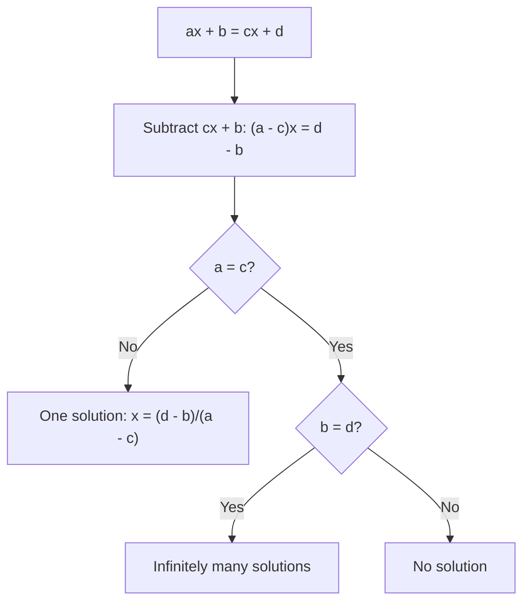

# Introduction to Equations

> [Mathematics](../../README.md) · [Pre-Algebra](../README.md) · Level: Beginner · Prerequisites: [Order of Operations](../01-order-of-operations/README.md), [Variables and Algebraic Expressions](../02-variables-and-expressions/README.md) · Estimated time: 6 h

## 1. Introduction

An **equation** is a statement that two expressions have the same value. The statement $3+4=7$ is a complete sentence, either true or false. The statement $3x+5=20$ contains a variable, so its truth depends on the value chosen for $x$; it is an *open sentence*. **Solving** the equation means finding every value of $x$ that makes it true.

Equations are the oldest and most useful tool of algebra. A word problem about ages, prices, mixtures or geometry becomes an equation once the unknown is named; the equation can then be manipulated by rules that preserve its truth. The manipulation is the easy part — the rules are few and mechanical. The hard and valuable parts are translating the problem correctly and checking that the solution answers the question that was asked.

This tutorial develops the balance model, states exactly which moves preserve the solution set and why, and applies them to one-step, two-step and multi-step linear equations, including equations with fractions, decimals and variables on both sides. It also explains what it means for an equation to have *no* solution or *infinitely many*.

## 2. Prerequisites

You need:

* **The order of operations**, since solving reverses it: [Order of Operations](../01-order-of-operations/README.md).
* **Expressions, terms, coefficients and the distributive property**: [Variables and Algebraic Expressions](../02-variables-and-expressions/README.md).
* **Signed-number arithmetic**, especially multiplying and dividing by negative numbers: [Integers](../../01-arithmetic/02-integers/README.md).
* **Fraction and decimal arithmetic**, including finding a common denominator: [Fractions](../../01-arithmetic/03-fractions/README.md) and [Decimals](../../01-arithmetic/04-decimals/README.md).
* **Divisibility and least common multiples**, for clearing denominators: [Factors, Multiples, GCD and LCM](../03-factors-and-multiples/README.md).

## 3. Learning Objectives

By the end of this tutorial you will be able to:

1. Explain what an equation asserts and what a solution is.
2. Distinguish equivalent equations from equations that merely look similar.
3. Justify the addition and multiplication properties of equality, and explain why multiplication by zero is forbidden.
4. Solve one-step and two-step linear equations with a written reason for each step.
5. Solve equations with variables on both sides, with parentheses, with fractions and with decimals.
6. Check a proposed solution by substitution in the *original* equation.
7. Translate a word problem into an equation, solve it, and interpret the result in context.
8. Recognize equations with no solution and equations with infinitely many solutions, and explain the difference.
9. Solve a formula for a specified variable.

## 4. Intuition

Picture a balance scale. The two sides of an equation are the two pans; the equals sign says the pans are level. Three operations keep the scale level:

* add the same weight to both pans;
* remove the same weight from both pans;
* double, triple or halve the contents of both pans (multiply or divide both sides by the same nonzero number).

Operations that treat the two pans differently destroy the balance. That is the whole of the balance model, and it explains both the power and the limitations of equation solving.

A second intuition is **undoing**. If you put on socks and then shoes, you undo by removing shoes and then socks — the reverse order. An equation records a sequence of operations applied to the unknown: "multiply by $3$, then subtract $5$". Solving undoes them in reverse: "add $5$, then divide by $3$". This is why two-step equations are solved by reversing the order of operations, not by repeating it.

## 5. Formal Definition

**Definition 5.1 (Equation).** An **equation** is a statement of the form
$$E=F,$$
where $E$ and $F$ are expressions. If $E$ and $F$ contain no variables, the equation is simply true or false. If they contain a variable $x$, the equation is an **open sentence**: it becomes true or false once a value is assigned to $x$.

**Definition 5.2 (Solution and solution set).** A **solution** of an equation in the variable $x$ is a value of $x$ (from the agreed domain) that makes the equation true. The **solution set** is the set of all solutions. "Solve the equation" means "determine the solution set".

**Definition 5.3 (Equivalent equations).** Two equations are **equivalent** (over a domain) if they have the same solution set over that domain.

**Definition 5.4 (Linear equation in one variable).** An equation is **linear** in $x$ if it can be written in the form
$$ax+b=0,\qquad a\neq0.$$
More generally, an equation of the form $ax+b=cx+d$ is linear provided $a\neq c$; if $a=c$ it degenerates to a constant statement.

**Definition 5.5 (Identity and contradiction).** An equation that is true for every value in the domain is an **identity**. An equation that is false for every value is a **contradiction**. An equation with exactly one solution in a linear setting is neither.

**Definition 5.6 (Domain).** The **domain** is the set of values the variable is allowed to take. Unless stated otherwise, we take the domain to be the real numbers, but a word problem may restrict it to positive integers, non-negative numbers, or values for which a denominator is nonzero.

## 6. Mathematical Notation

| Notation | Meaning | Read aloud |
|---|---|---|
| $=$ | the two sides are equal | "equals" |
| $\neq$ | not equal | "is not equal to" |
| $x=5$ | the solution is $5$ | "x equals five" |
| $\{5\}$ | the solution set containing $5$ | "the set containing five" |
| $\varnothing$ | the empty set (no solutions) | "the empty set" |
| $\iff$ | each side implies the other; equivalent statements | "if and only if" |
| $\implies$ | implies | "implies" |
| LHS, RHS | left-hand side, right-hand side | "left-hand side", "right-hand side" |

A solution set may be written $\{5\}$, $\{-3,2\}$ or, for identities over the reals, $\mathbb{R}$. Writing $x=5$ is shorthand for "the solution set is $\{5\}$".

## 7. Core Concepts

### 7.1 The balance model and the two legal moves

Every step in solving a linear equation is one of two moves, or a combination of them:

1. **Add or subtract the same quantity on both sides.** From $a=b$ we may conclude $a+c=b+c$; conversely, from $a+c=b+c$ we may conclude $a=b$.
2. **Multiply or divide both sides by the same nonzero quantity.** From $a=b$ we may conclude $ac=bc$; conversely, if $c\neq0$, from $ac=bc$ we may conclude $a=b$.

The converse directions matter: they are what guarantee that no solution is lost and no extra solution is gained. A move without a converse is not safe.

### 7.2 Inverse operations

| Operation applied to $x$ | Inverse operation |
|---|---|
| add $7$ | subtract $7$ |
| subtract $7$ | add $7$ |
| multiply by $4$ | divide by $4$ (multiply by $\frac14$) |
| divide by $4$ | multiply by $4$ |
| multiply by $-\frac23$ | multiply by $-\frac32$ |

The inverse of a sequence is the sequence of inverses in reverse order. For $3x-5$, the operations are "multiply by $3$" then "subtract $5$"; the inverse sequence is "add $5$" then "divide by $3$".

### 7.3 One-step equations

**Example.** Solve $x+7=12$.

Subtract $7$ from both sides (addition property with $c=-7$):
$$x+7-7=12-7\implies x=5.$$
Check: $5+7=12$. The solution set is $\{5\}$.

**Example.** Solve $\frac{x}{3}=5$.

Multiply both sides by $3$ (multiplication property with $c=3\neq0$):
$$3\cdot\dfrac{x}{3}=3\cdot5\implies x=15.$$
Check: $15/3=5$.

### 7.4 Two-step equations: reverse the order

**Example.** Solve $3x-5=16$.

The left side applies "multiply by $3$" then "subtract $5$". Undo in reverse:

Add $5$:
$$3x-5+5=16+5\implies 3x=21.$$
Divide by $3$:
$$\dfrac{3x}{3}=\dfrac{21}{3}\implies x=7.$$
Check: $3(7)-5=21-5=16$.

Doing the steps in the other order — dividing by $3$ first — gives $\frac{3x-5}{3}=\frac{16}{3}$, which is correct but messier; it does not isolate $x$ in one step.

### 7.5 Variables on both sides

**Example.** Solve $5x-3=2x+9$.

Subtract $2x$ from both sides to collect the variable on the left:
$$5x-3-2x=2x+9-2x\implies 3x-3=9.$$
Add $3$:
$$3x=12.$$
Divide by $3$:
$$x=4.$$
Check: left $5(4)-3=17$; right $2(4)+9=17$.

It is legal to collect the variable on either side; choosing the side that makes the coefficient positive usually avoids sign errors.

### 7.6 Parentheses

If the equation contains parentheses, distribute first.

**Example.** Solve $4(x-2)=3x+1$.

Distribute:
$$4x-8=3x+1.$$
Subtract $3x$:
$$x-8=1.$$
Add $8$:
$$x=9.$$
Check: left $4(9-2)=28$; right $3(9)+1=28$.

### 7.7 Fractions

Two methods work; both are legal.

**Method 1: multiply by the reciprocal of the coefficient.**

$$\dfrac{2}{3}x=\dfrac{4}{5}\implies x=\dfrac{3}{2}\cdot\dfrac{4}{5}=\dfrac{6}{5}.$$

**Method 2: multiply the whole equation by the least common multiple of the denominators.** This clears all fractions at once.

**Example.** Solve $\frac{x+1}{3}=\frac{x-2}{4}$.

The lcm of $3$ and $4$ is $12$. Multiply both sides by $12$:
$$12\cdot\dfrac{x+1}{3}=12\cdot\dfrac{x-2}{4}\implies 4(x+1)=3(x-2).$$
Distribute:
$$4x+4=3x-6.$$
Subtract $3x$ and subtract $4$:
$$x=-10.$$
Check: left $\frac{-10+1}{3}=\frac{-9}{3}=-3$; right $\frac{-10-2}{4}=\frac{-12}{4}=-3$.

A shortcut for proportions, valid when both denominators are nonzero:
$$\dfrac{a}{b}=\dfrac{c}{d}\iff ad=bc.$$
This is **cross-multiplication**; it is just multiplication by $bd$.

### 7.8 Decimals

Multiply the entire equation by a power of $10$ to remove decimals, then solve.

**Example.** Solve $0.05x+0.1(200-x)=16$.

Multiply by $100$:
$$5x+10(200-x)=1600.$$
Distribute:
$$5x+2000-10x=1600.$$
Collect:
$$-5x=-400.$$
Divide by $-5$:
$$x=80.$$
Check: $0.05(80)+0.1(120)=4+12=16$.

### 7.9 Checking a solution

A check must substitute into the **original** equation, not into an intermediate one, because an error in an intermediate step would be invisible otherwise.

**Procedure.** Replace $x$ by the proposed value everywhere; evaluate each side separately; confirm the two values agree. A check is not a proof that the solution is unique, but it does detect arithmetic errors.

### 7.10 Word problems

A reliable four-step procedure:

1. **Name the unknown.** Write "let $x$ be …", including units.
2. **Translate.** Use the dictionary below to write an equation.
3. **Solve.** Apply the balance moves.
4. **Interpret and check.** Does the answer make sense in the context? Does it satisfy the equation? Are units correct?

| Words | Symbolic form |
|---|---|
| is, was, equals, gives | $=$ |
| sum, increased by, more than | $+$ |
| difference, decreased by, less than | $-$ (watch the order) |
| product, times, of | $\times$ |
| quotient, divided by, per | $\div$ |
| twice, double | $2\times$ |
| half of | $\frac12\times$ |
| consecutive integers | $x,\ x+1,\ x+2$ |
| in $5$ years | $x+5$ |
| $5$ years ago | $x-5$ |

### 7.11 No solution, one solution, infinitely many

Linear equations have exactly one of three outcomes.

* **One solution** — the usual case, e.g. $2x+1=7$ gives $x=3$.
* **No solution** — the variable cancels and a false statement remains:
  $$2x+3=2x+7\implies 3=7,$$
  which is false. The solution set is $\varnothing$. Such an equation is a contradiction.
* **Infinitely many solutions** — the variable cancels and a true statement remains:
  $$3(x+2)=3x+6\implies 6=6,$$
  true for every $x$. The solution set is $\mathbb{R}$ (or the whole domain). Such an equation is an identity.

The distinction between "no solution" and "the solution is $0$" is essential. $2x=0$ has the solution $x=0$; $2x=2x+1$ has no solution at all.

### 7.12 Solving a formula for a variable

A formula is an equation among several variables. To solve for one variable, treat the others as constants and use the same moves.

**Example.** Solve $P=2l+2w$ for $w$:
$$P-2l=2w\implies w=\dfrac{P-2l}{2}.$$
No numerical value is needed; the result is an expression in the remaining variables.

## 8. Formulas and Properties

**Property 1 (Addition property of equality).** For all numbers $a,b,c$,
$$a=b\iff a+c=b+c.$$
*Why.* If $a=b$, then $a$ and $b$ are the same number, so adding $c$ to each produces the same result. Conversely, if $a+c=b+c$, add $-c$ to both sides to recover $a=b$.

**Property 2 (Multiplication property of equality).** For all numbers $a,b$ and $c\neq0$,
$$a=b\iff ac=bc.$$
*Why.* The forward direction holds because equal numbers multiplied by the same number give equal products. Conversely, if $ac=bc$ with $c\neq0$, multiply by $1/c$ to get $a=b$.

**Property 3 (Why $c=0$ is excluded).** From $a=b$ we may always conclude $a\cdot0=b\cdot0$, but the converse fails:
$$1\cdot0=2\cdot0,\qquad\text{yet }1\neq2.$$
Multiplying by zero destroys information, so it cannot be used as a solving step.

**Property 4 (Equivalence of the solving steps).** Each of the following transformations preserves the solution set:

* distributing or collecting like terms on one side;
* adding or subtracting the same expression on both sides;
* multiplying or dividing both sides by the same nonzero constant.

*Why.* The first is an identity from the algebra of expressions. The second and third are Properties 1 and 2. Because each move is reversible, the original and final equations have exactly the same solutions.

**Property 5 (Solution of a general linear equation).** Let $a,b,c,d$ be real numbers and consider
$$ax+b=cx+d.$$
Subtracting $cx+b$ from both sides gives the equivalent equation
$$(a-c)x=d-b.$$
Then:

* if $a\neq c$, there is exactly one solution, $x=\dfrac{d-b}{a-c}$;
* if $a=c$ and $b=d$, every real number is a solution;
* if $a=c$ and $b\neq d$, there is no solution.

*Why.* Division by $a-c$ is legal exactly when $a-c\neq0$, by Property 2. If $a=c$, the equation becomes $b=d$, which is either true for all $x$ or false for all $x$. The three cases are exhaustive and mutually exclusive.

**Property 6 (Cross-multiplication).** If $b\neq0$ and $d\neq0$, then
$$\dfrac{a}{b}=\dfrac{c}{d}\iff ad=bc.$$
*Why.* Multiply both sides by $bd$, which is nonzero.

**Property 7 (Check by substitution).** If $x=s$ is obtained from an equation by equivalence-preserving steps, then substituting $s$ into the original equation gives a true statement. Conversely, if substitution gives a false statement, $s$ is not a solution.

**Property 8 (Operations that are not reversible).** Squaring both sides is not an equivalence:
$$x=2\implies x^2=4,$$
but $x^2=4$ also has the solution $x=-2$. Squaring can introduce **extraneous solutions**. Similarly, multiplying by an expression that may be zero can introduce solutions, and dividing by such an expression can lose them. In this tutorial every multiplier is a nonzero constant, so these dangers do not arise; they will matter later.

## 9. Step-by-Step Examples

### Example 1 (Easy): one step with addition

Solve $x+7=12$.

Subtract $7$ from both sides:
$$x+7-7=12-7\implies x=5.$$
Check in the original: $5+7=12$. Solution set $\{5\}$.

### Example 2 (Easy): one step with multiplication and division

Solve $4x=28$.

Divide both sides by $4$:
$$\dfrac{4x}{4}=\dfrac{28}{4}\implies x=7.$$
Check: $4(7)=28$.

Solve $\frac{x}{3}=5$.

Multiply both sides by $3$:
$$x=15.$$
Check: $15/3=5$.

### Example 3 (Easy): two steps

Solve $3x-5=16$.

Add $5$:
$$3x=21.$$
Divide by $3$:
$$x=7.$$
Check: $3(7)-5=16$. The order matters: adding $5$ first isolates the term containing $x$; dividing first would give $\frac{3x-5}{3}=\frac{16}{3}$, which is true but does not isolate $x$.

### Example 4 (Medium): a negative coefficient

Solve $5-2x=11$.

Subtract $5$:
$$-2x=6.$$
Divide by $-2$:
$$x=-3.$$
Check: $5-2(-3)=5+6=11$. A common error is to write $x=3$ by dropping the minus sign during division.

### Example 5 (Medium): variables on both sides with parentheses

Solve $4(x-2)=3x+1$.

Distribute:
$$4x-8=3x+1.$$
Subtract $3x$ from both sides:
$$x-8=1.$$
Add $8$:
$$x=9.$$
Check: left $4(9-2)=4\cdot7=28$; right $3\cdot9+1=28$. Solution set $\{9\}$.

### Example 6 (Medium): fractions on both sides

Solve $\frac{x+1}{3}=\frac{x-2}{4}$.

Multiply by the lcm $12$:
$$4(x+1)=3(x-2).$$
Distribute:
$$4x+4=3x-6.$$
Subtract $3x$:
$$x+4=-6.$$
Subtract $4$:
$$x=-10.$$
Check: left $\frac{-9}{3}=-3$; right $\frac{-12}{4}=-3$.

### Example 7 (Hard): decimals and a mixture

Solve $0.05x+0.1(200-x)=16$.

Multiply by $100$:
$$5x+10(200-x)=1600.$$
Distribute:
$$5x+2000-10x=1600.$$
Collect like terms:
$$-5x+2000=1600.$$
Subtract $2000$:
$$-5x=-400.$$
Divide by $-5$:
$$x=80.$$
Check: $0.05(80)+0.1(120)=4+12=16$. In context, $x$ could be the number of milliliters of a $5\%$ solution mixed with $200-x$ milliliters of a $10\%$ solution to obtain $16$ units of solute.

### Example 8 (Hard): a word problem

The length of a rectangle is $5$ cm more than its width, and the perimeter is $46$ cm. Find the dimensions.

Let $w$ be the width in cm; then the length is $w+5$. Perimeter:
$$2w+2(w+5)=46.$$
Distribute:
$$2w+2w+10=46.$$
Collect:
$$4w+10=46.$$
Subtract $10$:
$$4w=36.$$
Divide by $4$:
$$w=9.$$
The width is $9$ cm and the length is $14$ cm. Check: $2(9)+2(14)=18+28=46$. Both dimensions are positive, as required by the context.

### Example 9 (Hard): identity and contradiction

Solve $2(x+3)=2x+6$.

Distribute:
$$2x+6=2x+6.$$
Subtract $2x$:
$$6=6.$$
This is true for every $x$; the equation is an identity and its solution set is $\mathbb{R}$.

Solve $3x+4=3x-5$.

Subtract $3x$:
$$4=-5.$$
This is false for every $x$; the equation is a contradiction and its solution set is $\varnothing$.

The two equations look similar before simplification. The difference appears only after the variable is eliminated: a true constant statement means every value works, a false one means none does.

## 10. Visual Explanations

The solving procedure is a loop that ends when the variable is isolated:

The classification of $ax+b=cx+d$ is a decision tree with three leaves, matching Property 5:

A balance table records what happens to each side, which is a useful habit when equations become longer:

| Step | Left pan | Right pan |
|---|---|---|
| Start | $3x-5$ | $16$ |
| Add $5$ | $3x$ | $21$ |
| Divide by $3$ | $x$ | $7$ |

## 11. Common Mistakes

| Mistake | Why it is tempting | Correct treatment |
|---|---|---|
| $x+7=12\Rightarrow x=19$ | seeing addition and adding again | subtract $7$ from both sides: $x=5$ |
| changing only one side | the unknown is "on the left" | every operation applies to both sides |
| $3x=15\Rightarrow x=18$ | adding instead of dividing | divide by $3$: $x=5$ |
| $5x-3=2x+9\Rightarrow 3x=12$ without tracking signs | moving terms mechanically | subtract $2x$: $3x-3=9$; add $3$: $3x=12$ |
| $\frac{x+3}{2}=5\Rightarrow x+3=5$ | forgetting to multiply the right side | multiply by $2$: $x+3=10$ |
| cancelling terms inside a sum | $\frac{x+2}{2}=x+1$ looks plausible | only factors cancel; solve instead |
| dividing by a variable | it "simplifies" | may lose the solution $x=0$; factor instead |
| squaring both sides to remove a root | seems to simplify | can introduce extraneous solutions; check every candidate |
| $x=0$ confused with "no solution" | both look like "nothing" | $x=0$ is one solution; no solution means $\varnothing$ |
| checking in an intermediate equation | it is already known to be true there | check in the original |
| negative coefficient: $-2x=6\Rightarrow x=3$ | ignoring the sign | $x=-3$ |

## 12. Applications

**Science and engineering.** Every formula can be rearranged for the needed quantity: from $d=rt$ solve for $t=d/r$; from $F=\frac95C+32$ solve for $C=\frac59(F-32)$; from $P=2l+2w$ solve for either dimension. The rearrangement is an equation-solving problem.

**Finance.** Simple interest $I=Prt$ is solved for $r$ to compare investments; break-even analysis sets revenue equal to cost, $pq=500+3q$, and solves for $q$.

**Geometry.** Unknown angles, sides and dimensions are found by writing equations from perimeter, area or angle-sum facts. Example 8 is the prototype.

**Mixtures and percentages.** "How much of a $5\%$ solution must be mixed with a $10\%$ solution to make $200$ ml containing $16$ units of solute?" is exactly Example 7: the two volumes add to $200$, and the amounts of solute add to $16$.

**Age and consecutive-number puzzles.** "The sum of three consecutive integers is 72" becomes $x+(x+1)+(x+2)=72$, whose solution is $x=23$, giving $23,24,25$.

**Programming.** In most languages `x = x + 1` is an **assignment**, not an equation: it means "replace the stored value of `x` by the old value plus one". Solving an equation and updating a variable are different operations that unfortunately share the symbol `=`. In mathematics, `x = x + 1` has no solution; in Python, it is a perfectly ordinary instruction.

## 13. Exercises

The problem set is in [exercises.md](exercises.md): 32 equations and problems, from one-step equations through fractions, decimals, word problems, literal equations and a complete classification of the general linear equation.

## 14. Solutions

Complete worked solutions, including checks, are in [solutions.md](solutions.md). Every solution shows the justification for each move and verifies the answer in the original equation.

## 15. Summary

* An equation asserts that two expressions are equal; a solution is a value making the assertion true.
* Two equations are equivalent if they have the same solution set.
* The only legal moves are adding/subtracting the same quantity on both sides and multiplying/dividing both sides by the same **nonzero** quantity.
* Multiplication by zero is not reversible and must never be used as a solving step.
* Solve by undoing operations in reverse order; distribute and collect like terms first.
* Clear fractions by multiplying by the lcm of the denominators, and decimals by multiplying by a power of $10$.
* Always check the candidate in the original equation.
* A linear equation has exactly one solution, no solution (contradiction) or infinitely many (identity); the three cases are distinguished by whether the variable coefficient and the constant statement survive.
* Word problems require naming the unknown, translating, solving, and interpreting the answer in context.
* Formulas are equations; solving for a different variable uses the same moves.

## 16. Further Learning

Next: [The Coordinate Plane](../05-the-coordinate-plane/README.md), where solutions of equations in two variables become points and lines, and where the slope of a line is interpreted as a rate of change.

For more practice, OpenStax's *Prealgebra* and *Elementary Algebra* cover one-step through multi-step equations with large exercise sets; Khan Academy's "Algebra basics" course includes interactive equation-solving practice. When you are ready for equations with powers, the quadratic formula and factoring are the natural next tools, and they rely on exactly the equivalence principles proved in Section 8.
