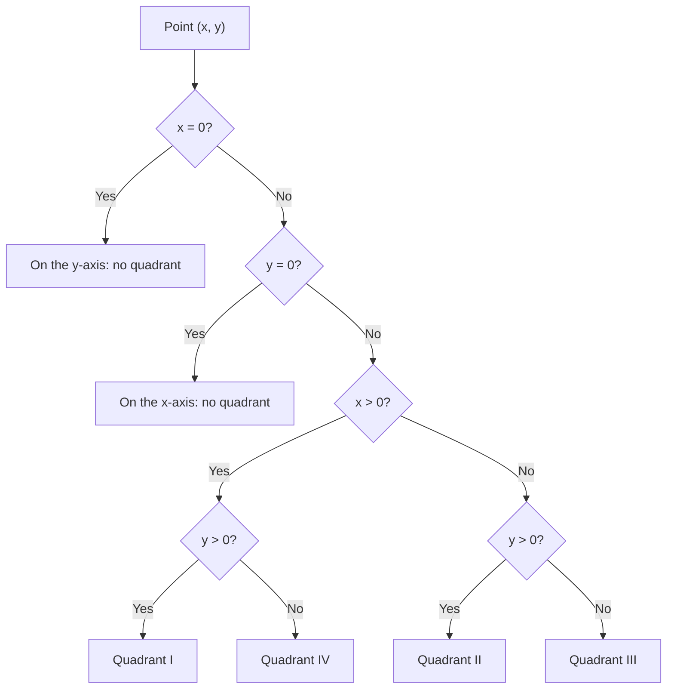
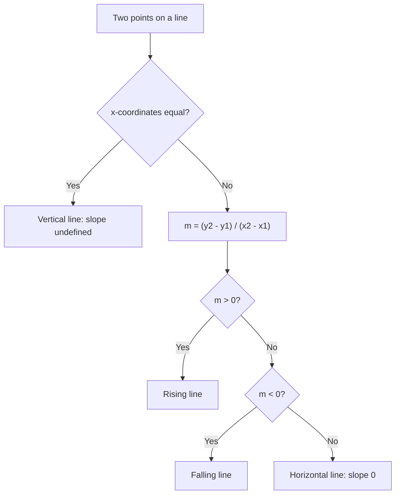
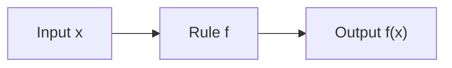

# The Coordinate Plane

> [Mathematics](../../README.md) · [Pre-Algebra](../README.md) · Level: Beginner · Prerequisites: [Order of Operations](../01-order-of-operations/README.md), [Variables and Algebraic Expressions](../02-variables-and-expressions/README.md), [Introduction to Equations](../04-introduction-to-equations/README.md) · Estimated time: 6 h

## 1. Introduction

Geometry and algebra were separate subjects for most of their history. In the seventeenth century René Descartes and Pierre de Fermat independently found a way to join them: assign to every point of the plane a pair of numbers, and every geometric question becomes an algebraic one. A curve becomes an equation; intersecting curves become simultaneous equations; distance becomes a square root; straightness becomes a constant slope.

The device is the **coordinate plane**: two perpendicular number lines, one horizontal and one vertical, crossing at the **origin**. A point is located by an **ordered pair** $(x,y)$: $x$ tells how far to move horizontally, $y$ how far vertically. The order matters — $(3,5)$ and $(5,3)$ are different points.

This tutorial develops the vocabulary and formulas of the coordinate plane — quadrants, distance, midpoint, slope, intercepts — and uses them to graph and interpret linear relationships. It closes with an introduction to **functions**, the modern language for "input–output rules", of which a line is the simplest interesting example.

## 2. Prerequisites

You need:

* **Signed numbers** and the number line: [Integers](../../01-arithmetic/02-integers/README.md) and [Order of Operations](../01-order-of-operations/README.md).
* **Algebraic expressions** and substitution: [Variables and Algebraic Expressions](../02-variables-and-expressions/README.md).
* **Solving linear equations**, especially isolating a variable and solving for one variable in a formula: [Introduction to Equations](../04-introduction-to-equations/README.md).
* **Square roots** of perfect squares and the ability to simplify $\sqrt{a^2+b^2}$ when $a^2+b^2$ is a perfect square: [Exponents and Roots](../../01-arithmetic/07-exponents-and-roots/README.md).

## 3. Learning Objectives

By the end of this tutorial you will be able to:

1. Plot and read ordered pairs, and identify the quadrant or axis on which a point lies.
2. Compute the distance between two points using the distance formula, and explain its derivation from the Pythagorean theorem.
3. Compute the midpoint of a segment and justify the averaging formula.
4. Compute the slope of a line from two points, from a graph or from a table, and interpret it as a rate of change with units.
5. Find the $x$- and $y$-intercepts of a line from its equation and explain their meaning in context.
6. Graph a line from a table of values and from slope-intercept form.
7. Write the equation of a line given its slope and one point, or given two points.
8. Decide whether two lines are parallel, perpendicular or neither from their slopes.
9. Interpret the slope and intercepts of a graph of a real situation.
10. Decide whether a relation is a function, evaluate $f(x)$, and solve $f(x)=k$.

## 4. Intuition

A city grid is the picture to keep in mind. Streets run east–west and avenues north–south. An address such as "3rd Avenue and 5th Street" is an ordered pair: the avenue number says how far east, the street number how far north. Swap them and you are at a different corner.

Distances on a grid are computed by walking along streets: to get from $(1,2)$ to $(4,6)$ you walk $3$ blocks east and $4$ blocks north. The straight-line distance is the diagonal of that $3\times4$ rectangle, which is $5$ — the classic $3$–$4$–$5$ right triangle.

Slope is the steepness of a road: rise over run. A road that climbs $2$ metres for every $3$ metres forward has slope $\frac23$, and that number means the same thing everywhere on the road because the road is straight. On a graph of distance against time, slope is speed; on a graph of cost against quantity, slope is the price per item.

## 5. Formal Definition

**Definition 5.1 (Coordinate plane).** Choose two perpendicular number lines in a plane, called the **$x$-axis** (horizontal) and the **$y$-axis** (vertical), intersecting at the **origin** $O=(0,0)$. The same unit length is used on both axes. The resulting plane is the **Cartesian coordinate plane**, denoted $\mathbb{R}^2$.

**Definition 5.2 (Coordinates).** For a point $P$, draw the line through $P$ perpendicular to each axis. The number where the perpendicular meets the $x$-axis is the **$x$-coordinate**; the number where it meets the $y$-axis is the **$y$-coordinate**. The point is written as the ordered pair $(x,y)$.

**Definition 5.3 (Quadrants).** The axes divide the plane into four **quadrants**, numbered counterclockwise from the upper right:

| Quadrant | Signs of $(x,y)$ | Example |
|---|---|---|
| I | $x>0$, $y>0$ | $(3,4)$ |
| II | $x<0$, $y>0$ | $(-2,5)$ |
| III | $x<0$, $y<0$ | $(-4,-3)$ |
| IV | $x>0$, $y<0$ | $(5,-1)$ |

Points with $x=0$ lie on the $y$-axis and points with $y=0$ lie on the $x$-axis; by convention they belong to no quadrant.

**Definition 5.4 (Relation and function).** A **relation** is any set of ordered pairs of real numbers. A relation is a **function** if every input $x$ is paired with exactly one output $y$. The **domain** is the set of inputs; the **range** is the set of outputs.

**Definition 5.5 (Linear function).** A function of the form
$$f(x)=mx+b$$
with constants $m$ and $b$ is a **linear function**. Its graph is a non-vertical line.

**Definition 5.6 (Slope).** For two distinct points $P_1=(x_1,y_1)$ and $P_2=(x_2,y_2)$ with $x_1\neq x_2$, the **slope** of the line through them is
$$m=\dfrac{y_2-y_1}{x_2-x_1}=\dfrac{\Delta y}{\Delta x}.$$
For a vertical line, $x_1=x_2$ and the slope is **undefined**.

**Definition 5.7 (Intercepts).** An **$x$-intercept** is a point where the graph meets the $x$-axis, so its $y$-coordinate is $0$. A **$y$-intercept** is a point where the graph meets the $y$-axis, so its $x$-coordinate is $0$. For a non-vertical line there is exactly one $y$-intercept; for a non-horizontal line exactly one $x$-intercept.

## 6. Mathematical Notation

| Notation | Meaning | Read aloud |
|---|---|---|
| $(x,y)$ | ordered pair: $x$ horizontal, $y$ vertical | "the point x comma y" |
| $O$ | the origin $(0,0)$ | "the origin" |
| $\Delta x$, $\Delta y$ | change in $x$, change in $y$ | "delta x", "delta y" |
| $m$ | slope | "m" |
| $y=mx+b$ | slope-intercept form | "y equals m x plus b" |
| $y-y_1=m(x-x_1)$ | point-slope form | — |
| $A x+B y=C$ | standard form | — |
| $d$ | distance | "d" |
| $M$ | midpoint | "M" |
| $f(x)$ | output of function $f$ at input $x$ | "f of x" |
| $\mathbb{R}$ | the real numbers | "the reals" |

A warning about $f(x)$: it is **not** $f$ times $x$. The letter $f$ names the rule; $f(3)$ is the output when the input is $3$.

## 7. Core Concepts

### 7.1 Plotting points

To plot $(x,y)$: start at the origin, move $|x|$ units right if $x>0$ (left if $x<0$), then move $|y|$ units up if $y>0$ (down if $y<0$). The order of the two movements does not matter, but the order of the numbers in the pair does.

Example: $(3,-2)$ is $3$ units right and $2$ units down, in quadrant IV. $(-3,2)$ is $3$ units left and $2$ up, in quadrant II. $(-3,-2)$ is quadrant III, and $(3,2)$ is quadrant I.

The **scale** matters when reading a graph: each tick must represent the stated amount, and the two axes need not use the same scale (though the same scale makes slopes visually meaningful).

### 7.2 Distance between two points

For two points on a horizontal line, the distance is $|x_2-x_1|$; on a vertical line, it is $|y_2-y_1|$. For general points, draw the right triangle with horizontal leg $|x_2-x_1|$ and vertical leg $|y_2-y_1|$. The distance is the hypotenuse, so by the Pythagorean theorem
$$d=\sqrt{(x_2-x_1)^2+(y_2-y_1)^2}.$$

The order of the points does not matter because the differences are squared.

**Example.** From $(1,2)$ to $(4,6)$: $\Delta x=3$, $\Delta y=4$, so $d=\sqrt{9+16}=\sqrt{25}=5$.

**Example.** From $(-2,5)$ to $(3,-7)$: $\Delta x=5$, $\Delta y=-12$, so $d=\sqrt{25+144}=\sqrt{169}=13$.

### 7.3 Midpoint

The midpoint of the segment joining $(x_1,y_1)$ and $(x_2,y_2)$ is
$$M=\left(\dfrac{x_1+x_2}{2},\ \dfrac{y_1+y_2}{2}\right).$$
Each coordinate is the average of the corresponding coordinates.

**Example.** The midpoint of $(-3,8)$ and $(5,-2)$ is
$$\left(\dfrac{-3+5}{2},\dfrac{8+(-2)}{2}\right)=(1,3).$$

*Why averaging works.* Moving from $P_1$ to $P_2$ changes $x$ by $x_2-x_1$; halfway means changing $x$ by half that amount, so the midpoint's $x$-coordinate is $x_1+\frac{x_2-x_1}{2}=\frac{x_1+x_2}{2}$. The same argument applies to $y$. Section 8 gives a distance-based proof.

### 7.4 Slope

The slope measures how steeply a line rises or falls:
$$m=\dfrac{\text{rise}}{\text{run}}=\dfrac{y_2-y_1}{x_2-x_1}.$$

| Situation | Slope |
|---|---|
| line rises left to right | $m>0$ |
| line falls left to right | $m<0$ |
| horizontal line | $m=0$ |
| vertical line | undefined |

**Example.** Through $(2,-1)$ and $(6,7)$:
$$m=\dfrac{7-(-1)}{6-2}=\dfrac{8}{4}=2.$$
Moving $1$ unit right raises the line $2$ units.

**Example.** Through $(1,4)$ and $(4,-2)$:
$$m=\dfrac{-2-4}{4-1}=\dfrac{-6}{3}=-2.$$

The slope does not depend on which two points on the line are chosen; any two choices give the same ratio because the corresponding right triangles are similar. For a vertical line the run is zero, and division by zero is undefined, which is why the slope is undefined rather than infinite or zero.

**Slope as a rate of change.** If $y$ is measured in dollars and $x$ in hours, the slope is measured in dollars per hour. If $y$ is distance in kilometres and $x$ is time in hours, the slope is speed in km/h. Always attach units to a slope in an applied problem.

### 7.5 Intercepts

To find the $x$-intercept of an equation, set $y=0$ and solve for $x$. To find the $y$-intercept, set $x=0$ and solve for $y$.

**Example.** For $3x+2y=12$:
* $y=0$ gives $3x=12$, so $x=4$; the $x$-intercept is $(4,0)$.
* $x=0$ gives $2y=12$, so $y=6$; the $y$-intercept is $(0,6)$.

In an applied graph, the $y$-intercept is often the **starting value** (the cost when nothing has been produced, the distance at time zero) and the $x$-intercept is often the **break-even or zero point** (the time when the distance is zero, the quantity at which profit vanishes).

### 7.6 Graphing a line from a table

Choose several values of $x$, compute $y$ from the equation, plot the pairs, and draw the straight line through them. For $y=\frac23x-1$:

| $x$ | $y=\frac23x-1$ | point |
|---|---|---|
| $-3$ | $-3$ | $(-3,-3)$ |
| $0$ | $-1$ | $(0,-1)$ |
| $3$ | $1$ | $(3,1)$ |
| $6$ | $3$ | $(6,3)$ |

The points lie on a straight line; the $y$-intercept is $(0,-1)$, and the slope $\frac23$ means "up $2$ for every $3$ right".

### 7.7 Graphing from slope-intercept form

In $y=mx+b$, the number $b$ is the $y$-coordinate of the $y$-intercept $(0,b)$, and $m$ is the slope. To graph:

1. Plot $(0,b)$.
2. From that point move $1$ unit right and $m$ units up if $m>0$ (down if $m<0$), or use the fraction $\frac{\text{rise}}{\text{run}}$ to move a convenient number of units.
3. Draw the line through the two points.

For $y=\frac23x-1$: plot $(0,-1)$; from there move right $3$ and up $2$ to $(3,1)$; draw the line. For $y=-2x+3$: plot $(0,3)$; move right $1$ and down $2$ to $(1,1)$.

Special cases: $y=b$ is a horizontal line with slope $0$; $x=a$ is a vertical line with undefined slope and is **not** the graph of a function.

### 7.8 Equations of lines

**Slope-intercept form.** If the slope is $m$ and the $y$-intercept is $(0,b)$, the line is $y=mx+b$.

**Point-slope form.** If the slope is $m$ and the line passes through $(x_1,y_1)$, then
$$y-y_1=m(x-x_1).$$
This follows from the slope formula: for any other point $(x,y)$ on the line, $\frac{y-y_1}{x-x_1}=m$.

**Through two points.** Compute the slope, then use point-slope with either point.

**Example.** Through $(1,4)$ and $(5,-4)$:
$$m=\dfrac{-4-4}{5-1}=\dfrac{-8}{4}=-2.$$
Using $(1,4)$:
$$y-4=-2(x-1)\implies y=-2x+6.$$
Check with $(5,-4)$: $-2(5)+6=-4$.

**Standard form.** $Ax+By=C$ with $A,B$ not both zero. If $B\neq0$, solve for $y$ to read the slope: $y=-\frac ABx+\frac CB$. If $B=0$, the line is vertical.

### 7.9 Parallel and perpendicular lines

Two non-vertical lines are **parallel** (or coincide) exactly when their slopes are equal. They are **perpendicular** exactly when the product of their slopes is $-1$:
$$m_1m_2=-1.$$
A horizontal line (slope $0$) is perpendicular to a vertical line (undefined slope), which is the one case the product rule does not cover.

**Example.** $y=3x+1$ and $y=3x-7$ are parallel. $y=3x+1$ and $y=-\frac13x+2$ are perpendicular because $3\cdot\left(-\frac13\right)=-1$.

### 7.10 Interpreting graphs of real situations

A graph of a real situation should be read in sentences, not just numbers:

* **Axes.** What quantity is on each axis, and in what units?
* **Slope.** How fast does the vertical quantity change per unit of the horizontal quantity? Attach units.
* **$y$-intercept.** What is the value when the horizontal quantity is zero?
* **$x$-intercept.** When is the vertical quantity zero?
* **Shape.** A straight segment means a constant rate; a horizontal segment means no change; a steeper segment means a faster rate.

**Example (a journey).** A cyclist rides $20$ km in $2$ hours, rests for $1$ hour, then rides $10$ km in the next $2$ hours. On a distance–time graph the slopes of the three segments are $10$ km/h, $0$ km/h and $5$ km/h. The average speed over the whole $5$ hours is $\frac{30}{5}=6$ km/h. The average speed is *not* the average of $10,0,5$; it is total distance divided by total time.

### 7.11 Functions as input–output rules

A function is a rule that assigns to each allowed input exactly one output. The notation $f(x)$ names the output. For $f(x)=3x-2$:

$$f(4)=3(4)-2=10,\qquad f(0)=-2,\qquad f(-1)=-5.$$

To solve $f(x)=7$, set the rule equal to $7$:
$$3x-2=7\implies 3x=9\implies x=3.$$
So $f(3)=7$.

**The vertical line test.** A graph represents a function exactly when no vertical line meets the graph in more than one point. A vertical line $x=a$ collects all points with input $a$; if there are two, the input $a$ has two outputs, which a function forbids.

A linear function $f(x)=mx+b$ has domain $\mathbb{R}$ and range $\mathbb{R}$ (if $m\neq0$). Its graph is a non-vertical line, and its slope $m$ is the constant rate at which the output changes per unit change of the input.

## 8. Formulas and Properties

**Property 1 (Pythagorean theorem).** In a right triangle with legs $a,b$ and hypotenuse $c$,
$$a^2+b^2=c^2.$$
*Why.* Arrange four copies of the triangle inside a square of side $a+b$, leaving a tilted square of side $c$ in the middle. The area of the large square is $(a+b)^2$. It is also the sum of the four triangles and the inner square:
$$(a+b)^2=4\cdot\dfrac{ab}{2}+c^2.$$
Expanding the left side gives $a^2+2ab+b^2=2ab+c^2$, so $a^2+b^2=c^2$.

**Property 2 (Distance formula).** For $P_1=(x_1,y_1)$ and $P_2=(x_2,y_2)$,
$$d(P_1,P_2)=\sqrt{(x_2-x_1)^2+(y_2-y_1)^2}.$$
*Why.* The horizontal and vertical segments through the two points form a right triangle with legs $|x_2-x_1|$ and $|y_2-y_1|$; the distance is the hypotenuse by Property 1. Squaring removes the absolute values.

**Property 3 (Midpoint formula).** The midpoint of $P_1P_2$ is
$$M=\left(\dfrac{x_1+x_2}{2},\dfrac{y_1+y_2}{2}\right).$$
*Why.* If $x_1\neq x_2$, the slope from $P_1$ to $M$ is
$$\dfrac{\dfrac{y_1+y_2}{2}-y_1}{\dfrac{x_1+x_2}{2}-x_1}=\dfrac{(y_2-y_1)/2}{(x_2-x_1)/2}=\dfrac{y_2-y_1}{x_2-x_1},$$
the same as the slope from $P_1$ to $P_2$, so $M$ lies on the line. Also
$$d(P_1,M)=\tfrac12\sqrt{(x_2-x_1)^2+(y_2-y_1)^2}=\tfrac12d(P_1,P_2),$$
and similarly $d(M,P_2)=\frac12d(P_1,P_2)$. Hence $M$ is exactly halfway. The cases $x_1=x_2$ and $y_1=y_2$ are checked directly.

**Property 4 (Slope is well defined).** The ratio $\frac{\Delta y}{\Delta x}$ is the same for any two distinct points on a non-vertical line.
*Why.* The right triangles formed by two different pairs of points on the same line have the same acute angle (the angle the line makes with the horizontal), so they are similar; corresponding ratios of legs are equal.

**Property 5 (Slope-intercept and point-slope forms).** A non-vertical line with slope $m$ and $y$-intercept $(0,b)$ has equation $y=mx+b$. A line with slope $m$ through $(x_1,y_1)$ has equation $y-y_1=m(x-x_1)$.
*Why.* A point $(x,y)$ is on the line exactly when the slope from $(x_1,y_1)$ to $(x,y)$ equals $m$, which is the point-slope equation after multiplying by $x-x_1$. Setting $x_1=0$, $y_1=b$ gives slope-intercept form.

**Property 6 (Parallel and perpendicular criteria).** Non-vertical lines are parallel or coincide iff $m_1=m_2$. Non-vertical, non-horizontal lines are perpendicular iff $m_1m_2=-1$.
*Why (perpendicular).* Translate the lines so they meet at the origin, with slopes $m_1,m_2$. Take $A=(1,m_1)$ on the first line and $B=(1,m_2)$ on the second. Then
$$OA^2=1+m_1^2,\qquad OB^2=1+m_2^2,\qquad AB^2=(m_2-m_1)^2.$$
The angle at $O$ is right exactly when $OA^2+OB^2=AB^2$ (the converse of the Pythagorean theorem). That gives
$$2+m_1^2+m_2^2=m_1^2-2m_1m_2+m_2^2\implies 2=-2m_1m_2\implies m_1m_2=-1.$$

**Property 7 (Constant rate for a linear function).** For $f(x)=mx+b$ and any $h\neq0$,
$$\dfrac{f(x+h)-f(x)}{h}=m.$$
*Why.* $f(x+h)-f(x)=m(x+h)+b-(mx+b)=mh$; divide by $h$.

**Property 8 (Intercepts).** The $x$-intercept of $y=mx+b$ (with $m\neq0$) is $\left(-\frac bm,0\right)$; the $y$-intercept is $(0,b)$.
*Why.* Set $y=0$ and solve; set $x=0$ and read $b$.

## 9. Step-by-Step Examples

### Example 1 (Easy): plotting and quadrants

Locate $(3,4)$, $(-2,5)$, $(-4,-3)$, $(5,-1)$ and $(0,-4)$.

* $(3,4)$: right $3$, up $4$ — quadrant I.
* $(-2,5)$: left $2$, up $5$ — quadrant II.
* $(-4,-3)$: left $4$, down $3$ — quadrant III.
* $(5,-1)$: right $5$, down $1$ — quadrant IV.
* $(0,-4)$: no horizontal movement; on the negative $y$-axis, in no quadrant.

### Example 2 (Easy): distance

Find the distance between $(1,2)$ and $(4,6)$.

$$\Delta x=4-1=3,\qquad \Delta y=6-2=4,$$
$$d=\sqrt{3^2+4^2}=\sqrt{9+16}=\sqrt{25}=5.$$

Find the distance between $(-2,5)$ and $(3,-7)$.

$$\Delta x=3-(-2)=5,\qquad \Delta y=-7-5=-12,$$
$$d=\sqrt{5^2+(-12)^2}=\sqrt{25+144}=\sqrt{169}=13.$$

### Example 3 (Easy): midpoint

Find the midpoint of $(-3,8)$ and $(5,-2)$, and verify that it is equidistant from the endpoints.

$$M=\left(\dfrac{-3+5}{2},\dfrac{8-2}{2}\right)=(1,3).$$
Distance to $(-3,8)$: $\sqrt{4^2+(-5)^2}=\sqrt{16+25}=\sqrt{41}$.
Distance to $(5,-2)$: $\sqrt{(-4)^2+5^2}=\sqrt{16+25}=\sqrt{41}$.
The distances agree, as a midpoint should.

### Example 4 (Medium): slopes of various lines

Find the slope through each pair:

* $(2,-1)$ and $(6,7)$: $m=\frac{7-(-1)}{6-2}=\frac84=2$.
* $(1,4)$ and $(4,-2)$: $m=\frac{-2-4}{4-1}=\frac{-6}{3}=-2$.
* $(2,5)$ and $(7,5)$: $m=\frac{5-5}{7-2}=0$ (horizontal).
* $(3,2)$ and $(3,8)$: $m=\frac{8-2}{3-3}$ is undefined (vertical).

### Example 5 (Medium): graph $y=\frac23x-1$

The $y$-intercept is $(0,-1)$ and the slope is $\frac23$. Plot $(0,-1)$, then move right $3$ and up $2$ to $(3,1)$. The $x$-intercept is found by setting $y=0$:
$$0=\dfrac23x-1\implies \dfrac23x=1\implies x=\dfrac32,$$
so the line crosses the $x$-axis at $\left(\frac32,0\right)$. A third point for accuracy is $(6,3)$.

### Example 6 (Medium): equation through two points

Find the equation of the line through $(1,4)$ and $(5,-4)$.

$$m=\dfrac{-4-4}{5-1}=\dfrac{-8}{4}=-2.$$
Point-slope with $(1,4)$:
$$y-4=-2(x-1)\implies y-4=-2x+2\implies y=-2x+6.$$
Check the second point: $-2(5)+6=-4$. The $y$-intercept is $(0,6)$.

### Example 7 (Medium): intercepts and standard form

Find the intercepts and slope of $3x+2y=12$.

* $x$-intercept: set $y=0$: $3x=12$, so $(4,0)$.
* $y$-intercept: set $x=0$: $2y=12$, so $(0,6)$.
* Slope: solve for $y$: $2y=-3x+12$, so $y=-\frac32x+6$ and $m=-\frac32$.

Check with the intercepts: $\frac{6-0}{0-4}=-\frac32$.

### Example 8 (Hard): a linear cost model

A plumber charges a \$60 call-out fee plus \$45 per hour. Write the cost as a function of hours, interpret the parameters, and find the duration of a job costing \$240.

$$C(h)=45h+60.$$
The slope $45$ is the hourly rate in dollars per hour; the $y$-intercept $60$ is the fixed charge when $h=0$. Solve $C(h)=240$:
$$45h+60=240\implies 45h=180\implies h=4.$$
The job took $4$ hours. In this context $h\ge0$; negative hours have no meaning even though the formula is defined for them.

### Example 9 (Hard): a function and its graph

For $f(x)=3x-2$, compute $f(4)$, $f(0)$ and $f(-1)$; solve $f(x)=7$; state the domain and range.

$$f(4)=3(4)-2=10,\qquad f(0)=-2,\qquad f(-1)=3(-1)-2=-5.$$
$f(x)=7$ gives $3x-2=7$, so $3x=9$ and $x=3$. The graph is the line $y=3x-2$, with slope $3$ and $y$-intercept $(0,-2)$. The domain is $\mathbb{R}$ and the range is $\mathbb{R}$.

## 10. Visual Explanations

Quadrant membership is a decision procedure on signs:

Slope classification works the same way:

A function is often drawn as a machine:

For $f(x)=3x-2$, the machine doubles nothing and triples everything: input $4$ gives output $10$, input $0$ gives $-2$.

Tables complement the diagrams. For the line $3x+2y=12$:

| Feature | Computation | Result |
|---|---|---|
| $x$-intercept | set $y=0$: $3x=12$ | $(4,0)$ |
| $y$-intercept | set $x=0$: $2y=12$ | $(0,6)$ |
| slope | $m=(6-0)/(0-4)$ | $-\frac32$ |
| equation in slope-intercept form | solve for $y$ | $y=-\frac32x+6$ |

## 11. Common Mistakes

| Mistake | Why it is tempting | Correct treatment |
|---|---|---|
| plotting $(3,5)$ as $5$ right, $3$ up | reading the pair in the wrong order | $(x,y)$: $x$ horizontal first |
| saying $(0,4)$ is in quadrant I | the point is above the origin | it lies on the $y$-axis; no quadrant |
| slope $=\frac{x_2-x_1}{y_2-y_1}$ | inverting rise and run | slope is $\frac{\Delta y}{\Delta x}$ |
| calling a vertical line's slope $0$ | "no rise" sounds like zero | run is zero, so slope is undefined; horizontal lines have slope $0$ |
| distance $=(x_2-x_1)+(y_2-y_1)$ | adding the changes | use squares and a square root |
| midpoint $=\left(\frac{x_2-x_1}{2},\frac{y_2-y_1}{2}\right)$ | averaging differences | average the coordinates: $\frac{x_1+x_2}{2}$ |
| $y$-intercept written $(b,0)$ | mixing up the axes | $y$-intercept is $(0,b)$ |
| graph not using equal scales | the line still "looks" right | equal scales make the visual slope equal the numerical slope |
| joining plotted points with a curve | smoothing looks natural | a linear equation has a straight-line graph; check with a third point |
| reading $f(x)$ as $f\cdot x$ | the notation looks like multiplication | $f$ is the name of the function |
| a circle "passes" the vertical line test | it looks like one curve | it fails: some vertical lines meet it twice, so it is not a function |

## 12. Applications

**Navigation and GPS.** Positions are ordered pairs (latitude, longitude), and distances on a small region are computed with the distance formula. Map applications use exactly the coordinate ideas of this tutorial, with the subtlety that the Earth is curved.

**Screens and computer graphics.** Every pixel has coordinates. In screen coordinates the $y$-axis usually points *down*, which is a convention of display hardware, not of mathematics — a good reminder that axis orientation is a choice.

**Physics.** On a distance–time graph the slope is velocity; on a velocity–time graph the slope is acceleration and the area under the graph is displacement. The constant-slope case corresponds to constant speed.

**Economics and business.** Cost, revenue and profit are often modelled as linear functions: $C(q)=mq+b$ has fixed cost $b$ and marginal cost $m$; the break-even quantity is the $x$-intercept of profit.

**Statistics.** Scatterplots place data as points; a line of best fit summarises a trend, and its slope is the estimated change in the response per unit change in the explanatory variable.

**Programming.** Functions in code mirror mathematical functions: a named input–output rule. Coordinates drive layout, plotting libraries and games; the vertical line test corresponds to the requirement that a lookup table have a single value per key.

## 13. Exercises

The problem set is in [exercises.md](exercises.md): 32 problems on plotting, distance, midpoint, slope, intercepts, graphing, equations of lines, interpretation of graphs, functions, and two proof-oriented challenges.

## 14. Solutions

Complete worked solutions are in [solutions.md](solutions.md). For graphing problems, the solution lists the points and features used to draw the graph, so the graph can be reconstructed exactly.

## 15. Summary

* A point is an ordered pair $(x,y)$; the order matters.
* The quadrants are numbered counterclockwise from the upper right; axes are not in any quadrant.
* Distance: $d=\sqrt{(x_2-x_1)^2+(y_2-y_1)^2}$, derived from the Pythagorean theorem.
* Midpoint: each coordinate is the average of the endpoints' coordinates.
* Slope: $m=\frac{\Delta y}{\Delta x}$; positive rises, negative falls, zero is horizontal, undefined is vertical.
* Slope is a rate of change, with units of $y$ per unit of $x$.
* $x$-intercept: set $y=0$; $y$-intercept: set $x=0$.
* $y=mx+b$ is slope-intercept form; $y-y_1=m(x-x_1)$ is point-slope form.
* Parallel lines have equal slopes; perpendicular slopes multiply to $-1$.
* A function assigns exactly one output to each input; the vertical line test detects functions graphically.
* For $f(x)=mx+b$, the slope $m$ is the constant rate of change and $b$ is the initial value.

## 16. Further Learning

This topic completes the bridge from arithmetic to algebra. From here, the natural continuations are linear systems (two lines, intersection points), quadratic functions (parabolas), and trigonometry (the unit circle). In this repository, [Variables and Algebraic Expressions](../02-variables-and-expressions/README.md) supplies the algebraic manipulation, and [Introduction to Equations](../04-introduction-to-equations/README.md) supplies the solving techniques used when a graph's equation is set equal to a value.

For additional practice, OpenStax's *Prealgebra* and *Elementary Algebra* contain chapters on graphing linear equations, and Khan Academy's "Algebra basics" course includes interactive graphing and slope practice. Graph paper and a ruler remain the best technology for learning this material: plot by hand until the formulas become obvious.
