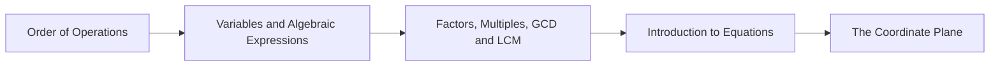

<!-- Generated by tools/build_indexes.py from tools/curriculum.json. Do not edit by hand. -->

# Pre-Algebra

*The bridge from numbers to symbols*

[Mathematics](../README.md) › Pre-Algebra

Order of operations, variables, factors, first equations and the coordinate plane. This is the shortest and most important bridge in the curriculum: after it, arithmetic becomes algebra.

## At a glance

| | |
|---|---|
| Topics | 5 (5 complete, 0 draft, 0 planned) |
| Estimated study time | ~25 hours |
| Prerequisites | [01-arithmetic](../01-arithmetic/README.md) |

## Study order

The numbers are the recommended order. Study a topic only after the ones before it —
the dependency chain below is the shortest safe route through the discipline.

## Topic inventory

| # | Topic | Level | Est. time | Status | Materials |
|---|---|---|---|---|---|
| 1 | [Order of Operations](01-order-of-operations/README.md) | Beginner | 3 h | Complete | [Tutorial](01-order-of-operations/README.md) · [Exercises](01-order-of-operations/exercises.md) · [Solutions](01-order-of-operations/solutions.md) |
| 2 | [Variables and Algebraic Expressions](02-variables-and-expressions/README.md) | Beginner | 5 h | Complete | [Tutorial](02-variables-and-expressions/README.md) · [Exercises](02-variables-and-expressions/exercises.md) · [Solutions](02-variables-and-expressions/solutions.md) |
| 3 | [Factors, Multiples, GCD and LCM](03-factors-and-multiples/README.md) | Beginner | 5 h | Complete | [Tutorial](03-factors-and-multiples/README.md) · [Exercises](03-factors-and-multiples/exercises.md) · [Solutions](03-factors-and-multiples/solutions.md) |
| 4 | [Introduction to Equations](04-introduction-to-equations/README.md) | Beginner | 6 h | Complete | [Tutorial](04-introduction-to-equations/README.md) · [Exercises](04-introduction-to-equations/exercises.md) · [Solutions](04-introduction-to-equations/solutions.md) |
| 5 | [The Coordinate Plane](05-the-coordinate-plane/README.md) | Beginner | 6 h | Complete | [Tutorial](05-the-coordinate-plane/README.md) · [Exercises](05-the-coordinate-plane/exercises.md) · [Solutions](05-the-coordinate-plane/solutions.md) |

### What each topic covers

- **Order of Operations** — Why a convention is needed, precedence, grouping symbols and evaluation.
- **Variables and Algebraic Expressions** — Letters as unknowns, translating words, terms, like terms, distributivity.
- **Factors, Multiples, GCD and LCM** — Divisibility rules, prime factorisation, the Euclidean algorithm and its uses.
- **Introduction to Equations** — The balance model, inverse operations and solving one- and two-step equations.
- **The Coordinate Plane** — Coordinates, distance, midpoint, slope and the graph of a relationship.

## Related disciplines

- [03-algebra](../03-algebra/README.md)

## Status key

- **Complete** — tutorial, exercises and full solutions exist and the tutorial meets the
  [authoring standard](../CONTRIBUTING.md).
- **Draft** — some material exists but the topic is not finished.
- **Planned** — identified in the curriculum, not written yet.

Overall progress and the full topic inventory live in [ROADMAP.md](../ROADMAP.md).
