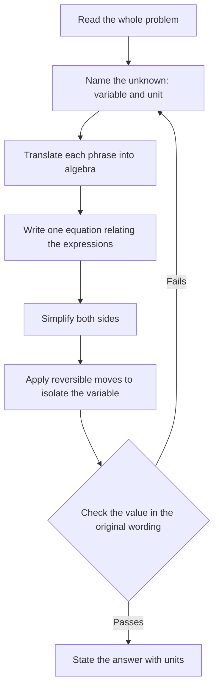

# Elementary Algebra

> [Algebra](../README.md) · Level: Beginner → Intermediate · Prerequisites: [Arithmetic](../../01-arithmetic/README.md), [Pre-Algebra](../../02-pre-algebra/README.md) · Estimated time: 150 min

## 1. Introduction

Arithmetic deals with particular numbers: $7+5=12$, and $\frac{3}{4}\cdot\frac{2}{3}=\frac{1}{2}$. Every question has a definite answer, and every answer is a number. Algebra keeps the same operations but changes the objects of study. Instead of asking about $7$ and $5$, it asks what is true of *every* pair of numbers, or of *some unknown* number.

That shift produces two new kinds of object.

* An **expression** such as $3x^2-2x+7$ is a recipe for producing a number once a value is supplied for $x$.
* An **equation** such as $3x+7=22$ is a *statement* that two expressions have the same value. The statement may be true for some values of $x$, for none, or for all.

Most of elementary algebra consists of learning to do two things well:

1. rewrite an expression without changing its value;
2. transform an equation without changing its solutions.

Polynomials, formulas, and word problems are applications of those two skills. The guiding question is never "what rule do I apply?" but "why is this step valid?" A step is valid only when it can be justified from the properties of the real numbers or from the logic of equality.

Algebra is the common language of quantitative work. A physicist writes $v=u+at$; an economist writes profit $=$ revenue $-$ cost; a programmer writes `total = price * quantity`; a chemist writes a concentration as amount divided by volume. Each is an algebraic expression or equation, and each becomes useful only when it can be rearranged correctly.

## 2. Prerequisites

You should be fluent with the following before starting. Each item is used repeatedly below, and each links to the tutorial that teaches it.

* **Signed integer arithmetic.** Adding, subtracting, multiplying and dividing positive and negative integers, for example $-7+4=-3$ and $(-3)(-4)=12$. See [Integers and Negative Numbers](../../01-arithmetic/02-integers/README.md).
* **Fractions.** The meaning of $\frac{a}{b}$ with $b\ne0$, equivalent fractions, addition with a common denominator, multiplication, and division by a fraction. See [Fractions](../../01-arithmetic/03-fractions/README.md).
* **Decimals.** Place value and conversion between decimals and fractions, for example $0.25=\frac{1}{4}$. See [Decimals](../../01-arithmetic/04-decimals/README.md).
* **Whole-number exponents and order of operations.** The meaning of $x^n$ as a product of $n$ copies of $x$, and the order of operations: parentheses, exponents, multiplication and division, addition and subtraction. See [Exponents and Roots](../../01-arithmetic/07-exponents-and-roots/README.md) and [Order of Operations](../../02-pre-algebra/01-order-of-operations/README.md).
* **Algebraic vocabulary.** Variables, constants, and the reading of simple expressions. See [Variables and Algebraic Expressions](../../02-pre-algebra/02-variables-and-expressions/README.md).
* **Elementary geometry vocabulary.** Rectangle, square, perimeter, area, length, width, and the fact that a rectangle's perimeter is the total length of its four sides.

## 3. Learning Objectives

By the end of this tutorial you will be able to:

1. Distinguish an expression from an equation, and identify the terms, coefficients, and variables of an expression.
2. State the field axioms of the real numbers and use them to justify algebraic manipulations.
3. Prove elementary consequences of the axioms, such as $a\cdot0=0$ and $(-a)(-b)=ab$.
4. Simplify expressions by combining like terms and by removing parentheses, giving a reason for each step.
5. Factor a common monomial from a polynomial and verify the result by expansion.
6. Add, subtract, and multiply polynomials, and derive the special products $(a\pm b)^2$ and $(a+b)(a-b)$.
7. Divide a polynomial by a monomial and state the necessary restriction on the divisor.
8. Evaluate an expression correctly when the inputs are negative or fractional.
9. Solve a formula for a named variable, stating the conditions under which the rearrangement is valid.
10. Translate an English sentence into an algebraic expression or equation, and check a solution against the original wording.
11. Explain precisely why adding a number to both sides, or multiplying both sides by a nonzero number, preserves the solution set — and why multiplying by zero does not.

## 4. Intuition

### 4.1 An expression is a recipe

A recipe lists ingredients and operations: "take twice the flour, add three eggs, beat for five minutes." It does not by itself produce a cake; you must supply the flour and eggs. An expression such as $2f+3e$ is exactly such a recipe: supply values for $f$ and $e$, and it produces a number.

Two different recipes can produce the same cake for every possible input. "Twice the flour plus three eggs" and "three eggs plus twice the flour" are different instructions but the same result, because addition is commutative. **Simplifying** an expression means replacing one recipe by another that gives the same output for every input. The output is what matters; the description is allowed to change.

### 4.2 An equation is a question

An equation is a complete sentence with a truth value. The sentence $3x+7=22$ is true when $x=5$ and false when $x=1$. It is neither true nor false until $x$ is specified. Solving the equation means finding *all* numbers that make the sentence true.

This is why "simplify" and "solve" are not interchangeable instructions. Simplifying $3x+7$ gives $3x+7$ (it is already simple); it does not give $22$, because the expression has no truth value. Solving $3x+7=22$ gives $x=5$, because the equation does.

### 4.3 An equation is a balanced scale

Picture a balance scale with the left side of the equation on one pan and the right side on the other. Equality means the scale is level.

* Adding the same weight to both pans keeps it level.
* Removing the same weight from both pans keeps it level.
* Doubling both pans keeps it level.
* Halving both pans keeps it level.

Those are the moves used to solve equations. But some moves that look harmless destroy information. Multiplying both pans by zero makes both pans empty: the scale is level, but you can no longer tell what was on it. Dividing both sides by an expression that is zero for the unknown is like dividing by a pan's weight when the pan is empty — the operation is undefined, and any conclusion drawn from it is suspect.

The balance-scale picture also explains why one does *not* "move a term across the equals sign and change its sign." Nothing is moved. The same quantity is subtracted from both sides, and the term disappears from one side because it cancels with its own negative.

### 4.4 Why letters help

A taxi that charges \$3.50 plus \$1.20 per kilometre can be described once by $C(d)=3.50+1.20d$, which answers both "what is the fare for 8 km?" and "for which distance is the fare \$15.50?". Letters also make general claims possible: $(a+b)^2=a^2+2ab+b^2$ is about every pair of numbers, and one proof in letters replaces infinitely many numerical checks.

## 5. Formal Definition

Throughout, the variables range over the real numbers $\mathbb{R}$ unless stated otherwise.

**Definition 5.1 (Variable and constant).** A *variable* is a symbol, usually a letter, that stands for an arbitrary element of a specified set (here $\mathbb{R}$). A *constant* is a fixed real number.

**Definition 5.2 (Algebraic expression).** Fix a finite set of variables. An *algebraic expression* is built by finitely many applications of the following rules:

1. every real constant is an expression;
2. every variable is an expression;
3. if $E$ and $F$ are expressions, then $E+F$, $E-F$, $EF$, and $E/F$ are expressions, where $E/F$ is admitted only when $F$ is not the zero expression;
4. if $E$ is an expression and $n$ is a positive integer, then $E^n$ is an expression.

The *domain* of an expression is the set of assignments of real numbers to its variables for which every operation in the expression is defined. In particular, a denominator must not be zero.

**Definition 5.3 (Terms, coefficients, like terms).** A *term* of a sum is one of the addends at the top level. In $3x^2-2xy+7$ the terms are $3x^2$, $-2xy$, and $7$. The *coefficient* of a term is its numerical factor: $3$, $-2$, and $7$ respectively. Two terms are *like terms* when they have exactly the same variable part, including exponents; $5x^2y$ and $-3x^2y$ are like terms, while $5x^2y$ and $5xy^2$ are not.

**Definition 5.4 (Equation, solution, solution set).** An *equation in the variable $x$* is a statement $E=F$, where $E$ and $F$ are expressions. A *solution* of the equation is a real number $s$ in the domain of both sides such that substituting $x=s$ makes the statement true. The *solution set* is the set of all solutions. The *domain* (or *replacement set*) of the equation is the set of real numbers for which both sides are defined.

**Definition 5.5 (Equivalent equations).** Two equations are *equivalent* (over a domain $D$) if they have exactly the same solution set in $D$.

**Definition 5.6 (Monomial, polynomial, degree).** A *monomial* is an expression of the form

$$
c\,x_1^{k_1}x_2^{k_2}\cdots x_r^{k_r},
$$

where $c\in\mathbb{R}$ and each $k_i$ is a nonnegative integer. A *polynomial* is a sum of finitely many monomials. A polynomial in one variable is written in *standard form* as

$$
a_nx^n+a_{n-1}x^{n-1}+\cdots+a_1x+a_0,
$$

with $a_n\ne0$; its *degree* is $n$, its *leading coefficient* is $a_n$, and $a_0$ is its *constant term*. The zero polynomial is not assigned a degree.

**Definition 5.7 (Identity and contradiction).** An equation in one variable is an *identity* (over $\mathbb{R}$) if every real number in its domain is a solution. It is a *contradiction* if it has no solutions. An equation that has some but not all real numbers as solutions is *conditional*.

**Definition 5.8 (Formula and literal equation).** A *formula* is an equation relating two or more variables, such as $A=lw$ or $P=2l+2w$. A *literal equation* is a formula in which some variables are regarded as known constants and one as the unknown. *Solving for a variable* means producing an equivalent equation in which that variable stands alone on one side.

**Remark 5.9 (The domain is part of the equation).** The expressions $\frac{x^2-1}{x-1}$ and $x+1$ agree for every $x\ne1$, but the first is undefined at $x=1$. Consequently the equations

$$
\frac{x^2-1}{x-1}=2
\qquad\text{and}\qquad
x+1=2
$$

do not have the same solution set over $\mathbb{R}$. The second has the solution $x=1$, but $x=1$ is not in the domain of the first, so the first has no solution. The point is that cancelling a common factor is legitimate only where that factor is nonzero. Domain restrictions are not decoration; they are part of the problem.

## 6. Mathematical Notation

| Symbol | Meaning | Read aloud |
|---|---|---|
| $x,y,z,a,b,c,n$ | variables or constants, depending on context | "ex", "why", "en" |
| $3x$ | the product $3\cdot x$ | "three ex" |
| $x^2$, $x^n$ | $x\cdot x$; $n$ factors of $x$ | "ex squared", "ex to the en" |
| $a(b+c)$ | the product of $a$ and the quantity $b+c$ | "ay times the quantity bee plus see" |
| $=$ | equality: both sides name the same number | "equals" or "is equal to" |
| $\ne$ | not equal | "is not equal to" |
| $\in$ | is an element of | "is in" |
| $\mathbb{R}$ | the set of real numbers | "the reals" |
| $\{x\in\mathbb{R}:P(x)\}$ | the set of real $x$ satisfying property $P$ | "the set of ex in the reals such that ..." |
| $\varnothing$ | the empty set | "the empty set" |
| $\iff$ | if and only if; the two statements have the same truth value | "if and only if" |
| $\implies$ | implies; one-directional | "implies" |
| LHS, RHS | left-hand side, right-hand side of an equation | "left-hand side", "right-hand side" |
| $\deg P$ | degree of the polynomial $P$ | "degree of pee" |

Juxtaposition means multiplication: $3x$ and $3\cdot x$ are the same. A fraction bar is both a division sign and a grouping symbol: $\frac{a+b}{c}$ means $(a+b)/c$, not $a+b/c$.

## 7. Core Concepts

### 7.1 The Algebraic Language

Algebraic language has nouns, verbs, and sentences.

* **Nouns:** numbers, constants, and variables.
* **Verbs:** the operations $+,-,\times,\div$, and exponentiation.
* **Sentences:** equations (and, later, inequalities).

The grammar is the order of operations, together with the convention that a fraction bar groups its numerator and denominator. Ambiguity is resolved by parentheses. The expression $3x+2$ means $(3\cdot x)+2$, not $3\cdot(x+2)$. The expression $\frac{x+1}{2}$ means $(x+1)/2$, not $x+\frac12$.

Much of the difficulty of algebra is not conceptual but grammatical: a symbol is misread, a parenthesis is dropped, or a negative sign is attached to the wrong term. Reading expressions aloud, with the grouping made explicit, is a reliable defence.

### 7.2 Expressions Versus Equations

An expression can be *evaluated* and *simplified*. An equation can be *solved*, and it can be *true* or *false*.

| Object | Example | Allowed question | Typical answer |
|---|---|---|---|
| Expression | $4x-7$ | Evaluate at $x=3$; simplify | $5$; $4x-7$ |
| Equation | $4x-7=9$ | Solve for $x$ | $x=4$ |

Two warnings follow from the table.

* You cannot "solve" an expression. "Solve $4x-7$" is an incomplete instruction.
* You may rewrite one side by an equivalent expression, but you may not change its value: replacing $2(x+1)$ by $2x+2$ is safe, while replacing it by $2x+1$ changes the statement.

An equation may be converted into an expression by moving everything to one side: $4x-7=9$ is equivalent to $4x-16=0$. Building the difference LHS $-$ RHS is often the cleanest way to compare two expressions.

### 7.3 The Real Numbers as an Axiomatic System

Algebra is not a collection of tricks. It is a deductive system built from a short list of assumptions about $\mathbb{R}$, called *axioms*, together with the laws of logic. Every algebraic manipulation you will ever perform is a consequence of these axioms.

**Field axioms.** For all $a,b,c\in\mathbb{R}$:

* **(A1) Closure.** $a+b\in\mathbb{R}$ and $ab\in\mathbb{R}$.
* **(A2) Commutativity.** $a+b=b+a$ and $ab=ba$.
* **(A3) Associativity.** $(a+b)+c=a+(b+c)$ and $(ab)c=a(bc)$.
* **(A4) Identities.** $a+0=a$ and $a\cdot1=a$. Also $1\ne0$.
* **(A5) Inverses.** For every $a$ there is a number $-a$ with $a+(-a)=0$. For every $a\ne0$ there is a number $a^{-1}$ with $a\,a^{-1}=1$.
* **(A6) Distributivity.** $a(b+c)=ab+ac$.

**Order axioms.** For all $a,b,c\in\mathbb{R}$:

* **(O1) Trichotomy.** Exactly one of $a<b$, $a=b$, $b<a$ holds.
* **(O2) Translation invariance.** If $a<b$, then $a+c<b+c$.
* **(O3) Scaling by a positive number.** If $a<b$ and $c>0$, then $ac<bc$.

**Equality axioms.** For all expressions $A,B,C$ and every operation or function symbol $f$:

* **(E1) Reflexivity.** $A=A$.
* **(E2) Symmetry.** If $A=B$, then $B=A$.
* **(E3) Transitivity.** If $A=B$ and $B=C$, then $A=C$.
* **(E4) Substitution.** If $A=B$, then $f(A)=f(B)$ whenever both sides are defined.

The field axioms describe an algebraic structure called a *field*. The rational numbers $\mathbb{Q}$ also satisfy them; the real numbers are distinguished from $\mathbb{Q}$ by an additional *completeness* axiom, which belongs to real analysis and is not needed here. All the algebra in this topic is valid in every field, hence in particular in $\mathbb{R}$.

Why call these axioms rather than theorems? Because they are the starting points. They cannot be proved from simpler algebraic facts; they are the assumptions that define what addition and multiplication mean. What *can* be proved are their consequences, and those proofs are the subject of the next subsection.

### 7.4 Consequences of the Axioms

The axioms are short, but they imply the familiar sign rules. Each proof below uses only (A1)–(A6) and (E1)–(E4). This is what "why is the manipulation valid?" means in practice.

**Lemma 7.1 (Uniqueness of additive inverses).** If $x+y=0$ and $x+z=0$, then $y=z$.

*Proof.* Starting from $y=y+0$ (A4), substitute $0=x+z$:

$$
y=y+0=y+(x+z)=(y+x)+z=(x+y)+z=0+z=z.
$$

The middle equalities use (A3), then (A2), then the hypothesis $x+y=0$, then (A4). $\square$

**Consequence 7.2 (Multiplication by zero).** For every $a\in\mathbb{R}$,

$$
a\cdot0=0.
$$

*Proof.* By (A6) and (A4),

$$
a\cdot0+a\cdot0=a(0+0)=a\cdot0.
$$

Add $-(a\cdot0)$ to both sides and use (A3), (A5), (A4). The left side becomes

$$
(a\cdot0+a\cdot0)+(-(a\cdot0))=a\cdot0+\bigl(a\cdot0+(-(a\cdot0))\bigr)=a\cdot0+0=a\cdot0,
$$

while the right side becomes $a\cdot0+(-(a\cdot0))=0$. Hence $a\cdot0=0$. $\square$

**Consequence 7.3 (Sign rules).** For all $a,b\in\mathbb{R}$,

$$
(-a)b=-(ab),\qquad a(-b)=-(ab),\qquad (-a)(-b)=ab.
$$

*Proof.* First,

$$
ab+(-a)b=(a+(-a))b=0\cdot b=0
$$

by (A6), (A5), (A2), and Consequence 7.2. Thus $(-a)b$ is an additive inverse of $ab$; by Lemma 7.1 it equals $-(ab)$. The second identity follows from the first and (A2). For the third, apply the first identity twice:

$$
(-a)(-b)=-\bigl(a(-b)\bigr)=-\bigl(-(ab)\bigr).
$$

Since $ab+(-(ab))=0$, the number $ab$ is an additive inverse of $-(ab)$; uniqueness gives $-\bigl(-(ab)\bigr)=ab$. $\square$

**Consequence 7.4 (Distributing a minus sign).** For all $a,b\in\mathbb{R}$,

$$
-(a+b)=-a-b,\qquad -(a-b)=-a+b.
$$

*Proof.* The sum $(a+b)+\bigl((-a)+(-b)\bigr)$ can be regrouped by (A3) and (A2) as

$$
(a+(-a))+(b+(-b))=0+0=0,
$$

so $(-a)+(-b)$ is an additive inverse of $a+b$, hence equals $-(a+b)$ by Lemma 7.1. The second follows by writing $a-b=a+(-b)$ and applying the first. $\square$

**Consequence 7.5 (No zero divisors).** If $ab=0$, then $a=0$ or $b=0$.

*Proof.* Suppose $ab=0$ and $a\ne0$. Then $a^{-1}$ exists by (A5). Using (A4), (A5), (A3), the hypothesis, and Consequence 7.2,

$$
b=1\cdot b=(a^{-1}a)b=a^{-1}(ab)=a^{-1}\cdot0=0.
$$

Thus if $a\ne0$, then $b=0$. $\square$

**Consequence 7.6 (Cancellation).** If $c\ne0$ and $ac=bc$, then $a=b$.

*Proof.* Multiply both sides by $c^{-1}$ and use (A3), (A5), (A4). $\square$

These six facts are used constantly, usually without comment. The purpose of proving them once is to know exactly what is being assumed when a sign changes or a factor is cancelled.

### 7.5 Simplifying Expressions and Combining Like Terms

A sum in which several terms share the same variable part can be collapsed into one term. For example,

$$
5x^2y-3x^2y=(5-3)x^2y=2x^2y.
$$

The justification is distributivity read from right to left, together with associativity and commutativity of multiplication:

$$
5x^2y-3x^2y=5(x^2y)+(-3)(x^2y)=\bigl(5+(-3)\bigr)(x^2y)=2x^2y.
$$

Similarly, $7x+4x=11x$ and $-2ab+9ab=7ab$. The coefficients combine by ordinary arithmetic; the variable part is untouched.

Two terms with *different* variable parts cannot be combined. The expression $3x+4x^2$ is not $7x^2$ and not $7x$. A quick numerical check settles it: at $x=2$, $3x+4x^2=6+16=22$, while $7x^2=28$.

Simplification is a chain of such rewrites. A useful strategy is:

1. remove grouping symbols using distributivity and Consequence 7.4;
2. identify like terms;
3. combine coefficients, keeping the variable part;
4. write the result in a standard order (descending powers of one variable, then alphabetical).

**Example.** Simplify $4(2x-3)-3(x-5)$.

$$
4(2x-3)-3(x-5)=8x-12-3x+15.
$$

The first product uses $4\cdot2x=8x$ and $4\cdot(-3)=-12$. The second uses $-3\cdot x=-3x$ and $-3\cdot(-5)=+15$. Combining like terms gives $(8-3)x+(-12+15)=5x+3$.

### 7.6 Monomials, Exponents, and Their Laws

For a real number $x$ and a positive integer $n$, the symbol $x^n$ means the product of $n$ factors:

$$
x^n=\underbrace{x\cdot x\cdots x}_{n\text{ factors}}.
$$

Counting factors gives the exponent laws. For positive integers $m,n$ and real $x,y$:

$$
x^mx^n=x^{m+n},\qquad (x^m)^n=x^{mn},\qquad (xy)^n=x^ny^n.
$$

For example, $x^3x^4=(xxx)(xxxx)=x^7$, and $(xy)^3=(xy)(xy)(xy)=xxxyyy=x^3y^3$.

For $x\ne0$ we extend the notation by

$$
x^0=1,\qquad x^{-n}=\frac{1}{x^n}\quad(n\ge1).
$$

These definitions are forced by the law $x^mx^n=x^{m+n}$: $x^n x^0=x^n$ forces $x^0=1$ when $x\ne0$, and $x^n x^{-n}=x^0=1$ forces $x^{-n}=1/x^n$. The restriction is essential: $0^{-1}$ and $0^0$ are undefined here.

A *monomial* is a constant times nonnegative integer powers of variables, such as $-7x^3y^2$. Its *degree* is the sum of the exponents: $3+2=5$ for that example. When several monomials are multiplied, degrees add; when a polynomial is added or subtracted, only like terms combine.

### 7.7 The Distributive Property and Factoring Out Common Factors

The distributive property is the bridge between products and sums:

$$
a(b+c)=ab+ac.
$$

Read from left to right, it *expands* a product into a sum. Read from right to left, it *factors* a common factor out of a sum. Both directions are the same axiom; which direction is useful depends on the task.

Expanding is used to remove parentheses:

$$
-2x(3x-5)=-6x^2+10x.
$$

Factoring is used to expose structure:

$$
-6x^2+10x=-2x(3x-5).
$$

Factoring a common monomial is a three-step procedure:

1. **Coefficient.** Take the greatest common divisor of the coefficients, with a sign chosen to make the remaining leading coefficient pleasant (often positive). For $18$ and $27$, the gcd is $9$.
2. **Each variable.** Take the smallest exponent of that variable occurring in any term. For $x^4$ and $x^2$, take $x^2$.
3. **Write and check.** Write the common factor outside, divide each term by it mentally, and verify by expanding.

**Example.** Factor $10a^2b-15ab^2$.

The coefficients have gcd $5$. The variable $a$ occurs to powers $2$ and $1$, so the smallest is $a^1$. The variable $b$ occurs to powers $1$ and $2$, so the smallest is $b^1$. Hence the common factor is $5ab$, and

$$
10a^2b-15ab^2=5ab(2a-3b).
$$

Expanding the right side returns the left side, so the factorization is correct.

Factoring is not guessing. The distributive law guarantees that if the common factor was chosen correctly, the expansion returns the original polynomial. If it does not, the factorization is wrong, and no amount of cleverness repairs it.

### 7.8 Polynomials: Adding, Subtracting, Multiplying

Polynomials are the expressions obtained from constants and variables using only addition, subtraction, multiplication, and nonnegative integer powers. They are closed under those operations: adding or multiplying two polynomials always produces a polynomial.

**Adding** polynomials means combining like terms:

$$
(4x^3-2x+7)+(x^3+5x^2-3)=5x^3+5x^2-2x+4.
$$

**Subtracting** means adding the negative of the second polynomial. Consequence 7.4 is what makes the sign change correct:

$$
(4x^3-2x+7)-(x^3+5x^2-3)=4x^3-2x+7-x^3-5x^2+3=3x^3-5x^2-2x+10.
$$

A numerical check at $x=1$: the left side is $(4-2+7)-(1+5-3)=9-3=6$, and the right side is $3-5-2+10=6$.

**Multiplying** uses distributivity repeatedly: multiply every term of the first polynomial by every term of the second, then combine like terms. For binomials this is often organized as FOIL (First, Outer, Inner, Last), but FOIL is only a memory aid; the justification is distributivity.

$$
(2x-5)(3x+4)=2x(3x+4)-5(3x+4)=6x^2+8x-15x-20=6x^2-7x-20.
$$

Three special products deserve to be memorized, and each is derived by expanding:

$$
\begin{aligned}
(a+b)^2&=(a+b)(a+b)=a^2+ab+ba+b^2=a^2+2ab+b^2,\\
(a-b)^2&=(a-b)(a-b)=a^2-ab-ba+b^2=a^2-2ab+b^2,\\
(a+b)(a-b)&=a^2-ab+ba-b^2=a^2-b^2.
\end{aligned}
$$

In each derivation, distributivity produces four terms; commutativity identifies the two middle terms, and Consequence 7.3 handles the signs. The last identity is called the *difference of squares*.

The degree of a product is the sum of the degrees of the factors, provided neither factor is the zero polynomial. Indeed, the leading term of the product is the product of the leading terms, and its coefficient is nonzero because $\mathbb{R}$ has no zero divisors (Consequence 7.5). For example, a degree-$2$ polynomial times a degree-$3$ polynomial has degree $5$.

### 7.9 Division by a Monomial

Dividing a sum by a monomial uses the same distributivity, written with fractions:

$$
\frac{A+B}{C}=\frac{A}{C}+\frac{B}{C}\qquad(C\ne0).
$$

This identity is just $(A+B)C^{-1}=AC^{-1}+BC^{-1}$. Applying it term by term gives

$$
\frac{12x^5-8x^3+4x^2}{4x^2}=3x^3-2x+1,\qquad x\ne0.
$$

To check, multiply the quotient by the divisor:

$$
4x^2(3x^3-2x+1)=12x^5-8x^3+4x^2.
$$

The restriction $x\ne0$ is required because the original expression has $4x^2$ in the denominator; the simplified quotient happens to be defined at $x=0$, but the original expression is not. Simplification cannot enlarge the domain.

Not every division of polynomials produces a polynomial. For instance,

$$
\frac{x^2+1}{x}=x+\frac{1}{x},
$$

and $\frac1x$ is not a polynomial. Division of one polynomial by another, with remainder, is a more advanced topic. Here only division by a single monomial is needed.

### 7.10 Evaluating Expressions

To evaluate an expression, replace each variable by its assigned value, using parentheses around negative values, then follow the order of operations.

**Example.** Evaluate $3x^2-2x+1$ at $x=-2$.

$$
3(-2)^2-2(-2)+1=3\cdot4+4+1=17.
$$

The parentheses matter. Without them, $-2^2$ means $-(2^2)=-4$, while $(-2)^2=4$. Similarly, $3x^2$ means $3(x^2)$, not $(3x)^2$: at $x=-2$,

$$
3x^2=3\cdot4=12,\qquad (3x)^2=(-6)^2=36.
$$

### 7.11 Formulas and Literal Equations

A formula expresses a relationship among several quantities. Solving a formula for one variable means using the equivalence moves of Section 7.13 to isolate that variable. The same rules apply as for numerical equations; the only new feature is that division or multiplication by an expression containing variables may require a restriction.

**Example.** Solve $P=2l+2w$ for $w$.

Subtract $2l$ from both sides (Theorem 8.1):

$$
P-2l=2w.
$$

Divide both sides by $2$ (Theorem 8.1, and $2\ne0$):

$$
w=\frac{P-2l}{2}.
$$

No restriction on $P$ or $l$ is needed, because the divisor is the nonzero constant $2$. If the equation had been $A=lw$, solving for $l$ would give $l=\frac{A}{w}$ **provided $w\ne0$**. The condition must be stated, because division by zero is undefined.

When the variable to be isolated appears in more than one term, it must be factored out. Solving

$$
ax+b=cx+d\qquad(a\ne c)
$$

for $x$ proceeds by subtracting $cx+b$ from both sides:

$$
ax-cx=d-b,
$$

then factoring the left side,

$$
(a-c)x=d-b,
$$

and dividing by the nonzero constant $a-c$:

$$
x=\frac{d-b}{a-c}.
$$

The hypothesis $a\ne c$ is exactly what makes the final division legal. This is the same calculation that solves a general linear equation; it is developed fully in [Linear Equations](../02-linear-equations/README.md).

### 7.12 Translating English into Algebra

Word problems are solved by translating sentences into expressions and equations. The translation is not a matter of taste: each English phrase has a standard algebraic counterpart, and the order of operations often differs from the order of words.

A reliable procedure:

1. **Read the whole problem once** without writing anything, to identify the unknown quantities and the relationships.
2. **Name the unknown** with a variable and a unit: "let $w$ be the width in metres."
3. **Translate each sentence** into an expression or equation. Translate slowly, phrase by phrase.
4. **Solve**, using equivalent equations.
5. **Check** the numerical answer in the *original wording*, not merely in the equation you derived.
6. **State the answer** with units and in a sentence.

| English | Algebra |
|---|---|
| the sum of $a$ and $b$ | $a+b$ |
| the difference of $a$ and $b$ | $a-b$ |
| the product of $a$ and $b$ | $ab$ |
| the quotient of $a$ and $b$ | $\dfrac{a}{b}$, $b\ne0$ |
| $5$ more than $x$ | $x+5$ |
| $5$ less than $x$ | $x-5$ |
| $x$ less than $5$ | $5-x$ |
| $3$ times as large as $x$ | $3x$ |
| twice the sum of $x$ and $7$ | $2(x+7)$ |
| the sum of twice $x$ and $7$ | $2x+7$ |
| $n$ percent of $x$ | $\dfrac{n}{100}x$ |
| consecutive integers | $n,\ n+1,\ n+2$ |
| consecutive even integers | $n,\ n+2,\ n+4$ |
| total cost | $(\text{price per unit})(\text{number of units})$ |
| average speed | $\dfrac{\text{distance}}{\text{time}}$ |

Two traps recur.

* **Reversal.** "Five less than $x$" is $x-5$, not $5-x$. "A number subtracted from $8$" is $8-n$, not $n-8$. The English word order is not the algebraic order.
* **Grouping.** "Twice the sum of $x$ and $7$" is $2(x+7)$; "the sum of twice $x$ and $7$" is $2x+7$. The word "sum" signals a parenthesis.

Units provide a second check. If $d$ is in kilometres and $t$ in hours, then $d/t$ is in kilometres per hour; an expression that adds kilometres to hours is wrong regardless of how it was derived.

### 7.13 The Principle of Equivalent Equations

Solving an equation means producing a chain of *equivalent* equations, ending with the solution set displayed. Two operations are guaranteed to preserve equivalence.

**Theorem 7.7 (Adding the same quantity).** For expressions $A,B$ and a real number $c$,

$$
A=B\quad\iff\quad A+c=B+c
$$

on the common domain.

*Proof.* If $A=B$, then substitution (E4) gives $A+c=B+c$. Conversely, if $A+c=B+c$, adding $-c$ to both sides and using associativity and inverses gives $A=B$. $\square$

**Theorem 7.8 (Multiplying by a nonzero constant).** For expressions $A,B$ and a real number $c\ne0$,

$$
A=B\quad\iff\quad cA=cB
$$

on the common domain.

*Proof.* If $A=B$, substitution gives $cA=cB$. Conversely, if $cA=cB$, multiply both sides by $c^{-1}$; associativity and $c^{-1}c=1$ give $A=B$. The hypothesis $c\ne0$ is what makes $c^{-1}$ exist. $\square$

Because both implications hold, the two equations have exactly the same solutions. This is why "do the same thing to both sides" is a valid solving technique — but only when the operation is reversible. The next warning shows what goes wrong otherwise.

**Warning 7.9 (Multiplying by an expression that can vanish).** If $C(x)$ is an expression in $x$ that is zero for some value of $x$, then

$$
A=B\implies C(x)A=C(x)B
$$

is true, but the converse can fail. For example, $x=2$ implies $x(x-1)=2(x-1)$, but the second equation also has the solution $x=1$, which does not satisfy $x=2$. Multiplying by $x-1$ *added* a solution because the multiplier vanished at $x=1$. Dividing by such an expression can *remove* solutions for the same reason. Multiplying or dividing by a nonzero **constant** is safe; multiplying or dividing by an **expression containing the variable** requires checking the domain.

A typical solution therefore looks like a chain:

$$
2x+5=11
\iff 2x=6
\iff x=3,
$$

where the first equivalence adds $-5$ to both sides and the second multiplies both sides by $\frac12$. Each step is reversible, so no solutions were gained or lost. Checking $x=3$ in the original equation is still good practice: it catches arithmetic errors, and it is essential once non-reversible operations (such as squaring) enter the picture.

## 8. Formulas and Properties

The following identities are used throughout. Each is a consequence of the axioms; the derivations are given in Section 7.

| Identity | Name or use | Hypotheses |
|---|---|---|
| $a(b+c)=ab+ac$ | distributive property | none |
| $a(b-c)=ab-ac$ | distributive property with subtraction | none |
| $-(b+c)=-b-c$ | distributing a minus sign | none |
| $-(b-c)=-b+c$ | distributing a minus sign | none |
| $a\cdot0=0$ | multiplication by zero | none |
| $(-a)b=-(ab)=a(-b)$ | sign rule for products | none |
| $(-a)(-b)=ab$ | product of two negatives | none |
| $(a+b)^2=a^2+2ab+b^2$ | square of a sum | none |
| $(a-b)^2=a^2-2ab+b^2$ | square of a difference | none |
| $(a+b)(a-b)=a^2-b^2$ | difference of squares | none |
| $a^ma^n=a^{m+n}$ | exponent law | $m,n$ positive integers (or integers, $a\ne0$) |
| $(a^m)^n=a^{mn}$ | power of a power | $m,n$ positive integers |
| $(ab)^n=a^nb^n$ | power of a product | $n$ positive integer |
| $\dfrac{A+B}{C}=\dfrac{A}{C}+\dfrac{B}{C}$ | dividing a sum by a monomial | $C\ne0$ |
| $\deg(PQ)=\deg P+\deg Q$ | degree of a product | $P,Q\ne0$ |

**Theorem 8.1 (The two equivalence moves).** For every real $c$, the equations $A=B$ and $A+c=B+c$ are equivalent; for every real $c\ne0$, the equations $A=B$ and $cA=cB$ are equivalent.

*Proof.* Both statements are Theorems 7.7 and 7.8. The reverse implications use subtraction of $c$ and multiplication by $c^{-1}$ respectively; the latter exists exactly because $c\ne0$. $\square$

**Theorem 8.2 (Factoring a common factor).** If $A$, $B$, and $C$ are expressions, then

$$
CA+CB=C(A+B)
$$

wherever all three expressions are defined.

*Proof.* This is (A6) read from right to left, with the products written in the opposite order using commutativity. $\square$

**Theorem 8.3 (Difference of squares).** For all real $a,b$,

$$
(a+b)(a-b)=a^2-b^2.
$$

*Proof.* Expanding produces $a^2-ab+ba-b^2$; the middle terms cancel by commutativity and the sign rule. $\square$

**Theorem 8.4 (Degree of a product).** If $P$ and $Q$ are nonzero polynomials, then

$$
\deg(PQ)=\deg P+\deg Q.
$$

*Proof.* Let $a_mx^m$ be the leading term of $P$ and $b_nx^n$ the leading term of $Q$, with $a_m\ne0$ and $b_n\ne0$. Every term of $PQ$ has degree at most $m+n$, and the term of degree $m+n$ is $a_mb_nx^{m+n}$. Since $a_mb_n\ne0$ by Consequence 7.5, this term is present. Hence the degree is exactly $m+n$. $\square$

## 9. Step-by-Step Examples

The examples below move from direct substitution to modelling. In each one, the *reason* for a step is stated, not just the step itself.

### Example 1 — Evaluating with Negative Inputs

Evaluate $3x^2-2xy+y$ at $x=-2$ and $y=3$.

**Strategy.** Substitute each variable inside parentheses, then apply the order of operations.

$$
3(-2)^2-2(-2)(3)+(3)=3\cdot4+12+3=27.
$$

The term $-2xy$ equals $-2\cdot(-2)\cdot3=+12$. Forgetting that the product of two negatives is positive is the usual error here. The value is $27$.

### Example 2 — Simplifying a Difference of Products

Simplify $4(2x-3)-3(x-5)+7$.

**Strategy.** Distribute first, then combine like terms.

$$
\begin{aligned}
4(2x-3)-3(x-5)+7
&=8x-12-3x+15+7 && \text{(distributivity; }-3\cdot(-5)=+15\text{)}\\
&=(8-3)x+(-12+15+7) && \text{(combine like terms)}\\
&=5x+10.
\end{aligned}
$$

**Check.** At $x=1$ the original expression is $4(-1)-3(-4)+7=-4+12+7=15$, and $5(1)+10=15$. The simplification is correct.

### Example 3 — Factoring a Common Monomial

Factor $18x^4y^2-27x^2y^3+9x^2y$.

**Strategy.** Find the greatest common divisor of the coefficients and the smallest exponent of each variable.

* Coefficients: $\gcd(18,27,9)=9$.
* Powers of $x$: $4,2,2$, so the smallest is $x^2$.
* Powers of $y$: $2,3,1$, so the smallest is $y$.

The common factor is $9x^2y$. Dividing each term by it gives $2x^2y$, $-3y^2$, and $1$:

$$
18x^4y^2-27x^2y^3+9x^2y=9x^2y(2x^2y-3y^2+1).
$$

**Check.** Expanding the right side restores all three original terms. The constant term $1$ inside the parentheses is easy to omit; its presence is what reproduces $9x^2y$.

### Example 4 — Multiplying Binomials

Multiply $(2x-5)(3x+4)$.

**Strategy.** Multiply every term of the first binomial by every term of the second.

$$
(2x-5)(3x+4)=2x(3x)+2x(4)-5(3x)-5(4)=6x^2+8x-15x-20=6x^2-7x-20.
$$

**Check.** At $x=2$: the left side is $(4-5)(6+4)=(-1)(10)=-10$, and the right side is $6(4)-7(2)-20=24-14-20=-10$. Correct.

### Example 5 — Dividing by a Monomial

Simplify $\dfrac{12x^5-8x^3+4x^2}{4x^2}$, stating any restriction.

**Strategy.** Divide each term of the numerator by the monomial, using $\frac{A+B}{C}=\frac AC+\frac BC$.

$$
\frac{12x^5-8x^3+4x^2}{4x^2}
=\frac{12x^5}{4x^2}-\frac{8x^3}{4x^2}+\frac{4x^2}{4x^2}
=3x^3-2x+1.
$$

The original expression requires $4x^2\ne0$, that is, $x\ne0$. The simplified form is defined at $x=0$, but simplification cannot enlarge the domain, so the restriction $x\ne0$ remains.

**Check.** $4x^2(3x^3-2x+1)=12x^5-8x^3+4x^2$, as required.

### Example 6 — Solving a Literal Equation with a Variable Denominator

Solve $S=\dfrac{a}{1-r}$ for $r$, stating all restrictions.

**Strategy.** Clear the denominator, isolate the term containing $r$, then divide.

Because the original expression is defined only for $r\ne1$, multiply both sides by $1-r\ne0$:

$$
S(1-r)=a.
$$

Distribute:

$$
S-Sr=a.
$$

Subtract $S$:

$$
-Sr=a-S.
$$

If $S\ne0$, divide by $-S$:

$$
r=\frac{a-S}{-S}=\frac{S-a}{S}.
$$

**Edge cases.** If $S=0$, the equation $S(1-r)=a$ reads $0=a$. When $a\ne0$ there is no solution for $r$. When $a=0$, every $r\ne1$ satisfies the original equation, so $r$ is not determined.

**Check.** Take $a=2$ and $r=\frac12$. Then $S=\frac{2}{1-\frac12}=4$, and the formula gives $\frac{4-2}{4}=\frac12$. Correct.

### Example 7 — Modelling a Perimeter Problem

A rectangular garden is $3$ m longer than twice its width, and its perimeter is $96$ m. Find its dimensions.

**Strategy.** Name the unknown, translate each phrase, write one equation, solve, and check against the wording.

Let $w$ be the width in metres. "Three metres longer than twice the width" gives length $2w+3$. The perimeter is twice the sum of length and width:

$$
2\bigl(w+(2w+3)\bigr)=96.
$$

Simplify inside the parentheses, then solve:

$$
2(3w+3)=96
\iff 6w+6=96
\iff 6w=90
\iff w=15.
$$

The width is $15$ m and the length is $2(15)+3=33$ m.

**Check.** The perimeter is $2(15)+2(33)=30+66=96$ m, and the length is indeed $3$ m more than twice the width. The answer is $15$ m by $33$ m.

### Example 8 — A Literal Equation with the Variable in Two Terms

Solve $\dfrac{x}{a}+\dfrac{x}{b}=1$ for $x$, where $a\ne0$, $b\ne0$, and $a+b\ne0$.

**Strategy.** Clear the denominators, then factor out $x$.

Multiply both sides by the nonzero product $ab$:

$$
bx+ax=ab.
$$

Factor the left side:

$$
x(a+b)=ab.
$$

Since $a+b\ne0$, divide:

$$
x=\frac{ab}{a+b}.
$$

**Check.** Take $a=2$, $b=3$. Then $x=\frac{6}{5}$, and $\frac{6/5}{2}+\frac{6/5}{3}=\frac35+\frac25=1$. Correct. The condition $a+b\ne0$ is essential; if $a+b=0$, the equation becomes $0\cdot x=ab=-a^2$, which has no solution when $a\ne0$.

## 10. Visual Explanations

The following flowchart records the modelling procedure of Section 7.12. It is a loop, not a straight line: a failed check sends the solver back to the definition of the unknown, which is where most modelling errors originate.

The classification of sentences into expressions, identities, conditional equations, and contradictions is given in Definitions 5.2, 5.4, and 5.7; a second diagram would only restate it. The *balance scale* of Section 4.3 is likewise a memory aid: adding the same weight to both pans is Theorem 7.7, and scaling both pans by a nonzero factor is Theorem 7.8.

## 11. Common Mistakes

1. **Distributing only over the first term.** $3(x+4)$ is $3x+12$, not $3x+4$. Numerical test at $x=1$: the correct value is $15$, the incorrect one is $7$.
2. **Losing a sign when distributing a minus.** $-(x-5)=-x+5$, not $-x-5$. Every term inside the parentheses changes sign (Consequence 7.4).
3. **Combining unlike terms.** $3x+4x^2$ is not $7x^2$ and not $7x$. At $x=2$ the expression equals $22$, while $7x^2=28$.
4. **Misreading a negative base.** $(-3)^2=9$, but $-3^2=-9$ and $3x^2$ means $3(x^2)$. Parentheses decide which number is squared.
5. **"Moving" a term with the wrong sign.** From $5x+3=13$, subtract $3$ from both sides to get $5x=10$; writing $5x=13+3$ changes the equation. Nothing is moved; the same quantity is subtracted.
6. **Cancelling terms instead of factors.** $\frac{x+2}{2}$ is $\frac{x}{2}+1$, not $x+1$. Cancellation requires a common *factor* of the entire numerator and denominator.
7. **Multiplying by an expression that can vanish.** From $x=2$, multiplying by $x-1$ gives $x(x-1)=2(x-1)$, which also has the solution $x=1$. The new equation is not equivalent to the old one.
8. **Ignoring the domain.** $\frac{x^2-1}{x-1}=x+1$ only for $x\ne1$. At $x=1$ the left side is undefined and the right side is $2$.
9. **Concluding $x=0$ from $0=0$.** An equation that reduces to a true numerical statement is an identity; every value in the domain is a solution, not just zero.
10. **Dropping parentheses during substitution.** Evaluating $3x^2$ at $x=-2$ as $(3\cdot-2)^2$ gives $36$ instead of $12$. Substitute the value in parentheses first, then apply exponents.

## 12. Applications

**Geometry.** Perimeter and area formulas are literal equations. A rectangle has $P=2l+2w$ and $A=lw$; solving either for a missing dimension is an exercise in equivalent equations. A circle has $C=2\pi r$, so $r=\frac{C}{2\pi}$.

**Finance.** Simple interest is $I=Prt$. Solving for the rate gives $r=\frac{I}{Pt}$ (with $P\ne0$, $t\ne0$). For $I=240$, $P=2000$, and $t=3$ years, $r=\frac{240}{6000}=0.04$, that is, $4\%$ per year. Total cost is a linear expression: fixed cost plus unit price times quantity.

**Science and engineering.** Density is $\rho=\frac{m}{V}$, so $m=\rho V$ and $V=\frac{m}{\rho}$ ($\rho\ne0$). Temperatures convert by $F=\frac95C+32$; at $C=20$, $F=36+32=68$. Every rearrangement is a literal-equation problem.

**Computing.** A program's arithmetic expressions follow the same grammar and order of operations. The distinction between an expression and an equation has an exact counterpart in programming: `total = price * quantity` is an *assignment*, not an equation to be solved, and `x = x + 1` is a valid assignment but a false equation for any finite $x$.

**Everyday modelling.** Splitting a bill, comparing phone plans, converting currencies, and mixing paint all reduce to expressions of the form "fixed part plus rate times amount". Writing the expression once and evaluating it repeatedly is more reliable than recomputing from scratch each time.

## 13. Exercises

The problem set is in [exercises.md](exercises.md). It contains 40 problems in four levels: Beginner (fluency with evaluation, translation, and simplification), Intermediate (multi-step simplification, polynomial arithmetic, and literal equations), Advanced (nested grouping, factoring with signs, and modelling), and Challenge (proofs from the axioms, error analysis, and harder translations). Attempt them before opening the solutions.

## 14. Solutions

Complete worked solutions to every exercise are in [solutions.md](solutions.md). Each solution states the strategy, shows every significant step, and checks the result.

## 15. Summary

* An **expression** is a recipe; an **equation** is a statement with a truth value. Simplify expressions; solve equations.
* The algebra of $\mathbb{R}$ rests on the field axioms (closure, commutativity, associativity, identities, inverses, distributivity) together with the order and equality axioms.
* The familiar sign rules are theorems: $a\cdot0=0$, $(-a)b=-(ab)$, $(-a)(-b)=ab$, and $-(a+b)=-a-b$.
* **Distributivity** $a(b+c)=ab+ac$ justifies both expanding and factoring. Factoring is the same axiom read right to left.
* **Like terms** have identical variable parts; only their coefficients combine.
* A polynomial is a sum of monomials. Addition and subtraction combine like terms; multiplication distributes every term over every term.
* The special products $(a\pm b)^2=a^2\pm2ab+b^2$ and $(a+b)(a-b)=a^2-b^2$ are consequences of distributivity.
* Division by a monomial distributes over the numerator and requires the divisor to be nonzero; the restriction survives simplification.
* Solving a formula for a variable uses the same equivalence moves as solving a numerical equation. When the variable appears twice, factor it out; state any division-by-zero conditions.
* Adding the same number to both sides and multiplying both sides by a **nonzero** number preserve the solution set. Multiplying by an expression that can vanish does not.
* Word problems are solved by naming the unknown with a unit, translating phrase by phrase, solving, and checking against the original wording.

## 16. Further Learning

The natural continuation is [Linear Equations](../02-linear-equations/README.md), which develops the equivalence principle into a complete method for equations of the form $ax+b=cx+d$, including fractional, decimal, absolute-value, and applied problems. Its [exercises](../02-linear-equations/exercises.md) and [solutions](../02-linear-equations/solutions.md) continue the programme begun here.

For more practice with the material of this topic, standard references are:

* J. Kaufmann and K. Schwitters, *Elementary Algebra* — extensive drills on polynomials, factoring, and literal equations.
* I. M. Gelfand and A. Shen, *Algebra* — a concise, proof-oriented treatment of the same manipulations.
* J. Stewart, L. Redlin, and S. Watson, *College Algebra* — a bridge from elementary manipulation to functions and modelling.

Return to the [Algebra index](../README.md) for the full study order.

