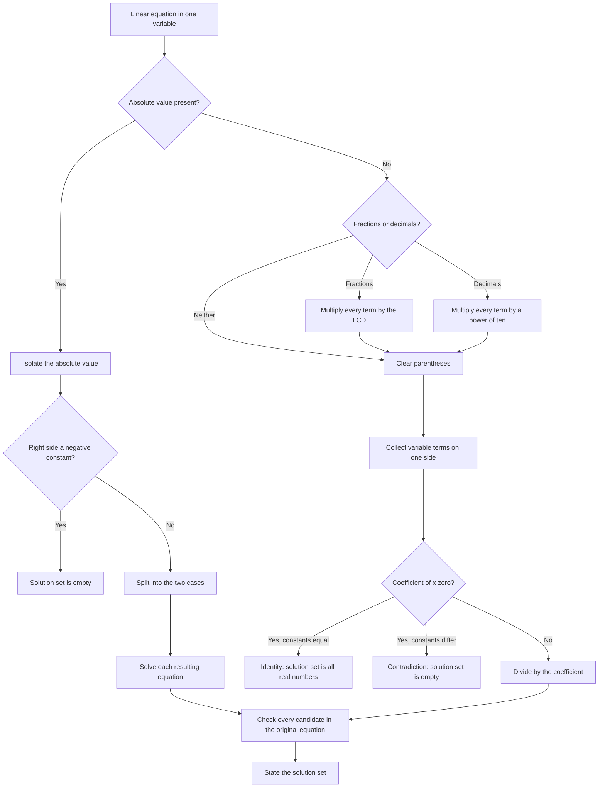

# Linear Equations

> [Algebra](../README.md) · Level: Beginner → Intermediate · Prerequisites: [Elementary Algebra](../01-elementary-algebra/README.md) · Estimated time: 150 min

## 1. Introduction

A **linear equation** is an equation in which every variable occurs to the first power and no variable is multiplied by another. In one variable every such equation can be written in the form

$$
ax+b=0,\qquad a\ne0,
$$

and its solution is a single number. The equation $ax+b=cx+d$ looks more complicated but reduces to the same form: subtract $cx+b$ from both sides to obtain $(a-c)x=d-b$. If $a\ne c$, this is a genuine linear equation with the unique solution $x=\frac{d-b}{a-c}$; if $a=c$, the equation degenerates into either an identity or a contradiction.

Linear equations are the first complete solving technique in algebra, and they are worth studying slowly for three reasons.

1. **They model constant-rate change.** A fixed fee plus a charge per unit, a speed times a time, a concentration times a volume, and a work rate times a duration all produce expressions of the form $mx+b$. Comparing two such expressions produces a linear equation.
2. **They train the equivalence principle.** Every step in a correct solution is an reversible transformation: adding the same number to both sides, or multiplying both sides by a nonzero number. Later equations (quadratic, rational, trigonometric) use the same principle, but with operations that are not always reversible, so the habits formed here matter.
3. **They introduce the full solution set.** A linear equation may have one solution, no solutions, or every real number as a solution. Recognizing which case occurs is part of solving, not an afterthought.

The purpose of this topic is not to produce answers quickly but to produce them *with justification*: every line should be an equation equivalent to the previous one, and every final answer should be checked in the original equation.

## 2. Prerequisites

This topic assumes the material of [Elementary Algebra](../01-elementary-algebra/README.md), in particular:

* the distinction between an expression and an equation, and the meaning of a solution and a solution set;
* the field axioms and their basic consequences, including distributivity and the sign rules;
* simplifying expressions by combining like terms and removing parentheses;
* factoring a common monomial, including the case where the variable appears in two terms;
* adding, subtracting, and multiplying polynomials, and dividing by a monomial;
* solving a formula for a variable, with the necessary nonzero conditions;
* the principle of equivalent equations: adding the same number to both sides or multiplying both sides by a nonzero number preserves the solution set.

Arithmetic prerequisites are fluency with signed numbers, fractions, and decimals. The [exercises of Elementary Algebra](../01-elementary-algebra/exercises.md) provide a diagnostic; if they are difficult, work through that topic first.

## 3. Learning Objectives

By the end of this tutorial you will be able to:

1. Recognize the forms $ax+b=c$ and $ax+b=cx+d$, and identify the coefficient of the unknown in each.
2. Solve a linear equation by a chain of justified equivalences, stating the operation performed at each step.
3. Solve equations containing fractions by multiplying both sides by the least common denominator.
4. Solve equations containing decimals by multiplying both sides by a suitable power of ten.
5. Distinguish conditional equations, identities, and contradictions, and describe the solution set in each case.
6. Solve absolute-value equations of the form $|X|=k$ using the two-case argument, and interpret the solutions as distances on the number line.
7. Solve equations of the form $|X|=|Y|$ and check candidates for extraneous solutions.
8. Solve a linear equation in two variables for one variable, and explain why such an equation has infinitely many solutions.
9. Set up and solve mixture, distance-rate-time, work, and age problems.
10. Explain why each solving step preserves the solution set, and identify steps that do not.

## 4. Intuition

### 4.1 The balance scale

An equation is a balanced scale. The left side and the right side have the same value. Adding the same weight to both pans, or removing the same weight from both pans, keeps the scale level. Doubling or halving both pans keeps it level. These are precisely the operations that preserve the solution set.

The scale picture also shows what is *not* allowed. Multiplying both pans by zero empties them: the scale is level, but the information is gone. Dividing by an expression that is zero for the unknown is undefined. Such operations can create or destroy solutions, which is why they need separate checking.

### 4.2 Unwrapping a parcel

To solve $3x+7=22$, imagine the unknown $x$ has been wrapped in two layers: first multiplied by $3$, then increased by $7$. The equation says the wrapped parcel has value $22$. To recover $x$, undo the layers in reverse order: first undo "add $7$" by subtracting $7$, then undo "multiply by $3$" by dividing by $3$.

$$
3x+7=22 \;\Longrightarrow\; 3x=15 \;\Longrightarrow\; x=5.
$$

The order matters. Subtracting $7$ first is correct because addition was applied last. Dividing by $3$ before subtracting would produce $\frac{22}{3}$ and a more complicated equation, not a wrong one, but it would not unwrap the parcel efficiently. The general rule is: **undo operations in the reverse of the order in which they were applied.**

### 4.3 Two straight lines

If the left side and the right side of $ax+b=cx+d$ are plotted as functions of $x$, both graphs are straight lines. A solution is an $x$-value at which the two lines have the same height, that is, a point where they meet.

* If the lines have different slopes ($a\ne c$), they meet exactly once: one solution.
* If the slopes are equal but the intercepts differ ($a=c$, $b\ne d$), the lines are parallel and never meet: no solution.
* If the slopes and intercepts are both equal ($a=c$, $b=d$), the lines coincide: every $x$ is a solution.

This geometric picture is developed properly when graphing is studied; here it serves only as intuition. The algebraic trichotomy in Section 7.4 is the rigorous statement, and it is proved from the axioms, not from a picture.

### 4.4 Absolute value is distance

The absolute value $|x|$ is the distance from $x$ to $0$ on the number line. More generally, $|x-c|$ is the distance from $x$ to the point $c$. Therefore the equation $|x-c|=r$ asks: which points are exactly $r$ units away from $c$? There are two, $c-r$ and $c+r$, provided $r>0$; there is one, $c$ itself, when $r=0$; and there are none when $r<0$, because distance cannot be negative.

This geometric reading explains why absolute-value equations split into two cases, and it provides a quick check on the answers.

## 5. Formal Definition

**Definition 5.1 (Linear equation in one variable).** A *linear equation in one variable* is an equation that can be written in the form

$$
ax+b=0,
$$

where $a,b\in\mathbb{R}$ and $a\ne0$. The number $a$ is the *coefficient* of $x$, and $b$ is the *constant term*. An equation of the form $0\cdot x+b=0$ is called a *constant equation*; it is either an identity or a contradiction, and it is not linear in $x$.

**Definition 5.2 (Solution and solution set).** A *solution* of an equation in $x$ is a real number $s$ in the domain of both sides such that substituting $x=s$ makes the equation true. The *solution set* is the set of all solutions, usually written with set braces, for example $\{5\}$ or $\mathbb{R}$ or $\varnothing$.

**Definition 5.3 (Equivalent equations).** Two equations are *equivalent* over a domain $D$ if they have the same solution set in $D$.

**Definition 5.4 (Identity, contradiction, conditional equation).** An equation is an *identity* over $D$ if every element of $D$ is a solution. It is a *contradiction* if it has no solution. It is *conditional* if it has at least one but not all elements of $D$ as solutions.

**Definition 5.5 (Absolute value).** For a real number $x$,

$$
|x|=
\begin{cases}
x, & x\ge0,\\
-x, & x<0.
\end{cases}
$$

Thus $|x|\ge0$ for every real $x$, and $|x|=0$ exactly when $x=0$.

**Definition 5.6 (Linear equation in two variables).** A *linear equation in two variables* is an equation that can be written as

$$
ax+by=c,
$$

where $a,b,c\in\mathbb{R}$ and not both $a$ and $b$ are zero. A *solution* is an ordered pair $(x,y)$ of real numbers satisfying the equation.

**Definition 5.7 (Literal equation).** A *literal equation* is an equation involving several variables in which some are treated as known constants and one as the unknown. *Solving for* that variable means writing an equivalent equation with it alone on one side, together with any necessary restrictions.

## 6. Mathematical Notation

| Symbol | Meaning | Read aloud |
|---|---|---|
| $ax+b=c$ | linear equation with unknown $x$ | "ay ex plus bee equals see" |
| $a\ne0$ | the coefficient is nonzero | "ay is not zero" |
| $\iff$ | the two equations are equivalent | "if and only if" |
| $\{5\}$ | the solution set containing only $5$ | "the set containing five" |
| $\varnothing$ | the empty set, used for "no solution" | "the empty set" |
| $\mathbb{R}$ | all real numbers, used for "identity" | "the reals" |
| $\pm$ | the two signs $+$ and $-$ | "plus or minus" |
| $\lvert x\rvert$ | absolute value of $x$ | "the absolute value of ex" |
| $\lvert x-c\rvert$ | distance from $x$ to $c$ | "the distance from ex to see" |
| LCD | least common denominator of several fractions | "ell see dee" |
| $(x,y)$ | ordered pair, a solution in two variables | "the ordered pair ex comma why" |
| $\mathbb{R}\setminus\{1\}$ | all real numbers except $1$ | "the reals minus the singleton one" |
| $d=rt$ | distance equals rate times time | "dee equals ar tee" |

## 7. Core Concepts

### 7.1 The Anatomy of a Linear Equation

The form $ax+b=c$ has three numerical ingredients:

* $a$, the coefficient of the unknown, which measures how fast the left side changes when $x$ changes;
* $b$, the constant added to the unknown term;
* $c$, the value the expression is required to take.

If $a=0$, the equation no longer contains $x$ and cannot be solved for $x$. It is either true for every $x$ (when $b=c$) or false for every $x$ (when $b\ne c$). This degenerate case is not a failure of the method; it is a genuine classification.

The form $ax+b=cx+d$ has unknowns on both sides. It is not a new type: subtracting $cx+b$ from both sides produces $(a-c)x=d-b$, which has the form $Ax=B$ with $A=a-c$ and $B=d-b$. Everything reduces to the case of a single coefficient times $x$ equal to a constant.

### 7.2 Equivalent Equations: The Only Two Legal Moves

All solving in this topic uses two operations:

* **(M1) Add or subtract the same real number** on both sides. By Theorem 7.7 of [Elementary Algebra](../01-elementary-algebra/README.md), this preserves the solution set.
* **(M2) Multiply or divide both sides by the same nonzero real number.** By Theorem 7.8 of that topic, this also preserves the solution set.

Every "move" you may have seen described as "take it to the other side and change its sign" is really (M1): subtracting a term from both sides makes it disappear from one side and appear with the opposite sign on the other. Describing the move as subtraction makes its validity obvious; describing it as teleportation invites sign errors.

Two cautions follow immediately.

1. **Multiplying by zero is not allowed.** It preserves truth in one direction only and destroys information.
2. **Multiplying by an expression containing the variable is not covered by (M2).** Such an expression may be zero for some candidate solutions. If it is used, the resulting equation may have extra solutions, and every candidate must be checked in the original.

A solution is written as a chain of equivalences:

$$
3x-7=11
\iff 3x=18
\iff x=6,
$$

where the first step adds $7$ to both sides and the second multiplies both sides by $\frac13$.

### 7.3 Solving $ax+b=c$

Assume $a\ne0$. The strategy is to strip away the constant term, then the coefficient.

**Step 1.** Subtract $b$ from both sides:

$$
ax+b=c \iff ax=c-b.
$$

**Step 2.** Multiply both sides by $\frac1a$ (equivalently, divide by $a$):

$$
ax=c-b \iff x=\frac{c-b}{a}.
$$

Both steps are reversible, so the final equation is equivalent to the original. The solution is unique: if $x_1$ and $x_2$ both satisfy $ax+b=c$, then $ax_1=c-b=ax_2$, and multiplying by $\frac1a$ gives $x_1=x_2$.

The formula $x=\frac{c-b}{a}$ should not be memorized as a substitute for the two steps. It is useful for computation, but the steps explain *why* it is correct.

### 7.4 Solving $ax+b=cx+d$: Collect, Factor, Divide

When the unknown appears on both sides, first collect all variable terms on one side and all constants on the other. Subtracting $cx+b$ from both sides gives

$$
ax+b=cx+d
\iff (a-c)x=d-b.
$$

The left side was factored: $ax-cx=(a-c)x$. Now there are three cases.

| Condition | Reduced equation | Solution set |
|---|---|---|
| $a\ne c$ | $(a-c)x=d-b$ | $\left\{\dfrac{d-b}{a-c}\right\}$ |
| $a=c$ and $b=d$ | $0=0$ | $\mathbb{R}$ (identity) |
| $a=c$ and $b\ne d$ | $0=d-b\ne0$ | $\varnothing$ (contradiction) |

The middle row is a genuine identity: the two sides are the same expression written differently, so every real number satisfies the equation. The third row is a genuine contradiction: it asserts that zero equals a nonzero number, which is false regardless of $x$.

A common error is to divide by $a-c$ without checking whether it is zero. The division is legal only in the first case. In the other two cases there is nothing to divide: the variable has disappeared.

### 7.5 Equations with Fractions: Clearing Denominators

If an equation contains numerical fractions, multiply both sides by their least common denominator (LCD). This is (M2) with a nonzero constant, so it is safe and reversible. The result is an equation without fractions.

**Example.** Solve $\dfrac{x}{3}+\dfrac{x}{4}=7$.

The LCD of $3$ and $4$ is $12$. Multiply every term on both sides by $12$:

$$
12\cdot\frac{x}{3}+12\cdot\frac{x}{4}=12\cdot7
\iff 4x+3x=84
\iff 7x=84
\iff x=12.
$$

Check: $\frac{12}{3}+\frac{12}{4}=4+3=7$. Correct.

The multiplication must hit **every** term. A frequent mistake is to multiply the fractions but forget the constant on the right, or to multiply only one side.

When a denominator contains the variable, the LCD is an expression, not a constant, and (M2) does not apply directly. The equation must first be restricted to values where the denominators are nonzero, and every candidate must be checked. For instance,

$$
\frac{x}{x-1}=1+\frac{1}{x-1}
$$

has domain $x\ne1$. Multiplying by $x-1$ gives $x=(x-1)+1=x$, which is true for every $x$, but only for $x\ne1$. The solution set is $\mathbb{R}\setminus\{1\}$, not $\mathbb{R}$. The excluded point must be removed explicitly.

### 7.6 Equations with Decimals

A decimal is a fraction with denominator a power of ten, so clearing decimals is a special case of clearing denominators. Multiply both sides by the smallest power of ten that removes every decimal place.

**Example.** Solve $0.3x+1.2=0.5x-0.6$.

The largest number of decimal places is one, so multiply by $10$:

$$
3x+12=5x-6.
$$

Subtract $3x$: $12=2x-6$. Add $6$: $18=2x$. Divide by $2$: $x=9$.

Check: $0.3(9)+1.2=2.7+1.2=3.9$ and $0.5(9)-0.6=4.5-0.6=3.9$. Correct.

If the equation contains $0.04$ and $0.1$, the multiplier is $100$, not $10$: $0.04=\frac{4}{100}$ still has a nonzero digit in the hundredths place. Choose the power of ten according to the *largest* number of decimal places present.

### 7.7 Identities and Contradictions

After collecting terms, the variable may cancel completely. The resulting numerical statement determines the solution set.

* If the statement is true, such as $0=0$ or $5=5$, the original equation is an **identity**: every real number in the domain is a solution.
* If the statement is false, such as $0=5$ or $-3=2$, the original equation is a **contradiction**: there is no solution.

A common misreading is to conclude $x=0$ from $0=0$. That is wrong: $x=0$ is a *conditional* equation with the single solution $0$. An identity has every real number as a solution.

| Original equation | After simplification | Classification | Solution set |
|---|---|---|---|
| $2(x+3)=2x+6$ | $0=0$ | identity | $\mathbb{R}$ |
| $2x+3=2x+7$ | $0=4$ | contradiction | $\varnothing$ |
| $2x=0$ | $x=0$ | conditional | $\{0\}$ |

### 7.8 Absolute-Value Equations

The equation $|X|=k$, where $X$ is an expression in $x$ and $k$ is a real number, is solved by considering the possible signs of $X$.

* If $k>0$, then $|X|=k$ exactly when $X=k$ or $X=-k$. These are two linear equations, solved separately.
* If $k=0$, then $|X|=0$ exactly when $X=0$. There is one equation.
* If $k<0$, there is no solution, because $|X|\ge0$ for every real $X$.

**Geometric form.** The equation $|x-c|=r$ says that the distance from $x$ to $c$ is $r$. For $r>0$ the solutions are $c-r$ and $c+r$; their midpoint is $c$, and each is $r$ units from it.

**Example.** Solve $|2x-5|=9$.

The right side is positive, so split:

$$
2x-5=9 \quad\text{or}\quad 2x-5=-9.
$$

The first gives $2x=14$, so $x=7$. The second gives $2x=-4$, so $x=-2$. Checking: $|2(7)-5|=|9|=9$ and $|2(-2)-5|=|-9|=9$. The solution set is $\{-2,7\}$. Geometrically, the equation is $|x-\frac52|=\frac92$, so the solutions are $\frac52-\frac92=-2$ and $\frac52+\frac92=7$.

**Equal absolute values.** The equation $|A|=|B|$ is equivalent to

$$
A=B \quad\text{or}\quad A=-B.
$$

Both alternatives are linear equations. The equivalence follows from $|A|^2=A^2$ and the difference-of-squares factorization, and it is proved as Theorem 8.5 below.

**A warning about expressions on the right.** An equation such as $|x+1|=2x-5$ is not of the form $|X|=k$ with constant $k$, because the right side can be negative. Splitting into $x+1=2x-5$ and $x+1=-(2x-5)$ produces candidates, but a candidate is valid only if it makes $2x-5\ge0$. Checking in the original equation is mandatory. In this example, the first case gives $x=6$ (valid, since $2(6)-5=7>0$), while the second gives $x=\frac43$ (invalid, since $2(\frac43)-5=-\frac73<0$). The solution set is $\{6\}$.

### 7.9 Linear Equations in More Than One Variable

An equation such as $4x-2y=8$ has infinitely many solutions: for every choice of $x$ there is exactly one $y$ that makes it true. Solving for $y$ gives

$$
4x-2y=8
\iff -2y=8-4x
\iff y=2x-4.
$$

The solution set is the set of all ordered pairs $(x,2x-4)$; in the coordinate plane these points form a straight line, a fact developed when linear functions are studied. This is why one linear equation in two variables cannot determine both unknowns: it constrains a whole line of possibilities, not a single point.

Special cases deserve notice. If the coefficient of $y$ is zero, as in $3x=6$, the equation determines $x$ alone ($x=2$) and places no restriction on $y$; its graph is a vertical line. If the coefficient of $x$ is zero, as in $2y=6$, then $y=3$ for every $x$; its graph is a horizontal line. If both coefficients were zero, the equation would be $0=c$, which is either an identity in two variables or a contradiction.

### 7.10 Choosing a Strategy

The order in which to attack an equation is not arbitrary. A reliable procedure is:

1. **Inspect for absolute value.** If an absolute value is present, isolate it first. Only then split into cases.
2. **Clear fractions or decimals.** Multiply both sides by the LCD or by a power of ten. Apply the multiplier to every term.
3. **Remove parentheses.** Distribute and simplify each side separately.
4. **Collect variable terms on one side and constants on the other.** Use (M1), and justify it as subtraction or addition.
5. **Combine like terms and factor the variable.** The equation should now read $Ax=B$.
6. **Examine the coefficient.** If $A\ne0$, divide to get $x=B/A$. If $A=0$, decide whether $B=0$ (identity) or $B\ne0$ (contradiction).
7. **Check** the answer in the original equation. If any non-reversible operation was used, check every candidate.

Section 10 presents this procedure as a flowchart. The order is a default, not a law: an equation with an obvious simplification may be attacked differently, provided every step is justified.

### 7.11 Applications: Four Standard Models

Word problems in this topic usually reduce to one of four models. In each, the key is to write a table or a rate equation before doing algebra.

**Mixtures.** If a solution has concentration $c$ (as a decimal) and volume $V$, the amount of dissolved substance is $cV$. When two solutions are mixed, the amounts add:

$$
c_1V_1+c_2V_2=c(V_1+V_2),\qquad V=V_1+V_2.
$$

The equation expresses conservation of the dissolved substance: none is created or destroyed by mixing. Volumes are assumed additive, which is an idealization; the model is stated explicitly so that the assumption is visible.

**Distance, rate, time.** For constant speed, $d=rt$. The three standard arrangements are:

| Situation | Equation |
|---|---|
| Two objects move toward each other | $r_1t+r_2t=D$ |
| Two objects move apart from the same point | $(r_1+r_2)t=D$ |
| A faster object catches a slower one that started earlier | $r_{\text{fast}}t=r_{\text{slow}}(t+\Delta)$ |

In the last row, $t$ is the time travelled by the faster object and $\Delta$ is the head start of the slower one. Distances are equal at the moment of catching.

**Work.** If a job takes $a$ hours alone, the rate is $\frac1a$ of the job per hour. If two workers or machines work simultaneously at constant rates, their rates add:

$$
\frac1a+\frac1b=\frac1t,
$$

where $t$ is the time to complete the job together. The equation says: in one hour, the fraction completed by the first plus the fraction completed by the second equals the fraction completed together. It assumes the rates are independent, which is part of the model.

**Age.** Let present ages be $A$ and $B$. In $k$ years the ages are $A+k$ and $B+k$; $k$ years ago they were $A-k$ and $B-k$. The *difference* of the ages is constant: $(A+k)-(B+k)=A-B$. This invariance is often the quickest route to the equation.

In all four models, define the unknown with a unit, write the equation from a stated principle (conservation, equal distance, additive rates, constant age difference), solve, and check the answer against the wording. The worked examples in Section 9 apply each model once.

## 8. Formulas and Properties

**Theorem 8.1 (Solution of $ax+b=c$).** If $a\ne0$, the equation $ax+b=c$ has exactly one solution,

$$
x=\frac{c-b}{a}.
$$

*Proof.* Subtracting $b$ from both sides gives $ax=c-b$; multiplying by $a^{-1}$ gives $x=a^{-1}(c-b)=\frac{c-b}{a}$. For uniqueness, if $x_1$ and $x_2$ are solutions, then $ax_1+b=ax_2+b$, so $ax_1=ax_2$, and multiplication by $a^{-1}$ gives $x_1=x_2$. $\square$

**Theorem 8.2 (Trichotomy for $ax+b=cx+d$).** For real $a,b,c,d$:

1. if $a\ne c$, the equation has the unique solution $x=\dfrac{d-b}{a-c}$;
2. if $a=c$ and $b=d$, every real number is a solution;
3. if $a=c$ and $b\ne d$, there is no solution.

*Proof.* Subtracting $cx+b$ from both sides gives the equivalent equation $(a-c)x=d-b$. In case 1, $a-c\ne0$, so Theorem 8.1 applies with coefficient $a-c$ and right side $d-b$. In case 2, the equation reads $0\cdot x=0$, true for every $x$. In case 3, it reads $0\cdot x=d-b$ with $d-b\ne0$, false for every $x$. $\square$

**Theorem 8.3 (Clearing denominators).** Let $L$ be a nonzero real constant. Then

$$
A=B \quad\iff\quad LA=LB.
$$

*Proof.* This is Theorem 8.1 of [Elementary Algebra](../01-elementary-algebra/README.md), with $c=L\ne0$. The forward direction is substitution; the reverse multiplies by $L^{-1}$. $\square$

**Theorem 8.4 (Absolute value equation).** Let $k\in\mathbb{R}$. The equation $|X|=k$ is equivalent to:

* $X=k$ or $X=-k$ if $k>0$;
* $X=0$ if $k=0$;
* a false statement (no solution) if $k<0$.

*Proof.* Since $|X|\ge0$ for every real $X$, the case $k<0$ is impossible. If $k=0$, then $|X|=0$ exactly when $X=0$. If $k>0$ and $|X|=k$, then either $X\ge0$, in which case $X=|X|=k$, or $X<0$, in which case $-X=|X|=k$, so $X=-k$. Conversely, $|k|=k$ and $|-k|=k$, so both values satisfy the equation. $\square$

**Theorem 8.5 (Equal absolute values).** For all real numbers or expressions $A$ and $B$,

$$
|A|=|B| \quad\iff\quad A=B \ \text{or}\ A=-B.
$$

*Proof.* For every real $t$, $|t|^2=t^2$. Since both sides of $|A|=|B|$ are nonnegative, and squaring is injective on $[0,\infty)$, the equation is equivalent to $A^2=B^2$. Then

$$
A^2=B^2 \iff A^2-B^2=0 \iff (A-B)(A+B)=0.
$$

By the absence of zero divisors, a product is zero exactly when one factor is zero, so $A=B$ or $A=-B$. $\square$

**Theorem 8.6 (Distance form).** For real $c$ and $r>0$, the equation $|x-c|=r$ has exactly the two solutions $x=c-r$ and $x=c+r$.

*Proof.* Apply Theorem 8.4 to $X=x-c$ and $k=r$. The two equations are $x-c=r$ and $x-c=-r$, whose solutions are $x=c+r$ and $x=c-r$. $\square$

**The work-rate formula.** If two agents working together at constant rates complete a job in $t$ hours, while working alone they take $a$ and $b$ hours respectively, then

$$
\frac1a+\frac1b=\frac1t.
$$

Justification: in one hour the first completes $\frac1a$ of the job and the second $\frac1b$; together they complete $\frac1t$. Rates add because the amounts of work done in an hour add. The formula assumes $a,b,t>0$ and independence of the two rates.

**The mixture balance.** Mixing volumes $V_1$ and $V_2$ with concentrations $c_1$ and $c_2$ gives concentration $c$ satisfying

$$
c_1V_1+c_2V_2=c(V_1+V_2).
$$

Justification: solute amount equals concentration times volume, and the total solute before mixing equals the total after, while the volumes add.

**Warning 8.7 (Extraneous solutions).** Operations that are not reversible can change the solution set. Multiplying by an expression that is zero for some candidate, or squaring both sides, may add solutions. Dividing by such an expression may remove them. Any use of such an operation requires checking every candidate in the original equation. The legal moves (M1) and (M2) are exactly the reversible ones used in this topic; absolute-value case splits are also reversible provided every case is retained.

## 9. Step-by-Step Examples

### Example 1 — A Basic Equation, Justified Step by Step

Solve $3x-7=11$.

Add $7$ to both sides (M1):

$$
3x=18.
$$

Multiply both sides by $\frac13$ (M2):

$$
x=6.
$$

**Check.** $3(6)-7=18-7=11$. The solution set is $\{6\}$. The equation is conditional: it has exactly one solution.

### Example 2 — Parentheses and Variables on Both Sides

Solve $5(x-2)+3=2x+4$.

Distribute and simplify the left side:

$$
5x-10+3=2x+4
\iff 5x-7=2x+4.
$$

Subtract $2x$ from both sides:

$$
3x-7=4.
$$

Add $7$:

$$
3x=11.
$$

Multiply by $\frac13$:

$$
x=\frac{11}{3}.
$$

**Check.** The left side is $5\left(\frac{11}{3}-2\right)+3=5\cdot\frac53+3=\frac{25}{3}+\frac93=\frac{34}{3}$. The right side is $2\cdot\frac{11}{3}+4=\frac{22}{3}+\frac{12}{3}=\frac{34}{3}$. The solution set is $\left\{\frac{11}{3}\right\}$.

### Example 3 — Clearing Fractions

Solve $\dfrac23x-\dfrac14=\dfrac12x+\dfrac56$.

The least common denominator of $3,4,2,6$ is $12$. Multiply **every** term on both sides by $12$:

$$
12\cdot\frac23x-12\cdot\frac14=12\cdot\frac12x+12\cdot\frac56,
$$

that is,

$$
8x-3=6x+10.
$$

Subtract $6x$:

$$
2x-3=10.
$$

Add $3$:

$$
2x=13.
$$

Divide by $2$:

$$
x=\frac{13}{2}.
$$

**Check.** The left side is $\frac23\cdot\frac{13}{2}-\frac14=\frac{13}{3}-\frac14=\frac{52-3}{12}=\frac{49}{12}$. The right side is $\frac12\cdot\frac{13}{2}+\frac56=\frac{13}{4}+\frac56=\frac{39+10}{12}=\frac{49}{12}$. Correct.

### Example 4 — Clearing Decimals

Solve $0.04x+0.6=0.1x-0.9$.

The largest number of decimal places is two, so multiply every term by $100$:

$$
4x+60=10x-90.
$$

Subtract $4x$:

$$
60=6x-90.
$$

Add $90$:

$$
150=6x.
$$

Divide by $6$:

$$
x=25.
$$

**Check.** $0.04(25)+0.6=1+0.6=1.6$ and $0.1(25)-0.9=2.5-0.9=1.6$. Correct.

### Example 5 — An Identity and a Contradiction

(a) Solve $4(x+1)-2=2(2x+1)$.

The left side is $4x+4-2=4x+2$; the right side is $4x+2$. Subtracting $4x$ from both sides gives $2=2$, a true numerical statement. The equation is an identity, and its solution set is $\mathbb{R}$.

(b) Solve $3x-5=3x+2$.

Subtracting $3x$ from both sides gives $-5=2$, a false numerical statement. The equation is a contradiction, and its solution set is $\varnothing$.

In neither case is the answer $x=0$. The variable has disappeared; the truth or falsity of the remaining numerical statement applies to every $x$ or to none.

### Example 6 — Absolute Value: All Three Cases

(a) Solve $|2x-5|=9$. Since $9>0$, split:

$$
2x-5=9 \quad\text{or}\quad 2x-5=-9.
$$

The first gives $x=7$; the second gives $x=-2$. Both check: $|2(7)-5|=9$ and $|2(-2)-5|=9$. Geometrically, $|2x-5|=2\left|x-\frac52\right|$, so the equation is $\left|x-\frac52\right|=\frac92$; the points at distance $\frac92$ from $\frac52$ are $-2$ and $7$.

(b) Solve $|4-3x|=0$. Since the right side is zero, there is one case: $4-3x=0$, so $x=\frac43$.

(c) Solve $|x-3|=-2$. Since the right side is negative and absolute value is never negative, there is no solution: the solution set is $\varnothing$.

### Example 7 — A Variable Right Side Requiring a Check

Solve $|x+1|=2x-5$.

The right side is not a constant, so the two-case split can produce a candidate for which $2x-5<0$. Such a candidate cannot satisfy the original equation, because the left side is nonnegative.

**Case 1.** $x+1=2x-5$. Then $-x=-6$, so $x=6$. The right side is $2(6)-5=7\ge0$, and $|6+1|=7$. Valid.

**Case 2.** $x+1=-(2x-5)=-2x+5$. Then $3x=4$, so $x=\frac43$. The right side is $2\left(\frac43\right)-5=\frac83-\frac{15}{3}=-\frac73<0$. Invalid, and indeed $\left|\frac43+1\right|=\frac73\ne-\frac73$.

The solution set is $\{6\}$. The rejected value solves the equation obtained by splitting but not the original equation; this is exactly the extraneous-solution phenomenon.

### Example 8 — The General Literal Equation and the Trichotomy

Solve $ax+b=cx+d$ for $x$, where $a,b,c,d$ are real constants.

Subtract $cx+b$ from both sides:

$$
ax-cx=d-b.
$$

Factor the left side:

$$
(a-c)x=d-b.
$$

If $a\ne c$, divide by $a-c$:

$$
x=\frac{d-b}{a-c}.
$$

If $a=c$, the equation becomes $0=d-b$. It is an identity when $d=b$ and a contradiction when $d\ne b$. This is precisely Theorem 8.2.

**Check.** Take $a=5$, $b=2$, $c=3$, $d=10$. Then $x=\frac{10-2}{5-3}=4$, and both sides equal $5(4)+2=22$ and $3(4)+10=22$.

**A second variable.** Solving $4x-2y=8$ for $y$ uses the same moves:

$$
4x-2y=8
\iff -2y=8-4x
\iff y=2x-4.
$$

For each $x$ there is exactly one $y$, so the solution set is the whole line of pairs $(x,2x-4)$, not a single pair.

### Example 9 — A Mixture Problem

How many litres of a $20\%$ saline solution must be added to $8$ litres of a $50\%$ solution to obtain a $30\%$ solution?

Let $x$ be the number of litres of the $20\%$ solution. The amount of salt is $0.20x$ in the first part and $0.50(8)=4$ in the second. After mixing, the total volume is $x+8$ and the total salt is $0.30(x+8)$. Conservation of salt gives

$$
0.20x+4=0.30(x+8).
$$

Distribute and solve:

$$
0.20x+4=0.30x+2.4
\iff 1.6=0.10x
\iff x=16.
$$

**Check.** The mixture has volume $24$ L and salt $0.20(16)+4=3.2+4=7.2$ L, and $\frac{7.2}{24}=0.30$, that is, $30\%$. The answer is $16$ litres.

### Example 10 — A Catch-Up Distance Problem

A cyclist leaves a town at noon riding at $4$ km/h. A jogger leaves the same town at 1 pm on the same road at $6$ km/h. When does the jogger catch the cyclist, and how far from town?

Let $t$ be the number of hours after noon. The cyclist has travelled $4t$ km. The jogger travels for $t-1$ hours (for $t\ge1$) and covers $6(t-1)$ km. At the catch-up point the distances are equal:

$$
4t=6(t-1).
$$

Solve:

$$
4t=6t-6
\iff 6=2t
\iff t=3.
$$

The catch-up occurs at 3 pm, at distance $4(3)=12$ km from town.

**Check.** The cyclist rides $3$ hours at $4$ km/h, covering $12$ km. The jogger rides $2$ hours at $6$ km/h, also covering $12$ km. Correct.

### Example 11 — A Work Problem

Pipe A fills a tank in $6$ hours; pipe B fills it in $12$ hours. How long do they take working together?

Let $t$ be the time in hours. In one hour A fills $\frac16$ of the tank and B fills $\frac1{12}$; together they fill $\frac1t$. Thus

$$
\frac16+\frac1{12}=\frac1t.
$$

The left side is $\frac{2}{12}+\frac{1}{12}=\frac{3}{12}=\frac14$, so $\frac1t=\frac14$ and $t=4$.

**Check.** In $4$ hours A fills $\frac46=\frac23$ of the tank and B fills $\frac4{12}=\frac13$; together they fill $1$ tank. Correct.

### Example 12 — An Age Problem

A father is four times as old as his son. In $20$ years he will be twice as old. Find their present ages.

Let $s$ be the son's present age. The father's present age is $4s$. In $20$ years their ages are $s+20$ and $4s+20$, and the condition is

$$
4s+20=2(s+20).
$$

Solve:

$$
4s+20=2s+40
\iff 2s=20
\iff s=10.
$$

The son is $10$ and the father is $40$.

**Check.** In $20$ years the son is $30$ and the father is $60$, and $60=2\cdot30$. Correct.

## 10. Visual Explanations

The following flowchart is the decision procedure of Section 7.10. It is meant to be read top to bottom; the order matters because an absolute value must be isolated before it can be split, and denominators should be cleared before collecting terms.

The absolute-value branch deserves a comment. If the isolated equation is $|X|=Y$ with $Y$ a constant, the sign of $Y$ decides immediately whether there are solutions. If $Y$ is an expression in $x$, the split still produces candidates, but each candidate must be checked in the original equation because $Y$ may be negative there. The flowchart routes all such candidates through the checking step.

The number-line interpretation of $|x-c|=r$ is worth keeping in mind: mark $c$, step $r$ units to the left and to the right, and label the two points $c-r$ and $c+r$. When $r=0$ the two points coincide; when $r<0$ no points exist.

## 11. Common Mistakes

1. **Sign error when collecting variable terms.** From $3x+5=2x+9$, subtracting $2x$ gives $x+5=9$, not $x+5=9$ with a sign change on $9$. Write the subtraction explicitly instead of "moving" terms.
2. **Distributing only to the first term.** $2(x-3)=2x-6$, not $2x-3$. Every term inside the parentheses is multiplied.
3. **Clearing denominators but not constants.** In $\frac{x}{2}+3=5$, multiplying by $2$ gives $x+6=10$, not $x+3=10$. The multiplier applies to every term.
4. **Dividing by a variable factor.** In $2(x-1)=3(x-1)$, dividing by $x-1$ gives the false statement $2=3$ and loses the true solution $x=1$. Instead, subtract $3(x-1)$ and factor: $(2-3)(x-1)=0$, so $x=1$.
5. **Ignoring a variable denominator.** Solving $\frac{x}{x-1}=\frac{1}{x-1}$ by multiplying by $x-1$ gives $x=1$, but $x=1$ is excluded from the domain. The equation has no solution.
6. **Solving an absolute-value equation with only one case.** $|2x-5|=9$ has two solutions, $7$ and $-2$; keeping only $2x-5=9$ misses $-2$.
7. **Accepting a candidate with a negative right side.** For $|x+1|=2x-5$, the candidate $x=\frac43$ makes the right side negative and must be rejected.
8. **Concluding $x=0$ from $0=0$.** A true numerical statement after the variable cancels means every real number is a solution. $x=0$ is the solution of $2x=0$, a different equation.
9. **Confusing "no solution" with "solution zero".** The equation $0x=5$ has solution set $\varnothing$; the equation $5x=0$ has solution set $\{0\}$.
10. **Adding times in work problems.** If one pipe takes $6$ h and another $12$ h, together they do not take $18$ h or $9$ h; the rates add, giving $4$ h.
11. **Ignoring a head start in distance problems.** The faster object's time is shorter by the head-start interval; using the same $t$ for both objects changes the problem.
12. **Choosing too small a power of ten.** An equation containing $0.04$ needs multiplication by $100$, not $10$, to clear the hundredths place.

## 12. Applications

**Physics and engineering.** Constant-velocity motion gives $d=rt$; solving for $t$ gives $t=\frac dr$ (with $r\ne0$). Ohm's law $V=IR$ is linear in each variable: $I=\frac VR$ and $R=\frac VI$ (with the divisor nonzero). Temperature conversion $F=\frac95C+32$ is a linear equation; solving for $C$ gives $C=\frac59(F-32)$. Each rearrangement is an instance of Theorem 8.1.

**Chemistry and pharmacy.** Dilution and mixture problems use the balance $c_1V_1+c_2V_2=c(V_1+V_2)$. A pharmacist computing a concentration, or a chemist preparing a standard solution, is solving exactly such an equation.

**Finance.** Break-even analysis compares revenue $R=px$ with cost $C=mx+b$, where $p$ is the unit price, $m$ the unit variable cost, and $b>0$ the fixed cost. The break-even quantity solves $px=mx+b$, so $x=\frac{b}{p-m}$ provided $p>m$; if $p\le m$, no positive break-even quantity exists. Simple interest $I=Prt$ is linear in each of $P,r,t$.

**Computer science.** Linear interpolation between two known values is a linear equation in the interpolation parameter. A spreadsheet formula such as `=0.04*A1+0.6` is a linear expression; setting it equal to a target and solving for the input is the same algebra done on paper. The distinction between an equation and an assignment statement remains important: `x = x + 1` is not an equation with a solution.

**Everyday decisions.** Comparing phone plans, taxi fares, or subscription services means comparing two expressions of the form $mx+b$. The break-even point is the solution of a linear equation, and the comparison on either side of it is decided by the coefficients.

## 13. Exercises

The problem set is in [exercises.md](exercises.md). It contains 45 problems in four levels: Beginner (one- and two-step equations, simple absolute values, and solving for a variable), Intermediate (fractions, decimals, identities, and absolute-value equations), Advanced (nested fractions, literal equations, and the four application models), and Challenge (extraneous solutions, parameter discussions, proof of the trichotomy, and multi-step modelling). Attempt each problem before opening the solutions.

## 14. Solutions

Complete worked solutions to every exercise are in [solutions.md](solutions.md). Each solution shows the equivalence steps, states restrictions, and checks the answer in the original equation.

## 15. Summary

* A linear equation in one variable can be written as $ax+b=0$ with $a\ne0$. The form $ax+b=cx+d$ reduces to $(a-c)x=d-b$.
* Adding the same number to both sides, or multiplying both sides by a nonzero number, preserves the solution set. These are the only two moves needed.
* For $ax+b=c$ with $a\ne0$, the unique solution is $x=\frac{c-b}{a}$.
* For $ax+b=cx+d$: if $a\ne c$ there is one solution; if $a=c$ and $b=d$ the equation is an identity; if $a=c$ and $b\ne d$ it is a contradiction.
* Fractions are cleared by multiplying every term by the LCD; decimals are cleared by multiplying every term by a suitable power of ten.
* If the variable cancels and a true statement remains, the solution set is $\mathbb{R}$; if a false statement remains, it is $\varnothing$; if the result is $x=0$, the solution set is $\{0\}$.
* For a nonconstant linear expression $X$, the equation $|X|=k$ has two solutions when $k>0$, one when $k=0$, and none when $k<0$. Geometrically, $|x-c|=r$ describes the two points at distance $r$ from $c$.
* $|A|=|B|$ is equivalent to $A=B$ or $A=-B$. When the right side of an absolute-value equation can be negative, every candidate must be checked in the original equation.
* A linear equation in two variables has infinitely many solutions, forming a line; solving for one variable expresses the dependence explicitly.
* Mixture problems conserve solute; distance problems use $d=rt$ with careful attention to starting times; work problems add rates; age problems use the constant age difference.
* Always check the final value in the original equation and state the solution set.

## 16. Further Learning

The next topic in the Algebra sequence is [Inequalities](../03-inequalities/README.md), where the same equivalence moves are used but multiplication by a negative number reverses the inequality. The [Algebra index](../README.md) gives the full study order, including systems of linear equations, polynomials, and quadratic equations.

For additional practice and a slower treatment of the same material:

* R. Larson and R. Hostetler, *Elementary and Intermediate Algebra* — extensive sections on linear equations, absolute value, and applications.
* J. Stewart, L. Redlin, and S. Watson, *College Algebra* — a bridge from linear equations to functions and modelling.
* A. Gelfand and A. Shen, *Algebra* — a concise, proof-oriented account of the same algebraic principles.

Return to [Elementary Algebra](../01-elementary-algebra/README.md) if any of the equivalence arguments in this topic felt unfamiliar; the two topics are designed to be read in sequence.

