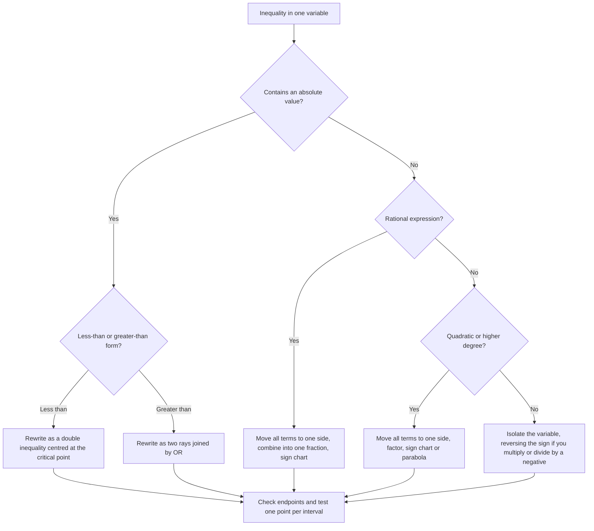
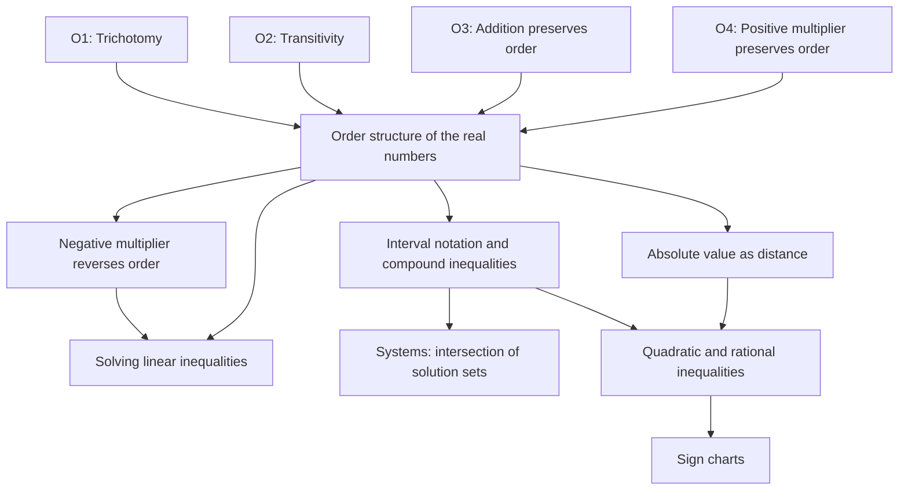

# Inequalities

> [Mathematics](../../README.md) › [Algebra](../README.md) · Level: Beginner → Intermediate · Prerequisites: [Integers](../../01-arithmetic/02-integers/README.md), [Fractions](../../01-arithmetic/03-fractions/README.md), [Elementary Algebra](../01-elementary-algebra/README.md) · Estimated time: 150 min

## 1. Introduction

Equations ask for the exact values at which two quantities are equal. Most real questions are not
like that. A speed limit does not say "drive at exactly $65$"; it says "do not exceed $65$". A
manufactured bolt is acceptable when its diameter is within $0.02$ mm of the specification, not when
it is exactly the specification. A household budget says that total spending must stay below income.
A computer program that clamps a value to a valid range tests two inequalities.

An **inequality** is a statement that one quantity is less than, or at most, or at least, another.
Solving an inequality means describing *every* value of the variable that makes the statement true —
usually an interval, a union of intervals, or the empty set.

The subject is more delicate than solving equations for two reasons.

1. **The order of the real numbers has structure.** We may add the same number to both sides, but
   multiplying by a negative number turns the order around. Every step must be justified by an order
   axiom, not by habit.
2. **A solution set is usually infinite.** We cannot check every value. Instead we reduce the
   inequality to a form whose solution set is visible, or we split the number line into intervals on
   which the sign of an expression is constant and test one point per interval.

This tutorial builds the subject from the order axioms of $\mathbb{R}$. It proves the rules that
school algebra uses without proof, then applies them to linear, compound, absolute-value, quadratic
and rational inequalities, and to systems in one variable. The final section shows how these ideas
encode budgets, tolerances and optimization constraints.

## 2. Prerequisites

You should be comfortable with the following, at the level of elementary algebra.

* **Signed arithmetic.** Adding, subtracting, multiplying and dividing negative numbers; the fact
  that $(-1)(-1)=1$; comparing $-7$ and $-2$ correctly ($-7<-2$, because $-7$ lies farther left).
* **Fractions.** Finding common denominators, cancelling common *factors* (not terms), and the rule
  that a fraction is positive exactly when numerator and denominator have the same sign.
* **Linear equations.** Solving $ax+b=c$ by subtracting $b$ and dividing by $a\neq 0$.
* **Factoring quadratics.** Writing $x^2+bx+c=(x-r)(x-s)$ when such integer roots exist, and using
  the discriminant $b^2-4ac$ to decide how many real roots a quadratic has.
* **Elementary set language.** The meaning of $\in$, $\varnothing$, and the intersection and union
  of two sets. These are reviewed in Section 6, so a first exposure is enough.

The tutorials that teach these prerequisites are part of the wider curriculum; this page is
self-contained for a reader who has seen them once.

## 3. Learning Objectives

After working through this tutorial you will be able to:

1. State the four order axioms of $\mathbb{R}$ and use them to justify algebraic steps.
2. Translate between inequality notation and interval notation, including unbounded intervals.
3. Solve linear inequalities and prove that multiplication or division by a negative number
   reverses the inequality.
4. Solve compound inequalities joined by *and* and by *or*, and recognise a chained inequality as a
   conjunction.
5. Solve absolute-value inequalities $|x|<a$, $|x|\le a$, $|x|>a$, $|x|\ge a$, including the
   degenerate cases $a=0$ and $a<0$, and interpret them as distance statements.
6. Build a sign chart and use it to solve quadratic and rational inequalities.
7. Solve systems of inequalities in one variable by intersecting solution sets.
8. Decide whether a candidate solution is valid, and explain why squaring or multiplying by an
   expression of unknown sign can introduce or lose solutions.
9. Model budgets, tolerances and optimization constraints with inequalities.

## 4. Intuition

Think of the real line as a road running from left to right. Every real number is a position on that
road. The statement $a<b$ means that $a$ is *strictly to the left of* $b$. The statement $a\le b$
allows the two positions to coincide.

Now think of an inequality as a balance that is allowed to tilt. Adding the same weight to both pans
does not change which pan is heavier, so adding the same number to both sides preserves the
inequality. Doubling both sides preserves it too, because stretching the whole picture about zero
does not change left-to-right order. But multiplying by $-1$ is a *reflection* in zero: everything
that was on the left moves to the right. That is exactly why the inequality reverses.

A solution set is the collection of positions on the road where a condition holds. "All positions
within $3$ units of $5$" is the interval $(2,8)$; "all positions at distance at least $3$ from $5$"
is the two rays $(-\infty,2]\cup[8,\infty)$. Absolute-value inequalities are distance statements in
disguise.

For expressions more complicated than a line, the road is divided into stretches on which the
expression cannot change sign without passing through zero or becoming undefined. A **sign chart**
records the sign on each stretch. This turns an apparently infinite check into finitely many test
points — one per stretch.

## 5. Formal Definition

Throughout, $\mathbb{R}$ is the set of real numbers with its usual addition, multiplication and
order. The order is characterised by four axioms.

**Definition 5.1 (Order axioms).** For all $a,b,c\in\mathbb{R}$:

* **(O1) Trichotomy.** Exactly one of $a<b$, $a=b$, $b<a$ holds.
* **(O2) Transitivity.** If $a<b$ and $b<c$, then $a<c$.
* **(O3) Compatibility with addition.** If $a<b$, then $a+c<b+c$.
* **(O4) Compatibility with multiplication by positives.** If $a<b$ and $c>0$, then $ac<bc$.

We write $a>b$ to mean $b<a$, and $a\ge b$ to mean $a>b$ or $a=b$.

These axioms describe a **linearly ordered field**. They are not arbitrary: each one is visibly true
of points on a line, and together they are enough to derive every algebraic rule for inequalities.

**Definition 5.2 (Solution set).** Let $P(x)$ be a statement about a real variable $x$. The solution
set of $P(x)$ is
$$S=\{x\in\mathbb{R}:P(x)\text{ is true}\}.$$
Two statements are **equivalent** when they have the same solution set over the intended domain.

For example, the solution set of $x^2<4$ is $(-2,2)$; the solution set of $x^2\le 4$ is $[-2,2]$;
the solution set of $x^2<-1$ is $\varnothing$.

**Definition 5.3 (Intervals).** Let $a,b\in\mathbb{R}$ with $a<b$. Then
$$\begin{aligned}
[a,b] &= \{x:a\le x\le b\}, & (a,b) &= \{x:a<x<b\},\\
[a,b) &= \{x:a\le x<b\}, & (a,b] &= \{x:a<x\le b\}.
\end{aligned}$$
The **unbounded intervals** are
$$\begin{aligned}
[a,\infty) &= \{x:x\ge a\}, & (a,\infty) &= \{x:x>a\},\\
(-\infty,b] &= \{x:x\le b\}, & (-\infty,b) &= \{x:x<b\},
\end{aligned}$$
together with $(-\infty,\infty)=\mathbb{R}$. A bracket at $\pm\infty$ is never used, because
$\pm\infty$ are not real numbers; they only indicate that the interval continues without bound.

**Definition 5.4 (Absolute value).** For $x\in\mathbb{R}$,
$$|x|=\begin{cases}x, & x\ge 0,\\ -x, & x<0.\end{cases}$$
Equivalently, $|x|$ is the distance from $x$ to $0$ on the number line, and $|x-a|$ is the distance
from $x$ to $a$.

**Definition 5.5 (Quadratic and rational inequalities).** A **quadratic inequality** is one that can
be written $ax^2+bx+c<0$, $ax^2+bx+c\le0$, $ax^2+bx+c>0$ or $ax^2+bx+c\ge0$, with $a\neq 0$. A
**rational inequality** is one that can be written in one of the four forms
$$\frac{p(x)}{q(x)}<0,\quad \frac{p(x)}{q(x)}\le0,\quad \frac{p(x)}{q(x)}>0,\quad
\frac{p(x)}{q(x)}\ge0,$$
where $p$ and $q$ are polynomials and $q$ is not the zero polynomial. Its **domain** excludes every
$x$ with $q(x)=0$.

**Definition 5.6 (System in one variable).** A system of inequalities in one variable is a finite
list $P_1(x),\dots,P_n(x)$. A solution is a real number that satisfies *all* of them. The solution
set is the intersection
$$S=S_1\cap S_2\cap\cdots\cap S_n,$$
where $S_i$ is the solution set of $P_i$.

## 6. Mathematical Notation

| Symbol | Meaning | Read aloud |
|---|---|---|
| $<$ | strictly less than | "is less than" |
| $\le$ | less than or equal to | "is at most" or "is less than or equal to" |
| $>$ | strictly greater than | "is greater than" |
| $\ge$ | greater than or equal to | "is at least" |
| $\ne$ | not equal to | "is not equal to" |
| $\mathbb{R}$ | the real numbers | "the reals" |
| $[a,b]$ | closed interval, endpoints included | "the closed interval from $a$ to $b$" |
| $(a,b)$ | open interval, endpoints excluded | "the open interval from $a$ to $b$" |
| $[a,b)$ | half-open interval | "$a$ included, $b$ excluded" |
| $\pm\infty$ | not a number; indicates unboundedness | "plus or minus infinity" |
| $\cup$ | union: elements in either set | "union" |
| $\cap$ | intersection: elements in both sets | "intersection" |
| $\varnothing$ | the empty set | "the empty set" |
| $\in$ | is an element of | "is in" |
| $\{x:P(x)\}$ | the set of all $x$ such that $P(x)$ | "the set of $x$ such that $P$ of $x$" |
| $\iff$ | if and only if; equivalent statements | "if and only if" |
| $\Rightarrow$ | implies | "implies" |
| $|x|$ | absolute value of $x$ | "the absolute value of $x$" |
| $|x-a|$ | distance from $x$ to $a$ | "the distance from $x$ to $a$" |

Two conventions matter when writing answers.

* **Brackets versus parentheses.** A square bracket includes the endpoint; a parenthesis excludes it.
  For example, $x\ge 3$ is $[3,\infty)$, not $(3,\infty)$.
* **"And" versus "or".** A solution joined by *and* must satisfy both conditions, so the sets are
  intersected. A solution joined by *or* needs only one, so the sets are united. The word *or* is
  inclusive in mathematics unless "exclusive or" is stated.

## 7. Core Concepts

### 7.1 Consequences of the order axioms

The axioms are short, but they imply every familiar manipulation rule. We prove the most important
ones; each proof names the axiom it uses.

**Theorem 7.1 (Difference criterion).** For all $a,b\in\mathbb{R}$,
$$a<b \iff b-a>0.$$

*Proof.* If $a<b$, add $-a$ to both sides. By (O3) the inequality is preserved:
$a+(-a)<b+(-a)$, that is, $0<b-a$. Conversely, if $0<b-a$, add $a$ to both sides:
$a<b$. $\square$

**Theorem 7.2 (Reflection).** For all $a,b\in\mathbb{R}$,
$$a<b \iff -b<-a.$$

*Proof.* By Theorem 7.1, $a<b$ means $b-a>0$. But $b-a=(-a)-(-b)$, so by Theorem 7.1 again,
$(-a)-(-b)>0$ means $-b<-a$. The argument reverses. $\square$

**Theorem 7.3 (Multiplication by a negative reverses order).** If $a<b$ and $c<0$, then $ac>bc$.

*Proof.* Since $c<0$, Theorem 7.2 applied to $c<0$ gives $-c>0$. From $a<b$ and $-c>0$, axiom (O4)
gives
$$a(-c)<b(-c).$$
Expanding, $-ac<-bc$. Add $ac+bc$ to both sides (O3):
$$bc<ac,$$
which is the same statement as $ac>bc$. $\square$

This is the theorem that school algebra states as "flip the sign when you multiply by a negative".
It is not a convention; it follows from the order axioms. The same conclusion holds for division by
a negative number, because dividing by $c$ means multiplying by $1/c$, and $1/c$ has the same sign
as $c$ (Theorem 7.4).

**Theorem 7.4 (Sign of a reciprocal).** If $a>0$, then $1/a>0$. If $a<0$, then $1/a<0$.

*Proof.* Suppose $a>0$. The reciprocal exists because $a\neq 0$, and $a\cdot(1/a)=1>0$. If $1/a$
were $0$, the product would be $0$; if $1/a<0$, then multiplying the inequality $1/a<0$ by the
positive number $a$ would give $1<0$, which is false. By trichotomy, $1/a>0$. The case $a<0$ follows
by applying the result to $-a>0$ and using $1/(-a)=-1/a$. $\square$

**Theorem 7.5 (Sign of a product).** For nonzero $a,b\in\mathbb{R}$:

* $ab>0$ exactly when $a$ and $b$ have the same sign;
* $ab<0$ exactly when $a$ and $b$ have opposite signs.

*Proof.* If $a>0$ and $b>0$, (O4) applied to $0<b$ with multiplier $a>0$ gives $0<ab$. If $a<0$ and
$b<0$, then $-a>0$ and $-b>0$, so $(-a)(-b)>0$; but $(-a)(-b)=ab$. Thus same signs give a positive
product. If $a>0$ and $b<0$, then $-b>0$, so $a(-b)>0$, that is, $-ab>0$, which by Theorem 7.2 gives
$ab<0$. The remaining case is symmetric. Trichotomy makes these the only possibilities. $\square$

**Theorem 7.6 (Squares are nonnegative).** For every $x\in\mathbb{R}$, $x^2\ge 0$, with equality
only when $x=0$.

*Proof.* If $x\ge 0$, then either $x=0$, when $x^2=0$, or $x>0$, when (O4) applied to $0<x$ with
multiplier $x>0$ gives $0<x^2$. If $x<0$, then $-x>0$; applying the positive case to $-x$ gives
$(-x)^2>0$, and $(-x)^2=x^2$. $\square$

A consequence used constantly: for $a\ge 0$,
$$x^2<a^2 \iff |x|<a.$$
Indeed both sides are equivalent to $-a<x<a$ when $a>0$, and both are false when $a=0$ except at
$x=0$, where both are false for the strict inequality.

### 7.2 Intervals and chained inequalities

An interval is a connected piece of the number line. The notation in Definition 5.3 is summarised in
the following table.

| Inequality | Interval | Endpoints |
|---|---|---|
| $a\le x\le b$ | $[a,b]$ | both included |
| $a<x<b$ | $(a,b)$ | both excluded |
| $a\le x<b$ | $[a,b)$ | left included, right excluded |
| $a<x\le b$ | $(a,b]$ | left excluded, right included |
| $x\ge a$ | $[a,\infty)$ | left included, unbounded right |
| $x>a$ | $(a,\infty)$ | left excluded, unbounded right |
| $x\le b$ | $(-\infty,b]$ | unbounded left, right included |
| $x<b$ | $(-\infty,b)$ | unbounded left, right excluded |
| all real $x$ | $(-\infty,\infty)$ | no finite endpoints |
| no real $x$ | $\varnothing$ | empty |

A **chained inequality** such as $2\le 3x-1<8$ is shorthand for the conjunction
$$2\le 3x-1 \quad\text{and}\quad 3x-1<8.$$
It is solved by applying the same operation to all three parts. Every operation must be applied to
the middle expression and to *both* endpoints. For instance, adding $1$ gives $3\le 3x<9$, and
dividing by $3$ gives $1\le x<3$. If a step multiplies by a negative number, both inequality signs
reverse:
$$-6< -2x\le 4 \quad\Longrightarrow\quad 3>x\ge -2,$$
which is conventionally written $-2\le x<3$.

A chain of the form $a<b<c$ automatically implies $a<c$ by transitivity, so it is a genuine
conjunction. A chain with the signs pointing in different directions, such as $x<3>x$, is not a
standard abbreviation and should be avoided; write the conjunction or disjunction explicitly.

### 7.3 Linear inequalities

A **linear inequality** in one variable has the form
$$ax+b<0,\qquad ax+b\le 0,\qquad ax+b>0,\quad\text{or}\quad ax+b\ge 0,$$
with $a,b\in\mathbb{R}$ and $a\neq 0$. The following procedure solves every one of them.

1. Move all variable terms to one side and all constants to the other, using (O3).
2. Combine like terms to reach $ax<b$ (or one of the other three forms).
3. Divide by $a$. If $a>0$, keep the direction; if $a<0$, reverse it (Theorem 7.3).
4. Write the solution as an interval, checking whether the boundary point is included.

The boundary point is $x=-b/a$. It is included exactly when the original inequality is non-strict
($\le$ or $\ge$); it is excluded for $<$ and $>$. For example, $2x-3<7$ gives $2x<10$, then $x<5$,
so the solution is $(-\infty,5)$, while $2x-3\le 7$ gives $(-\infty,5]$.

**Why the procedure is valid.** Each step replaces the inequality by an equivalent one. Adding or
subtracting the same number is reversible by (O3), and multiplying by a nonzero number is reversible
by (O4) together with Theorem 7.3. Because every step is an equivalence, no candidate solution is
lost and no invalid one is gained. This is the standard of proof for all the algorithms in this
tutorial: a chain of equivalences, with the direction of each implication justified.

### 7.4 Compound inequalities

Two inequalities can be combined in two ways.

* **Conjunction ("and").** The solution must satisfy both. The solution set is the **intersection**
  $S_1\cap S_2$. A chained inequality is a conjunction.
* **Disjunction ("or").** The solution must satisfy at least one. The solution set is the **union**
  $S_1\cup S_2$.

For example,
$$x>2 \ \text{and}\ x\le 5 \quad\Longleftrightarrow\quad 2<x\le 5,$$
with solution $(2,5]$, whereas
$$x\le 2 \ \text{or}\ x>5 \quad\Longleftrightarrow\quad x\in(-\infty,2]\cup(5,\infty).$$
The two answers are almost complementary, but note the endpoints: $2$ belongs to the second
solution but not the first, and $5$ belongs to the first but not the second. Endpoint bookkeeping
is where most errors occur.

A conjunction can be empty. For instance, $x<2$ and $x\ge 5$ have no common point, so the solution
set is $\varnothing$. A disjunction can be all of $\mathbb{R}$. For instance, $x<5$ or $x\ge 5$
covers every real number.

### 7.5 Absolute-value inequalities

The absolute value measures distance. The statement $|x|<3$ says that the distance from $x$ to $0$
is less than $3$, so $x$ lies strictly between $-3$ and $3$. The statement $|x|>3$ says that the
distance from $x$ to $0$ is greater than $3$, so $x$ lies to the left of $-3$ or to the right of
$3$. These geometric readings are proved algebraically below.

**Theorem 7.7 (Absolute value as a conjunction).** Let $a>0$. Then for every $x\in\mathbb{R}$,
$$|x|<a \iff -a<x<a,$$
and
$$|x|\le a \iff -a\le x\le a.$$

*Proof.* We prove the strict case; the non-strict case is identical with $\le$ in place of $<$.

($\Rightarrow$) Assume $|x|<a$. If $x\ge 0$, then $|x|=x$, so $x<a$; also $x\ge 0>-a$, hence
$x>-a$. If $x<0$, then $|x|=-x$, so $-x<a$, which is equivalent to $x>-a$; also $x<0<a$. In both
cases $-a<x<a$.

($\Leftarrow$) Assume $-a<x<a$. If $x\ge 0$, then $|x|=x<a$. If $x<0$, then $|x|=-x$, and
$x>-a$ gives $-x<a$. In both cases $|x|<a$. $\square$

**Theorem 7.8 (Absolute value as a disjunction).** Let $a>0$. Then for every $x\in\mathbb{R}$,
$$|x|>a \iff x<-a \ \text{or}\ x>a,$$
and
$$|x|\ge a \iff x\le -a \ \text{or}\ x\ge a.$$

*Proof.* We prove the strict case. ($\Rightarrow$) Assume $|x|>a$. If $x\ge 0$, then $x=|x|>a$. If
$x<0$, then $-x=|x|>a$, so $x<-a$. ($\Leftarrow$) If $x>a\ge 0$, then $|x|=x>a$. If $x<-a<0$, then
$|x|=-x>a$. $\square$

**Translating to a centre.** Since $|x-c|$ is the distance from $x$ to $c$, the inequality
$|x-c|<r$ (with $r>0$) is equivalent to
$$c-r<x<c+r.$$
This is the form used in tolerance specifications: "$x$ is within $r$ of $c$".

**Degenerate cases.** The hypothesis $a>0$ is essential. If $a=0$, then $|x|<0$ has no solution,
$|x|\le 0$ has the single solution $x=0$, $|x|>0$ holds for every $x\neq 0$, and $|x|\ge 0$ holds
for every real $x$. If $a<0$, then $|x|<a$ and $|x|\le a$ have no solution, because $|x|\ge 0>a$;
conversely $|x|>a$ and $|x|\ge a$ hold for every real $x$. The next table records all of this.

| $a$ | $|x|<a$ | $|x|\le a$ | $|x|>a$ | $|x|\ge a$ |
|---|---|---|---|---|
| $a>0$ | $(-a,a)$ | $[-a,a]$ | $(-\infty,-a)\cup(a,\infty)$ | $(-\infty,-a]\cup[a,\infty)$ |
| $a=0$ | $\varnothing$ | $\{0\}$ | $(-\infty,0)\cup(0,\infty)$ | $\mathbb{R}$ |
| $a<0$ | $\varnothing$ | $\varnothing$ | $\mathbb{R}$ | $\mathbb{R}$ |

**Comparing two absolute values.** For all $x,y\in\mathbb{R}$,
$$|x|<|y| \iff x^2<y^2.$$
Both sides are equivalent to $|x|^2<|y|^2$ because $|z|^2=z^2\ge 0$; for nonnegative numbers,
squaring is strictly increasing (the squaring rules in Section 8). This equivalence is the safest way to solve an
inequality such as $|x-1|<|2x+1|$: square both sides, expand, and solve the resulting quadratic
inequality. Squaring is legitimate here precisely because both sides are nonnegative.

### 7.6 Sign charts

A **sign chart** is a table that records the sign of an expression on each interval between its
zeros and its points of undefinedness. The method rests on a fact proved in calculus and used here
as an algebraic observation: a product or quotient of linear factors can change sign only at a value
where one of the factors is zero or where the expression is undefined.

**Procedure for a sign chart.**

1. Move every term to one side so that the inequality reads $F(x)<0$, $F(x)\le 0$, $F(x)>0$ or
   $F(x)\ge 0$.
2. Factor the numerator and the denominator of $F$ completely into linear and irreducible quadratic
   factors.
3. List the **critical values**: the zeros of the numerator and the zeros of the denominator.
4. Mark the critical values on a number line. A zero of the denominator is always excluded; a zero
   of the numerator is included only if the inequality is non-strict ($\le$ or $\ge$).
5. Choose one test point in each resulting interval and compute the sign of each factor there. The
   sign of $F$ is the product of the signs, with the denominator's sign counted in.
6. Read off the intervals whose sign satisfies the inequality.

The following table illustrates the format for
$$F(x)=\frac{(x+2)(x-1)}{x-3}.$$
The critical values are $-2$, $1$ and $3$, with $3$ excluded.

| Interval | $x+2$ | $x-1$ | $x-3$ | Sign of $F$ |
|---|---|---|---|---|
| $x<-2$ | $-$ | $-$ | $-$ | $-$ |
| $-2<x<1$ | $+$ | $-$ | $-$ | $+$ |
| $1<x<3$ | $+$ | $+$ | $-$ | $-$ |
| $x>3$ | $+$ | $+$ | $+$ | $+$ |

From this table, for example, $F(x)>0$ on $(-2,1)\cup(3,\infty)$, and $F(x)\le 0$ on
$(-\infty,-2]\cup[1,3)$. Notice that $3$ is excluded even in the non-strict case, because $F$ is not
defined there.

A sign chart is only a bookkeeping device; it does not replace the proof. The justification is that
on each interval, no factor changes sign, so the product or quotient has a constant sign; testing one
point therefore determines the sign on the whole interval. The boundary points are handled separately
by substitution.

### 7.7 Quadratic inequalities

A quadratic inequality can always be rearranged so that one side is zero and the other is a quadratic
compared with zero by one of the four signs:
$$ax^2+bx+c<0,\quad ax^2+bx+c\le0,\quad ax^2+bx+c>0,\quad\text{or}\quad ax^2+bx+c\ge0,$$
with $a\neq 0$. There are two complementary ways to solve it.

**The parabola view.** The graph of $f(x)=ax^2+bx+c$ is a parabola opening upward if $a>0$ and
downward if $a<0$. The inequality $f(x)>0$ asks where the graph lies above the $x$-axis; $f(x)<0$
asks where it lies below. The parabola crosses the axis at the real roots, so the sign pattern is
determined by the roots and by the direction of opening.

**The sign-chart view.** Factor $f(x)=a(x-r_1)(x-r_2)$ when the roots $r_1,r_2$ are real. Apply the
sign chart to the three factors $a$, $x-r_1$ and $x-r_2$.

**Theorem 7.9 (Sign of a quadratic).** Let $f(x)=ax^2+bx+c$ with $a\neq 0$, and let
$\Delta=b^2-4ac$.

1. If $\Delta>0$, write the roots as $r_1<r_2$. If $a>0$, then $f(x)>0$ on $(-\infty,r_1)\cup(r_2,\infty)$
   and $f(x)<0$ on $(r_1,r_2)$. If $a<0$, the signs are reversed.
2. If $\Delta=0$, the double root is $r=-b/(2a)$, and $f(x)=a(x-r)^2$. Hence $f(x)$ has the sign of
   $a$ for all $x\neq r$, and $f(r)=0$.
3. If $\Delta<0$, then $f(x)$ has the sign of $a$ for every real $x$, and $f(x)\neq 0$.

*Proof.* For (1), the quadratic formula gives real roots $r_1,r_2$ with
$$f(x)=a(x-r_1)(x-r_2).$$
The factor $x-r_1$ is negative for $x<r_1$ and positive for $x>r_1$; the factor $x-r_2$ is negative
for $x<r_2$ and positive for $x>r_2$. Since $r_1<r_2$, the signs on the three intervals are as
claimed, and multiplying by $a$ multiplies all signs by the sign of $a$.

For (2), $f(x)=a(x-r)^2$ because a quadratic with a double root $r$ factors as $a(x-r)^2$. A square
is nonnegative (Theorem 7.6), and is zero only at $x=r$; multiplying by $a$ gives the claim.

For (3), completing the square gives
$$f(x)=a\left[\left(x+\frac{b}{2a}\right)^2+\frac{4ac-b^2}{4a^2}\right].$$
If $\Delta<0$, then $4ac-b^2>0$, so the bracket is a sum of a square and a positive number; it is
strictly positive for every $x$. Hence $f(x)$ has the sign of $a$ and is never zero. $\square$

The practical rule for $a>0$ is therefore: **positive outside the roots, negative between them**.
For $a<0$ the pattern is reversed. When there are no real roots, the quadratic never changes sign.

### 7.8 Rational inequalities

A rational inequality contains the variable in a denominator. The safe method is always the same:
move everything to one side, combine into a single fraction, then make a sign chart. Multiplying
both sides by the denominator is *not* allowed in general, because the denominator may be positive
on part of the domain and negative on another part; multiplying by it without knowing its sign would
require splitting into cases and reversing the inequality on one of them.

**Procedure for a rational inequality.**

1. Move all terms to one side, so the inequality reads $\dfrac{p(x)}{q(x)}<0$,
   $\dfrac{p(x)}{q(x)}\le0$, $\dfrac{p(x)}{q(x)}>0$, or $\dfrac{p(x)}{q(x)}\ge0$.
2. Factor $p$ and $q$ completely.
3. Find the zeros of $p$ (where the fraction may equal zero) and the zeros of $q$ (where it is
   undefined). These are the critical values.
4. Exclude every zero of $q$ from the solution, regardless of whether the inequality is strict.
5. Make a sign chart and test one point in each interval.
6. Include a zero of $p$ exactly when the inequality is non-strict.

For example, to solve $\dfrac{x+2}{x-5}\ge 0$: the critical values are $-2$ (numerator zero) and
$5$ (denominator zero, excluded). The sign chart is positive on $(-\infty,-2)$, negative on
$(-2,5)$, and positive on $(5,\infty)$. Hence the solution is $(-\infty,-2]\cup(5,\infty)$; the
point $-2$ is included because the fraction equals $0$ there, and $5$ is excluded because the
fraction is undefined.

**A warning about "cross multiplying".** The inequality $\dfrac{1}{x}<2$ is *not* equivalent to
$1<2x$ for all $x$. If $x>0$, it is equivalent to $1<2x$, giving $x>1/2$. If $x<0$, multiplying by
$x$ reverses the inequality and gives $1>2x$, which is true for every negative $x$. The full
solution is $(-\infty,0)\cup(1/2,\infty)$. The single-fraction method avoids this case split:
$$\frac{1}{x}-2<0 \iff \frac{1-2x}{x}<0,$$
and the sign chart gives the same answer.

### 7.9 Systems of inequalities in one variable

A system is a conjunction: every inequality must hold. Solve each inequality separately, then
intersect the solution sets. It is useful to draw all the solution sets on one number line before
writing the final interval.

For example,
$$\begin{cases}2x-1<5,\\ 3-x\le 4.\end{cases}$$
The first gives $x<3$; the second gives $-x\le 1$, hence $x\ge -1$. The intersection is
$[-1,3)$.

Three outcomes are possible:

* the intersection is an interval (possibly a single point, and possibly all of $\mathbb{R}$);
* the intersection is empty, in which case the system is **inconsistent**;
* one inequality is redundant because its solution contains the other, and the answer is the
  smaller set.

A system never uses "or" between its lines. If a problem asks for values satisfying one condition
*or* another, solve the two conditions separately and take the union; that is a disjunction, not a
system.

### 7.10 Inequalities with a parameter

When an inequality contains a letter other than the variable, the answer may depend on the sign of
that letter. The discipline is to split into cases and to state the answer for each case.

For example, solve $mx>3$ for $x$, where $m$ is a real parameter.

* If $m>0$, divide by the positive number $m$: $x>3/m$.
* If $m=0$, the inequality becomes $0>3$, which is false for every $x$: no solution.
* If $m<0$, divide by the negative number $m$ and reverse: $x<3/m$.

A complete answer must mention all three cases. An answer that says only $x>3/m$ has silently
assumed $m>0$ and is wrong for negative $m$.

## 8. Formulas and Properties

The following table collects the rules used in this tutorial. Each row states its hypotheses,
because several rules fail without them.

| Rule | Hypotheses | Statement | Why it holds |
|---|---|---|---|
| Addition | none | $a<b\Rightarrow a+c<b+c$ | Axiom (O3) |
| Subtraction | none | $a<b\Rightarrow a-c<b-c$ | (O3) with $-c$ |
| Transitivity | none | $a<b$ and $b<c\Rightarrow a<c$ | Axiom (O2) |
| Positive multiplication | $c>0$ | $a<b\Rightarrow ac<bc$ | Axiom (O4) |
| Negative multiplication | $c<0$ | $a<b\Rightarrow ac>bc$ | Theorem 7.3 |
| Positive division | $c>0$ | $a<b\Rightarrow a/c<b/c$ | Multiply by $1/c>0$ |
| Negative division | $c<0$ | $a<b\Rightarrow a/c>b/c$ | Multiply by $1/c<0$ |
| Reciprocal | $a,b$ same sign, nonzero | $a<b\Rightarrow 1/a>1/b$ | Multiply $a<b$ by $1/(ab)>0$ |
| Adding inequalities | none | $a<b$ and $c<d\Rightarrow a+c<b+d$ | $a+c<b+c<b+d$ |
| Multiplying inequalities | $0<a<b$, $0<c<d$ | $ac<bd$ | $ac<bc<bd$ |
| Squaring (positive) | $0\le a<b$ | $a^2<b^2$ | $b^2-a^2=(b-a)(b+a)>0$ |
| Squaring (negative) | $a<b\le 0$ | $a^2>b^2$ | Both are $\ge 0$; see below |
| Absolute value product | none | $|xy|=|x|\,|y|$ | Case check on signs |
| Absolute value quotient | $y\neq 0$ | $|x/y|=|x|/|y|$ | Case check on signs |
| Triangle inequality | none | $|x+y|\le |x|+|y|$ | Add $-|x|\le x\le |x|$ and $-|y|\le y\le |y|$ |
| Absolute value square | none | $|x|^2=x^2$ | Both sides equal $x^2$ |
| Distance form | $r>0$ | $|x-c|<r\iff c-r<x<c+r$ | Theorem 7.7 with $x-c$ |
| Quadratic sign | $a\neq 0$, roots real | sign pattern of Theorem 7.9 | Factorisation and sign of product |
| Rational sign | denominator nonzero | sign from numerator and denominator | Theorem 7.5 |

**Proof of the reciprocal rule.** Suppose $a<b$ and $a,b$ have the same sign. Then $ab>0$, so
$1/(ab)>0$ by Theorem 7.4. Multiplying $a<b$ by $1/(ab)>0$ gives
$$\frac{a}{ab}<\frac{b}{ab},$$
that is, $\frac{1}{b}<\frac{1}{a}$, or $\frac{1}{a}>\frac{1}{b}$. $\square$

**Proof of the negative squaring rule.** If $a<b\le 0$, then $-b\le -a$ and both $-b$ and $-a$ are
nonnegative. Since $-b<-a$ unless $a=b$, the positive squaring rule gives $(-b)^2<(-a)^2$, that is,
$b^2<a^2$. If $a=b$, the squares are equal, consistent with the non-strict statement. $\square$

**Proof of the absolute value product rule.** If $x\ge 0$ and $y\ge 0$, then $xy\ge 0$, so
$|xy|=xy=|x||y|$. If $x\ge 0$ and $y<0$, then $xy\le 0$, so $|xy|=-xy=x(-y)=|x||y|$. The other two
cases are symmetric. $\square$

**Proof of the triangle inequality.** For any real $x$, $-|x|\le x\le |x|$: the left inequality is
obvious when $x\ge 0$, and when $x<0$ it says $-(-x)\le x$, i.e. $x\le x$. Similarly
$-|y|\le y\le |y|$. Adding the two chains (using the "adding inequalities" rule twice) gives
$$-(|x|+|y|)\le x+y\le |x|+|y|.$$
By Theorem 7.7 applied with $a=|x|+|y|$, this is exactly $|x+y|\le |x|+|y|$. $\square$

Equality in the triangle inequality holds exactly when $x$ and $y$ have the same sign or at least
one of them is zero. The proof shows why: equality requires the two chains to be aligned, which
happens only when $x$ and $y$ point in the same direction on the number line.

**A non-rule worth naming.** There is no valid general rule for squaring an inequality without a
sign hypothesis. From $-3<1$ one cannot conclude $9<1$. More generally, $a<b$ does **not** imply
$a^2<b^2$; it implies that conclusion only when $0\le a<b$, and it implies the reverse conclusion
when $a<b\le 0$. This is the single most common source of errors in absolute-value and quadratic
inequalities.

## 9. Step-by-Step Examples

The examples below are ordered from routine to demanding. Each one begins with a strategy and ends
with a numerical check, because an inequality's solution is a whole set and a check at one or two
points is the fastest way to catch a reversed sign.

### Example 9.1 — A basic linear inequality

Solve $5x-7<3x+9$.

**Strategy.** Collect the variable terms on the left and the constants on the right, then divide by
the coefficient of $x$.

$$\begin{aligned}
5x-7 &< 3x+9 \\
5x-3x-7 &< 9 && \text{subtract }3x\text{ from both sides (O3)}\\
2x-7 &< 9 && \text{combine like terms}\\
2x &< 16 && \text{add }7\text{ to both sides (O3)}\\
x &< 8 && \text{divide by }2>0\text{, direction unchanged}
\end{aligned}$$

The solution is $(-\infty,8)$.

**Check.** $x=0$ gives $-7<9$, true. $x=8$ gives $33<33$, false, as expected because the inequality
is strict. $x=9$ gives $38<36$, false. The boundary is exactly $8$.

### Example 9.2 — When the direction reverses

Solve $-3(2x-4)\ge 5x-8$.

**Strategy.** Expand first, then collect terms. The coefficient of $x$ will be negative, so the final
division reverses the inequality.

$$\begin{aligned}
-3(2x-4) &\ge 5x-8 \\
-6x+12 &\ge 5x-8 && \text{distribute}\\
-6x-5x+12 &\ge -8 && \text{subtract }5x\\
-11x &\ge -20 && \text{subtract }12\\
x &\le \frac{20}{11} && \text{divide by }-11<0\text{; reverse}
\end{aligned}$$

The solution is $\left(-\infty,\frac{20}{11}\right]$.

**Check.** $x=1$: the left side is $-3(-2)=6$, the right side is $-3$, and $6\ge -3$ is true.
$x=2$: the left side is $-3(0)=0$, the right side is $2$, and $0\ge 2$ is false. Since
$2>20/11\approx 1.818$, this is consistent with the solution. The endpoint $x=20/11$ satisfies the
original inequality with equality, so the bracket is correct.

### Example 9.3 — A compound inequality

Solve $-5<\dfrac{4-3x}{2}\le 1$.

**Strategy.** Clear the denominator by multiplying all three parts by the positive number $2$. Then
isolate $x$, remembering that the final division is by a negative number.

$$\begin{aligned}
-5 &< \frac{4-3x}{2}\le 1\\
-10 &< 4-3x\le 2 && \text{multiply all three parts by }2>0\\
-14 &< -3x\le -2 && \text{subtract }4\text{ from all parts}\\
\frac{14}{3} &> x\ge \frac{2}{3} && \text{divide by }-3<0\text{; reverse both signs}
\end{aligned}$$

Reading the last line from right to left gives $\frac{2}{3}\le x<\frac{14}{3}$, so the solution is
$\left[\frac{2}{3},\frac{14}{3}\right)$.

**Check.** $x=1$ gives $\frac{4-3}{2}=0.5$, and $-5<0.5\le 1$ is true. $x=0$ gives $2$, and
$2\le 1$ is false. $x=4.6$ gives $\frac{4-13.8}{2}=-4.9$, which is greater than $-5$; this is
inside the interval because $4.6<14/3\approx4.667$. $x=4.8$ gives $-5.2$, which is not greater than
$-5$, and $4.8>14/3$; consistent.

### Example 9.4 — An absolute-value inequality of the "less than" type

Solve $|3x-5|\le 7$.

**Strategy.** Use Theorem 7.7: $|u|\le a$ with $a>0$ is equivalent to $-a\le u\le a$.

$$\begin{aligned}
-7 &\le 3x-5\le 7\\
-2 &\le 3x\le 12 && \text{add }5\text{ to all parts}\\
-\frac{2}{3} &\le x\le 4 && \text{divide all parts by }3>0
\end{aligned}$$

The solution is $\left[-\frac{2}{3},4\right]$.

**Check.** $x=0$: $|-5|=5\le 7$, true. $x=4$: $|7|=7\le 7$, true. $x=-1$: $|-8|=8\le 7$, false,
and $-1<-2/3$; consistent. The geometric reading is that $3x$ must lie within $7$ of $5$, so $x$
lies within $7/3$ of $5/3$, i.e. in $\left[5/3-7/3,\,5/3+7/3\right]=\left[-2/3,4\right]$.

### Example 9.5 — An absolute-value inequality of the "greater than" type

Solve $|2x+1|>5$.

**Strategy.** Use Theorem 7.8: $|u|>a$ with $a>0$ is equivalent to $u<-a$ or $u>a$.

$$\begin{aligned}
2x+1 &< -5 &&\text{or}& 2x+1 &> 5\\
2x &< -6 &&\text{or}& 2x &> 4\\
x &< -3 &&\text{or}& x &> 2
\end{aligned}$$

The solution is $(-\infty,-3)\cup(2,\infty)$.

**Check.** $x=-4$: $|-7|=7>5$, true. $x=0$: $|1|=1>5$, false. $x=3$: $|7|=7>5$, true. At the
boundary points $x=-3$ and $x=2$, the absolute value equals $5$ exactly, so the strict inequality
excludes both.

### Example 9.6 — A quadratic inequality by sign chart

Solve $x^2-x-6>0$.

**Strategy.** Factor the quadratic, find its roots, and determine the sign of each factor on the
intervals between the roots.

The factorization is
$$x^2-x-6=(x-3)(x+2).$$
The roots are $3$ and $-2$. The sign chart is:

| Interval | $x-3$ | $x+2$ | $(x-3)(x+2)$ |
|---|---|---|---|
| $x<-2$ | $-$ | $-$ | $+$ |
| $-2<x<3$ | $-$ | $+$ | $-$ |
| $x>3$ | $+$ | $+$ | $+$ |

The product is positive on $(-\infty,-2)$ and $(3,\infty)$. Because the inequality is strict, the
roots are excluded. The solution is
$$(-\infty,-2)\cup(3,\infty).$$

**Check.** $x=-3$: $9+3-6=6>0$, true. $x=0$: $-6>0$, false. $x=4$: $16-4-6=6>0$, true. At $x=-2$
and $x=3$ the expression equals $0$, not something positive, so those points are correctly excluded.

### Example 9.7 — A rational inequality

Solve $\dfrac{x-1}{x+3}\le 2$.

**Strategy.** Do not multiply by $x+3$; its sign is unknown. Instead subtract $2$ from both sides and
combine into a single fraction.

$$\begin{aligned}
\frac{x-1}{x+3}-2 &\le 0\\
\frac{x-1-2(x+3)}{x+3} &\le 0 && \text{common denominator}\\
\frac{x-1-2x-6}{x+3} &\le 0\\
\frac{-x-7}{x+3} &\le 0
\end{aligned}$$

The numerator is zero at $x=-7$; the denominator is zero at $x=-3$, which is excluded. The sign
chart is:

| Interval | $-x-7$ | $x+3$ | Quotient |
|---|---|---|---|
| $x<-7$ | $+$ | $-$ | $-$ |
| $-7<x<-3$ | $-$ | $-$ | $+$ |
| $x>-3$ | $-$ | $+$ | $-$ |

The quotient is negative or zero on $(-\infty,-7]$ and on $(-3,\infty)$. The point $-7$ is included
because the quotient equals $0$ there; $-3$ is excluded because the expression is undefined. The
solution is
$$(-\infty,-7]\cup(-3,\infty).$$

**Check.** $x=-8$: $\frac{-9}{-5}=1.8\le 2$, true. $x=-5$: $\frac{-6}{-2}=3\le 2$, false — and
$-5$ lies in $(-7,-3)$, which is not in the solution. $x=0$: $-\frac13\le 2$, true. $x=-7$:
$\frac{-8}{-4}=2\le 2$, true, confirming inclusion. $x=-3$ is undefined.

### Example 9.8 — A system in one variable

Solve the system
$$\begin{cases}\dfrac{2x-1}{3}<x+2,\\[4pt] 5-2x\le 3x+10.\end{cases}$$

**Strategy.** Solve each inequality separately and intersect the solution sets.

First inequality: multiply by $3>0$:
$$2x-1<3x+6\iff -x<7\iff x>-7.$$
Second inequality:
$$5-2x\le 3x+10\iff -5x\le 5\iff x\ge -1.$$
The first solution is $(-7,\infty)$ and the second is $[-1,\infty)$. Their intersection is
$[-1,\infty)$, because every $x\ge -1$ also satisfies $x>-7$.

**Check.** $x=-0.5$: first gives $\frac{-2}{3}<1.5$, true; second gives $6\le 8.5$, true. $x=-2$:
first gives $\frac{-5}{3}<0$, true; second gives $9\le 4$, false. So $x=-2$ belongs to the first
solution but not the system; consistent with the intersection.

### Example 9.9 — Comparing two absolute values

Solve $|x-2|<|x+4|$.

**Strategy.** Both sides are nonnegative, so squaring is an equivalence (Section 8). Expand and
solve the resulting quadratic inequality.

$$\begin{aligned}
(x-2)^2 &< (x+4)^2\\
x^2-4x+4 &< x^2+8x+16\\
-4x+4 &< 8x+16\\
-12 &< 12x\\
-1 &< x
\end{aligned}$$

The solution is $(-1,\infty)$.

**Check.** $x=0$: $|{-2}|=2<4=|4|$, true. $x=-2$: $|{-4}|=4<2=|2|$, false. At $x=-1$ both
distances equal $3$, so the strict inequality fails; consistent with the open endpoint.

**Geometric reading.** The points $2$ and $-4$ divide the line; their midpoint is $-1$. A point is
closer to $2$ than to $-4$ exactly when it lies to the right of the midpoint. This matches the
answer without any algebra and provides an independent check.

## 10. Visual Explanations

The first diagram is a decision procedure: it tells you which method to reach for after looking at
the shape of the inequality. It is not a proof; it is a map of the techniques proved in Section 7.

The second diagram shows the logical dependencies among the rules. Every arrow is a theorem proved
in this tutorial; nothing in the lower row is assumed.

A sign chart is a compact visual summary of a rational expression. The following table is the one
from Example 9.7, with the selected intervals marked. Reading a sign chart is faster than re-testing
points, but the chart itself must be built from correctly factored expressions.

| Interval | Sign of numerator | Sign of denominator | Sign of quotient | Satisfies $\le 0$? |
|---|---|---|---|---|
| $(-\infty,-7)$ | $+$ | $-$ | $-$ | yes |
| $(-7,-3)$ | $-$ | $-$ | $+$ | no |
| $(-3,\infty)$ | $-$ | $+$ | $-$ | yes |

The number line itself is the most useful picture for a union or intersection. When solving a
system, draw each solution set as a thick segment on its own copy of the line; the solution is the
part where all the segments overlap.

## 11. Common Mistakes

The following errors account for most wrong answers in inequality problems. Each is stated together
with the reason it is tempting and the habit that prevents it.

1. **Forgetting to reverse when multiplying or dividing by a negative.** The step
   $-2x>6\Rightarrow x>-3$ is wrong; the correct conclusion is $x<-3$. The error comes from
   treating division as "just arithmetic" rather than as multiplication by a reciprocal whose sign
   matters. Habit: before dividing, write down the sign of the divisor.

2. **Multiplying both sides by an expression of unknown sign.** From $\frac{1}{x}<2$, concluding
   $1<2x$ assumes $x>0$. The correct method is to move everything to one side and use a sign chart.
   This is the most common error in rational inequalities.

3. **Confusing "and" with "or".** The conjunction $x<2$ and $x>5$ has no solution; the disjunction
   $x<2$ or $x>5$ has $(-\infty,2)\cup(5,\infty)$. Writing a single chain $2>x>5$ for the
   disjunction is meaningless, because it asserts both $x<2$ and $x<5$ and also $x>5$.

4. **Including a zero of the denominator.** In $\frac{x+2}{x-5}\ge 0$, the point $x=5$ is never a
   solution, even though the inequality is non-strict. The expression is undefined there. Habit:
   mark denominator zeros with an open circle before doing anything else.

5. **Squaring an inequality without a sign hypothesis.** From $x>-2$ one cannot conclude
   $x^2>4$; for example $x=0$ satisfies $x>-2$ but $0<4$. Squaring is an equivalence only when
   both sides are nonnegative. For $|x-1|<|x+2|$, squaring is legitimate because both sides are
   absolute values; for $x<3$, it is not.

6. **Solving $|x|<a$ as $x<a$ only.** The correct solution is $-a<x<a$. The inequality $|x|<3$
   admits $x=-2$, which the one-sided answer would exclude. The geometric meaning — distance less
   than $a$ from zero — makes the two-sided answer obvious.

7. **Solving $|x|>a$ as $x>a$ only.** The correct solution is $x<-a$ or $x>a$. The inequality
   $|x|>3$ admits $x=-4$, which the one-sided answer would exclude.

8. **Applying an operation to only part of a chained inequality.** From $2<3x-1<8$, adding $1$
   only to the left and middle gives the wrong chain. Every operation must be applied to all three
   parts.

9. **Dropping the negative branch of a quadratic.** From $x^2>4$, concluding $x>2$ loses the
   solutions $x<-2$. The correct factorization is $(x-2)(x+2)>0$, whose sign chart gives
   $(-\infty,-2)\cup(2,\infty)$.

10. **Cancelling terms instead of factors.** In $\frac{x^2-4}{x-2}$, the numerator factors as
    $(x-2)(x+2)$, so cancellation is valid for $x\neq 2$ and leaves $x+2$. In
    $\frac{x^2-4}{x^2-2}$, no cancellation is possible; the numerator and denominator share no
    factor. Cancelling the $x^2$ terms would be an error.

11. **Endpoint bracket errors.** The solution of $x\le 5$ is $(-\infty,5]$, not $(-\infty,5)$. The
    solution of $x<5$ is $(-\infty,5)$, not $(-\infty,5]$. Check the endpoint by substituting it
    into the original inequality: if it makes the statement true, include it; otherwise exclude it.

12. **Assuming $a<b$ implies $-a<-b$.** The correct implication is $-b<-a$. Multiplying by $-1$
    reflects the line, so the order reverses. This is the same theorem as the negative
    multiplication rule, applied with $c=-1$.

## 12. Applications

Inequalities are the language of constraints. An equation describes a single configuration; an
inequality describes a range of acceptable configurations. The following examples show the standard
patterns.

**Budgets.** If a service has a fixed fee $b$ and a per-unit cost $m$, the total cost of $x$ units
is $C(x)=mx+b$. A budget $B$ imposes
$$mx+b\le B \quad\Longleftrightarrow\quad x\le \frac{B-b}{m}\quad(m>0).$$
The feasible number of units is the interval $[0,(B-b)/m]$ intersected with the physical constraints
$x\ge 0$ and, if units are discrete, $x\in\mathbb{Z}$. For example, a club with $\$120$ to spend on
printing pays a $\$15$ setup fee and $\$2.50$ per poster: $15+2.5x\le 120$ gives $x\le 42$, so at
most $42$ posters can be printed.

**Tolerances.** A manufactured length $L$ is acceptable when it differs from the target $\mu$ by at
most $t$. This is exactly
$$|L-\mu|\le t \quad\Longleftrightarrow\quad \mu-t\le L\le \mu+t.$$
A bolt specified as $50\ \text{mm}\pm0.04\ \text{mm}$ must satisfy $|L-50|\le 0.04$, so
$49.96\le L\le 50.04$. The tolerance interval is closed because the boundary values are acceptable.

**Grade averages.** If a student has scores $s_1,\dots,s_{n-1}$ and a final score $x$ that counts
twice, the weighted average is $\frac{s_1+\cdots+s_{n-1}+2x}{n+1}$. Requiring an average of at least
$T$ gives a linear inequality in $x$; solving it produces the minimum final score needed.

**Optimization constraints.** In one-variable optimization, the feasible set is often an interval
defined by inequalities. For example, a rectangle with perimeter $20$ has length $x$ and width
$10-x$; the requirement that both sides be positive gives $0<x<10$, and a requirement that the
length not exceed twice the width gives $x\le 2(10-x)$, i.e. $x\le 20/3$. The feasible interval is
$(0,20/3]$. Every optimization method then searches only this interval.

**Speed and time.** If a journey of $d$ kilometres must take between $t_1$ and $t_2$ hours, the
average speed $v=d/t$ satisfies
$$\frac{d}{t_2}\le v\le\frac{d}{t_1}.$$
The inequalities reverse because $t\mapsto d/t$ is decreasing for positive $t$.

**Temperature and safety ranges.** A storage specification such as "keep between $-18^\circ$C and
$-4^\circ$C" is the compound inequality $-18\le T\le -4$, whose solution is the interval
$[-18,-4]$. A safety requirement "the pressure must not exceed $3$ bar" is $P\le 3$.

**Clamping in software.** A function that restricts a value to a range $[lo,hi]$ implements the
compound inequality $lo\le x\le hi$. Testing whether a value is inside a range is a conjunction of
two comparisons. Saturating arithmetic, colour channel limits and progress bars all use this pattern.

**The triangle inequality.** For any two real numbers, $|a+b|\le |a|+|b|$. In geometry this becomes
the statement that one side of a triangle is at most the sum of the other two; in analysis it is the
basic estimate that controls errors. It is proved in Section 8 from the order axioms.

## 13. Exercises

The problem set contains **36 exercises**, grouped by level:

* **Beginner (1–12):** interval notation, one-step and two-step linear inequalities, simple
  absolute values, a first system.
* **Intermediate (13–24):** multi-step linear inequalities, compound inequalities, quadratic and
  rational sign charts, absolute-value inequalities, and two applied models.
* **Advanced (25–31):** rational inequalities that require rearranging, comparisons of absolute
  values, degenerate quadratics, and an order-axiom proof.
* **Challenge (32–36):** sums of absolute values, a rational inequality with irrational critical
  values, an absolute value of a quadratic, the triangle inequality, and a three-term absolute-value
  inequality.

Attempt the problems before opening the solutions. Full worked solutions, including the strategy
and the checks, are in [solutions.md](solutions.md).

## 14. Solutions

Every exercise has a complete solution in [solutions.md](solutions.md). The solutions show the
algebra, explain why each step is reversible, and verify the answer at boundary points or with test
values. Where a problem has more than one natural method, the solution indicates the alternative.

## 15. Summary

* The real numbers form a **linearly ordered field**: trichotomy, transitivity, addition
  compatibility and positive-multiplication compatibility are the axioms from which everything
  follows.
* Adding or subtracting the same number preserves an inequality. Multiplying or dividing by a
  positive number preserves it; multiplying or dividing by a negative number **reverses** it.
* An interval is a connected piece of the line. Brackets include endpoints; parentheses exclude
  them. The symbols $\pm\infty$ are not numbers and never take a bracket.
* A compound inequality is a conjunction when it is written as a chain or with "and"; it is a
  disjunction when joined by "or". Conjunctions intersect solution sets; disjunctions unite them.
* $|x-c|$ is the distance from $x$ to $c$. For $a>0$, $|x|<a$ is the double inequality
  $-a<x<a$, while $|x|>a$ is the pair of rays $x<-a$ or $x>a$. The cases $a=0$ and $a<0$ must be
  handled separately.
* A sign chart reduces a quadratic or rational inequality to testing one point per interval. The
  critical values are the zeros of the numerator and the denominator; denominator zeros are always
  excluded.
* A quadratic with positive leading coefficient is positive outside its real roots and negative
  between them; with a negative leading coefficient the pattern is reversed. If there are no real
  roots, the sign is constant.
* A system in one variable is solved by intersecting the individual solution sets. It may be empty,
  a single point, an interval, a ray, or all of $\mathbb{R}$.
* Squaring an inequality is valid only when both sides are nonnegative. This is why extraneous
  solutions can appear when squaring equations and why absolute-value comparisons are safer when
  handled by cases or by the equivalence $|x|<|y|\iff x^2<y^2$.
* Inequalities model budgets, tolerances, safety ranges and optimization constraints; the solution
  of a model is the **feasible set**, usually an interval.

## 16. Further Learning

The natural next topic is [Intermediate Algebra](../04-intermediate-algebra/README.md), which develops
the exponent laws, radicals, rational expressions, polynomial division, the remainder theorem and the
binomial theorem. Those techniques extend the sign-chart method to expressions with roots and
rational exponents.

Within this repository, return to [Mathematics](../../README.md) for the curriculum map and the
recommended order of study.

Standard references for the material in this tutorial:

* Michael Spivak, *Calculus*, Chapter 1 — a careful construction of the ordered field of real
  numbers and the basic inequalities.
* Serge Lang, *Basic Mathematics* — a thorough treatment of inequalities, absolute value and
  interval notation at the pre-calculus level.
* The Art of Problem Solving, *Introduction to Algebra* — many competition-style inequality
  exercises with full solutions.
* Thomas' Calculus or any standard calculus text, sections on the mean value theorem, for the
  inequality techniques that recur in analysis.

