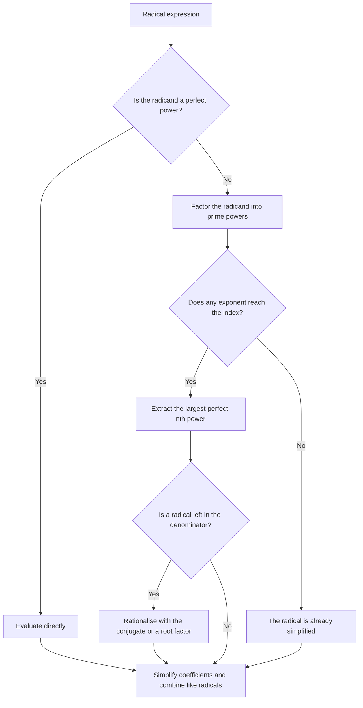
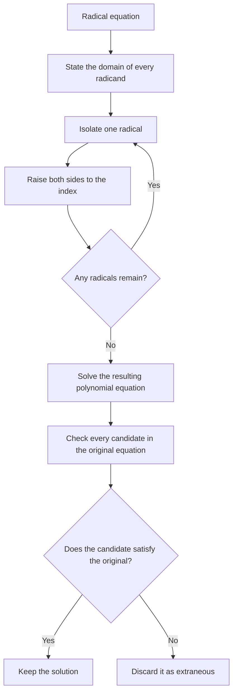

# Intermediate Algebra

> [Mathematics](../../README.md) › [Algebra](../README.md) · Level: Intermediate · Prerequisites: [Inequalities](../03-inequalities/README.md), [Elementary Algebra](../01-elementary-algebra/README.md), [Fractions](../../01-arithmetic/03-fractions/README.md) · Estimated time: 180 min

## 1. Introduction

Elementary algebra solves equations one operation at a time. Intermediate algebra is about
*structure*: recognising that many expressions are built from the same small set of patterns, and
learning the legal moves that transform one form into another without changing its value.

Four ideas organise the subject.

1. **Exponents are repeated multiplication, extended consistently.** The rule $a^m a^n=a^{m+n}$ is
   obvious when $m,n$ are positive integers. The definitions of $a^0$, $a^{-n}$ and $a^{m/n}$ are
   forced if we want that rule to keep working. Once the definitions are fixed, every exponent law
   can be proved rather than memorised.
2. **Roots undo powers.** The square root of $a$ is the nonnegative number whose square is $a$.
   Because squaring is not one-to-one on $\mathbb{R}$, roots require care with signs, domains and
   absolute values. This is also why radical equations can produce *extraneous* solutions.
3. **Rational expressions behave like fractions.** The rules for adding, multiplying and simplifying
   fractions apply to quotients of polynomials, with one new obligation: record the values of the
   variable that make a denominator zero.
4. **Polynomials have a division algorithm.** Just as every integer $a$ can be written as
   $a=bq+r$ with $0\le r<b$ for a positive divisor $b$, every polynomial can be written as
   $A(x)=D(x)Q(x)+R(x)$ with $\deg R<\deg D$. Evaluating at a root of $D$ instantly gives the
   remainder, and that fact is the engine behind the factor theorem and much of factorisation.

The final ingredient, the **binomial theorem**, shows how powers of a sum expand. Its coefficients
count choices, so a combinatorial argument proves an algebraic identity. This is the first place in
the curriculum where counting and algebra genuinely merge.

## 2. Prerequisites

You should be able to do the following before starting.

* **Arithmetic of integers and fractions.** Signs, common denominators, and cancellation of common
  factors. In particular, $\frac{ac}{bc}=\frac ab$ when $c\neq 0$, but $\frac{a+c}{b+c}\neq\frac ab$
  in general.
* **Integer exponents.** Know that $a^3=a\cdot a\cdot a$ and that $a^0=1$ for $a\neq0$.
* **Factoring quadratics.** Factor $x^2+bx+c$ by finding two numbers with sum $-b$ and product $c$;
  recognise a difference of squares $a^2-b^2=(a-b)(a+b)$.
* **Solving linear and quadratic equations**, including the quadratic formula.
* **Inequalities and interval notation**, including sign charts. The relevant techniques are in
  [Inequalities](../03-inequalities/README.md); this tutorial uses them when stating domains and
  when checking where a radical is defined.

## 3. Learning Objectives

After working through this tutorial you will be able to:

1. State the integer and rational exponent laws with their hypotheses, and prove the integer laws
   from the definition.
2. Convert between radical notation and rational exponents, and simplify radicals by extracting
   perfect powers.
3. Rationalise denominators containing one term, two terms, or cube roots.
4. Add, subtract, multiply and divide radical expressions.
5. Solve radical equations and identify extraneous solutions, explaining why they arise.
6. Simplify rational expressions, perform operations on them, and simplify complex fractions.
7. Divide polynomials using long division and synthetic division.
8. Use the remainder theorem and the factor theorem to evaluate and factor polynomials.
9. Expand powers of binomials with the binomial theorem and find a specified term.
10. Choose a factorisation strategy for polynomials of degree three or higher.

## 4. Intuition

Think of an algebraic expression as a machine that takes a number as input and returns a number.
Two expressions are **equivalent on a domain** when they return the same output for every input in
that domain. Every manipulation in this tutorial is an attempt to replace a complicated machine by a
simpler one that behaves identically wherever both are defined.

Exponents are a compression of repeated multiplication. Writing $a^{100}$ instead of one hundred
copies of $a$ is not merely shorthand; the exponent laws turn questions about repeated multiplication
into arithmetic on the exponents themselves. The price is that the exponent notation must be extended
to $0$, negative numbers and fractions in exactly one way that preserves the laws.

Radicals are the reverse direction. The square root asks: which number, when squared, gives this
value? Because both $3$ and $-3$ square to $9$, the question has two answers unless we agree to
return the nonnegative one. The convention "$\sqrt9=3$" is a choice, but a necessary one: without it,
$\sqrt{\phantom{x}}$ would not be a function. This single convention explains the identity
$\sqrt{x^2}=|x|$ and the need to check radical equations.

Rational expressions are fractions whose numerator and denominator are polynomials. Simplifying
$\frac{x^2-9}{x^2+x-12}$ to $\frac{x+3}{x+4}$ is not an equation-solving step; it is a statement that
the two machines agree everywhere except at the two inputs where the original denominator vanishes.
The exception is part of the answer.

Polynomial division is ordinary long division with powers of $x$ in place of powers of $10$. The
remainder theorem is the observation that the remainder after dividing by $x-c$ is exactly the value
of the polynomial at $c$. It converts the question "is $c$ a root?" into a single evaluation.

The binomial theorem counts. Expanding $(a+b)^n$ means choosing one letter from each of $n$ factors.
The number of ways to choose $b$ from exactly $k$ of them is $\binom nk$, so that is the coefficient
of $a^{n-k}b^k$. Algebra and counting give the same answer because they describe the same choices.

## 5. Formal Definition

**Definition 5.1 (Integer exponents).** Let $a\in\mathbb{R}$ and let $n$ be a positive integer. Define
$$a^n=\underbrace{a\cdot a\cdots a}_{n\text{ factors}}.$$
For $a\neq0$, define
$$a^0=1,\qquad a^{-n}=\frac{1}{a^n}\quad(n\ge1).$$
The expression $0^0$ is left undefined, and $0^{-n}$ is undefined because it would require division
by zero.

**Definition 5.2 (Principal $n$-th root).** Let $n\ge2$ be an integer.

* If $n$ is even and $a\ge0$, the **principal $n$-th root** $\sqrt[n]{a}$ is the unique
  nonnegative real number $b$ such that $b^n=a$.
* If $n$ is odd and $a\in\mathbb{R}$, $\sqrt[n]{a}$ is the unique real number $b$ such that
  $b^n=a$. This $b$ has the same sign as $a$.

For $n=2$ we write $\sqrt a$ instead of $\sqrt[2]{a}$. The equation $b^n=a$ with $n$ even has two
real solutions when $a>0$, namely $\sqrt[n]{a}$ and $-\sqrt[n]{a}$; the radical symbol denotes only
the nonnegative one.

**Definition 5.3 (Rational exponents).** Let $a>0$, let $m\in\mathbb{Z}$, and let $n\ge2$. Define
$$a^{m/n}=\left(\sqrt[n]{a}\right)^m.$$
If $a<0$ and $n$ is odd, the same formula defines $a^{m/n}$ provided the fraction $m/n$ is in lowest
terms with odd denominator. If $a<0$, $n$ is even and $m\neq0$, then $a^{m/n}$ is not a real number; the exponent $0$ is
already defined by $a^0=1$ for $a\neq0$.

The lowest-terms condition is not cosmetic. The expression $(-8)^{2/6}$ would be ambiguous: reducing
the exponent gives $(-8)^{1/3}=-2$, while applying the definition literally would require the sixth
root of $-8$, which is not real.

**Definition 5.4 (Rational expression).** A rational expression is a quotient
$$\frac{p(x)}{q(x)}$$
of polynomials $p,q$ with $q$ not the zero polynomial. Its **domain** is the set of real $x$ with
$q(x)\neq0$. A **complex fraction** is a rational expression whose numerator or denominator (or both)
is itself a rational expression.

**Definition 5.5 (Polynomial division).** Let $A(x)$ and $D(x)$ be polynomials with $D(x)\neq0$. The
**division algorithm** states that there exist unique polynomials $Q(x)$ and $R(x)$ such that
$$A(x)=D(x)Q(x)+R(x),$$
where either $R(x)=0$ or $\deg R<\deg D$. The polynomial $Q$ is the quotient and $R$ is the
remainder. If $R=0$, then $D$ divides $A$ and $D$ is a factor of $A$.

**Definition 5.6 (Binomial coefficient).** For integers $0\le k\le n$,
$$\binom nk=\frac{n!}{k!(n-k)!},$$
where $n!=1\cdot2\cdots n$ and $0!=1$. Combinatorially, $\binom nk$ is the number of $k$-element
subsets of an $n$-element set.

## 6. Mathematical Notation

| Symbol | Meaning | Read aloud |
|---|---|---|
| $a^n$ | $a$ raised to the power $n$ | "$a$ to the $n$" |
| $a^{-n}$ | $1/a^n$ | "$a$ to the minus $n$" |
| $a^{m/n}$ | the $n$-th root of $a$, raised to $m$ | "$a$ to the $m$ over $n$" |
| $\sqrt a$ | principal square root of $a$ | "the square root of $a$" |
| $\sqrt[n]{a}$ | principal $n$-th root of $a$ | "the $n$-th root of $a$" |
| $\sqrt[3]{a}$ | cube root of $a$ | "the cube root of $a$" |
| $\deg p$ | degree of the polynomial $p$ | "the degree of $p$" |
| $p(x)\div d(x)$ | division with quotient and remainder | "$p$ divided by $d$" |
| $Q(x)$ | quotient polynomial | "$Q$ of $x$" |
| $R(x)$ | remainder polynomial | "$R$ of $x$" |
| $\binom nk$ | binomial coefficient "$n$ choose $k$" | "$n$ choose $k$" |
| $n!$ | factorial of $n$ | "$n$ factorial" |
| $x-c$ | linear divisor with root $c$ | "$x$ minus $c$" |
| $\equiv$ | identically equal (as polynomials) | "is identically equal to" |
| $\pm$ | plus or minus; two signs together | "plus or minus" |

Two conventions are worth stating explicitly.

* **The radical sign is a function.** $\sqrt{9}=3$ only; it is not $\pm3$. When we want both
  solutions of $x^2=9$ we write $x=\pm\sqrt9=\pm3$.
* **A rational expression is defined only where its denominator is nonzero.** When simplifying, the
  cancelled factors still restrict the domain. For example,
  $\frac{x^2-1}{x-1}=x+1$ for $x\neq1$, but the right side is defined at $x=1$ while the left side
  is not.

## 7. Core Concepts

### 7.1 Integer exponent laws and their proofs

The laws for positive integer exponents are consequences of the definition, not separate axioms.
We prove them by induction, then extend them to all integer exponents.

**Theorem 7.1 (Product law).** For $a\in\mathbb{R}$ and nonnegative integers $m,n$,
$$a^m a^n=a^{m+n}.$$

*Proof.* Fix $m$ and induct on $n$. For $n=0$, the left side is $a^m a^0=a^m\cdot1=a^m=a^{m+0}$.
Assume the law for $n$. Then
$$a^m a^{n+1}=a^m(a^n a)=(a^m a^n)a=a^{m+n}a=a^{(m+n)+1}=a^{m+(n+1)},$$
where the first and last equalities use the definition of a positive power, the middle equality uses
associativity, and the induction hypothesis replaces $a^m a^n$ by $a^{m+n}$. $\square$

**Theorem 7.2 (Power of a power).** For $a\in\mathbb{R}$ and nonnegative integers $m,n$,
$$(a^m)^n=a^{mn}.$$

*Proof.* Induct on $n$. For $n=0$, $(a^m)^0=1=a^{m\cdot0}$. For the step,
$$(a^m)^{n+1}=(a^m)^n a^m=a^{mn}a^m=a^{mn+m}=a^{m(n+1)},$$
using the induction hypothesis and Theorem 7.1. $\square$

**Theorem 7.3 (Power of a product and a quotient).** For $a,b\in\mathbb{R}$ and a nonnegative
integer $n$,
$$(ab)^n=a^n b^n.$$
If $b\neq0$, then
$$\left(\frac ab\right)^n=\frac{a^n}{b^n}.$$

*Proof.* Both follow by induction on $n$ using commutativity and associativity of multiplication. For
the product, the step is
$$(ab)^{n+1}=(ab)^n(ab)=(a^n b^n)(ab)=(a^n a)(b^n b)=a^{n+1}b^{n+1}.$$
The quotient case is the same with $b^{-1}$ in place of $b$. $\square$

**Theorem 7.4 (Quotient law).** For $a\neq0$ and integers $m,n$,
$$\frac{a^m}{a^n}=a^{m-n}.$$

*Proof.* First suppose $m\ge n\ge0$. Then
$$a^m=a^{n+(m-n)}=a^n a^{m-n},$$
so dividing by $a^n\neq0$ gives $a^m/a^n=a^{m-n}$. If $m<n$, then $n-m>0$ and
$$\frac{a^m}{a^n}=\frac{1}{a^{n-m}}=a^{-(n-m)}=a^{m-n}.$$
The cases with negative $m$ or $n$ reduce to these by the definition $a^{-k}=1/a^k$. $\square$

**Why the extensions are forced.** If the product law is to hold for all integer exponents, then for
$a\neq0$,
$$a^n=a^{n+0}=a^n a^0,$$
and dividing by $a^n$ gives $a^0=1$. Similarly,
$$1=a^0=a^{n+(-n)}=a^n a^{-n},$$
so $a^{-n}=1/a^n$. The definitions in Definition 5.1 are therefore the only ones that preserve the
law. This is a useful pattern: a new definition is justified by the structure it must preserve.

**Theorem 7.5 (Integer exponent laws).** For $a,b\neq0$ and $m,n\in\mathbb{Z}$,
$$a^m a^n=a^{m+n},\qquad (a^m)^n=a^{mn},\qquad (ab)^n=a^n b^n,\qquad
\frac{a^m}{a^n}=a^{m-n}.$$
The proofs reduce to the nonnegative case by writing each negative exponent as a reciprocal. For
example,
$$a^{-m}a^{-n}=\frac{1}{a^m}\cdot\frac{1}{a^n}=\frac{1}{a^{m+n}}=a^{-(m+n)}.$$

Three warnings prevent most exponent errors:

* $(a+b)^n\neq a^n+b^n$ in general. For $n=2$, $(a+b)^2=a^2+2ab+b^2$.
* $a^{m^n}$ means $a^{(m^n)}$, not $(a^m)^n$. For example, $2^{3^2}=2^9=512$, while
  $(2^3)^2=8^2=64$.
* A negative exponent produces a reciprocal, not a negative number: $2^{-3}=\frac18>0$.

### 7.2 Rational exponents and radicals

Radicals and rational exponents are two notations for the same operation. The bridge is
$$a^{m/n}=\left(\sqrt[n]{a}\right)^m,$$
valid for $a>0$ (and for $a<0$ with $n$ odd, as in Definition 5.3).

**Theorem 7.6 (Product and quotient rules for radicals).** Let $n\ge2$. If $a,b\ge0$ (or if $n$ is
odd and $a,b\in\mathbb{R}$), then
$$\sqrt[n]{ab}=\sqrt[n]{a}\,\sqrt[n]{b}.$$
If $b\neq0$, then
$$\sqrt[n]{\frac ab}=\frac{\sqrt[n]{a}}{\sqrt[n]{b}}.$$

*Proof.* Consider the product rule. The right side is a product of nonnegative numbers when $n$ is
even, and has the same sign as $ab$ when $n$ is odd. In either case, raising it to the $n$-th power
gives
$$\left(\sqrt[n]{a}\,\sqrt[n]{b}\right)^n
=\left(\sqrt[n]{a}\right)^n\left(\sqrt[n]{b}\right)^n=ab.$$
By the uniqueness of the principal $n$-th root (Definition 5.2), it must equal $\sqrt[n]{ab}$. The
quotient rule is identical with division in place of multiplication. $\square$

**Theorem 7.7 (Root of a power).** For $a\ge0$ and integers $m,n$ with $n\ge2$,
$$\sqrt[n]{a^m}=\left(\sqrt[n]{a}\right)^m=a^{m/n}.$$
For $m<0$, both sides are interpreted as reciprocals.

*Proof.* For $m\ge0$, raise the right side to the $n$-th power:
$$\left(\left(\sqrt[n]{a}\right)^m\right)^n
=\left(\sqrt[n]{a}\right)^{mn}
=\left(\left(\sqrt[n]{a}\right)^n\right)^m=a^m,$$
using Theorem 7.2. The right side is nonnegative, so by uniqueness it is the principal $n$-th root of
$a^m$. The negative case follows from $a^{m/n}=1/a^{-m/n}$. $\square$

**Theorem 7.8 (Square root of a square).** For every real $x$,
$$\sqrt{x^2}=|x|.$$

*Proof.* The number $|x|$ is nonnegative, and $|x|^2=x^2$. By the uniqueness of the nonnegative
square root, $\sqrt{x^2}=|x|$. $\square$

The theorem is often misremembered as $\sqrt{x^2}=x$. That is true only when $x\ge0$; for $x=-3$,
$\sqrt{(-3)^2}=\sqrt9=3=|{-3}|$, not $-3$. In general,
$$\sqrt{x^{2k}}=|x|^k,\qquad \sqrt{x^{2k+1}}=x^k\sqrt{x}\quad(x\ge0).$$

**Rational exponent laws.** For $a,b>0$ and rational numbers $r,s$,
$$a^r a^s=a^{r+s},\qquad (a^r)^s=a^{rs},\qquad (ab)^r=a^r b^r,\qquad
\frac{a^r}{a^s}=a^{r-s}.$$
These follow by writing $r=m/n$ and $s=p/q$ with common denominator $nq$ and applying the integer
laws to $a^{1/(nq)}$. The condition $a>0$ is needed so that every root is defined and the principal
root is unambiguous.

**Simplified radical form.** A radical expression is simplified when:

1. the radicand contains no factor raised to a power at least $n$;
2. the radicand contains no fractions;
3. no denominator contains a radical;
4. the exponent of each factor in the radicand is less than $n$.

For example, $\sqrt{72}=\sqrt{36\cdot2}=6\sqrt2$ is simplified. The expression $\sqrt{12}$ is not
simplified as it stands, because $12$ has the square factor $4$; extracting it gives
$\sqrt{12}=2\sqrt3$, and now the radicand $3$ has no square factor. Similarly,
$\sqrt[3]{54}=3\sqrt[3]{2}$.

### 7.3 Operations with radicals and rationalising

**Adding and subtracting.** Radicals can be combined only when they have the same index and the same
radicand. Such radicals are called **like radicals**. For example,
$$3\sqrt2+5\sqrt2=8\sqrt2,\qquad 2\sqrt[3]{5}-\sqrt[3]{5}=\sqrt[3]{5}.$$
The distributive law is the justification: $3\sqrt2+5\sqrt2=(3+5)\sqrt2$. Expressions such as
$\sqrt2+\sqrt3$ cannot be combined; they are not like radicals. Numerical approximation confirms
that $\sqrt2+\sqrt3\approx3.146$, while $\sqrt5\approx2.236$.

**Multiplying.** Use the product rule and the distributive law:
$$(\sqrt a+\sqrt b)(\sqrt c+\sqrt d)=\sqrt{ac}+\sqrt{ad}+\sqrt{bc}+\sqrt{bd},$$
with all radicands nonnegative. Special products apply:
$$(\sqrt a+\sqrt b)(\sqrt a-\sqrt b)=a-b,$$
because the middle terms cancel. The factors $\sqrt a+\sqrt b$ and $\sqrt a-\sqrt b$ are called
**conjugates**.

**Rationalising a denominator.** The goal is to remove radicals from a denominator without changing
the value of the expression.

* For a single term such as $\frac{1}{\sqrt a}$, multiply numerator and denominator by $\sqrt a$:
  $$\frac{1}{\sqrt a}=\frac{\sqrt a}{a}\quad(a>0).$$
* For a binomial such as $\frac{1}{\sqrt a+\sqrt b}$, multiply by the conjugate
  $\sqrt a-\sqrt b$:
  $$\frac{1}{\sqrt a+\sqrt b}=\frac{\sqrt a-\sqrt b}{a-b}.$$
* For a cube root such as $\frac{1}{\sqrt[3]{a}-\sqrt[3]{b}}$, use the identity
  $$a-b=\left(\sqrt[3]{a}-\sqrt[3]{b}\right)\left(\sqrt[3]{a^2}+\sqrt[3]{ab}+\sqrt[3]{b^2}\right).$$
  The second factor is the conjugate for cube roots.

The last identity is the difference-of-cubes formula with $x=\sqrt[3]{a}$ and $y=\sqrt[3]{b}$:
$$x^3-y^3=(x-y)(x^2+xy+y^2).$$

### 7.4 Radical equations and extraneous solutions

A **radical equation** is an equation in which the variable appears under a radical. The standard
method is:

1. State the domain: every radicand must be nonnegative when the index is even.
2. Isolate one radical.
3. Raise both sides to the index of the radical.
4. If a radical remains, repeat steps 2 and 3.
5. Solve the resulting polynomial equation.
6. **Check every candidate in the original equation.**

Step 6 is not optional. Raising both sides to an even power can introduce solutions that satisfy the
squared equation but not the original one. These are called **extraneous solutions**.

**Why extraneous solutions appear.** The implication
$$A=B\Longrightarrow A^2=B^2$$
is valid, but its converse is false: $A^2=B^2$ implies $A=B$ **or** $A=-B$. Squaring loses the
sign information. For example, $x=2$ implies $x^2=4$, but $x^2=4$ also allows $x=-2$. When we square
an equation, we solve a weaker condition and may pick up values for which the two sides had opposite
signs. Only substitution into the original equation can distinguish the genuine solutions.

**Theorem 7.9 (Odd powers are injective).** For an odd positive integer $n$, the map $x\mapsto x^n$
is strictly increasing on $\mathbb{R}$; hence
$$A=B\iff A^n=B^n.$$
Raising both sides of an equation to an odd power therefore does not create extraneous solutions.
Domain restrictions can still exclude values, and arithmetic mistakes can still occur.

*Proof.* If $0\le x<y$, then repeated multiplication by nonnegative factors gives $x^n<y^n$ for odd
$n$; if $x<0<y$, then $x^n<0<y^n$; if $x<y\le0$, then $-y<-x$ and the positive case applied to
$-y,-x$ gives $(-y)^n<(-x)^n$, hence $y^n<x^n$ because $n$ is odd. The function is therefore strictly
increasing, hence one-to-one. $\square$

For rational exponents, the same parity issue appears. The equation
$$x^{2/3}=4$$
is equivalent to $\left(\sqrt[3]{x}\right)^2=4$, so $\sqrt[3]{x}=\pm2$ and $x=\pm8$. Both values
must be checked: $(\pm8)^{2/3}=4$ indeed. By contrast, $x^{3/2}=8$ requires $x\ge0$ and has the
single solution $x=4$, because the exponent $3/2$ is defined here only for nonnegative bases.

### 7.5 Rational expressions and complex fractions

A rational expression is a quotient of polynomials. Its domain excludes the zeros of the denominator.
Simplifying is done by factoring the numerator and denominator and cancelling **common factors**:
$$\frac{p(x)c(x)}{q(x)c(x)}=\frac{p(x)}{q(x)}\quad\text{provided }c(x)\neq0.$$
The cancelled factor's zeros remain excluded from the domain of the original expression, even if the
simplified expression is defined there.

**Operations.** For rational expressions $P,Q,R,S$ with the relevant denominators nonzero:

* Multiplication: $\dfrac PQ\cdot\dfrac RS=\dfrac{PR}{QS}$.
* Division: $\dfrac PQ\div\dfrac RS=\dfrac PQ\cdot\dfrac SR=\dfrac{PS}{QR}$, with $R\neq0$.
* Addition and subtraction: find a common denominator, preferably the least common multiple of the
  denominators, then combine numerators.

**Complex fractions.** A complex fraction has a fraction in its numerator, its denominator, or both.
There are two safe methods:

1. **Simplify top and bottom separately, then divide.** This is reliable when each part is already a
   single fraction.
2. **Multiply numerator and denominator by the least common denominator of all the small fractions.**
   This clears every small denominator in one step.

For example,
$$\frac{\dfrac1x-\dfrac1{x+1}}{\dfrac1{x+1}}
=\frac{\dfrac{(x+1)-x}{x(x+1)}}{\dfrac1{x+1}}
=\frac{\dfrac{1}{x(x+1)}}{\dfrac1{x+1}}
=\frac{1}{x(x+1)}\cdot(x+1)=\frac1x,$$
with $x\neq-1,0$. The second method would multiply top and bottom by $x(x+1)$ from the start and
reach the same result.

**A non-cancellation warning.** Terms may not be cancelled:
$$\frac{x^2+4}{x^2}\neq 4.$$
Only factors common to the entire numerator and the entire denominator may be cancelled. The
expression $\frac{x^2+4}{x^2}$ is already in lowest terms.

### 7.6 Polynomial long division

Polynomial long division mirrors integer long division. The **degree** of a nonzero polynomial is the
largest exponent with a nonzero coefficient. If $A$ and $D$ are nonzero polynomials with
$\deg A\ge\deg D$, then $\deg Q=\deg A-\deg D$: the leading term of $DQ$ is the product of the
leading terms, and no other term of $DQ$ can cancel it because $R$ has smaller degree than $D$.

**Algorithm.**

1. Write $A(x)$ and $D(x)$ in descending powers of $x$. Insert terms with coefficient $0$ for any
   missing power.
2. Divide the leading term of the current dividend by the leading term of $D$. This is the next term
   of $Q$.
3. Multiply $D$ by that term and subtract the result from the current dividend.
4. Repeat with the new dividend until its degree is less than $\deg D$.
5. The final expression is the remainder. Write
   $$A(x)=D(x)Q(x)+R(x).$$

The leading term is the only term that matters at each stage. If $A(x)=2x^3+\cdots$ and $D(x)=x-2$,
the first quotient term is $2x^3/x=2x^2$; multiplying and subtracting reduces the degree of the
working dividend by one. A completely worked division, with every subtraction displayed, appears in
Example 9.5.

Long division also applies when the dividend has lower degree than the divisor; then $Q=0$ and
$R=A$. A rational expression is called **proper** when the numerator has lower degree than the
denominator, and **improper** otherwise. Dividing an improper rational expression produces a
polynomial part plus a proper remainder:
$$\frac{A(x)}{D(x)}=Q(x)+\frac{R(x)}{D(x)}.$$
This decomposition is the algebraic precursor of partial fractions.

### 7.7 Synthetic division and the remainder theorem

Synthetic division is a shortcut for dividing by a linear polynomial $x-c$. It records only the
coefficients, because the powers of $x$ are determined by their positions.

**Synthetic division procedure.**

1. Write the coefficients of the dividend in descending powers, inserting zeros for missing powers.
2. Write $c$ to the left.
3. Bring down the first coefficient.
4. Multiply the number just brought down by $c$, write the product under the next coefficient, and
   add.
5. Repeat until the last coefficient has been used.
6. The numbers in the bottom row before the last are the coefficients of the quotient, whose degree
   is one less than the dividend's. The last number is the remainder.

For example, dividing $x^3-4x^2+5x-2$ by $x-1$ uses $c=1$ and coefficients $1,-4,5,-2$. Bring
down $1$; then multiply by $1$ and add to the next coefficient repeatedly. The bottom row is
$$1,\quad -3,\quad 2,\quad 0.$$
The quotient is $x^2-3x+2$ and the remainder is $0$. Indeed,
$$x^3-4x^2+5x-2=(x-1)(x^2-3x+2)=(x-1)(x-1)(x-2).$$

**Theorem 7.10 (Remainder theorem).** If a polynomial $A(x)$ is divided by $x-c$, then the remainder
is $A(c)$.

*Proof.* By the division algorithm,
$$A(x)=(x-c)Q(x)+R,$$
where $R$ is a constant because $\deg(x-c)=1$ and the remainder must have degree less than $1$.
Substituting $x=c$ gives
$$A(c)=(c-c)Q(c)+R=0\cdot Q(c)+R=R.$$
$\square$

**Theorem 7.11 (Factor theorem).** The polynomial $x-c$ is a factor of $A(x)$ if and only if
$A(c)=0$.

*Proof.* If $x-c$ is a factor, then $A(x)=(x-c)Q(x)$ for some polynomial $Q$, so $A(c)=0$. Conversely,
if $A(c)=0$, the remainder theorem gives $A(x)=(x-c)Q(x)+0$, so $x-c$ is a factor. $\square$

The factor theorem converts root-finding into factorisation. Once one root $c$ is known, divide by
$x-c$ and continue with the lower-degree quotient. For a divisor of the form $ax-b$, write it as
$a(x-b/a)$; the remainder is $A(b/a)$, and the quotient must be divided by $a$ to compensate.

Synthetic division applies only to linear divisors. A divisor of degree $2$ or more requires long
division, although the remainder theorem still holds in the general form: the remainder upon
division by $D(x)$ is the unique polynomial of degree less than $\deg D$ that agrees with $A$ at the
roots of $D$ when those roots are distinct.

### 7.8 The binomial theorem

**Theorem 7.12 (Binomial theorem).** For every nonnegative integer $n$ and all $a,b\in\mathbb{R}$,
$$(a+b)^n=\sum_{k=0}^{n}\binom nk a^{n-k}b^k.$$
Explicitly,
$$(a+b)^n=a^n+\binom n1 a^{n-1}b+\binom n2 a^{n-2}b^2+\cdots+\binom n{n-1}ab^{n-1}+b^n.$$

**Combinatorial proof sketch.** Write $(a+b)^n$ as the product of $n$ factors, each equal to $a+b$.
Expanding means choosing either $a$ or $b$ from each factor and multiplying the $n$ chosen letters.
The term $a^{n-k}b^k$ arises exactly when $b$ is chosen from $k$ of the factors and $a$ from the
remaining $n-k$. The number of ways to choose which $k$ factors contribute $b$ is $\binom nk$. All
these choices produce the same monomial, so the coefficient of $a^{n-k}b^k$ is $\binom nk$. Summing
over $k=0,\dots,n$ accounts for every term. $\square$

This argument proves the identity without expanding any particular power. It also explains why the
coefficients are symmetric: choosing $k$ factors to contribute $b$ is the same as choosing $n-k$
factors to contribute $a$, so
$$\binom nk=\binom n{n-k}.$$

**The term formula.** The $(k+1)$-st term in the expansion of $(a+b)^n$, counting from $k=0$, is
$$T_{k+1}=\binom nk a^{n-k}b^k.$$
This is the fastest way to find a single coefficient without expanding everything.

**Pascal's identity.** For $1\le k\le n-1$,
$$\binom nk=\binom{n-1}{k-1}+\binom{n-1}k.$$
*Combinatorial proof.* Count the $k$-element subsets of $\{1,\dots,n\}$ according to whether they
contain the element $n$. If they do, the remaining $k-1$ elements form a subset of
$\{1,\dots,n-1\}$, giving $\binom{n-1}{k-1}$ choices. If they do not, all $k$ elements come from the
first $n-1$, giving $\binom{n-1}k$ choices. The two cases are disjoint and exhaustive, so the sum
counts all subsets. $\square$

Pascal's identity generates each row of Pascal's triangle from the previous row. The triangle is a
table of the coefficients:

| $n$ | Coefficients |
|---|---|
| $0$ | $1$ |
| $1$ | $1\quad1$ |
| $2$ | $1\quad2\quad1$ |
| $3$ | $1\quad3\quad3\quad1$ |
| $4$ | $1\quad4\quad6\quad4\quad1$ |
| $5$ | $1\quad5\quad10\quad10\quad5\quad1$ |

### 7.9 Factorisation strategies beyond quadratics

No single method factors every polynomial. The skill is choosing the right strategy and persisting
through several steps. The following checklist is ordered from cheapest to most expensive.

**1. Common factor first.** Always remove the greatest common factor of all terms:
$$6x^4-9x^3+3x^2=3x^2(2x^2-3x+1).$$
Removing it first reduces the degree and the size of the coefficients.

**2. Recognise special products.**

* Difference of squares: $a^2-b^2=(a-b)(a+b)$.
* Perfect square trinomial: $a^2\pm2ab+b^2=(a\pm b)^2$.
* Sum of cubes: $a^3+b^3=(a+b)(a^2-ab+b^2)$.
* Difference of cubes: $a^3-b^3=(a-b)(a^2+ab+b^2)$.

The cube formulas are verified by expanding the right side; all intermediate terms cancel.

**3. Factor by grouping.** For four terms, group them in pairs and look for a common binomial factor:
$$x^3+3x^2-4x-12=x^2(x+3)-4(x+3)=(x+3)(x^2-4)=(x+3)(x-2)(x+2).$$
Grouping is not guaranteed to work, but when it does it is the fastest route.

**4. Substitute to reveal a quadratic form.** An expression such as $x^4-5x^2+4$ is quadratic in
$x^2$. Put $u=x^2$:
$$u^2-5u+4=(u-1)(u-4),$$
so
$$x^4-5x^2+4=(x^2-1)(x^2-4)=(x-1)(x+1)(x-2)(x+2).$$
The same idea handles $x^6-7x^3+12$, which is quadratic in $x^3$.

**5. Use the rational root theorem and the factor theorem.** Let
$$p(x)=a_nx^n+a_{n-1}x^{n-1}+\cdots+a_1x+a_0$$
have integer coefficients with $a_n\neq0$ and $a_0\neq0$. If the rational number $r=p/q$ in lowest
terms is a root, then $p\mid a_0$ and $q\mid a_n$. The proof is a divisibility argument: substituting
$r$ and clearing denominators gives
$$a_np^n+a_{n-1}p^{n-1}q+\cdots+a_0q^n=0.$$
Every term except $a_0q^n$ is divisible by $p$, so $p\mid a_0q^n$; since $\gcd(p,q)=1$, $p\mid a_0$.
Similarly $q\mid a_np^n$, hence $q\mid a_n$.

This theorem gives a finite list of candidates. Test them with synthetic division; each success gives
a linear factor, and the quotient has lower degree. Repeat until the quotient is quadratic or
irreducible.

**6. Know when to stop.** Some polynomials do not factor over the real numbers into linear factors.
The polynomial $x^2+1$ is irreducible over $\mathbb{R}$, and so is any quadratic with negative
discriminant. The fundamental theorem of algebra guarantees that every nonconstant polynomial with
real coefficients factors into linear factors over $\mathbb{C}$ and into linear and irreducible
quadratic factors over $\mathbb{R}$; it does not guarantee that the factors have simple coefficients.

A useful extra identity is Sophie Germain's:
$$x^4+4y^4=(x^2-2xy+2y^2)(x^2+2xy+2y^2).$$
It factors an expression that at first looks irreducible, and it is proved by completing the square:
$x^4+4y^4=(x^2+2y^2)^2-4x^2y^2$, then applying a difference of squares.

## 8. Formulas and Properties

The table collects the identities used in this tutorial. Hypotheses are part of each statement: most
errors come from applying a formula outside the range of values for which it was proved.

| Identity | Hypotheses | Statement | Justification |
|---|---|---|---|
| Product of powers | $a\neq0$ if an exponent is negative | $a^m a^n=a^{m+n}$ | Theorem 7.1, extended by Theorem 7.5 |
| Power of a power | $a\neq0$ if an exponent is negative | $(a^m)^n=a^{mn}$ | Theorem 7.2 |
| Power of a product | $a,b\in\mathbb{R}$ | $(ab)^n=a^n b^n$ | Theorem 7.3 |
| Power of a quotient | $b\neq0$ | $(a/b)^n=a^n/b^n$ | Theorem 7.3 |
| Quotient of powers | $a\neq0$ | $a^m/a^n=a^{m-n}$ | Theorem 7.4 |
| Zero exponent | $a\neq0$ | $a^0=1$ | Forced by the product law |
| Negative exponent | $a\neq0$ | $a^{-n}=1/a^n$ | Forced by the product law |
| Rational exponent | $a>0$ | $a^{m/n}=(\sqrt[n]{a})^m$ | Definition 5.3 |
| Product of roots | $a,b\ge0$ for even $n$ | $\sqrt[n]{ab}=\sqrt[n]{a}\sqrt[n]{b}$ | Theorem 7.6 |
| Quotient of roots | $a\ge0$, $b>0$ for even $n$ | $\sqrt[n]{a/b}=\sqrt[n]{a}/\sqrt[n]{b}$ | Theorem 7.6 |
| Root of a square | $x\in\mathbb{R}$ | $\sqrt{x^2}=|x|$ | Theorem 7.8 |
| Square of a root | $a\ge0$ | $(\sqrt a)^2=a$ | Definition of principal root |
| Conjugate product | $a,b\ge0$ | $(\sqrt a+\sqrt b)(\sqrt a-\sqrt b)=a-b$ | Difference of squares |
| Cube-root conjugate | $a,b\in\mathbb{R}$ | $(x-y)(x^2+xy+y^2)=x^3-y^3$ with $x=\sqrt[3]a$, $y=\sqrt[3]b$ | Expansion |
| Difference of squares | none | $a^2-b^2=(a-b)(a+b)$ | Expansion |
| Perfect square | none | $a^2\pm2ab+b^2=(a\pm b)^2$ | Expansion |
| Sum of cubes | none | $a^3+b^3=(a+b)(a^2-ab+b^2)$ | Expansion |
| Difference of cubes | none | $a^3-b^3=(a-b)(a^2+ab+b^2)$ | Expansion |
| Division algorithm | $D\neq0$ | $A=DQ+R$, $R=0$ or $\deg R<\deg D$ | Definition 5.5 |
| Remainder theorem | $c\in\mathbb{R}$ | remainder of $A$ by $x-c$ is $A(c)$ | Theorem 7.10 |
| Factor theorem | $c\in\mathbb{R}$ | $x-c$ divides $A$ $\iff$ $A(c)=0$ | Theorem 7.11 |
| Binomial theorem | $n\ge0$ integer | $(a+b)^n=\sum_{k=0}^n\binom nk a^{n-k}b^k$ | Theorem 7.12 |
| Pascal identity | $1\le k\le n-1$ | $\binom nk=\binom{n-1}{k-1}+\binom{n-1}k$ | Subset counting |
| Rational root theorem | integer coefficients, $a_0a_n\neq0$ | rational root $p/q$ in lowest terms has $p\mid a_0$, $q\mid a_n$ | Divisibility argument |
| Quadratic formula | $a\neq0$ | $x=\dfrac{-b\pm\sqrt{b^2-4ac}}{2a}$ | Completing the square |

**Special expansions.** The binomial theorem with small $n$ gives the identities used most often:
$$\begin{aligned}
(a+b)^2&=a^2+2ab+b^2, & (a-b)^2&=a^2-2ab+b^2,\\
(a+b)^3&=a^3+3a^2b+3ab^2+b^3, & (a-b)^3&=a^3-3a^2b+3ab^2-b^3.
\end{aligned}$$
The signs in the cubic expansion alternate according to the power of $b$, exactly as the binomial
theorem predicts. The sum and difference of cubes are not the cubes of sums and differences:
$$a^3+b^3\neq(a+b)^3.$$
The correct factorisations are in the table and are proved by expansion.

**A useful degree check.** In the division algorithm, if $A$ and $D$ are nonzero and
$\deg A\ge\deg D$, then
$$\deg Q=\deg A-\deg D.$$
This is a quick way to catch a missing or extra term in a long division: if the quotient's degree is
wrong, the leading-term divisions were misaligned.

**A useful coefficient check.** The binomial coefficient formula gives
$$\binom n0=\binom nn=1,\qquad \binom n1=\binom n{n-1}=n,\qquad
\sum_{k=0}^n\binom nk=2^n.$$
The last identity counts all subsets of an $n$-element set, or equivalently substitutes $a=b=1$ in
the binomial theorem.

## 9. Step-by-Step Examples

The examples progress from direct applications of the exponent and radical rules to a multi-step
factorisation.

### Example 9.1 — A rational exponent with an odd root

Simplify $\left(27a^6b^9\right)^{1/3}$, where $a,b\in\mathbb{R}$.

**Strategy.** Apply the power-of-a-product law, then the power-of-a-power law. The cube root is
defined for every real number, so no absolute values are needed.

$$\begin{aligned}
\left(27a^6b^9\right)^{1/3}
&=27^{1/3}\left(a^6\right)^{1/3}\left(b^9\right)^{1/3}\\
&=3a^{6/3}b^{9/3}\\
&=3a^2b^3.
\end{aligned}$$

The simplification is valid for all real $a,b$ because $n=3$ is odd.

**Check.** Take $a=1$, $b=-1$. The original expression is
$$\left(27\cdot1\cdot(-1)\right)^{1/3}=(-27)^{1/3}=-3.$$
The simplified expression is $3(1)^2(-1)^3=-3$. They agree.

### Example 9.2 — A square root with even powers

Simplify $\sqrt{50x^6y^4}$, assuming $x\ge0$ and $y\in\mathbb{R}$.

**Strategy.** Extract the largest square factor from $50$, and use $\sqrt{z^2}=|z|$ for the variable
powers. Since $x\ge0$, $|x|=x$; since $y^4=(y^2)^2$ and $y^2\ge0$, $\sqrt{y^4}=y^2$.

$$\begin{aligned}
\sqrt{50x^6y^4}
&=\sqrt{25\cdot2}\cdot\sqrt{x^6}\cdot\sqrt{y^4}\\
&=5\sqrt2\cdot x^3\cdot y^2\\
&=5\sqrt2\,x^3y^2.
\end{aligned}$$

If $x$ were allowed to be negative, the factor would be $|x|^3$ rather than $x^3$.

**Check.** Take $x=1$, $y=-2$. The original is $\sqrt{50\cdot1\cdot16}=\sqrt{800}=20\sqrt2$. The
simplified expression is $5\sqrt2\cdot1\cdot4=20\sqrt2$. They agree.

### Example 9.3 — Rationalising a binomial denominator

Simplify $\dfrac{3}{\sqrt7-2}$ by rationalising the denominator.

**Strategy.** Multiply numerator and denominator by the conjugate $\sqrt7+2$, then use
$(\sqrt7-2)(\sqrt7+2)=7-4=3$.

$$\begin{aligned}
\frac{3}{\sqrt7-2}
&=\frac{3(\sqrt7+2)}{(\sqrt7-2)(\sqrt7+2)}\\
&=\frac{3(\sqrt7+2)}{7-4}\\
&=\frac{3(\sqrt7+2)}{3}\\
&=\sqrt7+2.
\end{aligned}$$

**Check.** Numerically, $\sqrt7\approx2.6458$, so the original is
$3/(0.6458)\approx4.6458$, and $\sqrt7+2\approx4.6458$. They agree.

### Example 9.4 — A radical equation with an extraneous solution

Solve $\sqrt{2x+7}=x+2$.

**Strategy.** The radicand requires $x\ge-7/2$. The left side is nonnegative, so any solution must
also satisfy $x+2\ge0$, i.e. $x\ge-2$. Square, solve, and check every candidate.

$$\begin{aligned}
\sqrt{2x+7}&=x+2\\
2x+7&=(x+2)^2 && \text{square both sides}\\
2x+7&=x^2+4x+4\\
0&=x^2+2x-3\\
0&=(x+3)(x-1).
\end{aligned}$$
The candidates are $x=-3$ and $x=1$. Check them in the original equation:

* $x=-3$: the left side is $\sqrt{1}=1$, while the right side is $-1$. False.
* $x=1$: the left side is $\sqrt9=3$, while the right side is $3$. True.

The only solution is $x=1$.

**Why the extraneous root appeared.** Squaring produced the equation $2x+7=(x+2)^2$, which is
satisfied by both $x=-3$ and $x=1$. At $x=-3$, the two sides of the original equation are $1$ and
$-1$, which are negatives of each other; squaring erased that sign difference. The domain condition
$x\ge-2$ would have excluded $x=-3$ before any algebra, which is why writing the domain first is
worth the effort.

### Example 9.5 — Long division and complete factorisation

Divide $2x^3-3x^2-8x+12$ by $x-2$, and factor the dividend completely.

**Strategy.** Use synthetic division with $c=2$ and coefficients $2,-3,-8,12$.

| $c=2$ | $2$ | $-3$ | $-8$ | $12$ |
|---|---|---|---|---|
| bring down | $2$ |  |  |  |
| multiply by $2$, add |  | $4+(-3)=1$ |  |  |
| multiply by $2$, add |  |  | $2+(-8)=-6$ |  |
| multiply by $2$, add |  |  |  | $-12+12=0$ |

The bottom row is $2,1,-6,0$, so the quotient is $2x^2+x-6$ and the remainder is $0$. Therefore
$$2x^3-3x^2-8x+12=(x-2)(2x^2+x-6).$$
Factor the quotient by finding two numbers with product $2\cdot(-6)=-12$ and sum $1$: they are $4$ and
$-3$. Thus
$$2x^2+x-6=2x^2+4x-3x-6=2x(x+2)-3(x+2)=(2x-3)(x+2).$$
The complete factorisation is
$$2x^3-3x^2-8x+12=(x-2)(2x-3)(x+2).$$

**Check.** Expanding $(x-2)(2x-3)(x+2)$: first
$(2x-3)(x+2)=2x^2+4x-3x-6=2x^2+x-6$, then
$(x-2)(2x^2+x-6)=2x^3+x^2-6x-4x^2-2x+12=2x^3-3x^2-8x+12$. It matches. Also
$A(2)=16-12-16+12=0$, confirming the remainder.

### Example 9.6 — Expanding a binomial with the binomial theorem

Expand $(2x-y)^5$.

**Strategy.** Use the binomial theorem with $a=2x$, $b=-y$ and $n=5$. The coefficients are
$1,5,10,10,5,1$.

$$\begin{aligned}
(2x-y)^5
&=\binom50(2x)^5+\binom51(2x)^4(-y)+\binom52(2x)^3(-y)^2\\
&\qquad+\binom53(2x)^2(-y)^3+\binom54(2x)(-y)^4+\binom55(-y)^5\\
&=32x^5-5(16x^4)y+10(8x^3)y^2-10(4x^2)y^3+5(2x)y^4-y^5\\
&=32x^5-80x^4y+80x^3y^2-40x^2y^3+10xy^4-y^5.
\end{aligned}$$

**Check.** Set $x=1$, $y=1$. The original is $(2-1)^5=1$. The expansion gives
$32-80+80-40+10-1=1$. The alternating signs and the final negative term are both correct because
$b=-y$ is negative when $y>0$.

### Example 9.7 — Factoring by grouping

Factor $2x^3+x^2-8x-4$.

**Strategy.** Group the first two and last two terms, and look for a common binomial.

$$\begin{aligned}
2x^3+x^2-8x-4
&=x^2(2x+1)-4(2x+1)\\
&=(2x+1)(x^2-4)\\
&=(2x+1)(x-2)(x+2).
\end{aligned}$$
The last step uses the difference of squares.

**Check.** Expand $(2x+1)(x^2-4)=2x^3+x^2-8x-4$, which is the original. The roots are
$x=-1/2$, $x=2$ and $x=-2$; substituting each into the original gives $0$.

### Example 9.8 — A quadratic in disguise

Solve $x^{2/3}-5x^{1/3}+6=0$.

**Strategy.** Let $u=x^{1/3}$. Then $x^{2/3}=u^2$, and the equation becomes a quadratic in $u$.

$$u^2-5u+6=0\iff(u-2)(u-3)=0.$$
Thus $u=2$ or $u=3$. Since $u=x^{1/3}$, cubing is one-to-one on $\mathbb{R}$:
$$x=2^3=8\quad\text{or}\quad x=3^3=27.$$

**Check.** $x=8$: $8^{2/3}-5(8^{1/3})+6=4-10+6=0$. $x=27$: $27^{2/3}-5(27^{1/3})+6=9-15+6=0$.
Both solutions are valid; no extraneous root arises because cubing is injective.

### Example 9.9 — The rational root theorem in action

Factor $x^3-2x^2-5x+6$ completely.

**Strategy.** The polynomial has integer coefficients, leading coefficient $1$ and constant term $6$.
By the rational root theorem, any rational root $p/q$ in lowest terms has $p\mid6$ and $q\mid1$.
The candidates are
$$\pm1,\ \pm2,\ \pm3,\ \pm6.$$
Test $x=1$: $1-2-5+6=0$, so $x=1$ is a root and $x-1$ is a factor. Synthetic division with $c=1$ and
coefficients $1,-2,-5,6$ gives the bottom row $1,-1,-6,0$:
$$x^3-2x^2-5x+6=(x-1)(x^2-x-6).$$
Factor the quadratic:
$$x^2-x-6=(x-3)(x+2).$$
Hence
$$x^3-2x^2-5x+6=(x-1)(x-3)(x+2).$$

**Check.** Expand $(x-1)(x-3)(x+2)$: first $(x-3)(x+2)=x^2-x-6$, then
$(x-1)(x^2-x-6)=x^3-x^2-6x-x^2+x+6=x^3-2x^2-5x+6$. It matches. The roots are $1,3,-2$, and each makes
the original polynomial zero.

## 10. Visual Explanations

The first diagram describes the decision procedure for simplifying a radical expression. It reflects
the definitions and theorems of Sections 7.2 and 7.3; each branch corresponds to a legal algebraic
move, not to a heuristic.

The second diagram is the algorithm for radical equations. The loop on the right is essential when
two radicals are present: after one squaring, a radical may remain, and the isolation step must be
repeated.

The following table is a compact visual summary of the factorisation checklist in Section 7.9. Read
it top to bottom: the first applicable row is the cheapest strategy.

| Pattern you see | Strategy | Example |
|---|---|---|
| Every term shares a factor | Take out the greatest common factor | $6x^3-9x^2=3x^2(2x-3)$ |
| Two squares with a minus sign | Difference of squares | $9x^2-25=(3x-5)(3x+5)$ |
| Two cubes with a plus or minus | Sum or difference of cubes | $x^3+8=(x+2)(x^2-2x+4)$ |
| Four terms | Group in pairs | $x^3+3x^2-4x-12=(x+3)(x^2-4)$ |
| Only even powers | Substitute for the square | $x^4-5x^2+4=(x^2-1)(x^2-4)$ |
| Integer coefficients, degree at least three | Rational root theorem, then divide | $x^3-2x^2-5x+6=(x-1)(x-3)(x+2)$ |
| Quadratic with negative discriminant | Irreducible over $\mathbb{R}$ | $x^2+1$ |

## 11. Common Mistakes

1. **Assuming $\sqrt{a+b}=\sqrt a+\sqrt b$.** The identity is false: with $a=9$ and $b=16$,
   $\sqrt{25}=5$, while $\sqrt9+\sqrt{16}=3+4=7$. The product rule says
   $\sqrt{ab}=\sqrt a\sqrt b$; there is no corresponding sum rule.

2. **Assuming $(a+b)^n=a^n+b^n$.** For $n=2$, the correct expansion is $a^2+2ab+b^2$. The missing
   cross term is exactly the term that the binomial theorem supplies.

3. **Treating a negative exponent as a negative number.** $3^{-2}=\frac19$, not $-9$. The negative
   sign in the exponent means "take the reciprocal"; it does not change the sign of the value.

4. **Writing $\sqrt{x^2}=x$ without absolute value.** The correct identity is $\sqrt{x^2}=|x|$. For
   $x=-4$, $\sqrt{16}=4=|{-4}|$. The error is dangerous when simplifying expressions such as
   $\sqrt{(x-3)^2}$, which equals $|x-3|$, not $x-3$.

5. **Taking an even root of a negative number.** $\sqrt{-4}$ and $\sqrt[4]{-16}$ are not real
   numbers. An odd root of a negative number is real: $\sqrt[3]{-8}=-2$. The index parity controls
   the domain.

6. **Cancelling terms instead of factors.** From $\frac{x^2-4}{x-2}$, cancelling $x^2$ with $x$ gives
   a wrong answer. Factor first: $\frac{(x-2)(x+2)}{x-2}=x+2$ for $x\neq2$.

7. **Forgetting the excluded values.** The simplification in the previous item is valid only for
   $x\neq2$. The original expression is undefined at $x=2$, even though $x+2$ is defined there.

8. **Squaring both sides and forgetting to check.** The equation $\sqrt{x+3}=x-3$ leads to
   $x^2-7x+6=0$, whose roots are $1$ and $6$. Only $6$ solves the original equation; $1$ is
   extraneous because the right side is negative at $x=1$. Every even power requires a check.

9. **Combining unlike radicals.** $\sqrt2+\sqrt3\neq\sqrt5$. Radicals can be combined only when both
   the index and the radicand agree. Simplify each radical first:
   $$\sqrt8+\sqrt{18}=2\sqrt2+3\sqrt2=5\sqrt2,$$
   because the simplified radicals are like radicals.

10. **Misapplying the remainder theorem to a divisor $x+c$.** For division by $x-c$, evaluate at
    $c$; for division by $x+c$, evaluate at $-c$. The sign is the most common arithmetic slip in
    synthetic division.

11. **Using the wrong binomial coefficient for a term.** The coefficient of the term containing
    $b^k$ is $\binom nk$, not $\binom n{n-k}$ (although these are equal), and the first term
    corresponds to $k=0$. Writing the term formula carefully prevents off-by-one errors.

12. **Believing every polynomial factors nicely.** The rational root theorem finds rational roots
    when they exist; it does not guarantee that they do. A cubic may have one real irrational root
    and an irreducible quadratic factor. The factor theorem tells you what happens after you find a
    root; it does not find the root for you.

## 12. Applications

**Compound interest and growth.** If a principal $P$ earns interest at an annual rate $r$ compounded
$n$ times per year, the amount after $t$ years is
$$A=P\left(1+\frac rn\right)^{nt}.$$
Solving for $t$ requires logarithms, but solving for the growth factor uses rational exponents. The
compound annual growth rate of an investment that grows from $P$ to $A$ in $t$ years is
$$\left(\frac AP\right)^{1/t}-1.$$
This is a rational exponent in a financial formula.

**Geometry and distance.** The distance between points $(x_1,y_1)$ and $(x_2,y_2)$ is
$$\sqrt{(x_2-x_1)^2+(y_2-y_1)^2},$$
a square root of a sum of squares. Heron's formula for the area of a triangle with side lengths
$a,b,c$ is
$$A=\sqrt{s(s-a)(s-b)(s-c)},\qquad s=\frac{a+b+c}{2}.$$
Both formulas require simplifying radicals and respecting the domain of the square root.

**Physics.** The speed acquired by an object falling a distance $h$ from rest is $v=\sqrt{2gh}$,
where $g$ is the acceleration due to gravity. The period of a simple pendulum of length $L$ is
$$T=2\pi\sqrt{\frac Lg}.$$
Rearranging for $L$ gives $L=\dfrac{gT^2}{4\pi^2}$, an exercise in isolating a square root.

**Root mean square.** In electrical engineering and statistics, the root mean square of
$x_1,\dots,x_n$ is
$$\operatorname{RMS}=\sqrt{\frac{x_1^2+\cdots+x_n^2}{n}}.$$
The name describes the operations in reverse order: square, mean, then root.

**Computer graphics.** To normalise a three-dimensional vector $(x,y,z)$, one divides by its length
$\sqrt{x^2+y^2+z^2}$. The result is a vector of length $1$, used for lighting and camera directions.
Normalising is the geometric version of rationalising: removing a square root from a denominator.

**Polynomial division in computing.** Polynomial division and the remainder theorem are the basis of
error-detecting codes, interpolation algorithms and the Euclidean algorithm for polynomials. In
cryptography and coding theory, polynomials are divided modulo an irreducible polynomial, and the
remainder is the encoded object.

**Counting and probability.** The binomial coefficients $\binom nk$ count subsets, and they appear in
the binomial distribution: the probability of exactly $k$ successes in $n$ independent trials with
success probability $p$ is
$$\binom nk p^k(1-p)^{n-k}.$$
The binomial theorem is the algebraic reason the probabilities sum to $1$.

## 13. Exercises

The problem set contains **36 exercises**, grouped by level:

* **Beginner (1–12):** exponent arithmetic, simplifying radicals, rationalising simple denominators,
  simplifying rational expressions, and basic synthetic division.
* **Intermediate (13–24):** rational exponents, more difficult radical simplification and
  rationalisation, operations on rational expressions, radical equations, polynomial division, and
  factoring by grouping.
* **Advanced (25–31):** binomial expansions and coefficients, two-radical equations, a rational
  expression identity, the remainder theorem with an unknown coefficient, and a proof of
  irrationality.
* **Challenge (32–36):** nested radicals, a radical equation with two candidates, a quadratic in
  disguise with a negative solution, a combinatorial proof of a binomial identity, and Sophie
  Germain factorisation.

Full worked solutions are in [solutions.md](solutions.md). Attempt every problem before reading
them.

## 14. Solutions

Every exercise has a complete solution in [solutions.md](solutions.md). The solutions show the
algebra, state the domain where relevant, and verify radical-equation candidates in the original
equation. Alternative methods are noted when they are shorter or more instructive.

## 15. Summary

* Integer exponent laws follow from the definition by induction. The definitions $a^0=1$ and
  $a^{-n}=1/a^n$ are forced by the requirement that $a^ma^n=a^{m+n}$ continue to hold.
* Rational exponents satisfy the same laws for positive bases. For a negative base, an odd
  denominator is required, and the fraction must be in lowest terms.
* The principal $n$-th root is the nonnegative root when $n$ is even, and the unique real root when
  $n$ is odd. Consequently $\sqrt{x^2}=|x|$, not $x$.
* Radical expressions are simplified by extracting perfect powers, removing fractions from
  radicands, and rationalising denominators. Conjugates use $a^2-b^2$ for square roots and
  $a^3-b^3$ for cube roots.
* Raising both sides of an equation to an even power can introduce extraneous solutions because
  $A^2=B^2$ allows $A=-B$. Odd powers are injective and do not create this problem, though domain
  restrictions remain.
* Rational expressions are simplified by factoring and cancelling common factors; the zeros of
  cancelled factors remain excluded from the domain.
* The division algorithm writes $A=DQ+R$ with $\deg R<\deg D$. Synthetic division computes $Q$ and
  $R$ for a linear divisor $x-c$; the remainder theorem identifies $R$ with $A(c)$.
* The factor theorem turns roots into factors. The rational root theorem supplies a finite list of
  candidates for integer-coefficient polynomials.
* The binomial theorem states
  $(a+b)^n=\sum_{k=0}^n\binom nk a^{n-k}b^k$; its coefficients count the choices of which factors
  contribute $b$.
* Factorisation beyond quadratics uses common factors, special products, grouping, quadratic
  substitution, and the rational root theorem combined with division.

## 16. Further Learning

Review [Inequalities](../03-inequalities/README.md) for the sign-chart techniques used when finding
domains and solving radical inequalities. Return to [Mathematics](../../README.md) for the
curriculum map and the recommended order of study.

Standard references:

* Michael Sullivan, *Intermediate Algebra* — a comprehensive treatment of exponents, radicals,
  rational expressions and polynomial division at this level.
* James Stewart, *Precalculus: Mathematics for Calculus* — clear chapters on polynomial and rational
  functions, with many applied exercises.
* The Art of Problem Solving, *Intermediate Algebra* — a demanding treatment of polynomials,
  exponents, radicals and the binomial theorem, with competition-style problems.
* Serge Lang, *Basic Mathematics* — a rigorous and concise account of algebra, including the
  binomial theorem and polynomial arithmetic.

