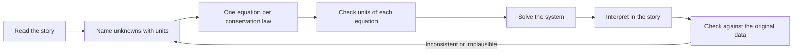

# Systems of Linear Equations

> [Mathematics](../../README.md) › [Algebra](../README.md) · Level: Intermediate · Prerequisites: [Linear Equations](../02-linear-equations/README.md), [Elementary Algebra](../01-elementary-algebra/README.md) · Estimated time: 150 min

## 1. Introduction

A single linear equation such as $2x + 3y = 12$ is a question with too many answers: every pair
$(x, y)$ on a certain straight line satisfies it. A **system** asks several such questions at once and
demands that *one* tuple of numbers answer all of them simultaneously:

$$
\begin{cases}
2x + 3y = 12\\
x - y = 1
\end{cases}
$$

The answer here is a single point, $(3, 2)$, because that is the only pair lying on both lines.

This idea — impose several linear conditions, ask what survives — is one of the most used pieces of
mathematics in the world. A chemist balances a reaction by solving a system (one equation per
element, one unknown per molecule count). An electrical engineer finds currents in a circuit by
writing Kirchhoff's laws at every node. An economist finds the price at which supply equals demand.
A graphics card computes where a ray hits a triangle by intersecting three planes. A spreadsheet
solves a least-squares fit by solving a system with many equations and few unknowns.

Systems are also where **linear algebra** begins. Everything you do here by hand — adding equations,
multiplying one by a number — becomes, in the next stage, a single operation on a rectangular array
of numbers called a matrix. Section 7.9 gives a first preview of that language, so that when you meet
matrices formally they will feel like a change of notation rather than a change of subject.

The plan of this tutorial is: make precise what "solution" means (§5), see the geometry of two
equations in two unknowns (§7.2), learn the two hand methods and *why* they are legitimate (§7.3–7.5),
extend to three unknowns (§7.6), prove that only three shapes of solution set are possible (§7.7),
model word problems (§7.8), and finally translate everything into row reduction (§7.9).

## 2. Prerequisites

You should be comfortable with the following. The first two are developed in
[Elementary Algebra](../01-elementary-algebra/README.md) and
[Linear Equations](../02-linear-equations/README.md); the recalls below are summaries, not substitutes.
Each is stated in one line so that this tutorial can be read on its own; if a recall feels unfamiliar,
revise it before continuing.

**Solving a linear equation in one unknown.** For $a \neq 0$, the equation $ax + b = c$ has the single
solution $x = (c - b)/a$. The justification is that adding the same number to both sides, or
multiplying both sides by the same *nonzero* number, preserves the truth of an equation, and these
operations can be undone.

**The Cartesian plane.** Every pair $(x, y)$ of real numbers is a point of the plane, with $x$ measured
horizontally and $y$ vertically. The set of pairs satisfying $ax + by = c$ (with $a, b$ not both zero)
is a straight line. Two useful forms of the same line are

$$
y = mx + k \qquad\text{(slope–intercept form, valid when } b \neq 0\text{)}
$$

where $m = -a/b$ is the **slope** and $k = c/b$ is the **intercept**, and the general form
$ax + by = c$, which also covers vertical lines such as $x = 3$ (where $b = 0$).

**The distributive law and collecting like terms.** $a(b + c) = ab + ac$, and terms with the same
powers of the same variables may be added: $3x + 5x = 8x$.

**Arithmetic with fractions.** $\dfrac{a}{b} + \dfrac{c}{d} = \dfrac{ad + bc}{bd}$ and
$\dfrac{a}{b} \cdot \dfrac{c}{d} = \dfrac{ac}{bd}$ for $b, d \neq 0$. Most systems in practice have
non-integer solutions, so fluency here matters.

## 3. Learning Objectives

By the end of this tutorial you will be able to

1. decide whether a given tuple is a solution of a given system, and describe the solution set of a
   system as a set;
2. classify a $2 \times 2$ system as having one solution, no solution, or infinitely many, both
   algebraically and geometrically, and connect the classification to the number
   $a_1b_2 - a_2b_1$;
3. solve a $2 \times 2$ system by substitution and by elimination, and explain why each step preserves
   the solution set;
4. solve a $3 \times 3$ system by elimination followed by back-substitution, and recognise when the
   solution set is a line or a plane rather than a point;
5. prove that a linear system cannot have exactly two solutions;
6. translate a word problem (mixture, distance, cost) into a system, solve it, and check the answer
   against the original story;
7. write the augmented matrix of a system, carry out elementary row operations, reach reduced row
   echelon form, and read off consistency, rank, and the number of free parameters;
8. state and use the criterion for consistency in terms of $\operatorname{rank} A$ and
   $\operatorname{rank}[A \mid b]$.

## 4. Intuition

Think of a linear equation as a **constraint**: a statement that restricts where a point can be. One
constraint in the plane leaves a whole line of freedom — one degree of freedom, in the language of
later chapters. A second, independent constraint removes that freedom and pins the point down.

A useful picture is two dials. Each equation is a demand of the form "the weighted sum of the two
dials must equal this number". Turning one dial changes both weighted sums, so a single demand can
always be met in infinitely many ways, but two demands that pull in different directions leave only
one setting that satisfies both. If the two demands pull in exactly the same direction — if one
equation is just a multiple of the other — the second demand is already satisfied whenever the first
is, and one degree of freedom survives: infinitely many solutions. If they pull in the same direction
but ask for *different* totals, no setting can satisfy both: no solution.

The word *linear* is doing real work. "Linear" means each unknown appears only to the first power and
never multiplied by another unknown. That is exactly the condition under which **superposition**
holds: if $u$ and $v$ are both solutions of the same homogeneous equations, then so is every
combination $u + t(v - u)$. Superposition is why a linear system can never have exactly two
solutions — either none, or one, or a whole continuum (§7.7). A non-linear system such as
$x^2 + y^2 = 1$, $y = x^2$ can easily have exactly two solutions, and that is precisely because
squaring is not linear.

Finally, a warning that will pay off later: solving a system is not "finding $x$". It is **replacing
the system by a simpler system with exactly the same solutions**. Every method in this tutorial is a
sequence of such replacements.

## 5. Formal Definition

**Definition 5.1 (Linear equation).** Let $n \geq 1$ and let $a_1, \dots, a_n, b \in \mathbb{R}$ with
not all of $a_1, \dots, a_n$ equal to $0$. A **linear equation in the variables $x_1, \dots, x_n$** is
an equation of the form

$$
a_1 x_1 + a_2 x_2 + \cdots + a_n x_n = b .
$$

The numbers $a_1, \dots, a_n$ are the **coefficients**, and $b$ is the **right-hand side**. A
**solution** of the equation is an ordered $n$-tuple $(s_1, \dots, s_n) \in \mathbb{R}^n$ such that
substituting $x_1 = s_1, \dots, x_n = s_n$ makes the equation true.

The requirement that not all coefficients vanish excludes the degenerate expressions $0 = b$ and
$0 = 0$, which are not equations *in the variables* at all; they will nevertheless appear as
by-products of elimination in §7.5 and must be interpreted carefully.

Order matters: $(3, 2)$ and $(2, 3)$ are different tuples and are checked separately.

**Definition 5.2 (System, solution set).** A **system of $m$ linear equations in $n$ unknowns** is a
list

$$
\begin{cases}
a_{11}x_1 + a_{12}x_2 + \cdots + a_{1n}x_n = b_1\\
a_{21}x_1 + a_{22}x_2 + \cdots + a_{2n}x_n = b_2\\
\quad\vdots\\
a_{m1}x_1 + a_{m2}x_2 + \cdots + a_{mn}x_n = b_m
\end{cases}
$$

of $m$ linear equations in the same $n$ variables. (The double subscript $a_{ij}$ reads "the
coefficient of $x_j$ in equation $i$".) A **solution of the system** is a tuple
$(s_1, \dots, s_n)$ that is a solution of *every* equation in the list. The **solution set** is

$$
S = \{(s_1, \dots, s_n) \in \mathbb{R}^n : \text{every equation of the system holds at } (s_1, \dots, s_n)\}.
$$

Note that $S$ is a *set of tuples*, not a number. "Solve the system" means "determine $S$ exactly".

**Definition 5.3 (Consistent, inconsistent).** A system is **consistent** if $S \neq \varnothing$ and
**inconsistent** if $S = \varnothing$. A consistent system is **determined** (or has a *unique
solution*) if $S$ has exactly one element, and **underdetermined** if $S$ has infinitely many
elements. (Section 7.7 shows that for linear systems these are the only possibilities.)

**Definition 5.4 (Equivalent systems).** Two systems in the same variables are **equivalent** if they
have the same solution set.

This is the key definition of the whole tutorial: every solution technique is a chain of systems,
each equivalent to the previous one, ending in a system so simple that its solution set is visible.

**Definition 5.5 (Homogeneous system).** A system is **homogeneous** if every right-hand side is $0$;
otherwise it is **non-homogeneous**.

A homogeneous system always has the **trivial solution** $(0, 0, \dots, 0)$, so it is always
consistent. Its other solutions, if any, are called **non-trivial**.

## 6. Mathematical Notation

| Symbol | Read as | Meaning |
|---|---|---|
| $x_1, \dots, x_n$ | "ex one to ex en" | the unknowns; the subscript is a label, not an exponent |
| $a_{ij}$ | "ay eye jay" | coefficient of $x_j$ in the $i$-th equation |
| $b_i$ | "bee eye" | right-hand side of the $i$-th equation |
| $\mathbb{R}^n$ | "are en" | the set of ordered $n$-tuples of real numbers |
| $(s_1, \dots, s_n)$ | "the tuple ess one to ess en" | one candidate solution, ordered |
| $S$ | "ess" | the solution set |
| $\varnothing$ | "the empty set" | the set with no elements |
| $\{(4 - 2t,\ t) : t \in \mathbb{R}\}$ | "the set of pairs $(4-2t, t)$ as $t$ ranges over the reals" | a parametrised infinite solution set; $t$ is the **parameter** |
| $\mid$ in $[A \mid b]$ | "augmented by" | separates coefficient columns from the right-hand side |
| $\operatorname{rank} A$ | "the rank of ay" | the number of pivots in an echelon form of $A$ |
| $\iff$ | "if and only if" | the two statements are true together or false together |
| $\Longrightarrow$ | "implies" | if the left holds, then the right holds |

Two conventions used throughout:

* A **parameter** is a new letter standing for a quantity that may be chosen freely. Writing
  $S = \{(4 - 2t,\, t) : t \in \mathbb{R}\}$ describes all solutions at once and is a complete
  answer — indeed a better one than a list of three sample solutions.
* We write systems inside a single brace with `\begin{cases}` so that the brace means "all of these
  must hold".

## 7. Core Concepts

### 7.1 What it means to solve a system

Solving means describing $S$ exactly. There are only three kinds of answer:

* one tuple, e.g. $S = \{(3, 2)\}$;
* a parametrised family, e.g. $S = \{(t, 7 - 2t) : t \in \mathbb{R}\}$;
* the empty set, $S = \varnothing$.

Because $S$ is a set, the answer $\{(3,2)\}$ and the answer $(3,2)$ mean different things in
principle; in practice mathematicians write "the solution is $(3,2)$" for a unique solution and use
set notation whenever there is a parameter.

**Checking is part of solving.** A proposed solution is verified by substituting it into *every*
equation. This is cheap and catches almost every arithmetic slip. It also settles uniqueness claims
only negatively: checking one tuple shows consistency, never that no other tuple works.

### 7.2 Two equations in two unknowns: the geometry

Each equation of a $2 \times 2$ system describes a straight line. The solution set is the
**intersection** of the two lines, and there are exactly three geometric possibilities.

| Geometry | Algebra | Solution set |
|---|---|---|
| The lines cross at one point | the equations are *independent* | one tuple |
| The lines are parallel and distinct | the system is *inconsistent* | $\varnothing$ |
| The lines coincide | one equation is a multiple of the other | a whole line of tuples |

The algebraic test uses the four coefficients only. Define

$$
D = a_1 b_2 - a_2 b_1 .
$$

Then:

* $D \neq 0$: exactly one solution;
* $D = 0$: the two left-hand sides are proportional, so either the lines coincide (infinitely many
  solutions) or they are parallel and distinct (no solutions); the right-hand sides decide which.

The quantity $D$ is the **determinant** of the coefficient matrix; §8.1 proves the criterion and
gives explicit formulas for the solution.

**Example (quick).** For $2x - 3y = 6$ and $4x - 6y = 10$ we have
$D = 2 \cdot (-6) - 4 \cdot (-3) = -12 + 12 = 0$, so the lines are parallel or equal. Multiplying the
first equation by $2$ gives $4x - 6y = 12$, which contradicts $4x - 6y = 10$; the lines are parallel
and distinct, and $S = \varnothing$. Both lines have slope $2/3$, confirming the conclusion.

### 7.3 The substitution method

The idea: use one equation to express one unknown in terms of the other, then substitute.

**Procedure.**

1. Pick an equation and an unknown whose coefficient in that equation is nonzero. Solve that
   equation for that unknown.
2. Substitute the resulting expression into the *other* equation. The result is one equation in one
   unknown.
3. Solve it, then recover the first unknown from the expression found in step 1.
4. Check in both original equations.

**Why it is legitimate.** Suppose the system is $E_1, E_2$ and $E_1$ reads
$x = f(y)$ (this is possible exactly when the coefficient of $x$ in $E_1$ is nonzero). Then:

* if $(s, t)$ satisfies $E_1$ and $E_2$, then $s = f(t)$, so $(s,t)$ satisfies the substituted
  equation $E_2[f(t), t]$;
* conversely, if $t$ satisfies the substituted equation and we set $s = f(t)$, then $E_1$ holds by
  construction and $E_2$ holds because the substituted equation *is* $E_2$ with $x$ replaced by
  $f(t)$.

So the original system and the pair (equation $x = f(y)$, substituted equation) have the same
solutions. Nothing is lost and nothing is invented. The hypothesis "coefficient nonzero" matters:
solving $0 \cdot x + y = 3$ for $x$ is impossible, and dividing by a symbol that might be zero is
exactly the kind of step that destroys solutions.

Substitution is the method of choice when one coefficient is $1$ or $-1$, or when one equation is
already solved for a variable.

### 7.4 The elimination method

The idea: combine equations so that an unknown disappears. Adding $3x + 2y = 16$ and $5x - 2y = 8$
gives $8x = 24$, because the $+2y$ and $-2y$ cancel.

**The three elementary operations.** Given a system, you may

* **(E1) exchange** two equations;
* **(E2) multiply** one equation by a nonzero constant $c \neq 0$;
* **(E3) add** a constant multiple of one equation to another equation.

**Theorem 7.1 (Equivalence of elementary operations).** Each of (E1)–(E3), applied once to a system,
produces a system with exactly the same solution set.

**Proof.** Let the system be $E_1, \dots, E_m$ and let $S$ be its solution set; write $S'$ for the
solution set after the operation.

*(E1)* The list of equations is merely reordered, and "satisfies every equation of the list" does not
depend on the order. Hence $S' = S$.

*(E2)* Replacing $E_i$ by $cE_i$ with $c \neq 0$: if a tuple satisfies $E_i$ then it satisfies $cE_i$;
conversely if it satisfies $cE_i$ then, multiplying by $1/c$ (legitimate since $c \neq 0$), it
satisfies $E_i$. All other equations are untouched, so $S' = S$.

*(E3)* Say we replace $E_2$ by $E_2 + cE_1$. If a tuple satisfies $E_1$ and $E_2$, then it satisfies
$E_2 + cE_1$ by adding two true equations. Conversely, if it satisfies $E_1$ and $E_2 + cE_1$, then
subtracting $cE_1$ (which is true) shows it satisfies $E_2$. Hence $S' = S$. $\blacksquare$

Two remarks that matter in practice.

* The operation "multiply by $0$" is **not** allowed, and the proof shows why: multiplying by $0$
  turns an equation into $0 = 0$, which is satisfied by everything, so information is destroyed and
  the solution set grows. This is the single most common way to "prove" a false solution.
* Operations (E1)–(E3) are reversible, so a chain of them is a chain of equivalent systems. That is
  the formal content of "solving by elimination".

**Procedure (forward elimination, then back-substitution).**

1. Choose an unknown to eliminate; call it the *pivot* unknown.
2. Use (E3) — after scaling with (E2) if convenient — to remove that unknown from every equation
   below the first.
3. Repeat with the remaining equations and the remaining unknowns, working downward. You obtain a
   **triangular** system: the last equation involves only the last unknown.
4. Solve the last equation, substitute upward, and finish. This is **back-substitution**.

**Bookkeeping.** Recording only the coefficients and the right-hand sides produces the *augmented
matrix* of §7.9; the three operations above then become the three elementary *row* operations. Nothing
mathematical changes — only the notation gets shorter.

### 7.5 What can go wrong: the degenerate rows

During elimination an equation may collapse to

$$
0 = c \quad (c \neq 0) \qquad\text{or}\qquad 0 = 0 .
$$

* $0 = c$ with $c \neq 0$ is false for every tuple. Since the system contains an equation that no
  tuple satisfies, $S = \varnothing$: the system is **inconsistent**.
* $0 = 0$ is true for every tuple. It carries no information and may be deleted; the system becomes
  *smaller* but not different. If at least one genuine equation remains, there are infinitely many
  solutions and free parameters appear (§7.9).

These two rows are the algebraic fingerprints of the two degenerate geometric cases of §7.2. In three
dimensions $0 = 0$ can mean that three planes share a line, or even coincide, and the algebra cannot
tell those apart without further work — but the *solution set* is the same object.

### 7.6 Systems in three variables

A linear equation $ax + by + cz = d$ with $(a,b,c) \neq (0,0,0)$ describes a **plane** in space. Two
planes normally meet in a line; a third plane normally meets that line in a single point. Elimination
works exactly as before; only the bookkeeping grows.

**Example (worked in full in §9.6).** For

$$
\begin{cases}
x + y + z = 6\\
2x - y + z = 3\\
x + 2y - z = 2
\end{cases}
$$

subtracting twice the first equation from the second, and the first from the third, eliminates $x$ and
leaves a $2 \times 2$ system in $y, z$, which is solved and then substituted back.

The geometric possibilities are richer than in the plane:

| Configuration of three planes | Solution set |
|---|---|
| meet in one point | one tuple |
| meet in a line (like pages of a book) | a line: one parameter |
| all coincide | a plane: two parameters |
| no common point (parallel, or pairwise lines that miss) | $\varnothing$ |

Even in three dimensions, then, the solution set is never "two points". That is the content of the
next subsection.

### 7.7 The three possible shapes of a solution set

The geometry suggested a dichotomy; the algebra proves it for *any* number of equations and unknowns.

**Theorem 7.2 (No system has exactly two solutions).** A linear system has either no solution, exactly
one solution, or infinitely many solutions.

**Proof.** Suppose the system is consistent, and that $u = (u_1, \dots, u_n)$ and
$v = (v_1, \dots, v_n)$ are two *distinct* solutions. For $t \in \mathbb{R}$ define

$$
w(t) = u + t(v - u) = \bigl(u_1 + t(v_1 - u_1),\; \dots,\; u_n + t(v_n - u_n)\bigr).
$$

Consider any one equation of the system, written as $a_1x_1 + \cdots + a_nx_n = b$. Because $u$ and $v$
are solutions,

$$
a_1u_1 + \cdots + a_nu_n = b
\qquad\text{and}\qquad
a_1v_1 + \cdots + a_nv_n = b .
$$

Substituting $w(t)$ gives

$$
\begin{aligned}
\sum_{j=1}^{n} a_j\bigl(u_j + t(v_j - u_j)\bigr)
&= \sum_{j=1}^{n} a_ju_j + t\sum_{j=1}^{n} a_j(v_j - u_j)\\
&= b + t\,(b - b)\\
&= b .
\end{aligned}
$$

So $w(t)$ satisfies that equation for every $t$; since the equation was arbitrary, $w(t)$ is a
solution of the whole system for every $t \in \mathbb{R}$.

It remains to see that the solutions $w(t)$ are all different. If $w(t_1) = w(t_2)$, then
$(t_1 - t_2)(v_j - u_j) = 0$ for every $j$. Since $u \neq v$, some $v_j - u_j \neq 0$, so
$t_1 = t_2$. Thus $t \mapsto w(t)$ is injective and the solution set is infinite. $\blacksquare$

Geometrically, $w(t)$ is the line through $u$ and $v$: **the line through any two solutions consists
entirely of solutions**. This is the visible face of linearity, and it is exactly what fails for
non-linear systems.

**Consequence.** For a linear system, "consistent" plus "not unique" is the same as "infinitely
many". So the three cases of §7.2 are not a special feature of two dimensions; they are the only
cases in every dimension.

### 7.8 Modelling word problems

Word problems are not a different kind of mathematics; they are a translation exercise followed by
the algebra already learned. A reliable protocol:

1. **Name the unknowns.** Write "let $x$ be the number of litres of the $20\%$ solution" — with
   units. Vague names produce vague equations.
2. **Write one equation per sentence (or per conservation law).** Mixture problems conserve *total
   amount* and *amount of the substance*; distance problems use distance $=$ speed $\times$ time and
   add or subtract speeds with or against a current; cost problems conserve *count* and *total
   money*.
3. **Check the units** of every equation. Adding litres to litres is meaningful; adding litres to
   litres-per-minute is a sign of an error.
4. **Solve**, then **interpret**: a negative volume or a fractional number of tickets may signal a
   modelling mistake even when the algebra is right.
5. **Check against the story**, not merely against your own equations.

Three standard shapes, with the structure made explicit:

**Mixture.** Mix $x$ units of a $p\%$ concentrate with $y$ units of a $q\%$ concentrate to obtain
$T$ units at $r\%$:

$$
\begin{cases}
x + y = T & \text{(total amount)}\\
\dfrac{p}{100}x + \dfrac{q}{100}y = \dfrac{r}{100}T & \text{(amount of concentrate)}
\end{cases}
$$

**Distance with a current or wind.** With speed $v$ through the medium and current $c$ (both positive),
the ground speeds are $v + c$ downstream and $v - c$ upstream. Two trips give

$$
\begin{cases}
(v + c)\,t_1 = d_1\\
(v - c)\,t_2 = d_2
\end{cases}
$$

**Cost or revenue.** $x$ units at price $p$ and $y$ units at price $q$ with a known total count and a
known total revenue:

$$
\begin{cases}
x + y = N\\
px + qy = R
\end{cases}
$$

Each of these is a pair of linear equations, so each is solved by the methods of §7.3–7.4 — and each
may be inconsistent if the data are impossible (for instance, asking for a $90\%$ mixture from
$20\%$ and $50\%$ stocks).

### 7.9 A first look at matrices and row reduction

Write a system with only its numbers. For

$$
\begin{cases}
x + y + z = 6\\
2x - y + z = 3\\
x + 2y - z = 2
\end{cases}
$$

the **coefficient matrix** and the **augmented matrix** are

$$
A = \begin{pmatrix} 1 & 1 & 1\\ 2 & -1 & 1\\ 1 & 2 & -1\end{pmatrix},
\qquad
[A \mid b] = \left(\begin{array}{ccc|c} 1 & 1 & 1 & 6\\ 2 & -1 & 1 & 3\\ 1 & 2 & -1 & 2\end{array}\right).
$$

Each row of $[A \mid b]$ records one equation; each column of $A$ belongs to one unknown; the last
column holds the right-hand sides. The three elementary operations of §7.4 become **elementary row
operations**:

* **(R1)** swap two rows;
* **(R2)** multiply a row by a nonzero constant;
* **(R3)** add a multiple of one row to another row.

By Theorem 7.1 these operations do not change the solution set of the system encoded in the matrix.

**Echelon forms.** A matrix is in **row echelon form (REF)** if

1. all zero rows are at the bottom;
2. the first nonzero entry of each row — its **pivot** or *leading entry* — is strictly to the right of
   the pivot of the row above.

It is in **reduced row echelon form (RREF)** if in addition every pivot equals $1$ and is the only
nonzero entry in its column. Every matrix reaches RREF by row operations, and the RREF is unique
(proved in linear algebra; we use it without proof here).

**Rank.** The **rank** of $A$, written $\operatorname{rank} A$, is the number of pivots in any echelon
form of $A$. That this number does not depend on which row operations were used is a theorem; it is
what makes the following criterion meaningful.

**Theorem 7.3 (Consistency and the number of solutions, first form).** Consider a system of $m$
equations in $n$ unknowns with coefficient matrix $A$ and augmented matrix $[A \mid b]$, and let
$r = \operatorname{rank} A$.

1. The system is consistent $\iff$ $\operatorname{rank} A = \operatorname{rank}[A \mid b]$.
2. If it is consistent, the solution is unique $\iff$ $r = n$.
3. If it is consistent and $r < n$, the solution set has exactly $n - r$ **free parameters**: the
   unknowns attached to pivot columns are determined by those attached to the other $n - r$ columns.

**Why.** Row-reduce $[A \mid b]$. A row of the form $(0\ \cdots\ 0 \mid c)$ with $c \neq 0$ is the
degenerate equation $0 = c$ of §7.5, and the system is inconsistent; such a row exists exactly when
the right-hand column contains a pivot, i.e. exactly when
$\operatorname{rank}[A \mid b] = \operatorname{rank} A + 1$. Otherwise delete zero rows. What remains
has $r$ pivot columns and $n - r$ non-pivot columns; assign an arbitrary value (a parameter) to each
non-pivot unknown, and back-substitution determines the pivot unknowns uniquely. $\blacksquare$

The theorem is often called the **Rouché–Capelli theorem**. It converts "how many solutions?" into
two integer counts.

**Reading a solution from RREF.** If the RREF is

$$
\left(\begin{array}{ccc|c} 1 & 0 & 0 & 1\\ 0 & 1 & 0 & 2\\ 0 & 0 & 1 & 3\end{array}\right)
$$

then $x = 1$, $y = 2$, $z = 3$. If instead it is

$$
\left(\begin{array}{ccc|c} 1 & 0 & 2 & 5\\ 0 & 1 & -1 & 1\\ 0 & 0 & 0 & 0\end{array}\right)
$$

then $z$ is free, $y = 1 + z$, $x = 5 - 2z$, and the solution set is
$\{(5 - 2t,\ 1 + t,\ t) : t \in \mathbb{R}\}$ with $r = 2$, $n = 3$, $n - r = 1$ parameter — exactly
as Theorem 7.3 predicts.

### 7.10 Homogeneous systems

For a homogeneous system the right-hand side is zero everywhere, so the inconsistency of part 1 of
Theorem 7.3 can never occur (the right-hand column is zero and cannot acquire a pivot). Hence:

**Proposition 7.4.** A homogeneous system is always consistent; it has a non-trivial solution if and
only if $\operatorname{rank} A < n$.

**Corollary 7.5.** A homogeneous system with *more unknowns than equations* always has a non-trivial
solution.

**Proof.** If there are $m$ equations in $n$ unknowns with $m < n$, then
$\operatorname{rank} A \leq m < n$, so by Proposition 7.4 a non-trivial solution exists. $\blacksquare$

This little corollary is the seed of an enormous amount of mathematics: it implies that a square
system $Ax = 0$ with $n$ equations and $n$ unknowns has non-trivial solutions exactly when $A$ cannot
be inverted, and it is the reason eigenvalues exist.

## 8. Formulas and Properties

### 8.1 The determinant criterion for $2 \times 2$ systems

**Theorem 8.1.** Consider

$$
\begin{cases}
a_1x + b_1y = c_1\\
a_2x + b_2y = c_2
\end{cases}
\qquad\text{and let}\qquad D = a_1b_2 - a_2b_1 .
$$

1. If $D \neq 0$ the system has exactly one solution, namely

$$
x = \frac{c_1b_2 - c_2b_1}{D}, \qquad y = \frac{a_1c_2 - a_2c_1}{D}.
$$

2. If $D = 0$ the system has either no solution or infinitely many.

**Proof.** *(1) Existence.* Substituting the displayed formulas,

$$
\begin{aligned}
a_1x + b_1y
&= \frac{a_1(c_1b_2 - c_2b_1) + b_1(a_1c_2 - a_2c_1)}{D}\\
&= \frac{a_1b_2c_1 - a_1b_1c_2 + a_1b_1c_2 - a_2b_1c_1}{D}
= \frac{c_1(a_1b_2 - a_2b_1)}{D} = c_1 ,
\end{aligned}
$$

and the same computation with the roles of $(a_1,b_1,c_1)$ and $(a_2,b_2,c_2)$ exchanged gives
$a_2x + b_2y = c_2$. So the formulas do give a solution.

*(1) Uniqueness.* Let $(x,y)$ and $(x',y')$ be solutions and put $\Delta x = x - x'$,
$\Delta y = y - y'$. Subtracting the equations gives the homogeneous system

$$
a_1\Delta x + b_1\Delta y = 0, \qquad a_2\Delta x + b_2\Delta y = 0 .
$$

Multiply the first by $b_2$ and the second by $b_1$, then subtract:
$(a_1b_2 - a_2b_1)\Delta x = 0$, so $\Delta x = 0$. Multiply the first by $a_2$ and the second by
$a_1$, then subtract: $(a_2b_1 - a_1b_2)\Delta y = 0$, so $\Delta y = 0$. Hence $(x,y) = (x',y')$.

*(2)* Suppose $D = 0$ and $(a_1,b_1) \neq (0,0)$ (if $(a_1,b_1) = (0,0)$ use the same argument with
the indices exchanged). Then $(a_2, b_2) = \lambda(a_1, b_1)$ for some real $\lambda$: indeed, if
$a_1 \neq 0$ take $\lambda = a_2/a_1$ and note $b_2 = a_2b_1/a_1 = \lambda b_1$; if $a_1 = 0$ then
$b_1 \neq 0$ and $D = -a_2b_1 = 0$ forces $a_2 = 0$, so take $\lambda = b_2/b_1$. Then the second
equation reads $\lambda(a_1x + b_1y) = c_2$. If $c_2 = \lambda c_1$ it is a consequence of the first
equation and the solution set is a line; if $c_2 \neq \lambda c_1$ it contradicts the first equation
and the solution set is empty. $\blacksquare$

The numerators in Theorem 8.1 are themselves determinants:
$x = \begin{vmatrix} c_1 & b_1\\ c_2 & b_2\end{vmatrix} \big/ D$ and
$y = \begin{vmatrix} a_1 & c_1\\ a_2 & c_2\end{vmatrix} \big/ D$. This is **Cramer's rule** in its
smallest case. It is elegant but computationally wasteful; elimination is faster and generalises.

### 8.2 Superposition and the structure of solution sets

**Theorem 8.2 (Superposition).** Suppose the same coefficients act on the unknowns throughout. If $u$
and $v$ are solutions of the homogeneous system with coefficient matrix $A$, and $\alpha, \beta \in
\mathbb{R}$, then $\alpha u + \beta v$ is also a solution. If $p$ is any solution of the
non-homogeneous system $Ax = b$ and $h$ is a solution of $Ax = 0$, then $p + h$ is a solution of
$Ax = b$.

**Proof.** For each row $i$, linearity of the dot product gives
$\sum_j a_{ij}(\alpha u_j + \beta v_j) = \alpha\sum_j a_{ij}u_j + \beta\sum_j a_{ij}v_j = 0 + 0 = 0$.
Similarly $\sum_j a_{ij}(p_j + h_j) = b_i + 0 = b_i$. $\blacksquare$

So the solution set of a consistent non-homogeneous system is "one particular solution plus all
solutions of the associated homogeneous system". In two dimensions this is "a point plus a
direction", i.e. a line; in three dimensions it is a point plus a plane, or a point plus a line. This
is the structural explanation of Theorem 7.2: adding a fixed $p$ to an infinite set cannot produce a
finite set of size two.

### 8.3 A summary table of criteria

| Question | Criterion |
|---|---|
| $2\times 2$, unique solution | $a_1b_2 - a_2b_1 \neq 0$ |
| $2\times 2$, infinitely many | $D = 0$ and $c_2 = \lambda c_1$, where $(a_2,b_2) = \lambda(a_1,b_1)$ |
| $2\times 2$, none | $D = 0$ and $c_2 \neq \lambda c_1$, where $(a_2,b_2) = \lambda(a_1,b_1)$ |
| general, consistent | $\operatorname{rank} A = \operatorname{rank}[A \mid b]$ |
| general, unique | consistent and $\operatorname{rank} A = n$ |
| general, $k$ parameters | consistent and $k = n - \operatorname{rank} A$ |
| homogeneous, non-trivial exists | $\operatorname{rank} A < n$ |

## 9. Step-by-Step Examples

The examples are ordered from a mechanical check to a full three-variable model. Each one begins with
a *strategy* sentence: deciding **how** to attack is the part that separates a solver from a
calculator.

### Example 1 — Checking a proposed solution

Is $(2, -1)$ a solution of the system $3x + 2y = 4$, $x - y = 3$? Is $(-2, 5)$?

**Strategy.** Substitution into *both* equations; a tuple must pass every test.

For $(2,-1)$:

$$
3(2) + 2(-1) = 6 - 2 = 4 \ \checkmark, \qquad 2 - (-1) = 3 \ \checkmark .
$$

Both equations hold, so $(2,-1)$ is a solution.

For $(-2,5)$:

$$
3(-2) + 2(5) = -6 + 10 = 4 \ \checkmark, \qquad -2 - 5 = -7 \neq 3 \ \times .
$$

The first equation holds and the second fails. One failure is enough: $(-2,5)$ is **not** a solution.
Note how the second equation separates the two candidates — this is what a second constraint does.

### Example 2 — Substitution

Solve

$$
\begin{cases}
2x + y = 7\\
x - 3y = -7 .
\end{cases}
$$

**Strategy.** The coefficient of $y$ in the first equation is $1$, so solving it for $y$ costs nothing
and produces no fractions.

From the first equation, $y = 7 - 2x$. Substitute into the second:

$$
x - 3(7 - 2x) = -7
\;\Longrightarrow\;
x - 21 + 6x = -7
\;\Longrightarrow\;
7x = 14
\;\Longrightarrow\;
x = 2 .
$$

Then $y = 7 - 2(2) = 3$. Check:

$$
2(2) + 3 = 7 \ \checkmark, \qquad 2 - 3(3) = -7 \ \checkmark .
$$

Hence $S = \{(2,3)\}$.

**Why this is valid.** Every step replaced one equation by an equivalent one; the substitution itself
is justified by §7.3 because the coefficient of $y$ in the first equation is $1 \neq 0$. Solving for
$y$ when its coefficient were $0$ would have been impossible — a reminder that the "choose a variable
with nonzero coefficient" clause is not decoration.

### Example 3 — Elimination with scaling on both sides

Solve

$$
\begin{cases}
3x + 4y = 10\\
5x - 2y = 8 .
\end{cases}
$$

**Strategy.** No coefficient is $\pm 1$, but the coefficients of $y$ are $4$ and $-2$: multiplying the
second equation by $2$ makes them cancel.

Multiply the second equation by $2$ (operation (E2), $c = 2 \neq 0$):

$$
10x - 4y = 16 .
$$

Add this to the first equation (operation (E3)):

$$
(3x + 4y) + (10x - 4y) = 10 + 16 \;\Longrightarrow\; 13x = 26 \;\Longrightarrow\; x = 2 .
$$

Substitute back into the first equation: $3(2) + 4y = 10$, so $4y = 4$ and $y = 1$. Check:

$$
3(2) + 4(1) = 10 \ \checkmark, \qquad 5(2) - 2(1) = 8 \ \checkmark .
$$

Hence $S = \{(2,1)\}$. The order in which the unknowns are eliminated is a free choice; a solver looks
for the cheapest cancellation, which here is $y$.

### Example 4 — An inconsistent system (parallel lines)

Solve

$$
\begin{cases}
2x - 3y = 6\\
4x - 6y = 10 .
\end{cases}
$$

**Strategy.** The coefficients of the second equation are exactly twice those of the first, so
elimination should produce a constant equation — and the constants decide the outcome.

Multiply the first equation by $2$: $4x - 6y = 12$. Subtract the second equation:

$$
(4x - 6y) - (4x - 6y) = 12 - 10 \;\Longrightarrow\; 0 = 2 .
$$

The equation $0 = 2$ is false for every $(x,y)$, so $S = \varnothing$: the system is inconsistent.

**Geometric reading.** Both equations have slope $\tfrac{2}{3}$: from $2x - 3y = 6$ we get
$y = \tfrac{2}{3}x - 2$, and from $4x - 6y = 10$ we get $y = \tfrac{2}{3}x - \tfrac{5}{3}$. The
intercepts $-2$ and $-\tfrac53$ differ, so the lines are parallel and distinct. The determinant is
$D = 2\cdot(-6) - 4\cdot(-3) = 0$, consistent with Theorem 8.1.

### Example 5 — Coincident lines and a parametrised solution

Solve

$$
\begin{cases}
x + 2y = 4\\
3x + 6y = 12 .
\end{cases}
$$

**Strategy.** Again one equation is a multiple of the other; this time the right-hand sides match too.

The second equation is $3$ times the first, so it adds no information: subtracting $3$ times the first
from the second gives $0 = 0$. The system is equivalent to the single equation $x + 2y = 4$. Solving
for $x$:

$$
x = 4 - 2y .
$$

Since $y$ is unrestricted, introduce a parameter $t = y$:

$$
S = \{(4 - 2t,\ t) : t \in \mathbb{R}\}.
$$

**Check that the parametrisation is complete.** For any $t$, the first equation gives
$(4 - 2t) + 2t = 4$; the second gives $3(4 - 2t) + 6t = 12 - 6t + 6t = 12$. Conversely, every solution
of the system satisfies $x + 2y = 4$, hence has the displayed form with $t = y$. So nothing is missed.

Three sample points are $(4,0)$ (from $t = 0$), $(2,1)$ (from $t = 1$), and $(0,2)$ (from $t = 2$);
all lie on the same line, as they must.

### Example 6 — Three equations in three unknowns

Solve

$$
\begin{cases}
x + y + z = 6\\
2x - y + z = 3\\
x + 2y - z = 2 .
\end{cases}
$$

**Strategy.** Use the first equation (coefficient $1$ on $x$) to eliminate $x$ from the other two, then
solve the resulting $2 \times 2$ system, then back-substitute.

*Step 1: eliminate $x$.* Subtract $2 \times$ (equation 1) from equation 2:

$$
(2x - y + z) - 2(x + y + z) = 3 - 12
\;\Longrightarrow\;
-3y - z = -9
\;\Longrightarrow\;
3y + z = 9 . \qquad\text{(A)}
$$

Subtract equation 1 from equation 3:

$$
(x + 2y - z) - (x + y + z) = 2 - 6
\;\Longrightarrow\;
y - 2z = -4 . \qquad\text{(B)}
$$

*Step 2: solve the $2 \times 2$ system (A), (B).* From (B), $y = 2z - 4$. Substitute into (A):

$$
3(2z - 4) + z = 9
\;\Longrightarrow\;
7z - 12 = 9
\;\Longrightarrow\;
z = 3 .
$$

Then $y = 2(3) - 4 = 2$.

*Step 3: back-substitute.* From equation 1, $x = 6 - y - z = 6 - 2 - 3 = 1$.

*Step 4: check all three originals.*

$$
1 + 2 + 3 = 6 \ \checkmark, \qquad 2(1) - 2 + 3 = 3 \ \checkmark, \qquad 1 + 2(2) - 3 = 2 \ \checkmark .
$$

Hence $S = \{(1,2,3)\}$. Geometrically the three planes meet in exactly one point.

### Example 7 — Three unknowns with a free parameter

Solve

$$
\begin{cases}
x + y + z = 3\\
2x + 2y + 2z = 6\\
x - y = 0 .
\end{cases}
$$

**Strategy.** Notice that the second equation is $2$ times the first; expect a redundant equation and
therefore a parameter.

Subtracting twice the first equation from the second gives $0 = 0$, so the second equation may be
deleted. The system is equivalent to

$$
x + y + z = 3, \qquad x = y .
$$

Substituting $x = y$ into the first equation gives $2x + z = 3$, i.e. $z = 3 - 2x$. With the free
parameter $t = x = y$,

$$
S = \{(t,\ t,\ 3 - 2t) : t \in \mathbb{R}\}.
$$

This is a **line** in space: the three planes share a line. Inside the solution set the three
coefficients tell the same story: $n = 3$ unknowns, rank $2$ (two independent equations), hence
$n - r = 1$ parameter, in agreement with Theorem 7.3.

Check at $t = 1$: $(1,1,1)$ gives $1+1+1 = 3$ and $1-1 = 0$; at $t = 0$: $(0,0,3)$ gives
$0+0+3 = 3$ and $0 - 0 = 0$. Both are solutions, as is every point on the line through them.

### Example 8 — The same system by row reduction

Example 6 in matrix language. Start from the augmented matrix and reduce:

$$
\left(\begin{array}{ccc|c} 1 & 1 & 1 & 6\\ 2 & -1 & 1 & 3\\ 1 & 2 & -1 & 2\end{array}\right)
\xrightarrow{R_2 \leftarrow R_2 - 2R_1}
\left(\begin{array}{ccc|c} 1 & 1 & 1 & 6\\ 0 & -3 & -1 & -9\\ 1 & 2 & -1 & 2\end{array}\right)
$$

$$
\xrightarrow{R_3 \leftarrow R_3 - R_1}
\left(\begin{array}{ccc|c} 1 & 1 & 1 & 6\\ 0 & -3 & -1 & -9\\ 0 & 1 & -2 & -4\end{array}\right)
\xrightarrow{R_2 \leftrightarrow R_3}
\left(\begin{array}{ccc|c} 1 & 1 & 1 & 6\\ 0 & 1 & -2 & -4\\ 0 & -3 & -1 & -9\end{array}\right)
$$

$$
\xrightarrow{R_3 \leftarrow R_3 + 3R_2}
\left(\begin{array}{ccc|c} 1 & 1 & 1 & 6\\ 0 & 1 & -2 & -4\\ 0 & 0 & -7 & -21\end{array}\right)
\xrightarrow{R_3 \leftarrow -\frac{1}{7}R_3}
\left(\begin{array}{ccc|c} 1 & 1 & 1 & 6\\ 0 & 1 & -2 & -4\\ 0 & 0 & 1 & 3\end{array}\right).
$$

The last row reads $z = 3$; the second reads $y - 2z = -4$, so $y = 2$; the first reads
$x + y + z = 6$, so $x = 1$. This reproduces $S = \{(1,2,3)\}$.

Continuing to **RREF** removes the back-substitution entirely:

$$
\xrightarrow[R_1 \leftarrow R_1 - R_3]{R_2 \leftarrow R_2 + 2R_3}
\left(\begin{array}{ccc|c} 1 & 1 & 0 & 3\\ 0 & 1 & 0 & 2\\ 0 & 0 & 1 & 3\end{array}\right)
\xrightarrow{R_1 \leftarrow R_1 - R_2}
\left(\begin{array}{ccc|c} 1 & 0 & 0 & 1\\ 0 & 1 & 0 & 2\\ 0 & 0 & 1 & 3\end{array}\right).
$$

Now each row is a solved equation. The pivot count is $3 = n$, confirming uniqueness. The advantage of
RREF is not speed on a $3 \times 3$ problem but the fact that it works unchanged for $30 \times 40$
problems, where no human would attempt back-substitution "by eye".

### Example 9 — A mixture problem

How many litres of a $20\%$ acid solution and of a $60\%$ acid solution must be mixed to obtain
$40$ litres of a $45\%$ solution?

**Strategy.** Two conservation laws: total volume, and total acid. Name the unknowns with units.

Let $x$ be the litres of $20\%$ solution and $y$ the litres of $60\%$ solution. Then

$$
\begin{cases}
x + y = 40 & \text{(total volume, litres)}\\[2pt]
0.20x + 0.60y = 0.45 \cdot 40 = 18 & \text{(litres of pure acid)} .
\end{cases}
$$

From the first equation $x = 40 - y$. Substitute:

$$
0.20(40 - y) + 0.60y = 18
\;\Longrightarrow\;
8 + 0.40y = 18
\;\Longrightarrow\;
y = 25 .
$$

Then $x = 40 - 25 = 15$. Check the acid content: $0.20(15) + 0.60(25) = 3 + 15 = 18$, and
$18/40 = 0.45$. So $15$ litres of the $20\%$ solution and $25$ litres of the $60\%$ solution.

**Sanity check by a different route.** The target $45\%$ lies closer to $60\%$ than to $20\%$, so more
of the strong solution should be used: $25 > 15$. The weighted average
$\frac{15 \cdot 20 + 25 \cdot 60}{40} = \frac{300 + 1500}{40} = 45$ confirms it.

### Example 10 — A distance problem with a current

A boat travels $30$ km downstream in $2$ hours and returns the same $30$ km in $3$ hours. Find the
boat's speed in still water and the speed of the current.

**Strategy.** Distance $=$ speed $\times$ time, with ground speed $b + c$ downstream and $b - c$
upstream.

Let $b$ be the boat's speed in still water (km/h) and $c$ the current's speed (km/h), with $b > c > 0$.
Then

$$
\begin{cases}
2(b + c) = 30 & \text{(downstream)}\\
3(b - c) = 30 & \text{(upstream)}
\end{cases}
\qquad\Longleftrightarrow\qquad
\begin{cases}
b + c = 15\\
b - c = 10 .
\end{cases}
$$

Adding: $2b = 25$, so $b = 12.5$. Subtracting: $2c = 5$, so $c = 2.5$. Check:
$2(12.5 + 2.5) = 30$ and $3(12.5 - 2.5) = 30$. The boat's still-water speed is $12.5$ km/h and the
current runs at $2.5$ km/h.

**Why the addition works.** The two equations have the same coefficients on $b$ and opposite
coefficients on $c$; adding eliminates $c$, subtracting eliminates $b$. This "sum and difference"
structure appears whenever a quantity is measured once with and once against a drift.

### Example 11 — A cost problem

A theatre sells $300$ tickets and takes in $\$3280$. Adult tickets cost $\$12$ and child tickets
cost $\$8$. How many of each were sold?

**Strategy.** One equation counts tickets, one equation counts money. Both must be satisfied by the
same pair.

Let $a$ be the number of adult tickets and $c$ the number of child tickets. Then

$$
\begin{cases}
a + c = 300\\
12a + 8c = 3280 .
\end{cases}
$$

From the first equation $c = 300 - a$. Substituting:

$$
12a + 8(300 - a) = 3280
\;\Longrightarrow\;
12a + 2400 - 8a = 3280
\;\Longrightarrow\;
4a = 880
\;\Longrightarrow\;
a = 220 .
$$

Then $c = 80$. Check: $220 + 80 = 300$ and $12(220) + 8(80) = 2640 + 640 = 3280$.

**A useful interpretation.** If all $300$ tickets had been child tickets the revenue would have been
$\$2400$; each upgrade to an adult ticket adds $\$4$. The extra revenue is $\$880$, and
$880/4 = 220$ upgrades. This "compared with a baseline" reasoning is elimination in disguise, and it
is often faster than writing the system.

## 10. Visual Explanations

The classification of a system depends on only two integers, so a flowchart is the natural picture of
Theorem 7.3.

```mermaid
flowchart TD
    A["Linear system: m equations, n unknowns"] --> B["Form the augmented matrix and row-reduce"]
    B -->     C{"Does a row have all-zero coefficients but a nonzero constant?"}
    C -->|"Yes"| D["Inconsistent: S is empty"]
    C -->|"No"| E{"Count the pivots r"]
    E -->|"r = n"| F["Exactly one solution"]
    E -->|"r less than n"| G["Infinitely many solutions: n minus r free parameters"]
```

Solving a word problem is a pipeline, and every stage has its own failure mode. Naming the stages makes
it easier to locate a mistake.



A translation table for the three standard models, to be used together with §7.8:

| Story phrase | Equation it produces |
|---|---|
| "the total is $T$" | sum of the unknowns $= T$ |
| "$p\%$ solution", "$q\%$ solution", "$r\%$ mixture" | $\frac{p}{100}x + \frac{q}{100}y = \frac{r}{100}T$ |
| "with the current / tailwind" | $(v + c)\,t = d$ |
| "against the current / headwind" | $(v - c)\,t = d$ |
| "$x$ items at price $p$, $y$ items at price $q$, total $R$" | $px + qy = R$ |
| "twice as many $x$ as $y$" | $x = 2y$ |
| "the number formed by digits $a$ then $b$" | $10a + b$ |

## 11. Common Mistakes

**1. Changing one side only.** From $3x + 4y = 10$ it is legal to write $6x + 8y = 20$ (both sides
doubled) but not $6x + 4y = 10$. Every operation (E2) must act on the *whole* equation, right-hand
side included.

**2. Forgetting to add the right-hand sides when adding equations.** In Example 3 the sum is
$13x = 26$, not $13x = 10 + 8$ computed only from the left sides — which happens to be the same
number here, but only because both right-hand sides were added correctly. A reliable habit is to write
the addition in full:
$(3x + 4y) + (10x - 4y) = 10 + 16$.

**3. Multiplying an equation by zero.** This turns the equation into $0 = 0$ and *enlarges* the
solution set. Any "solution" obtained afterwards is suspect. Theorem 7.1 requires $c \neq 0$ for
exactly this reason.

**4. Dividing by a quantity that might be zero.** In a system with a parameter (such as Exercise 21)
the step "divide by $k - 1$" is valid only when $k \neq 1$. The cases $k = 1$ and $k = -1$ must be
examined separately. This is the most frequent source of missing solutions in parameter problems.

**5. Treating a row of zeros as a solution.** The row $0 = 0$ means "no information", not "$x$ can be
anything". The remaining equations still constrain the unknowns; the extra freedom appears as a
parameter, and the number of parameters is $n - r$, not $n$.

**6. Concluding uniqueness from one check.** Verifying that $(2,3)$ works shows the system is
consistent; it says nothing about whether another tuple also works. Uniqueness comes from the rank
count or from the determinant, never from a successful substitution.

**7. Checking only one equation.** A tuple that satisfies the first equation but not the second is not
a solution. Both (all) equations must hold.

**8. Reversing the order of a tuple.** The solution of a system in $x, y$ is written $(x, y)$. Writing
$(y, x)$ — for instance reporting $(3, 2)$ when $x = 2$, $y = 3$ — is a silent error that passes a
careless check whenever the system is symmetric. Read the variables in the order they were declared.

**9. Mixing percentages and fractions.** In a mixture equation, $20\%$ must enter as $0.20$ or
$\frac{20}{100}$, and the right-hand side must be the *amount of substance*, not a percentage. An
equation such as $20x + 60y = 45$ is dimensionally wrong: it equates "percent times litre" with
"percent".

**10. Reporting an inconsistent system as "no solution for $x$".** Inconsistency is a property of the
whole system: no tuple satisfies it. It is not that $x$ is missing; it is that the constraints
contradict each other, and the contradiction survives every legal operation.

## 12. Applications

**Balancing chemical equations.** Each element gives one conservation equation; each molecular species
gives one unknown (its stoichiometric coefficient). Burning methane, $x\,\mathrm{CH_4} + y\,\mathrm{O_2}
\to z\,\mathrm{CO_2} + w\,\mathrm{H_2O}$, gives carbon $x = z$, hydrogen $4x = 2w$, oxygen $2y = 2z + w$.
The system is homogeneous, so it determines the ratios of $x, y, z, w$ but not their scale — the
physical solution is the smallest positive integer one, here $(1, 2, 1, 2)$.

**Electrical circuits.** Kirchhoff's current law at each node and voltage law around each loop give a
linear system in the unknown currents. Ten nodes produce ten equations; the coefficients are
resistances. This is one of the reasons linear algebra was developed.

**Economic equilibrium.** Supply and demand for several interdependent goods give one linear equation
per market (quantity supplied equals quantity demanded, each depending linearly on all prices). The
equilibrium price vector is the solution of the system.

**Computer graphics and ray tracing.** A ray is a parametrised line; a triangle lies in a plane. The
intersection is found by solving a $3 \times 3$ system, once per pixel per triangle, which is why the
efficiency of the solver matters.

**Linear programming.** Optimising a linear objective subject to linear inequalities begins by finding
the vertices of the feasible region, each of which is the solution of a square linear system obtained
by turning active inequalities into equations.

**Data fitting and statistics.** Fitting a line $y = mx + k$ through many data points gives more
equations than unknowns; the least-squares solution is obtained from a square system called the normal
equations. The same machinery solves interpolation problems exactly when the number of data points
matches the number of parameters.

**Networks and traffic flow.** Conservation of flow at each junction gives one linear equation per
junction. Such systems are typically underdetermined, and the interesting question is which parameter
values keep every flow non-negative (see Exercise 34).

## 13. Exercises

The problem set is in [exercises.md](exercises.md). It contains 35 problems in four levels: fluency
with substitution and elimination, classification of systems, modelling word problems, proofs about
equivalence and rank, and several challenge problems including a parameter-dependent system and a
blending problem with infinitely many feasible recipes.

Attempt each problem on paper before consulting the solutions. Problems marked as proofs should be
written in complete sentences, with every hypothesis used explicitly.

## 14. Solutions

Complete worked solutions — every step, plus remarks on alternative routes and typical pitfalls — are
in [solutions.md](solutions.md). Each solution is numbered to match the exercise.

## 15. Summary

* A **linear system** is a list of linear equations in the same unknowns; a **solution** is one tuple
  satisfying all of them; the **solution set** is the set of all such tuples.
* Two systems are **equivalent** when they have the same solution set. Solving means passing through
  equivalent systems to one whose solution set is obvious.
* The legal moves are: swap equations, multiply an equation by a **nonzero** constant, add a multiple
  of one equation to another. Each is reversible, hence solution-preserving (Theorem 7.1).
* Substitution is legal precisely because the equation used is solved for a variable with nonzero
  coefficient.
* A $2 \times 2$ system has one solution, none, or infinitely many. The test is
  $D = a_1b_2 - a_2b_1$: $D \neq 0$ gives a unique solution with the explicit formulas of Theorem 8.1;
  $D = 0$ gives the degenerate cases.
* **No linear system has exactly two solutions** (Theorem 7.2). The proof is superposition: the whole
  line through two solutions consists of solutions.
* In three unknowns the solution set is a point, a line, a plane, or empty, corresponding to
  $n - r = 0, 1, 2, 3$ in the rank count.
* The augmented matrix encodes a system; elementary row operations preserve the solution set;
  consistency is $\operatorname{rank} A = \operatorname{rank}[A \mid b]$; a consistent system has
  $n - \operatorname{rank} A$ free parameters.
* Word problems are translated by naming unknowns with units and writing one equation per conservation
  law; the answer must be checked against the story, not only against the equations.

## 16. Further Learning

**Next in this repository.** Polynomials are the next algebraic object after linear ones:
[Polynomials](../06-polynomials/README.md) develops degree, division, the remainder and factor
theorems, and the relation between roots and coefficients. The contrast is instructive: a linear
equation has one root, a polynomial of degree $n$ has at most $n$, and systems of linear equations
have the rigid three-case structure proved here.

**Where this leads.** The natural continuation is a first course in linear algebra: vector spaces,
linear maps, matrices, determinants, and Gaussian elimination in full generality. The three-case
theorem of §7.7 becomes the statement that an affine subspace is either empty or a translate of a
linear subspace, and Theorem 7.3 becomes the rank–nullity theorem.

**Standard references.**

* G. Strang, *Introduction to Linear Algebra* — the first two chapters cover everything in §7.9 and
  more, with a strong geometric emphasis.
* S. Lang, *Introduction to Linear Algebra* — concise and rigorous; good for the proofs.
* H. Anton and C. Rorres, *Elementary Linear Algebra: Applications Version* — many applied systems,
  including circuits and networks.
* G. Polya, *How to Solve It* — the classic on the modelling and problem-solving habits used in §7.8.

**Practice.** Systems appear in almost every later topic, so fluency pays compound interest. A useful
drill is to take any $2 \times 2$ system with integer coefficients, solve it twice — once by
substitution, once by elimination — and confirm that the two routes agree.

