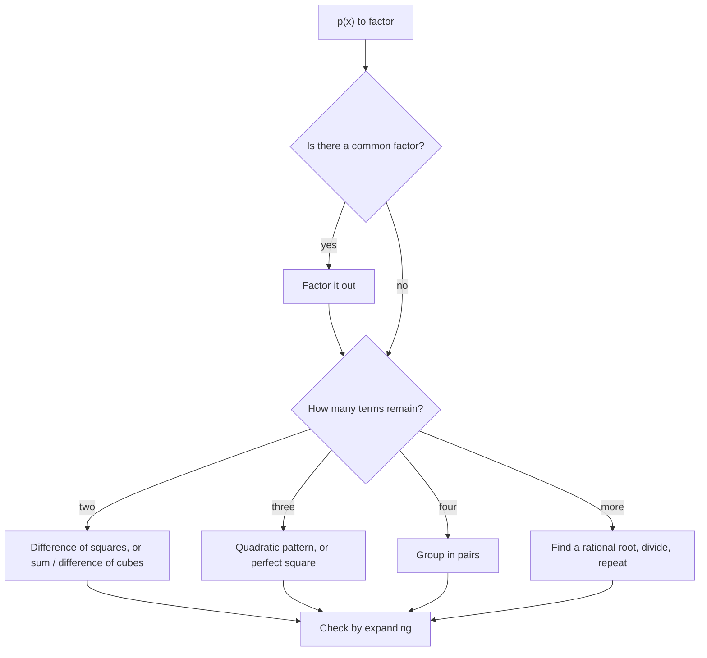

# Polynomials

> [Mathematics](../../README.md) › [Algebra](../README.md) · Level: Intermediate · Prerequisites: [Elementary Algebra](../01-elementary-algebra/README.md), [Factoring](../07-factoring/README.md) · Estimated time: 150 min

## 1. Introduction

Polynomials are the expressions built from a variable using only addition, subtraction and
multiplication:

$$
3x^4 - 7x^2 + x - 2, \qquad (x - 1)^3, \qquad \tfrac12 x^2 + 5 .
$$

No division by the variable, no roots, no exponentials, no trigonometric functions. That austere
restriction makes them the simplest interesting class of functions — and, remarkably, the most useful.
They approximate every continuous function (Taylor's theorem), they describe the response of linear
systems and filters, they encode data in error-correcting codes, they define the arithmetic behind
secret-sharing schemes, and they are the objects on which modern algebra is built.

The reason for their power is a single structural fact, which this tutorial proves: a polynomial of
degree $n$ is determined by its behaviour at $n+1$ points, and the equation $p(x) = 0$ has at most $n$
solutions. "Rigid but flexible": rigid because a few data points pin a polynomial down, flexible
because by choosing the degree you can fit almost any smooth shape you like. Every application above
exploits some aspect of that trade-off.

This tutorial proceeds in the order in which the ideas became clear historically: arithmetic with
polynomials (§7.1–7.6), division and its consequences — the remainder and factor theorems (§7.7–7.9),
the existence of roots — the fundamental theorem of algebra (§7.10), the fine structure of roots —
multiplicity and Vieta's formulas (§7.11–7.12), and finally the graphical and identity-theoretic
picture (§7.13–7.15). Proofs are given for everything that can be proved with the tools at hand; the
one genuinely deep result, the fundamental theorem of algebra, is stated clearly and its intuition
explained, with an honest note that its proof belongs to analysis.

## 2. Prerequisites

Exponent laws and the distributive law are developed in
[Elementary Algebra](../01-elementary-algebra/README.md); factoring quadratics in
[Factoring](../07-factoring/README.md); the binomial theorem in
[Intermediate Algebra](../04-intermediate-algebra/README.md). The recalls below are summaries, not
substitutes for those tutorials.

**Exponent laws.** For integers $m, n \geq 0$ and $a \neq 0$:
$a^m a^n = a^{m+n}$, $(a^m)^n = a^{mn}$, $(ab)^n = a^nb^n$, and $a^0 = 1$. We use $x^1 = x$ and
$x^0 = 1$ throughout, so that a constant $c$ may be written $cx^0$.

**The distributive law.** $a(b + c) = ab + ac$ and $(a + b)(c + d) = ac + ad + bc + bd$. Multi-term
products are computed by multiplying every term of the first factor by every term of the second and
collecting like terms.

**Factoring quadratics.** $x^2 + (p+q)x + pq = (x+p)(x+q)$, and more generally
$ax^2 + bx + c = a(x - r_1)(x - r_2)$ where $r_1, r_2$ are the roots given by the quadratic formula

$$
r = \frac{-b \pm \sqrt{b^2 - 4ac}}{2a} .
$$

**Function notation.** $p(c)$ denotes the value of the polynomial $p$ at $x = c$, obtained by
substituting $c$ for every occurrence of $x$.

**Real numbers.** $\mathbb{R}$ is closed under $+$, $-$, $\times$; it has no **zero divisors**: if
$ab = 0$ then $a = 0$ or $b = 0$. This innocent property is used in almost every proof below.

## 3. Learning Objectives

By the end of this tutorial you will be able to

1. write a polynomial in standard form and read off its degree, leading coefficient and constant term;
2. state and use the end behaviour of a polynomial from the parity of its degree and the sign of its
   leading coefficient;
3. add, subtract and multiply polynomials, and explain why
   $\deg(pq) = \deg p + \deg q$ while $\deg(p+q) \leq \max(\deg p, \deg q)$;
4. expand and recognise the standard special products, including the difference of squares, the sum and
   difference of cubes, and $(a \pm b)^3$;
5. carry out polynomial long division and state the division algorithm with its uniqueness clause;
6. prove the remainder theorem and the factor theorem, and use them to test candidate factors and to
   determine unknown coefficients;
7. state the fundamental theorem of algebra, explain why it is not obvious, and derive the factorisation
   of a real polynomial into linear and quadratic factors;
8. derive Vieta's formulas for degrees $2$ and $3$ and use them without solving the equation;
9. describe the graph of a polynomial — end behaviour, intercepts, behaviour at a repeated root, sign
   chart — from its factorisation alone;
10. distinguish an identity from an equation, and determine unknown coefficients by equating coefficients.

## 4. Intuition

A polynomial is a machine assembled from three operations: scaling, adding, and multiplying by the
variable. Feed a number in, turn the crank, get a number out. Its **degree** counts how many times the
machine can "multiply by $x$" along a chain, and it measures the machine's capacity for complexity.

Think of degree as a budget. A degree-$1$ polynomial is a straight line: one slope, one intercept, no
curvature. A degree-$2$ polynomial can bend once. Degree $3$ can bend twice. Each extra degree buys one
more bend — this is why a polynomial of degree $n$ can change direction at most $n - 1$ times, and why
$n+1$ points pin it down: each point is one condition, and each condition removes one degree of freedom
from the $n+1$ coefficients.

There is a second, complementary intuition. Far away from the origin, a polynomial behaves like its
**leading term** alone, because the highest power dominates all lower ones. Close to the origin, the
**constant term** dominates, because all the powers of a small number are smaller still. So a
polynomial is a tug-of-war between the local behaviour (low powers) and the global behaviour (the
leading term), and the interesting phenomena — the bends, the zeros — happen in between.

For instance $p(x) = x^3 - 100x$ looks like $-100x$ near $x = 0$ (steep, negative, going down) and
like $x^3$ far away (positive, rising). Somewhere in between it must turn around, twice — and indeed
$p(x) = x(x-10)(x+10)$ has zeros at $-10, 0, 10$. The shape is completely determined by the zeros and
the leading coefficient. That is the theme of §7.12–7.13.

Finally, the deepest intuition of all: **the roots and the coefficients are two views of the same
data.** Expanding $(x - r_1)(x - r_2)\cdots(x - r_n)$ produces coefficients that are symmetric
combinations of the roots (Vieta). Division by $x - c$ detects whether $c$ is a root (factor theorem).
Multiplication of polynomials corresponds to adding their roots (with multiplicity). Polynomials are
the meeting point of algebra as computation and algebra as the study of structure.

## 5. Formal Definition

**Definition 5.1 (Polynomial).** Let $n \geq 0$ be an integer. A **polynomial in the variable $x$ with
real coefficients** is an expression

$$
p(x) = a_nx^n + a_{n-1}x^{n-1} + \cdots + a_1x + a_0
$$

where $a_0, a_1, \dots, a_n \in \mathbb{R}$. The numbers $a_k$ are the **coefficients**, $a_k$ being
the coefficient of $x^k$. We allow ourselves to omit terms whose coefficient is $0$, and to insert
zero coefficients for missing powers when it is convenient.

* If $a_n \neq 0$ then $n$ is the **degree** of $p$, written $\deg p = n$, and $a_n$ is the **leading
  coefficient**, written $\operatorname{lc}(p) = a_n$. The term $a_nx^n$ is the **leading term**.
* $a_0$ is the **constant term**.
* A polynomial of degree $0$ is a **constant** (a nonzero real number). A polynomial of degree $1$ is
  **linear**, degree $2$ **quadratic**, degree $3$ **cubic**, degree $4$ **quartic**.
* A polynomial whose leading coefficient is $1$ is **monic**.
* The **zero polynomial** is the polynomial all of whose coefficients are $0$. Its degree is not
  defined (some authors assign $-\infty$, which makes the degree formulas below work without
  exceptions).

**Definition 5.2 (Equality of polynomials).** Two polynomials are **equal** if, after inserting zero
coefficients for missing powers, the coefficients of every power of $x$ agree.

**Definition 5.3 (Polynomial function).** A polynomial $p$ defines a function
$p \colon \mathbb{R} \to \mathbb{R}$ by $c \mapsto p(c)$. The set of all polynomials in $x$ with real
coefficients is denoted $\mathbb{R}[x]$.

**Definition 5.4 (Root, zero).** A real number $c$ is a **root** (or **zero**) of $p$ if $p(c) = 0$.

**Definition 5.5 (Divides).** For polynomials $d \neq 0$ and $p$, we say $d$ **divides** $p$, written
$d \mid p$, if there is a polynomial $q$ with $p = dq$. In that case $d$ is a **factor** of $p$.

Three warnings, stated now and used throughout.

* The zero polynomial has **every** real number as a root. Statements such as "a polynomial of degree
  $n$ has at most $n$ roots" silently exclude it; every theorem below that counts roots assumes
  $p \neq 0$.
* "Degree" is a property of the *written expression* only after like terms are collected: the
  expression $(x+1)^2 - x^2 - 2x$ has degree $0$, not $2$, because it simplifies to $1$.
* Equality of polynomials (Definition 5.2) is a statement about coefficients; equality of the
  *functions* they define is a statement about all inputs. Section 7.14 proves that the two notions
  coincide over $\mathbb{R}$, which is what licenses "equating coefficients".

## 6. Mathematical Notation

| Symbol | Read as | Meaning |
|---|---|---|
| $\deg p$ | "degree of $p$" | the highest exponent with nonzero coefficient |
| $\operatorname{lc}(p)$ | "leading coefficient of $p$" | coefficient of the highest power |
| $p(c)$ | "$p$ of $c$" | the value of $p$ at $x = c$ |
| $\mathbb{R}[x]$ | "are of ex" | all polynomials in $x$ with real coefficients |
| $\sum_{k=0}^{n} a_kx^k$ | "the sum from $k$ equals zero to $n$ of $a_k x^k$" | compact notation for $a_0 + a_1x + \cdots + a_nx^n$ |
| $d \mid p$ | "$d$ divides $p$" | there exists $q$ with $p = dq$ |
| $p \equiv q$ | "$p$ is identically equal to $q$" | equal as polynomials, i.e. for every $x$ |
| $\binom{n}{k}$ | "$n$ choose $k$" | $\dfrac{n!}{k!(n-k)!}$, the binomial coefficient |
| $\overline{z}$ | "z bar" | complex conjugate of $z$; used only in §7.10 |
| $c$ with multiplicity $m$ | "root of multiplicity $m$" | $(x - c)^m \mid p$ but $(x-c)^{m+1} \nmid p$ |

**Reading a summation.** $\sum_{k=0}^{3} a_kx^k$ means $a_0x^0 + a_1x^1 + a_2x^2 + a_3x^3$, i.e.
$a_0 + a_1x + a_2x^2 + a_3x^3$. The index $k$ is a dummy: replacing it by $j$ changes nothing.

## 7. Core Concepts

### 7.1 Standard form, degree and leading coefficient

**Standard form** means the terms are written in decreasing order of exponent, with like terms already
collected. For example

$$
5 - 2x^3 + 7x - x^5 = -x^5 - 2x^3 + 7x + 5 ,
$$

so the degree is $5$, the leading coefficient is $-1$, and the constant term is $5$. The rewriting is
harmless because addition of real numbers is commutative; but the *degree* is only visible after the
rewriting, since the highest power appears in the middle of the original expression.

Two subtleties:

* **Missing powers.** The polynomial $x^5 - 3$ has coefficients $a_4 = a_3 = a_2 = a_1 = 0$. Inserting
  zeros is essential when aligning terms for division (§7.7).
* **Cancellation can lower the degree.** The expression $x^3 + (1 - x^3)$ is the constant $1$, of
  degree $0$. This is not a pathology; it is the reason the degree of a sum satisfies an inequality
  rather than an equality.

Thus a polynomial of degree $n$ has exactly $n + 1$ coefficients, but any of them except the leading one
may be zero.

### 7.2 End behaviour

For large $|x|$, the leading term overwhelms everything else. Formally, factor it out:

$$
p(x) = a_nx^n\left(1 + \frac{a_{n-1}}{a_n}\cdot\frac{1}{x} + \cdots + \frac{a_0}{a_n}\cdot\frac{1}{x^n}\right)
\qquad (x \neq 0).
$$

As $|x|$ grows, every fraction inside the bracket tends to $0$, so the bracket tends to $1$; thus $p(x)$
has the sign of $a_nx^n$ once $|x|$ is large. This gives four cases.

| Degree | Leading coefficient | $x \to -\infty$ | $x \to +\infty$ |
|---|---|---|---|
| even | $a_n > 0$ | $+\infty$ | $+\infty$ |
| even | $a_n < 0$ | $-\infty$ | $-\infty$ |
| odd | $a_n > 0$ | $-\infty$ | $+\infty$ |
| odd | $a_n < 0$ | $+\infty$ | $-\infty$ |

The table is worth memorising in words: **even degree — the two ends agree; odd degree — the two ends
disagree; the sign of $a_n$ decides whether the right end goes up or down.** Since the sign of $a_nx^n$
is the sign of $a_n$ times the sign of $x^n$, and $x^n$ is positive for every $x \neq 0$ when $n$ is
even, the whole table follows from that one observation.

Note what the table does *not* say: nothing about the middle. Two polynomials of degree $4$ with
positive leading coefficients can look wildly different between their ends. End behaviour is asymptotics,
not shape.

### 7.3 Addition and subtraction

Add by adding coefficients of equal powers; subtract by subtracting them. The result is again a
polynomial, and the two operations are associative, commutative and distributive — $\mathbb{R}[x]$ is a
ring, in the language of later chapters.

**Theorem 7.1 (Degree of a sum).** Let $p, q$ be nonzero polynomials. Then

$$
\deg(p + q) \leq \max(\deg p,\, \deg q).
$$

Moreover, if $\deg p \neq \deg q$ then $\deg(p+q) = \max(\deg p, \deg q)$.

**Proof.** Let $m = \deg p$ and $n = \deg q$, and suppose $m \geq n$ without loss of generality. The
coefficient of $x^k$ in $p + q$ is zero whenever $k > m$, because both $p$ and $q$ have no such term.
Hence $\deg(p+q) \leq m$.

If $m > n$, the coefficient of $x^m$ in $p+q$ equals the coefficient of $x^m$ in $p$ (since $q$ has no
$x^m$ term), which is $\operatorname{lc}(p) \neq 0$. So the degree is exactly $m$. If $m = n$, the
leading coefficients may cancel — as in $x^2 + (-x^2 + 3) = 3$ — and then the degree is smaller.
$\blacksquare$

**Example.** $(3x^3 - 2x + 5) + (x^3 + 4x^2 - 7) = 4x^3 + 4x^2 - 2x - 2$, of degree $3 = \max(3,3)$.
But $(x^2 + 3x) + (-x^2 + 5) = 3x + 5$, of degree $1 < 2$: the quadratics cancelled.

Subtraction is addition of the negative, so the same theorem applies; the only new risk is a sign error
when distributing the minus sign across a bracket, which is the subject of §11.

### 7.4 Multiplication

Multiply every term of the first factor by every term of the second and collect like terms. For a
product of two binomials this is the familiar "first, outer, inner, last" rule, which is simply the
distributive law applied twice:

$$
(ax + b)(cx + d) = ax(cx + d) + b(cx + d) = acx^2 + (ad + bc)x + bd .
$$

**Theorem 7.2 (Degree of a product).** For nonzero polynomials $p$ and $q$,

$$
\deg(pq) = \deg p + \deg q .
$$

**Proof.** Write $m = \deg p$, $n = \deg q$, and let $a = \operatorname{lc}(p) \neq 0$,
$b = \operatorname{lc}(q) \neq 0$. Every term of $pq$ is of the form
$a_ix^i \cdot b_jx^j = a_ib_j\,x^{i+j}$ with $i \leq m$ and $j \leq n$, so every exponent in $pq$ is at
most $m + n$. The coefficient of $x^{m+n}$ receives exactly one contribution, namely $a_mb_n = ab$. In
$\mathbb{R}$, a product of nonzero numbers is nonzero, so $ab \neq 0$ and the coefficient of $x^{m+n}$
does not vanish. Hence $\deg(pq) = m + n$. $\blacksquare$

The role of "no zero divisors" is now visible: over a number system where $ab$ could be $0$ with
$a, b \neq 0$, the degree of a product could drop. This is exactly why polynomials over $\mathbb{Z}/6$
behave strangely, while polynomials over $\mathbb{R}$, $\mathbb{Q}$, $\mathbb{C}$ or $\mathbb{Z}/p$ with
$p$ prime behave well.

**Consequence.** Multiplying by a nonzero constant does not change the degree, and multiplying two
non-constant polynomials strictly increases the degree. So a product of two non-constant polynomials is
never constant: this is the statement that $\mathbb{R}[x]$ has no zero divisors either, which will
follow from Theorem 7.2 applied to $p - q$.

### 7.5 Special products

Every identity below is a substitution instance of the distributive law; each is worth deriving once and
then recognising instantly. Verify each by expanding — this is not optional, because a mis-remembered
sign is the most common algebraic error there is.

**Square of a binomial.**

$$
(a + b)^2 = a^2 + 2ab + b^2, \qquad (a - b)^2 = a^2 - 2ab + b^2 .
$$

*Derivation of the first:* $(a+b)(a+b) = a^2 + ab + ba + b^2 = a^2 + 2ab + b^2$. The second follows by
replacing $b$ with $-b$.

**Difference of squares.**

$$
(a + b)(a - b) = a^2 - b^2 .
$$

*Derivation:* $a^2 - ab + ba - b^2 = a^2 - b^2$; the two middle terms cancel. This is the most used
identity in all of elementary algebra.

**Cube of a binomial.**

$$
(a + b)^3 = a^3 + 3a^2b + 3ab^2 + b^3, \qquad (a - b)^3 = a^3 - 3a^2b + 3ab^2 - b^3 .
$$

*Derivation of the first:* $(a + b)^3 = (a+b)(a^2 + 2ab + b^2) = a^3 + 2a^2b + ab^2 + a^2b + 2ab^2 + b^3
= a^3 + 3a^2b + 3ab^2 + b^3$. The coefficients $1, 3, 3, 1$ are the third row of Pascal's triangle.

**Sum and difference of cubes.**

$$
a^3 + b^3 = (a + b)(a^2 - ab + b^2), \qquad a^3 - b^3 = (a - b)(a^2 + ab + b^2).
$$

*Derivation of the first:* expand $(a+b)(a^2 - ab + b^2) = a^3 - a^2b + ab^2 + a^2b - ab^2 + b^3 =
a^3 + b^3$. Every intermediate term cancels. Note the mnemonic: the quadratic factor has the *opposite*
sign in the middle.

**Binomial theorem.** The pattern generalises:

$$
(a + b)^n = \sum_{k=0}^{n} \binom{n}{k} a^{n-k}b^k .
$$

It is proved by induction on $n$ using Pascal's rule
$\binom{n+1}{k} = \binom{n}{k-1} + \binom{n}{k}$, which is precisely the bookkeeping of "where did the
term $a^{n-k}b^k$ come from". We shall use only $n \leq 3$ in this tutorial.

### 7.6 Factoring patterns and strategy

Factoring is expanding in reverse, and it is genuinely harder because it is a search rather than a
computation. The reliable strategy, in order:

1. **Common factor first.** Always. $6x^3 - 9x^2 + 3x = 3x(2x^2 - 3x + 1)$, and the remaining quadratic
   is smaller and easier.
2. **Count the terms.**
   * two terms: try difference of squares $a^2 - b^2$, difference of cubes, sum of cubes;
   * three terms: try a quadratic pattern, or a perfect square $a^2 \pm 2ab + b^2$;
   * four terms: try grouping, e.g. $x^3 + 3x^2 - 4x - 12 = x^2(x + 3) - 4(x + 3) = (x+3)(x^2 - 4)$.
3. **Substitute for a repeated expression.** $x^4 - 5x^2 + 4$ is a quadratic in $u = x^2$, namely
   $u^2 - 5u + 4 = (u-1)(u-4)$, hence $(x^2 - 1)(x^2 - 4) = (x-1)(x+1)(x-2)(x+2)$.
4. **Hunt for a root.** If none of the above works, look for a small integer or rational root and use
   the factor theorem (§7.9, §7.15). Every real root produces a linear factor, and dividing it out
   lowers the degree.

Two useful general formulas, both instances of the same telescoping pattern:

$$
a^n - b^n = (a - b)\left(a^{n-1} + a^{n-2}b + \cdots + ab^{n-2} + b^{n-1}\right) \qquad (n \geq 1),
$$

$$
a^n + b^n = (a + b)\left(a^{n-1} - a^{n-2}b + \cdots - ab^{n-2} + b^{n-1}\right) \qquad (n \text{ odd}).
$$

Check the first by multiplying out: the product telescopes, every term cancelling with the next except
the first and last. For $n = 3$ it reduces to the difference of cubes; for $n = 2$, to the difference of
squares. The second formula requires $n$ odd — for even $n$, $a^n + b^n$ has no factor $a+b$ because
setting $a = -b$ gives $b^n + b^n = 2b^n \neq 0$.

### 7.7 The division algorithm for polynomials

Integers have division with remainder: $17 = 5 \cdot 3 + 2$, with $0 \leq 2 < 5$. Polynomials have the
same structure, with "smaller remainder" replaced by "lower degree".

**Definition 7.4 (Polynomial division).** Let $p$ and $d \neq 0$ be polynomials. We say $p$ **divided by**
$d$ has **quotient** $q$ and **remainder** $r$ if

$$
p = dq + r \qquad\text{and}\qquad r = 0 \ \text{ or } \ \deg r < \deg d .
$$

**Theorem 7.5 (Division algorithm).** For every polynomial $p$ and every nonzero polynomial $d$ there
exist unique polynomials $q, r$ satisfying the conditions above.

**Proof of existence.** Induct on $m = \deg p$. If $p = 0$ or $m < \deg d$, take $q = 0$ and $r = p$;
then $r = 0$ or $\deg r = \deg p < \deg d$.

Now suppose $m \geq \deg d = n$, and write $a = \operatorname{lc}(p)$, $b = \operatorname{lc}(d)
\neq 0$. Define

$$
q_1(x) = \frac{a}{b}x^{m-n}, \qquad p_1(x) = p(x) - q_1(x)\,d(x).
$$

The term $q_1d$ has leading term $\frac{a}{b}x^{m-n} \cdot bx^n = ax^m$, exactly the leading term of
$p$. Therefore the leading terms cancel in $p_1$, so $\deg p_1 < \deg p = m$. By the induction
hypothesis applied to $p_1$ (which has smaller degree), there are $q_2, r$ with
$p_1 = dq_2 + r$ and $r = 0$ or $\deg r < \deg d$. Then

$$
p = p_1 + q_1d = (q_2 + q_1)d + r ,
$$

so $q = q_1 + q_2$ and $r$ satisfy the requirement.

**Proof of uniqueness.** Suppose $dq + r = dq' + r'$ with $r, r'$ both zero or of degree $< \deg d$.
Then

$$
d(q - q') = r' - r .
$$

Assume $q \neq q'$. The left side is then a nonzero polynomial divisible by $d$, so by Theorem 7.2 its
degree equals $\deg d + \deg(q - q') \geq \deg d$. The right side is either zero (when $r = r'$) or, by
Theorem 7.1, of degree at most $\max(\deg r, \deg r') < \deg d$. A nonzero polynomial cannot have degree
both $\geq \deg d$ and $< \deg d$, so the assumption $q \neq q'$ is false: $q = q'$. Substituting back
into $dq + r = dq' + r'$ gives $r = r'$. $\blacksquare$

**The long-division layout.** The recursive proof *is* the algorithm. Writing $r_0 = p$, one computes

$$
r_k = r_{k-1} - \frac{\operatorname{lc}(r_{k-1})}{\operatorname{lc}(d)}\,x^{\deg r_{k-1} - \deg d}\,d,
\qquad k = 1, 2, \dots
$$

and stops at the first $k$ with $r_k = 0$ or $\deg r_k < \deg d$. Each step kills the leading term of
the current remainder, so the degrees strictly decrease and the process terminates. On paper this is
written as a long division: the dividend under the bracket, the divisor on the left, and one line per
subtraction.

In practice one writes the division as

$$
\frac{2x^4 - 3x^3 + x - 5}{x^2 - x + 1} = 2x^2 - x - 3 + \frac{-x - 2}{x^2 - x + 1},
$$

read off from Example 5 of §9. Two practical rules prevent almost all errors: insert zeros for missing
powers of the dividend, and subtract *whole rows* with the signs distributed.

**Synthetic division.** When the divisor is $x - c$ (monic of degree $1$), the algorithm is so
specialised that it can be compressed to an array of arithmetic. If
$p(x) = a_nx^n + \cdots + a_0$, then dividing by $x - c$ gives coefficients obtained by

$$
b_{n-1} = a_n, \qquad b_{k-1} = a_k + c\,b_k \ \ (k = n-1, \dots, 1),
$$

and the remainder is $a_0 + c\,b_0$. This is Horner's scheme. It computes the quotient and the remainder
in $n$ multiplications and $n$ additions — and by the remainder theorem it also evaluates $p(c)$.

### 7.8 The remainder theorem

**Theorem 7.6 (Remainder theorem).** Let $p$ be a polynomial and $c \in \mathbb{R}$. The remainder on
dividing $p(x)$ by $x - c$ is $p(c)$. Equivalently,

$$
p(x) = (x - c)\,q(x) + p(c)
$$

for a unique polynomial $q$.

**Proof.** Apply the division algorithm with $d(x) = x - c$. The remainder $r$ satisfies $r = 0$ or
$\deg r < \deg(x - c) = 1$; in either case $r$ is a constant. Write $p(x) = (x-c)q(x) + r$. Substituting
$x = c$ makes the first term vanish:

$$
p(c) = (c - c)\,q(c) + r = 0 \cdot q(c) + r = r .
$$

So the remainder equals $p(c)$, and $q$ is unique by Theorem 7.5. $\blacksquare$

The theorem is more than a shortcut: it converts a question about *division* into a question about
*evaluation*, and evaluation is the cheapest operation a polynomial admits. It is why computer algebra
systems test divisibility by $x - c$ with one Horner evaluation instead of a full division.

**Consequence (evaluation form).** For any $p$ and any $c$,
$p(x) - p(c)$ is divisible by $x - c$. In particular, if $p(c) = 0$ then $x - c$ divides $p$ — the next
theorem.

### 7.9 The factor theorem and the root bound

**Theorem 7.7 (Factor theorem).** Let $p$ be a polynomial and $c \in \mathbb{R}$. Then

$$
(x - c) \mid p(x) \iff p(c) = 0 .
$$

**Proof.**

*($\Rightarrow$)* If $p(x) = (x-c)q(x)$, then $p(c) = (c-c)q(c) = 0$.

*($\Leftarrow$)* Suppose $p(c) = 0$. By the remainder theorem, $p(x) = (x-c)q(x) + p(c) = (x-c)q(x)$,
so $(x-c) \mid p(x)$. $\blacksquare$

**Corollary 7.8 (Root bound).** A nonzero polynomial of degree $n \geq 0$ has at most $n$ distinct real
roots.

**Proof.** Induct on $n$. For $n = 0$ the polynomial is a nonzero constant, which has no roots. Suppose
the claim known for degree $n - 1$, and let $p$ have degree $n$. If $p$ has no roots there is nothing to
prove. Otherwise let $c$ be a root. By the factor theorem $p(x) = (x-c)q(x)$ with
$\deg q = n - 1$ (Theorem 7.2, since $\deg(x-c) = 1$). Any root $s \neq c$ of $p$ satisfies
$(s - c)q(s) = 0$, and $s - c \neq 0$, so $q(s) = 0$ (no zero divisors in $\mathbb{R}$). By the
induction hypothesis $q$ has at most $n-1$ distinct roots, so $p$ has at most $1 + (n-1) = n$ distinct
roots. $\blacksquare$

The bound is sharp: $x(x-1)(x-2)\cdots(x-n)$ has degree $n$ and $n$ distinct roots. It can fail over
other number systems — $x^2 - 1$ has four roots modulo $8$, namely $1, 3, 5, 7$ — which is another
appearance of zero divisors.

### 7.10 The fundamental theorem of algebra

Everything so far is elementary: division, evaluation, counting. The next statement is not.

**Theorem 7.9 (Fundamental theorem of algebra).** Every polynomial with complex coefficients of degree
$n \geq 1$ has at least one root in $\mathbb{C}$.

**Corollary 7.10 (Complete factorisation).** Every polynomial $p$ of degree $n \geq 1$ with complex
coefficients can be written

$$
p(x) = a_n\,(x - z_1)(x - z_2)\cdots(x - z_n),
$$

where $a_n$ is the leading coefficient and $z_1, \dots, z_n \in \mathbb{C}$ are its roots, counted with
multiplicity.

**Proof of the corollary from the theorem.** Induct on $n$. For $n = 1$, $a_1x + a_0 =
a_1\left(x - (-a_0/a_1)\right)$. For $n > 1$, the theorem supplies a root $z_1$; by the factor theorem
(applied over $\mathbb{C}$, which is a field just like $\mathbb{R}$) $p(x) = (x - z_1)g(x)$ with
$\deg g = n - 1$, and the induction hypothesis factorises $g$. $\blacksquare$

**Honest note on the proof.** Theorem 7.9 cannot be proved by algebra alone: it is a statement about
the completeness of $\mathbb{C}$, and every known proof uses analysis or topology. The standard proof
(Liouville's theorem) observes that a non-constant polynomial is an entire function that grows like
$|z|^n$ at infinity; if it had no zero, $1/p$ would be entire and bounded, hence constant by Liouville,
a contradiction. A more intuitive proof studies $|p(z)|$: it attains a minimum on a large disc, and a
local expansion $p(z_0 + h) = p(z_0) + c_kh^k + \cdots$ shows that if $p(z_0) \neq 0$ one can move a
little in a direction that decreases $|p|$. Hence the minimum is $0$.

**Intuition without proof.** Three ways to believe it:

* $\mathbb{C}$ has "no holes". A real polynomial of odd degree must cross the axis because its ends go
  in opposite directions (intermediate value theorem); even degree fails over $\mathbb{R}$ precisely
  because a positive-definite polynomial never reaches zero. Adjoining $i$ removes the last hole.
* Multiplication by a non-zero complex number is a rotation together with a scaling. A polynomial of
  degree $n$ wraps the plane $n$ times around each output value; the wrapping cannot avoid the origin.
* Empirically: the quadratic formula solves degree $2$ inside $\mathbb{C}$; Cardano's formulas solve
  degrees $3$ and $4$; the pattern is that the missing root is always complex. The fundamental theorem
  says the pattern never breaks.

**Real coefficients: conjugate pairs.** Suppose $p$ has *real* coefficients and $z \in \mathbb{C}$
satisfies $p(z) = 0$. Complex conjugation fixes every real number and respects sums and products, so

$$
0 = \overline{p(z)} = \overline{a_nz^n + \cdots + a_0} = a_n\overline{z}^n + \cdots + a_0 = p(\overline{z}).
$$

Hence $\overline{z}$ is also a root, with the same multiplicity. So non-real roots of a real polynomial
come in conjugate pairs, and the total number of non-real roots is even. Consequently:

* a real polynomial of **odd** degree has at least one **real** root;
* $x^2 + 1$ is the simplest real polynomial with no real root, and $x^2 + 1 = (x-i)(x+i)$ is its
  complex factorisation.

**Factorisation over $\mathbb{R}$.** Grouping each conjugate pair
$(x - z)(x - \overline{z}) = x^2 - (z + \overline{z})x + z\overline{z}$ produces a quadratic with real
coefficients and negative discriminant. Therefore every real polynomial factors over $\mathbb{R}$ into a
product of **linear factors** (from real roots) and **irreducible quadratics** (from conjugate pairs).
For example

$$
x^4 + 4 = (x^2 + 2x + 2)(x^2 - 2x + 2),
$$

both quadratics having discriminant $4 - 8 = -4 < 0$. (This is not a coincidence: it is
Sophie Germain's identity $a^4 + 4b^4 = (a^2 + 2ab + 2b^2)(a^2 - 2ab + 2b^2)$ with $a = x$, $b = 1$.)

### 7.11 Multiplicity

A root can be "repeated". The precise definition:

**Definition 7.11 (Multiplicity).** Let $p \neq 0$ and $p(c) = 0$. The **multiplicity** of $c$ is the
largest integer $m \geq 1$ such that $(x - c)^m \mid p(x)$. Equivalently, $p(x) = (x-c)^m s(x)$ with
$s(c) \neq 0$. A root of multiplicity $1$ is **simple**; multiplicity $2$ is a **double** root, and so
on.

The equivalence of the two formulations is a consequence of the factor theorem applied repeatedly: as
long as $s(c) = 0$, another factor $(x - c)$ can be pulled out.

**Examples.**

* $p(x) = (x-1)^3(x+2)$ has root $1$ of multiplicity $3$ and root $-2$ of multiplicity $1$.
* $x^2 - 2x + 1 = (x-1)^2$: the root $1$ has multiplicity $2$.
* $x^3 - 3x^2 + 3x - 1 = (x-1)^3$: multiplicity $3$.
* $x^2 + 1$ has no real root; over $\mathbb{C}$ its roots $i, -i$ are simple.

**Counting with multiplicity.** By Corollary 7.10, a degree-$n$ polynomial has exactly $n$ complex roots
counted with multiplicity; over $\mathbb{R}$ the sum of the multiplicities of the real roots is at most
$n$. So "degree $n$" and "number of roots" agree once you count correctly and allow complex numbers.

Multiplicity is not a technicality: it governs the shape of the graph (§7.13), the behaviour of
numerical root-finding (a double root is ill-conditioned), and the algebra of partial fractions.

### 7.12 Roots and coefficients: Vieta's formulas

Expanding a product of linear factors and comparing coefficients relates the roots to the coefficients
directly.

**Degree 2.** Let $p(x) = ax^2 + bx + c$ with $a \neq 0$ have roots $r_1, r_2$ (possibly complex, possibly
equal). Then $p(x) = a(x - r_1)(x - r_2)$, and

$$
a(x-r_1)(x-r_2) = a\left(x^2 - (r_1 + r_2)x + r_1r_2\right) = ax^2 - a(r_1+r_2)x + ar_1r_2 .
$$

Comparing coefficients of $x^1$ and $x^0$:

$$
r_1 + r_2 = -\frac{b}{a}, \qquad r_1r_2 = \frac{c}{a} .
$$

**Degree 3.** Let $p(x) = ax^3 + bx^2 + cx + d$ have roots $r_1, r_2, r_3$. First
$(x - r_1)(x - r_2) = x^2 - (r_1+r_2)x + r_1r_2$; multiplying by $(x - r_3)$ gives

$$
\begin{aligned}
(x-r_1)(x-r_2)(x-r_3)
&= x^3 - (r_1+r_2+r_3)x^2 + (r_1r_2 + r_1r_3 + r_2r_3)x - r_1r_2r_3 .
\end{aligned}
$$

Multiplying by $a$ and comparing with $ax^3 + bx^2 + cx + d$:

$$
r_1 + r_2 + r_3 = -\frac{b}{a}, \qquad
r_1r_2 + r_1r_3 + r_2r_3 = \frac{c}{a}, \qquad
r_1r_2r_3 = -\frac{d}{a} .
$$

Sign pattern: sum $-\frac{b}{a}$, pairwise $+\frac{c}{a}$, product $-\frac{d}{a}$ — alternating, starting
with a minus on the $x^{n-1}$ coefficient.

**General degree.** Writing $p(x) = a_n\prod_{k=1}^{n}(x - r_k)$ and expanding, the coefficient of
$x^{n-k}$ is $a_n$ times $(-1)^k$ times the sum of all products of $k$ distinct roots:

$$
\sum_{1 \leq i_1 < \cdots < i_k \leq n} r_{i_1}\cdots r_{i_k} = (-1)^k\,\frac{a_{n-k}}{a_n},
\qquad k = 1, \dots, n .
$$

These are **Vieta's formulas**. The quantity on the left is the $k$-th elementary symmetric polynomial
in the roots; the formulas say that the coefficients are (up to signs) exactly those symmetric
functions. Newton's identities invert the relation, expressing power sums $\sum r_i^k$ in terms of the
coefficients.

**Why Vieta matters.** It gives information about roots without finding them. If a cubic has roots
$r_1, r_2, r_3$ with $r_1 + r_2 + r_3 = 6$ and $r_1r_2r_3 = 6$, you can test candidate triples
instantly; if you know two roots, the third is determined by the sum; and quantities such as
$r_1^2 + r_2^2 + r_3^2 = (r_1+r_2+r_3)^2 - 2(r_1r_2 + r_1r_3 + r_2r_3)$ are computable from the
coefficients alone. This is the standard route to symmetric-function problems in competitions.

### 7.13 Graphing polynomial behaviour

A polynomial's graph can be sketched from its factorisation, with no calculus. Five features carry all
the information.

**(1) End behaviour** — from §7.2: even degree means the two ends agree, odd degree means they
disagree, and the sign of the leading coefficient says whether the right end rises or falls.

**(2) $y$-intercept** — the single point $x = 0$, where $p(0) = a_0$, the constant term. This is the
only place where the constant coefficient is directly visible on the graph.

**(3) $x$-intercepts** — the real roots, found from the factorisation or numerically. Between
consecutive distinct real roots the sign of $p$ cannot change (a sign change would force another root,
by the intermediate value theorem). So the sign is constant on each interval determined by the roots,
and it suffices to test one point per interval.

**(4) Behaviour at a root: the multiplicity test.** Suppose $p(x) = (x - c)^m s(x)$ with
$s(c) \neq 0$. Near $c$, the factor $s(x)$ is close to $s(c)$, so it keeps the sign of $s(c)$ on a
small interval around $c$; the factor $(x - c)^m$ has the sign of $(x-c)^m$. Hence:

* $m$ **odd**: $(x-c)^m$ changes sign at $c$, so the graph **crosses** the axis (and is steep or flat
  according to the size of $m$);
* $m$ **even**: $(x-c)^m \geq 0$ on both sides and vanishes at $c$, so the graph **touches** the axis and
  turns back.

**(5) At most $n - 1$ turning points** for a degree-$n$ polynomial. The derivative $p'$ has degree
$n - 1$ (for $n \geq 1$), and a turning point is a zero of $p'$; by Corollary 7.8 there are at most
$n-1$ of them. The same bound, in the form "at most $n-1$ bends", is exactly the "budget" intuition of
§4. This argument uses the derivative, so it is stated rather than proved here; everything else in this
subsection is proved.

**Sign chart method.** To find where $p > 0$ and $p < 0$:

1. factor $p$ completely into linear factors, keeping track of multiplicities;
2. list the distinct real roots in increasing order;
3. choose one test point in each interval and compute the sign of each factor;
4. read off the sign of the product; a factor with even multiplicity contributes $+$ on both sides of
   its root.

**Symmetry.** A polynomial is **even** if $p(-x) = p(x)$ for all $x$, which happens exactly when all
exponents are even; its graph is symmetric about the $y$-axis. It is **odd** if $p(-x) = -p(x)$, which
happens exactly when all exponents are odd; its graph has rotational symmetry about the origin.

### 7.14 Polynomial identities and equality of polynomials

An **equation** such as $x^2 - 3x + 2 = 0$ is a question: for which $x$ is it true? An **identity**
such as $(x + 1)^2 = x^2 + 2x + 1$ is a statement: it holds for every $x$. The notation $p \equiv q$
marks the second case.

**Theorem 7.12 (Equality of polynomials).** Let $p$ and $q$ be polynomials with real coefficients. The
following are equivalent:

1. $p$ and $q$ have the same coefficients (Definition 5.2);
2. $p(c) = q(c)$ for every real $c$;
3. $p(c) = q(c)$ for $n + 1$ distinct real numbers $c$, where $n \geq \max(\deg p, \deg q)$.

**Proof.** (1) $\Rightarrow$ (2): equal coefficients give equal values at every $c$, term by term.
(2) $\Rightarrow$ (3): trivial.

(3) $\Rightarrow$ (1): suppose $p$ and $q$ agree at $n+1$ distinct points, and consider $h = p - q$.
Then $\deg h \leq n$ (Theorem 7.1), and $h$ has at least $n+1$ distinct roots. By Corollary 7.8, a
nonzero polynomial of degree $\leq n$ has at most $n$ roots. Hence $h$ is the zero polynomial, i.e. all
its coefficients are zero, i.e. $p$ and $q$ have equal coefficients. $\blacksquare$

**Consequences.**

* **Identification is legal.** If $a x^2 + bx + c = 0$ for all $x$, then $a = b = c = 0$. This is what
  licenses "equating coefficients" in the method of undetermined coefficients.
* **Interpolation is unique.** Two polynomials of degree $\leq n$ that agree at $n+1$ points are the
  same polynomial. Existence of such a polynomial is a separate theorem (Lagrange interpolation), but
  uniqueness is immediate from Theorem 7.12.
* **A non-zero polynomial cannot vanish on an interval.** If it vanished on infinitely many points, it
  would have more roots than its degree.

**Method of undetermined coefficients.** To write a polynomial in a prescribed form, set up the form
with unknown coefficients, expand, and compare coefficients of each power. For instance, to write
$2x^2 - 7x + 3$ in powers of $(x - 1)$, put

$$
2x^2 - 7x + 3 = a(x-1)^2 + b(x-1) + c
$$

and expand the right side: $ax^2 + (-2a + b)x + (a - b + c)$. Comparing coefficients gives
$a = 2$, $-2a + b = -7$, $a - b + c = 3$, hence $b = -3$ and $c = -2$; check in Example 9 of §9. Note
that this is *not* circular: Theorem 7.12 is what guarantees that a solution $(a,b,c)$ of the
coefficient equations is the only possible one.

### 7.15 Finding roots in practice: the rational root theorem

For degrees $3$ and $4$ there are formulas, but they are unpleasant; for degree $5$ and above there is
no formula in radicals at all (Abel–Ruffini). In practice one finds *rational* roots by testing a finite
list, then divides them out.

**Theorem 7.13 (Rational root theorem).** Let
$p(x) = a_nx^n + \cdots + a_1x + a_0$ have **integer** coefficients with $a_n \neq 0$ and
$a_0 \neq 0$. If $r = s/t$ is a root, written in lowest terms with $t > 0$, then

$$
s \mid a_0 \qquad\text{and}\qquad t \mid a_n .
$$

**Proof.** Substituting $x = s/t$ and multiplying by $t^n$ gives

$$
a_ns^n + a_{n-1}s^{n-1}t + \cdots + a_1st^{n-1} + a_0t^n = 0 .
$$

Every term except the last contains a factor $s$; moving the last term to the other side,

$$
s\left(a_ns^{n-1} + a_{n-1}s^{n-2}t + \cdots + a_1t^{n-1}\right) = -a_0t^n .
$$

The left side is an integer multiple of $s$, so $s \mid a_0t^n$. Since $s$ and $t$ have no common factor,
$s \mid a_0$. Symmetrically, every term except the first contains a factor $t$:

$$
t\left(a_{n-1}s^{n-1} + \cdots + a_1st^{n-2} + a_0t^{n-1}\right) = -a_ns^n ,
$$

so $t \mid a_ns^n$, and since $\gcd(s,t) = 1$, $t \mid a_n$. $\blacksquare$

**Corollary 7.14.** If $p$ is monic with integer coefficients, every rational root is an integer dividing
the constant term.

The theorem produces **candidates**, not roots: each candidate must still be tested by evaluation (or
synthetic division). For $p(x) = x^3 - 4x^2 + x + 6$ the candidates are $\pm1, \pm2, \pm3, \pm6$; testing
gives $p(-1) = 0$, $p(2) = 0$, $p(3) = 0$ and no others (Example 10 of §9).

**Why it fails to help sometimes.** $x^2 - 2$ has integer coefficients but no rational root; the theorem
correctly predicts none, since the candidates $\pm1, \pm2$ all fail. Irrational and complex roots are
invisible to this theorem — a limitation that the fundamental theorem of algebra explains rather than
removes.

## 8. Formulas and Properties

A compact reference. Each entry states its hypotheses; the section where it is proved is indicated.

**Degree rules** (for nonzero $p, q$; §7.3–7.4)

$$
\deg(p \pm q) \leq \max(\deg p, \deg q), \qquad \deg(pq) = \deg p + \deg q .
$$

The first is an equality when $\deg p \neq \deg q$; it can drop when the leading terms cancel. The second
is always an equality over $\mathbb{R}$.

**Special products** (§7.5)

$$
\begin{aligned}
(a \pm b)^2 &= a^2 \pm 2ab + b^2\\
(a + b)(a - b) &= a^2 - b^2\\
(a \pm b)^3 &= a^3 \pm 3a^2b + 3ab^2 \pm b^3\\
a^3 \pm b^3 &= (a \pm b)(a^2 \mp ab + b^2)\\
(a + b)^n &= \sum_{k=0}^{n}\binom{n}{k}a^{n-k}b^k .
\end{aligned}
$$

**Division and roots** (§7.7–7.9)

* Division algorithm: for $d \neq 0$ there are unique $q, r$ with $p = dq + r$, $r = 0$ or
  $\deg r < \deg d$.
* Remainder theorem: the remainder of $p$ on division by $x - c$ equals $p(c)$.
* Factor theorem: $(x-c) \mid p \iff p(c) = 0$.
* Root bound: a nonzero polynomial of degree $n$ has at most $n$ distinct roots.

**Fundamental theorem of algebra** (§7.10): every non-constant complex polynomial has a root; hence
$p(x) = a_n\prod_{k=1}^{n}(x - z_k)$ over $\mathbb{C}$. Over $\mathbb{R}$, non-real roots occur in
conjugate pairs, and the factorisation uses linear factors and irreducible quadratics.

**Vieta's formulas** (§7.12)

$$
\begin{aligned}
\text{degree } 2:&\quad r_1 + r_2 = -\frac{b}{a}, \quad r_1r_2 = \frac{c}{a}\\
\text{degree } 3:&\quad r_1+r_2+r_3 = -\frac{b}{a}, \quad r_1r_2+r_1r_3+r_2r_3 = \frac{c}{a}, \quad r_1r_2r_3 = -\frac{d}{a}
\end{aligned}
$$

and in general $\sum_{i_1<\cdots<i_k} r_{i_1}\cdots r_{i_k} = (-1)^k a_{n-k}/a_n$.

**Rational root theorem** (§7.15): for integer coefficients, a rational root $s/t$ in lowest terms
satisfies $s \mid a_0$ and $t \mid a_n$.

**Useful derived identities**

$$
r_1^2 + r_2^2 = (r_1+r_2)^2 - 2r_1r_2, \qquad
r_1^3 + r_2^3 = (r_1+r_2)^3 - 3r_1r_2(r_1+r_2).
$$

Both are instances of Newton's identities and let you compute symmetric expressions from Vieta.

## 9. Step-by-Step Examples

### Example 1 — Reading a polynomial

For $p(x) = 4x^3 - 7x^5 + 2x - 9$, state the standard form, the degree, the leading coefficient, the
constant term, and the end behaviour.

**Strategy.** Rearrange into decreasing exponents first; every other question depends on the leading
term.

In standard form,

$$
p(x) = -7x^5 + 4x^3 + 2x - 9 .
$$

Degree $5$ (odd), leading coefficient $-7$ (negative), constant term $-9$, and the missing $x^4$ and
$x^2$ terms have coefficient $0$. Since the degree is odd the two ends disagree, and since the leading
coefficient is negative the right end falls:

$$
p(x) \to +\infty \ \text{as } x \to -\infty, \qquad p(x) \to -\infty \ \text{as } x \to +\infty .
$$

A quick numerical confirmation: $p(-10) = -7(-100000) + 4(-1000) - 20 - 9 = 700000 - 4000 - 29 > 0$,
while $p(10) = -700000 + 4000 + 20 - 9 < 0$. The leading term indeed dominates.

### Example 2 — Adding and subtracting

Compute $(3x^3 - 2x + 5) + (x^3 + 4x^2 - 7)$ and $(x^2 + 3x) - (x^2 - 5)$.

**Strategy.** Align equal powers; for subtraction, distribute the minus sign first.

First sum: the cubic terms give $3x^3 + x^3 = 4x^3$, the quadratic terms give $0 + 4x^2 = 4x^2$, the
linear terms give $-2x + 0 = -2x$, and the constants give $5 - 7 = -2$:

$$
(3x^3 - 2x + 5) + (x^3 + 4x^2 - 7) = 4x^3 + 4x^2 - 2x - 2 .
$$

The degree is $3 = \max(3,3)$, as Theorem 7.1 allows.

Second difference: distribute the minus sign over *both* terms of the second bracket,

$$
(x^2 + 3x) - (x^2 - 5) = x^2 + 3x - x^2 + 5 = 3x + 5 .
$$

The quadratic terms cancelled, so the degree dropped from $2$ to $1$. This is the case $\deg p = \deg q$
in Theorem 7.1 where the leading coefficients cancel; it is not an error, and it is exactly the
mechanism behind the subtraction step of polynomial division.

### Example 3 — Multiplying

Expand $(2x - 3)(x^2 + 4x - 1)$ and verify the result at $x = 2$.

**Strategy.** Distribute term by term, then collect; verify numerically, which catches sign errors that
a second symbolic pass might repeat.

$$
\begin{aligned}
(2x - 3)(x^2 + 4x - 1)
&= 2x(x^2 + 4x - 1) - 3(x^2 + 4x - 1)\\
&= 2x^3 + 8x^2 - 2x - 3x^2 - 12x + 3\\
&= 2x^3 + 5x^2 - 14x + 3 .
\end{aligned}
$$

Check at $x = 2$: the left side is $(4 - 3)(4 + 8 - 1) = 1 \cdot 11 = 11$; the right side is
$2(8) + 5(4) - 14(2) + 3 = 16 + 20 - 28 + 3 = 11$. Agreement. Degrees agree too:
$1 + 2 = 3 = \deg(2x^3 + \cdots)$.

**A second check that catches different errors** is to test at $x = 0$: the left side is $(-3)(-1) = 3$
and the right side is the constant term $3$. Testing at $x = 0$ checks the constant term alone, and at
$x = 1$ checks the sum of all coefficients: left $(2-3)(1+4-1) = -4$; right $2 + 5 - 14 + 3 = -4$.

### Example 4 — Special products in both directions

(a) Expand $(2x - 3y)^3$. (b) Multiply $(3x + 2)(9x^2 - 6x + 4)$.

**Strategy.** (a) recognise the cube of a binomial with $a = 2x$, $b = 3y$ and the minus pattern.
(b) recognise the sum-of-cubes pattern with $a = 3x$, $b = 2$, so that the product must be $a^3 + b^3$.

(a) With $a = 2x$ and $b = 3y$,

$$
\begin{aligned}
(a - b)^3 &= a^3 - 3a^2b + 3ab^2 - b^3\\
&= (2x)^3 - 3(2x)^2(3y) + 3(2x)(3y)^2 - (3y)^3\\
&= 8x^3 - 3 \cdot 4x^2 \cdot 3y + 3 \cdot 2x \cdot 9y^2 - 27y^3\\
&= 8x^3 - 36x^2y + 54xy^2 - 27y^3 .
\end{aligned}
$$

Spot-check with $x = y = 1$: the left side is $(2 - 3)^3 = -1$; the right side is
$8 - 36 + 54 - 27 = -1$. Agreement.

(b) Here $a^2 = 9x^2$ (so $a = 3x$), $ab = 6x$ (consistent, since $a = 3x$, $b = 2$), and $b^2 = 4$
(so $b = 2$). The second factor is $a^2 - ab + b^2$, hence

$$
(3x + 2)(9x^2 - 6x + 4) = (3x)^3 + 2^3 = 27x^3 + 8 .
$$

Verify by expanding anyway, because pattern-matching is where signs go wrong:
$27x^3 - 18x^2 + 12x + 18x^2 - 12x + 8 = 27x^3 + 8$. The cross terms cancel exactly as the identity
promises.

### Example 5 — Long division with a quadratic divisor

Divide $p(x) = 2x^4 - 3x^3 + x - 5$ by $d(x) = x^2 - x + 1$.

**Strategy.** Insert the missing $x^2$ term as $0x^2$; then at each step divide the current leading term
by $x^2$ and subtract.

$$
p(x) = 2x^4 - 3x^3 + 0x^2 + x - 5 .
$$

*Step 1.* $2x^4 \div x^2 = 2x^2$, and $2x^2(x^2 - x + 1) = 2x^4 - 2x^3 + 2x^2$. Subtracting,

$$
(2x^4 - 3x^3 + 0x^2 + x - 5) - (2x^4 - 2x^3 + 2x^2) = -x^3 - 2x^2 + x - 5 .
$$

*Step 2.* $-x^3 \div x^2 = -x$, and $-x(x^2 - x + 1) = -x^3 + x^2 - x$. Subtracting,

$$
(-x^3 - 2x^2 + x - 5) - (-x^3 + x^2 - x) = -3x^2 + 2x - 5 .
$$

*Step 3.* $-3x^2 \div x^2 = -3$, and $-3(x^2 - x + 1) = -3x^2 + 3x - 3$. Subtracting,

$$
(-3x^2 + 2x - 5) - (-3x^2 + 3x - 3) = -x - 2 .
$$

The remainder $-x - 2$ has degree $1 < 2 = \deg d$, so the algorithm stops. Therefore

$$
2x^4 - 3x^3 + x - 5 = (x^2 - x + 1)(2x^2 - x - 3) + (-x - 2),
$$

that is, quotient $2x^2 - x - 3$ and remainder $-x - 2$.

**Check by expansion.**

$$
\begin{aligned}
(x^2 - x + 1)(2x^2 - x - 3)
&= 2x^4 - x^3 - 3x^2 - 2x^3 + x^2 + 3x + 2x^2 - x - 3\\
&= 2x^4 - 3x^3 + 0x^2 + 2x - 3 .
\end{aligned}
$$

Adding the remainder $-x - 2$ gives $2x^4 - 3x^3 + x - 5$, as required. The zero $x^2$ coefficient is a
useful tell: had we forgotten to insert $0x^2$, the corresponding coefficient would have come out
nonzero and the check would have failed.

### Example 6 — Remainder theorem and factor theorem

(a) Find the remainder when $p(x) = x^4 - 3x^2 + 2x - 5$ is divided by $x + 2$.
(b) Factor $q(x) = x^3 - 2x^2 - 5x + 6$ completely.

**Strategy.** (a) Division by $x - c$ with $c = -2$: evaluate. (b) Test small integers with the factor
theorem; each success lowers the degree.

(a) Here $x + 2 = x - (-2)$, so $c = -2$ and the remainder is

$$
p(-2) = (-2)^4 - 3(-2)^2 + 2(-2) - 5 = 16 - 12 - 4 - 5 = -5 .
$$

No division needed. (If the quotient is also wanted: $p(x) = (x+2)(x^3 - 2x^2 + x) - 5$.)

(b) Candidates: $\pm1, \pm2, \pm3, \pm6$ by Corollary 7.14. Evaluate:

$$
q(1) = 1 - 2 - 5 + 6 = 0 \ \checkmark, \qquad q(2) = 8 - 8 - 10 + 6 = -4 \neq 0 .
$$

So $x - 1$ is a factor. Dividing out (synthetic division with $c = 1$):

$$
\begin{aligned}
x^3 - 2x^2 - 5x + 6 &= (x - 1)(x^2 - x - 6) .
\end{aligned}
$$

Check the division by expanding: $(x-1)(x^2 - x - 6) = x^3 - x^2 - 6x - x^2 + x + 6 = x^3 - 2x^2 - 5x + 6$.
Now factor the quadratic: $x^2 - x - 6 = (x - 3)(x + 2)$, since $(-3)(2) = -6$ and $-3 + 2 = -1$. Hence

$$
q(x) = (x - 1)(x - 3)(x + 2),
$$

with roots $1, 3, -2$. Vieta check: sum $1 + 3 - 2 = 2 = -\frac{b}{a} = -\frac{-2}{1}$; product
$1 \cdot 3 \cdot (-2) = -6 = -\frac{d}{a} = -\frac{6}{1}$.

### Example 7 — Vieta's formulas for a cubic

Factor $p(x) = 2x^3 - 9x^2 + 7x + 6$, then verify all three Vieta relations.

**Strategy.** Try integer candidates dividing $6$; $p(2)$ is the natural first test because the
coefficients look "built around" $2$.

$$
p(2) = 2(8) - 9(4) + 7(2) + 6 = 16 - 36 + 14 + 6 = 0 \ \checkmark .
$$

So $x - 2$ is a factor. Synthetic division with $c = 2$ on the coefficients $2, -9, 7, 6$:

$$
\begin{array}{c|rrrr}
2 & 2 & -9 & 7 & 6\\
 & & 4 & -10 & -6\\
\hline
 & 2 & -5 & -3 & 0
\end{array}
$$

so $p(x) = (x - 2)(2x^2 - 5x - 3)$. Factor the quadratic: $2x^2 - 5x - 3 = 2x^2 - 6x + x - 3 =
2x(x - 3) + (x - 3) = (2x + 1)(x - 3)$. Therefore

$$
p(x) = (x - 2)(x - 3)(2x + 1),
\qquad\text{roots } r_1 = 2,\ r_2 = 3,\ r_3 = -\tfrac12 .
$$

Vieta with $a = 2$, $b = -9$, $c = 7$, $d = 6$:

$$
r_1 + r_2 + r_3 = 2 + 3 - \tfrac12 = \tfrac92 = -\frac{b}{a} = \frac{9}{2} \ \checkmark,
$$

$$
r_1r_2 + r_1r_3 + r_2r_3 = 6 - 1 - \tfrac32 = \tfrac72 = \frac{c}{a} = \frac{7}{2} \ \checkmark,
$$

$$
r_1r_2r_3 = 2 \cdot 3 \cdot\left(-\tfrac12\right) = -3 = -\frac{d}{a} = -\frac{6}{2} \ \checkmark .
$$

All three relations hold. Note that Vieta's formulas do not require the roots to be found first: given
two roots, the third follows from $r_3 = -\frac{b}{a} - r_1 - r_2$, which is often faster than dividing.

### Example 8 — Multiplicity, sign chart, and a sketch

Analyse $p(x) = (x + 2)^2(x - 1)(x - 3)$: degree, end behaviour, intercepts, behaviour at each root, and
sign.

**Strategy.** Read everything from the factored form. The factors are already linear, so multiplicities
are visible.

*Degree and leading coefficient.* Four linear factors, so degree $4$; the leading coefficient is
$1 \cdot 1 \cdot 1 \cdot 1 = 1$. Even degree with positive leading coefficient: both ends rise.

*Intercepts.* $x$-intercepts at $-2$ (multiplicity $2$), $1$ (multiplicity $1$), and $3$ (multiplicity
$1$). The $y$-intercept is
$p(0) = (2)^2(-1)(-3) = 12$.

*Behaviour at the roots.* At $x = -2$ the multiplicity is even, so the graph touches the axis and turns
back — no crossing. At $x = 1$ and $x = 3$ the multiplicity is odd, so the graph crosses.

*Sign chart.* The factor $(x+2)^2$ is never negative, so the sign of $p$ is the sign of $(x-1)(x-3)$.

| Interval | Test point | $(x+2)^2$ | $(x-1)$ | $(x-3)$ | Sign of $p$ |
|---|---|---|---|---|---|
| $(-\infty, -2)$ | $x = -3$ | $+$ | $-$ | $-$ | $+$ |
| $(-2, 1)$ | $x = 0$ | $+$ | $-$ | $-$ | $+$ |
| $(1, 3)$ | $x = 2$ | $+$ | $+$ | $-$ | $-$ |
| $(3, \infty)$ | $x = 4$ | $+$ | $+$ | $+$ | $+$ |

So $p(x) \geq 0$ except on $(1,3)$, where it is negative; $p$ touches zero at $-2$ without changing
sign, and crosses at $1$ and $3$.

*Sketch description.* Coming in from the left high above the axis, the graph descends, grazes the axis
at $(-2, 0)$, stays just above it, descends through $(1,0)$, reaches a minimum somewhere in $(1,3)$,
rises through $(3,0)$, and continues upward. It passes through $(0, 12)$ on the way. The expansion
$x^4 - 9x^2 - 4x + 12$ confirms the constant term.

### Example 9 — Undetermined coefficients

Find $a, b, c$ such that $2x^2 - 7x + 3 = a(x - 1)^2 + b(x - 1) + c$ for all $x$.

**Strategy.** Expand the right side, collect powers of $x$, and equate coefficients; Theorem 7.12
guarantees that the resulting system determines $a, b, c$ uniquely.

$$
a(x-1)^2 + b(x-1) + c = a(x^2 - 2x + 1) + bx - b + c
= ax^2 + (-2a + b)x + (a - b + c).
$$

Comparing with $2x^2 - 7x + 3$:

$$
a = 2, \qquad -2a + b = -7, \qquad a - b + c = 3 .
$$

From $a = 2$ the second equation gives $b = -7 + 4 = -3$. The third then gives
$c = 3 - a + b = 3 - 2 - 3 = -2$. Hence

$$
2x^2 - 7x + 3 = 2(x-1)^2 - 3(x-1) - 2 .
$$

Check at $x = 1$: the left side is $2 - 7 + 3 = -2$, the right side is $c = -2$. Check at $x = 0$:
left $3$, right $2 + 3 - 2 = 3$. Check at $x = 2$: left $8 - 14 + 3 = -3$, right $2(1) - 3(1) - 2 = -3$.
Three distinct points agree and both sides have degree $\leq 2$, so by Theorem 7.12 the identity is
established.

**Alternative route.** Substitute $x = 1$ directly into the identity: it kills the first two terms and
gives $c$ immediately; then differentiate, or substitute $x = 2$ and $x = 0$, to get two equations for
$a, b$. Both routes are legitimate; coefficient comparison is more systematic.

### Example 10 — The rational root theorem in action

Solve $x^3 - 4x^2 + x + 6 = 0$.

**Strategy.** Monic with integer coefficients, so by Corollary 7.14 any rational root is an integer
dividing $6$: candidates $\pm1, \pm2, \pm3, \pm6$.

Evaluate, beginning with the easy values:

$$
\begin{aligned}
p(1) &= 1 - 4 + 1 + 6 = 4, & p(-1) &= -1 - 4 - 1 + 6 = 0 \ \checkmark,\\
p(2) &= 8 - 16 + 2 + 6 = 0 \ \checkmark, & p(-2) &= -8 - 16 - 2 + 6 = -20,\\
p(3) &= 27 - 36 + 3 + 6 = 0 \ \checkmark, & p(-3) &= -27 - 36 - 3 + 6 = -60 .
\end{aligned}
$$

Three roots found and the polynomial has degree $3$, so by Corollary 7.8 there can be no others. Hence

$$
x^3 - 4x^2 + x + 6 = (x + 1)(x - 2)(x - 3),
$$

and the solution set of the equation is $\{-1, 2, 3\}$.

**Verification by expansion.**
$(x+1)(x-2)(x-3) = (x+1)(x^2 - 5x + 6) = x^3 - 5x^2 + 6x + x^2 - 5x + 6 = x^3 - 4x^2 + x + 6$. Vieta:
sum $= -1 + 2 + 3 = 4 = -\frac{b}{a}$; pairwise $= -2 - 3 + 6 = 1 = \frac{c}{a}$; product
$= -6 = -\frac{d}{a}$. All consistent.

**Remark.** Once three roots of a cubic are known the factorisation is forced, so the remaining
candidates need not be tested. In general, testing stops when the number of roots found equals the
degree.

## 10. Visual Explanations

Factoring is a search, and a decision procedure turns the search into a checklist. The order matters:
the common factor first, because everything afterwards is easier on a smaller polynomial.

A summary of what the degree and leading coefficient alone tell you. Nothing in this table requires
knowing the roots.

| Degree $n$ | Name | At most $n$ real roots | At most $n-1$ turning points | End behaviour |
|---|---|---|---|---|
| $0$ | constant | $0$ | $0$ | horizontal |
| $1$ | linear | $1$ | $0$ | opposite ends, one rising |
| $2$ | quadratic | $2$ | $1$ | same ends; opens up if $a_2 > 0$ |
| $3$ | cubic | $3$ | $2$ | opposite ends |
| $4$ | quartic | $4$ | $3$ | same ends |
| $n$ even | — | $n$ | $n-1$ | same ends |
| $n$ odd | — | $n$ | $n-1$ | opposite ends |

The two "at most" columns are not independent: the root bound is Corollary 7.8, and the turning-point
bound follows from applying it to the derivative, as noted in §7.13.

## 11. Common Mistakes

**1. $(a + b)^2 = a^2 + b^2$.** The single most common algebraic error. It omits the cross term $2ab$.
Numerical disproof: $(3 + 4)^2 = 49$ but $3^2 + 4^2 = 25$. Whenever a square of a sum appears, write the
cross term explicitly before doing anything else.

**2. Wrong sign in $(a - b)^3$.** The pattern is $a^3 - 3a^2b + 3ab^2 - b^3$: alternating, starting and
ending with a minus. A useful check is to set $a = b = 1$, which must give $0$; if your expansion gives
$8$ or $-1$, a sign is wrong.

**3. Distributing a minus sign over only the first term.** $-(x^2 - 5) = -x^2 + 5$, not $-x^2 - 5$.
In polynomial subtraction this error is fatal, because it changes the constant term.

**4. Assuming $\deg(p + q) = \max(\deg p, \deg q)$.** It is only an inequality; the leading terms may
cancel (Example 2). Similarly, $\deg(p - p) = \deg 0$ is undefined, not $0$.

**5. Forgetting missing powers in long division.** Dividing $2x^4 - 3x^3 + x - 5$ by a quadratic requires
the term $0x^2$. Without it, the columns shift and the quotient is wrong — and, worse, the answer often
looks plausible.

**6. Using the wrong sign in the remainder theorem.** Division by $x + 2$ means division by
$x - (-2)$, so evaluate at $-2$, not at $2$. A quick sanity check: if $p(-2)$ and $p(2)$ have opposite
signs, the error is caught immediately.

**7. Reversing the factor theorem.** "$c$ is a root" means $x - c$ is a factor, not $x + c$. For the
root $c = 3$ the factor is $x - 3$. The confusion usually comes from the two steps "root $3$" and
"factor $x + 3$" being written side by side when the root is $-3$.

**8. Concluding "no real roots" from the rational root theorem.** That theorem excludes only *rational*
roots. $x^2 - 2$ has no rational root but has two real roots; $x^2 + 1$ has no rational root and no real
root, and distinguishing these cases requires the discriminant or the factorisation over $\mathbb{R}$.

**9. Confusing multiplicity with degree.** A root of multiplicity $3$ in a degree-$5$ polynomial consumes
three of the five root-slots; the remaining two belong to other roots or to a quadratic factor. Sum of
multiplicities over $\mathbb{C}$ equals the degree; the number of *distinct* roots is smaller.

**10. Equating coefficients on a restricted domain.** If $p(x) = q(x)$ only for $x > 0$, or only for
integer $x$, nothing follows about the coefficients. Theorem 7.12 needs agreement at $n+1$ *distinct*
points (or on an infinite set). "It works for the three values I tried" is not a proof unless the degree
is at most $2$.

**11. Cancelling a factor that is zero.** From $(x-1)(x-2) = (x-1)(x-3)$ one may conclude $x - 2 = x - 3$
only when $x \neq 1$. In polynomial identities, the cancelling step is legitimate; in equations it must
be accompanied by "if the factor is nonzero" and by a separate check of the excluded case.

## 12. Applications

**Approximation of functions.** Taylor's theorem expresses a smooth function as a polynomial plus a
remainder, and every calculator and library routine evaluates $\sin$, $\exp$ and $\log$ this way. The
error term is governed by the next derivative, so the degree is chosen to reach a target accuracy. This
is why polynomial arithmetic speed matters: a modern processor evaluates a degree-$10$ polynomial at a
single point in a few nanoseconds using Horner's scheme.

**Computer graphics and design.** Bézier curves — the curves behind font outlines and vector drawing —
are polynomial curves of low degree written in the Bernstein basis. A cubic Bézier is a degree-$3$
polynomial in each coordinate; joining such curves smoothly is a statement about matching values and
derivatives at endpoints, exactly the algebra of §7.14.

**Error detection and correction.** A cyclic redundancy check treats a block of data as the coefficient
list of a polynomial over a finite field and takes its remainder modulo a fixed "generator" polynomial.
Reed–Solomon codes, used on CDs and in QR codes, evaluate a polynomial at several points; the fact that
a degree-$n$ polynomial is determined by $n+1$ values (Theorem 7.12) is precisely what lets a decoder
reconstruct corrupted data.

**Secret sharing.** Shamir's scheme hides a secret as the constant term of a random polynomial of degree
$k-1$ and gives each participant one point on its graph. Any $k$ participants reconstruct the
polynomial by interpolation; fewer than $k$ learn nothing, because infinitely many polynomials of that
degree pass through their points.

**Kinematics and engineering models.** Position under constant acceleration is a quadratic in time;
the deflection of a loaded beam is a cubic or quartic in the distance along the beam; the response of a
linear filter is a quotient of polynomials (a rational function), and its stability is decided by the
location of the denominator's roots in the complex plane — a direct application of §7.10.

**Economics and cost modelling.** Revenue $R(x) = x\,p(x)$ for a linear demand $p(x) = a - bx$ is a
quadratic; profit is revenue minus cost, and its maximum occurs at a root of the derivative, i.e. at
the vertex of a parabola. Break-even points are roots of the profit polynomial.

## 13. Exercises

The problem set is in [exercises.md](exercises.md). It contains 35 problems across four levels:
expansion and factorisation drills, end-behaviour and division exercises, proofs of the degree and
root-bound theorems, Vieta computations without solving, multiplicity and graphing analysis, and
challenge problems on conjugate roots, Sophie Germain's identity, and a divisibility argument with
parity.

Write out expansions in full at least until the patterns are automatic — checking by expansion is the
habit that makes the rest of algebra safe.

## 14. Solutions

Complete worked solutions are in [solutions.md](solutions.md), numbered to match the exercises. Each
solution states the strategy, shows the algebra, and verifies the result — usually by expansion, which
is the one check that catches sign errors reliably.

## 15. Summary

* A polynomial is a finite sum $\sum a_kx^k$; its **degree** is the highest exponent with nonzero
  coefficient, its **leading coefficient** multiplies that term, and the **constant term** is $a_0$.
* **End behaviour** is decided by degree parity and the sign of the leading coefficient: even degree
  means both ends agree, odd degree means they disagree.
* $\deg(p + q) \leq \max(\deg p, \deg q)$ with equality when the degrees differ; $\deg(pq) =
  \deg p + \deg q$ always, because $\mathbb{R}$ has no zero divisors.
* The **special products** — squares, cubes, difference of squares, sum and difference of cubes — are
  the distributive law in disguise; learn them in both directions.
* **Division algorithm:** $p = dq + r$ with $r = 0$ or $\deg r < \deg d$; $q$ and $r$ are unique.
* **Remainder theorem:** the remainder on division by $x - c$ is $p(c)$.
  **Factor theorem:** $(x - c) \mid p \iff p(c) = 0$.
* **Root bound:** a nonzero polynomial of degree $n$ has at most $n$ distinct roots.
* **Fundamental theorem of algebra:** every non-constant complex polynomial has a root, hence factors
  completely over $\mathbb{C}$. Over $\mathbb{R}$, non-real roots come in conjugate pairs and the
  factorisation uses linear and irreducible quadratic factors.
* **Vieta:** for a quadratic, $r_1 + r_2 = -b/a$ and $r_1r_2 = c/a$; for a cubic,
  $r_1+r_2+r_3 = -b/a$, $r_1r_2+r_1r_3+r_2r_3 = c/a$, $r_1r_2r_3 = -d/a$; in general the elementary
  symmetric functions of the roots are the coefficients up to alternating signs.
* **Multiplicity** controls the local shape: odd multiplicity crosses the axis, even multiplicity
  touches it.
* A **polynomial identity** holds for every $x$; two polynomials of degree $\leq n$ agreeing at $n+1$
  points are identical, which justifies equating coefficients.
* The **rational root theorem** turns an infinite search for rational roots into a finite list of
  candidates $s/t$ with $s \mid a_0$, $t \mid a_n$.

## 16. Further Learning

**Previous in this repository.** [Systems of Linear Equations](../05-systems-of-equations/README.md)
covers the linear case, where every equation has degree $1$ and the solution set is always empty, a
point, or a continuum. Polynomials are the next step up in degree, and the contrast is sharp: a linear
equation has at most one root, a degree-$n$ polynomial has at most $n$, and the rigidity that made
linear systems predictable is replaced by the rigidity of the root bound.

**Where this leads.**

* **Polynomial arithmetic over other fields** — $\mathbb{Q}$, $\mathbb{C}$, finite fields — leads to
  field theory and Galois theory, where the unsolvability of the quintic is proved.
* **Rational functions** — quotients of polynomials — lead to partial fractions, asymptotics, and the
  Laplace transform.
* **Interpolation and approximation** — Lagrange interpolation, Newton's divided differences, splines,
  and Chebyshev approximation.
* **Algebraic geometry** begins with the zero sets of systems of polynomial equations, generalising
  both §7.13 here and the linear systems of the previous topic.

**Standard references.**

* S. Lang, *Algebra* — the structural treatment of $\mathbb{R}[x]$, ideals, and the fundamental theorem
  of algebra.
* I. N. Herstein, *Topics in Algebra* — a gentle first pass at polynomial rings and roots.
* M. Artin, *Algebra* — excellent on the relation between roots, coefficients, and symmetry.
* G. Polya and G. Szegő, *Problems and Theorems in Analysis* — for the analytic side: where polynomials
  approximate, and how well.
* Any competition-problem collection (for example Engel, *Problem-Solving Strategies*) for the
  symmetric-function techniques that start from Vieta's formulas.
