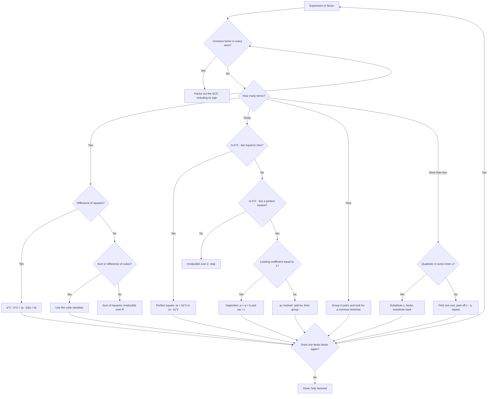

# Factoring

> [Mathematics](../../README.md) › [Algebra](../README.md) · Level: Intermediate · Prerequisites: [Elementary Algebra](../01-elementary-algebra/README.md), [Polynomials](../06-polynomials/README.md) · Estimated time: 150 min

## 1. Introduction

Multiplication is mechanical: given two polynomials, distributing always produces their product. Factoring runs the same operation backwards, and it is *not* mechanical. Given $x^2 - x - 12$ there is no procedure that "divides by $x$"; you must recognise a pattern, search a finite list of candidates, or invoke a theorem that says where to look. That asymmetry — cheap to multiply, expensive to un-multiply — is the engine of modern cryptography, and it is why factoring is the first place where algebra demands strategy rather than procedure.

Factoring is not about producing a prettier expression. It converts a **sum** into a **product**, and products have properties that sums do not:

* **Zero.** A product is zero exactly when one of its factors is zero, so $x^2 - x - 12 = 0$ becomes $x - 4 = 0$ or $x + 3 = 0$. Factoring is the main bridge from *expressions* to *solutions*.
* **Cancellation.** $\dfrac{x^2-x-12}{x^2-9} = \dfrac{(x-4)(x+3)}{(x-3)(x+3)} = \dfrac{x-4}{x-3}$ for $x \neq \pm 3$. Factoring is the main bridge from fractions of polynomials to simplicity.
* **Sign.** The sign of a product is the product of the signs of its factors, which is why sign charts are drawn from factorised forms rather than expanded ones.
* **Structure.** Whether a polynomial is a product of smaller ones is a property of the polynomial itself, independent of any equation. That question — irreducibility — is where algebra stops being computation and becomes the study of structure.

This tutorial teaches the toolkit — common factors, grouping, the special products, the two quadratic patterns, substitution — and, more importantly, the part textbooks often leave implicit: **how to recognise which tool applies**. Section 7.14 condenses everything into one decision procedure; Section 10 draws it.

One warning about vocabulary. "Factor" is both noun and verb, for numbers and for polynomials: a factor of $12$ is $3$; a factor of $x^2 - 9$ is $x-3$; to factor is to write as a product. Throughout we distinguish factoring an **expression** (producing an equivalent expression, true for every value of the variable) from solving an **equation** (producing the set of values making a statement true). Confusing the two is the most common error in the topic.

## 2. Prerequisites

**The distributive law.** $a(b+c) = ab + ac$, hence $(a+b)(c+d) = ac + ad + bc + bd$. Every derivation here is this law in reverse, and every result is checked by expanding. See [Elementary Algebra](../01-elementary-algebra/README.md).

**Exponent laws.** $x^mx^n = x^{m+n}$, $(x^m)^n = x^{mn}$, $(xy)^n = x^ny^n$, and $x^0 = 1$ for $x \neq 0$. We need these to recognise perfect squares such as $9x^4 = (3x^2)^2$ and perfect cubes such as $8y^6 = (2y^2)^3$.

**Multiplying polynomials.** Multiplying term by term and collecting like terms, the degree formula $\deg(pq) = \deg p + \deg q$, and the vocabulary of leading coefficient and constant term: [Polynomials](../06-polynomials/README.md).

**Integer arithmetic and divisibility.** Divisors, prime factorisation, $\gcd$. Searching for a factorisation of $x^2 + bx + c$ is searching through divisor pairs of $c$: [Integers and Negative Numbers](../../01-arithmetic/02-integers/README.md).

**Signs and fractions.** Products of signs, $-(-a) = a$, and arithmetic with fractions — needed because the general quadratic forces a division by $a$.

**Expressions versus equations.** Reading $x^2 - 4$ as an object and $x^2 - 4 = 0$ as a statement: [Variables and Expressions](../../02-pre-algebra/02-variables-and-expressions/README.md).

## 3. Learning Objectives

By the end of this tutorial you will be able to

1. explain what factoring over $\mathbb{Z}$, over $\mathbb{Q}$ and over $\mathbb{R}$ means, and why the answer depends on the coefficient set;
2. extract the greatest common factor, including a negative leading coefficient, and explain why it must come first;
3. factor a four-term polynomial by grouping, including regrouping when the first pairing fails;
4. derive and use the difference of squares, perfect-square trinomials, and the sum and difference of cubes;
5. factor $x^2 + bx + c$ by inspection, using the sign of $c$ to predict the signs of the factors;
6. state and prove the splitting lemma behind the $ac$ method, and apply the method to $ax^2 + bx + c$;
7. decide from the discriminant when an integer factorisation is impossible, so that you stop searching;
8. factor quartic-like expressions by substitution, including those quadratic in an inner expression;
9. use the factor theorem to peel a linear factor off a polynomial of higher degree;
10. classify a polynomial as irreducible over a specified set, with examples that differ between $\mathbb{Z}$ and $\mathbb{R}$;
11. choose a strategy deliberately with the decision tree of Section 10, and justify the choice.

## 4. Intuition

**Un-multiplying a rectangle.** Multiplication of positive integers counts cells of a rectangle: $3 \times 4$ is a grid, twelve cells. Factoring $12$ asks which rectangles have twelve cells, and the answer is the divisor pairs $1\times12$, $2\times6$, $3\times4$. The same picture serves polynomials: $(x+3)(x+4)$ is a rectangle with sides $x+3$ and $x+4$, and expanded it is four smaller pieces, $x^2 + 4x + 3x + 12$. Factoring reassembles the four pieces into one rectangle. When they cannot be reassembled the polynomial is *irreducible* — the analogue of a prime, a rectangle built from nothing smaller.

**Reverse engineering a product.** If someone multiplies two whole numbers and reports $391$, recovering $17$ and $23$ requires search. But you know the *shape* of the answer: it is a product of two integers, so its prime factors are exactly the prime factors of those integers. Polynomial products are even more constrained: a product of two linear polynomials has degree $2$ with coefficients tied to the constants in the factors. Those ties are what inspection exploits, and they are why quadratics are easy while $x^4 + x + 1$ is not.

**One law, many costumes.** Every technique here is $ab + ac = a(b+c)$ in disguise. Grouping uses it once per pair; difference of squares uses it twice; the $ac$ method uses it after splitting a term. When stuck, ask: *what common object can I pull out?* Sometimes a monomial (the GCF), sometimes a binomial (grouping), sometimes a whole bracketed expression (substitution).

**Recognition beats computation.** An expert looks at the number of terms first (two, three, four), then at the degree pattern, then at whether the first and last terms are perfect squares or cubes. Each observation eliminates most of the toolkit and leaves one or two candidates. That scanning habit is the real skill, and Section 7.14 formalises it.

## 5. Formal Definition

Throughout, $\mathbb{Z}[x]$, $\mathbb{Q}[x]$, $\mathbb{R}[x]$ denote polynomials in $x$ with coefficients in the named set. Two polynomials are **associates** if one is a nonzero constant multiple of the other.

**Definition 5.1 (factor, factorisation).** Let $F$ be $\mathbb{Z}$, $\mathbb{Q}$ or $\mathbb{R}$ and let $p \in F[x]$ with $\deg p \geq 1$. A polynomial $q \in F[x]$ is a **factor of $p$ over $F$** if there is $r \in F[x]$ with $p(x) = q(x)r(x)$ for every $x$. A **factorisation of $p$ over $F$** is a list $q_1,\dots,q_k \in F[x]$, each of degree at least $1$, and a nonzero constant $c \in F$, such that

$$
p(x) = c\,q_1(x)q_2(x)\cdots q_k(x) \quad \text{for every } x .
$$

The constant carries the leading coefficient and the sign.

**Definition 5.2 (reducible, irreducible).** $p \in F[x]$ with $\deg p \geq 1$ is **reducible over $F$** if $p = qr$ with $q, r \in F[x]$ and $\deg q \geq 1$, $\deg r \geq 1$. Otherwise $p$ is **irreducible over $F$**.

Since $p = 1\cdot p$ and $p = (-1)(-p)$ always hold, trivial factorisations are excluded by requiring both factors to have degree at least $1$. Irreducibility is relative to $F$: $x^2 - 2$ is irreducible over $\mathbb{Q}$ and reducible over $\mathbb{R}$.

**Definition 5.3 (factored completely).** $p \in F[x]$ is **factored completely over $F$** when written as a constant times a product of polynomials irreducible over $F$. Over $\mathbb{R}$, $2x^3 - 8x = 2x(x-2)(x+2)$ is complete, while $2x(x^2-4)$ is not.

**Definition 5.4 (greatest common factor of monomials).** For nonzero monomials $m_i = a_i x_1^{e_{i1}}\cdots x_n^{e_{in}}$ with integer coefficients, the **greatest common factor** is

$$
\gcd(a_1,\dots,a_k)\; x_1^{\min_i e_{i1}}\cdots x_n^{\min_i e_{in}} ,
$$

with the coefficient $\gcd$ taken positive. A polynomial is **primitive** if the only common integer factor of its coefficients is $1$.

**Definition 5.5 (quadratic in form).** $p(x)$ is **quadratic in form** if there is an expression $u = u(x)$ and constants $A \neq 0$, $B$, $C$ with $p(x) = Au^2 + Bu + C$. The standard case is $x^4 + bx^2 + c$ with $u = x^2$; another is $x - 5\sqrt{x} + 6$ with $u = \sqrt{x}$, $x \geq 0$.

**Remark 5.6.** Over $\mathbb{R}$ every polynomial of odd degree has a root, so no polynomial of odd degree at least $3$ is irreducible over $\mathbb{R}$. Over $\mathbb{Q}$ matters differ: $x^3 - 2$ is irreducible over $\mathbb{Q}$ although $\sqrt[3]{2}$ is a real root. "Irreducible" without a coefficient set is meaningless.

## 6. Mathematical Notation

| Symbol | Read as | Meaning |
|---|---|---|
| $p(x)$ | $p$ of $x$ | $p$ evaluated at $x$ |
| $\deg p$ | degree of $p$ | highest exponent with nonzero coefficient |
| $p \mid q$ | $p$ divides $q$ | there is $r$ with $q = pr$ |
| $\gcd(a,b)$ | greatest common divisor | largest positive integer dividing both |
| $F[x]$ | polynomials over $F$ | the coefficient set is part of the data |
| $(x-a)$ | the linear factor $x$ minus $a$ | zero exactly at $x = a$ |
| $a^2 - b^2$ | a difference of squares | factors as $(a-b)(a+b)$ |
| $a^3 \pm b^3$ | sum or difference of cubes | the two cube identities |
| $\pm$ | plus or minus | two signs taken consistently, never mixed |
| $\Delta = b^2 - 4ac$ | discriminant | decides whether an integer factorisation exists |
| $\sqrt[3]{a}$ | cube root of $a$ | the real number whose cube is $a$ |

Read $(x-3)(x+4)$ aloud as "the quantity $x$ minus three, times the quantity $x$ plus four". The parentheses mark the factors; dropping them changes the meaning.

## 7. Core Concepts

### 7.1 Factoring is reverse multiplication

Multiplying gives an **identity** that holds for every $x$:

$$
(x+3)(x-4) = x^2 - 4x + 3x - 12 = x^2 - x - 12 .
$$

Specialising $x = 10$ checks it numerically: $13 \cdot 6 = 78$ and $100 - 10 - 12 = 78$. Any correct factorisation can be spot-checked with one or two convenient values. Factoring runs the arrow backwards: from $x^2 - x - 12$ we produce $(x+3)(x-4)$. Because the identity holds for all $x$, nothing is being *found*; something is being *recognised*.

| Task | Output | Correct notation |
|---|---|---|
| Factor | an expression | $x^2-x-12 = (x+3)(x-4)$ |
| Solve | a set of numbers | $x^2-x-12 = 0 \iff x \in \{-3,4\}$ |

Writing "$x^2 - x - 12 = (x+3)(x-4) = 0$" is a category error: it silently changes an identity into an equation. It is a *useful* error — it is how one passes from the identity to the solution set — but each step should be stated for what it is.

### 7.2 The greatest common factor

**The GCF comes first.** If every term shares a factor, extract it before anything else; leaving it in place makes the remaining pattern unrecognisable. For $12x^3y^2 - 18x^2y^4$ the coefficients have $\gcd(12,18) = 6$, the largest common power of $x$ is $x^2$, and of $y$ is $y^2$, so

$$
12x^3y^2 - 18x^2y^4 = 6x^2y^2\left(2x - 3y^2\right).
$$

The cofactor $2x - 3y^2$ is primitive, and that is a general self-check: a correct GCF extraction leaves a primitive cofactor. When the leading coefficient is negative it is conventional to factor the sign out as well, so that the cofactor's leading coefficient is positive:

$$
-4x^3 + 8x^2 - 12x = -4x\left(x^2 - 2x + 3\right).
$$

"Why greatest?" Because any common factor $d$ divides the greatest one, so extracting the GCF is equivalent to extracting $d$ and continuing — it is complete with respect to that factor. The usual slip is to forget the variables: $6x^3 - 9x^2 = 3(2x^3 - 3x^2)$ is true but useless, whereas $3x^2(2x-3)$ exposes a linear factor.

### 7.3 Factoring by grouping

Grouping is the distributive law applied to a binomial common factor:

$$
ax + ay + bx + by = a(x+y) + b(x+y) = (a+b)(x+y).
$$

For $6x^3 - 9x^2 + 4x - 6$, grouping the first two and last two terms gives

$$
3x^2(2x - 3) + 2(2x - 3) = (3x^2 + 2)(2x - 3),
$$

which checks: $(3x^2+2)(2x-3) = 6x^3 - 9x^2 + 4x - 6$. ✓ Signs need care. For $x^3 + 4x^2 - 3x - 12$ the second group must be factored as $-3(x+4)$, not $3(x+4)$:

$$
x^2(x+4) - 3(x+4) = (x^2 - 3)(x+4).
$$

Grouping is a *search over pairings*, not a fixed procedure. In $2x^3 - 4x^2 + 3x - 6$ the outer pairing $\left(2x^3-6\right) + \left(-4x^2+3x\right)$ leads nowhere, while the adjacent pairing gives $2x^2(x-2) + 3(x-2) = (2x^2+3)(x-2)$. With four terms there are three pairings, so trying another costs little. If the polynomial is known to be a product $(a+b)(c+d)$ that was expanded, some pairing always succeeds.

### 7.4 Difference of squares

For all real $a,b$,

$$
a^2 - b^2 = (a-b)(a+b),
$$

because $(a-b)(a+b) = a^2 + ab - ab - b^2$ and the cross terms cancel. That cancellation is the whole content of the identity, and its absence is why $a^2 + b^2$ does not factor over $\mathbb{R}$: $a^2 + b^2 = 0$ forces $a = b = 0$, so there is no root and hence no linear factor.

Recognition: two terms, both perfect squares, joined by a minus sign. Worth recognising on sight are $1,4,9,16,25,36,49,64,81,100,121,144$ together with $x^2, x^4, x^6,\dots$, and mixed forms such as $9x^4 = (3x^2)^2$ or $49y^6 = (7y^3)^2$. Thus $4x^2 - 25 = (2x-5)(2x+5)$.

A fourth power must often be attacked twice:

$$
x^4 - 16 = (x^2-4)(x^2+4) = (x-2)(x+2)(x^2+4),
$$

and $x^2 + 4$ is irreducible over $\mathbb{R}$, so this is complete. Stopping at $(x^2-4)(x^2+4)$ is the commonest incomplete answer in the topic. Geometrically, a square of side $a$ with a square of side $b$ removed from a corner can be cut and reassembled into a rectangle of sides $a-b$ and $a+b$: the identity is a statement about area.

### 7.5 Perfect-square trinomials

$$
a^2 + 2ab + b^2 = (a+b)^2, \qquad a^2 - 2ab + b^2 = (a-b)^2 .
$$

Recognition needs three checks: the first and last terms are perfect squares, the middle term equals *twice* the product of the square roots in magnitude, and the middle sign gives the sign inside the binomial. For $16x^2 - 24x + 9$ we have $\sqrt{16x^2} = 4x$, $\sqrt{9} = 3$ and $2\cdot 4x\cdot 3 = 24x$, so $16x^2 - 24x + 9 = (4x-3)^2$; the discriminant test confirms it, since $(-24)^2 - 4\cdot16\cdot9 = 0$.

The algebraic characterisation is cleaner than the arithmetic one: $ax^2 + bx + c$ is a perfect square up to a constant multiple exactly when $b^2 - 4ac = 0$. That is precisely why "the middle term must be twice the product" works — it is the equation $b^2 = 4ac$ in disguise. A near miss such as $x^2 + 10x + 24$ fails the test and factors as $(x+4)(x+6)$, two different binomials.

### 7.6 Sum and difference of cubes

$$
a^3 - b^3 = (a-b)\left(a^2 + ab + b^2\right), \qquad
a^3 + b^3 = (a+b)\left(a^2 - ab + b^2\right).
$$

Both are verified by expanding; every mixed term cancels in pairs:

$$
(a-b)(a^2+ab+b^2) = a^3 + a^2b + ab^2 - a^2b - ab^2 - b^3 = a^3 - b^3 .
$$

The sign mnemonic is "same, opposite, always positive": the binomial carries the original sign, the trinomial's first term is positive, its middle term has the opposite sign, and its last term is positive. For instance

$$
8x^3 - 27 = (2x-3)\left(4x^2 + 6x + 9\right),
$$

and expanding returns $8x^3 + 12x^2 + 18x - 12x^2 - 18x - 27 = 8x^3 - 27$. ✓ Similarly $x^3 + 64 = (x+4)(x^2 - 4x + 16)$.

The trinomial factor is irreducible over $\mathbb{R}$: as a quadratic in $a$ with $b$ fixed its discriminant is $b^2 - 4b^2 = -3b^2 \leq 0$, vanishing only when $b = 0$, in which case the expression is just $a^2$. (Over $\mathbb{C}$ it splits, using cube roots of unity — a topic for later study of complex numbers.)

The general pattern, valid for every $n \geq 1$, is

$$
a^n - b^n = (a-b)\left(a^{n-1} + a^{n-2}b + \cdots + b^{n-1}\right),
$$

and for odd $n$ the same with a plus sign and alternating signs inside. These follow by telescoping: expanding the right side shifts one sum against the other and everything but $a^n$ and $b^n$ cancels. For even $n$, $a^n + b^n$ has no such factorisation over $\mathbb{R}$, since $a = 1$, $b = -1$ gives $1 + (-1)^n = 2 \neq 0$, so $a+b$ is not a factor.

### 7.7 Factoring $x^2 + bx + c$ by inspection

If $x^2 + bx + c = (x+p)(x+q)$ then expanding gives $x^2 + (p+q)x + pq$, so the requirement is exactly

$$
p + q = b \qquad\text{and}\qquad pq = c .
$$

This is a search over divisor pairs of $c$, and the sign of $c$ prunes it drastically.

| Sign of $c$ | Signs of $p,q$ | Consequence |
|---|---|---|
| $c > 0$ | same sign | both carry the sign of $b$ |
| $c < 0$ | opposite signs | the larger in absolute value carries the sign of $b$ |
| $c = 0$ | $pq = 0$ | one factor is $x$: $x^2 + bx = x(x+b)$ |

For $x^2 - 7x + 12$ we have $c > 0$ and $b < 0$, so both constants are negative; the negative pairs of $12$ are $(-1,-12)$, $(-2,-6)$, $(-3,-4)$ with sums $-13,-8,-7$, and the third works:

$$
x^2 - 7x + 12 = (x-3)(x-4).
$$

For $x^2 + 3x - 10$ the signs differ and the positive constant is larger: the pair $(5,-2)$ has sum $3$, so $x^2 + 3x - 10 = (x+5)(x-2)$.

**Uniqueness.** If $x^2 + bx + c = (x-p)(x-q)$ then $p,q$ solve $t^2 + bt + c = 0$, and a quadratic has at most two roots (Section 7.13), so the unordered pair $\{p,q\}$ is determined by $b$ and $c$. Exhaustive search therefore either finds the unique answer or proves there is none. For $x^2 + 3x + 5$ the only integer pairs with product $5$ are $(1,5)$ and $(-1,-5)$, with sums $6$ and $-6$; neither is $3$, so there is no factorisation over $\mathbb{Z}$. Its discriminant $9 - 20 = -11$ is negative, so there is none over $\mathbb{R}$ either.

### 7.8 The $ac$ method, and why it works

For $ax^2 + bx + c$ with $a \neq 1$, writing $(px+q)(rx+s) = pr\,x^2 + (ps+qr)x + qs$ shows the factorisation is equivalent to the three conditions

$$
pr = a, \qquad qs = c, \qquad ps + qr = b .
$$

**Splitting lemma.** Let $a,b,c \in \mathbb{Z}$ with $a \neq 0$ and $u,v \in \mathbb{Z}$. Then

$$
u + v = b \ \text{ and } \ uv = ac
\quad\Longleftrightarrow\quad
ax^2 + bx + c = (ax+u)\left(x + \frac{v}{a}\right).
$$

*Proof.* Expanding the right side,

$$
(ax+u)\left(x + \frac{v}{a}\right) = ax^2 + (u+v)x + \frac{uv}{a},
$$

so the two sides agree exactly when $u+v = b$ and $uv/a = c$, that is $uv = ac$. $\blacksquare$

The lemma justifies the procedure twice over. First, it says which pairs to try: the pair must multiply to $ac$ and add to $b$ — the same search as in Section 7.7 but with $ac$ in place of $c$. Second, it *is* the grouping step: when $u+v = b$,

$$
ax^2 + bx + c = ax^2 + ux + vx + c = x(ax+u) + \frac{v}{a}(ax+u) = (ax+u)\left(x + \frac{v}{a}\right),
$$

which is "split the middle term, then group". When an integer factorisation exists, the numbers are such that the factor $v/a$ is integral after clearing denominators.

**Necessity, and a stopping test.** If $ax^2 + bx + c = (px+q)(rx+s)$ with integers, then $u := ps$ and $v := qr$ are integers with $u+v = ps+qr = b$ and $uv = psqr = (pr)(qs) = ac$. Hence

> an integer factorisation exists only if some divisor pair of $ac$ adds to $b$; equivalently $b^2 - 4ac$ must be a perfect square.

Indeed $(u-v)^2 = (u+v)^2 - 4uv = b^2 - 4ac$, so $b^2 - 4ac$ is a square whenever such $u,v$ exist, and if $b^2 - 4ac = k^2$ then $u = (b+k)/2$, $v = (b-k)/2$ are integers of the required kind. The test is exact, and that is what turns guessing into a terminating algorithm.

### 7.9 Factoring $ax^2 + bx + c$: the working procedure

**Step 1.** Extract the GCF: $6x^2 + 9x - 15 = 3(2x^2 + 3x - 5)$. **Step 2.** Compute $ac$ and list divisor pairs. **Step 3.** Find a pair summing to $b$; if there is none, stop — the polynomial is irreducible over $\mathbb{Z}$. **Step 4.** Split the middle term and group.

For $6x^2 + 7x - 20$ we have $ac = -120$ and $b = 7$; since $ac < 0 < b$ the pair has opposite signs with the positive member larger in absolute value, and $(15,-8)$ has sum $7$. Hence

$$
6x^2 + 7x - 20 = 6x^2 + 15x - 8x - 20 = 3x(2x+5) - 4(2x+5) = (3x-4)(2x+5),
$$

which expands back to $6x^2 + 15x - 8x - 20$. ✓ For $8x^2 - 2x - 15$ we have $ac = -120$, $b = -2$, and the pair $(10,-12)$ works:

$$
8x^2 - 2x - 15 = 8x^2 - 12x + 10x - 15 = 4x(2x-3) + 5(2x-3) = (4x+5)(2x-3). \;\checkmark
$$

For $2x^2 + 5x + 4$ we have $ac = 8$, $b = 5$, and the pairs $(1,8), (2,4), (-1,-8), (-2,-4)$ have sums $9, 6, -9, -6$. None is $5$, and $b^2 - 4ac = -7 < 0$, so the polynomial is irreducible over $\mathbb{Z}$, and over $\mathbb{R}$ as well.

Guessing the shape $(px+q)(rx+s)$ directly also works, and is faster when $a$ and $c$ have few divisors, but it offers no stopping criterion. The $ac$ method with the discriminant test always says when to stop, which is why it is the default.

### 7.10 Substitution: quadratic in form

Identify an inner expression $u$ making the polynomial quadratic in $u$, factor that quadratic, substitute back, and state any domain restriction.

For $x^4 - 5x^2 + 4$ take $u = x^2$: then $u^2 - 5u + 4 = (u-1)(u-4)$, so

$$
x^4 - 5x^2 + 4 = (x^2-1)(x^2-4) = (x-1)(x+1)(x-2)(x+2),
$$

which is complete over $\mathbb{R}$ and checks by expansion. For $3x^4 + 5x^2 - 2$ take $u = x^2$: the pair $(6,-1)$ splits $5u$, giving $3u^2 + 6u - u - 2 = 3u(u+2) - (u+2) = (3u-1)(u+2)$, so

$$
3x^4 + 5x^2 - 2 = (3x^2-1)(x^2+2) = (\sqrt3 x - 1)(\sqrt3 x + 1)(x^2+2)
$$

over $\mathbb{R}$, since $x^2 + 2$ stays irreducible.

Substitution also handles shifted blocks and negative exponents. With $u = x+1$, $(x+1)^2 - 6(x+1) + 8 = (u-2)(u-4) = (x-1)(x-3)$. With $u = x^{-1}$, $x^{-2} - 3x^{-1} + 2 = (x^{-1}-1)(x^{-1}-2) = \dfrac{(1-x)(1-2x)}{x^2}$ for $x \neq 0$. With $u = x^2 + 3x$,

$$
\left(x^2+3x\right)^2 - 2\left(x^2+3x\right) - 8 = (u-4)(u+2) = (x+4)(x-1)(x+1)(x+2).
$$

Substitution is legitimate because a polynomial identity in $u$ remains one after $u$ is replaced by any expression; only the domain statement needs care — $u = \sqrt{x}$ forces $x \geq 0$.

### 7.11 Over the integers, over the rationals, over the reals

| Polynomial | over $\mathbb{Z}$ | over $\mathbb{Q}$ | over $\mathbb{R}$ |
|---|---|---|---|
| $x^2 - 4$ | $(x-2)(x+2)$ | same | same |
| $x^2 - 2$ | irreducible | irreducible | $(x-\sqrt2)(x+\sqrt2)$ |
| $x^2 + 1$ | irreducible | irreducible | irreducible |
| $x^4 + 4$ | $(x^2-2x+2)(x^2+2x+2)$ | same | same |
| $x^4 + 1$ | irreducible | irreducible | $(x^2-\sqrt2\,x+1)(x^2+\sqrt2\,x+1)$ |

Two structural facts organise the table. **Gauss's lemma** says that a primitive $p \in \mathbb{Z}[x]$ is irreducible over $\mathbb{Z}$ if and only if it is irreducible over $\mathbb{Q}$; so hunting for rational factorisations of an integer polynomial reduces to hunting for integer ones. The **fundamental theorem of algebra** says every non-constant complex polynomial is a constant times a product of linear factors; consequently every real polynomial factors over $\mathbb{R}$ into linear factors and irreducible quadratics, the quadratics being exactly those with negative discriminant.

That $x^4 + 4$ factors over $\mathbb{Z}$ even though it has no real root is the striking entry in the table. The derivation is a trick worth remembering:

$$
x^4 + 4 = \left(x^2+2\right)^2 - 4x^2 = \left(x^2+2-2x\right)\left(x^2+2+2x\right),
$$

a *hidden* difference of squares created by adding and subtracting $4x^2$. Both factors have discriminant $-4$, so the result is complete over $\mathbb{R}$ as well.

### 7.12 Irreducibility preview

Deciding irreducibility is the natural next question, and it is genuinely harder than factoring.

**Fact (degrees $2$ and $3$).** For $p \in F[x]$ of degree $2$ or $3$, $p$ is irreducible over $F$ if and only if $p$ has no root in $F$.

*Proof.* If $p = qr$ with both factors of degree at least $1$, one has degree $1$, say $\alpha x + \beta$ with $\alpha \neq 0$; its root $-\beta/\alpha \in F$ is a root of $p$. Conversely a root $a \in F$ gives the factor $x-a$ by the factor theorem. $\blacksquare$

For degree $2$ this is the discriminant test in disguise. The fact **fails for degree at least $4$**: $x^4 + 3x^2 + 2 = (x^2+1)(x^2+2)$ has no real root yet is reducible.

Two standard tools, stated for reference. The **rational root theorem**: if $p(x) = a_nx^n + \cdots + a_0$ has integer coefficients and $p(s/t) = 0$ with $s/t$ in lowest terms, then $s \mid a_0$ and $t \mid a_n$ — finitely many candidates. **Eisenstein's criterion**: if a prime $\pi$ divides every non-leading coefficient and $\pi^2 \nmid a_0$, then $p$ is irreducible over $\mathbb{Q}$. For example $x^2 + 2x + 2$ is irreducible by Eisenstein with $\pi = 2$, consistent with its negative discriminant. The general theory belongs to [Abstract Algebra](../../13-abstract-algebra/README.md).

### 7.13 The factor theorem link

**Factor theorem.** Let $p \in \mathbb{R}[x]$ and $a \in \mathbb{R}$. Then $p(a) = 0$ if and only if $x - a$ is a factor of $p$.

*Proof.* Divide: the division algorithm gives $p(x) = (x-a)q(x) + r$ with $r$ constant, because the divisor has degree $1$. Substituting $x = a$ gives $r = p(a)$. If $x-a$ divides $p$ then $r = 0$ and $p(a) = 0$; if $p(a) = 0$ then $r = 0$ and $p = (x-a)q$. $\blacksquare$

**Consequence 1.** A nonzero polynomial of degree $n$ has at most $n$ distinct roots, since each root contributes a distinct linear factor and degrees add. **Consequence 2.** One known root reduces the degree by one, so a cubic with a known root becomes a quadratic. For instance $p(x) = x^3 - 4x^2 + x + 6$ has $p(3) = 27 - 36 + 3 + 6 = 0$; writing $p = (x-3)(x^2 + \beta x + \gamma)$ and comparing constants gives $\gamma = -2$, and comparing $x^2$ coefficients gives $\beta - 3 = -4$, so $\beta = -1$ and

$$
p(x) = (x-3)(x^2 - x - 2) = (x-3)(x-2)(x+1).
$$

**Consequence 3.** If $(x-a)^m$ divides $p$ but $(x-a)^{m+1}$ does not, then $a$ is a root of **multiplicity** $m$; for example $x^3 - 3x^2 + 3x - 1 = (x-1)^3$ has the root $1$ with multiplicity $3$. Multiplicity governs how the graph meets the axis, which is why "the number of roots" is always counted with multiplicity.

### 7.14 The decision strategy

**Rule 1 — common factor first.** Extract the GCF, including its sign, then return to Rule 2 with the cofactor.

**Rule 2 — two terms.** (a) Difference of squares? $a^2 - b^2 \to (a-b)(a+b)$, then re-examine each factor, since a difference of squares can hide inside a fourth power. (b) Sum or difference of cubes? Use the cube identities. (c) Sum of squares? Irreducible over $\mathbb{R}$: stop. (d) Otherwise look for a disguised difference of squares by adding and subtracting a term, as in $x^4 + 4$.

**Rule 3 — three terms.** (a) Perfect square? Test $b^2 - 4ac = 0$. (b) Leading coefficient $1$? Inspect: find $p, q$ with $p+q = b$, $pq = c$. (c) Otherwise use the $ac$ method: find $u,v$ with $u+v = b$, $uv = ac$, split and group. (d) If $b^2 - 4ac$ is not a non-negative perfect square, stop: irreducible over $\mathbb{Z}$.

**Rule 4 — four terms.** Group in pairs, factor each pair, look for a common binomial; if the first pairing fails, try another. If all pairings fail, the polynomial may not factor over $\mathbb{Z}$, or it may need regrouping plus substitution.

**Rule 5 — degree four and above.** Look for an inner expression $u$ making the polynomial quadratic in $u$. If there is none, look for an obvious root (small integers, via the rational root theorem), peel off a linear factor, and restart at Rule 2 on the quotient.

**Rule 6 — verify and finish.** Expand to check the identity, then scan each factor and ask whether it factors again. A factorisation is finished only when every factor is irreducible over the target set.

**A worked scan.** For $2x^5 - 32x$, Rule 1 gives $2x(x^4-16)$; Rule 2 applies twice to the quartic, yielding $2x(x-2)(x+2)(x^2+4)$, which is complete over $\mathbb{R}$ because $x^2 + 4$ has negative discriminant.

### 7.15 Why factoring matters

**Solving equations.** The **zero product property** — $AB = 0$ if and only if $A = 0$ or $B = 0$ for real numbers — is why factoring solves equations. From $6x^2 + 7x - 20 = (3x-4)(2x+5) = 0$ we get $x = \tfrac43$ or $x = -\tfrac52$, and substituting the second gives $6\cdot\tfrac{25}{4} - 7\cdot\tfrac52 - 20 = 0$. ✓ The full development is in [Quadratic Equations](../08-quadratic-equations/README.md).

**Simplifying rational expressions.** Cancellation is legitimate only between *factors*, never between summands:

$$
\frac{x^2 - x - 12}{x^2 - 9} = \frac{(x-4)(x+3)}{(x-3)(x+3)} = \frac{x-4}{x-3} \quad (x \neq \pm 3).
$$

Writing $\frac{x^2+3}{x^2} = 3$ is the corresponding error: $3$ is a summand, not a factor.

**Sign charts.** A factorised expression changes sign only at the zeros of its factors, which is how quadratic and rational inequalities are solved; see [Inequalities](../03-inequalities/README.md).

**Beyond school algebra.** Irreducibility questions decide which regular polygons are constructible, polynomial factorisation over finite fields drives error-correcting codes and secret sharing, and the integer version — factoring $N = pq$ — protects internet traffic.

## 8. Formulas and Properties

| # | Identity | Hypotheses | Verification |
|---|---|---|---|
| 1 | $a(b+c) = ab + ac$ | commutative ring | distributive axiom |
| 2 | $(a+b)(c+d) = ac + ad + bc + bd$ | commutative ring | apply 1 twice |
| 3 | $(a \pm b)^2 = a^2 \pm 2ab + b^2$ | commutative ring | put $c = a$, $d = \pm b$ in 2 |
| 4 | $a^2 - b^2 = (a-b)(a+b)$ | commutative ring | cross terms cancel |
| 5 | $a^3 \mp b^3 = (a \mp b)(a^2 \pm ab + b^2)$ | commutative ring | all mixed terms cancel |
| 6 | $a^n - b^n = (a-b)\sum_{k=0}^{n-1} a^{n-1-k}b^k$ | $n \geq 1$ | telescoping |
| 7 | $a^n + b^n = (a+b)\sum_{k=0}^{n-1}(-1)^k a^{n-1-k}b^k$ | $n$ odd | telescoping |
| 8 | $(x+p)(x+q) = x^2 + (p+q)x + pq$ | commutative ring | expand |
| 9 | $ax^2+bx+c = (ax+u)(x+v/a)$ if $u+v=b$, $uv=ac$ | $a \neq 0$ | expand |
| 10 | $AB = 0 \iff A = 0$ or $B = 0$ | $A,B \in \mathbb{R}$ | no zero divisors |
| 11 | $p(a) = 0 \iff (x-a) \mid p(x)$ | $p \in F[x]$, $a \in F$ | division algorithm |

**Why $a^2 + b^2$ is absent.** Suppose $a^2 + b^2 = (\alpha a + \beta b)(\gamma a + \delta b)$ identically. Comparing the $a^2$ and $b^2$ coefficients gives $\alpha\gamma = 1$ and $\beta\delta = 1$, while the cross coefficient gives $\alpha\delta + \beta\gamma = 0$ and $\alpha\delta - \beta\gamma$ must also vanish, forcing $\alpha\delta = \beta\gamma = 0$ — impossible since all four factors are nonzero. Over $\mathbb{C}$, however, $a^2 + b^2 = (a+ib)(a-ib)$.

**Why telescoping works.** In identity 6, expanding gives $\sum_{k=0}^{n-1}a^{n-k}b^k - \sum_{k=0}^{n-1}a^{n-1-k}b^{k+1}$; the second sum is the first shifted by one index, so all intermediate terms cancel and only $a^n - b^n$ remains. This is the most reliable source of factorisations of $x^n \pm 1$.

**Why the zero product property matters.** It holds in $\mathbb{R}$ and in every field, and it can fail in rings with zero divisors: modulo $6$, $2 \cdot 3 \equiv 0$ although neither factor is $0$. Reasoning that "one factor must vanish" is therefore only valid in a domain; modular arithmetic is treated in [Number Theory](../../12-number-theory/README.md).

**Proposition 8.1 (unique factorisation).** For $F = \mathbb{Q}$ or $\mathbb{R}$, every nonzero $p \in F[x]$ is $c\,q_1\cdots q_k$ with $c \in F\setminus\{0\}$ and each $q_i$ monic and irreducible over $F$, and the list is unique up to order. This is why "factor completely" is well defined: there is exactly one answer up to order and units. The proof uses the division algorithm and Gauss's lemma, and belongs to [Abstract Algebra](../../13-abstract-algebra/README.md).

**Proposition 8.2 (degree bookkeeping).** If $p = qr$ with $q,r \neq 0$ then $\deg p = \deg q + \deg r$, and the leading coefficient of $p$ is the product of the leading coefficients. Hence a quadratic factorises only as linear times linear, and a cubic only as linear times quadratic — which is what restricts the shapes worth considering.

## 9. Step-by-Step Examples

### Example 9.1 (GCF, then difference of squares)

Factor $20x^4 - 45x^2$. The coefficients have $\gcd 5$ and both terms contain $x^2$, so $20x^4 - 45x^2 = 5x^2(4x^2 - 9)$. Now $4x^2 - 9 = (2x)^2 - 3^2$, so

$$
20x^4 - 45x^2 = 5x^2(2x-3)(2x+3).
$$

All factors are monomial or linear, so nothing remains; expanding gives $5x^2(4x^2-9) = 20x^4 - 45x^2$. ✓ Had the GCF been taken as $5x$, the result $5x(4x^3 - 9x)$ would have hidden the difference of squares entirely.

### Example 9.2 (inspection with a negative constant)

Factor $x^2 + 2x - 35$. Here $c < 0$ so the constants have opposite signs, and $b > 0$ so the positive one has larger magnitude. The candidate pairs $(35,-1)$, $(7,-5)$, $(5,-7)$, $(1,-35)$ have sums $34, 2, -2, -34$; the second works:

$$
x^2 + 2x - 35 = (x+7)(x-5),
$$

and expanding gives $x^2 - 5x + 7x - 35 = x^2 + 2x - 35$. ✓

### Example 9.3 (perfect square)

Factor $4x^2 - 12x + 9$. Since $\sqrt{4x^2} = 2x$, $\sqrt{9} = 3$ and $2 \cdot 2x \cdot 3 = 12x$, the middle term has the right magnitude; the negative sign makes the binomial a difference:

$$
4x^2 - 12x + 9 = (2x-3)^2 .
$$

The discriminant confirms it: $(-12)^2 - 4 \cdot 4 \cdot 9 = 144 - 144 = 0$. Expanding $(2x-3)^2$ returns $4x^2 - 12x + 9$. ✓

### Example 9.4 (grouping reveals a hidden GCF)

Factor $3x^3 - 6x^2 - 27x + 54$. Grouping as $(3x^3 - 6x^2) + (-27x + 54)$ gives

$$
3x^2(x-2) - 27(x-2) = (3x^2 - 27)(x-2) = 3(x^2-9)(x-2) = 3(x-3)(x+3)(x-2).
$$

Verification: $3(x^2-9)(x-2) = 3(x^3 - 2x^2 - 9x + 18) = 3x^3 - 6x^2 - 27x + 54$. ✓ Notice that the common factor $3$ appears only *after* grouping: the original four terms have no common factor at all.

### Example 9.5 (sum of cubes)

Factor $27x^3 + 125$. Since $27x^3 = (3x)^3$ and $125 = 5^3$, the sum-of-cubes identity with $a = 3x$, $b = 5$ gives

$$
27x^3 + 125 = (3x+5)\left(9x^2 - 15x + 25\right).
$$

Expanding: $27x^3 - 45x^2 + 75x + 45x^2 - 75x + 125 = 27x^3 + 125$. ✓ The quadratic factor has discriminant $225 - 900 < 0$, so it is irreducible over $\mathbb{R}$ and the factorisation is complete.

### Example 9.6 (substitution, then difference of squares)

Factor $x^4 - 3x^2 - 4$. With $u = x^2$, $u^2 - 3u - 4 = (u-4)(u+1)$ because $(-4)(1) = -4$ and $-4+1 = -3$. Therefore

$$
x^4 - 3x^2 - 4 = (x^2-4)(x^2+1) = (x-2)(x+2)(x^2+1),
$$

and $x^2 + 1$ is irreducible over $\mathbb{R}$. Check: $(x^2-4)(x^2+1) = x^4 + x^2 - 4x^2 - 4 = x^4 - 3x^2 - 4$. ✓

### Example 9.7 (substitution with a non-monic quadratic)

Factor $2x^4 + 7x^2 + 3$. With $u = x^2$ the quadratic is $2u^2 + 7u + 3$; here $ac = 6$ and the pair $(6,1)$ splits $7u$, so

$$
2u^2 + 7u + 3 = 2u(u+3) + (u+3) = (2u+1)(u+3),
$$

hence $2x^4 + 7x^2 + 3 = (2x^2+1)(x^2+3)$. Both factors have negative discriminant ($-8$ and $-12$), so the real factorisation is complete. Check: $(2x^2+1)(x^2+3) = 2x^4 + 6x^2 + x^2 + 3 = 2x^4 + 7x^2 + 3$. ✓

### Example 9.8 (a hidden difference of squares)

Factor $x^4 + x^2 + 1$. Neither a difference of squares nor a cube, but completing a square creates one:

$$
x^4 + x^2 + 1 = \left(x^2+1\right)^2 - x^2 = \left(x^2+1-x\right)\left(x^2+1+x\right).
$$

Check the rewriting: $x^4 + 2x^2 + 1 - x^2 = x^4 + x^2 + 1$. ✓ Verification of the product:

$$
(x^2-x+1)(x^2+x+1) = x^4 + x^3 + x^2 - x^3 - x^2 - x + x^2 + x + 1 = x^4 + x^2 + 1. \;\checkmark
$$

Both quadratics have discriminant $-3$, so this is complete over $\mathbb{R}$.

### Example 9.9 (factor theorem then inspection)

Factor $p(x) = x^3 - 2x^2 - 5x + 6$. By the rational root theorem, candidates are $\pm1,\pm2,\pm3,\pm6$; testing $x = 1$ gives $1 - 2 - 5 + 6 = 0$, so $x-1$ is a factor. Write $p = (x-1)(x^2 + \beta x + \gamma)$ and compare coefficients: the constant term gives $-\gamma = 6$, so $\gamma = -6$; the $x^2$ coefficient gives $\beta - 1 = -2$, so $\beta = -1$. Hence

$$
p(x) = (x-1)\left(x^2 - x - 6\right) = (x-1)(x-3)(x+2),
$$

since $(-3)(2) = -6$ and $-3+2 = -1$. Verification: $(x-1)(x-3) = x^2-4x+3$ and $(x^2-4x+3)(x+2) = x^3 - 2x^2 - 5x + 6$. ✓ The roots $1,3,-2$ are simple.

### Example 9.10 (no roots, still reducible)

Factor $x^4 + 4$. Since $a^4 + 4 \geq 4$ for real $a$, there is no real root and hence no linear factor — yet a quartic can split as two quadratics. Add and subtract $4x^2$:

$$
x^4 + 4 = \left(x^2+2\right)^2 - (2x)^2 = (x^2 - 2x + 2)(x^2 + 2x + 2).
$$

Verification: $x^4 + 2x^3 + 2x^2 - 2x^3 - 4x^2 - 4x + 2x^2 + 4x + 4 = x^4 + 4$. ✓ Both quadratics have discriminant $-4$, so the factorisation is complete over $\mathbb{R}$. This destroys the tempting heuristic "no roots means irreducible", which holds only for degrees $2$ and $3$.

## 10. Visual Explanations

### 10.1 The decision tree

The tree terminates because each pass through the bottom node lowers the degree of some factor, and degree cannot drop below $1$. For quadratics it is complete: one branch always applies, and the discriminant question settles existence in both directions.

### 10.2 The area model of $(x+p)(x+q)$

| | $x$ | $+4$ |
|---|---|---|
| $x$ | $x^2$ | $4x$ |
| $+3$ | $3x$ | $12$ |

The grid shows $(x+3)(x+4) = x^2 + 7x + 12$: the diagonal cells $4x$ and $3x$ combine into the middle term, with coefficients $p$ and $q$. This is the geometric content of $(x+p)(x+q) = x^2 + (p+q)x + pq$, and it explains why the middle coefficient is a *sum* while the constant is a *product*.

### 10.3 Lookup table

| What you see | Method | Template |
|---|---|---|
| Every term divisible by the same monomial | GCF | $ma + mb = m(a+b)$ |
| Four terms, pairs sharing a binomial | grouping | $(a+b)(c+d)$ |
| Two terms, both squares, minus sign | difference of squares | $a^2 - b^2$ |
| Two terms, both cubes | cubes | $a^3 \pm b^3$ |
| Three terms, $b^2 - 4ac = 0$ | perfect square | $(a \pm b)^2$ |
| Three terms, $a = 1$ | inspection | $(x+p)(x+q)$ |
| Three terms, $a \neq 1$, $b^2-4ac$ a square | $ac$ method | split, then group |
| Three terms, $b^2 - 4ac < 0$ | stop | irreducible over $\mathbb{R}$ |
| Degree $4$ with only even powers | substitution | $u = x^2$ |
| Any degree, one root known | factor theorem | $p = (x-a)q$ |

## 11. Common Mistakes

**1. Cancelling summands instead of factors.** $\dfrac{x^2+3}{x^2} \neq 3$: the numerator has no factor $x^2$. Only a factor common to the whole numerator and denominator may be cancelled.

**2. Stopping before the factorisation is complete.** $x^4 - 16 = (x^2-4)(x^2+4)$ is true and incomplete; the difference of squares must be applied again. Always rescan every factor.

**3. Factoring a sum of squares over the reals.** $x^2 + 9 \neq (x+3)(x-3)$; the right side is $x^2 - 9$. Over $\mathbb{R}$, $x^2 + 9$ is irreducible.

**4. Sign errors in the cube identities.** $a^3 - b^3 = (a-b)(a^2+ab+b^2)$, not $(a-b)(a^2-ab+b^2)$; the wrong version expands to $a^3 - 2a^2b + 2ab^2 - b^3$, which is neither $a^3-b^3$ nor a perfect cube. Check with the mnemonic "same, opposite, always positive".

**5. Forgetting the GCF before pattern-spotting.** $2x^2 - 18 = 2(x-3)(x+3)$, not $2(x^2-9)$; the factor $2$ hides the difference of squares if left inside.

**6. Dropping the sign of a negative leading coefficient.** $-x^2+4x-3 = -(x-1)(x-3)$. Writing $(-x+1)(x-3)$ is also correct, but the negative is easily lost in later steps.

**7. Writing an identity as though it were an equation.** "$x^2-5x+6 = (x-2)(x-3) = 0$" mixes two different assertions. Factor first; then, if solving, set the product equal to zero as a separate statement.

**8. Believing every quadratic factors.** $2x^2+5x+4$ does not factor over $\mathbb{Z}$. Test $b^2-4ac$; if it is not a perfect square, stop. Guessing indefinitely is not mathematics.

**9. Mixing up the pair conditions.** For $x^2+bx+c$ the numbers add to $b$ and multiply to $c$; for the $ac$ method they add to $b$ and multiply to $ac$. Swapping the conditions is the commonest $ac$-method error.

**10. Ignoring a domain restriction after substitution.** Factoring $y^2-5y+6$ with $y = \sqrt{x}$ is valid only for $x \geq 0$. The algebra is right; the domain statement is missing.

**11. Assuming "no real roots" means "irreducible".** $x^4+4 = (x^2-2x+2)(x^2+2x+2)$ has no real root and is reducible. The equivalence holds only for degrees $2$ and $3$.

**12. Dividing by an expression that may vanish.** Solving $2x^2 = 6x$ by dividing by $x$ loses $x = 0$; factor instead: $2x(x-3) = 0$ gives $x = 0$ or $x = 3$.

## 12. Applications

**Solving polynomial equations.** Every equation solved "by factoring" uses the zero product property, and the strategy scales: find one root, divide, repeat. This is the skeleton of the general theory of polynomial equations.

**Rational expressions and functions.** Cancellation, common denominators and the location of holes in a graph all need factored forms. In $\frac{(x-4)(x+3)}{(x-3)(x+3)}$ the cancelled factor still excludes $x = -3$ from the domain. Rational functions are treated in [Precalculus](../../06-precalculus/README.md).

**Sign analysis and inequalities.** A factored expression changes sign only at zeros of its factors, so the sign chart of $\frac{(x-1)(x+4)}{x-2}$ can be read off at once. See [Inequalities](../03-inequalities/README.md) and [Quadratic Equations](../08-quadratic-equations/README.md).

**Calculus.** Critical points come from solving $f'(x) = 0$, and partial fractions — the standard technique for integrating rational functions — begins by factoring the denominator into linear and irreducible quadratic factors.

**Number theory and cryptography.** Fermat's method writes an odd composite as $a^2 - b^2 = (a-b)(a+b)$, the difference-of-squares identity used as an algorithm. RSA rests on multiplication being cheap and factoring being hard, and polynomial factorisation over finite fields underlies Reed–Solomon codes, secret sharing and AES.

**Geometry, optimisation and arithmetic.** Area and volume problems routinely produce quadratics and cubics solved by factoring, with positivity of lengths selecting the admissible root. The special products are also mental-arithmetic shortcuts: $101 \cdot 99 = 100^2 - 1 = 9999$ and $47^2 = (50-3)^2 = 2500 - 300 + 9 = 2209$.

## 13. Exercises

The problem set is in [exercises.md](exercises.md): $36$ problems in four bands. The Beginner band drills recognition and fluency; the Intermediate band combines two techniques per problem; the Advanced band asks for justification, irreducibility arguments and factorisations needing a trick; the Challenge band contains proof-style and classification problems. Attempt each on paper and expand to check.

## 14. Solutions

Complete worked solutions, with every step and every check, are in [solutions.md](solutions.md). Each solution names the method and says why that method was the right choice, so the solutions double as further worked examples.

## 15. Summary

* Factoring rewrites a **sum** as a **product** and is an **identity**; solving produces a **set of numbers**. Keeping the two apart prevents most errors.
* **Order of work:** GCF first, then count the terms, then apply the pattern for that count. Skipping the GCF is the commonest cause of a missed factorisation.
* **Two terms:** $a^2-b^2 = (a-b)(a+b)$; $a^3 \pm b^3$ with "same, opposite, always positive". A sum of squares does not factor over $\mathbb{R}$.
* **Three terms:** perfect square when $b^2-4ac = 0$; inspection ($p+q=b$, $pq=c$) when $a = 1$; the $ac$ method ($u+v=b$, $uv=ac$, split and group) when $a \neq 1$.
* **Four terms:** grouping, searching over pairings and watching signs.
* **The discriminant decides existence:** if $b^2-4ac$ is not a non-negative perfect square, no integer factorisation exists — stop rather than guess.
* **Substitution** reduces any polynomial quadratic in an inner expression to a quadratic; substitute back and state domain restrictions.
* **Irreducibility is relative:** $x^2-2$ is irreducible over $\mathbb{Q}$ and splits over $\mathbb{R}$; $x^4+1$ is irreducible over $\mathbb{Q}$ and splits into quadratics over $\mathbb{R}$.
* **Factor theorem:** $p(a) = 0 \iff (x-a) \mid p(x)$, so one known root reduces the degree by one.
* **Always verify by expanding, then check that every factor is irreducible.**

## 16. Further Learning

* [Polynomials](../06-polynomials/README.md) — the division algorithm, remainder and factor theorems, multiplicity and end behaviour in full generality.
* [Quadratic Equations](../08-quadratic-equations/README.md) — what factoring is for: four solution methods, the discriminant, completing the square, Vieta's formulas.
* [Elementary Algebra](../01-elementary-algebra/README.md) and [Intermediate Algebra](../04-intermediate-algebra/README.md) — the algebraic grammar, including the binomial theorem behind $(a+b)^n$.
* [Inequalities](../03-inequalities/README.md) — sign charts built from factorised expressions.
* [Abstract Algebra](../../13-abstract-algebra/README.md) — polynomial rings, Gauss's lemma, Eisenstein's criterion, unique factorisation.
* [Number Theory](../../12-number-theory/README.md) — the integer analogue that motivates the polynomial theory.
* [Precalculus](../../06-precalculus/README.md) — zeros of polynomials, rational functions and their graphs.

For further reading: Gelfand and Shen's *Algebra* teaches factoring through problems; Stewart's *College Algebra* is a conventional treatment with graded exercises; Gallian's *Contemporary Abstract Algebra* covers irreducibility rigorously. None is required here.