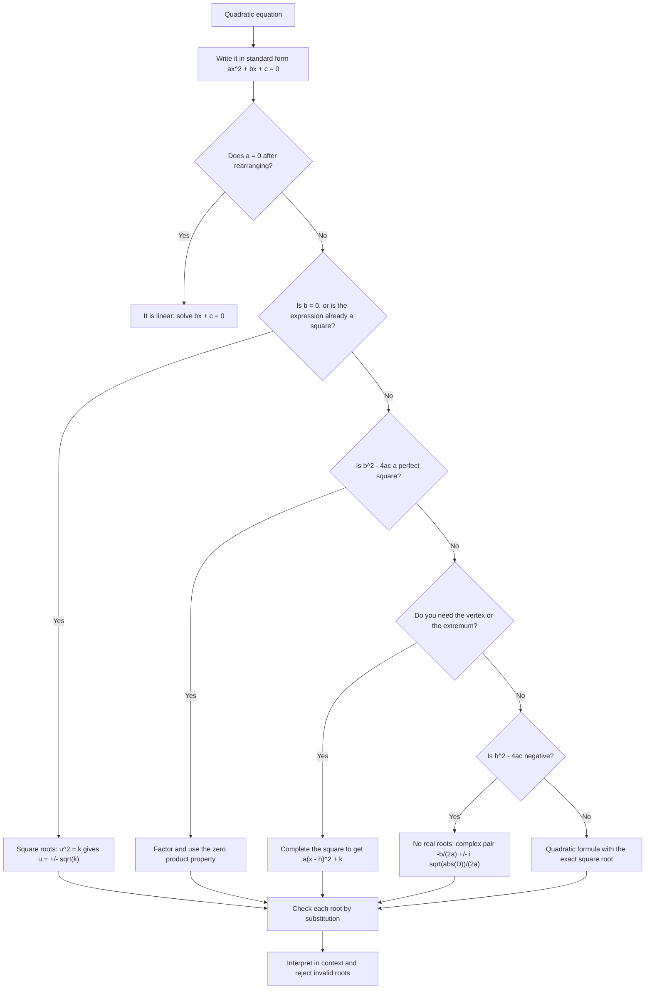
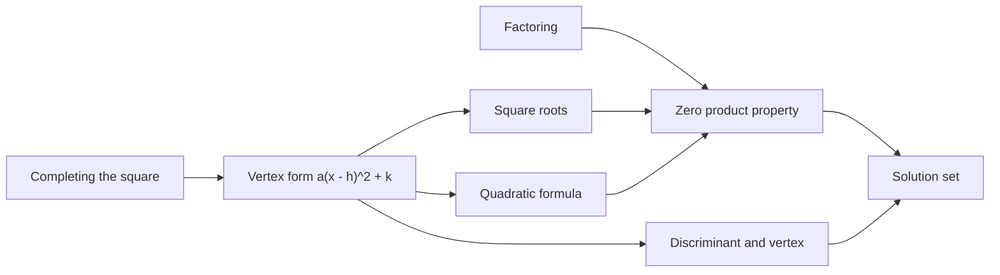

# Quadratic Equations

> [Mathematics](../../README.md) › [Algebra](../README.md) · Level: Intermediate · Prerequisites: [Factoring](../07-factoring/README.md), [Polynomials](../06-polynomials/README.md), square roots · Estimated time: 150 min

## 1. Introduction

A quadratic equation is a statement of the form $ax^2 + bx + c = 0$ with $a \neq 0$. It is the first equation type whose solution is not a formula for the unknown but a *choice* among methods, and the first whose solutions may fail to exist in $\mathbb{R}$. Both features make it a turning point in the curriculum: before it, solving means undoing operations; after it, solving means selecting a technique, justifying it, and interpreting the result.

Quadratics are everywhere because a quadratic is the simplest model of *curvature*. Anything that rises and falls — a thrown ball, profit as a function of price, the area enclosed by a fixed length of fence — has a maximum or minimum somewhere, and the mathematics of that optimum is the vertex of a parabola. Anything that involves a squared constraint — Pythagoras, kinetic energy, variance, the area of a square — produces quadratic equations. The formula that solves them is one of the few pieces of mathematics that essentially every educated person knows, and it has been known in essentially its present form for four thousand years.

This tutorial presents **four** solution methods, and it is deliberate that there are four:

1. **Factoring**, which is exact, fast, and reveals the structure of the polynomial — but works only when the roots are rational (or otherwise obvious).
2. **Square roots**, which is the direct inverse of squaring and applies when the variable appears only as a perfect square.
3. **Completing the square**, which always works, produces the vertex form, and is the conceptual engine behind the formula.
4. **The quadratic formula**, the closed form that always applies, at the cost of hiding the structure.

The unity behind them matters: completing the square *derives* the formula, and the discriminant inside the formula *is* the vertex's vertical position in disguise. Section 7.11 gives an explicit table of when each method is best.

## 2. Prerequisites

**Factoring.** Common factors, the two quadratic patterns, and the zero product property, all in [Factoring](../07-factoring/README.md). Solving by factoring is nothing but the zero product property applied to a factorisation.

**Polynomial arithmetic.** Expanding, collecting like terms, and the vocabulary of degree and leading coefficient: [Polynomials](../06-polynomials/README.md).

**Square roots.** $\sqrt{k}$ is defined for $k \geq 0$ and denotes the non-negative number whose square is $k$; $\sqrt{k^2} = |k|$; and $\sqrt{4x^2} = 2|x|$. The identity $\sqrt{u^2} = |u|$ is what makes the $\pm$ in the quadratic formula necessary.

**Fraction arithmetic and the distributive law.** The general derivation divides by $a$ and by $4a$, so fluency with algebraic fractions is assumed.

**Inequalities and sign charts.** For quadratic inequalities we need the rule that a product changes sign only at a zero of one of its factors: [Inequalities](../03-inequalities/README.md).

**Function notation and graphs.** Reading $f(x) = ax^2+bx+c$ as a function, and knowing that its graph is a curve: [Variables and Expressions](../../02-pre-algebra/02-variables-and-expressions/README.md) and [Elementary Algebra](../01-elementary-algebra/README.md).

## 3. Learning Objectives

By the end of this tutorial you will be able to

1. write a quadratic equation in standard form and identify when it degenerates to a linear equation;
2. solve quadratics by factoring, by square roots, by completing the square, and by the formula, and check each root by substitution;
3. derive the vertex form $f(x) = a(x-h)^2 + k$ from $f(x) = ax^2+bx+c$ by completing the square, and state $h$ and $k$ explicitly;
4. derive the quadratic formula from the vertex form, justifying every step including the appearance of $\pm$;
5. compute the discriminant and use it to decide the number of real roots without solving;
6. state Vieta's formulas, prove them by expanding $a(x-r_1)(x-r_2)$, and use them to compute symmetric expressions without finding the roots;
7. write down a quadratic with prescribed roots, or with prescribed sum and product;
8. sketch a parabola from its vertex form: vertex, axis of symmetry, direction, intercepts;
9. solve quadratic inequalities using a sign chart, including the cases with no real roots;
10. model projectile, area and revenue problems, carrying units through and rejecting solutions that are invalid in context;
11. explain the complex roots that occur when the discriminant is negative, and verify them by substitution;
12. choose a solution method deliberately and justify the choice.

## 4. Intuition

**The parabola as a bent line.** A linear function has one slope everywhere. A quadratic has a slope that changes steadily, so its graph bends — and if it bends, it eventually turns around. The turning point is the **vertex**, and the vertical line through it is the **axis of symmetry**: the two halves of the parabola are mirror images. Symmetry is the single most useful intuition about quadratics, because it implies that the two roots (when they exist) sit at equal distances on either side of the axis. Their average is therefore the axis position, which is exactly the formula $x = -b/(2a)$.

**Solving is asking where the curve crosses the axis.** The equation $ax^2+bx+c = 0$ asks for the $x$-coordinates where the parabola meets the horizontal axis. Three things can happen, and they are exhaustive: the parabola crosses twice ($\Delta > 0$), touches once ($\Delta = 0$), or misses entirely ($\Delta < 0$). The discriminant does not "magically" count roots; it measures how far the vertex sits above or below the axis relative to how sharply the parabola opens.

**Completing the square is translation.** Adding and subtracting a constant inside a quadratic slides the parabola horizontally and vertically without changing its shape. Completing the square finds the translation that moves the vertex to the origin, and the translated equation $a(x-h)^2 + k = 0$ is solved by one square root. Every method in this chapter is a way of performing that translation, either literally (completing the square), by pattern recognition (factoring), or by formula (which recorded the answer once and for all).

**Why four methods.** The methods differ in *what they cost* and *what they show*. Factoring costs a search but displays the roots as factors and reveals the zeros instantly. The formula costs arithmetic with a square root but never fails and immediately reports the discriminant. Completing the square costs fractions but produces the vertex, which is what optimisation needs. Square roots cost nothing when applicable and are the fastest route when the linear term is absent. A competent solver picks by looking first.

## 5. Formal Definition

**Definition 5.1 (quadratic equation).** A **quadratic equation in one variable** is an equation that can be written in the form

$$
ax^2 + bx + c = 0, \qquad a, b, c \in \mathbb{R}, \ a \neq 0 .
$$

This is **standard form**, and $a$, $b$, $c$ are its **coefficients**: $a$ the leading coefficient, $b$ the linear coefficient, $c$ the constant term. The condition $a \neq 0$ is what makes the equation genuinely quadratic; if $a = 0$ it reduces to the linear equation $bx + c = 0$.

**Definition 5.2 (solution set).** A **root** or **solution** of $ax^2+bx+c=0$ is a number $r$ with $ar^2 + br + c = 0$. The **solution set** is $\{r \in \mathbb{R} : ar^2+br+c = 0\}$ when only real solutions are sought, and the analogous subset of $\mathbb{C}$ in the complex setting.

**Definition 5.3 (quadratic function, parabola).** The function $f : \mathbb{R} \to \mathbb{R}$, $f(x) = ax^2+bx+c$ with $a \neq 0$, is a **quadratic function**, and its graph is a **parabola**. A parabola opens upward when $a > 0$ and downward when $a < 0$.

**Definition 5.4 (vertex form).** The **vertex form** of a quadratic function is

$$
f(x) = a(x - h)^2 + k ,
$$

with $a \neq 0$. The point $(h,k)$ is the **vertex** of the parabola, and the line $x = h$ is its **axis of symmetry**.

**Definition 5.5 (discriminant).** For $ax^2+bx+c$ with $a \neq 0$, the **discriminant** is

$$
\Delta := b^2 - 4ac .
$$

**Definition 5.6 (Vieta's formulas).** If $r_1, r_2$ are the roots (real or complex) of $ax^2+bx+c=0$, then

$$
r_1 + r_2 = -\frac{b}{a}, \qquad r_1r_2 = \frac{c}{a} .
$$

**Definition 5.7 (pure quadratic).** A quadratic equation is **pure** or **incomplete** if $b = 0$; then it has the form $ax^2 + c = 0$ and is solved directly by square roots.

**Remark 5.8 (existence and count).** Over $\mathbb{R}$ the equation has two distinct solutions when $\Delta > 0$, exactly one when $\Delta = 0$, and none when $\Delta < 0$. Over $\mathbb{C}$ it always has two solutions counted with multiplicity. Both statements are proved in Sections 7.6 and 7.7; they are not separate facts but consequences of the vertex form.

## 6. Mathematical Notation

| Symbol | Read as | Meaning |
|---|---|---|
| $ax^2+bx+c=0$ | standard form | $a \neq 0$; the equation to solve |
| $a$, $b$, $c$ | leading, linear, constant coefficient | real numbers, $a \neq 0$ |
| $\Delta$ | discriminant | $b^2 - 4ac$ |
| $f(x)$ | $f$ of $x$ | the quadratic function |
| $(h,k)$ | vertex | turning point of the parabola |
| $a(x-h)^2+k$ | vertex form | translated and scaled square |
| $\pm$ | plus or minus | two values, taken consistently |
| $r_1, r_2$ | the roots | solutions of the equation |
| $\sqrt{\Delta}$ | square root of the discriminant | real only when $\Delta \geq 0$ |
| $i$ | imaginary unit | $i^2 = -1$, used when $\Delta < 0$ |
| $\iff$ | if and only if | equivalence of statements |
| $\in$ | is an element of | membership in a set |

Read $\dfrac{-b \pm \sqrt{b^2-4ac}}{2a}$ as "minus $b$, plus or minus the square root of $b$ squared minus four $a$ $c$, all divided by two $a$". The phrase "all divided" is important: the fraction bar covers the whole numerator $-b \pm \sqrt{\Delta}$, not just the radical.

## 7. Core Concepts

### 7.1 Standard form and the degenerate case

Every method presupposes standard form. An equation such as $3x^2 = 5x - 2$ must first be rewritten as $3x^2 - 5x + 2 = 0$, with the signs of $b$ and $c$ taken from that form. Failing to do so is the commonest source of wrong answers with the formula, because substituting $b = 5$ instead of $b = -5$ changes both roots.

If the $x^2$ terms cancel during rearrangement, the equation is not quadratic at all. For instance $x^2 + 3x = x^2 - 5$ reduces to $3x = -5$, a linear equation with the single solution $x = -\tfrac53$. This degenerate case must be checked *after* rearrangement, not assumed away: the definition requires $a \neq 0$, so a quadratic solver handed this equation would be applying a formula outside its hypotheses.

### 7.2 Solving by factoring

If $ax^2+bx+c$ factors as a product of linear polynomials with real coefficients, then the **zero product property** finishes the job: a product of real numbers is zero exactly when one factor is zero. For $2x^2 - 5x - 3 = 0$, the $ac$ method gives $ac = -6$ and the pair $(1,-6)$, so

$$
2x^2 - 5x - 3 = 2x^2 + x - 6x - 3 = x(2x+1) - 3(2x+1) = (2x+1)(x-3).
$$

Hence $2x+1 = 0$ or $x-3 = 0$, giving $x = -\tfrac12$ or $x = 3$. Both are checked by substitution: $2\cdot\tfrac14 + \tfrac52 - 3 = 0$ and $2 \cdot 9 - 15 - 3 = 0$. ✓

Factoring is the fastest method when it applies, and it is the only one that displays the roots as visible structure. It fails when the roots are irrational or complex, because then no factorisation with rational coefficients exists — and the discriminant tells you in advance: an integer factorisation exists only if $\Delta = b^2-4ac$ is a perfect square (Section 7.6). For $2x^2-5x-3$ we have $\Delta = 25 + 24 = 49 = 7^2$, so factoring was guaranteed to work.

Note the trap in equations with a missing constant term: $3x^2 - 12x = 0$ becomes $3x(x-4) = 0$, so $x = 0$ or $x = 4$. Dividing both sides by $3x$ at the start would destroy the solution $x = 0$.

### 7.3 Solving by square roots

If the equation can be put in the form $u^2 = k$ with $k \geq 0$, then $u = \pm\sqrt{k}$, because both squares give $k$ and no other number does. Applied to a quadratic with $b = 0$:

$$
3x^2 - 27 = 0 \iff x^2 = 9 \iff x = \pm 3 .
$$

Applied to a completed square, the same rule solves more:

$$
3(x-4)^2 - 27 = 0 \iff (x-4)^2 = 9 \iff x - 4 = \pm 3 \iff x \in \{1, 7\}.
$$

The $\pm$ is not optional. Writing $x - 4 = 3$ and concluding $x = 7$ loses a genuine solution, and the loss is not detectable from the algebra alone — only from remembering that squaring is not injective on $\mathbb{R}$. Formally, $u^2 = k$ with $k \geq 0$ is equivalent to $u = \sqrt{k}$ or $u = -\sqrt{k}$, and the compact notation $u = \pm\sqrt{k}$ abbreviates exactly that.

If $k < 0$ the equation $u^2 = k$ has no real solution, because squares of real numbers are non-negative. Over $\mathbb{C}$ the solutions are $u = \pm i\sqrt{|k|}$; this is the first appearance of the complex case.

### 7.4 Completing the square and the vertex form

The method rewrites $ax^2+bx+c$ so that the variable appears only once, inside a square. The algebraic identity behind it is

$$
x^2 + px = \left(x + \frac{p}{2}\right)^2 - \frac{p^2}{4},
$$

which is verified by expanding: $\left(x+\tfrac{p}{2}\right)^2 = x^2 + px + \tfrac{p^2}{4}$. Adding $\tfrac{p^2}{4}$ completes the square; subtracting it again keeps the value unchanged. Geometrically, the quadratic is being translated so that its vertex lands on the $y$-axis.

**Derivation of the vertex form.** Let $f(x) = ax^2+bx+c$ with $a \neq 0$.

$$
\begin{aligned}
f(x) &= a\left(x^2 + \frac{b}{a}x\right) + c && \text{factor } a \text{ from the } x\text{-terms}\\
&= a\left[\left(x + \frac{b}{2a}\right)^2 - \frac{b^2}{4a^2}\right] + c && \text{complete the square with } p = \frac{b}{a}\\
&= a\left(x + \frac{b}{2a}\right)^2 - \frac{b^2}{4a} + c && \text{distribute } a\\
&= a\left(x + \frac{b}{2a}\right)^2 + \frac{4ac - b^2}{4a} && \text{common denominator}.
\end{aligned}
$$

Comparing with $a(x-h)^2 + k$ gives

$$
h = -\frac{b}{2a}, \qquad k = \frac{4ac-b^2}{4a} = c - \frac{b^2}{4a},
$$

and since $4ac - b^2 = -\Delta$, the vertical position of the vertex is $k = -\dfrac{\Delta}{4a}$.

**Consequences.** Because $(x-h)^2 \geq 0$ for real $x$, the sign of $a$ decides whether the vertex is a minimum or a maximum:

* if $a > 0$, then $f(x) \geq k$ for all $x$, with equality only at $x = h$ — the vertex is the **minimum**;
* if $a < 0$, then $f(x) \leq k$ for all $x$, with equality only at $x = h$ — the vertex is the **maximum**.

This is the entire theory of quadratic optimisation, and it also locates the roots: solving $a(x-h)^2 + k = 0$ gives $(x-h)^2 = -k/a$, which has solutions exactly when $-k/a \geq 0$.

**Example.** For $f(x) = -2x^2 + 12x - 13$: factor out $-2$ from the $x$-terms, $f(x) = -2(x^2 - 6x) - 13$; complete the square inside, $x^2 - 6x = (x-3)^2 - 9$, so $f(x) = -2\left[(x-3)^2 - 9\right] - 13 = -2(x-3)^2 + 18 - 13 = -2(x-3)^2 + 5$. The vertex is $(3,5)$, the parabola opens downward, and the maximum value is $5$. Expanding back gives $-2x^2 + 12x - 13$. ✓

### 7.5 The quadratic formula

The formula is the vertex form solved for $x$. Start from

$$
a\left(x + \frac{b}{2a}\right)^2 + \frac{4ac - b^2}{4a} = 0 .
$$

**Step 1.** Move the constant term across: $a\left(x + \dfrac{b}{2a}\right)^2 = \dfrac{b^2 - 4ac}{4a}$.

**Step 2.** Divide by $a \neq 0$: $\left(x + \dfrac{b}{2a}\right)^2 = \dfrac{b^2-4ac}{4a^2}$.

**Step 3.** Take square roots. Since $4a^2 = (2a)^2$ and $\sqrt{(2a)^2} = 2|a|$,

$$
x + \frac{b}{2a} = \pm\frac{\sqrt{b^2-4ac}}{2|a|} .
$$

**Step 4.** The two signs $\pm$ make the absolute value irrelevant, because $\pm\frac{s}{2|a|}$ and $\pm\frac{s}{2a}$ describe the same set of two numbers. Hence

$$
x = \frac{-b \pm \sqrt{b^2 - 4ac}}{2a} .
$$

That is the **quadratic formula**. It is derived, not memorised, and the derivation shows why the denominator is $2a$ and why the discriminant sits under a square root: it is the horizontal distance from the axis of symmetry to the roots.

**Reading the formula structurally.** Write it as

$$
x = -\frac{b}{2a} \pm \frac{\sqrt{\Delta}}{2a} .
$$

The first term is the axis of symmetry $h$; the second is the distance from the axis to each root. This is why the roots are symmetric about $x = h$ and why the axis is their average, $\frac{r_1 + r_2}{2} = -\frac{b}{2a}$.

### 7.6 The discriminant and the number of real roots

From $(x-h)^2 = -\dfrac{k}{a} = \dfrac{\Delta}{4a^2}$, and since $4a^2 > 0$, the sign of the right side is the sign of $\Delta$. Therefore:

| $\Delta$ | Right side | Real solutions | Geometry |
|---|---|---|---|
| $\Delta > 0$ | positive | two distinct: $\dfrac{-b \pm \sqrt{\Delta}}{2a}$ | parabola crosses the axis twice |
| $\Delta = 0$ | zero | one: $x = -\dfrac{b}{2a}$, of multiplicity $2$ | parabola touches the axis at the vertex |
| $\Delta < 0$ | negative | none | parabola does not meet the axis |

Three further remarks.

1. **$\Delta = 0$ does not mean "no solution".** It means one solution, counted twice. The equation $x^2 - 6x + 9 = 0$ has the single solution $x = 3$, since $(x-3)^2 = 0$.
2. **A perfect-square discriminant signals a rational factorisation.** If $a, b, c$ are integers and $\Delta$ is a perfect square, then $\sqrt{\Delta}$ is an integer and both roots are rational, so the polynomial factors over $\mathbb{Q}$. If $\Delta > 0$ is not a perfect square, the roots are real and irrational, and the polynomial is irreducible over $\mathbb{Q}$.
3. **$\Delta$ and the vertex.** Since $k = -\Delta/(4a)$, the sign of $\Delta$ is the sign of $-ak$. A parabola opening upward ($a>0$) with positive $k$ sits above the axis and has $\Delta < 0$; that is the same statement.

**Example.** For $2x^2 - 3x + 4$: $\Delta = 9 - 32 = -23 < 0$, so there are no real solutions, and indeed $2x^2-3x+4 = 2\left(x-\tfrac34\right)^2 + \tfrac{23}{8} > 0$ for every real $x$.

### 7.7 Complex roots preview

When $\Delta < 0$, the equation $\left(x+\frac{b}{2a}\right)^2 = \frac{\Delta}{4a^2}$ has no real solution, because a square cannot equal a negative number. Introducing $i$ with $i^2 = -1$ allows the same derivation to continue:

$$
x = \frac{-b \pm i\sqrt{|\Delta|}}{2a} .
$$

So $x^2 + 4x + 13 = 0$ has, since $\Delta = 16 - 52 = -36$,

$$
x = \frac{-4 \pm \sqrt{-36}}{2} = -2 \pm 3i .
$$

Checking: $(-2+3i)^2 + 4(-2+3i) + 13 = (4 - 12i - 9) - 8 + 12i + 13 = 0$. ✓ The two roots are **complex conjugates**: they have the same real part $-2 = h$ and imaginary parts of opposite sign.

The pattern is general: a real quadratic with $\Delta < 0$ has roots $h \pm i\sqrt{|\Delta|}/(2|a|)$, symmetric about the same axis $x = h$. The parabola does not meet the real axis, but its vertex and shape are unchanged. Complex numbers have their own arithmetic — addition, multiplication, conjugation, polar form — which is developed separately; for this tutorial the important point is that the formula continues to make sense, and that no real solution exists.

### 7.8 Vieta's formulas

Assume $ax^2+bx+c = 0$ has roots $r_1, r_2$ (real or complex). By the factor theorem,

$$
ax^2+bx+c = a(x-r_1)(x-r_2) = a\left(x^2 - (r_1+r_2)x + r_1r_2\right).
$$

Comparing coefficients of $x$ and of the constant term gives

$$
r_1 + r_2 = -\frac{b}{a}, \qquad r_1r_2 = \frac{c}{a} .
$$

These are **Vieta's formulas**. They hold whether or not the roots are real, and they cost nothing to compute.

**Uses.**

* *Recovering the second root.* If $r_1$ is known, then $r_2 = -\frac{b}{a} - r_1$ and also $r_2 = \frac{c}{a r_1}$ (the latter requiring $r_1 \neq 0$). Two independent checks are available, which is useful.
* *Building an equation from its roots.* If $r_1 + r_2 = S$ and $r_1r_2 = P$, then the monic quadratic with those roots is $x^2 - Sx + P = 0$. For roots $\tfrac23$ and $-4$: $S = -\tfrac{10}{3}$, $P = -\tfrac83$, so $x^2 + \tfrac{10}{3}x - \tfrac83 = 0$, i.e. $3x^2 + 10x - 8 = 0$ after clearing denominators. Check: $(3x-2)(x+4) = 3x^2 + 10x - 8$. ✓
* *Symmetric expressions.* Because $r_1^2 + r_2^2 = (r_1+r_2)^2 - 2r_1r_2 = \frac{b^2-2ac}{a^2}$, one can compute such quantities without extracting the roots. For $2x^2-5x+1$, $S = \tfrac52$ and $P = \tfrac12$, so $r_1^2+r_2^2 = \tfrac{25}{4} - 1 = \tfrac{21}{4}$. Similarly $\frac{1}{r_1} + \frac{1}{r_2} = \frac{S}{P} = -\frac{b}{c}$ when $c \neq 0$, and $|r_1 - r_2| = \frac{\sqrt{\Delta}}{|a|}$.
* *Sign analysis.* The product $P = c/a$ tells whether the roots have the same sign ($P > 0$) or opposite signs ($P < 0$). Combined with $S = -b/a$ one determines the signs exactly, which is often all a problem needs.
* *Unknown coefficients.* If a problem says the roots satisfy some relation, Vieta converts that relation into an equation for the coefficients. For example, if the roots of $x^2 - 4x + m = 0$ satisfy $r_1 = 3r_2$, then $4r_2 = 4$ gives $r_2 = 1$, $r_1 = 3$, and $m = r_1r_2 = 3$.

**Warning.** The formulas are $r_1+r_2 = -b/a$, with the minus sign, and $r_1r_2 = +c/a$. Dropping the minus is the most frequent Vieta error.

### 7.9 Graphing parabolas from vertex form

From $y = a(x-h)^2 + k$ the graph is read off directly:

| Feature | Value | Why |
|---|---|---|
| Vertex | $(h,k)$ | $a(x-h)^2$ is zero at $x=h$ and positive elsewhere |
| Axis of symmetry | $x = h$ | replacing $x-h$ by $-(x-h)$ leaves the value unchanged |
| Opens | up if $a>0$, down if $a<0$ | sign of $a$ multiplies a non-negative quantity |
| Extremum | minimum $k$ if $a>0$, maximum $k$ if $a<0$ | as above |
| Width | narrower as $\lvert a\rvert$ grows | the same $y$-step needs a smaller $x$-step |
| $y$-intercept | $ah^2 + k$ | put $x = 0$ |
| $x$-intercepts | $h \pm \sqrt{-k/a}$ when $-k/a \geq 0$ | solve $a(x-h)^2 + k = 0$ |

**Example.** For $y = -x^2+6x-5$, completing the square gives $y = -(x^2-6x) - 5 = -[(x-3)^2 - 9] - 5 = -(x-3)^2+4$. So the vertex is $(3,4)$, the axis is $x = 3$, the parabola opens downward, the $y$-intercept is $y(0) = -5$, and the $x$-intercepts solve $-(x-3)^2 + 4 = 0$, giving $(x-3)^2 = 4$ and $x \in \{1, 5\}$. All four numbers agree with the expanded form: $-x^2+6x-5 = 0$ has roots $1$ and $5$ by factoring as $-(x-1)(x-5)$, and their average $\frac{1+5}{2} = 3$ is the axis. ✓

Note the general relation: the $x$-intercepts are symmetric about the axis, so knowing one intercept and the axis determines the other. If a parabola has intercepts $1$ and $5$, its axis is $x = 3$ and $h = 3$.

### 7.10 Quadratic inequalities, briefly

A quadratic inequality such as $x^2 - 3x - 10 \leq 0$ is solved by factoring and reading signs. Factor: $(x-5)(x+2) \leq 0$. The factors change sign at $x = 5$ and $x = -2$, so the real line splits into three intervals; testing one point in each:

| Interval | Sign of $x-5$ | Sign of $x+2$ | Sign of product |
|---|---|---|---|
| $x < -2$ | $-$ | $-$ | $+$ |
| $-2 < x < 5$ | $-$ | $+$ | $-$ |
| $x > 5$ | $+$ | $+$ | $+$ |

The product is at most zero exactly on $[-2,5]$, so the solution set is $[-2,5]$.

The three possible shapes follow from the sign of $a$ and of $\Delta$:

* $\Delta > 0$: the parabola crosses twice, so the inequality holds outside the roots (if $a>0$ and the inequality is "$>0$") or between them (if "$<0$").
* $\Delta = 0$: the parabola touches the axis, so $ax^2+bx+c \geq 0$ holds for all $x$ when $a>0$, with equality only at the vertex; a *strict* inequality $>0$ then holds for all $x$ except the vertex.
* $\Delta < 0$: the parabola misses the axis, so $ax^2+bx+c$ has the sign of $a$ everywhere; the inequality either holds for all real $x$ or for none.

For example $x^2 - 4x + 5 > 0$ holds for every real $x$, because $\Delta = 16 - 20 = -4 < 0$ and $a = 1 > 0$; indeed $x^2-4x+5 = (x-2)^2+1 \geq 1$. A full treatment of inequalities, including rational and absolute-value cases, is in [Inequalities](../03-inequalities/README.md).

### 7.11 Choosing a method

| Method | Best when | Cost | What it reveals |
|---|---|---|---|
| Factoring | $\Delta$ is a perfect square, or the factorisation is obvious | a search over divisor pairs | the roots as factors; multiplicity visible |
| Square roots | $b = 0$, or the equation is already a square $u^2 = k$ | almost nothing | symmetric roots $\pm\sqrt{k}$ |
| Completing the square | you need the vertex, or $b$ is even and $a$ is small | fraction arithmetic | vertex form, extremum, symmetry |
| Formula | anything else, especially with irrational or complex roots | one square root and a division | discriminant, both roots at once |

Practical guidance. **Look first for structure**: is there a common factor, a missing linear term, an obvious perfect square? If yes, the first three methods are faster than the formula. **Use the discriminant early**: computing $\Delta$ tells you whether factoring can possibly work and how many roots to expect, so it is never wasted effort. **Prefer exact forms**: $\frac{5+\sqrt{37}}{6}$ is the answer; $1.847$ is a numerical approximation, useful for interpretation but not a substitute.

All four methods are the same mathematics. Factoring is completing the square done by pattern-matching; square roots is completing the square when the square is already complete; the formula is completing the square done once, symbolically, for all time. Knowing that, one never has to memorise which method "is allowed": any correct method gives the same roots, and the choice is purely about efficiency and clarity.

### 7.12 Modelling with quadratics

Three standard models, each with its own units and interpretation.

**Projectiles (vertical motion).** Ignoring air resistance, the height of a body thrown vertically with initial speed $v_0$ from height $h_0$ is

$$
h(t) = -\tfrac12 g t^2 + v_0 t + h_0 ,
$$

with $h$ in metres and $t$ in seconds when $g = 9.8\ \mathrm{m/s^2}$, so $\tfrac12 g = 4.9\ \mathrm{m/s^2}$. In feet and seconds, $g = 32\ \mathrm{ft/s^2}$ and $\tfrac12 g = 16$. The vertex gives the maximum height and the time it occurs; the positive root of $h(t) = 0$ gives the time of landing. Negative roots are discarded because they precede the throw.

**Area with a fixed perimeter.** A rectangular pen with $L$ metres of fencing, using a wall on one side, has sides $x$ and $L - 2x$, hence area $A(x) = x(L-2x)$, a downward parabola with roots $0$ and $L/2$ and vertex at $x = L/4$. Asking when $A = A_0$ produces a quadratic equation whose two roots (when they exist) are the two shapes with that area.

**Revenue with linear demand.** If $x$ units are sold at price $p$ and demand is linear, $x = A - Bp$ with $A, B > 0$, then revenue is

$$
R(p) = p(A - Bp) = -Bp^2 + Ap ,
$$

a downward parabola with roots $0$ and $A/B$. Its vertex at $p = A/(2B)$ is the revenue-maximising price, and the maximum revenue is $A^2/(4B)$.

In all three cases the modelling discipline is the same: state the variable and its units, write the constraint, form the quadratic, solve, then **interpret and filter** — reject values that violate the physical domain (negative lengths, times before the start), and attach units to the final answer.

## 8. Formulas and Properties

| # | Statement | Hypotheses | Why it holds |
|---|---|---|---|
| 1 | $ax^2+bx+c = a\left(x+\frac{b}{2a}\right)^2 + \frac{4ac-b^2}{4a}$ | $a \neq 0$ | completing the square |
| 2 | Vertex $(h,k) = \left(-\frac{b}{2a}, \frac{4ac-b^2}{4a}\right)$ | $a \neq 0$ | compare with $a(x-h)^2+k$ |
| 3 | $x = \frac{-b \pm \sqrt{b^2-4ac}}{2a}$ | $a \neq 0$, $b^2-4ac \geq 0$ for real roots | solve 1 for $x$ |
| 4 | Two real roots $\iff \Delta > 0$; one $\iff \Delta = 0$; none $\iff \Delta < 0$ | $a,b,c \in \mathbb{R}$, $a \neq 0$ | sign of $(x-h)^2 = \Delta/(4a^2)$ |
| 5 | $r_1 + r_2 = -\frac{b}{a}$, $r_1r_2 = \frac{c}{a}$ | roots exist (real or complex) | expand $a(x-r_1)(x-r_2)$ |
| 6 | $x^2 - Sx + P = 0$ has roots with sum $S$ and product $P$ | any $S, P$ | Vieta in reverse |
| 7 | $r_1^2+r_2^2 = \frac{b^2-2ac}{a^2}$ | roots exist | $(r_1+r_2)^2 - 2r_1r_2$ |
| 8 | $\lvert r_1 - r_2\rvert = \frac{\sqrt{\Delta}}{\lvert a\rvert}$ | $\Delta \geq 0$ | $(r_1-r_2)^2 = (r_1+r_2)^2 - 4r_1r_2$ |
| 9 | $k = -\frac{\Delta}{4a}$ | $a \neq 0$ | $\Delta = b^2-4ac$ |
| 10 | $f$ has minimum $k$ at $x=h$ if $a>0$; maximum if $a<0$ | $a \neq 0$ | $(x-h)^2 \geq 0$ |

**Property 1 in words.** Every quadratic is a horizontal translation and a vertical translation of $y = ax^2$. That is the structural content of the vertex form, and it is why all parabolas with the same $a$ are congruent.

**Property 4 in words.** The number of real solutions is decided by whether the horizontal line $y = 0$ meets the parabola, which depends only on where the vertex sits relative to the axis and on which way the parabola opens.

**Property 8.** This gives the distance between the roots directly, and it is how one proves that the roots are symmetric about the axis: their midpoint is $\frac{r_1+r_2}{2} = -\frac{b}{2a} = h$.

**Property 6 with a caveat.** For real roots the discriminant of $x^2-Sx+P$ must be non-negative, that is $S^2 \geq 4P$; if $S^2 < 4P$ the equation still exists but its roots are a complex conjugate pair, and Vieta's formulas still hold over $\mathbb{C}$.

**Proposition 8.1 (a quadratic has at most two roots).** If $ar^2+br+c = 0$ for three distinct real numbers, then $a = b = c = 0$.

*Proof.* A nonzero polynomial of degree $n$ has at most $n$ roots, as shown in [Factoring](../07-factoring/README.md); with three distinct roots and degree at most $2$, the polynomial must be the zero polynomial. $\blacksquare$

**Proposition 8.2 (equivalent forms).** For $a \neq 0$ the following are equivalent: (i) $ax^2+bx+c$ has a repeated root; (ii) $\Delta = 0$; (iii) $ax^2+bx+c$ is a constant multiple of a perfect square; (iv) the vertex lies on the $x$-axis.

*Proof.* $(i)\Leftrightarrow(ii)$: a repeated root means the two values $\frac{-b\pm\sqrt\Delta}{2a}$ coincide, which happens exactly when $\sqrt\Delta = 0$. $(ii)\Leftrightarrow(iv)$: $k = -\Delta/(4a) = 0$. $(ii)\Leftrightarrow(iii)$: with $\Delta = 0$, property 1 gives $a\left(x+\frac{b}{2a}\right)^2$. $\blacksquare$

## 9. Step-by-Step Examples

### Example 9.1 (factoring)

Solve $2x^2 - 5x - 3 = 0$.

*Strategy:* the coefficients are small integers, so test whether factoring works. Here $ac = -6$ and $b = -5$; the pair $(1,-6)$ sums to $-5$. Splitting and grouping,

$$
2x^2 + x - 6x - 3 = x(2x+1) - 3(2x+1) = (2x+1)(x-3).
$$

By the zero product property, $2x+1 = 0$ or $x-3 = 0$, so $x = -\tfrac12$ or $x = 3$.

*Check:* $2\left(\tfrac14\right) + \tfrac52 - 3 = \tfrac12 + \tfrac52 - 3 = 0$ ✓ and $2(9) - 15 - 3 = 0$ ✓. *Corroboration:* $\Delta = 25+24 = 49 = 7^2$, a perfect square, so rational roots were guaranteed, and the formula gives $\frac{5 \pm 7}{4} \in \left\{3, -\tfrac12\right\}$.

### Example 9.2 (square roots)

Solve $3(x-4)^2 - 27 = 0$.

*Strategy:* the variable occurs only inside a square, so isolate the square and take roots.

$$
3(x-4)^2 = 27 \iff (x-4)^2 = 9 \iff x - 4 = \pm 3 \iff x \in \{1, 7\}.
$$

*Check:* for $x = 7$, $3(3)^2 - 27 = 27 - 27 = 0$ ✓; for $x = 1$, $3(-3)^2 - 27 = 0$ ✓. Expanding to standard form, $3x^2 - 24x + 21 = 0$, i.e. $x^2 - 8x + 7 = 0$, whose roots are $1$ and $7$ — and their sum $8 = -b/a$, as Vieta requires.

### Example 9.3 (completing the square)

Solve $x^2 - 6x + 2 = 0$.

*Strategy:* $b = -6$ is even and $a = 1$, so completing the square is clean, and it also delivers the vertex.

$$
x^2 - 6x + 2 = (x-3)^2 - 9 + 2 = (x-3)^2 - 7 .
$$

So $(x-3)^2 = 7$, giving $x = 3 \pm \sqrt7$. Numerically $x \approx 5.646$ or $x \approx 0.354$.

*Check* for $x = 3+\sqrt7$: $(3+\sqrt7)^2 - 6(3+\sqrt7) + 2 = (9 + 6\sqrt7 + 7) - 18 - 6\sqrt7 + 2 = 0$ ✓. The vertex of $y = x^2-6x+2$ is $(3,-7)$, and $\Delta = 36 - 8 = 28 > 0$, consistent with two real roots at distance $\sqrt{28}/2 = \sqrt7$ from the axis $x = 3$. ✓

### Example 9.4 (vertex form)

Write $f(x) = -2x^2 + 12x - 13$ in vertex form and state its maximum.

$$
\begin{aligned}
f(x) &= -2\left(x^2 - 6x\right) - 13\\
&= -2\left[(x-3)^2 - 9\right] - 13\\
&= -2(x-3)^2 + 18 - 13\\
&= -2(x-3)^2 + 5 .
\end{aligned}
$$

The vertex is $(3,5)$; since $a = -2 < 0$ the parabola opens downward and $5$ is the maximum, attained at $x = 3$. *Check* by expanding: $-2(x^2-6x+9)+5 = -2x^2+12x-18+5 = -2x^2+12x-13$ ✓. *Check by formula:* $h = -\frac{12}{2(-2)} = 3$ and $k = \frac{4(-2)(-13) - 144}{4(-2)} = \frac{104-144}{-8} = 5$ ✓.

### Example 9.5 (the formula)

Solve $3x^2 - 5x - 1 = 0$.

Here $a = 3$, $b = -5$, $c = -1$, so

$$
\Delta = (-5)^2 - 4(3)(-1) = 25 + 12 = 37 > 0, \qquad x = \frac{5 \pm \sqrt{37}}{6}.
$$

Numerically $\sqrt{37} \approx 6.0828$, so $x \approx 1.8471$ or $x \approx -0.1805$.

*Check* the first root approximately: $3(1.8471)^2 - 5(1.8471) - 1 \approx 10.2354 - 9.2355 - 1 \approx 0$ ✓ (the small residual is rounding). *Check by Vieta:* the roots sum to $\frac{10}{6} = \frac53 = -\frac{b}{a}$ ✓ and multiply to $\frac{25-37}{36} = -\frac{12}{36} = -\frac13 = \frac{c}{a}$ ✓.

### Example 9.6 (discriminant with a parameter)

Find all $k$ such that $x^2 + (k-1)x + 4 = 0$ has exactly one real solution.

Exactly one real solution means $\Delta = 0$:

$$
(k-1)^2 - 4 \cdot 1 \cdot 4 = 0 \iff (k-1)^2 = 16 \iff k - 1 = \pm 4 \iff k \in \{5, -3\}.
$$

*Check:* for $k = 5$ the equation is $x^2+4x+4 = (x+2)^2$, whose only root is $-2$ ✓. For $k = -3$ it is $x^2-4x+4 = (x-2)^2$, whose only root is $2$ ✓. Both reduced to perfect squares, as Proposition 8.2 requires.

### Example 9.7 (Vieta without solving)

Let $r_1, r_2$ be the roots of $2x^2 - 5x + 1 = 0$. Compute $r_1 + r_2$, $r_1r_2$, $r_1^2 + r_2^2$ and $\frac{1}{r_1} + \frac{1}{r_2}$.

By Vieta, $S = r_1+r_2 = \frac52$ and $P = r_1r_2 = \frac12$. Then

$$
r_1^2 + r_2^2 = S^2 - 2P = \frac{25}{4} - 1 = \frac{21}{4}, \qquad
\frac{1}{r_1} + \frac{1}{r_2} = \frac{S}{P} = \frac{5/2}{1/2} = 5 .
$$

*Check by solving:* $r = \frac{5 \pm \sqrt{17}}{4}$, so
$r_1^2 + r_2^2 = \frac{(5+\sqrt{17})^2 + (5-\sqrt{17})^2}{16} = \frac{2(25+17)}{16} = \frac{84}{16} = \frac{21}{4}$ ✓. Also
$\frac{1}{r_1} + \frac{1}{r_2} = \frac{4}{5+\sqrt{17}} + \frac{4}{5-\sqrt{17}} = \frac{4(10)}{25-17} = 5$ ✓.

### Example 9.8 (projectile)

A ball is thrown upward from $2$ m above the ground with initial speed $19.6$ m/s. Its height after $t$ seconds is $h(t) = -4.9t^2 + 19.6t + 2$ metres. Find the maximum height, when it occurs, and when the ball lands.

*Maximum.* The vertex is at

$$
t = -\frac{b}{2a} = -\frac{19.6}{2(-4.9)} = 2\ \text{s},
\qquad h(2) = -4.9(4) + 39.2 + 2 = 21.6\ \text{m}.
$$

*Landing.* Solve $h(t) = 0$:

$$
t = \frac{-19.6 \pm \sqrt{19.6^2 - 4(-4.9)(2)}}{2(-4.9)} = \frac{-19.6 \pm \sqrt{384.16 + 39.2}}{-9.8} = \frac{-19.6 \pm \sqrt{423.36}}{-9.8}.
$$

Since $\sqrt{423.36} \approx 20.576$, the two values are $t \approx \frac{40.176}{9.8} \approx 4.10$ s and $t \approx \frac{-0.976}{9.8} \approx -0.10$ s. The negative value is discarded: it is the time at which the ball *would* have been at ground level had the motion continued backwards, and it lies outside the model's domain $t \geq 0$. The ball lands after about $4.10$ s.

*Interpretation.* The upward speed is $19.6$ m/s, so gravity removes $9.8$ m/s of upward speed each second: the ball rises for $2$ s, which matches the vertex, and then falls symmetrically.

### Example 9.9 (area with a fixed length of fence)

A rectangular garden is enclosed on three sides by $30$ m of fencing, the fourth side being a wall. Find the dimensions giving an area of $100\ \mathrm{m^2}$.

Let $x$ be the length of each side perpendicular to the wall, in metres. The side parallel to the wall then measures $30 - 2x$, so the area is $A(x) = x(30-2x)$ and the requirement is

$$
30x - 2x^2 = 100 \iff 2x^2 - 30x + 100 = 0 \iff x^2 - 15x + 50 = 0 \iff (x-5)(x-10) = 0 .
$$

So $x = 5$ or $x = 10$. The corresponding parallel sides are $30 - 10 = 20$ m and $30 - 20 = 10$ m, and the two gardens are $5\,\mathrm{m} \times 20\,\mathrm{m}$ and $10\,\mathrm{m} \times 10\,\mathrm{m}$; both have area $100\ \mathrm{m^2}$ ✓. The two solutions are the two shapes with that area, mirror images in the sense that the roles of the two dimensions are exchanged.

*Interpretation.* Both roots are admissible because both give positive side lengths: they correspond to the two distinct rectangles of that area, one elongated ($5\,\mathrm{m} \times 20\,\mathrm{m}$) and one square ($10\,\mathrm{m} \times 10\,\mathrm{m}$). Had the request been for $120\ \mathrm{m^2}$, the equation $x^2-15x+60 = 0$ would have $\Delta = 225-240 < 0$ and there would be no solution: the maximum possible area is at $x = 7.5$ m, namely $112.5\ \mathrm{m^2}$.

### Example 9.10 (revenue)

A workshop sells $x$ units per week at a price of $p = 120 - 2x$ dollars per unit. Find the output that maximises weekly revenue, the price at that output, and the maximum revenue.

Revenue is price times quantity:

$$
R(x) = x(120 - 2x) = -2x^2 + 120x .
$$

The vertex is at $x = -\frac{120}{2(-2)} = 30$, and the maximum revenue is $R(30) = 30(120-60) = 1800$ dollars, at price $p = 120 - 60 = 60$ dollars per unit.

*Check:* $R(29) = 29 \cdot 62 = 1798$ and $R(31) = 31 \cdot 58 = 1798$, both less than $1800$ ✓. The roots of $R(x) = 0$ are $x = 0$ and $x = 60$; the vertex is their midpoint $30$, as symmetry requires.

*Interpretation.* Quantity is dimensionless here, price is in dollars per unit, so revenue is in dollars. The model assumes the linear demand applies throughout $0 \leq x \leq 60$; outside that range the price would be negative, which is meaningless.

## 10. Visual Explanations

### 10.1 Choosing a method

### 10.2 The three cases in one picture

The parabola $y = ax^2+bx+c$ with $a>0$ and the horizontal axis meet in one of three ways, determined solely by the height of the vertex above the axis:

| $\Delta$ | Vertex height $k = -\Delta/(4a)$ | Picture | Real roots |
|---|---|---|---|
| $\Delta > 0$ | $k < 0$ (below the axis) | two crossings | $\dfrac{-b \pm \sqrt{\Delta}}{2a}$ |
| $\Delta = 0$ | $k = 0$ (on the axis) | tangency | $-\dfrac{b}{2a}$ (double) |
| $\Delta < 0$ | $k > 0$ (above the axis) | no crossing | none |

For $a<0$ the picture is reflected and the inequalities of sign reverse, but the count of roots is unchanged: it depends on $\Delta$ only.

### 10.3 How the four methods relate

Every arrow is a derivation, not an analogy: factoring is completing the square performed by pattern recognition, square roots is the last step of that computation, and the formula is the same computation carried out once with letters instead of numbers. The diagram is a proof that the four methods cannot disagree.

## 11. Common Mistakes

**1. Forgetting the $\pm$ when taking square roots.** From $(x-3)^2 = 7$ one must conclude $x = 3 \pm \sqrt7$, not $x = 3+\sqrt7$. Squaring is not injective, so a square equation has two solutions.

**2. Dividing by $x$.** For $3x^2 = 12x$, dividing by $x$ gives $x = 4$ and silently discards $x = 0$. Factor instead: $3x(x-4) = 0$.

**3. Using the formula before standard form.** In $3x^2 = 5x - 2$ the coefficients are $a = 3$, $b = -5$, $c = 2$ only after subtracting the right side. Substituting $b = 5$ produces the wrong pair of roots.

**4. Wrong denominator or wrong sign.** The whole numerator is divided: $x = \frac{-b \pm \sqrt{b^2-4ac}}{2a}$, not $\frac{-b}{2a} \pm \sqrt{b^2-4ac}$ and not $\frac{b \pm \sqrt{\Delta}}{2a}$.

**5. Thinking $\Delta = 0$ means "no solution".** It means exactly one solution, $x = -b/(2a)$, of multiplicity two. "No solution" is $\Delta < 0$ over the reals.

**6. Losing a sign inside the discriminant.** For $2x^2 - 3x - 4$ the constant is $-4$, so $-4ac = -4(2)(-4) = +32$ and $\Delta = 9 + 32 = 41$. Writing $c = 4$ gives $9 - 32 = -23$ and a completely different conclusion.

**7. Writing $(x+h)^2 = x^2 + h^2$.** The square of a binomial has a middle term: $(x+3)^2 = x^2+6x+9$. This error corrupts every step of completing the square.

**8. Adding $\left(\frac{b}{2}\right)^2$ but forgetting to subtract it.** Completing the square must preserve the value of the expression: $x^2 + px = \left(x+\frac p2\right)^2 - \frac{p^2}{4}$.

**9. Vieta sign errors.** The sum is $-b/a$, with the minus; the product is $+c/a$. For $2x^2-5x+1$ the sum is $\frac52$, not $-\frac52$.

**10. Accepting extraneous roots from radical equations.** Solving $\sqrt{2x+5} = x+1$ by squaring gives $x = \pm 2$, but $x = -2$ gives $\sqrt1 = 1 \neq -1$. Always substitute back into the *original* equation.

**11. Confusing the vertex's $x$-coordinate with its value.** For $f(x) = -2x^2+12x-13$ the maximum is $5$, not $3$; $3$ is where it occurs. The maximum *value* is $k$, the maximum *location* is $h$.

**12. Reporting a root that the context forbids.** A negative time or a negative length is a solution of the equation but not of the problem. State the domain, solve, then filter.

## 12. Applications

**Projectile motion and free fall.** Setting $h(t) = 0$ determines landing times, and the vertex gives the apex. With air resistance the model becomes exponential, but over short flights the quadratic is accurate.

**Optimisation in business and engineering.** Revenue, profit, area, and total cost are frequently quadratic in a single decision variable; the vertex is the optimum. Where the quadratic comes from a constraint, the vertex formula replaces a search over the feasible set.

**Geometry.** Pythagoras' theorem produces quadratics whenever a side is expressed in terms of another: a right triangle with legs $x$ and $x+1$ and hypotenuse $x+2$ gives $x^2 + (x+1)^2 = (x+2)^2$, hence $x^2 - 2x - 3 = 0$ and $x = 3$.

**Physics and energy.** $E = \tfrac12 mv^2$ is quadratic in the speed; solving for $v$ gives $v = \sqrt{2E/m}$. The same pattern appears in the period of a pendulum for small amplitudes and in the relation between kinetic energy and stopping distance.

**Statistics.** Variance is an average of squares, and the normal distribution's exponent is quadratic. Least-squares fitting reduces to solving a system whose normal equations are quadratic in the parameters.

**Computer graphics and numerical methods.** Ray–sphere intersection requires solving a quadratic in the ray parameter; parabolic curves and Bézier quadratics are built from the same algebra. Newton's method applied to quadratics also explains why iterating $x \mapsto \frac12\left(x + \frac{a}{x}\right)$ computes square roots.

**Finance.** Compound interest over two periods gives a quadratic in $(1+r)$; the internal rate of return for a two-period cash flow reduces to a quadratic equation.

## 13. Exercises

The problem set is in [exercises.md](exercises.md): $36$ problems in four bands. The Beginner band drills each of the four methods on a single equation; the Intermediate band requires choosing a method and handling parameters; the Advanced band adds inequalities, radicals, complex roots and modelling; the Challenge band contains proof and classification problems. Check every root by substitution.

## 14. Solutions

Complete worked solutions are in [solutions.md](solutions.md), with the method named, every algebraic step shown, the numerical check performed, and the interpretation stated for modelling problems.

## 15. Summary

* **Standard form** is $ax^2+bx+c = 0$ with $a \neq 0$; rearrange before choosing a method, and check that $a \neq 0$ survives the rearrangement.
* **Factoring** is fastest when it applies and fails unless $b^2-4ac$ is a perfect square; the zero product property converts factors into roots.
* **Square roots** solve $u^2 = k$; the $\pm$ is mandatory when $k > 0$, and no real solution exists when $k < 0$.
* **Completing the square** produces $f(x) = a\left(x+\frac{b}{2a}\right)^2 + \frac{4ac-b^2}{4a}$, i.e. the vertex form with $h = -\frac{b}{2a}$ and $k = -\frac{\Delta}{4a}$.
* **The quadratic formula** $x = \frac{-b \pm \sqrt{b^2-4ac}}{2a}$ is the vertex form solved for $x$; the roots sit symmetrically about $x = h$ at distance $\frac{\sqrt\Delta}{2|a|}$.
* **The discriminant decides**: $\Delta > 0$ two real roots, $\Delta = 0$ one double root, $\Delta < 0$ none over $\mathbb{R}$ (a complex pair instead).
* **Vieta:** $r_1+r_2 = -b/a$ and $r_1r_2 = c/a$; these let you compute symmetric expressions, build equations from roots, and fix unknown coefficients without solving.
* **Graphing:** from $y = a(x-h)^2+k$ read off the vertex, the axis, the opening direction, the extremum and the intercepts; the intercepts are symmetric about the axis.
* **Inequalities** are solved by factoring and a sign chart, with the $\Delta < 0$ case decided by the sign of $a$.
* **Modelling:** write the constraint, form the quadratic, solve exactly, then filter by the physical domain and attach units.

## 16. Further Learning

* [Factoring](../07-factoring/README.md) — the factorisation techniques behind the first method, and the proof that integer factorisations exist exactly when the discriminant is a square.
* [Polynomials](../06-polynomials/README.md) — Vieta's formulas in higher degree, the factor theorem, and multiplicity.
* [Inequalities](../03-inequalities/README.md) — sign charts, rational and absolute-value inequalities.
* [Intermediate Algebra](../04-intermediate-algebra/README.md) — radicals, rational exponents, and radical equations with extraneous roots.
* [Precalculus](../../06-precalculus/README.md) — parabolas as conic sections, transformations of graphs, and quadratic modelling.
* [Abstract Algebra](../../13-abstract-algebra/README.md) — where the formula comes from structurally, and why no analogous formula exists for degree five.

For further reading: Gelfand and Shen's *Algebra* derives the formula and discusses Vieta thoroughly; Stewart's *College Algebra* has extensive graded exercises on all four methods; any history of mathematics covering Babylonian, Indian and Islamic algebra shows how long the completing-the-square idea has been in use.