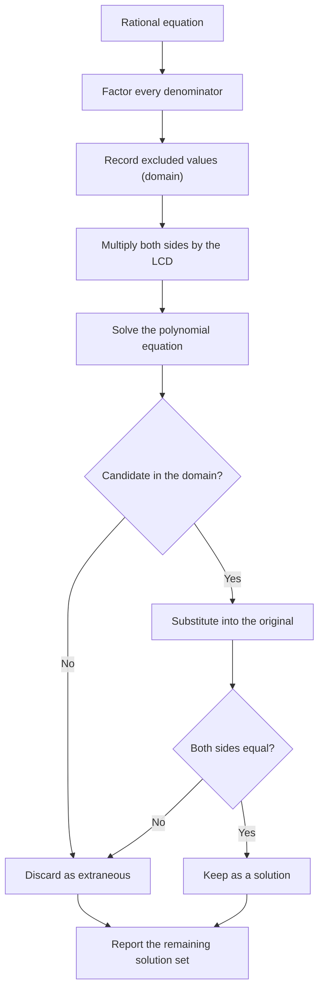

# Rational Expressions

> [Algebra](../README.md) · Level: Intermediate · Prerequisites: [fraction arithmetic](../01-elementary-algebra/README.md), [polynomial arithmetic and factoring](../06-polynomials/README.md), linear and quadratic equations, [proportion and ratio](../../01-arithmetic/06-ratios-and-proportions/README.md), [sign charts](../03-inequalities/README.md) · Estimated time: 180 min

## 1. Introduction

A **rational expression** is a quotient of two polynomials: $\dfrac{x^2-1}{x-1}$,
$\dfrac{3}{x}$, $\dfrac{5x+2}{x^2-9}$, $\dfrac{1}{x}+\dfrac{1}{y}$. The name is deliberate —
these are the algebra of *ratios*, exactly as $\frac{3}{4}$ is the arithmetic of ratios. Everything
you already know about numerical fractions (common denominators, cancelling, inverting a divisor)
survives, but one genuinely new phenomenon appears: **the denominator may vanish**, and the set of
values where it does not is part of the object you are studying.

That single fact is the source of every subtlety in this topic.

* Simplifying $\dfrac{x^2-1}{x-1}$ to $x+1$ is correct **only for $x \ne 1$**. At $x=1$ the original
  expression is undefined, while $x+1$ equals $2$. The two formulas describe different functions.
* Solving a rational equation by multiplying through by a denominator can create **extraneous
  solutions** — numbers that satisfy the multiplied equation but make an original denominator zero.
  Every candidate therefore has to be tested against the original equation.

Both points matter far beyond school algebra. Rational functions are the first non-polynomial
functions most students meet; their graphs have asymptotes and holes; their end behaviour is the
prototype of a limit; their decomposition into simpler pieces (partial fractions) is how calculus
integrates them; and the "check for excluded values" habit is the same one that appears in numerical
analysis whenever an algorithm divides by a quantity that might vanish.

The plan is: domains first (§7.1–7.2), arithmetic next (§7.3–7.5), equations and their traps
(§7.6–7.7), models built from ratios (§7.8), graphs and asymptotes (§7.9), applications (§7.10).
Proofs of the algebraic rules are collected in §8 so that the working sections stay readable.

## 2. Prerequisites

You should be fluent with the following; each item is used constantly and each is taught in the
linked tutorial.

* **Arithmetic of fractions.** $\frac{a}{b}+\frac{c}{d}=\frac{ad+bc}{bd}$, $\frac{a}{b}\cdot\frac{c}{d}=\frac{ac}{bd}$,
  and cancelling a common *factor*. See [Elementary Algebra](../01-elementary-algebra/README.md).
* **Polynomial arithmetic.** Expanding products, collecting like terms, and evaluating a polynomial
  at a point. See [Polynomials](../06-polynomials/README.md).
* **Factoring.** Common factors, difference of squares $a^2-b^2=(a-b)(a+b)$, trinomials
  $x^2+bx+c=(x-r)(x-s)$, and grouping. Factoring is the engine of every simplification in this topic.
* **Linear and quadratic equations.** Solving $ax+b=0$ and $ax^2+bx+c=0$, including the quadratic
  formula and the discriminant $b^2-4ac$.
* **Ratio and proportion.** The meaning of $\frac{a}{b}=\frac{c}{d}$ and of $y \propto x$. See
  [Ratios and Proportions](../../01-arithmetic/06-ratios-and-proportions/README.md).
* **Signed numbers and sign charts.** Deciding where a product is positive or negative. See
  [Inequalities](../03-inequalities/README.md).
* **Function language.** The notation $f:A\to B$, the words *domain* and *range*, and the idea that
  two functions are equal only when they have the same domain and the same values.

## 3. Learning Objectives

After working through this tutorial you will be able to:

1. State the domain of any rational expression and explain why the domain is part of its meaning.
2. Explain, with a numerical table and an algebraic proof, why $\dfrac{x^2-1}{x-1}\ne x+1$ at $x=1$.
3. Simplify a rational expression while recording every excluded value.
4. Multiply and divide rational expressions, stating the domain of the result.
5. Find the least common denominator of several polynomial denominators and use it to add and
   subtract rational expressions.
6. Recognise the two standard methods for simplifying a complex fraction and use whichever is
   shorter.
7. Solve rational equations, identify extraneous solutions, and prove why they appear.
8. Decide when cross-multiplication is legitimate and when it is not.
9. Build and use direct, inverse and joint variation models.
10. Find the domain, holes, vertical asymptotes, horizontal asymptotes and slant asymptotes of the
    graph of a rational function.
11. Model work-rate, mixture and average-cost problems with rational equations and check the answer
    against the physical situation.

## 4. Intuition

Think of a rational expression as a **comparison of two quantities**: money per person, grams per
millilitre, kilometres per hour. A ratio is meaningful only while the quantity you divide by is
nonzero. "Cost per unit" makes no sense when the number of units is zero; "grams per millilitre"
makes no sense when the volume is zero. The algebra merely records that fact.

Cancelling has the same meaning as in arithmetic. If six cakes are shared by three people, each gets
two; if sixty are shared by thirty, each still gets two. Multiplying both the number of cakes and
the number of people by the same nonzero number does not change the ratio. That is the whole content
of the cancellation law. But multiply both by **zero** and the comparison is destroyed: 0 cakes
shared by 0 people is not 2 cakes per person; it is a question with no answer. This is exactly why
the cancelled factor must be nonzero.

Now picture the graph. The expression $\frac{x^2-1}{x-1}$ is a straight line $y=x+1$ with a single
point removed at $x=1$ — a **hole**. The photograph is complete except for one missing pixel. The
formula $x+1$ fills that pixel in with the value 2; the rational expression refuses to. A function
is a rule *together with its domain*; filling in a missing point produces a different function, even
though the two agree everywhere else.

Extraneous solutions are the same story viewed through equations. Multiplying both sides of an
equation by an expression is like multiplying a photograph by a factor: at points where the factor is
nonzero the operation is reversible, and nothing is lost. At points where the factor is zero, the
operation crushes everything to zero and information disappears. Solving the multiplied equation can
therefore hand you a number that was never admissible. Checking in the original equation is not
pedantry; it is the only way to tell which candidates survived.

## 5. Formal Definition

Throughout, $\mathbb{R}[x]$ denotes the set of polynomials in $x$ with real coefficients.

**Definition 5.1 (Rational expression).** A *rational expression in $x$* is an expression that can be
written as
$$\frac{P(x)}{Q(x)},$$
where $P,Q\in\mathbb{R}[x]$ and $Q$ is not the zero polynomial. $P$ is the *numerator* and $Q$ the
*denominator*. A rational expression in several variables is defined identically, with
$P,Q\in\mathbb{R}[x_1,\dots,x_n]$.

**Definition 5.2 (Domain).** The *domain* of the rational expression $\dfrac{P(x)}{Q(x)}$ is
$$\operatorname{dom}\frac{P}{Q}=\{x\in\mathbb{R} : Q(x)\ne 0\}.$$
A number $a$ with $Q(a)=0$ is an *excluded value* of the expression.

The domain depends on the written form. The expression $\frac{x^2-1}{x-1}$ has domain
$\mathbb{R}\setminus\{1\}$, while the polynomial $x+1$ has domain $\mathbb{R}$. This is precisely why
they are not the same function.

**Definition 5.3 (Equality of functions).** Functions $f$ and $g$ are *equal* when
$\operatorname{dom}f=\operatorname{dom}g$ and $f(x)=g(x)$ for every $x$ in that common domain. They
are *equal on a set $S$* when $S\subseteq \operatorname{dom}f\cap\operatorname{dom}g$ and the values
agree on $S$. Two rational expressions are *equivalent* when they are equal on the intersection of
their domains.

Thus $\frac{x^2-1}{x-1}=x+1$ on $\mathbb{R}\setminus\{1\}$, but the two functions are not equal.

**Definition 5.4 (Lowest terms).** The rational expression $\frac{P}{Q}$ is in *lowest terms* (or
*reduced*) when no polynomial of degree at least $1$ divides both $P$ and $Q$. Over $\mathbb{R}$ this
means: after factoring $P$ and $Q$ into linear factors and irreducible quadratic factors, no factor
occurs in both.

When $P$ and $Q$ share a factor $(x-a)$, the value $x=a$ is missing from the domain although the
factor cancels. The graph has a **hole** at $x=a$; the $y$-coordinate of the hole is the value of the
reduced expression at $a$ (when that value exists).

**Definition 5.5 (Rational function).** A *rational function* is a function whose rule can be
written as a quotient of polynomials. Its domain is the set of real numbers at which the defining
formula is defined, i.e. Definition 5.2 applied to the formula as given.

**Definition 5.6 (Complex fraction).** A *complex fraction* is a fraction whose numerator or
denominator (possibly both) contains one or more fractions.

**Definition 5.7 (Rational equation).** A *rational equation* is an equation in which at least one
side is a rational expression. Its *solution set* is the set of numbers in the domains of all
expressions appearing in it that make the two sides equal.

**Definition 5.8 (Extraneous solution).** Let $A=B$ be an equation and $A'=B'$ an equation obtained
from it by an operation that is not reversible. A number that belongs to the solution set of
$A'=B'$ but not to that of $A=B$ is an *extraneous solution* of the original equation.

**Definition 5.9 (Least common denominator).** For rational expressions with denominators
$Q_1,\dots,Q_k$, the *least common denominator* (LCD) is the monic polynomial of least degree
divisible by every $Q_i$. Equivalently, factor each $Q_i$; the LCD is the product of every
irreducible factor that occurs, raised to the highest power in which it occurs.

## 6. Mathematical Notation

| Symbol | Read as | Meaning |
|---|---|---|
| $\dfrac{P(x)}{Q(x)}$ | $P$ of $x$ over $Q$ of $x$ | quotient of two polynomials |
| $Q(x)\ne 0$ | $Q$ of $x$ is not zero | the condition defining the domain |
| $\operatorname{dom} f$ | the domain of $f$ | set of admissible inputs |
| $x\ne a$ | $x$ is not equal to $a$ | one excluded value |
| $\mathbb{R}\setminus\{1\}$ | the reals minus the set containing 1 | all reals except $1$ |
| $\operatorname{lcm}(A,B)$ | least common multiple | smallest common multiple of two polynomials |
| $\mathrm{LCD}$ | least common denominator | the lcm of a list of denominators |
| $\equiv$ | identically equal | equal on a specified domain |
| $y\propto x$ | $y$ is proportional to $x$ | $y=kx$ for a constant $k$ |
| $y\propto \dfrac{1}{x}$ | $y$ varies inversely with $x$ | $y=k/x$ for a constant $k$ |
| $k$ | the constant of variation | the fixed number in a variation model |
| $R(x)\to L$ as $x\to\infty$ | $R$ of $x$ tends to $L$ | informal end-behaviour statement; made precise with limits in [Calculus](../../07-calculus/README.md) |

Reading aloud: "$\frac{x^2-1}{x-1}$, for $x$ not equal to one, simplifies to $x+1$." The qualifier is
part of the sentence, not an afterthought.

## 7. Core Concepts

### 7.1 Domains, and why $\dfrac{x^2-1}{x-1}\ne x+1$ at $x=1$

The expression $f(x)=\dfrac{x^2-1}{x-1}$ is defined whenever the denominator is nonzero, that is
for every real $x$ except $1$. Its domain is $\mathbb{R}\setminus\{1\}$.

Factor the numerator: $x^2-1=(x-1)(x+1)$. For $x\ne 1$ the factor $x-1$ is a nonzero number, so it may be cancelled (Proposition 8.1), giving
$x+1$. At $x=1$ the factor is zero and cancellation is forbidden — there is nothing to cancel,
because the expression is not defined there at all.

A table makes the difference visible.

| $x$ | $0.9$ | $0.99$ | $0.999$ | $1$ | $1.001$ | $1.01$ | $1.1$ |
|---|---|---|---|---|---|---|---|
| $f(x)=\dfrac{x^2-1}{x-1}$ | $1.9$ | $1.99$ | $1.999$ | undefined | $2.001$ | $2.01$ | $2.1$ |
| $g(x)=x+1$ | $1.9$ | $1.99$ | $1.999$ | $2$ | $2.001$ | $2.01$ | $2.1$ |

The two functions agree at every tabulated point except $x=1$, where only $g$ has a value. So
$f\ne g$ as functions, even though $f(x)=g(x)$ for every $x$ in the domain of $f$. The correct
statement is $\frac{x^2-1}{x-1}=x+1$ for $x\ne 1$.

The graph of $f$ is the line $y=x+1$ with the point $(1,2)$ deleted. Such a missing point is called a
**hole**. It is invisible at the scale of a hand-drawn graph, which is exactly why algebra, not
picture-drawing, has to track it.

Why insist on the distinction? Because a function is not a formula; it is a formula together with a
domain (Definition 5.3). Two formulas that agree wherever both are defined may still be different
functions. Calculus makes the point again: $f$ has a removable discontinuity at $1$, meaning that
assigning $f(1)=2$ would repair it. The repair is a *choice*, and it changes the function.

### 7.2 Simplifying with domain tracking

To simplify a rational expression:

1. Factor the numerator and the denominator completely over $\mathbb{R}$.
2. Write down every value that makes an original denominator zero. These are permanent exclusions.
3. Cancel common factors, using the cancellation law only where the factor is nonzero.
4. Present the answer as the simplified expression *together with* the excluded values.

The exclusions come from the original expression and are never removed by cancelling. A simplified
answer without its restrictions is incomplete.

**Example.** Simplify $\dfrac{2x^2-8}{x^2-2x}$.

Factor: $2x^2-8=2(x^2-4)=2(x-2)(x+2)$ and $x^2-2x=x(x-2)$. The denominator vanishes at $x=0$ and
$x=2$, so those two values are excluded. For $x\notin\{0,2\}$,
$\frac{2(x-2)(x+2)}{x(x-2)}=\frac{2(x+2)}{x}$.

Check at $x=3$: the original gives $\frac{18-8}{9-6}=\frac{10}{3}$ and the simplified form gives
$\frac{2\cdot 5}{3}=\frac{10}{3}$. Check at the excluded value $x=2$: the original is $\frac{0}{0}$
(undefined), while the simplified form equals $4$. The point $(2,4)$ is a hole.

A useful slogan: **cancel factors, never terms**. The expression $\frac{x+2}{x+4}$ cannot be
simplified, because $x$ is a term of each numerator and denominator, not a factor. Substituting
$x=2$ gives $\frac{4}{6}=\frac23$, not $\frac{2}{4}=\frac12$.

### 7.3 Multiplication and division

For rational expressions $A/B$ and $C/D$ with $B,D\ne0$,

$$
\frac{A}{B}\cdot\frac{C}{D}=\frac{AC}{BD},
\qquad
\frac{A}{B}\div\frac{C}{D}=\frac{A}{B}\cdot\frac{D}{C}=\frac{AD}{BC}\quad(C\ne0).
$$

The second rule says: dividing by a fraction is multiplying by its reciprocal. It follows from the
definition of division as "the number $q$ such that $q\cdot\frac{C}{D}=\frac{A}{B}$"; multiplying
that equation by $\frac{D}{C}$ gives $q=\frac{A}{B}\cdot\frac{D}{C}$.

Domains behave predictably:

* the domain of a product is the intersection of the domains of the factors;
* the domain of a quotient additionally excludes every value where the divisor is zero.

In practice: **factor first, cancel second, multiply last**. Multiplying out first produces large
polynomials that must then be factored again — extra work and extra errors. Cross-cancelling between
the numerator of one fraction and the denominator of the other is nothing more than cancelling common
factors after writing the product as a single fraction.

**Example.** Multiply $\dfrac{x^2-9}{x^2+7x+12}\cdot\dfrac{x+4}{x-3}$.

Factor: $x^2-9=(x-3)(x+3)$ and $x^2+7x+12=(x+3)(x+4)$. Hence
$\frac{(x-3)(x+3)}{(x+3)(x+4)}\cdot\frac{x+4}{x-3}=1$, valid for $x\ne -3,-4,3$. The answer $1$ must still carry the restrictions: the original expression
is undefined at those three values even though the constant $1$ is defined everywhere.

**Example.** Divide $\dfrac{x^2-4}{x^2-1}\div\dfrac{x+2}{x-1}$. Inverting and factoring,
$\frac{(x-2)(x+2)}{(x-1)(x+1)}\cdot\frac{x-1}{x+2}=\frac{x-2}{x+1}$ for $x\ne \pm1,-2$.

Check at $x=0$: the original is $\frac{-4}{-1}\div\frac{2}{-1}=4\div(-2)=-2$, and the simplified
form is $\frac{-2}{1}=-2$.

### 7.4 The least common denominator; adding and subtracting

Fractions with a common denominator add by adding numerators:

$$
\frac{A}{D}+\frac{B}{D}=\frac{A+B}{D}.
$$

This is the distributive law in disguise: $AD^{-1}+BD^{-1}=(A+B)D^{-1}$. For general denominators,
adding numerators and adding denominators is **wrong**
($\frac{A}{B}+\frac{C}{D}\ne\frac{A+C}{B+D}$ in general); the correct identity is
$\frac{A}{B}+\frac{C}{D}=\frac{AD+CB}{BD}$.

Any common denominator works, but the **least** common denominator keeps the algebra small. To find
it: factor every denominator; for each irreducible factor take the highest power in which it appears;
multiply those powers together.

**Example.** For denominators $(x-2)^2(x+3)$ and $(x-2)(x+3)^2$, the LCD is $(x-2)^2(x+3)^2$: the
factor $x-2$ appears to power $2$ at most, and $x+3$ likewise.

To rewrite a fraction with a larger denominator, multiply numerator and denominator by the missing
factor — that is, multiply by $1$ in the form $\frac{M}{M}$, so
$\frac{A}{B}=\frac{A\cdot M}{B\cdot M}$ for $M\ne0$.

**Worked miniature.** Combine $\dfrac{3}{x^2-4}-\dfrac{1}{x-2}$. Since $x^2-4=(x-2)(x+2)$ and the
second denominator is missing the factor $x+2$,
$\frac{3}{(x-2)(x+2)}-\frac{x+2}{(x-2)(x+2)}=\frac{3-(x+2)}{(x-2)(x+2)}=\frac{1-x}{(x-2)(x+2)}$,
with $x\ne\pm2$. Note the brackets: the minus sign applies to the whole numerator $x+2$, not just to
$x$. Check at $x=0$: original $\frac{3}{-4}-\frac{1}{-2}=-0.75+0.5=-0.25$; result
$\frac{1}{-4}=-0.25$.

### 7.5 Complex fractions

A complex fraction is simplified by turning it into an ordinary division. Two methods are standard.

* **Method A (combine, then divide).** Write the numerator as a single fraction, the denominator as a
  single fraction, then use $\frac{A/B}{C/D}=\frac{A}{B}\cdot\frac{D}{C}$.
* **Method B (clear inner denominators).** Multiply numerator and denominator of the complex fraction
  by the LCD of all the inner fractions. This multiplies by $1=\frac{M}{M}$ and is therefore valid
  wherever $M\ne0$.

Both methods give the same answer; choose the one with less writing.

**Example.** Simplify $\dfrac{\frac1x-\frac1y}{\frac1{x^2}-\frac1{y^2}}$.

Method A. The numerator is $\frac{y-x}{xy}$. The denominator is
$\frac{y^2-x^2}{x^2y^2}=\frac{(y-x)(y+x)}{x^2y^2}$. Therefore
$\frac{\frac{y-x}{xy}}{\frac{(y-x)(y+x)}{x^2y^2}}=\frac{y-x}{xy}\cdot\frac{x^2y^2}{(y-x)(y+x)}=\frac{xy}{x+y}$,
valid for $x,y\ne0$ and $x\ne\pm y$.

Method B. Multiply numerator and denominator by $x^2y^2$:

$$
\frac{\frac1x-\frac1y}{\frac1{x^2}-\frac1{y^2}}\cdot\frac{x^2y^2}{x^2y^2}
=\frac{xy^2-x^2y}{y^2-x^2}
=\frac{xy(y-x)}{(y-x)(y+x)}
=\frac{xy}{x+y}.
$$

Check with $x=2$, $y=3$: the original is $\frac{0.5-0.333\ldots}{0.25-0.111\ldots}\approx1.2$ and the
answer is $\frac{6}{5}=1.2$.

### 7.6 Rational equations and extraneous solutions

A rational equation is solved by *clearing denominators*: multiply both sides by the LCD. The result
is a polynomial equation, which we know how to solve. The subtlety is that the multiplication may not
be reversible.

**The mechanism.** Suppose the LCD is $M(x)$ and $a$ is a candidate root.

* If $M(a)\ne0$, then multiplying by $M(a)$ is reversible: $A(a)=B(a)$ exactly when
  $A(a)M(a)=B(a)M(a)$. No information is lost or gained.
* If $M(a)=0$, then $A(a)M(a)=0=B(a)M(a)$ for *every* $A$ and $B$: the multiplied equation is
  automatically true at $a$. It tells us nothing about the original.

Therefore each root of the cleared equation is either a genuine solution or a zero of $M$. A zero of
$M$ is a value at which some denominator of the original equation vanishes; such a value cannot be a
solution, because the original equation is not even defined there.

**Procedure.**

1. Factor all denominators and state the domain (the excluded values).
2. Multiply both sides by the LCD; record that the multiplication is valid only on the domain.
3. Solve the resulting polynomial equation.
4. Discard every candidate that lies outside the domain.
5. Check the survivors in the **original** equation (substitution also catches arithmetic slips).

**Worked miniature.** Solve $\dfrac{x}{x-4}-\dfrac{8}{x^2-4x}=\dfrac{2}{x}$.

The denominators are $x-4$, $x(x-4)$ and $x$, so the domain is $x\ne0,4$ and the LCD is $x(x-4)$.
Multiplying: $x^2-8=2(x-4)=2x-8$, so $x^2-2x=0$, so $x(x-2)=0$.

Candidates $x=0$ and $x=2$. The value $0$ is excluded (it makes two denominators zero), so it is
extraneous; only $x=2$ remains. Check: $\frac{2}{-2}-\frac{8}{4-8}=-1+2=1$ and $\frac{2}{2}=1$.
The solution set is $\{2\}$.

Two different things are both called "extraneous" in textbooks, and it is worth separating them.

* A candidate excluded by the domain, as above. The algebra was correct; the candidate was never
  admissible.
* A candidate produced by squaring or another irreversible operation (treated in
  [Radicals and Rational Exponents](../10-radicals-and-rational-exponents/README.md)). There the
  transformed equation genuinely has a solution that the original does not.

Both are handled the same way: test in the original.

### 7.7 Proportions and cross-multiplication

A **proportion** is an equation of the form $\frac{a}{b}=\frac{c}{d}$ with $b,d\ne0$.

Multiplying both sides by $bd$ gives $ad=bc$. Conversely, if $ad=bc$ and $b,d\ne0$, dividing by $bd$
returns the proportion. Hence

$$
\frac{a}{b}=\frac{c}{d}\iff ad=bc \qquad (b,d\ne0).
$$

This is why cross-multiplication is legitimate for a proportion — and only for a proportion. The
equation $\frac{x}{2}+1=\frac{3}{x}$ is not of the form "fraction equals fraction", so
"cross-multiplying" it would be meaningless. Combine each side into a single fraction first.

**Example.** Solve $\dfrac{2x-1}{x+4}=\dfrac{3}{x}$.

Cross-multiplying ($x\ne -4,\,0$):

$$
x(2x-1)=3(x+4)
\;\Longrightarrow\;
2x^2-x=3x+12
\;\Longrightarrow\;
2x^2-4x-12=0
\;\Longrightarrow\;
x^2-2x-6=0.
$$

The quadratic formula gives $x=\frac{2\pm\sqrt{4+24}}{2}=1\pm\sqrt7$. Neither value is $-4$ or $0$,
so both are valid. Check $x=1+\sqrt7\approx3.646$: left side $\frac{6.292}{7.646}\approx0.823$, right
side $\frac{3}{3.646}\approx0.823$.

A proportion with polynomial numerators and denominators can therefore lead to a quadratic, and a
quadratic can have two, one or no real solutions. The domain check is separate from the
discriminant: a quadratic may have two real roots and still contribute only one solution.

### 7.8 Variation models with rational functions

A **variation model** states how one quantity depends on others through multiplication and division
by constants.

| Name | Form | Verbal statement |
|---|---|---|
| Direct variation | $y=kx$ | $y$ is proportional to $x$ |
| Direct variation with a power | $y=kx^n$ | $y$ varies as the $n$-th power of $x$ |
| Inverse variation | $y=\dfrac{k}{x^n}$ | $y$ varies inversely as the $n$-th power of $x$ |
| Joint variation | $z=kxy$ | $z$ varies jointly with $x$ and $y$ |
| Combined variation | $y=\dfrac{kx}{z}$ | $y$ varies directly with $x$, inversely with $z$ |

Inverse variation is exactly the statement that the product is constant: for $x\ne0$,

$$
y=\frac{k}{x}\iff xy=k .
$$

The graph of $y=k/x$ is a hyperbola whose asymptotes are the coordinate axes — the first rational
function most people meet.

**Example.** The intensity $I$ of light falling on a surface varies inversely as the square of the
distance $d$ from the source. A lamp gives $I=12$ lux at $d=2$ m. Find $I$ at $d=6$ m, and the
distance at which $I=3$ lux.

From $I=k/d^2$ and $12=k/4$ we get $k=48$. Then $I(6)=48/36=\frac43$ lux, and $3=48/d^2$ gives
$d^2=16$, so $d=4$ m (the negative root is rejected because a distance is non-negative).

Variation statements are *modelling assumptions*, not theorems: they are the simplest nontrivial
hypothesis about how two measured quantities are related, and they must be tested against data.

### 7.9 Rational functions and asymptotes

Let $R(x)=\dfrac{P(x)}{Q(x)}$ with $P,Q$ polynomials.

* **Domain.** All $x$ with $Q(x)\ne0$.
* **Zeros.** The values $x$ with $P(x)=0$ and $Q(x)\ne0$.
* **Vertical asymptote.** A line $x=a$ where $Q(a)=0$ and the factor $(x-a)$ does **not** cancel
  completely (a partial cancellation still leaves an asymptote). As $x$ approaches $a$, $|R(x)|$
  grows without bound.
* **Hole.** A value $x=a$ where the factor $(x-a)$ cancels completely, that is, it occurs in the
  numerator at least as often as in the denominator. The graph misses the point
  $\left(a,\ \text{value of the reduced expression at }a\right)$.
* **End behaviour.** Compare the degrees $n=\deg P$ and $m=\deg Q$:
  * $n<m$: horizontal asymptote $y=0$;
  * $n=m$: horizontal asymptote $y=\dfrac{\text{leading coefficient of }P}{\text{leading coefficient of }Q}$;
  * $n=m+1$: no horizontal asymptote; a **slant asymptote** $y=S(x)$ obtained by dividing $P$ by $Q$;
  * $n>m+1$: no linear asymptote; the graph grows like a polynomial of degree $n-m$.

A horizontal asymptote describes behaviour *far away*; the graph may cross it near the origin. For
example $R(x)=\frac{x}{x^2+1}$ has $y=0$ as horizontal asymptote and passes through $(0,0)$.

**Example.** Analyse $R(x)=\dfrac{2x^2-8}{x^2-x-6}$.

Factor: $2x^2-8=2(x-2)(x+2)$ and $x^2-x-6=(x-3)(x+2)$. Thus
$R(x)=\frac{2(x-2)(x+2)}{(x-3)(x+2)}=\frac{2(x-2)}{x-3}$ for $x\ne 3,-2$.

Domain $\mathbb{R}\setminus\{3,-2\}$. The factor $x+2$ cancels, so there is a **hole** at $x=-2$,
with height $\frac{2(-4)}{-5}=\frac85$. The factor $x-3$ remains, so $x=3$ is a **vertical
asymptote**. The degrees are equal and the leading coefficients are $2$ and $1$, so $y=2$ is a
**horizontal asymptote**. Check at $x=0$: the original is $\frac{-8}{-6}=\frac43$ and the reduced form
is $\frac{-4}{-3}=\frac43$.

**Example.** $R(x)=\dfrac{x^2+1}{x}=x+\dfrac1x$. Dividing gives a **slant asymptote** $y=x$; the
vertical asymptote is $x=0$; there are no zeros and no holes. Check at $x=2$: $2+\frac12=2.5$ and
$\frac{5}{2}=2.5$.

The phrase "grows without bound" is made precise only with limits; Proposition 8.7 gives the
algebraic statement behind the degree rules, and
[Calculus](../../07-calculus/README.md) supplies the formal definition.

### 7.10 Applications

**Work-rate problems.** If a machine, pipe or person completes one job in $t$ hours at a constant
rate, then it completes $\frac1t$ of the job per hour. Two such agents working simultaneously and
independently complete the sum of the fractions per hour, so if together they need $T$ hours,

$$
\frac{1}{t_1}+\frac{1}{t_2}=\frac{1}{T}.
$$

The word *independently* is a hypothesis: two painters sharing a ladder do not add their rates.

**Mixture problems.** Track the amount of the substance, not the concentration. If a container holds
$V$ litres at concentration $c$ (as a fraction), the amount of solute is $cV$. Adding or removing
material changes $V$ and the amount of solute in a way that is usually easy to write down, and the new
concentration is the quotient. Conservation of solute is the equation.

**Average cost.** A factory with fixed cost $F$ (rent, machinery) and variable cost $v$ per unit
produces $x$ units at total cost $F+vx$. The **average cost per unit** is

$$
\bar C(x)=\frac{F+vx}{x}=\frac{F}{x}+v,\qquad x>0 .
$$

Its graph has the vertical line $x=0$ as an asymptote (not in the domain) and the horizontal line
$y=v$ as end behaviour: with many units, the fixed cost is spread thin and the average approaches the
marginal cost $v$. The function is decreasing, because $F/x$ decreases.

**Other occurrences.** Parallel resistance and the thin lens obey the same algebra, dilution and
dosing use the same conservation idea, and the derivative of a rational function is again rational,
which is why calculus texts spend so long on them (§12).

## 8. Formulas and Properties

Every rule below is stated with its hypotheses. The proofs use only the field axioms of
$\mathbb{R}$: addition and multiplication are commutative and associative, multiplication
distributes over addition, and every nonzero number has a multiplicative inverse.

**Proposition 8.1 (Cancellation).** Let $a,b,k\in\mathbb{R}$ with $b\ne0$ and $k\ne0$. Then
$$\frac{ka}{kb}=\frac{a}{b}.$$

*Proof.* By definition $\frac{x}{y}=xy^{-1}$ for $y\ne0$. Then
$\frac{ka}{kb}=(ka)(kb)^{-1}=(ka)(k^{-1}b^{-1})=(kk^{-1})(ab^{-1})=1\cdot\frac ab=\frac ab$.

The step $(kb)^{-1}=k^{-1}b^{-1}$ uses $k\ne0$ and $b\ne0$, and $kb\ne0$ precisely because both
factors are nonzero. $\blacksquare$

The hypothesis $k\ne0$ is exactly the hypothesis "$x-1\ne0$" that forbids cancelling at $x=1$ in
§7.1.

**Proposition 8.2 (Cross-multiplication).** Let $a,b,c,d\in\mathbb{R}$ with $b\ne0$ and $d\ne0$. Then
$$\frac ab=\frac cd\iff ad=bc.$$

*Proof.* ($\Rightarrow$) Multiply both sides of $\frac ab=\frac cd$ by $bd$, which is nonzero:
$\frac{abd}{b}=\frac{cbd}{d}$, that is $ad=bc$. ($\Leftarrow$) Suppose $ad=bc$. Multiply both sides
by $\frac{1}{bd}$: $\frac{ad}{bd}=\frac{bc}{bd}$, that is $\frac ab=\frac cd$. $\blacksquare$

**Proposition 8.3 (Addition).** Let $a,b,c,d\in\mathbb{R}$ with $b\ne0$ and $d\ne0$. Then
$$\frac ab+\frac cd=\frac{ad+bc}{bd}.$$

*Proof.* By Proposition 8.1 (with $k=d$) $\frac ab=\frac{ad}{bd}$, and (with $k=b$)
$\frac cd=\frac{bc}{bd}$. Then
$\frac{ad}{bd}+\frac{bc}{bd}=(ad+bc)(bd)^{-1}=\frac{ad+bc}{bd}$. $\blacksquare$

**Proposition 8.4 (Sign of a quotient).** Let $b\ne0$. Then $\frac ab$ is positive exactly when $a$
and $b$ have the same sign, negative exactly when they have opposite signs, and zero exactly when
$a=0$.

*Proof.* Since $b\cdot b^{-1}=1>0$, the inverse $b^{-1}$ has the same sign as $b$. The product
$ab^{-1}$ is positive exactly when the factors have equal signs. $\blacksquare$

This proposition is what makes sign charts for rational inequalities work.

**Proposition 8.5 (Multiplication and division).** Let $b,d\ne0$. Then
$$\frac ab\cdot\frac cd=\frac{ac}{bd},
\qquad
\frac ab\div\frac cd=\frac{ad}{bc}\ \ (c\ne0).$$

*Proof.* The first is associativity and commutativity of multiplication:
$(ab^{-1})(cd^{-1})=(ac)(bd)^{-1}$. For the second, let $q=\frac ab\cdot\frac dc$; then
$q\cdot\frac cd=\frac ab\cdot\frac dc\cdot\frac cd=\frac ab$, so $q$ is the quotient. Uniqueness of
the quotient follows from $c/d\ne0$. $\blacksquare$

**Proposition 8.6 (Clearing denominators and extraneous roots).** Let $M$ be a rational expression
and let $a\in\operatorname{dom}M$. If $M(a)\ne0$ and $A,B$ are defined at $a$, then
$$A(a)=B(a)\iff A(a)M(a)=B(a)M(a).$$
If $M(a)=0$, then $A(a)M(a)=B(a)M(a)$ holds for all values of $A(a)$ and $B(a)$.

*Proof.* If $M(a)\ne0$, multiply the equality $A(a)=B(a)$ by $M(a)$ to get the second statement, and
multiply the second by the nonzero number $1/M(a)$ to recover the first. If $M(a)=0$ both products
are $0$. $\blacksquare$

*Consequence.* The solution set of $AM=BM$ contains the solution set of $A=B$. New solutions can
appear only at zeros of $M$, and those are exactly the values excluded from the domain of the
original equation. This is why the check in §7.6 always succeeds: an extraneous root is always a zero
of the LCD.

**Proposition 8.7 (End behaviour of a rational function).** Let
$R(x)=\frac{a_nx^n+a_{n-1}x^{n-1}+\cdots+a_0}{b_mx^m+b_{m-1}x^{m-1}+\cdots+b_0}$ with $a_nb_m\ne0$.
Then:

1. if $n<m$, $|R(x)|\le \dfrac{C}{|x|^{m-n}}$ for all sufficiently large $|x|$, so $R(x)$ can be made
   arbitrarily small;
2. if $n=m$, $R(x)$ can be made arbitrarily close to $\dfrac{a_n}{b_m}$;
3. if $n>m$, $|R(x)|$ grows without bound as $|x|$ grows.

*Proof.* For $|x|\ge1$ and $0\le k\le n-1$ we have $|x|^k\le|x|^{n-1}$, so
$|a_nx^n+\cdots+a_0|\le |a_n||x|^n+A|x|^{n-1}$ with $A=\sum_{k=0}^{n-1}|a_k|$. Similarly, for
$|x|\ge 1$,
$|b_mx^m+\cdots+b_0|\ge |b_m||x|^m-B|x|^{m-1}=|x|^{m-1}(|b_m||x|-B)$ with
$B=\sum_{k=0}^{m-1}|b_k|$, which exceeds $\tfrac12|b_m||x|^m$ once $|x|\ge 2B/|b_m|$. Hence for all
large $|x|$,
$|R(x)|\le \frac{|a_n||x|^n+A|x|^{n-1}}{\tfrac12|b_m||x|^m}\le \frac{2(|a_n|+A)}{|b_m|}\,|x|^{\,n-m}$.
If $n<m$ this bound tends to $0$ as $|x|$ grows. If $n=m$, divide numerator and denominator by
$x^n$: the expression becomes
$\frac{a_n+a_{n-1}/x+\cdots+a_0/x^n}{b_m+b_{m-1}/x+\cdots+b_0/x^n}$, and every term containing
$1/x^k$ can be made as small as desired, leaving $a_n/b_m$ up to an arbitrarily small error. If
$n>m$, the lower bound $|P(x)|\ge\tfrac12|a_n||x|^n$ together with the upper bound
$|Q(x)|\le(|b_m|+B)|x|^m$, valid for large $|x|$, gives $|R(x)|\ge c|x|^{n-m}$ for a positive
constant $c$, so $|R(x)|$ exceeds any prescribed bound. $\blacksquare$

**Proposition 8.8 (Division and slant asymptotes).** If $\deg P\ge\deg Q$, there are polynomials $S$
and $R$ with $P(x)=S(x)Q(x)+R(x)$ and $\deg R<\deg Q$, so
$\dfrac{P(x)}{Q(x)}=S(x)+\dfrac{R(x)}{Q(x)}$. When $\deg P=\deg Q+1$, $S$ is linear and the graph
approaches the line $y=S(x)$.

*Proof.* The existence of $S$ and $R$ is polynomial long division, proved in
[Polynomials](../06-polynomials/README.md). The last claim follows from Proposition 8.7 applied to
$R/Q$, whose numerator has smaller degree than its denominator. $\blacksquare$

**Proposition 8.9 (Inverse variation).** For $x\ne0$, the following are equivalent: $y=\dfrac kx$ for
some constant $k$; $xy=k$ for some constant $k$; $y$ is proportional to $\dfrac1x$.

*Proof.* Multiply $y=k/x$ by $x$ to obtain $xy=k$; divide $xy=k$ by $x\ne0$ to recover $y=k/x$. The
third statement is the definition of proportionality with respect to the quantity $1/x$.
$\blacksquare$

**Proposition 8.10 (Rate additivity — a modelling principle).** Suppose an agent working alone at a
constant rate completes a job in $t_1$ hours, so its rate is $1/t_1$ job per hour. If two agents work
simultaneously and independently, the combined rate is the sum of the rates, and the time $T$
satisfies $\frac{1}{T}=\frac{1}{t_1}+\frac{1}{t_2}$.

This is not a theorem of arithmetic; it is the definition of "constant rate" plus the assumption that
the agents do not interfere. $\square$

## 9. Step-by-Step Examples

### Example 9.1 — A domain and a hole

Find the domain of $f(x)=\dfrac{x^2-1}{x-1}$, simplify, and describe the graph.

*Step 1 — domain.* The denominator vanishes only at $x=1$, so
$\operatorname{dom}f=\mathbb{R}\setminus\{1\}$.

*Step 2 — factor.* $x^2-1=(x-1)(x+1)$.

*Step 3 — cancel where legal.* For $x\ne1$,
$f(x)=\frac{(x-1)(x+1)}{x-1}=x+1$.

*Step 4 — interpret.* The graph is the line $y=x+1$ with the point $(1,2)$ removed. The value $2$ is
the height the line would have there, but $f(1)$ is undefined.

*Check.* $f(3)=\frac{9-1}{2}=4=3+1$; $f(-2)=\frac{4-1}{-3}=-1=-2+1$; $f(1)$ does not exist.

### Example 9.2 — Simplifying with domain tracking

Simplify $\dfrac{2x^2-8}{x^2-2x}$ and state the domain.

*Step 1 — factor.* $2x^2-8=2(x-2)(x+2)$; $x^2-2x=x(x-2)$.

*Step 2 — excluded values.* $x=0$ and $x=2$.

*Step 3 — cancel.* $\dfrac{2(x-2)(x+2)}{x(x-2)}=\dfrac{2(x+2)}{x}$ for $x\ne0,2$.

*Answer.* $\dfrac{2(x+2)}{x}$, $x\ne0,\,2$.

*Check.* At $x=3$ both forms give $\frac{10}{3}$. At $x=1$ both give $6$. At $x=2$ the original is
undefined and the reduced form equals $4$, which locates the hole at $(2,4)$.

### Example 9.3 — Multiplication and division

(a) Multiply $\dfrac{x^2-9}{x^2+7x+12}\cdot\dfrac{x+4}{x-3}$.
(b) Divide $\dfrac{x^2-4}{x^2-1}\div\dfrac{x+2}{x-1}$.

*Part (a).* Factor: $x^2-9=(x-3)(x+3)$, $x^2+7x+12=(x+3)(x+4)$. The product is
$\frac{(x-3)(x+3)(x+4)}{(x+3)(x+4)(x-3)}=1$ for $x\ne-3,-4,3$.

The restrictions come from the original denominators, not from the answer. Check at $x=0$: the
original is $\frac{-9}{12}\cdot\frac{4}{-3}=\left(-\frac34\right)\left(-\frac43\right)=1$.

*Part (b).* Invert and multiply:
$\frac{(x-2)(x+2)}{(x-1)(x+1)}\cdot\frac{x-1}{x+2}=\frac{x-2}{x+1}$ for $x\ne\pm1,-2$.

Check at $x=0$: original $\frac{-4}{-1}\div\frac{2}{-1}=4\div(-2)=-2$; result $\frac{-2}{1}=-2$.

### Example 9.4 — Adding and subtracting with an LCD

Combine $\dfrac{3}{x^2-4}-\dfrac{1}{x-2}$.

*Step 1 — factor.* $x^2-4=(x-2)(x+2)$; the LCD is $(x-2)(x+2)$; the domain excludes $\pm2$.

*Step 2 — rewrite.* The second fraction needs the factor $x+2$:
$\frac{1}{x-2}=\frac{x+2}{(x-2)(x+2)}$.

*Step 3 — subtract.* Keep the brackets:
$\frac{3}{(x-2)(x+2)}-\frac{x+2}{(x-2)(x+2)}=\frac{3-(x+2)}{(x-2)(x+2)}=\frac{1-x}{(x-2)(x+2)}$.

*Step 4 — check.* At $x=0$: left side $\frac{3}{-4}-\frac{1}{-2}=-0.25$; right side
$\frac{1}{-4}=-0.25$. At $x=3$: left side $\frac35-1=-\frac25$; right side
$\frac{-2}{5\cdot1}=-\frac25$.

### Example 9.5 — A complex fraction

Simplify $\dfrac{\frac1x-\frac1y}{\frac1{x^2}-\frac1{y^2}}$.

*Step 1 — common denominators inside.* Numerator $\frac{y-x}{xy}$; denominator
$\frac{y^2-x^2}{x^2y^2}$.

*Step 2 — divide.* $\dfrac{y-x}{xy}\cdot\dfrac{x^2y^2}{y^2-x^2}$.

*Step 3 — factor and cancel.* $y^2-x^2=(y-x)(y+x)$, so the product is
$\dfrac{(y-x)x^2y^2}{xy(y-x)(y+x)}=\dfrac{xy}{x+y}$.

*Step 4 — domain.* $x\ne0$, $y\ne0$, $x\ne y$, $x\ne-y$.

*Check.* With $x=2$, $y=3$: original $\frac{0.5-1/3}{0.25-1/9}=\frac{1/6}{5/36}=\frac{6}{5}$; answer
$\frac{6}{5}$.

### Example 9.6 — A rational equation with an extraneous root

Solve $\dfrac{x}{x-4}-\dfrac{8}{x^2-4x}=\dfrac{2}{x}$.

*Step 1 — factor and domain.* $x^2-4x=x(x-4)$; the domain is $x\ne0,4$; the LCD is $x(x-4)$.

*Step 2 — clear denominators.* Multiply every term by $x(x-4)$:
$x\cdot x-8=2(x-4)$.

(For the first term: $\frac{x}{x-4}\cdot x(x-4)=x^2$. For the second: $\frac{8}{x(x-4)}\cdot x(x-4)=8$.
For the right side: $\frac2x\cdot x(x-4)=2(x-4)$.)

*Step 3 — solve.* $x^2-8=2x-8$, so $x^2-2x=0$, so $x(x-2)=0$.

so $x=0$ or $x=2$.

*Step 4 — discard.* $x=0$ is outside the domain and is extraneous. The only candidate left is $x=2$.

*Step 5 — check in the original.* Left side: $\frac{2}{-2}-\frac{8}{-4}=-1+2=1$. Right side:
$\frac22=1$. Both sides agree, so the solution set is $\{2\}$.

Note that $x=0$ *does* satisfy the cleared equation $x^2-8=2x-8$ (both sides equal $-8$). The cleared
equation cannot distinguish it from a solution, because at $x=0$ the multiplier $x(x-4)$ is zero.

### Example 9.7 — A rational equation leading to a quadratic

Solve $\dfrac1x+\dfrac1{x+3}=\dfrac12$.

*Step 1 — domain.* $x\ne0,-3$.

*Step 2 — clear denominators with LCD $2x(x+3)$:* $2(x+3)+2x=x(x+3)$.

*Step 3 — expand and collect.* $2x+6+2x=x^2+3x$, so $4x+6=x^2+3x$, so $x^2-x-6=0$.

*Step 4 — factor.* $(x-3)(x+2)=0$, so $x=3$ or $x=-2$.

*Step 5 — check the domain.* Neither $3$ nor $-2$ is $0$ or $-3$, so both are admissible.

*Step 6 — verify.* $x=3$: $\frac13+\frac16=\frac12$. $x=-2$: $-\frac12+\frac11=\frac12$. The solution
set is $\{-2,3\}$.

### Example 9.8 — A work-rate problem

Tom takes $3$ hours longer than Maria to paint a fence. Working together they finish in $2$ hours. How
long does each take alone?

*Step 1 — name the unknown.* Let $t$ be Maria's time in hours. Then Tom needs $t+3$ hours.

*Step 2 — translate to rates.* Maria paints $\frac1t$ of the fence per hour; Tom paints
$\frac{1}{t+3}$; together they paint $\frac12$ per hour. Hence $\frac1t+\frac{1}{t+3}=\frac12$.

*Step 3 — clear denominators* (LCD $2t(t+3)$, and $t>0$ by the physical situation):
$2(t+3)+2t=t(t+3)$, so $4t+6=t^2+3t$, so $t^2-t-6=0$.

*Step 4 — solve.* $(t-3)(t+2)=0$, so $t=3$ or $t=-2$.

*Step 5 — interpret.* A time of $-2$ hours is meaningless; reject it on physical grounds (not because
of an algebraic domain restriction). Maria needs $3$ hours and Tom needs $6$ hours.

*Step 6 — check.* In one hour they paint $\frac13+\frac16=\frac12$ of the fence, so the whole fence
takes $2$ hours. Correct.

### Example 9.9 — Average cost and a horizontal asymptote

A workshop has fixed daily costs of $\$5000$ and a variable cost of $\$4$ per unit. The average cost
per unit at a production level of $x\ge1$ units is $\bar C(x)=\frac{5000+4x}{x}$.

(a) Compute $\bar C(100)$ and $\bar C(1000)$.
(b) Describe the end behaviour and the asymptotes.
(c) How many units must be produced for the average cost to be at most $\$5$?

*Part (a).* $\bar C(100)=\frac{5000+400}{100}=54$ dollars; $\bar C(1000)=\frac{5000+4000}{1000}=9$
dollars.

*Part (b).* Write $\bar C(x)=\frac{5000}{x}+4$. As $x$ grows, $\frac{5000}{x}$ becomes arbitrarily
small, so $\bar C(x)$ approaches $4$ from above: $y=4$ is a horizontal asymptote. The line $x=0$ is a
vertical asymptote, but $x=0$ is not in the domain because production is positive.

*Part (c).* Solve $\frac{5000+4x}{x}\le5$. Since $x>0$, multiplying by $x$ preserves the inequality:
$5000+4x\le5x$, so $5000\le x$.

At least $5000$ units are needed. Check: $\bar C(5000)=\frac{5000+20000}{5000}=5$; at $x=4000$ the
average is $\frac{5000+16000}{4000}=5.25>5$. Correct.

## 10. Visual Explanations

The decision procedure below records that the domain check happens before the algebra and the
verification after it.

The shape of a rational function is read from its factors; the table records what each kind does.

| Feature of the factored form | Consequence for the graph |
|---|---|
| Factor $(x-a)$ in the denominator only | Vertical asymptote $x=a$ |
| Factor $(x-a)$ in both numerator and denominator | Hole at $x=a$, height from the reduced form |
| Factor $(x-a)$ in the numerator only | Zero (horizontal intercept) at $x=a$ |
| Degree of numerator $<$ degree of denominator | Horizontal asymptote $y=0$ |
| Equal degrees | Horizontal asymptote at the ratio of leading coefficients |
| Numerator degree one more | Slant asymptote from polynomial division |

The difference between a hole and an asymptote is a difference in the *limit*: near a hole the values
approach a finite number, near an asymptote they do not. The hyperbola $y=1/x$ shows both ends at
once: small inputs give large outputs, large inputs give small outputs.

## 11. Common Mistakes

1. **Cancelling terms instead of factors.** $\dfrac{x+2}{x+4}\ne\dfrac12$; only a factor common to the whole numerator and the whole denominator may be cancelled.
2. **Dropping the domain.** Writing $\frac{x^2-1}{x-1}=x+1$ without qualification is false at $x=1$.
3. **Assuming the cleared equation has the same solutions.** Clearing denominators can add roots; the check is not optional.
4. **Cross-multiplying a non-proportion.** $\frac{x}{2}+1=\frac3x$ is not "fraction equals fraction"; combine each side first.
5. **Losing a minus sign over a binomial.** $\frac{3}{x^2-4}-\frac{1}{x-2}$ needs $3-(x+2)=1-x$, not $3-x+2$.
6. **Adding numerators and denominators.** $\frac1x+\frac1y\ne\frac{2}{x+y}$: at $x=y=1$ the left side is $2$ and the right side is $1$.
7. **Using the wrong multiplier in a complex fraction.** Both numerator and denominator must be multiplied by the same nonzero quantity.
8. **Confusing a hole with an asymptote.** A cancelled factor gives a hole; an uncancelled one gives an asymptote.
9. **Believing a graph cannot cross its horizontal asymptote.** It can; the asymptote constrains behaviour at infinity only.
10. **Rejecting a root for the wrong reason.** A negative time is rejected because time is positive — a fact about the model, not the algebra.
11. **Forgetting that the LCD may vanish at a candidate.** The multiplier is a variable expression, not a nonzero constant.

## 12. Applications

**Physics and engineering.** Resistances in parallel satisfy $\frac{1}{R}=\frac{1}{R_1}+\frac{1}{R_2}$, that is $R=\frac{R_1R_2}{R_1+R_2}$; the thin-lens equation $\frac1f=\frac1{d_o}+\frac1{d_i}$ is the same algebra and explains why the image distance blows up near the focal point.

**Chemistry and pharmacy.** Dilution is conservation of solute, $c_1V_1=c_2V_2$; dose per kilogram of body mass is a quotient, and paediatric dosing rules are rational expressions in age or mass.

**Economics and operations.** Average cost $\bar C(x)=\frac{F+vx}{x}$ decreases towards the limit $v$; break-even analysis, cost per mile and cost per passenger all have this shape.

**Calculus and computing.** Every rational function has an elementary antiderivative via partial fractions, and the derivative of a rational function is rational. Rational Bézier curves use quotients of weights because ratios produce exact conic sections; in floating point, a small nonzero denominator amplifies rounding error.

**Everyday arithmetic.** Unit price, fuel per distance, speed, density and batting averages are quotients, undefined when the denominator is zero.

## 13. Exercises

The problem set is in [exercises.md](exercises.md): 36 problems, graded from domain and simplification
drills through complex fractions and asymptote analysis to proofs and competition-style problems.

## 14. Solutions

Complete worked solutions, with every significant step and a verification, are in
[solutions.md](solutions.md); each restates the domain first, because that is where most errors occur.

## 15. Summary

* A rational expression is a quotient of polynomials. Its domain — the set where the denominator is nonzero — is part of its meaning.
* $\dfrac{x^2-1}{x-1}=x+1$ for $x\ne1$ only; cancellation requires the cancelled factor to be nonzero.
* The cancellation law, the addition formula and cross-multiplication all follow from the field axioms, and each has a hypothesis that must be checked.
* Simplify by factoring first; cancel whole factors, never terms; record the exclusions.
* The LCD is the least common multiple of the denominators; rewriting with it is multiplying by $1$.
* Complex fractions become ordinary divisions after combining the inner fractions, or after multiplying numerator and denominator by their LCD.
* Clearing denominators is reversible only where the multiplier is nonzero; candidates that make it zero are extraneous.
* Cross-multiplication is valid exactly for proportions. Inverse variation is the statement $xy=k$; work-rate, mixture and average-cost models are rational equations with physical constraints.
* For $R=P/Q$ in lowest terms: non-cancelled zeros of $Q$ give vertical asymptotes, cancelled ones give holes, and the degrees determine the end behaviour.

## 16. Further Learning

Within this curriculum:

* [Polynomials](../06-polynomials/README.md) — the factor theorem and polynomial division, which
  underpin every cancellation and every slant asymptote here.
* [Inequalities](../03-inequalities/README.md) — sign charts for rational inequalities, the natural
  next step after the sign analysis in §8.4.
* [Elementary Algebra](../01-elementary-algebra/README.md) — the fraction and exponent rules used
  throughout.
* [Radicals and Rational Exponents](../10-radicals-and-rational-exponents/README.md) — the companion
  topic on the other irreversible operation, squaring; its extraneous-root analysis parallels §7.6.
* [Precalculus](../../06-precalculus/README.md) — rational functions as a function family, with
  transformations and graphing.
* [Calculus](../../07-calculus/README.md) — limits at infinity, asymptotes made rigorous, and the
  derivatives and integrals of rational functions.

Standard references: Stewart, *Calculus* (rational functions and partial fractions); Sullivan,
*Algebra and Trigonometry* (rational expressions and variation); Andreescu, *Algebra* (rational
identities). None is required in order to continue in this repository.

