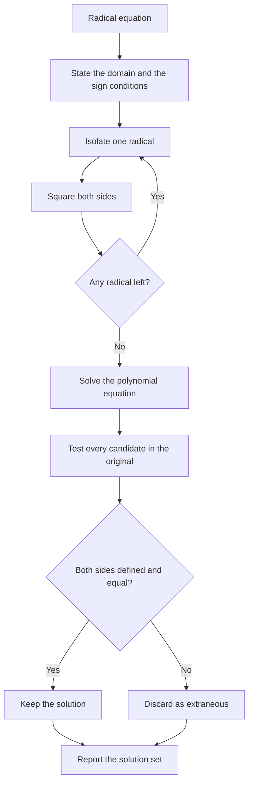

# Radicals and Rational Exponents

> [Algebra](../README.md) · Level: Intermediate · Prerequisites: [exponent laws](../01-elementary-algebra/README.md), [polynomial arithmetic and factoring](../06-polynomials/README.md), quadratic equations, the Pythagorean theorem, [inequalities](../03-inequalities/README.md) · Estimated time: 180 min

## 1. Introduction

A square root answers a geometric question: what side length has a square of area $9$? The answer is
$3$, because $3^2=9$. A cube root answers the three-dimensional version: what edge has a cube of
volume $8$? The answer is $2$, because $2^3=8$. The notation $\sqrt[n]{a}$, the **$n$-th root** of
$a$, generalises both: it asks for a number whose $n$-th power is $a$.

Two features of this innocent question drive the whole topic.

1. **A root need not exist, and when it exists it need not be unique.** The equation $y^2=9$ has two
   real solutions, $3$ and $-3$; the equation $y^2=-9$ has none. To make $\sqrt{\phantom{x}}$ a
   well-defined function, mathematics singles out the non-negative solution and calls it the
   **principal** root. Then $\sqrt9=3$, not $\pm3$, while solving $x^2=9$ still gives $x=\pm3$ — a
   distinction that causes more errors than any other in the topic.
2. **The principal root does not commute with squaring.** Since the principal root is forced to be
   non-negative, $\sqrt{x^2}$ cannot be $x$ for negative $x$; it equals $|x|$. This is not a
   technicality: it is the algebraic content of the absolute value.

The second half of the topic is about *rational exponents*. Writing $\sqrt[n]{a}$ as $a^{1/n}$ and
$\sqrt[n]{a^m}$ as $a^{m/n}$ is not mere notation: it is the unique definition consistent with the
exponent laws. Once that is understood, radicals become powers, and the familiar rules
$a^r a^s = a^{r+s}$ and $(a^r)^s = a^{rs}$ apply with fractional $r,s$.

The third theme is **irreversibility**. Squaring both sides of an equation is not reversible: it
destroys the sign. Solving a radical equation therefore produces *candidate* solutions, and every
candidate must be substituted back. The precise statement — $\sqrt A = B$ is equivalent to
$A = B^2$ **and** $B \ge 0$ — converts a vague "check your answers" into a theorem.

Along the way the topic delivers the distance formula, the equation of a circle, and the first
glimpse of why $x^2=-1$ forces the complex numbers.

## 2. Prerequisites

You should be comfortable with the following, each taught in the linked tutorial.

* **Integer exponents.** $a^m a^n = a^{m+n}$, $(a^m)^n = a^{mn}$, $(ab)^n = a^nb^n$,
  $a^{-n} = 1/a^n$, and $a^0=1$ for $a\ne0$. See [Elementary Algebra](../01-elementary-algebra/README.md).
* **Factoring.** Removing the largest perfect-square (or perfect-cube) factor from an integer or a
  monomial; difference of squares $a^2-b^2=(a-b)(a+b)$; the sum and difference of cubes
  $a^3\pm b^3=(a\pm b)(a^2\mp ab+b^2)$. See [Polynomials](../06-polynomials/README.md).
* **Quadratic equations.** The quadratic formula and the discriminant.
* **Absolute value.** $|x|$ is the distance from $x$ to $0$; $|x|\ge0$; $|x|^2=x^2$.
* **Pythagoras.** In a right triangle with legs $a,b$ and hypotenuse $c$, $a^2+b^2=c^2$.
* **Inequalities.** Multiplying an inequality by a positive quantity preserves it; squaring is
  order-preserving on non-negative numbers. See [Inequalities](../03-inequalities/README.md).

## 3. Learning Objectives

After working through this tutorial you will be able to:

1. Evaluate $n$-th roots of numbers and explain when a real root exists and when it does not.
2. State the definition of the principal root and use it to simplify $\sqrt{x^2}$ correctly as $|x|$.
3. Define $a^{m/n}$ and explain why the exponent laws force that definition.
4. Convert freely between radical and rational-exponent notation.
5. Simplify radicals by extracting perfect powers, including powers of variables.
6. Add and subtract like radicals; multiply radicals; simplify nested radicals such as
   $\sqrt{3+2\sqrt2}$.
7. Rationalise denominators with one term, with binomials (using conjugates), and with cube roots.
8. Solve radical equations and prove that squaring is not reversible; identify extraneous roots.
9. Solve equations containing two radicals and check every candidate.
10. Derive and use the distance formula, the midpoint formula and the equation of a circle.
11. Explain why $x^2=-1$ has no real solution and how the complex numbers resolve this.

## 4. Intuition

Squaring is a machine that takes a number and returns its area when it is the side of a square. The
square root runs the machine backwards: given an area, find the side. But the machine is not
one-to-one: feeding $3$ and feeding $-3$ both return $9$. Running a many-to-one machine backwards
requires a choice, and the choice mathematics makes is: *take the non-negative side*. The square root
sign is therefore a function with a built-in sign convention, and the $\pm$ in $x=\pm3$ appears only
when we solve an equation, not when we evaluate a root.

Think of a ladder against a wall. If the ladder is $5$ m long and its foot is $3$ m from the wall,
Pythagoras says the height is $\sqrt{5^2-3^2}=\sqrt{16}=4$ m. The geometry automatically selects the
positive root, because a height is positive. The algebra alone would offer $\pm4$; the model rejects
$-4$. This is the recurring pattern: radicals produce two algebraic possibilities, and the context
(geometry, time, length) selects one.

Rational exponents extend the idea. "Multiply $a$ by itself $3$ times" makes sense; "multiply $a$ by
itself half a time" does not. But the exponent law $a^m a^n=a^{m+n}$ does make sense for every
integer, and demanding that it continue to hold for fractions leaves exactly one possible meaning for
$a^{1/2}$: the number whose product with itself is $a$. Notation is not invented here; it is forced.

The final intuition is about information loss. Squaring a number destroys its sign; two inputs,
one output. Any operation that destroys information cannot be undone unambiguously. Solving an
equation by squaring therefore widens the set of candidates, and the extra candidates obey the
"other sign" of what was squared. Checking them is how the lost sign is restored.

## 5. Formal Definition

**Definition 5.1 ($n$-th root).** Let $n\ge2$ be an integer and $a\in\mathbb{R}$.

* If $n$ is **odd**, the function $y\mapsto y^n$ is strictly increasing on $\mathbb{R}$, so for every
  $a$ there is exactly one real $y$ with $y^n=a$. We write $y=\sqrt[n]{a}$.
* If $n$ is **even**, the equation $y^n=a$ has a real solution only when $a\ge0$. For $a>0$ there
  are exactly two solutions, one positive and one negative; for $a=0$ there is exactly one, $y=0$.

**Definition 5.2 (Principal root).** For $n$ even and $a\ge0$, the **principal $n$-th root**
$\sqrt[n]{a}$ is the unique non-negative $y$ with $y^n=a$. For $n$ odd, $\sqrt[n]{a}$ is the unique
real $y$ with $y^n=a$ (it is negative when $a<0$). In both cases the symbol is a function of $a$:
one value, determined.

The number $n$ is the **index**, $a$ the **radicand**, and $\sqrt{\phantom{x}}$ the **radical sign**.
When $n=2$ the index is omitted: $\sqrt a=\sqrt[2]{a}$.

The existence of $n$-th roots of non-negative numbers is a consequence of the completeness of the real
line (a continuous increasing function that is $0$ at $0$ and arbitrarily large takes every
intermediate value). That theorem belongs to real analysis; here we use the result.

**Definition 5.3 (Rational exponent).** Let $m,n$ be integers with $n\ge2$ and $\gcd(m,n)=1$. For
$a>0$,
$$a^{m/n}:=\sqrt[n]{a^m}.$$
For $a=0$ the definition applies when $m>0$, giving $0$. For $a<0$ it applies only when $n$ is odd,
and then $a^{m/n}:=\left(\sqrt[n]{a}\right)^m$.

The condition $a>0$ for even $n$ is not a convenience: $(-4)^{1/2}$ would have to be a real number
whose square is $-4$, and no such number exists. The condition $\gcd(m,n)=1$ for negative bases is
also essential; §7.2 shows what goes wrong without it.

**Definition 5.4 (Radical equation).** A **radical equation** is an equation in which the variable
appears in a radicand. Its solution set is the set of real numbers at which every expression in the
equation is defined and the two sides are equal.

**Definition 5.5 (Extraneous root).** A number that satisfies an equation obtained by squaring but
does not satisfy the original equation is an **extraneous root** of the original.

**Definition 5.6 (Like radicals).** Two radicals are **like** when they have the same index and the
same radicand, for example $3\sqrt5$ and $-7\sqrt5$. Like radicals may be combined by adding their
coefficients, because they are like terms in the sense of polynomial algebra.

## 6. Mathematical Notation

| Symbol | Read as | Meaning |
|---|---|---|
| $\sqrt a$ | the square root of $a$ | principal root, defined for $a\ge0$ |
| $\sqrt[n]{a}$ | the $n$-th root of $a$ | index $n$, radicand $a$ |
| $a^{1/n}$ | $a$ to the one $n$-th | $\sqrt[n]{a}$ |
| $a^{m/n}$ | $a$ to the $m$ over $n$ | $\sqrt[n]{a^m}$ |
| $a^{-m/n}$ | $a$ to the minus $m$ over $n$ | $1/a^{m/n}$ |
| $|x|$ | absolute value of $x$ | $\sqrt{x^2}$ |
| $\pm$ | plus or minus | the two signs, taken separately |
| $\sqrt{A}=B$ | the root of $A$ equals $B$ | requires $B\ge0$ |
| $i$ | $i$ | a number with $i^2=-1$; not real |
| $d(P,Q)$ | distance from $P$ to $Q$ | $\sqrt{(x_2-x_1)^2+(y_2-y_1)^2}$ |

Reading aloud: "$\sqrt{x^2}$ equals the absolute value of $x$", never "equals $x$". And
"$a^{m/n}$" is "the $n$-th root of $a$ to the $m$", with the order of the two operations immaterial
(Proposition 8.5).

## 7. Core Concepts

### 7.1 $n$-th roots, the principal root, and why $\sqrt{x^2}=|x|$

The radical sign denotes the **principal** root, and the definition builds in a sign convention:

$$
\sqrt{49}=7,\qquad \sqrt[3]{-27}=-3,\qquad \sqrt[4]{16}=2 .
$$

For $\sqrt[3]{-27}$ the value $-3$ is correct because the index $3$ is odd and $(-3)^3=-27$; for
$\sqrt[4]{16}$ the value $2$ is chosen over $-2$ because the index is even and the principal root is
the non-negative one. The equation $y^4=16$ still has two real solutions, $\pm2$; the *expression*
$\sqrt[4]{16}$ has one value.

This distinction matters most for $\sqrt{x^2}$. Since $x^2\ge0$, the principal square root exists for
every real $x$, and it is non-negative. Test it:

| $x$ | $-3$ | $-2$ | $-1$ | $0$ | $1$ | $2$ | $3$ |
|---|---|---|---|---|---|---|---|
| $x^2$ | $9$ | $4$ | $1$ | $0$ | $1$ | $4$ | $9$ |
| $\sqrt{x^2}$ | $3$ | $2$ | $1$ | $0$ | $1$ | $2$ | $3$ |
| $|x|$ | $3$ | $2$ | $1$ | $0$ | $1$ | $2$ | $3$ |
| $x$ | $-3$ | $-2$ | $-1$ | $0$ | $1$ | $2$ | $3$ |

The rows for $\sqrt{x^2}$ and $|x|$ agree everywhere; the row for $x$ does not. Hence

$$
\sqrt{x^2}=|x| \qquad\text{for every real } x .
$$

The proof is one line: $|x|\ge0$ and $|x|^2=x^2$, and the principal square root is the *unique*
non-negative number whose square is $x^2$ (Proposition 8.1). In particular
$\sqrt{x^2}=x$ only when $x\ge0$; for $x<0$ it equals $-x$.

For higher indices the pattern depends on parity:

$$
\sqrt[n]{x^n}=
\begin{cases}
|x|, & n \text{ even},\\[2pt]
x, & n \text{ odd}.
\end{cases}
$$

Examples: $\sqrt{16x^2}=4|x|$; $\sqrt{x^6}=|x|^3$; $\sqrt[4]{x^4}=|x|$; $\sqrt[3]{x^9}=x^3$;
$\sqrt[3]{-8x^3}=-2x$. When a problem states that a variable is positive, the absolute value may be
dropped — but the hypothesis must be stated, not assumed silently.

### 7.2 Rational exponents, forced by the exponent laws

We want to attach a meaning to $a^{1/n}$ so that the exponent law $(a^p)^q=a^{pq}$ continues to hold
with $p=\frac1n$ and $q=n$:

$$
\left(a^{1/n}\right)^n=a^{1}=a .
$$

So $a^{1/n}$ must be a number whose $n$-th power is $a$. For $a\ge0$ there is exactly one
non-negative such number, namely the principal root. The definition is therefore forced:

$$
a^{1/n}:=\sqrt[n]{a}\qquad(a\ge0;\ a\ \text{arbitrary when } n \text{ is odd}).
$$

For a general fraction, demand $(a^{m/n})^n=a^m$. The number $\sqrt[n]{a^m}$ satisfies this, and it is
the only non-negative candidate, so

$$
a^{m/n}:=\sqrt[n]{a^m}\qquad(a>0).
$$

The two orders of operating agree:

$$
\sqrt[n]{a^m}=\left(\sqrt[n]{a}\right)^m ,
$$

because both sides are non-negative and both have $n$-th power $a^m$ (Proposition 8.5). This is why
one may compute $27^{2/3}$ either as $(\sqrt[3]{27})^2=3^2=9$ or as $\sqrt[3]{27^2}=\sqrt[3]{729}=9$;
the first is easier.

The definition is consistent: if $\frac mn=\frac{km}{kn}$, then $\sqrt[kn]{a^{km}}=\sqrt[n]{a^m}$,
again because both are non-negative and both have the same $kn$-th power $a^{km}$. Without this check
the notation would be ambiguous.

A table of values, all verified by the definition:

| Expression | Computation | Value |
|---|---|---|
| $27^{2/3}$ | $(\sqrt[3]{27})^2=3^2$ | $9$ |
| $16^{-3/4}$ | $1/(\sqrt[4]{16})^3=1/2^3$ | $\frac18$ |
| $8^{-2/3}$ | $1/(\sqrt[3]{8})^2=1/2^2$ | $\frac14$ |
| $(-8)^{2/3}$ | $(\sqrt[3]{-8})^2=(-2)^2$ | $4$ |
| $32^{2/5}$ | $(\sqrt[5]{32})^2=2^2$ | $4$ |

**The negative-base trap.** For $a<0$ the definition requires the fraction in lowest terms with an odd
denominator. The reason is concrete: $\frac26=\frac13$, but applying $\sqrt[n]{a^m}$ with $(m,n)=(2,6)$
gives $\sqrt[6]{(-8)^2}=\sqrt[6]{64}=2$, while with $(m,n)=(1,3)$ it gives $\sqrt[3]{-8}=-2$. The same
exponent would have two values. With the lowest-terms convention, only $(-8)^{1/3}=-2$ and
$(-8)^{2/3}=4$ are admitted, and both formulas agree. For even $n$ no real value exists at all.

For $a>0$ the exponent laws hold for all rational exponents $r,s$:

$$
a^ra^s=a^{r+s},\qquad (a^r)^s=a^{rs},\qquad (ab)^r=a^rb^r,\qquad a^{-r}=\frac{1}{a^r}.
$$

Proposition 8.6 gives the proof from the integer laws.

### 7.3 Simplifying radicals and combining like radicals

Two rules do most of the work. For $a,b\ge0$,

$$
\sqrt[n]{a}\sqrt[n]{b}=\sqrt[n]{ab},
\qquad
\frac{\sqrt[n]{a}}{\sqrt[n]{b}}=\sqrt[n]{\frac ab}\quad(b>0).
$$

Both fail when the radicands are negative; §11 records the standard counterexample. To simplify a
radical, factor out the largest perfect $n$-th power:

$$
\sqrt{50}=\sqrt{25\cdot2}=5\sqrt2,\qquad
\sqrt{72}=\sqrt{36\cdot2}=6\sqrt2,\qquad
\sqrt[3]{54}=\sqrt[3]{27\cdot2}=3\sqrt[3]{2}.
$$

With variables, extract even powers under a square root:

$$
\sqrt{12x^2}=\sqrt{4x^2\cdot3}=2|x|\sqrt3,\qquad
\sqrt{18a^2b^4}=3|a|b^2\sqrt2 .
$$

Radicals are **like** when index and radicand agree, and like radicals combine by the distributive
law:

$$
3\sqrt5+7\sqrt5=(3+7)\sqrt5=10\sqrt5,
\qquad
\sqrt8+\sqrt{18}=2\sqrt2+3\sqrt2=5\sqrt2 .
$$

Unlike radicals do not combine: $\sqrt2+\sqrt3\ne\sqrt5$ (numerically $1.414+1.732=3.146$ while
$\sqrt5\approx2.236$). Neither does a root distribute over a sum:
$\sqrt{9+16}=5$ but $\sqrt9+\sqrt{16}=7$.

### 7.4 Rationalising denominators

A quotient such as $\frac{1}{\sqrt2}$ is correct but awkward; multiplying numerator and denominator by
$\sqrt2$ changes its form without changing its value:

$$
\frac{1}{\sqrt2}=\frac{1}{\sqrt2}\cdot\frac{\sqrt2}{\sqrt2}=\frac{\sqrt2}{2}.
$$

For a general monomial denominator, $\frac{1}{\sqrt[n]{a^k}}$ with $0<k\le n$ is cleared by
multiplying by $\sqrt[n]{a^{\,n-k}}$, since the product of the radicands becomes $a^n$, whose root is
$a$. For
example $\frac{2}{\sqrt[3]{2}}=\frac{2\sqrt[3]{4}}{\sqrt[3]{8}}=\sqrt[3]{4}$.

For a **binomial** denominator containing a square root, multiply by the **conjugate**, using
$(A+B)(A-B)=A^2-B^2$:

$$
\frac{2}{\sqrt7-\sqrt3}
=\frac{2(\sqrt7+\sqrt3)}{(\sqrt7-\sqrt3)(\sqrt7+\sqrt3)}
=\frac{2(\sqrt7+\sqrt3)}{7-3}
=\frac{\sqrt7+\sqrt3}{2}.
$$

The denominator became the rational number $7-3=4$. In general

$$
\frac{1}{\sqrt a+\sqrt b}=\frac{\sqrt a-\sqrt b}{a-b}\qquad(a,b\ge0,\ a\ne b).
$$

For cube roots the conjugate trick is replaced by the factorisation
$u^3-v^3=(u-v)(u^2+uv+v^2)$. With $u=\sqrt[3]{a}$ and $v=\sqrt[3]{b}$,

$$
\left(\sqrt[3]{a}-\sqrt[3]{b}\right)\left(\sqrt[3]{a^2}+\sqrt[3]{ab}+\sqrt[3]{b^2}\right)=a-b .
$$

For example

$$
\frac{1}{\sqrt[3]{2}-1}
=\frac{\sqrt[3]{4}+\sqrt[3]{2}+1}{(\sqrt[3]{2}-1)(\sqrt[3]{4}+\sqrt[3]{2}+1)}
=\sqrt[3]{4}+\sqrt[3]{2}+1 .
$$

Check numerically: $\frac{1}{1.2599-1}=3.847$ and $1.5874+1.2599+1=3.847$.

### 7.5 Operations and nested radicals

Multiplication and division use the product and quotient rules after any necessary simplification:

$$
(3+\sqrt2)(3-\sqrt2)=9-2=7,\qquad
(2\sqrt3-1)^2=12-4\sqrt3+1=13-4\sqrt3,\qquad
\frac{\sqrt{32}}{\sqrt2}=\sqrt{16}=4 .
$$

A **nested radical** is a root inside a root. Some of them collapse:

$$
\sqrt{3+2\sqrt2}=\sqrt2+1,
$$

because $(\sqrt2+1)^2=2+2\sqrt2+1=3+2\sqrt2$ and $\sqrt2+1>0$. The general denesting identity is

$$
\sqrt{a+2\sqrt b}=\sqrt{\frac{a+c}{2}}+\sqrt{\frac{a-c}{2}},
\qquad c=\sqrt{a^2-4b},
$$

valid when $a\ge0$, $b\ge0$ and $a^2\ge4b$; the identity is proved in Proposition 8.9. With $a=3$,
$b=2$ we get $c=\sqrt{9-8}=1$ and the formula returns $\sqrt2+\sqrt{1}=\sqrt2+1$.

Not every nested radical collapses, and $\sqrt{\sqrt a}$ is simply $a^{1/4}$ by the exponent laws.

### 7.6 Radical equations: squaring is not reversible

The central theorem is short and complete:

$$
\sqrt A=B \iff A=B^2\ \text{ and }\ B\ge0 .
$$

*Proof.* If $\sqrt A=B$, then $B\ge0$ by definition of the principal root, and squaring gives $A=B^2$.
Conversely, if $A=B^2$ with $B\ge0$, then $\sqrt A=\sqrt{B^2}=|B|=B$. $\blacksquare$

The equivalence shows exactly where extraneous roots come from. Plain squaring loses the condition
$B\ge0$, so it solves both $\sqrt A=B$ and $\sqrt A=-B$ at once. Every solution of the second equation
that is not a solution of the first is extraneous.

**Procedure.** Isolate the radical; record the sign condition on the other side; square; solve the
resulting polynomial equation; keep only candidates satisfying both the sign condition and the
domain; substitute into the original.

**Example.** Solve $\sqrt{2x+3}=x$.

Squaring gives $2x+3=x^2$, that is $x^2-2x-3=0$, so $(x-3)(x+1)=0$ and $x=3$ or $x=-1$. The sign
condition $x\ge0$ rejects $-1$ immediately. Check: $\sqrt9=3$ for $x=3$; for $x=-1$ the left side is
$\sqrt1=1$ and the right side is $-1$, so it fails. Solution set $\{3\}$.

**Cube roots are different.** The map $x\mapsto x^3$ is strictly increasing on $\mathbb{R}$, hence
one-to-one and onto. Cubing is therefore reversible:
$\sqrt[3]{A}=B\iff A=B^3$, with no sign condition. Solving $\sqrt[3]{2x-1}=-2$ gives
$2x-1=-8$, so $x=-\frac72$; check $\sqrt[3]{-8}=-2$. No candidate is ever extraneous for an odd root,
though arithmetic still deserves a check.

Squaring never *loses* a solution of the original equation: $A=B$ implies $A^2=B^2$. It can only add
candidates. Losses can occur only if a step divides by an expression that might be zero.

### 7.7 Equations with two radicals

When two radicals appear, isolate one of them and square; the cross term produces a single radical,
which is then isolated and squared again. Both squarings can add candidates, so both must be checked.

**Example.** Solve $\sqrt{2x+5}-\sqrt{x+2}=1$.

Isolate: $\sqrt{2x+5}=1+\sqrt{x+2}$. Both sides are non-negative, so squaring is reversible at this
stage:

$$
2x+5=1+2\sqrt{x+2}+(x+2),
$$

so $2x+5=x+3+2\sqrt{x+2}$, hence $x+2=2\sqrt{x+2}$. Square again:

$$
(x+2)^2=4(x+2) \;\Longrightarrow\; (x+2)(x+2-4)=0 \;\Longrightarrow\; x=-2 \ \text{or}\ x=2 .
$$

Check both in the original. $x=-2$: $\sqrt1-\sqrt0=1$ ✓. $x=2$: $\sqrt9-\sqrt4=3-2=1$ ✓. Both are
solutions.

The common error here is to write $\left(\sqrt A-\sqrt B\right)^2=A-B$. The correct expansion is
$A-2\sqrt{AB}+B$; the cross term is exactly what makes the method work.

### 7.8 The distance formula and geometric applications

Place two points $P=(x_1,y_1)$ and $Q=(x_2,y_2)$ in the plane. The horizontal distance between them is
$|x_2-x_1|$ and the vertical distance is $|y_2-y_1|$. These are the legs of a right triangle whose
hypotenuse is $PQ$, so Pythagoras gives

$$
PQ^2=(x_2-x_1)^2+(y_2-y_1)^2,
\qquad
PQ=\sqrt{(x_2-x_1)^2+(y_2-y_1)^2}.
$$

The non-negative root is taken because a distance is non-negative; the absolute values disappear
because squares are non-negative. For example the distance from $(1,2)$ to $(4,6)$ is
$\sqrt{3^2+4^2}=\sqrt{25}=5$.

The **midpoint** is the average of the coordinates:
$\left(\frac{x_1+x_2}{2},\frac{y_1+y_2}{2}\right)$. Translating the origin to $P$ reduces the claim to
the one-dimensional fact that the midpoint of $0$ and $x_2-x_1$ is half their sum.

A **circle** of radius $r$ centred at $(h,k)$ is the set of points at distance $r$ from the centre:

$$
(x-h)^2+(y-k)^2=r^2 .
$$

In three dimensions the same argument applied twice gives
$d=\sqrt{(x_2-x_1)^2+(y_2-y_1)^2+(z_2-z_1)^2}$.

### 7.9 A note on $x^2=-1$

For every real $x$, $x^2\ge0$. Hence $x^2=-1$ has no real solution, and $\sqrt{-1}$ is not a real
number. Mathematics extends the number system rather than abandoning the equation: define $i$ by
$i^2=-1$ and consider numbers $z=a+bi$ with $a,b\in\mathbb{R}$. In that larger system every quadratic
equation has two roots, and in fact every polynomial of degree $n$ has $n$ roots counted with
multiplicity.

Two warnings carry over from this chapter. First, $\sqrt{-1}\cdot\sqrt{-1}=i\cdot i=-1$, not
$\sqrt{(-1)(-1)}=1$; the product rule $\sqrt a\sqrt b=\sqrt{ab}$ requires $a,b\ge0$. Second, the
principal-root convention must be handled with care in $\mathbb{C}$; the safe definition of
$z^{1/2}$ is multivalued, and a branch must be chosen. The full story belongs to
[Complex Analysis](../../15-complex-analysis/README.md).

## 8. Formulas and Properties

Every statement below carries its hypotheses. The proofs use the uniqueness of the principal root
(Proposition 8.1), which is the workhorse of the whole chapter.

**Proposition 8.1 (Uniqueness of the principal root).** Let $n\ge2$ and $a\ge0$. Among non-negative
real numbers there is at most one $y$ with $y^n=a$. Existence is supplied by the completeness of
$\mathbb{R}$.

*Proof of uniqueness.* Suppose $u,v\ge0$ and $u^n=v^n$. If $u>v$, then
$$u^n-v^n=(u-v)\left(u^{n-1}+u^{n-2}v+\cdots+uv^{n-2}+v^{n-1}\right)>0,$$
because $u-v>0$ and the bracket is a sum of non-negative terms, at least one of which is positive.
So $u^n>v^n$, contradicting $u^n=v^n$. Similarly $v>u$ is impossible. Hence $u=v$.
$\blacksquare$

**Proposition 8.2 ($\sqrt[n]{x^n}$).** For every real $x$,
$$\sqrt{x^2}=|x|,\qquad
\sqrt[n]{x^n}=\begin{cases}|x|, & n \text{ even},\\ x, & n \text{ odd}.\end{cases}$$

*Proof.* For $n=2$: $|x|\ge0$ and $|x|^2=x^2$, so $|x|$ is the non-negative number whose square is
$x^2$; by Proposition 8.1 it equals the principal root $\sqrt{x^2}$. For even $n$, $|x|^n=x^n$ and
$|x|\ge0$, so $\sqrt[n]{x^n}=|x|$ by the same uniqueness. For odd $n$, $x^n$ has the sign of $x$ and
$x$ is the unique real solution of $y^n=x^n$, so $\sqrt[n]{x^n}=x$. $\blacksquare$

**Proposition 8.3 (Product rule).** Let $a,b\ge0$ and $n\ge2$. Then
$\sqrt[n]{a}\,\sqrt[n]{b}=\sqrt[n]{ab}$.

*Proof.* Both factors are non-negative, so their product is non-negative. Raising it to the $n$-th
power gives $\left(\sqrt[n]a\right)^n\left(\sqrt[n]b\right)^n=ab$. By Proposition 8.1 this product is
the principal $n$-th root of $ab$. $\blacksquare$

The hypothesis $a,b\ge0$ is essential: with $a=b=-1$ the left side is not even defined in
$\mathbb{R}$, while $\sqrt{(-1)(-1)}=1$.

**Proposition 8.4 (Quotient rule).** Let $a\ge0$, $b>0$ and $n\ge2$. Then
$\dfrac{\sqrt[n]{a}}{\sqrt[n]{b}}=\sqrt[n]{\dfrac ab}$.

*Proof.* The quotient is non-negative and its $n$-th power is $a/b$; apply Proposition 8.1.
$\blacksquare$

**Proposition 8.5 (Order of operations in $a^{m/n}$).** Let $a\ge0$, and let $m,n$ be integers with
$n\ge2$. Then
$$\left(\sqrt[n]{a}\right)^m=\sqrt[n]{a^m},$$
and if $\frac mn=\frac{km}{kn}$ with $k\ge1$, then $\sqrt[kn]{a^{km}}=\sqrt[n]{a^m}$.

*Proof.* For the first identity, both sides are non-negative, and raising the left side to the $n$-th
power gives
$\left(\left(\sqrt[n]a\right)^m\right)^n=\left(\sqrt[n]a\right)^{mn}=\left(\left(\sqrt[n]a\right)^n\right)^m=a^m$.
By Proposition 8.1 the left side is the principal root of $a^m$. For the second, both sides are
non-negative and both have $kn$-th power $a^{km}$. $\blacksquare$

**Proposition 8.6 (Exponent laws for rational exponents).** Let $a>0$ and let $r,s\in\mathbb{Q}$.
Then
$$a^ra^s=a^{r+s},\qquad (a^r)^s=a^{rs},\qquad (ab)^r=a^rb^r\ (b>0),\qquad a^{-r}=\frac{1}{a^r}.$$

*Proof.* Write $r=\frac mn$ and $s=\frac pq$ with $n,q\ge1$. For the first law, put both factors over
the common index $nq$ using Proposition 8.5:
$a^r=\sqrt[nq]{a^{mq}}$ and $a^s=\sqrt[nq]{a^{pn}}$. The product rule gives
$\sqrt[nq]{a^{mq+pn}}=a^{(mq+pn)/(nq)}=a^{r+s}$. For the second, both sides are positive; the $nq$-th
power of the left side is $\left(\left(a^{m/n}\right)^{p/q}\right)^{nq}=\left(\left(a^{m/n}\right)^{p}\right)^{n}=\left(a^{m/n}\right)^{pn}=a^{mp}$, and the
$nq$-th power of $a^{mp/(nq)}$ is also $a^{mp}$; positive numbers with equal powers are equal. For the third, first
take $r=\frac1n$: $\left(a^{1/n}b^{1/n}\right)^n=ab$ with both sides positive, so
$(ab)^{1/n}=a^{1/n}b^{1/n}$; then raise to the integer power $m$. The fourth is the case $s=-r$ of the
first law, since $a^0=1$. $\blacksquare$

**Proposition 8.7 (Squaring and equivalence).** For expressions $A,B$:

1. $A=B\Rightarrow A^2=B^2$.
2. The converse fails: $A=1$, $B=-1$ gives equal squares but $A\ne B$.
3. If $A\ge0$, then $\sqrt A=B\iff A=B^2$ and $B\ge0$.

*Proof.* (1) Substituting equal values into the function $t\mapsto t^2$ gives equal outputs.
(2) $1^2=(-1)^2$ but $1\ne-1$. (3) If $\sqrt A=B$, then $B\ge0$ because the principal root is
non-negative, and $B^2=A$ by definition. Conversely if $A=B^2$ and $B\ge0$, then
$\sqrt A=\sqrt{B^2}=|B|=B$ by Proposition 8.2. $\blacksquare$

*Consequence.* The solutions of $\sqrt A=B$ are exactly the solutions of $A=B^2$ that also satisfy
$B\ge0$. Squaring therefore cannot lose a solution, but it can add every solution of
$\sqrt A=-B$ that fails the sign test. This is the complete explanation of extraneous roots in
radical equations.

**Proposition 8.8 (Squaring a sum of radicals).** For $A,B\ge0$,
$$\left(\sqrt A\pm\sqrt B\right)^2=A+B\pm2\sqrt{AB}.$$

*Proof.* Expand: $A\pm2\sqrt A\sqrt B+B$, and $\sqrt A\sqrt B=\sqrt{AB}$ by Proposition 8.3.
$\blacksquare$

The cross term $2\sqrt{AB}$ is why $\left(\sqrt A-\sqrt B\right)^2\ne A-B$.

**Proposition 8.9 (Denesting).** Let $a\ge0$, $b\ge0$ and $c=\sqrt{a^2-4b}$, and suppose $a^2\ge4b$.
Then
$$\sqrt{a+2\sqrt b}=\sqrt{\frac{a+c}{2}}+\sqrt{\frac{a-c}{2}}.$$

*Proof.* Both terms under the outer roots are non-negative because $c\le a$ (indeed
$c^2=a^2-4b\le a^2$ and $c\ge0$). Squaring the right side by Proposition 8.8:
$$\frac{a+c}{2}+\frac{a-c}{2}+2\sqrt{\frac{a+c}{2}\cdot\frac{a-c}{2}}
=a+2\sqrt{\frac{a^2-c^2}{4}}=a+2\sqrt{\frac{4b}{4}}=a+2\sqrt b .$$
The right side is non-negative, so it equals the principal root. $\blacksquare$

**Proposition 8.10 (Distance formula).** For $P=(x_1,y_1)$ and $Q=(x_2,y_2)$,
$$PQ=\sqrt{(x_2-x_1)^2+(y_2-y_1)^2}.$$

*Proof.* The segment $PQ$ is the hypotenuse of a right triangle whose legs have lengths
$|x_2-x_1|$ and $|y_2-y_1|$ (translate one vertex to the origin and align the axes). Pythagoras gives
$PQ^2=(x_2-x_1)^2+(y_2-y_1)^2$. Since a distance is non-negative, $PQ$ is the principal square root.
$\blacksquare$

## 9. Step-by-Step Examples

### Example 9.1 — Evaluating roots

Evaluate (a) $\sqrt{49}$, (b) $\sqrt[3]{-27}$, (c) $\sqrt[4]{16}$, (d) $\sqrt{-4}$.

*Part (a).* $7^2=49$ and $7\ge0$, so $\sqrt{49}=7$. The value $-7$ is not the principal root, even
though $(-7)^2=49$.

*Part (b).* The index $3$ is odd, so negative radicands are allowed. Since $(-3)^3=-27$,
$\sqrt[3]{-27}=-3$.

*Part (c).* $2^4=16$ and $2\ge0$, so $\sqrt[4]{16}=2$. (The equation $y^4=16$ has solutions $\pm2$;
the expression has the value $2$.)

*Part (d).* No real number has square $-4$, so $\sqrt{-4}$ is undefined in $\mathbb{R}$.

*Check.* $7^2=49$; $(-3)^3=-27$; $2^4=16$.

### Example 9.2 — Simplifying $\sqrt{x^2}$ and higher powers

Simplify (a) $\sqrt{(5)^2}$, (b) $\sqrt{(-5)^2}$, (c) $\sqrt{9x^2}$, (d) $\sqrt{x^6}$,
(e) $\sqrt[3]{x^9}$, (f) $\sqrt[4]{(x-1)^4}$.

*Part (a).* $\sqrt{25}=5$.

*Part (b).* $\sqrt{25}=5$, not $-5$: the principal root is non-negative, and indeed $|-5|=5$.

*Part (c).* $\sqrt{9x^2}=\sqrt9\sqrt{x^2}=3|x|$. If the problem states $x\ge0$, this is $3x$.

*Part (d).* $x^6=(x^3)^2$, so $\sqrt{x^6}=|x^3|=|x|^3$.

*Part (e).* The index is odd, so $\sqrt[3]{x^9}=x^3$ for every real $x$.

*Part (f).* The index is even, so $\sqrt[4]{(x-1)^4}=|x-1|$.

*Check.* At $x=-2$: part (c) gives $3\cdot2=6$, and $\sqrt{36}=6$; part (d) gives $8$ and
$\sqrt{64}=8$; part (e) gives $-8$ and $\sqrt[3]{-512}=-8$.

### Example 9.3 — Rational exponents

Evaluate (a) $27^{2/3}$, (b) $16^{-3/4}$, (c) $(-8)^{2/3}$, (d) $\left(\frac{4}{9}\right)^{3/2}$.

*Part (a).* $27^{2/3}=\left(\sqrt[3]{27}\right)^2=3^2=9$.

*Part (b).* $16^{-3/4}=\dfrac{1}{16^{3/4}}=\dfrac{1}{\left(\sqrt[4]{16}\right)^3}=\dfrac{1}{2^3}=\dfrac18$.

*Part (c).* The denominator $3$ is odd, so the negative base is allowed:
$(-8)^{2/3}=\left(\sqrt[3]{-8}\right)^2=(-2)^2=4$.

*Part (d).* $\left(\frac49\right)^{3/2}=\left(\sqrt{\frac49}\right)^3=\left(\frac23\right)^3=\frac{8}{27}$.

*Check.* $9^{3/2}=27$ and $27^{2/3}=9$ are consistent; $16^{3/4}=8$ and $8^{-1}=\frac18$; $4^{3/2}=8$
so $(-8)^{2/3}=4$ has the right magnitude and sign.

### Example 9.4 — Simplifying and combining radicals

Simplify $\sqrt{50}+\sqrt{18}-\sqrt{8}$.

*Step 1 — extract perfect squares.* $\sqrt{50}=5\sqrt2$, $\sqrt{18}=3\sqrt2$, $\sqrt{8}=2\sqrt2$.

*Step 2 — combine like radicals.* $5\sqrt2+3\sqrt2-2\sqrt2=(5+3-2)\sqrt2=6\sqrt2$.

*Check numerically.* $\sqrt{50}\approx7.0711$, $\sqrt{18}\approx4.2426$, $\sqrt{8}\approx2.8284$;
the combination is $7.0711+4.2426-2.8284=8.4853$, and $6\sqrt2\approx8.4853$. ✓

### Example 9.5 — Rationalising a binomial denominator

Simplify $\dfrac{\sqrt5+\sqrt2}{\sqrt5-\sqrt2}$.

*Step 1 — multiply by the conjugate.*
$\dfrac{\sqrt5+\sqrt2}{\sqrt5-\sqrt2}\cdot\dfrac{\sqrt5+\sqrt2}{\sqrt5+\sqrt2}$.

*Step 2 — expand.* Numerator: $(\sqrt5+\sqrt2)^2=5+2\sqrt{10}+2=7+2\sqrt{10}$. Denominator:
$5-2=3$.

*Step 3 — write the answer.* $\dfrac{7+2\sqrt{10}}{3}$.

*Check numerically.* Original $\frac{2.2361+1.4142}{2.2361-1.4142}=\frac{3.6503}{0.8219}=4.441$.
Answer $\frac{7+6.3246}{3}=\frac{13.3246}{3}=4.4415$. ✓

### Example 9.6 — Rationalising a cube-root denominator

Simplify $\dfrac{1}{\sqrt[3]{2}-1}$.

*Step 1 — recognise the difference of cubes.* With $u=\sqrt[3]{2}$ and $v=1$,
$u^3-v^3=(u-v)(u^2+uv+v^2)$, so the multiplier is $u^2+u+1=\sqrt[3]{4}+\sqrt[3]{2}+1$.

*Step 2 — multiply.*

$$
\dfrac{\sqrt[3]{4}+\sqrt[3]{2}+1}{(\sqrt[3]{2}-1)(\sqrt[3]{4}+\sqrt[3]{2}+1)}
=\dfrac{\sqrt[3]{4}+\sqrt[3]{2}+1}{2-1}=\sqrt[3]{4}+\sqrt[3]{2}+1 .
$$

*Check numerically.* $\frac{1}{1.2599-1}=3.8473$; the answer is $1.5874+1.2599+1=3.8473$. ✓

### Example 9.7 — Denesting a radical

Simplify $\sqrt{7+4\sqrt3}$.

*Step 1 — match the pattern.* $4\sqrt3=2\sqrt{12}$, so $a=7$ and $b=12$.

*Step 2 — compute $c$.* $c=\sqrt{a^2-4b}=\sqrt{49-48}=1$.

*Step 3 — apply Proposition 8.9.*
$\sqrt{7+4\sqrt3}=\sqrt{\frac{7+1}{2}}+\sqrt{\frac{7-1}{2}}=\sqrt4+\sqrt3=2+\sqrt3$.

*Step 4 — verify by squaring.* $(2+\sqrt3)^2=4+4\sqrt3+3=7+4\sqrt3$ ✓, and $2+\sqrt3>0$, so it is
the principal root.

### Example 9.8 — A radical equation with an extraneous root

Solve $\sqrt{2x+3}=x$.

*Step 1 — sign condition.* The left side is non-negative, so any solution must satisfy $x\ge0$.

*Step 2 — square.* $2x+3=x^2$, that is $x^2-2x-3=0$.

*Step 3 — solve.* $(x-3)(x+1)=0$, so $x=3$ or $x=-1$.

*Step 4 — apply the sign condition.* $x=-1$ is rejected because $-1<0$ (equivalently, it solves
$\sqrt{2x+3}=-x$, not the original).

*Step 5 — check.* $x=3$: left side $\sqrt9=3$, right side $3$ ✓. Solution set $\{3\}$.

### Example 9.9 — An equation with two radicals

Solve $\sqrt{2x+5}-\sqrt{x+2}=1$.

*Step 1 — isolate one radical.* $\sqrt{2x+5}=1+\sqrt{x+2}$. The right side is positive, so the sign
condition is automatic here.

*Step 2 — square and simplify.* $2x+5=1+2\sqrt{x+2}+(x+2)$, so $x+2=2\sqrt{x+2}$.

*Step 3 — square again.* $(x+2)^2=4(x+2)$, so $(x+2)(x+2-4)=0$ and $x=-2$ or $x=2$.

*Step 4 — check both in the original.* $x=-2$: $\sqrt1-\sqrt0=1$ ✓. $x=2$: $\sqrt9-\sqrt4=1$ ✓.

*Step 5 — answer.* $\{-2,2\}$.

### Example 9.10 — The distance formula in use

Find every point on the $x$-axis that is equidistant from $A=(2,3)$ and $B=(5,7)$.

*Step 1 — coordinates of the unknown.* A point on the $x$-axis has the form $(x,0)$.

*Step 2 — write both distances.*
$d(P,A)^2=(x-2)^2+3^2$ and $d(P,B)^2=(x-5)^2+7^2$. Equidistance is equivalent to equality of the
squares, because both distances are non-negative.

*Step 3 — expand.*

$$
x^2-4x+4+9=x^2-10x+25+49
\;\Longrightarrow\;
-4x+13=-10x+74
\;\Longrightarrow\;
6x=61 .
$$

*Step 4 — solve and check.* $x=\frac{61}{6}$. Then
$d(P,A)^2=\left(\frac{49}{6}\right)^2+9=\frac{2401+324}{36}=\frac{2725}{36}$ and
$d(P,B)^2=\left(\frac{31}{6}\right)^2+49=\frac{961+1764}{36}=\frac{2725}{36}$ ✓.

*Step 5 — answer.* The point is $\left(\frac{61}{6},0\right)$, approximately $(10.17,0)$.

## 10. Visual Explanations

The solution procedure for a radical equation is a loop with a mandatory exit test.

Whether a real root exists is decided by the index and the sign of the radicand.

| Index | Radicand positive | Radicand zero | Radicand negative |
|---|---|---|---|
| Even ($n=2,4,\dots$) | one principal root, positive | root $0$ | no real root |
| Odd ($n=3,5,\dots$) | one positive root | root $0$ | one negative root |

The graph of $y=\sqrt x$ is the upper half of the parabola $x=y^2$: it starts at the origin, increases
without bound, but ever more slowly. The domain is $x\ge0$, the range is $y\ge0$, and the curve is the
mirror image, across the line $y=x$, of the right half of $y=x^2$. This is the geometric reason a
square root cannot return a negative value.

## 11. Common Mistakes

1. **Writing $\sqrt{x^2}=x$.** False for $x<0$; the correct identity is $\sqrt{x^2}=|x|$.
2. **Confusing the equation $x^2=9$ with the expression $\sqrt9$.** The equation has solutions $\pm3$; the expression equals $3$.
3. **Distributing a root over a sum.** $\sqrt{a+b}\ne\sqrt a+\sqrt b$; for $a=b=9$ the left side is $\sqrt{18}$ and the right side is $6$.
4. **Combining unlike radicals.** $\sqrt2+\sqrt3$ cannot be simplified; only equal indices and equal radicands combine.
5. **Using $\sqrt a\sqrt b=\sqrt{ab}$ for negative numbers.** $\sqrt{-1}\sqrt{-1}=i^2=-1$, not $\sqrt1=1$.
6. **Squaring a sum term by term.** $(\sqrt A+\sqrt B)^2\ne A+B$; the cross term $2\sqrt{AB}$ is missing.
7. **Forgetting the sign condition after squaring.** $\sqrt A=B$ requires $B\ge0$; without it, extraneous roots survive.
8. **Squaring twice without checking.** Each squaring can add candidates, so both checks are needed.
9. **Applying an even root to a negative radicand.** $\sqrt{-9}$ is not a real number; write "no real solution".
10. **Misusing rational exponents with negative bases.** $(-8)^{2/6}$ is ambiguous; the fraction must be in lowest terms with an odd denominator.
11. **Dropping the absolute value too early.** $\sqrt{4x^2}=2|x|$, not $2x$; state the hypothesis $x\ge0$ if you drop it.
12. **Cubing an equation and assuming extraneous roots are possible.** Cubing is reversible; a failed check there signals an arithmetic error, not a spurious root.

## 12. Applications

**Geometry.** The distance formula, the midpoint formula and the equation of a circle are direct
consequences of Pythagoras and a square root. The same formula in three dimensions gives lengths of
segments in space, and in $n$ dimensions it defines the Euclidean norm
$\lVert x\rVert=\sqrt{x_1^2+\cdots+x_n^2}$.

**Physics.** The period of a small-amplitude pendulum is $T=2\pi\sqrt{L/g}$, so the length needed for
a given period is $L=g\left(T/2\pi\right)^2$. The time for an object to fall a height $h$ from rest is
$t=\sqrt{2h/g}$. The speed of a wave on a string is $\sqrt{T/\mu}$, where $T$ is tension and $\mu$ is
linear density.

**Statistics.** Standard deviation is a square root of a variance, which is why it has the same units
as the data. The root-mean-square value of a varying quantity is defined by a square root average, and
confidence intervals are half-widths built from square roots of sample sizes.

**Engineering and computing.** The hypotenuse computation is the inner loop of computer graphics and
of every distance query in a spatial database. Squaring is cheap; the final square root is often
avoided by comparing squared distances. Fourier transforms, signal amplitudes and impedance magnitudes
all involve square roots of sums of squares.

**Finance.** The compound-interest formula inverted for time uses logarithms, but the "rule of 72" and
the computation of annualised returns from growth factors use roots: a growth factor $g$ over $n$
years corresponds to an annual rate $g^{1/n}-1$.

**Everyday reasoning.** Screens are measured diagonally as $\sqrt{w^2+h^2}$; ladder problems, ramp
slopes and navigation all reduce to the same formula.

## 13. Exercises

The problem set is in [exercises.md](exercises.md): 36 problems, graded from evaluating roots and
converting notation through rationalising, denesting and radical equations to proofs and
competition-style problems.

## 14. Solutions

Complete worked solutions, with every significant step and a verification by substitution, are in
[solutions.md](solutions.md). Each solution states the domain or sign condition before squaring,
because that is where extraneous roots are created.

## 15. Summary

* $\sqrt[n]{a}$ is the principal root: non-negative for even $n$, sign of $a$ for odd $n$.
* For even $n$ a real root exists only when $a\ge0$; for odd $n$ it exists for every real $a$.
* $\sqrt{x^2}=|x|$, and $\sqrt[n]{x^n}=|x|$ for even $n$, $x$ for odd $n$.
* $a^{m/n}=\sqrt[n]{a^m}=(\sqrt[n]a)^m$ for $a\ge0$; the definition is forced by the exponent laws.
* Rational exponents with negative bases require lowest terms and an odd denominator.
* For $a,b\ge0$: $\sqrt[n]a\sqrt[n]b=\sqrt[n]{ab}$ and $\sqrt[n]a/\sqrt[n]b=\sqrt[n]{a/b}$; the hypotheses cannot be dropped.
* Like radicals combine by adding coefficients; unlike radicals do not.
* Rationalising multiplies by $1$: by $\sqrt[n]{a^{n-k}}$ for monomials, by the conjugate for binomials, by the cube-root factor for $\sqrt[3]a-\sqrt[3]b$.
* $\sqrt A=B\iff A=B^2$ and $B\ge0$; squaring is not reversible, so candidates must be checked.
* $\left(\sqrt A\pm\sqrt B\right)^2=A+B\pm2\sqrt{AB}$; the cross term drives the two-radical method.
* The distance formula is Pythagoras plus the principal root; the midpoint is the coordinate average.
* $x^2=-1$ has no real solution; adjoining $i$ with $i^2=-1$ gives the complex numbers.

## 16. Further Learning

Within this curriculum:

* [Elementary Algebra](../01-elementary-algebra/README.md) — integer exponents and the fraction rules used throughout.
* [Polynomials](../06-polynomials/README.md) — factoring, including the sum and difference of cubes used for rationalising.
* [Inequalities](../03-inequalities/README.md) — the order properties that justify squaring only on non-negative quantities.
* [Rational Expressions](../09-rational-expressions/README.md) — the companion topic on extraneous roots from a vanishing denominator.
* [Precalculus](../../06-precalculus/README.md) — radical functions, their graphs, inverses and transformations.
* [Calculus](../../07-calculus/README.md) — derivatives of $x^{m/n}$ and integrals involving radicals.
* [Complex Analysis](../../15-complex-analysis/README.md) — the full story of roots of negative numbers.

Standard references: Stewart, *Calculus* (radical and rational-exponent review); Sullivan,
*Algebra and Trigonometry* (radicals, rational exponents and radical equations); Andreescu and
Andrica, *Complex Numbers from A to Z* (the passage to $\mathbb{C}$). None is required in order to
continue in this repository.

