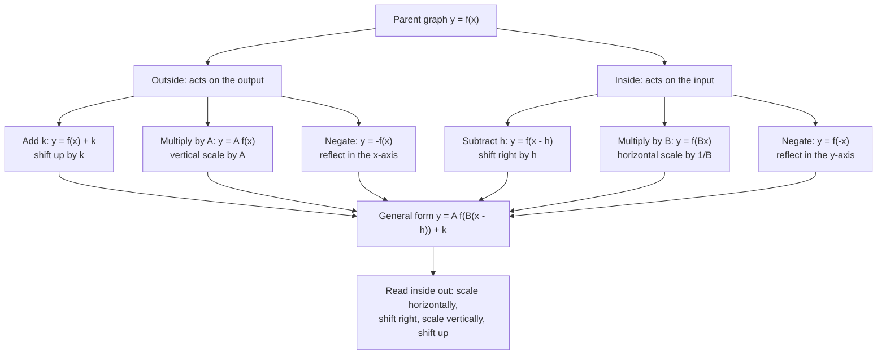
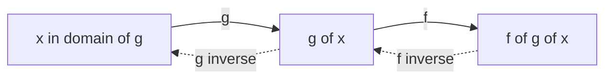

# Functions

> [Algebra](../README.md) · Level: Intermediate · Prerequisites: [Elementary Algebra](../01-elementary-algebra/README.md), [Inequalities](../03-inequalities/README.md), [Intermediate Algebra](../04-intermediate-algebra/README.md), [Polynomials](../06-polynomials/README.md) · Estimated time: 10 h

## 1. Introduction

Almost every quantitative statement in science has the form *this depends on that*. The area of a
circle depends on its radius; the tax you owe depends on your income; the temperature of a cooling cup
depends on how long it has been standing. A **function** is the object that records such a dependence
completely: for each admissible input it names exactly one output.

The idea is older than its notation — tables of eclipse dates, interest tables and tide tables are
ancient input–output lists, and they are functions in the modern sense. What changed in the
seventeenth and eighteenth centuries was the willingness to treat the *rule* itself as an object:
Leibniz used "function" for a quantity varying along a curve, Euler introduced $f(x)$ in 1734, and
Dirichlet separated the notion from any formula at all. The set-theoretic definition used today
(Section 5) is the one every later subject assumes.

Two features make the subject more than notation.

1. **The domain is part of the function.** The formula $f(x)=\sqrt{4-x}$ says nothing until we say
   which $x$ are allowed; for $x=5$ there is no real output. Many later errors are domain errors in
   disguise.
2. **Structure is visible in the graph.** Whether a curve is the graph of a function, whether the
   function can be undone, whether it is symmetric, where it rises and falls — each is a geometric
   question with an algebraic answer and a test that can be applied by eye.

This tutorial treats the function as a rule, as a set of ordered pairs, as a graph and as a machine;
finds domains and ranges, including restricted ones; develops function notation; states and proves
the two line tests; classifies functions by symmetry and monotonicity; measures change with the
average rate of change; derives the transformation rules and explains why they work; treats
composition and its domain; proves that a bijection has exactly one inverse and that inverse graphs
are reflections in $y=x$; and closes with piecewise and absolute-value functions.

## 2. Prerequisites

* **Algebraic manipulation** — expanding, factoring, collecting like terms, the field axioms:
  [Elementary Algebra](../01-elementary-algebra/README.md).
* **Intervals and inequalities** — the meaning of $[a,b]$, $(a,b)$, $[a,\infty)$:
  [Inequalities](../03-inequalities/README.md).
* **Roots and rational exponents** — $\sqrt{x}$ defined for $x\ge0$ and never negative,
  $x^{m/n}=\sqrt[n]{x^m}$: [Intermediate Algebra](../04-intermediate-algebra/README.md).
* **Polynomials and quadratics** — completing the square and the vertex form $a(x-h)^2+k$:
  [Polynomials](../06-polynomials/README.md).
* **The coordinate plane** — plotting $(x,y)$, reading a graph, the slope through two points:
  [Pre-Algebra](../../02-pre-algebra/README.md).

## 3. Learning Objectives

After working through this tutorial you will be able to:

1. Describe a function as a rule, a table, a set of ordered pairs and a graph, and decide when two
   descriptions define the same function.
2. Apply the vertical line test, and find natural domains involving radicals, quotients and context.
3. Evaluate at numbers, at symbols and at expressions such as $f(x+h)$, and simplify a difference
   quotient.
4. Apply the horizontal line test and prove algebraically that a function is one-to-one.
5. Classify a function as even, odd or neither, and find the intervals on which it rises or falls.
6. Compute average rates of change and interpret them as slopes of secant lines.
7. Derive and apply the rule $y=A f(B(x-h))+k$, explaining why inside changes act in reverse.
8. Form compositions, compute their exact domains, and show that $f\circ g\ne g\circ f$.
9. Decide whether a function is invertible, find its inverse, and prove uniqueness and the reflection
   in $y=x$.
10. Work with piecewise and absolute-value functions, including $y=|f(x)|$ and $y=f(|x|)$.

## 4. Intuition

Think of a machine with a slot at the top and a tray at the bottom. You drop a number in; fixed
operations are performed; a single number lands in the tray. The machine is *deterministic* — the same
input always gives the same output — and it may accept only some inputs, which are its domain. A
vending machine that sometimes gives crisps and sometimes chocolate for button B4 is not a function of
the button; one that is empty at B4 simply has B4 outside its domain.

Now plot every $(x,\text{output})$ pair. Two consequences of determinism are the source of the two
line tests. Because each input has *one* output, a vertical line meets the graph at most once. Because
a curve can double back, a horizontal line may meet it several times; when no horizontal line meets it
more than once, every output has a single input that produced it, and the machine can be run backwards
— exactly the condition for an inverse function.

The rest of the subject is bookkeeping about these two ideas: which inputs are legal, which outputs
occur, when the machine can be reversed, and how the picture changes when the machine is modified.

## 5. Formal Definition

**Definition 5.1 (function).** Let $A$ and $B$ be sets. A **function** $f$ from $A$ to $B$ is a subset
$f\subseteq A\times B$ with the property

$$\forall a \in A\ \exists!\, b \in B \quad (a,b) \in f.$$

Every element of $A$ is the first coordinate of exactly one ordered pair in $f$. We write $f:A\to B$,
and for the unique $b$ with $(a,b)\in f$ we write $b=f(a)$. The phrase **exactly one** carries two
requirements that must be checked separately: *existence* (every $a\in A$ has an output) and
*uniqueness* (no $a$ has two different outputs).

**Definition 5.2 (domain, codomain, range).** For $f:A\to B$, the **domain** is $A$, written
$\operatorname{dom} f$; the **codomain** is $B$, the set in which outputs are declared to lie; the
**range** (or image) is the set of outputs that actually occur,
$\operatorname{ran} f=f[A]=\{f(a):a\in A\}\subseteq B$. The codomain is part of the declaration, the
range a consequence of the rule: for $f(x)=x^2$ with $f:\mathbb{R}\to\mathbb{R}$ the codomain is
$\mathbb{R}$ but the range is $[0,\infty)$.

**Definition 5.3 (graph).** For $A,B\subseteq\mathbb{R}$ the **graph** of $f$ is
$G_f=\{(x,f(x)):x\in A\}\subseteq\mathbb{R}^2$.

**Definition 5.4 (equality).** $f=g$ exactly when $\operatorname{dom} f=\operatorname{dom} g$ and
$f(x)=g(x)$ for every $x$ in that common domain. Thus $f(x)=x$ on $\mathbb{R}$ and $g(x)=x^2/x$ on
$\mathbb{R}\setminus\{0\}$ are **not** equal: they agree where both are defined, but their domains
differ.

**Definition 5.5 (injective, surjective, bijective).** Let $f:A\to B$. Then $f$ is **one-to-one** (or
**injective**) when $\forall x_1,x_2\in A$, $f(x_1)=f(x_2)\Rightarrow x_1=x_2$; **onto** (or
**surjective**) when $\operatorname{ran} f=B$; and a **bijection** when both. The notions are
independent: from $\mathbb{R}$ to $\mathbb{R}$, the map $x\mapsto 2^x$ (studied in
[Exponential and Logarithmic Functions](../12-exponential-and-logarithmic-functions/README.md)) is
one-to-one but not onto, $x^3-x$ is onto but not one-to-one, and $2x+1$ is both.

**Definition 5.6 (even, odd, monotone).** Let $D=\operatorname{dom} f$ satisfy
$x\in D\Rightarrow -x\in D$; call $D$ **symmetric about $0$**. Then $f$ is **even** if $f(-x)=f(x)$
for all $x\in D$, and **odd** if $f(-x)=-f(x)$. On an interval $I\subseteq D$, $f$ is **increasing**
if $x_1<x_2$ in $I$ implies $f(x_1)\le f(x_2)$, and **strictly increasing** if it implies
$f(x_1)<f(x_2)$; *decreasing* and *strictly decreasing* reverse the inequalities.

## 6. Mathematical Notation

| Symbol | Read as | Meaning |
|---|---|---|
| $f : A \to B$ | "$f$ maps $A$ to $B$" | domain $A$, codomain $B$ |
| $f(x)$ | "$f$ of $x$" | the output at $x$; not a product |
| $f(3)$ | "$f$ at $3$" | the value of $f$ when $x=3$ |
| $\operatorname{dom} f$ | "the domain of $f$" | the set of admissible inputs |
| $\operatorname{ran} f$, $f[A]$ | "the range of $f$" | the set of outputs |
| $G_f$ | "the graph of $f$" | the set $\{(x,f(x))\}$ |
| $f \circ g$ | "$f$ composed with $g$" | apply $g$ first: $(f\circ g)(x)=f(g(x))$ |
| $f^{-1}$ | "the inverse of $f$" | defined only for a bijection; **not** $1/f$ |
| $\lvert x\rvert$ | "the absolute value of $x$" | distance from $x$ to $0$ |
| $\Delta x$ | "delta $x$" | a change in $x$ |
| $f(x+h)$ | "$f$ of $x$ plus $h$" | $f$ evaluated at the single input $x+h$ |

In $f(x)$ the parentheses denote *application*, not multiplication: $f(x)$ is not $f\cdot x$. Likewise
$f^{-1}(x)$ is the inverse function at $x$, whereas $f(x)^{-1}=1/f(x)$ is the reciprocal. For $f(x)=2x$
these are $x/2$ and $1/(2x)$.

## 7. Core Concepts

### 7.1 The four faces of a function

**As a rule.** $f(x)=x^2-2x$. Compact, and it allows exact computation, but it hides behaviour until
you evaluate it. **As a table** — a sample of input–output pairs, which is how data arrive from
experiment:

| $x$ | $0$ | $1$ | $2$ | $3$ | $4$ |
|---|---|---|---|---|---|
| $f(x)$ | $0$ | $-1$ | $0$ | $3$ | $8$ |

A table only samples; it never determines the function on all of $\mathbb{R}$ unless a rule is known.
**As a set of ordered pairs**, $f=\{(0,0),(1,-1),(2,0),(3,3),(4,8)\}$ for the same sample — Definition
5.1 in concrete form, and the natural form for a finite domain. **As a graph**, the points plotted in
the plane, which display at a glance the domain, the range, the symmetry, the monotonicity and the
asymptotes. **As a machine**: input enters, fixed operations are applied, output leaves — the most
useful picture for composition, since chaining machines is composition of functions.

Two different-looking formulas may define the same function: $\lvert x\rvert=\sqrt{x^2}$ for every real
$x$. But $\dfrac{x^2-1}{x-1}=x+1$ only for $x\ne1$, so the second formula defines a function with
domain $\mathbb{R}\setminus\{1\}$, not $\mathbb{R}$.

### 7.2 Domain and range

**The natural domain** of a formula is the largest subset of $\mathbb{R}$ on which it produces a real
number. Three restrictions generate almost every case.

1. **Even roots.** $\sqrt{g(x)}$ and $g(x)^{1/2}$ require $g(x)\ge0$; odd roots such as $\sqrt[3]{g(x)}$
   impose no restriction.
2. **Quotients.** $\dfrac{1}{g(x)}$ requires $g(x)\ne0$.
3. **Context.** A model may add conditions the formula does not: a radius must be positive, a
   probability must lie in $[0,1]$, a count of people must be an integer.

When several occur, the natural domain is their **intersection**: for $f(x)=\dfrac{\sqrt{x+2}}{x-1}$
we need $x+2\ge0$ and $x-1\ne0$, so $\operatorname{dom} f=[-2,1)\cup(1,\infty)$.

**Restricted domains.** Sometimes we deliberately shrink the domain, which is how a non-invertible
function becomes invertible: $x^2$ on $\mathbb{R}$ is not one-to-one, but on $[0,\infty)$ it is. The
restriction is part of the definition and can change the range.

**Finding the range.** Project the graph onto the $y$-axis; or solve $y=f(x)$ for $x$ and keep the $y$
for which a real solution exists — for $y=\dfrac{x}{x+1}$ we get $x=\dfrac{y}{1-y}$, so the range is
$\mathbb{R}\setminus\{1\}$; or use monotonicity: a strictly increasing continuous function on $[a,b]$
has range $[f(a),f(b)]$.

### 7.3 Function notation and evaluation

The symbol $f(x)$ names the **output** at input $x$, and $x$ is a *dummy variable*: $f(x)=x^2$ and
$f(t)=t^2$ are the same function. Evaluation substitutes the *whole* input wherever the variable occurs:

$$f(x) = x^2 - 3x \quad \Longrightarrow \quad f(x+h) = (x+h)^2 - 3(x+h).$$

A frequent error is $f(x+h)=x^2+h^2-3x-3h$, as if squaring acted on the pieces separately; squaring
acts on the single number $x+h$.

**The difference quotient** $\dfrac{f(x+h)-f(x)}{h}$ with $h\ne0$ measures the average change of $f$
per unit change of $x$. For $f(x)=x^2-3x$,

$$\begin{aligned}
f(x+h)-f(x) &= \big[(x+h)^2 - 3(x+h)\big] - \big[x^2 - 3x\big] \\
&= x^2 + 2xh + h^2 - 3x - 3h - x^2 + 3x = 2xh + h^2 - 3h,
\end{aligned}$$

so $\dfrac{f(x+h)-f(x)}{h}=\dfrac{h(2x+h-3)}{h}=2x+h-3$. Cancelling $h$ is legal precisely because
$h\ne0$.

### 7.4 The vertical line test

A curve is the graph of a function exactly when every vertical line meets it at most once. If a line
$x=a$ met the curve at two points $(a,b_1)$, $(a,b_2)$ with $b_1\ne b_2$, the input $a$ would have two
outputs. Conversely, if every vertical line meets the curve at most once, declaring $f(a)=b$ whenever
$(a,b)$ lies on the curve defines a function whose graph is that curve. So $x^2+y^2=25$ fails (the line
$x=0$ meets it at $(0,\pm5)$), the parabola $y=x^2$ passes, and the vertical line $x=3$ is not the
graph of a function of $x$.

### 7.5 One-to-one functions and the horizontal line test

Injectivity says that distinct inputs give distinct outputs, and geometrically: **a function is
one-to-one exactly when every horizontal line meets its graph at most once.** If $f(x_1)=f(x_2)=c$
with $x_1\ne x_2$, the line $y=c$ meets the graph twice; conversely such a double meeting gives two
inputs with one output.

**Algebraic proof** proceeds from the definition. For $f(x)=3x+5$, suppose $f(x_1)=f(x_2)$; then
$3x_1+5=3x_2+5$, so $x_1=x_2$. To show that $g(x)=x^2$ is **not** one-to-one on $\mathbb{R}$ a single
counterexample suffices: $g(-2)=4=g(2)$ with $-2\ne2$. One counterexample settles non-injectivity;
injectivity needs the general argument.

Restriction can create injectivity: $x^2$ is one-to-one on $[0,\infty)$, since for $x_1,x_2\ge0$,
$x_1^2=x_2^2$ gives $(x_1-x_2)(x_1+x_2)=0$, and the second factor is positive unless both are zero.

### 7.6 Even and odd symmetry

An even function satisfies $f(-x)=f(x)$: $(x,y)$ and $(-x,y)$ both lie on the graph, which is
therefore unchanged by reflection in the $y$-axis. An odd function satisfies $f(-x)=-f(x)$: $(-x,-y)$
accompanies $(x,y)$, a half-turn about the origin.

| Function | Test | Conclusion |
|---|---|---|
| $x^2$, $x^4$, $\lvert x\rvert$, $\dfrac{1}{x^2+1}$ | $f(-x)=f(x)$ | even |
| $x$, $x^3$, $x^5$, $\dfrac{x}{x^2+1}$ | $f(-x)=-f(x)$ | odd |
| $x^2+x$ | $f(-x)=x^2-x$ | neither |
| $0$ (zero function) | both hold | even **and** odd |

The zero function is the only one that is both: $f(x)=-f(x)$ forces $f(x)=0$. Three algebraic facts
follow by substitution. The sum of two even functions is even, and the sum of two odd functions is odd.
The product of two even functions is even, of two odd functions is even, of an even and an odd function
is odd: for odd $f$ and even $g$, $(fg)(-x)=f(-x)g(-x)=(-f(x))g(x)=-(fg)(x)$. And an odd function
defined at $0$ satisfies $f(0)=0$, because $f(0)=f(-0)=-f(0)$.

### 7.7 Increasing and decreasing

Monotonicity is a property of a function **on an interval**, never at a single point. On $I$, $f$ is
increasing if $x_1<x_2$ in $I$ implies $f(x_1)\le f(x_2)$, strictly increasing if it implies
$f(x_1)<f(x_2)$; decreasing is the same with the inequality reversed.

The interval must be stated. The function $f(x)=1/x$ is strictly decreasing on $(0,\infty)$ and on
$(-\infty,0)$, but **not** on the union: with $x_1=-1<1=x_2$ we get $f(x_1)=-1<1=f(x_2)$. The two
branches are separate, and crossing the gap reverses the ordering.

A strictly monotone function on an interval is one-to-one there: if $x_1\ne x_2$ then one is smaller,
and strict monotonicity makes the images strictly unequal.

### 7.8 Average rate of change

The **average rate of change** of $f$ on $[a,b]$, with $a\ne b$, is

$$\operatorname{ARC}_{[a,b]}(f) = \frac{f(b)-f(a)}{b-a} = \frac{\Delta y}{\Delta x},$$

the change in output per unit of input, in units of output per unit of input — dollars per year,
metres per second, degrees per minute. Geometrically it is the slope of the **secant line** through
$(a,f(a))$ and $(b,f(b))$, since the slope through two points is $\frac{y_2-y_1}{x_2-x_1}$. The sign
carries information: positive means $f$ rose on net, negative means it fell, zero means equal endpoint
heights (which does **not** mean $f$ was constant in between).

For $f(x)=x^2$ on $[1,3]$ it is $4$; on $[1,2]$, $3$; on $[1,1.5]$, $2.5$. The averages approach $2$
as the interval shrinks toward $1$ — the first hint of the derivative in
[Calculus](../../07-calculus/README.md). For a linear function $f(x)=mx+c$ the average is $m$ on every
interval, because $\frac{(mb+c)-(ma+c)}{b-a}=\frac{m(b-a)}{b-a}=m$; for a nonlinear function it depends
on the interval, and that dependence is what "nonlinear" means quantitatively. Writing $b=a+h$ gives
the difference quotient of Section 7.3.

### 7.9 Transformations I: shifts and reflections

A **transformation** builds a new function from a known one by modifying the input or the output. The
parent graph is $G_f=\{(t,f(t))\}$, and a transformation is a rule moving each of its points.

**Vertical shift.** For $y=f(x)+k$ the point $(t,f(t)+k)$ lies on the new graph whenever $(t,f(t))$
lies on the old one: $x$ is untouched and the height gains $k$, so the graph moves **up** by $k$ when
$k>0$. The map $(t,y)\mapsto(t,y+k)$ is a bijection with inverse $(t,y)\mapsto(t,y-k)$, so no point is
lost or duplicated.

**Horizontal shift.** For $y=f(x-h)$: which point on the new graph has $x$-coordinate $t+h$? Its height
is $f((t+h)-h)=f(t)$. So $(t+h,f(t))$ is on the new graph exactly when $(t,f(t))$ is on the old one:
**every point moves right by $h$.** This is the rule that surprises everyone — the formula shows
"$-h$" but the picture moves right. The reason is that the inside of the function is a *demand on the
input*: to obtain the old output $f(t)$ the new function must be fed $x=t+h$. The old value now arrives
later, hence "right".

| Change to the formula | Effect on the graph | Effect on a point |
|---|---|---|
| $f(x)+k$ | shift up by $k$ ($k>0$) | $(t,y)\mapsto(t,y+k)$ |
| $f(x)-k$ | shift down by $k$ | $(t,y)\mapsto(t,y-k)$ |
| $f(x-h)$ | shift **right** by $h$ ($h>0$) | $(t,y)\mapsto(t+h,y)$ |
| $f(x+h)$ | shift **left** by $h$ | $(t,y)\mapsto(t-h,y)$ |
| $-f(x)$ | reflect in the $x$-axis | $(t,y)\mapsto(t,-y)$ |
| $f(-x)$ | reflect in the $y$-axis | $(t,y)\mapsto(-t,y)$ |

In $-f(x)$ the output is negated, turning heights into depths: reflection in the $x$-axis. In $f(-x)$
the input is negated, copying each side of the graph onto the other: reflection in the $y$-axis. Each
map is its own inverse, so each is a genuine mirror operation.

### 7.10 Transformations II: stretches and the general form

**Vertical stretch.** In $y=A f(x)$ each output is multiplied by $A$: the graph is pulled away from the
$x$-axis when $|A|>1$, squashed toward it when $0<|A|<1$, and also reflected in the $x$-axis when
$A<0$. Horizontal coordinates are untouched.

**Horizontal stretch.** In $y=f(Bx)$ the new function reaches $f(t)$ at $x=t/B$, so a feature that sat
at $t$ now sits at $t/B$: the graph is compressed toward the $y$-axis by $1/|B|$ when $|B|>1$, stretched
when $|B|<1$, and reflected in the $y$-axis when $B<0$. The asymmetry is not a notational accident:
multiplying the output by $A$ multiplies heights by $A$, while $f(Bx)$ divides distances from the axis
by $B$.

**The general form.** Every combination used here can be written

$$y = A\, f\big(B(x-h)\big) + k .$$

Read from the inside out: (1) horizontal scale by $1/|B|$, reflecting in the $y$-axis if $B<0$; (2)
horizontal shift right by $h$; (3) vertical scale by $|A|$, reflecting in the $x$-axis if $A<0$; (4)
vertical shift up by $k$. Steps 1–2 and steps 3–4 may each be performed in the other order if the shift
amount is adjusted, since $f(B(x-h))=f(Bx-Bh)$ says that shifting right by $Bh$ before scaling equals
scaling then shifting right by $h$. What is never allowed is shifting by $h$ and then scaling the
*shifted* graph, which produces $f\big(B(x-Bh)\big)$.

**Example.** $y=-2\sqrt{3(x-1)}+5$ comes from $y=\sqrt{x}$ by compressing horizontally by $1/3$,
shifting right $1$, stretching vertically by $2$, reflecting in the $x$-axis, and shifting up $5$. The
domain is $[1,\infty)$, since $3(x-1)\ge0$; the range is $(-\infty,5]$, since $-\sqrt{\cdot}\le0$.

### 7.11 Composition

If $g$ is defined at $x$ and $f$ at $g(x)$, the **composition** is $(f\circ g)(x)=f(g(x))$: $g$ acts
first, $f$ second. In machine language, the output of the $g$-machine feeds the $f$-machine.

The formula $f(g(x))$ can be evaluated exactly when $x\in\operatorname{dom} g$ and
$g(x)\in\operatorname{dom} f$, so

$$\operatorname{dom}(f\circ g) = \{\, x \in \operatorname{dom} g : g(x) \in \operatorname{dom} f \,\}.$$

This is not always the natural domain of the simplified formula. With $f(x)=\sqrt{x}$ and $g(x)=x-3$,

$$(f\circ g)(x)=\sqrt{x-3},\quad \operatorname{dom}(f\circ g)=[3,\infty); \qquad
(g\circ f)(x)=\sqrt{x}-3,\quad \operatorname{dom}(g\circ f)=[0,\infty).$$

Different formulas *and* different domains: composition is **not commutative**. It **is associative**,
$f\circ(g\circ h)=(f\circ g)\circ h$, since both sides send $x$ to $f(g(h(x)))$. A case where
simplifying loses information: with $f(x)=x^2$ and $g(x)=\sqrt{x}$,
$(f\circ g)(x)=x$ for $x\ge0$ while $(g\circ f)(x)=\lvert x\rvert$ for all $x$ — the first has domain
$[0,\infty)$ even though its formula $x$ is defined everywhere. Compute domains from the definition,
never from the tidied formula.

### 7.12 Inverse functions

**Definition.** Let $f:A\to B$ be a bijection. The **inverse** $f^{-1}:B\to A$ is defined by

$$f^{-1}(b)=a \quad\Longleftrightarrow\quad f(a)=b .$$

Equivalently, $f^{-1}\circ f=\operatorname{id}_A$ and $f\circ f^{-1}=\operatorname{id}_B$. One-to-one
guarantees that the preimage $a$ is unique, so the rule names a single element; onto guarantees that
$f^{-1}$ is defined on all of $B$. If either fails, no inverse function exists, though a one-to-one
$f$ has an inverse on its range.

**Finding an inverse.** Write $y=f(x)$, solve for $x$, exchange the names. For
$f(x)=\dfrac{2x+1}{x-3}$ (domain $x\ne3$):

$$y(x-3)=2x+1 \;\Longrightarrow\; xy-3y=2x+1 \;\Longrightarrow\; x(y-2)=3y+1
\;\Longrightarrow\; x=\frac{3y+1}{y-2}.$$

Hence $f^{-1}(x)=\dfrac{3x+1}{x-2}$, with domain $x\ne2$ — exactly the range of $f$. Check:
$f(0)=-\tfrac13$ and $f^{-1}\!\left(-\tfrac13\right)=0$. ✓

**Domain and range swap:** $\operatorname{dom} f^{-1}=\operatorname{ran} f$ and
$\operatorname{ran} f^{-1}=\operatorname{dom} f$. This is the cheapest way to find the range of a
complicated function: invert it and look at the inverse's domain.

**Graphs.** $(a,b)$ lies on $G_f$ exactly when $(b,a)$ lies on $G_{f^{-1}}$, and $(a,b)\mapsto(b,a)$ is
reflection in the line $y=x$ (Theorem 8.6). Hence the two graphs are mirror images across $y=x$, and
any crossing point of the two graphs lies on $y=x$.

**Warning.** $f^{-1}(x)$ is not $\dfrac{1}{f(x)}$: for $f(x)=x+1$, $f^{-1}(x)=x-1$ while
$\dfrac{1}{f(x)}=\dfrac{1}{x+1}$.

### 7.13 Piecewise and absolute-value functions

A function is **piecewise** when the rule changes across the domain:

$$f(x)=\begin{cases}x+2, & x<0,\\ x^2, & 0\le x\le2,\\ 5, & x>2.\end{cases}$$

The conditions must be disjoint and must cover the domain. Evaluate by locating the input:
$f(-3)=-1$, $f(0)=0$, $f(2)=4$, $f(4)=5$. The range is the union of the ranges on the pieces,
$(-\infty,2)\cup[0,4]\cup\{5\}=(-\infty,4]\cup\{5\}$. On a graph, included endpoints get filled dots
and excluded ones open dots; a piecewise graph may jump.

**Absolute value** is the distance from $x$ to $0$, defined piecewise:

$$\lvert x\rvert=\begin{cases}x, & x\ge0,\\ -x, & x<0,\end{cases}$$

with the V-shaped graph of slopes $\pm1$ and vertex at the origin. Useful identities, each proved by
cases, are

$$\lvert xy\rvert=\lvert x\rvert\lvert y\rvert,\qquad
\left\lvert\frac xy\right\rvert=\frac{\lvert x\rvert}{\lvert y\rvert}\ (y\ne0),\qquad
\lvert x+y\rvert\le\lvert x\rvert+\lvert y\rvert,\qquad \lvert x\rvert=\sqrt{x^2}.$$

The last explains why $y=\lvert x\rvert$ is even: $\sqrt{(-x)^2}=\sqrt{x^2}$.

**Transformations of the V.** For $a\ne0$, $y=a\lvert x-h\rvert+k$ has vertex $(h,k)$, opens upward
when $a>0$ and downward when $a<0$, is steeper than $\lvert x\rvert$ when $|a|>1$, and has range
$[k,\infty)$ or $(-\infty,k]$.

**Two derived graphs.** $y=\lvert f(x)\rvert$ keeps the parts of the graph on or above the $x$-axis and
reflects the parts below it upward: the absolute value is applied to the **output**.
$y=f(\lvert x\rvert)$ keeps the part with $x\ge0$ and reflects it in the $y$-axis, always producing an
even function: the absolute value is applied to the **input**.

## 8. Formulas and Properties

Every statement below is proved from the definitions, not assumed.

### 8.1 The vertical line test

**Theorem 8.1.** A set $S\subseteq\mathbb{R}^2$ is the graph of a function $A\to\mathbb{R}$ for some
$A\subseteq\mathbb{R}$ if and only if every vertical line meets $S$ in at most one point.

*Proof.* If $S=G_f$ and the line $x=a$ met $G_f$ at $(a,b_1)$ and $(a,b_2)$, then $b_1=f(a)=b_2$, so
the points coincide. Conversely, if every vertical line meets $S$ at most once, let
$A=\{a:\text{the line }x=a\text{ meets }S\}$ and let $f(a)$ be the unique $y$-coordinate of that
intersection; this is well defined and its graph is exactly $S$. $\blacksquare$

### 8.2 The horizontal line test

**Theorem 8.2.** A function $f$ is one-to-one on its domain if and only if every horizontal line meets
$G_f$ in at most one point.

*Proof.* If $y=c$ met $G_f$ at $(x_1,c)$ and $(x_2,c)$, then $f(x_1)=c=f(x_2)$, so injectivity forces
$x_1=x_2$. Conversely, if $f(x_1)=f(x_2)=c$ with $x_1\ne x_2$, the line $y=c$ meets $G_f$ twice.
$\blacksquare$

### 8.3 Domain of a composition

**Theorem 8.3.** For functions $f$ and $g$,
$\operatorname{dom}(f\circ g)=\{\,x\in\operatorname{dom} g: g(x)\in\operatorname{dom} f\,\}$.

*Proof.* The expression $f(g(x))$ is meaningful exactly when (i) $g(x)$ is defined, i.e.
$x\in\operatorname{dom} g$, and (ii) the number $g(x)$ belongs to $\operatorname{dom} f$. Both are
necessary by the definition of evaluation and jointly sufficient. $\blacksquare$

**Corollary.** $\operatorname{dom}(f\circ g)\subseteq\operatorname{dom} g$, with equality when
$\operatorname{ran} g\subseteq\operatorname{dom} f$.

### 8.4 Uniqueness of the inverse

**Theorem 8.4.** Let $f:A\to B$ be a bijection. Then there is exactly one function $g:B\to A$ with
$g(f(a))=a$ for all $a\in A$ and $f(g(b))=b$ for all $b\in B$; it is $f^{-1}$.

*Proof.* **Existence.** For $b\in B$, surjectivity gives at least one $a$ with $f(a)=b$ and injectivity
at most one, so exactly one; call it $a_b$ and set $f^{-1}(b)=a_b$. Then $f(f^{-1}(b))=b$; and for
$a\in A$, the element $f(a)$ has $a$ as its unique preimage, so $f^{-1}(f(a))=a$.

**Uniqueness.** Suppose $g_1,g_2:B\to A$ both satisfy $f(g_i(b))=b$. Fix $b$ and put $a=g_1(b)$. Then
$f(a)=b$, so $a$ is the unique preimage of $b$; since $f(g_2(b))=b$, also $g_2(b)=a=g_1(b)$. As $b$ was
arbitrary, $g_1=g_2$. $\blacksquare$

**Corollary 8.5.** $(f^{-1})^{-1}=f$, and for composable bijections $(f\circ g)^{-1}=g^{-1}\circ f^{-1}$.

*Proof of the second identity.* Compute

$$(g^{-1}\circ f^{-1})\big(f(g(c))\big)=g^{-1}\big(f^{-1}(f(g(c)))\big)=g^{-1}(g(c))=c,$$

and $f\big(g\big(g^{-1}(f^{-1}(b))\big)\big)=f(f^{-1}(b))=b$. So $g^{-1}\circ f^{-1}$ is a two-sided
inverse of $f\circ g$, and by Theorem 8.4 it is the only one. $\blacksquare$

The order reversal is intuitive: to undo "socks, then shoes", remove the shoes first.

### 8.5 Inverse graphs are reflections in $y=x$

**Theorem 8.6.** Let $f$ be a bijection. Then $(a,b)\in G_f\iff (b,a)\in G_{f^{-1}}$. Consequently
$G_{f^{-1}}$ is the image of $G_f$ under $\rho(x,y)=(y,x)$, which is reflection in the line $y=x$.

*Proof.* $(a,b)\in G_f\iff f(a)=b\iff f^{-1}(b)=a\iff(b,a)\in G_{f^{-1}}$. It remains to identify
$\rho$. It is an involution, its fixed points satisfy $(x,y)=(y,x)$ and so form the line $y=x$, it
preserves distances since $\lVert\rho(x_1,y_1)-\rho(x_2,y_2)\rVert^2=(y_1-y_2)^2+(x_1-x_2)^2$ equals
the squared distance before applying $\rho$, and it interchanges the half-planes $\{y>x\}$ and
$\{y<x\}$. A distance-preserving involution that fixes a line pointwise and swaps its two sides is
exactly the reflection in that line. $\blacksquare$

**Corollary.** If $(a,a)$ lies on $G_f$ it also lies on $G_{f^{-1}}$: the graphs of a function and its
inverse cross on the line $y=x$.

### 8.6 The transformation rules

**Theorem 8.7.** Let $G$ be the graph of $y=f(x)$ and let $A\ne0$, $B\ne0$, $h,k\in\mathbb{R}$. The graph
of $y=A f(B(x-h))+k$ is obtained from $G$ by (1) horizontal scaling by $1/\lvert B\rvert$ toward the
$y$-axis, with reflection in the $y$-axis if $B<0$; (2) horizontal translation right by $h$; (3) vertical
scaling by $\lvert A\rvert$ away from the $x$-axis, with reflection in the $x$-axis if $A<0$; (4)
vertical translation up by $k$.

*Proof.* It suffices to identify the point map. The point with first coordinate $x=h+t/B$ has second
coordinate

$$A f\!\left(B\left(h+\tfrac{t}{B}-h\right)\right)+k=A f(t)+k,$$

so $\bigl(h+t/B,\,Af(t)+k\bigr)$ lies on the new graph whenever $(t,f(t))$ lies on $G$, and conversely
every point of the new graph arises this way from $t=B(x-h)$. Reading the map in the stated order —
divide $t$ by $B$ (reflecting if $B<0$), add $h$, multiply the height by $A$ (reflecting if $A<0$), add
$k$ — gives the four operations listed. $\blacksquare$

The key corollary is the formula $x=h+t/B$: a feature that sat at $t$ now sits at $h+t/B$, which is why
inside changes act backwards.

### 8.7 Symmetry rules

**Proposition 8.8.** Let $f,g$ have symmetric domains. If both are even, then $f+g$, $f-g$, $fg$ and
(where defined) $f/g$ are even. If both are odd, then $f+g$ and $f-g$ are odd while $fg$ and $f/g$ are
even. If $f$ is even and $g$ is odd, then $fg$ and $f/g$ are odd.

*Proof.* Substitute $-x$ and use the definitions:
$(f+g)(-x)=f(-x)+g(-x)=f(x)+g(x)$; $(fg)(-x)=f(-x)g(-x)=(-f(x))(-g(x))=f(x)g(x)$ when both are odd;
$(fg)(-x)=f(x)(-g(x))=-(fg)(x)$ when $f$ is even and $g$ odd. The quotient cases follow from the product
cases. $\blacksquare$

**Proposition 8.9 (even–odd decomposition).** Every function $f$ with a symmetric domain can be written
uniquely as $f=E+O$ with $E$ even and $O$ odd, namely
$E(x)=\dfrac{f(x)+f(-x)}{2}$ and $O(x)=\dfrac{f(x)-f(-x)}{2}$.

*Proof.* The displayed $E,O$ satisfy $E(-x)=E(x)$, $O(-x)=-O(x)$ and $E+O=f$. For uniqueness, if
$f=E+O$ with $E$ even and $O$ odd, then $f(-x)=E(x)-O(x)$, so adding and subtracting gives
$2E(x)=f(x)+f(-x)$ and $2O(x)=f(x)-f(-x)$, which determine $E$ and $O$ from $f$. $\blacksquare$

## 9. Step-by-Step Examples

### Example 9.1 — Domain, range and evaluation of a rational function

Let $f(x)=\dfrac{1}{x-2}$. The only obstruction is the denominator, so
$\operatorname{dom} f=\mathbb{R}\setminus\{2\}$. Values: $f(0)=-\tfrac12$, $f(3)=1$, $f(1)=-1$, while
$f(2)$ does not exist. For the range, solve $y=\dfrac{1}{x-2}$: $y(x-2)=1$, so $x=2+\dfrac1y$, which
requires $y\ne0$ and produces a valid $x\ne2$ for every such $y$. Hence
$\operatorname{ran} f=\mathbb{R}\setminus\{0\}$. The average rate of change on $[3,5]$ is
$\dfrac{\tfrac13-1}{2}=-\dfrac13$, negative because the right branch is strictly decreasing.

### Example 9.2 — A square-root function with a bounded domain

Let $g(x)=\sqrt{9-x^2}$. The radicand must be non-negative: $9-x^2\ge0$, i.e. $\lvert x\rvert\le3$, so
$\operatorname{dom} g=[-3,3]$. For such $x$, $0\le x^2\le9$, so $0\le9-x^2\le9$ and $0\le g(x)\le3$;
every value $c\in[0,3]$ is attained at $x=\sqrt{9-c^2}$. Hence $\operatorname{ran} g=[0,3]$. The graph
is the upper half of the circle of radius $3$: the whole circle fails the vertical line test, and taking
the non-negative branch selects a function.

### Example 9.3 — A difference quotient with a reciprocal

For $f(x)=\dfrac1x$ and $h\ne0$, $x\ne0$, $x+h\ne0$,

$$\begin{aligned}
\frac{f(x+h)-f(x)}{h}
&= \frac{1}{h}\left(\frac{1}{x+h}-\frac{1}{x}\right)
= \frac{1}{h}\cdot\frac{x-(x+h)}{x(x+h)}
= \frac{1}{h}\cdot\frac{-h}{x(x+h)}
= -\frac{1}{x(x+h)} .
\end{aligned}$$

**Check** with $x=2$, $h=1$: the quotient is $\dfrac{1/3-1/2}{1}=-\dfrac16$, and the formula gives
$-\dfrac{1}{2\cdot3}=-\dfrac16$ ✓. The result is negative for positive $x,h$, confirming that $1/x$
decreases.

### Example 9.4 — Transforming a graph with a known domain and range

Suppose $\operatorname{dom} f=[-2,4]$ and $\operatorname{ran} f=[0,8]$, and let $g(x)=-2f(x-3)+1$.
The argument must satisfy $-2\le x-3\le4$, so $\operatorname{dom} g=[1,7]$ — the substitution moved the
domain **right** by $3$ despite the minus sign. For the range, $f$ runs over $[0,8]$, so $-2f$ runs over
$[-16,0]$ (the factor $-2$ reverses the order) and $-2f+1$ over $[-15,1]$, giving
$\operatorname{ran} g=[-15,1]$.

In words: shift right $3$, stretch vertically by $2$, reflect in the $x$-axis, shift up $1$. By Theorem
8.7 the point map is $(t,y)\mapsto(t+3,\,-2y+1)$; the midpoint $t=1$ of the old domain lands at $x=4$,
the midpoint of the new one.

### Example 9.5 — Composition in both orders, with exact domains

Let $f(x)=\dfrac{1}{x-2}$ and $g(x)=\sqrt{x+1}$.

**First order.** $(f\circ g)(x)=\dfrac{1}{\sqrt{x+1}-2}$. We need $x\in[-1,\infty)$ and
$\sqrt{x+1}\ne2$, i.e. $x\ne3$, so $\operatorname{dom}(f\circ g)=[-1,3)\cup(3,\infty)$. The exclusion is
invisible in the tidy formula unless you look for it.

**Second order.** $(g\circ f)(x)=\sqrt{\dfrac{1}{x-2}+1}=\sqrt{\dfrac{x-1}{x-2}}$. We need $x\ne2$ and
$\dfrac{x-1}{x-2}\ge0$; a sign chart with a zero at $1$ and a pole at $2$ gives
$(-\infty,1]\cup(2,\infty)$. So $\operatorname{dom}(g\circ f)=(-\infty,1]\cup(2,\infty)$.

Different formulas, different domains: composition is not commutative.

### Example 9.6 — Inverting a quadratic on a restricted domain

Let $f(x)=x^2-4x+7$ on $[2,\infty)$. Completing the square, $f(x)=(x-2)^2+3$.

**Injectivity.** If $x_1,x_2\ge2$ and $(x_1-2)^2=(x_2-2)^2$, then $x_1-2=\pm(x_2-2)$. The minus sign
gives $x_1=4-x_2$, which with both $\ge2$ forces $x_1=x_2=2$; the plus sign gives $x_1=x_2$.

**Range.** $(x-2)^2$ runs over $[0,\infty)$, so the range is $[3,\infty)$.

**Inverse.** From $y=(x-2)^2+3$ we get $x-2=\pm\sqrt{y-3}$; since $x\ge2$, take the plus sign:
$f^{-1}(x)=2+\sqrt{x-3}$ with domain $[3,\infty)$ and range $[2,\infty)$.

**Checks.** $f\bigl(f^{-1}(x)\bigr)=(\sqrt{x-3})^2+3=x$, and
$f^{-1}\bigl(f(x)\bigr)=2+\sqrt{(x-2)^2}=2+\lvert x-2\rvert=x$ — the last step *because* $x\ge2$. Without
the restriction the second identity would fail, which is exactly why the restriction is part of the
definition.

### Example 9.7 — A piecewise function built from absolute values

Write $h(x)=\lvert x-3\rvert+\lvert x+1\rvert$ without absolute values. The breakpoints are $x=3$ and
$x=-1$.

* $x<-1$: both expressions are negative, so $h(x)=-(x-3)-(x+1)=-2x+2$.
* $-1\le x<3$: only $x-3$ is negative, so $h(x)=-(x-3)+(x+1)=4$.
* $x\ge3$: both are non-negative, so $h(x)=(x-3)+(x+1)=2x-2$.

At the joins both formulas give $4$, so the graph is continuous: two rays of slopes $\mp2$ joined by a
horizontal segment. On $x<-1$ the value exceeds $4$; on $x\ge3$ it is at least $4$; on $[-1,3]$ it
equals $4$. Hence the minimum is $4$, attained on all of $[-1,3]$, and
$\operatorname{ran} h=[4,\infty)$.

**Interpretation.** The two terms are distances from $x$ to $3$ and to $-1$. For $x$ between the
points the distances add to the gap $4$; outside, the sum exceeds the gap. This is the one-dimensional
triangle inequality.

### Example 9.8 — A hard synthesis: symmetry, injectivity and an inverse with a radical

Let $f(x)=\dfrac{x}{x^2+1}$.

**(a) Symmetry.** $f(-x)=\dfrac{-x}{x^2+1}=-f(x)$, so $f$ is odd.

**(b) Not one-to-one on $\mathbb{R}$.** $f(2)=\dfrac25$ and
$f\!\left(\tfrac12\right)=\dfrac{1/2}{5/4}=\dfrac25$, two inputs with one output.

**(c) One-to-one on $[0,1]$.** Suppose $0\le x_1,x_2\le1$ and $f(x_1)=f(x_2)$. Cross multiplying (both
denominators are positive) and grouping,

$$x_1x_2^2+x_1-x_2x_1^2-x_2 = (x_1-x_2)(1-x_1x_2)=0 .$$

So either $x_1=x_2$, or $x_1x_2=1$; in the second case both lie in $[0,1]$ and their product is $1$,
forcing $x_1=x_2=1$. Either way $x_1=x_2$.

**(d) The inverse on $[0,1]$.** From $y=\dfrac{x}{x^2+1}$ we get $yx^2-x+y=0$, so for $y\ne0$

$$x=\frac{1\pm\sqrt{1-4y^2}}{2y},$$

which is real exactly when $\lvert y\rvert\le\tfrac12$; on $[0,1]$ take the minus sign. Hence

$$f^{-1}(x)=\frac{1-\sqrt{1-4x^2}}{2x}\ (0<x\le\tfrac12), \qquad f^{-1}(0)=0,$$

with domain $[0,\tfrac12]$ — which is also the range of $f$ on $[0,1]$.

**Check.** $f\!\left(\tfrac12\right)=0.4$ and
$f^{-1}(0.4)=\dfrac{1-\sqrt{0.36}}{0.8}=\dfrac{0.4}{0.8}=0.5$ ✓.

## 10. Visual Explanations

### 10.1 The transformation hierarchy

Every transformation belongs to one of two families: operations applied **outside** $f$, which act on
the output and hence vertically, and operations applied **inside** $f$, which act on the input and hence
horizontally.

The asymmetry is the point of the diagram: an outside change does what it says, an inside change does
the opposite. Adding $k$ outside moves the graph up by $k$; subtracting $h$ inside moves it **right**
by $h$.

### 10.2 Reading a graph

| Question | What to read off the graph |
|---|---|
| What is the domain? | the horizontal extent |
| What is the range? | the vertical extent |
| Is it a function? | every vertical line meets it at most once |
| Is it one-to-one? | every horizontal line meets it at most once |
| Is it even? | symmetric about the $y$-axis |
| Is it odd? | symmetric about the origin |
| Where is it increasing? | where the graph rises from left to right |
| Average rate of change on $[a,b]$? | the slope of the secant through the two graph points |
| What is $f^{-1}$? | reflect the graph in $y=x$ |
| Where is $f(x)=c$? | where the horizontal line $y=c$ meets the graph |

### 10.3 Composition and inverses as a round trip

Composition is a pipeline, and inverses undo the steps in the opposite order — the dotted arrows. That
is why $(f\circ g)^{-1}=g^{-1}\circ f^{-1}$: the last stage must be reversed first.

## 11. Common Mistakes

1. **Treating $f(x+h)$ as $f(x)+h$.** For $f(x)=x^2$, $f(x+h)=(x+h)^2=x^2+2xh+h^2$, not $x^2+h^2$
   and not $x^2+h$. Substitution replaces the *entire* input.
2. **Assuming $f(a+b)=f(a)+f(b)$.** True only for $f(x)=mx$. For $x^2$, $f(2+3)=25\ne4+9$.
3. **Cancelling before checking the domain.** $\dfrac{x^2-4}{x-2}=x+2$ for $x\ne2$; the cancelled
   formula defines a different function, since its domain includes $2$.
4. **Reversing the horizontal shift.** $y=f(x-3)$ shifts the graph **right** by $3$: the feature that
   was at $x=0$ now occurs where $x-3=0$.
5. **Stretching horizontally by $B$ instead of $1/B$.** $y=f(2x)$ compresses by a factor of $2$; the
   graph reaches $f(1)$ at $x=\tfrac12$.
6. **Mixing the order of horizontal operations.** $f(2(x-3))$ is not $f(2x-3)$: the first scales then
   shifts right $3$, the second shifts right $\tfrac32$ then scales.
7. **Concluding $f\circ g=g\circ f$.** For $f(x)=x^2$ and $g(x)=x+1$, $(f\circ g)(x)=(x+1)^2$ while
   $(g\circ f)(x)=x^2+1$.
8. **Using the simplified formula for a composition's domain.** Compute it from the two original
   domains (Theorem 8.3), as in Example 9.5.
9. **Writing $f^{-1}(x)=\dfrac{1}{f(x)}$.** The notation denotes the inverse function; the reciprocal
   is $f(x)^{-1}$.
10. **Forgetting to restrict the domain when inverting.** $x^2$ has no inverse on $\mathbb{R}$; the
    inverse $\sqrt{x}$ belongs to the restriction to $[0,\infty)$.
11. **Dropping $\pm$ when solving $x^2=c$.** Both roots are needed; the domain restriction then selects
    between them, as in Example 9.6.
12. **Excluding an endpoint that belongs.** The natural domain of $\sqrt{x-3}$ is $[3,\infty)$, not
    $(3,\infty)$.

## 12. Applications

**Physics and engineering.** Position as a function of time, $s(t)$; its average rate of change is
average velocity, and the limit of that average is instantaneous velocity. A calibration curve converts
sensor voltage to a physical quantity, and the reverse calibration is its inverse function.

**Finance.** Interest, depreciation schedules and tax brackets are functions; brackets are piecewise,
with jumps in the *slope* rather than the value. Currency conversion is linear, and converting back is
its inverse.

**Computing.** Every program's main computation is a function from inputs to outputs. Composition is
written `f(g(x))` in code, or `x |> g |> f`. Hash functions are deliberately **not** one-to-one;
checksums and lossless compression must be. Type signatures such as `f : A -> B` are Definition 5.1 at
the level of types.

**Biology and medicine.** Dose–response curves map concentration to effect; body-surface-area formulas
map height and mass to dosage; population models $P(t)$ summarise a trend through an average rate of
change over a decade.

**Geometry.** $A(r)=\pi r^2$ with domain $r>0$, and its inverse $r(A)=\sqrt{A/\pi}$. Similar-triangle
arguments are statements about composed scaling functions.

**Everyday modelling.** $C(F)=\tfrac59(F-32)$ is linear, one-to-one, and inverted by
$F(C)=\tfrac95C+32$. A parking fee charging per started hour is a step function; a phone plan with an
allowance is piecewise linear.

**Why inverses matter.** Every reversible procedure defines a pair of inverse functions — encrypt and
decrypt, encode and decode, convert and convert back. Every procedure that loses information —
hashing, rounding, taking absolute values — is not one-to-one, and its "inverse" can recover only a
class of possibilities.

## 13. Exercises

The problem set is in [exercises.md](exercises.md): 37 problems grouped as Beginner, Intermediate,
Advanced and Challenge. They cover domain and range computations, evaluation and difference quotients,
the line tests, symmetry, monotonicity and average rates of change, transformations, composition with
exact domains, inverses, and piecewise and absolute-value functions. Several problems ask for proofs,
and the Challenge problems extend the theory beyond the worked examples.

## 14. Solutions

Full worked solutions, with the strategy for each problem and every significant step, are in
[solutions.md](solutions.md). Attempt the exercises before opening that file.

## 15. Summary

* A function is a set of ordered pairs in which every input appears exactly once; the domain is part of
  the function, the codomain is a declaration, and the range is a consequence.
* Rule, table, ordered pairs and graph are four presentations of one object; functions are equal only
  when their domains agree and their values agree everywhere on it.
* Natural domains come from intersecting the restrictions of even roots ($\ge0$), quotients ($\ne0$)
  and context.
* The vertical line test recognises graphs of functions; the horizontal line test recognises
  one-to-one functions.
* Even functions satisfy $f(-x)=f(x)$ and are symmetric about the $y$-axis; odd functions satisfy
  $f(-x)=-f(x)$ and are symmetric about the origin. Every function on a symmetric domain splits
  uniquely into an even and an odd part.
* Monotonicity is a property on an interval; a strictly monotone function is one-to-one there.
* The average rate of change $\dfrac{f(b)-f(a)}{b-a}$ is a secant slope, and equals the constant slope
  $m$ exactly for linear functions.
* Every transformation of $y=f(x)$ is the point map $(t,y)\mapsto(h+t/B,\,Ay+k)$ for
  $y=A f(B(x-h))+k$; outside changes act as written, inside changes act in reverse.
* $\operatorname{dom}(f\circ g)=\{x\in\operatorname{dom} g: g(x)\in\operatorname{dom} f\}$; composition
  is associative but not commutative.
* A function is invertible exactly when it is a bijection; the inverse is unique, swaps domain with
  range, and reflects the graph in $y=x$.
* Piecewise functions apply different rules on different intervals; $y=\lvert f(x)\rvert$ reflects
  negative outputs upward while $y=f(\lvert x\rvert)$ copies the right half onto the left.

## 16. Further Learning

**Next in this curriculum.**

* [Exponential and Logarithmic Functions](../12-exponential-and-logarithmic-functions/README.md) — the
  first genuinely new family of functions, and the natural place to see inverses in action.
* [Precalculus](../../06-precalculus/README.md) — trigonometry and conic sections, studied through their
  graphs and transformations.
* [Calculus](../../07-calculus/README.md) — the average rate of change becomes the derivative.
* [Geometry](../../04-geometry/README.md) — geometric transformations and symmetry groups formalise the
  reflections and scalings used here.
* [Foundations](../../00-foundations/README.md) — the set-theoretic treatment of relations, functions,
  injections and bijections, with cardinality as an application.

**Standard references.** Stewart, *Precalculus: Mathematics for Calculus* (functions, transformations,
inverses); Spivak, *Calculus*, Chapter 3 (functions as sets of ordered pairs); Halmos, *Naive Set
Theory*, Sections 8–10 (the formal definition of a map); Gelfand, Glagoleva and Shnol, *Functions and
Graphs* (an elementary but unusually deep treatment of graphs and transformations).
