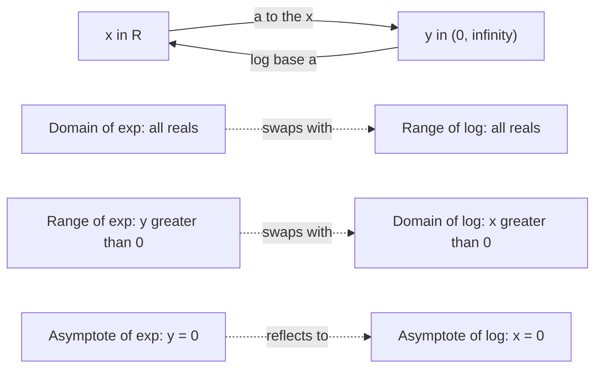
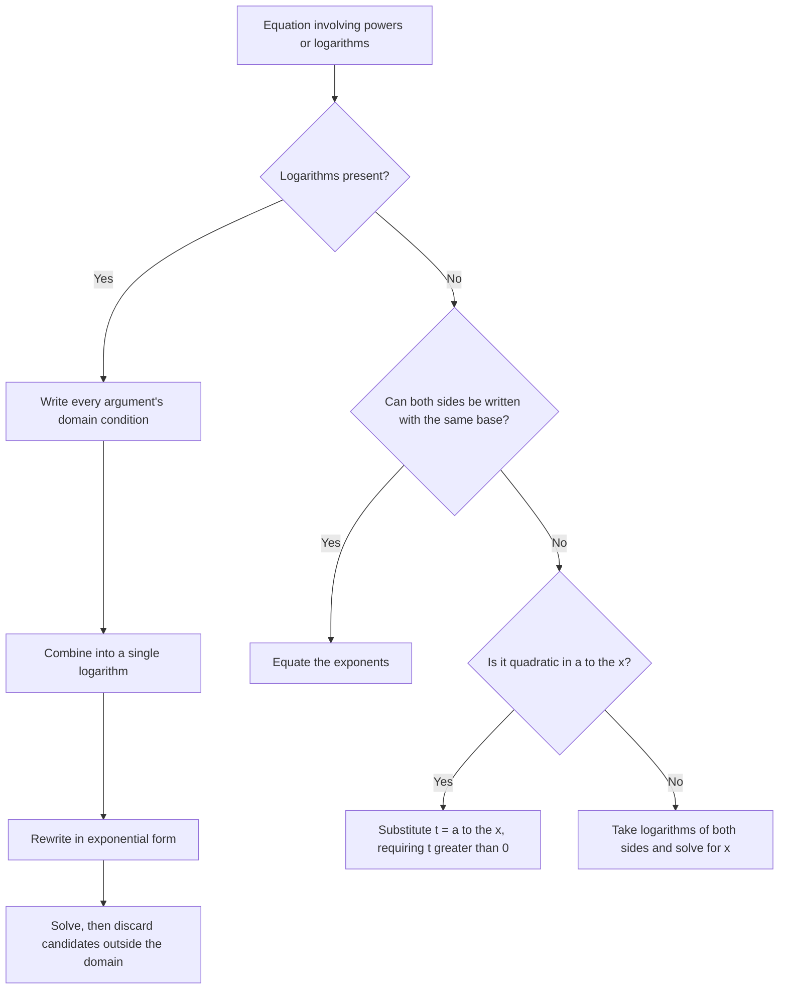

# Exponential and Logarithmic Functions

> [Algebra](../README.md) · Level: Intermediate · Prerequisites: [Functions](../11-functions/README.md), [Intermediate Algebra](../04-intermediate-algebra/README.md), [Polynomials](../06-polynomials/README.md) · Estimated time: 10 h

## 1. Introduction

Every function studied so far has been built from the four operations and roots: polynomials grow,
rational functions blow up, roots flatten out. None of them can describe a quantity that changes by a
fixed *factor* in each equal time step — money at compound interest, a culture of bacteria, the
radioactive atoms left in a sample, the loudness of a sound as its power multiplies.

The family that does this is the **exponential functions** $x \mapsto a^x$. Their defining property is

$$a^{x+y} = a^x\cdot a^y :$$

adding inputs multiplies outputs. A unit increase in $x$ multiplies the value by the constant factor
$a$. That single property, together with continuity, forces the whole shape of the function and even the
form of the formula (Section 7.2).

Exponentials appear wherever growth or decay is proportional to the current amount. Bank balances,
populations, epidemics, drug concentrations, the charge on a capacitor, the cooling of coffee, the
spread of a rumour: the same equation $y' = ky$ describes them all, and its solutions are
exponentials.

Their inverses are the **logarithms**. A logarithm is nothing more than an *exponent*: $\log_a x$ is
the power to which $a$ must be raised to produce $x$. That single sentence explains every logarithm law,
because each law is just an exponent law read backwards. Logarithms were invented by John Napier
around 1614, decades before exponent notation existed, as a computational device for turning
multiplication into addition; they remained the working tool of astronomy, navigation and engineering
for three centuries, until mechanical calculators and then computers displaced them. They are still
indispensable wherever a multiplicative quantity must be measured on an additive scale — the decibel,
the Richter magnitude, the pH scale and the star magnitude system are all logarithms in disguise.

This tutorial derives the exponential form from its defining property, constructs the number $e$ from
compound interest, defines logarithms as inverses, proves the logarithm laws, develops change of base,
solves exponential and logarithmic equations with the domain checks they demand, describes the graphs
and their transformations, and applies all of it to finance, physics, chemistry, geology and
population biology.

## 2. Prerequisites

You should be comfortable with the following, each taught in the listed tutorial.

* **Functions, inverses and transformations** — domain and range, one-to-one functions, the horizontal
  line test, composition, inverse functions and reflection in $y=x$:
  [Functions](../11-functions/README.md). This is the single most important prerequisite: logarithms
  are defined as inverse functions, and every logarithm graph is a reflected exponential graph.
* **Rational exponents** — $a^{m/n}=\sqrt[n]{a^m}$ for $a>0$, and the exponent laws for rational
  exponents: [Intermediate Algebra](../04-intermediate-algebra/README.md).
* **Solving quadratics** — factoring and the quadratic formula:
  [Polynomials](../06-polynomials/README.md).
* **Inequalities and interval notation** — including solving $\frac{x-1}{x-2}\ge 0$ with a sign chart:
  [Inequalities](../03-inequalities/README.md).
* **Percentage change** — "increases by $6\%$ per year" means "multiplies by $1.06$ per year".

## 3. Learning Objectives

After working through this tutorial you will be able to:

1. Explain what the identity $a^{x+y}=a^x a^y$ means and why it forces exponential behaviour, and
   state the theorem that characterises exponential functions among all continuous functions.
2. Sketch $y=a^x$ for $a>1$ and $0<a<1$, listing domain, range, intercept, asymptote and monotonicity.
3. Define $e$ via compound interest and via $\lim_{n\to\infty}(1+1/n)^n$, and prove that the limit
   exists.
4. Convert freely between $a^y=x$ and $y=\log_a x$, and explain why a logarithm is an exponent.
5. State and prove the product, quotient, power and change-of-base laws for logarithms.
6. Evaluate logarithms exactly where possible and numerically otherwise, using change of base.
7. Solve exponential equations by equating exponents, by taking logarithms, and by substitution when
   the equation is quadratic in $a^x$.
8. Solve logarithmic equations, rejecting extraneous roots by checking the domain of every logarithm.
9. Graph exponential and logarithmic functions with shifts, stretches and reflections, and identify
   asymptotes and intercepts after transformation.
10. Model compound interest, radioactive decay, carbon dating, earthquake magnitudes, sound levels and
    logistic growth.

## 4. Intuition

**Multiplication instead of addition.** A linear function adds the same amount at each step: $3, 5, 7,
9, \dots$. An exponential function multiplies by the same factor at each step: $3, 6, 12, 24, \dots$.
Linear growth is a staircase with equal treads; exponential growth is a staircase whose treads double.
The first is described by repeated addition, the second by repeated multiplication, and repeated
multiplication is what an exponent abbreviates.

**The chessboard story.** A grain of rice on the first square of a chessboard, two on the second, four
on the third, and so on: the 64th square holds $2^{63}$, about $9.2\times10^{18}$ grains, roughly a
thousand times the world's annual rice harvest. Exponential growth is unintuitive precisely because
doubling feels small at each step and is catastrophic in aggregate.

**Why the base matters.** $2^x$ doubles every unit; $10^x$ multiplies by ten; $(1.06)^x$ grows by $6\%$
per unit. All of them are the same shape, merely stretched horizontally, because
$b^x = 2^{cx}$ for a suitable $c$ (Section 7.7). The base sets the *speed* of growth, not the shape.

**Logarithms as the reverse question.** An exponential answers: "I know the exponent; what is the
value?" A logarithm answers: "I know the value; what was the exponent?" If $2^{10}=1024$, then
$\log_2 1024 = 10$. The logarithm is the *number of multiplications* needed to get from $1$ to the
value. This is why logarithms turn multiplication into addition: multiplying two powers of $2$ adds
their exponents, i.e. adds their logarithms.

**Why logs tame large numbers.** The distance from $1$ to $10^9$ is nine orders of magnitude; on a
logarithmic scale it is just $9$. Whenever a quantity ranges over many powers of ten — sound
intensity, earthquake energy, acidity, stellar brightness — a logarithmic scale compresses it into
something a human can read. Each unit on the scale corresponds to a fixed *factor*, not a fixed
increment.

## 5. Formal Definition

**Definition 5.1 (integer and rational powers).** For $a>0$ and $n \in \mathbb{N}$, define
$a^1=a$ and $a^{n+1}=a^n a$; set $a^0=1$ and $a^{-n}=1/a^n$. For $m,n\in\mathbb{Z}$ with $n>0$, define
$a^{m/n}=\sqrt[n]{a^m}$, the unique positive number whose $n$-th power is $a^m$.

**Definition 5.2 (exponential function).** For a fixed **base** $a>0$ with $a \ne 1$, the
**exponential function with base $a$** is

$$f : \mathbb{R} \to (0,\infty), \qquad f(x) = a^x .$$

The definition is completed in Section 7.4, where $a^x$ for irrational $x$ is defined as the limit of
$a^{q}$ along rationals $q \to x$; the exponent laws then extend to all real exponents.

**Definition 5.3 (logarithm).** Let $a>0$, $a\ne1$. For $x>0$ the **logarithm of $x$ to the base $a$**
is the unique real number $\log_a x$ such that

$$a^{\log_a x} = x .$$

Equivalently, $y = \log_a x \iff a^y = x$. The number $\log_a x$ is therefore *the exponent* that must
be placed on $a$ to produce $x$.

Uniqueness in Definition 5.3 is not an assumption: it follows from the strict monotonicity of $a^y$,
which Section 7.4 establishes. Existence follows because the range of $y\mapsto a^y$ is $(0,\infty)$.

**Definition 5.4 (natural and common logarithms).** The **natural logarithm** is $\ln x := \log_e x$,
where $e$ is the number of Definition 7.3. The **common logarithm** is the base-$10$ logarithm. This
repository writes $\log_{10}$ explicitly whenever confusion with $\ln$ is possible; the unadorned
symbol $\log$ means $\log_{10}$ in elementary chapters such as this one and $\ln$ in analysis.

**Definition 5.5 (exponential growth and decay).** A quantity $N(t)$ exhibits **exponential growth**
when $N(t) = N_0 a^{t/T}$ with $a>1$, and **exponential decay** when $0<a<1$. Equivalently, in each
time interval of length $T$ the quantity is multiplied by the constant factor $a$. The **doubling
time** is the $T$ with $a=2$; the **half-life** is the $T$ with $a=\tfrac12$.

## 6. Mathematical Notation

| Symbol | Read as | Meaning |
|---|---|---|
| $a^x$ | "$a$ to the $x$" | $a$ multiplied by itself, extended to real $x$ |
| $e^x$, $\exp x$ | "e to the $x$", "exp of $x$" | the exponential with base $e\approx2.71828$ |
| $e$ | "e" | $\lim_{n\to\infty}(1+1/n)^n$ |
| $\log_a x$ | "log base $a$ of $x$" | the exponent $y$ with $a^y=x$ |
| $\ln x$ | "natural log of $x$" | $\log_e x$ |
| $\log x$, $\log_{10} x$ | "log of $x$" | base-$10$ logarithm in this chapter |
| $\log_b a$ | "log base $b$ of $a$" | used in change of base |
| $N_0$ | "N nought" | initial amount, the value at $t=0$ |
| $T_{1/2}$ | "T one-half" | half-life |
| $k$ | "k" | decay or growth constant |
| $K$ | "K" | carrying capacity |
| $\operatorname{dB}$ | "decibels" | $10\log_{10}(I/I_0)$ |
| $M$ | "magnitude" | Richter scale value |
| $\approx$ | "approximately equal to" | used for rounded decimals |

Two conventions matter. First, $\log_a x$ is defined only for $x>0$; the base must be positive and not
$1$. Second, $\ln$ and $e$ are not independent symbols: $\ln$ is $\log_e$, so $\ln e = 1$ and
$\ln 1 = 0$. Writing $\log_a x$ with $a \le 0$ or $a=1$ is meaningless, because such a base either
produces negative values (which cannot be attained by a positive power in a useful way) or fails to be
one-to-one.

## 7. Core Concepts

### 7.1 Repeated multiplication and the exponent laws

An exponential function is built from repeated multiplication, so it inherits the exponent laws. For
$a>0$ and real $s,t$:

$$a^{s+t}=a^s a^t, \qquad a^{s-t}=\frac{a^s}{a^t}, \qquad (a^s)^t=a^{st}, \qquad (ab)^s=a^s b^s .$$

Each law is proved for natural exponents by counting factors and then extended to integers, rationals
and finally reals by continuity. For example $(a^s)^t=a^{st}$ with $s=m/n$, $t=p/q$ reduces to
$\sqrt[nq]{a^{mp}}$, and both sides equal that.

The first law is the characteristic one. Everything specific to exponentials — the shape of the graph,
the existence of a horizontal asymptote, the form of the growth model — follows from it.

### 7.2 The properties that force the form $a^x$

Suppose a quantity depends on time in such a way that *adding one unit of time multiplies the quantity
by a fixed factor*. Write $f(t)$ for the quantity and set $a=f(1)/f(0)$. The normalised function
$g(t)=f(t)/f(0)$ then has $g(0)=1$ and $g(1)=a$. Repeated application gives $g(n)=a^n$ for integers
$n$; and $g(1/n)^n=g(1)=a$ with $g(1/n)>0$ forces $g(1/n)=a^{1/n}$, hence $g(m/n)=a^{m/n}$. So
$f(t)=f(0)a^t$ at every rational $t$.

This is the content of the next theorem, which is the precise answer to the question "why must growth
at a constant relative rate be exponential?".

**Theorem 7.1 (characterisation of exponentials).** Let $f:\mathbb{R}\to\mathbb{R}$ satisfy

$$f(x+y)=f(x)f(y) \quad \text{for all } x,y \in \mathbb{R},$$

and suppose $f$ is not identically zero.

1. $f(0)=1$ and $f(x)>0$ for all $x$.
2. $f(x)=a^x$ for every rational $x$, where $a=f(1)$.
3. If in addition $f$ is continuous at $0$, then $f(x)=a^x$ for every real $x$.

*Proof.* (1) Put $x=y=0$: $f(0)=f(0)^2$, so $f(0)\in\{0,1\}$. If $f(0)=0$ then for every $x$,
$f(x)=f(x+0)=f(x)f(0)=0$, contradicting the hypothesis that $f$ is not identically zero. Hence
$f(0)=1$. Next, $1=f(0)=f(x+(-x))=f(x)f(-x)$, so $f(x)\ne0$ for all $x$. Finally
$f(x)=f(x/2+x/2)=f(x/2)^2\ge0$, and since $f(x)\ne0$, $f(x)>0$.

(2) By induction, $f(n)=a^n$ for $n\in\mathbb{N}$; and $f(-n)=1/f(n)=a^{-n}$. For $n \ge 1$,
$f(1/n)^n=f(1)=a$, and $f(1/n)>0$, so $f(1/n)=a^{1/n}$. Then
$f(m/n)=f(1/n)^m=a^{m/n}$ for $m\in\mathbb{Z}$.

(3) Let $x\in\mathbb{R}$ and let $(q_n)$ be a sequence of rationals with $q_n\to x$. Continuity at $0$
implies continuity everywhere (because $|f(x)-f(y)| = f(y)\,\bigl|f(x-y)-1\bigr|$, and $f(y)$ is bounded
near $y$), so $a^{q_n}=f(q_n)\to f(x)$. Since $a^{q_n}\to a^x$ by the definition of real powers,
$f(x)=a^x$. $\blacksquare$

Part (3) is where continuity enters. Without it there are pathological solutions of
$f(x+y)=f(x)f(y)$ built from a Hamel basis; they are not continuous and never arise as models. In this
course we work only with continuous functions, so the exponential form is forced.

### 7.3 Graphs of exponential functions

For $a>1$, the graph of $y=a^x$ starts almost flat on the left, crosses $(0,1)$, and rises ever more
steeply, eventually outgrowing every polynomial (a growth comparison proved in calculus). For
$0<a<1$ the graph is its mirror image in the $y$-axis and decreases.

| Property | $y=a^x$ with $a>1$ | $y=a^x$ with $0<a<1$ |
|---|---|---|
| Domain | $\mathbb{R}$ | $\mathbb{R}$ |
| Range | $(0,\infty)$ | $(0,\infty)$ |
| $y$-intercept | $(0,1)$ | $(0,1)$ |
| Horizontal asymptote | $y=0$ as $x\to-\infty$ | $y=0$ as $x\to+\infty$ |
| Monotonicity | strictly increasing | strictly decreasing |
| One-to-one | yes | yes |
| Additional point | $(1,a)$ | $(1,a)$ |

The graph never meets the $x$-axis: $a^x>0$ for every real $x$. The axis is an asymptote, not a
crossing. This is the sharpest qualitative difference from polynomials, which must have roots.

**Why the graph is concave upward.** For $a>1$ the slope increases with $x$: at each point the graph
turns upward, because each extra unit of input multiplies by $a>1$ the amount already gained. Formally
$f\big(\tfrac{x+y}{2}\big)=\sqrt{f(x)f(y)}<\tfrac{f(x)+f(y)}{2}$ for $x\ne y$ by the arithmetic–geometric
mean inequality, so the midpoint of any chord lies above the graph.

### 7.4 Real exponents, and why $a^x$ is monotone

The definition $a^{m/n}=\sqrt[n]{a^m}$ covers only rational exponents. For irrational $x$ we take a
sequence of rationals $q_n\to x$ and define

$$a^x := \lim_{n\to\infty} a^{q_n} .$$

Four things must be checked for this to be a definition rather than a hope: the limit exists, it does
not depend on the chosen sequence, the exponent laws survive, and the function stays monotone. For
$a>1$ all four follow from monotonicity on rationals: if $q\le q'$ then $a^q\le a^{q'}$, so the values
$a^{q_n}$ form a Cauchy sequence whenever $q_n$ does. This is a standard completeness argument and is
quoted rather than reproduced in full.

With this in hand:

* $a^x$ is **strictly increasing** for $a>1$ and **strictly decreasing** for $0<a<1$. (If $x<y$, then
  $a^y=a^x a^{y-x}$ with $a^{y-x}>1$ when $a>1$.)
* The range is $(0,\infty)$. (It contains all $a^q$ for rational $q$, and those are already dense in
  $(0,\infty)$.)
* Hence $x\mapsto a^x$ is a bijection $\mathbb{R}\to(0,\infty)$, so it has an inverse. That inverse is
  the logarithm, which is the content of Section 7.6.

Strict monotonicity is what makes exponential equations solvable: **if $a^u=a^v$ then $u=v$**, and if
$a>1$ then $a^u<a^v \iff u<v$. For $0<a<1$ the inequality direction reverses.

### 7.5 The number $e$: compound interest and the limit $(1+1/n)^n$

**Compound interest.** A principal $P$ invested at a nominal annual rate $r$, compounded $n$ times a
year, grows to

$$A(n) = P\left(1+\frac{r}{n}\right)^{nt}$$

after $t$ years, because each of the $nt$ compounding periods multiplies the balance by $1+r/n$. What
happens as compounding becomes more frequent? With $P=1$, $r=1$, $t=1$ the question is the behaviour of

$$a_n = \left(1+\frac1n\right)^n .$$

Numerically: $a_1=2$, $a_2=2.25$, $a_3\approx2.3704$, $a_{10}\approx2.5937$, $a_{100}\approx2.7048$,
$a_{1000}\approx2.7169$. The values rise but ever more slowly, and they stay below $3$.

**Theorem 7.2.** The sequence $a_n=(1+1/n)^n$ is strictly increasing and bounded above by $3$; hence it
converges.

*Proof.* By the binomial theorem,

$$a_n = \sum_{k=0}^{n}\binom{n}{k}\frac{1}{n^k} = \sum_{k=0}^{n}\frac{1}{k!}\prod_{j=0}^{k-1}\left(1-\frac{j}{n}\right).$$

*Increasing.* Each factor $\bigl(1-j/n\bigr)$ increases with $n$, so the $k$-th term of $a_{n+1}$ is
larger than the $k$-th term of $a_n$, and $a_{n+1}$ has in addition one extra positive term. Hence
$a_{n+1}>a_n$.

*Bounded.* Each product is at most $1$, so

$$a_n \le \sum_{k=0}^{n}\frac{1}{k!} \le 1+\sum_{k=1}^{n}\frac{1}{2^{k-1}} = 1+2\left(1-2^{-n}\right) < 3,$$

using $k! \ge 2^{k-1}$ for $k\ge1$.

A bounded increasing sequence of reals converges (completeness of $\mathbb{R}$), so the limit exists.
$\blacksquare$

**Definition 7.3.** The **number $e$** is

$$e := \lim_{n\to\infty}\left(1+\frac1n\right)^n = 2.718281828459045\dots$$

**Corollary 7.4 (continuous compounding).** For principal $P$, nominal rate $r$ and time $t$,

$$\lim_{n\to\infty} P\left(1+\frac{r}{n}\right)^{nt} = P e^{rt}.$$

*Proof.* Put $m=n/r$, so $n=rm$ and the expression becomes $P\bigl[(1+1/m)^{m}\bigr]^{rt}$. As
$n\to\infty$ we have $m\to\infty$, and $(1+1/m)^m\to e$; raising to the fixed power $rt$ preserves the
limit. Hence the limit is $Pe^{rt}$. $\blacksquare$

For $r=0.06$ and $t=10$, continuous compounding gives $e^{0.6}\approx1.8221$ times the principal, only
slightly more than monthly compounding's $1.005^{120}\approx1.8194$. Compounding more often has
diminishing returns, and $e^{rt}$ is the limit that cannot be exceeded.

**Two other characterisations of $e$** (both standard, both proved in analysis): $e=\sum_{k\ge0}1/k!$
and $e=\lim_{h\to0}(1+h)^{1/h}$. The second says that $e$ is the base for which the graph of $a^x$ has
slope exactly $1$ at $x=0$.

### 7.6 Logarithms as inverses, and why a logarithm is an exponent

Because $x\mapsto a^x$ is a bijection $\mathbb{R}\to(0,\infty)$ (Section 7.4), it has an inverse, by the
theory of [Functions](../11-functions/README.md).

**Definition 7.5.** For $a>0$, $a\ne1$, the **logarithm to the base $a$** is the inverse of the
exponential with base $a$:

$$y=\log_a x \quad\Longleftrightarrow\quad a^y = x .$$

The two inverse identities follow at once:

$$\log_a\bigl(a^x\bigr)=x \ \text{ for all } x\in\mathbb{R}, \qquad a^{\log_a x}=x \ \text{ for all }
x>0 .$$

**Why "a logarithm is an exponent".** The equation $a^y=x$ asks: *to what power must $a$ be raised to
produce $x$?* The answer is $y$, and that number is $\log_a x$. So $\log_a x$ is a *power*, and it is
for this reason that every logarithm law is an exponent law read in reverse. For example, the exponent
law $a^{u+v}=a^u a^v$ says that multiplying two values corresponds to adding their exponents; that is
exactly $\log_a(xy)=\log_a x+\log_a y$.

**Immediate consequences.**

* $x>0$ is required: no power of a positive number is negative or zero, so $a^y=x$ has no solution for
  $x\le 0$. The domain of $\log_a$ is $(0,\infty)$.
* $\log_a 1 = 0$ (because $a^0=1$) and $\log_a a = 1$ (because $a^1=a$).
* $\log_a a^x = x$ and $a^{\log_a x}=x$.
* $\log_a x$ is strictly increasing for $a>1$ and strictly decreasing for $0<a<1$, matching $a^x$.
* The graph of $y=\log_a x$ is the reflection of $y=a^x$ in the line $y=x$.

**A note on bases.** Every positive base other than $1$ is allowed, but three are standard: base $10$
(historical, used in the decibel and Richter scales), base $2$ (used in computer science, where
$\log_2 n$ is the number of halvings, i.e. the depth of a balanced binary tree), and base $e$ (the
natural choice in calculus, because $e^x$ is its own derivative).

### 7.7 The logarithm laws, and why the base does not matter

The laws below hold for $a>0$, $a\ne1$, and positive arguments.

$$\log_a(xy)=\log_a x+\log_a y, \qquad \log_a\!\left(\frac xy\right)=\log_a x-\log_a y, \qquad
\log_a(x^r)=r\log_a x \ (r\in\mathbb{R}).$$

*Proof of the first.* Let $u=\log_a x$ and $v=\log_a y$, so $x=a^u$ and $y=a^v$. Then
$xy=a^u a^v=a^{u+v}$, and taking $\log_a$ of both sides gives $\log_a(xy)=u+v=\log_a x+\log_a y$.
$\blacksquare$

The other two are proved the same way, from $a^u/a^v=a^{u-v}$ and $(a^u)^r=a^{ur}$; Section 8 gives
full proofs.

**Change of base.** For bases $a,b>0$ with $a\ne1$ and $b\ne1$, and $x>0$,

$$\log_b x = \frac{\log_a x}{\log_a b}.$$

In particular $\log_b x = \dfrac{\ln x}{\ln b} = \dfrac{\log_{10} x}{\log_{10} b}$; the ratio is
independent of the auxiliary base $a$. This is what makes a calculator with only $\ln$ and $\log_{10}$
sufficient for every base.

**Consequences worth memorising.**

$$\log_a \frac1x = -\log_a x, \qquad \log_{a^n} x = \frac1n\log_a x, \qquad
\log_{a^n}\!\bigl(x^m\bigr)=\frac mn\log_a x, \qquad \log_a b=\frac{1}{\log_b a}.$$

**A warning that the laws alone do not give.** $\log_a(x+y)$ has no simplification. It is *not*
$\log_a x+\log_a y$, and $\log_a(x^2)$ equals $2\log_a\lvert x\rvert$, not $2\log_a x$ when $x$ may be
negative. The laws apply only where every logarithm in them is defined.

### 7.8 Graphs of logarithmic functions and their transformations

Because $y=\log_a x$ and $y=a^x$ are inverse, everything about the exponential graph transcribes.

| Property | $y=\log_a x$, $a>1$ | $y=\log_a x$, $0<a<1$ |
|---|---|---|
| Domain | $(0,\infty)$ | $(0,\infty)$ |
| Range | $\mathbb{R}$ | $\mathbb{R}$ |
| $x$-intercept | $(1,0)$ | $(1,0)$ |
| Vertical asymptote | $x=0$ (as $x\to0^+$) | $x=0$ (as $x\to0^+$) |
| Monotonicity | strictly increasing | strictly decreasing |
| Additional point | $(a,1)$ | $(a,1)$ |

The transformed forms follow the general rules of
[Functions](../11-functions/README.md), with one important difference: the asymptote moves with the
horizontal shift, so it must be recomputed every time.

* $y=\log_a(x-h)+k$: vertical asymptote $x=h$, domain $(h,\infty)$.
* $y=c\log_a\bigl(b(x-h)\bigr)+k$: vertical asymptote $x=h$; a horizontal stretch does **not** move the
  asymptote, but it does change which point sits at the intercept.
* $y=c\,a^{b(x-h)}+k$: horizontal asymptote $y=k$ (the shift moves the asymptote up or down), and the
  range is $(k,\infty)$ if $c>0$ and $(-\infty,k)$ if $c<0$.

**Example.** For $y=2^{x-1}+3$: the parent $2^x$ has asymptote $y=0$; the transformation moves every
height up by $3$, so the asymptote is $y=3$ and the range is $(3,\infty)$; the graph is shifted right
$1$, so the point $(0,1)$ of the parent moves to $(1,4)$.

For $y=\ln(x+2)$: the asymptote $x=0$ moves to $x=-2$, the domain is $(-2,\infty)$, and the point
$(1,0)$ of the parent moves to $(-1,0)$.

### 7.9 Solving exponential and logarithmic equations

**Exponential equations.** Three techniques cover everything in this course.

1. **Same base.** Write both sides as powers of the same base and equate exponents:
   $2^{3x-1}=2^{x+5} \Rightarrow 3x-1=x+5 \Rightarrow x=3$. This is legitimate because $a^x$ is
   one-to-one.
2. **Take logarithms of both sides.** When the bases cannot be matched, apply a logarithm:
   $3^x=20 \Rightarrow x\ln 3=\ln 20 \Rightarrow x=\dfrac{\ln20}{\ln3}\approx2.727$. Taking logs is
   legitimate because $\ln$ is one-to-one and defined on $(0,\infty)$, where both sides live.
3. **Substitution.** When the equation is quadratic in $a^x$, set $t=a^x$ and solve for $t$, then
   recover $x$. The substitution is only valid for $t>0$, which supplies a genuine domain check:
   $4^x-5\cdot2^x+4=0 \Rightarrow t^2-5t+4=0 \Rightarrow t\in\{1,4\} \Rightarrow x\in\{0,2\}$.

**Logarithmic equations.** Two rules govern the process.

1. **Domain first.** Every logarithm must receive a positive argument. Write down the conditions before
   manipulating anything; at the end, discard any candidate that violates them.
2. **Convert or combine.** Either combine the logarithms into one and rewrite as an exponential, or
   convert each logarithm to its exponential form.

For example, $\log_2(x+1)+\log_2(x-1)=3$ requires $x>1$. Combining gives
$\log_2\bigl((x+1)(x-1)\bigr)=3$, hence $x^2-1=8$, hence $x=\pm3$. The candidate $x=-3$ violates
$x>1$ and is discarded; the solution is $x=3$.

**Why extraneous roots appear.** Combining logarithms can enlarge the set of admissible $x$, because
$\log_a(xy)$ is defined where only one of $\log_a x$, $\log_a y$ is. Similarly, using
$\log_a(x^2)=2\log_a x$ silently assumes $x>0$. Every manipulation that widens the domain can admit
spurious solutions, and only the final domain check removes them.

### 7.10 Growth, decay and their parameters

**The three equivalent forms.** A quantity growing or decaying exponentially can be written

$$N(t)=N_0 a^{t} \quad\text{(unit factor)}, \qquad N(t)=N_0 b^{t/T} \quad\text{(factor $b$ per time
$T$)}, \qquad N(t)=N_0 e^{kt}\quad\text{(growth constant)}.$$

They describe the same family; only the parametrisation differs. Conversion uses $a=e^{k}$ and
$a^{T}=b$, i.e. $k=\ln a$.

**Half-life.** If $N(t)=N_0e^{-kt}$ with $k>0$, the half-life is the time at which $N=N_0/2$:

$$\tfrac12 = e^{-kT_{1/2}} \quad\Longrightarrow\quad T_{1/2}=\frac{\ln 2}{k} \quad\Longrightarrow\quad
k=\frac{\ln2}{T_{1/2}} .$$

Hence the decay model in terms of the half-life is

$$N(t)=N_0\left(\tfrac12\right)^{t/T_{1/2}}=N_0\,2^{-t/T_{1/2}} .$$

**Doubling time.** The same computation with growth gives $T_2=\dfrac{\ln2}{k}$.

**Effective annual rate.** If a nominal annual rate $r$ is compounded $n$ times per year, the
**effective annual rate** is $\bigl(1+\tfrac rn\bigr)^n-1$; for continuous compounding it is
$e^{r}-1$. These numbers make offers comparable.

### 7.11 Applications: money, matter, sound and populations

**Compound interest.** $A=P(1+r/n)^{nt}$ (discrete) or $A=Pe^{rt}$ (continuous). With $P=\$1000$,
$r=0.05$ and $t=2$ years, monthly compounding gives
$1000(1+0.05/12)^{24}\approx\$1104.94$.

**Radioactive decay and carbon dating.** Carbon-14 has a half-life of about $5730$ years. Living things
exchange carbon with the atmosphere and hold the atmospheric ratio; once they die, the carbon-14
decays without replacement. If a sample retains a fraction $f$ of the original carbon-14, its age is

$$t=\frac{T_{1/2}\ln(1/f)}{\ln 2}.$$

**Richter scale.** The magnitude of an earthquake is $M=\log_{10}(A/A_0)$, where $A$ is the amplitude
recorded by a seismograph and $A_0$ a reference amplitude. One unit of magnitude is a factor of $10$ in
amplitude; because the energy released scales roughly as $A^{3/2}$, one unit of magnitude is about
$10^{1.5}\approx31.6$ times more energy.

**Decibels.** Sound level in decibels is $L=10\log_{10}(I/I_0)$ with $I_0=10^{-12}$ W/m$^2$, the
threshold of hearing. An increase of $10$ dB multiplies the intensity by $10$; $+3$ dB roughly doubles
it (since $10^{0.3}\approx2$).

**pH.** $\mathrm{pH}=-\log_{10}[\mathrm{H}^+]$, a concentration measured in moles per litre. Each unit
is a factor of $10$ in acidity.

**Logistic growth (preview).** Unrestricted exponential growth cannot continue indefinitely in a
finite environment. The standard correction is

$$P(t)=\frac{K}{1+Ae^{-rt}}, \qquad A=\frac{K-P_0}{P_0},$$

where $K$ is the carrying capacity and $r$ the intrinsic growth rate. At $t=0$ this gives $P(0)=P_0$;
as $t\to\infty$, $e^{-rt}\to0$ and $P(t)\to K$; and $P(t)=K/2$ when $t=\ln A/r$. The graph is the
S-shaped **logistic curve**: nearly exponential at first, then flattening as it approaches $K$. It is
the standard first model for populations, epidemics and market saturation, and it is studied properly
in differential equations.

## 8. Formulas and Properties

### 8.1 The three fundamental logarithm laws

**Theorem 8.1.** Let $a>0$, $a\ne1$, and let $x,y>0$ and $r\in\mathbb{R}$. Then

$$\log_a(xy)=\log_a x+\log_a y, \qquad \log_a\frac xy=\log_a x-\log_a y, \qquad \log_a x^r=r\log_a x .$$

*Proof.* Write $u=\log_a x$ and $v=\log_a y$, so that $x=a^u$ and $y=a^v$ by Definition 7.5.

*Product.* $xy=a^ua^v=a^{u+v}$, hence $\log_a(xy)=u+v$.

*Quotient.* $\dfrac xy=\dfrac{a^u}{a^v}=a^{u-v}$, hence $\log_a\dfrac xy=u-v$.

*Power.* For $r=n\in\mathbb{N}$, $x^n=(a^u)^n=a^{nu}$ by induction on the exponent law, so
$\log_a x^n=nu=n\log_a x$. For $r=1/n$, $x^{1/n}=a^{u/n}$ because $\bigl(a^{u/n}\bigr)^n=a^u=x$ and the
positive $n$-th root is unique; so $\log_a x^{1/n}=u/n$. For $r=m/n$ combine the two, and for $r<0$
use $x^r=1/x^{-r}$ together with the quotient law. $\blacksquare$

### 8.2 Change of base

**Theorem 8.2.** For $a,b>0$, $a\ne1$, $b\ne1$, and $x>0$,

$$\log_b x=\frac{\log_a x}{\log_a b} .$$

*Proof.* Let $y=\log_b x$, so $b^y=x$. Take $\log_a$ of both sides:
$\log_a(b^y)=\log_a x$, and by the power law $y\log_a b=\log_a x$. Since $b\ne1$, $\log_a b\ne0$
(because $b^1=b\ne1=a^0$, so $b$ is not a power $a^0$; more directly, $\log_a$ is one-to-one and
$\log_a b=0$ would force $b=1$). Dividing gives $y=\dfrac{\log_a x}{\log_a b}$. $\blacksquare$

**Corollary 8.3.** $\log_a b=\dfrac{1}{\log_b a}$; $\log_{a^n}x=\dfrac1n\log_a x$;
$\log_{a^n}x^m=\dfrac mn\log_a x$. Each follows by substituting the appropriate bases and powers into
Theorem 8.2 and using the power law.

### 8.3 Monotonicity and the injectivity of exponential and logarithmic equations

**Theorem 8.4.** Let $a>1$. Then $a^u=a^v \iff u=v$, and $a^u<a^v \iff u<v$. For $0<a<1$ the equality
still characterises $u=v$ but the inequality reverses.

*Proof.* If $u<v$ then $a^v=a^u a^{v-u}$ with $v-u>0$, so $a^{v-u}>1$ when $a>1$ (a positive power of a
number exceeding $1$ exceeds $1$, by induction on rationals and continuity). Hence $a^v>a^u$. This
gives strict monotonicity, which implies injectivity. The case $0<a<1$ follows by writing $a=1/b$ with
$b>1$ and noting $a^x=b^{-x}$. $\blacksquare$

**Corollary 8.5.** For $a>1$, $\log_a u=\log_a v \iff u=v$ (both must be positive), and
$\log_a u<\log_a v \iff u<v$. For $0<a<1$ the inequality reverses.

This corollary is the licence for "equate the arguments" when solving logarithmic equations — provided
the arguments are positive.

### 8.4 The limit defining $e$

**Theorem 8.6.** $\displaystyle\lim_{n\to\infty}\left(1+\frac1n\right)^n$ exists and lies between $2$
and $3$.

*Proof.* Theorem 7.2 shows the sequence is increasing and bounded above by $3$; $a_1=2$ gives the lower
bound. $\blacksquare$

**Corollary 8.7.** For real $r$ and $t$, $\displaystyle\lim_{n\to\infty}\left(1+\frac rn\right)^{nt} =
e^{rt}$, so the balance under continuous compounding at nominal rate $r$ is $Pe^{rt}$.

### 8.5 The decay formulas

**Proposition 8.8.** Let $N(t)=N_0e^{-kt}$ with $k>0$.

1. $N$ is strictly decreasing and $N(t)\to0$ as $t\to\infty$.
2. $T_{1/2}=\dfrac{\ln2}{k}$, and $N(t)=N_0\,2^{-t/T_{1/2}}$.
3. The fraction remaining after time $t$ depends only on $t/T_{1/2}$, not on $N_0$.

*Proof.* (1) If $t_1<t_2$ then $N(t_1)/N(t_2)=e^{k(t_2-t_1)}>1$, so $N(t_1)>N(t_2)$; and
$e^{-kt}\to0$ because $e^{k}>1$, so $e^{-kt}=(1/e^k)^{t}\to0$. (2) Solve $e^{-kT_{1/2}}=\tfrac12$:
$-kT_{1/2}=-\ln2$. Then $e^{-kt}=e^{-(\ln2)t/T_{1/2}}=2^{-t/T_{1/2}}$. (3) Immediate from the second
formula, in which $N_0$ occurs only as a factor. $\blacksquare$

### 8.6 The change-of-scale formulas

**Proposition 8.9.** If $M=\log_{10}(A/A_0)$, then an increase of $\Delta M$ in magnitude multiplies the
amplitude by $10^{\Delta M}$. If $L=10\log_{10}(I/I_0)$, then an increase of $\Delta L$ decibels
multiplies the intensity by $10^{\Delta L/10}$.

*Proof.* From $M_2-M_1=\log_{10}(A_2/A_1)$ we get $A_2/A_1=10^{M_2-M_1}$ by Definition 7.5. The
decibel statement is the same computation with the factor $10$ carried through:
$L_2-L_1=10\log_{10}(I_2/I_1)$, so $I_2/I_1=10^{(L_2-L_1)/10}$. $\blacksquare$

## 9. Step-by-Step Examples

### Example 9.1 — Evaluating powers with rational exponents

Simplify without a calculator: $16^{3/4}$, $27^{-2/3}$, $\left(\dfrac18\right)^{2/3}$.

**First.** $16^{3/4}=\left(16^{1/4}\right)^3=2^3=8$.

**Second.** $27^{-2/3}=\dfrac{1}{27^{2/3}}=\dfrac{1}{\left(\sqrt[3]{27}\right)^2}=\dfrac{1}{3^2}=
\dfrac19$.

**Third.** $\left(\dfrac18\right)^{2/3}=\dfrac{1^{2/3}}{8^{2/3}}=\dfrac{1}{\left(\sqrt[3]{8}\right)^2}
=\dfrac{1}{2^2}=\dfrac14$.

**Check.** $8^{4/3}=\left(\sqrt[3]8\right)^4=2^4=16$ ✓. The rule $(a^{1/n})^m=a^{m/n}$ lets the root be
taken first, which is always the easier order.

### Example 9.2 — Two exponential graphs, side by side

Compare $y=2^x$ and $y=\left(\tfrac12\right)^x$.

Since $\left(\tfrac12\right)^x=2^{-x}$, the second graph is the first reflected in the $y$-axis. Both
have domain $\mathbb{R}$, range $(0,\infty)$, $y$-intercept $(0,1)$ and asymptote $y=0$. The first is
strictly increasing, the second strictly decreasing. Sample points:

| $x$ | $-2$ | $-1$ | $0$ | $1$ | $2$ |
|---|---|---|---|---|---|
| $2^x$ | $0.25$ | $0.5$ | $1$ | $2$ | $4$ |
| $2^{-x}$ | $4$ | $2$ | $1$ | $0.5$ | $0.25$ |

Neither graph ever reaches the $x$-axis: $2^x>0$ always. Both pass through $(0,1)$ because $a^0=1$ for
every base.

### Example 9.3 — Evaluating logarithms exactly

Compute: $\log_2 32$, $\log_{27}9$, $\log_5\dfrac{1}{125}$, $\ln 1$, $e^{\ln 7}$, $10^{\log_{10}3}$.

* $\log_2 32 = 5$ because $2^5=32$.
* $\log_{27}9 = \tfrac23$ because $27^{2/3}=\left(\sqrt[3]{27}\right)^2=3^2=9$.
* $\log_5\dfrac{1}{125}=-3$ because $5^{-3}=\dfrac{1}{125}$.
* $\ln 1 = 0$ because $e^0=1$.
* $e^{\ln 7}=7$ and $10^{\log_{10}3}=3$, by the inverse identity $a^{\log_a x}=x$.

**Method.** In every case, ask "to what power must the base be raised?" Rewriting the argument as a
power of the base answers the question immediately.

### Example 9.4 — Expanding and combining logarithms

**(a) Expand** $\log_a\dfrac{x^3\sqrt{y}}{z^2}$, where $a>0$, $a\ne1$, $x,y,z>0$.

Use the quotient law, then the product law, then the power law:

$$\begin{aligned}
\log_a\frac{x^3\sqrt{y}}{z^2}
&= \log_a\bigl(x^3\sqrt{y}\bigr) - \log_a z^2\\
&= \log_a x^3 + \log_a y^{1/2} - \log_a z^2\\
&= 3\log_a x + \tfrac12\log_a y - 2\log_a z .
\end{aligned}$$

**(b) Combine** $2\log x - \tfrac13\log y + \log z$ into a single logarithm (base $10$, all arguments
positive).

$$\begin{aligned}
2\log x - \tfrac13\log y+\log z
&= \log x^2 - \log y^{1/3}+\log z\\
&= \log\frac{x^2}{y^{1/3}}+\log z\\
&= \log\frac{x^2z}{\sqrt[3]{y}} .
\end{aligned}$$

**Check** by substituting $x=y=z=10$: the original is $2(1)-\tfrac13(1)+1=\tfrac83$; the combined form is
$\log_{10}\dfrac{1000}{10^{1/3}} = 3-\tfrac13 = \tfrac83$ ✓.

### Example 9.5 — Change of base and an exponential equation

**(a)** Compute $\log_7 100$.

$$\log_7 100=\frac{\ln 100}{\ln 7}=\frac{4.60517}{1.94591}\approx 2.3666 .$$

**Check.** $7^{2.3666}\approx 7^{2}\cdot 7^{0.3666}=49\cdot 2.0408\approx100.0$ ✓.

**(b)** Solve $3^{x}=20$.

Take $\ln$ of both sides (legal: both sides are positive, and $\ln$ is one-to-one):

$$x\ln 3=\ln 20 \quad\Longrightarrow\quad x=\frac{\ln20}{\ln3}=\frac{2.99573}{1.09861}\approx2.7268 .$$

So $x\approx2.727$. **Check.** $3^{2.7268}=e^{2.7268\cdot1.09861}=e^{2.99573}=20.00$ ✓.

Note the shape of the answer: it can be reduced to $\log_3 20$, which is the exact value; the decimal is
an approximation.

### Example 9.6 — A quadratic in disguise

Solve $4^x-5\cdot 2^x+4=0$.

Since $4^x=\left(2^2\right)^x=\left(2^x\right)^2$, set $t=2^x$. Then $t>0$ and

$$t^2-5t+4=0 \quad\Longrightarrow\quad (t-1)(t-4)=0 \quad\Longrightarrow\quad t\in\{1,4\}.$$

Both values are positive, so both are admissible:

* $2^x=1 \Rightarrow x=0$;
* $2^x=4=2^2 \Rightarrow x=2$.

**Check.** $x=0$: $1-5+4=0$ ✓. $x=2$: $16-20+4=0$ ✓.

**What if a root were negative?** For $4^x+3\cdot2^x-4=0$ the substitution gives $t^2+3t-4=0$, so
$t=1$ or $t=-4$; the second is rejected because $2^x>0$ for every real $x$. One solution, $x=0$.

### Example 9.7 — Logarithmic equations with a domain check

**(a)** Solve $\log_2(x+1)+\log_2(x-1)=3$.

*Domain.* Both arguments must be positive: $x>-1$ and $x>1$, so $x>1$.

*Solve.* Combine: $\log_2\bigl((x+1)(x-1)\bigr)=\log_2(x^2-1)=3$. Converting to exponential form,
$x^2-1=2^3=8$, so $x^2=9$ and $x=\pm3$.

*Check.* $x=3$ satisfies $x>1$ ✓. $x=-3$ does not ($\log_2(-2)$ is undefined), so it is rejected. The
solution is $x=3$.

**(b)** Solve $\log_{10}(x^2-3)=\log_{10}(2x)$.

*Domain.* $x^2-3>0$ and $2x>0$, i.e. $x>\sqrt3$.

*Solve.* The arguments must be equal: $x^2-3=2x$, so $x^2-2x-3=0$ and $(x-3)(x+1)=0$, giving $x=3$ or
$x=-1$.

*Check.* $x=3>\sqrt3$ ✓. $x=-1$ fails both conditions ($2x=-2<0$), so it is extraneous. The solution
is $x=3$.

**Numerical check.** $\log_{10}(9-3)=\log_{10}6\approx0.778$ and $\log_{10}(2\cdot3)=\log_{10}6$ ✓.

### Example 9.8 — Compound interest three ways

Invest $\$5000$ at a nominal annual rate of $6\%$ for $10$ years. Compute the balance with (a) monthly
compounding, (b) continuous compounding, and (c) compare the effective annual rates.

**(a) Monthly.** $n=12$, so

$$A=5000\left(1+\frac{0.06}{12}\right)^{12\cdot10}=5000(1.005)^{120}.$$

Now $(1.005)^{120}=e^{120\ln 1.005}=e^{120(0.00498754)}=e^{0.598505}\approx1.819397$. Hence
$A\approx 5000\times1.819397=\$9096.98$.

**(b) Continuous.**

$$A=5000e^{0.06\cdot10}=5000e^{0.6}=5000(1.8221188)=\$9110.59 .$$

**(c) Effective annual rates.** Monthly: $(1.005)^{12}-1=e^{12(0.00498754)}-1=e^{0.0598505}-1
\approx1.061678-1=6.1678\%$. Continuous: $e^{0.06}-1\approx1.0618365-1=6.1837\%$.

**Comment.** Continuous compounding exceeds monthly compounding by about $\$13.61$ over ten years, a
difference of $0.16\%$. Compounding frequency has sharply diminishing returns, bounded by $e^{r}$.

### Example 9.9 — Carbon dating and a half-life

**(a)** A wooden artefact retains $68\%$ of its original carbon-14. Estimate its age, taking
$T_{1/2}=5730$ years.

Model: $N(t)=N_0\,2^{-t/T_{1/2}}$. With $N/N_0=0.68$,

$$0.68=2^{-t/5730} \;\Longrightarrow\; \ln 0.68=-\frac{t}{5730}\ln 2
\;\Longrightarrow\; t=5730\cdot\frac{-\ln 0.68}{\ln 2}.$$

Numerically $\ln 0.68=-0.385662$ and $\ln 2=0.693147$, so

$$t = 5730\cdot\frac{0.385662}{0.693147}=5730(0.556395)\approx3188\ \text{years}.$$

The artefact is about $3190$ years old.

**(b)** A drug has a half-life of $12$ hours. How long until $20\%$ of the dose remains?

$$0.20=2^{-t/12} \;\Longrightarrow\; \ln 0.2=-\frac{t}{12}\ln 2
\;\Longrightarrow\; t=12\cdot\frac{1.609438}{0.693147}=12(2.321928)\approx27.9\ \text{hours}.$$

**Check.** After $24$ h (two half-lives) $25\%$ remains, and $27.9$ h is slightly longer, so slightly
less than $25\%$ — consistent with $20\%$ ✓.

## 10. Visual Explanations

### 10.1 The exponential–logarithm pair

The two functions are inverses, so their graphs are mirror images in the line $y=x$; the table of
properties is the same table read with domain and range exchanged.

The dotted pairings are the graphical statement of the inverse relationship: a horizontal asymptote of
the exponential becomes a vertical asymptote of the logarithm, an intercept $(0,1)$ becomes $(1,0)$, and
the reflection in $y=x$ carries each feature to its counterpart.

### 10.2 Which method for which equation?

The left branch is the one that punishes carelessness: the domain conditions must be written *before*
combining, because combining can hide a violation.

### 10.3 Growth compared

| $x$ | $x^2$ | $2^x$ | $e^x$ | $x^{10}$ |
|---|---|---|---|---|
| $1$ | $1$ | $2$ | $2.718$ | $1$ |
| $5$ | $25$ | $32$ | $148.4$ | $9\,765\,625$ |
| $10$ | $100$ | $1024$ | $22\,026$ | $10^{10}$ |
| $20$ | $400$ | $1\,048\,576$ | $4.85\times10^{8}$ | $10^{13}$ |

A power $x^n$ beats any fixed exponential eventually — at $x=20$ the tenth power is still far ahead —
but for moderate $x$ the exponential overtakes everything. The practical lesson is that exponential
models are credible only over a limited range: no population doubles forever.

## 11. Common Mistakes

1. **Applying the exponent laws to sums.** $a^{x+y}=a^xa^y$ is correct, but $a^{x+y}\ne a^x+a^y$, and
   $(a+b)^2\ne a^2+b^2$. The laws govern products and powers, never addition of bases.
2. **Thinking $a^0=0$.** Every positive base satisfies $a^0=1$, because $a^{n-n}=a^n/a^n=1$. Only
   $0^0$ is problematic, and it is not used here.
3. **Assuming $(-2)^x$ is a function on $\mathbb{R}$.** For negative bases, real powers are not defined
   for most exponents. The base of an exponential must be positive.
4. **Writing $\log(x+y)=\log x+\log y$.** The product law concerns a product. There is no law for a sum.
5. **Dropping the domain of a logarithm.** $\log_a x$ needs $x>0$. Solving
   $\log(x^2-3)=\log(2x)$ gives $x=3$ and $x=-1$, and only $x=3$ is admissible.
6. **Forgetting that combining logarithms can create extraneous roots.** $\log x+\log(x-1)$ is defined
   only for $x>1$, whereas $\log(x^2-x)$ is defined for $x<0$ or $x>1$. Always check candidates in the
   *original* equation.
7. **Confusing $\ln$ with $\log_{10}$.** $\ln 100\approx4.605$ but $\log_{10}100=2$. Change of base is
   what reconciles them.
8. **Believing $\log_a x$ can be negative only for $x<0$.** It can be negative for positive $x$: $\log_2
   0.5=-1$, because $2^{-1}=0.5$.
9. **Using $\log(x^2)=2\log x$ when $x$ may be negative.** The correct identity is
   $\log(x^2)=2\log\lvert x\rvert$ for $x\ne0$.
10. **Scaling an exponential the wrong way.** $y=2^{x-1}$ is $y=2^x$ shifted **right** by $1$, which
    equals $y=\tfrac12\cdot2^x$ — the same graph as a vertical compression. Both descriptions are
    correct; $y=2^{x}-1$ is something else entirely.
11. **Reporting an unrounded answer as exact.** $x=\ln 20/\ln 3$ is exact; $2.7268$ is not. State which
    is which, and round only at the end.
12. **Applying a continuous model outside its range.** A half-life formula predicts $10^{-30}$ of a
    sample remaining after a million half-lives, but a sample of finitely many atoms cannot be divided
    indefinitely; the model is a large-number approximation.

## 12. Applications

**Finance and economics.** Compound interest $A=P(1+r/n)^{nt}$ and its continuous limit $A=Pe^{rt}$;
the effective annual rate $\left(1+\frac rn\right)^n-1$ makes offers with different compounding
frequencies comparable. Present value discounts future money by $e^{-rt}$. Inflation, mortgage
amortisation and exponential depreciation of assets all use the same algebra. The "rule of 72" is the
observation that a doubling time at $r\%$ per year is about $72/r$ years, since
$\ln 2/\ln(1+r/100)\approx 69.3/r$ and $72$ is a convenient multiple.

**Physics.** Radioactive decay $N=N_0e^{-\lambda t}$, with $\lambda=\ln2/T_{1/2}$; the charge on a
capacitor discharging through a resistor; Newton's law of cooling, whose excess temperature above the
room decays exponentially; the attenuation of X-rays and gamma rays through matter, measured in
half-value layers; the absorption of light in a medium (Beer–Lambert law, itself logarithmic in
concentration).

**Chemistry and geology.** The pH scale $\mathrm{pH}=-\log_{10}[\mathrm{H}^+]$; the Arrhenius equation
$k=Ae^{-E_a/(RT)}$ for reaction rates; radiocarbon dating of organic material up to about $50\,000$
years; potassium–argon and uranium–lead dating for rocks. Each is a logarithm applied to a ratio.

**Earth science.** The Richter magnitude $M=\log_{10}(A/A_0)$, the moment magnitude scale used for large
earthquakes, and the logarithmic wind profile near the ground.

**Acoustics and optics.** Sound level $L=10\log_{10}(I/I_0)$ in decibels; the logarithmic response of the
human ear, which is why linear intensity is the wrong scale for perception; stellar magnitudes, defined
so that five magnitudes correspond to a factor of $100$ in brightness.

**Biology and medicine.** Bacterial growth in a nutrient bath (exponential until resources bind);
drug clearance with a biological half-life that sets dosing intervals; the $\mathrm{LD}_{50}$
(median lethal dose) and log-dose response curves; epidemic growth followed by logistic saturation.

**Computing.** $\log_2 n$ is the number of times $n$ can be halved, hence the height of a balanced binary
tree and the complexity of binary search. Floating-point numbers are stored as sign, mantissa and
exponent, so their spacing is logarithmic.

**Why the logistic correction is needed.** Exponential models predict unbounded growth, impossible in a
finite world. The logistic function $P(t)=\dfrac{K}{1+Ae^{-rt}}$ keeps the early exponential rise (when
$P\ll K$) and flattens as the population approaches the carrying capacity $K$; its inflection point at
$P=K/2$ is where growth is fastest.

## 13. Exercises

The problem set is in [exercises.md](exercises.md): 38 problems grouped as Beginner, Intermediate,
Advanced and Challenge. They cover evaluation and simplification, graphs and asymptotes, the
definition of $e$, the logarithm laws and their proofs, change of base, exponential and logarithmic
equations with domain checks, and applications to interest, half-life, carbon dating, the Richter and
decibel scales, and logistic growth.

## 14. Solutions

Full worked solutions, with the strategy for each problem and every significant step, are in
[solutions.md](solutions.md). Attempt the exercises before opening that file.

## 15. Summary

* An exponential function is characterised by $a^{x+y}=a^xa^y$: adding inputs multiplies outputs.
  Continuity plus that identity forces $f(x)=a^x$ with $a=f(1)>0$ (Theorem 7.1).
* $y=a^x$ has domain $\mathbb{R}$, range $(0,\infty)$, intercept $(0,1)$, asymptote $y=0$; it increases
  for $a>1$ and decreases for $0<a<1$, and it is one-to-one in both cases.
* $e=\lim_{n\to\infty}(1+1/n)^n$ exists because the sequence increases and is bounded by $3$; it is the
  continuous-compounding limit, $Pe^{rt}$.
* A logarithm is an exponent: $\log_a x=y \iff a^y=x$. It is the inverse of $a^x$, defined for $x>0$.
* The laws $\log_a(xy)=\log_a x+\log_a y$, $\log_a(x/y)=\log_a x-\log_a y$ and $\log_a x^r=r\log_a x$
  are the exponent laws read backwards; change of base is
  $\log_b x=\dfrac{\log_a x}{\log_a b}$, valid for any auxiliary base $a$ with $a>0$, $a\ne1$.
* Exponential equations are solved by matching bases, by taking logarithms, or by substituting
  $t=a^x$ when the equation is quadratic in $a^x$.
* Logarithmic equations require the domain conditions $(\text{argument}>0)$ first and a domain check at
  the end; extraneous roots come from combining logarithms across sign changes.
* Graphs transform as in [Functions](../11-functions/README.md); the horizontal asymptote $y=0$ becomes
  $y=k$ under a vertical shift, and the vertical asymptote $x=0$ becomes $x=h$ under a horizontal one.
* Exponential decay is parametrised by the half-life: $N=N_0 2^{-t/T_{1/2}}$ with
  $T_{1/2}=\ln2/k$; growth by the doubling time, computed identically.
* Logarithmic scales — decibel, Richter, pH, magnitude — convert multiplicative ranges into additive
  ones, so a fixed step corresponds to a fixed factor.

## 16. Further Learning

**Next in this curriculum.**

* [Functions](../11-functions/README.md) — the inverse-function theory that logarithms rest on.
* [Complex Numbers](../13-complex-numbers/README.md) — the exponential continued into the complex plane.
* [Precalculus](../../06-precalculus/README.md) — trigonometric functions, which share the exponential's
  periodic structure in a different guise.
* [Calculus](../../07-calculus/README.md) — $e^x$ is the function equal to its own derivative, and
  $\ln x$ is defined there as an integral; the growth-rate comparisons of Section 10.3 are proved there.
* [Mathematical Modeling](../../22-mathematical-modeling/README.md) — logistic and other saturating
  models in context.

**Standard references.** Stewart, *Precalculus: Mathematics for Calculus* (exponential and logarithmic
functions, with applications); Rudin, *Principles of Mathematical Analysis*, Chapter 8 (rigorous
construction, including $\sum 1/k! = e$); Hardy, *A Course of Pure Mathematics*, Chapters IX–X
(the classical treatment from the functional equation); Ellenberg, *How Not to Be Wrong*, Chapter 3
(exponential growth and its counterintuitive consequences).

