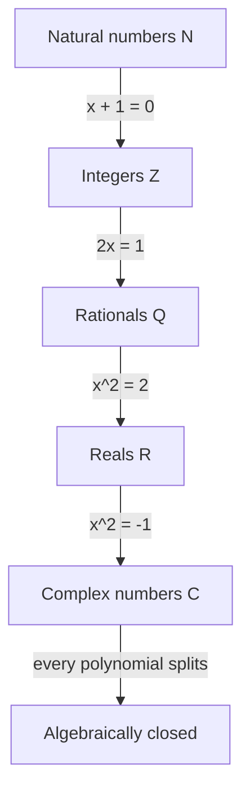

# Complex Numbers

> [Mathematics](../../README.md) · Level: Intermediate · Prerequisites: [Elementary Algebra](../01-elementary-algebra/README.md), [Inequalities](../03-inequalities/README.md), [Polynomials](../06-polynomials/README.md), [Trigonometry](../../05-trigonometry/README.md) · Estimated time: 240 min

## 1. Introduction

Solve $x^2 = -1$. Every real number squares to something non-negative, so there is no real
solution. For most of mathematical history that was the end of the story. Yet today the same
equation opens onto a number system used by electrical engineers to compute alternating current, by
signal processors to compress audio, by physicists to write wave functions, and by mathematicians to
prove theorems about ordinary real numbers.

What changed was the discovery that if you *pretend* the equation has a solution, call it $i$, and
compute with the usual rules while replacing $i^2$ by $-1$, the results are consistent — and they
answer real questions about real quantities. Cardano met such expressions in 1545 while solving
cubics and called the practice "as subtle as it is useless"; Bombelli showed they could be
manipulated to produce correct real answers; Descartes coined *imaginary* in 1637 as an insult;
Gauss gave the geometric interpretation; and Hamilton in 1837 removed the mystery by defining a
complex number as a **pair of real numbers** with explicit rules. That definition is the one used
here: nothing is imagined, and a complex number is as concrete as a point on a map.

The pattern is the same at every earlier stage of the curriculum. Each extension of the number
system is forced by an equation the old system cannot solve:

| Equation | Old system fails | New system |
|---|---|---|
| $x + 1 = 0$ | $\mathbb{N}_0$ has no negatives | $\mathbb{Z}$ |
| $2x = 1$ | $\mathbb{Z}$ has no halves | $\mathbb{Q}$ |
| $x^2 = 2$ | $\mathbb{Q}$ has no irrationals | $\mathbb{R}$ |
| $x^2 = -1$ | $\mathbb{R}$ has no $\sqrt{-1}$ | $\mathbb{C}$ |

Every step keeps all old numbers and all old rules, and adds the missing solutions. The last step
has a feature the others lack: $\mathbb{C}$ is **algebraically closed** — no polynomial equation
remains unsolvable. That is the fundamental theorem of algebra (§7.8), and it is why the story stops
here rather than continuing into higher dimensions.

Plan: definitions and field axioms (§5), arithmetic and geometry (§7.1–§7.4), polar form and De
Moivre (§7.5–§7.7), the fundamental theorem and quadratics (§7.8–§7.9), and a preview of complex
analysis (§7.10).

## 2. Prerequisites

**Real arithmetic and the field properties.** Addition and multiplication of reals are associative,
commutative and distributive; every number has an additive inverse and every nonzero number a
multiplicative inverse. These are the rules of [Elementary Algebra](../01-elementary-algebra/README.md)
and are restated as axioms in §5.2, because they are exactly what must survive the extension.

**Expanding products and collecting like terms.** $(a+b)(c+d) = ac+ad+bc+bd$ and $3x+5x = 8x$.
Every multiplication below is a bracket expansion followed by collecting terms.

**Quadratics and the discriminant.** For $a \neq 0$, $ax^2+bx+c=0$ has solutions
$x = \dfrac{-b \pm \sqrt{b^2-4ac}}{2a}$, and the sign of $b^2-4ac$ decides how many are real
([Polynomials](../06-polynomials/README.md)). Here the negative case becomes the interesting one.

**Absolute value and distance.** $\lvert x\rvert$ is the distance from $x$ to $0$, and
$\lvert x-y\rvert$ the distance between two points; the complex modulus generalises this
([Inequalities](../03-inequalities/README.md)).

**Roots and exponent laws.** $\sqrt{ab} = \sqrt a\sqrt b$ holds for $a,b \ge 0$ and **fails** when
both are negative; that failure is a common error (§11). See
[Intermediate Algebra](../04-intermediate-algebra/README.md).

**Trigonometry.** Sine, cosine, radians, the special values at multiples of $\pi/6$ and $\pi/4$, and
the addition formulas for $\cos(\alpha+\beta)$ and $\sin(\alpha+\beta)$, developed in the
[Trigonometry](../../05-trigonometry/README.md) discipline. They are used once, in §7.5.

**The Cartesian plane.** A pair $(a,b)$ is a point, with $a$ horizontal and $b$ vertical. The
complex plane is this plane with a multiplication added.

## 3. Learning Objectives

After this tutorial you will be able to

1. explain why $x^2=-1$ forces an extension of $\mathbb{R}$, and state the construction of
   $\mathbb{C}$ as pairs of reals with explicit operations;
2. verify the field axioms, including the inverse $\bar z/\lvert z\rvert^2$, and prove that
   $\mathbb{C}$ admits no order compatible with its arithmetic;
3. add, multiply and divide in Cartesian form, and compute powers of $i$;
4. use conjugates and moduli, including $z\bar z = \lvert z\rvert^2$, $\lvert zw\rvert = \lvert z\rvert\lvert w\rvert$
   and the triangle inequality;
5. interpret addition as vector addition and multiplication as rotation plus scaling;
6. convert between Cartesian and polar form with the argument in the correct quadrant;
7. derive the modulus–argument rule and apply De Moivre's theorem to powers and $n$-th roots;
8. find all $n$-th roots, recognise roots of unity as vertices of a regular $n$-gon, and use their
   sum and product;
9. state the fundamental theorem of algebra, factor over $\mathbb{C}$, and solve quadratics with
   complex roots;
10. explain why complex differentiability is stronger than real differentiability and state the
    Cauchy–Riemann equations.

## 4. Intuition

### 4.1 A line cannot contain a quarter-turn

Multiplication by a real number only stretches or reflects the number line; multiplying by $-1$ is a
**half-turn**. If some number squared to $-1$, multiplication by it would be an operation that,
performed twice, is a half-turn — a **quarter-turn**. A quarter-turn does not exist on a line, but
it plainly exists in a plane. Allow a plane, and $\sqrt{-1}$ stops being a mystery: it is a
quarter-turn.

This is the whole geometric content of the subject. A complex number is a point of the plane, and
multiplication by it is a rotation together with a scaling.

### 4.2 Two dials, one rule

Think of a complex number as a pair of dials, real and imaginary. Addition combines the dials
separately; nothing crosses over. Multiplication mixes them, because $i\cdot i = -1$ makes the
imaginary dial spill backwards into the real one. That single rule,
$$i^2 = -1,$$
together with ordinary algebra, determines every product: expand the brackets and replace $i^2$ by
$-1$.

### 4.3 Consistency before belief

"Let $i^2=-1$" is legitimate only if the system is consistent: every route to an expression must
give the same value. Section 5 settles this by constructing $\mathbb{C}$ from pairs of reals, whose
arithmetic is already known to be consistent. After that, $i$ may be used freely as shorthand for
the pair $(0,1)$, just as $\tfrac12$ is shorthand for a pair of integers.

### 4.4 Why the plane is enough

Adding $\sqrt{-1}$ might seem to leave other equations unsolved, forcing a third dimension and then
a fourth. It does not. Every polynomial equation of every degree, with complex coefficients, has all
its solutions already in $\mathbb{C}$. The plane suffices — that is the fundamental theorem of
algebra (§7.8).

## 5. Formal Definition

### 5.1 Construction from pairs of reals

**Definition 5.1 (The complex numbers).** Let $\mathbb{C} := \mathbb{R}^2$ with
$$(a,b)+(c,d) := (a+c,\;b+d), \qquad (a,b)\cdot(c,d) := (ac-bd,\;ad+bc).$$
Write $0 := (0,0)$, $1 := (1,0)$, $\operatorname{Re}(a,b) := a$ and $\operatorname{Im}(a,b) := b$.
A pair with real part $0$ is **purely imaginary**.

Addition is componentwise vector addition. The multiplication rule looks arbitrary for one
paragraph; the next proposition shows it is forced.

**Proposition 5.2 (The product is forced).** If a set contains a copy of $\mathbb{R}$ and an
element $i$ with $i^2=-1$, and is closed under $+$ and $\cdot$, then
$$(a+bi)(c+di) = (ac-bd)+(ad+bc)i.$$

*Proof.* Expand: $(a+bi)(c+di) = ac + (ad+bc)i + bd\,i^2$, and $i^2=-1$ gives the claim. $\square$

**Proposition 5.3 (Standard form).** With $i := (0,1)$, every $z \in \mathbb{C}$ has a unique
expression $z = a+bi$ with $a,b \in \mathbb{R}$, and $i^2 = -1$.

*Proof.* $bi = (b,0)(0,1) = (0,b)$ and $a+bi = (a,0)+(0,b) = (a,b)$; uniqueness is uniqueness of
coordinates; $i^2 = (0\cdot0-1\cdot1,\;0\cdot1+1\cdot0) = (-1,0) = -1$. $\square$

So the real line sits inside the plane as the horizontal axis, and $i$ is the point one unit up.

### 5.2 Field axioms

**Definition 5.4 (Field).** A set $F$ with operations $+,\cdot$ and $0 \neq 1$ is a **field** when,
for all $x,y,w \in F$:

| | Axiom | Statement |
|---|---|---|
| F1 | Closure | $x+y,\; x\cdot y \in F$ |
| F2 | Associativity of $+$ | $(x+y)+w = x+(y+w)$ |
| F3 | Commutativity of $+$ | $x+y = y+x$ |
| F4 | Additive identity | $x+0 = x$ |
| F5 | Additive inverse | $x+(-x) = 0$ |
| F6 | Associativity of $\cdot$ | $(xy)w = x(yw)$ |
| F7 | Commutativity of $\cdot$ | $xy = yx$ |
| F8 | Multiplicative identity | $x\cdot 1 = x$ |
| F9 | Multiplicative inverse | $x \neq 0 \Rightarrow \exists x^{-1},\ xx^{-1} = 1$ |
| F10 | Distributivity | $x(y+w) = xy+xw$ |

$\mathbb{Q}$ and $\mathbb{R}$ are fields; $\mathbb{Z}$ is not, since F9 fails. These are exactly the
rules of elementary algebra, so proving $\mathbb{C}$ is a field means proving the new arithmetic
breaks none of the old habits.

**Theorem 5.5 ($\mathbb{C}$ is a field).** $\mathbb{C}$ with the operations of Definition 5.1
satisfies F1–F10.

*Proof.* By Proposition 5.3 all computations are real arithmetic with $i^2=-1$.
F1 holds by definition. F2–F5 hold componentwise, with $0=(0,0)$ and $-(a,b)=(-a,-b)$.
F7 holds because $ac-bd = ca-db$ and $ad+bc = cb+da$. F8: $(a,b)(1,0) = (a,b)$ and $(1,0)\neq(0,0)$.

*F6.* For $z_1=(a,b)$, $z_2=(c,d)$, $z_3=(e,f)$,
$$\begin{aligned}
(z_1z_2)z_3 &= \bigl((ac-bd)e-(ad+bc)f,\ (ac-bd)f+(ad+bc)e\bigr)\\
&= \bigl(ace-bde-adf-bcf,\ acf-bdf+ade+bce\bigr),\\
z_1(z_2z_3) &= \bigl(a(ce-df)-b(cf+de),\ a(cf+de)+b(ce-df)\bigr)\\
&= \bigl(ace-adf-bcf-bde,\ acf+ade+bce-bdf\bigr),
\end{aligned}$$
and the two results are the same four terms with the same signs.

*F9.* If $z = a+bi \neq 0$ then $a^2+b^2>0$; set $z^{-1} := \dfrac{a-bi}{a^2+b^2} \in \mathbb{C}$.
Then
$$z z^{-1} = \frac{(a+bi)(a-bi)}{a^2+b^2} = \frac{a^2+b^2}{a^2+b^2} = 1,$$
because $(a,b)(a,-b) = (a^2+b^2,\; -ab+ba) = (a^2+b^2,0)$.

*F10.* Both sides equal the pair whose coordinates are $a(c+e)-b(d+f)$ and $a(d+f)+b(c+e)$.
$\blacksquare$

**Corollary 5.6 (Embedding).** $\iota : \mathbb{R} \to \mathbb{C}$, $\iota(a) = (a,0)$, is
injective and preserves $+,\cdot,0,1$; so $\mathbb{R} \subseteq \mathbb{C}$ and we write $a$ for
$(a,0)$.

*Proof.* Immediate from Definition 5.1 with $b=d=0$. $\square$

### 5.3 Conjugate and modulus

**Definition 5.7.** For $z = a+bi$ define the **conjugate** $\bar z := a-bi$ and the **modulus**
$\lvert z\rvert := \sqrt{a^2+b^2}$.

Conjugation is reflection in the real axis; the modulus is the distance to the origin. The identity
$$z\bar z = \lvert z\rvert^2,$$
obtained by expanding $(a+bi)(a-bi)$, converts a complex product into a non-negative real. It is the
most used identity in the subject: it underlies division and every modulus computation.

### 5.4 No order on $\mathbb{C}$

**Theorem 5.8 (No compatible order).** There is no total order on $\mathbb{C}$ making it an ordered
field.

*Proof.* In an ordered field $1>0$, because $1 = 1^2 \ge 0$ and $1 \neq 0$; hence $-1<0$. Since
$i \neq 0$, trichotomy gives $i>0$ or $i<0$. If $i>0$, multiplying $i>0$ by the positive element $i$
gives $i^2>0$, i.e. $-1>0$, a contradiction. If $i<0$ then $-i>0$, and multiplying $-i>0$ by the
positive element $-i$ gives $(-i)^2>0$, again $-1>0$, a contradiction. $\blacksquare$

Consequently $z<w$ is meaningless for non-real complex numbers. Inequalities apply only to real
quantities such as $\lvert z\rvert$, $\operatorname{Re} z$ and $\operatorname{Im} z$.

## 6. Mathematical Notation

| Symbol | Read as | Meaning |
|---|---|---|
| $i$ | "i" | the number $(0,1)$, with $i^2=-1$ |
| $\mathbb{C}$ | "the complex numbers" | $\{a+bi : a,b\in\mathbb{R}\}$ |
| $z, w$ | "z", "w" | complex numbers |
| $\operatorname{Re} z$ | "real part of z" | the $a$ in $z=a+bi$ |
| $\operatorname{Im} z$ | "imaginary part of z" | the $b$ in $z=a+bi$; it is **real** |
| $\bar z$ | "z bar" | the conjugate $a-bi$ |
| $\lvert z\rvert$ | "modulus of z" | $\sqrt{a^2+b^2}$, distance to $0$ |
| $\arg z$ | "argument of z" | any $\theta$ with $z = \lvert z\rvert(\cos\theta+i\sin\theta)$ |
| $\operatorname{Arg} z$ | "principal argument" | the argument in $(-\pi,\pi]$ |
| $r(\cos\theta+i\sin\theta)$ | "r cosine theta plus i sine theta" | polar form (also $r\operatorname{cis}\theta$) |
| $e^{i\theta}$ | "e to the i theta" | **defined** as $\cos\theta+i\sin\theta$ (§7.5) |
| $\omega_n$ | "omega sub n" | the primitive root $\cos\frac{2\pi}{n}+i\sin\frac{2\pi}{n}$ |

Two reading notes. First, $\operatorname{Im} z$ is not multiplied by $i$: for $z = 3-4i$ both
$\operatorname{Re} z = 3$ and $\operatorname{Im} z = -4$ are real. Second, the radical sign is
ambiguous over $\mathbb{C}$, since every nonzero number has two square roots and neither is
"positive": write "$w^2 = z$" or "the roots are $\pm w$", and keep $\sqrt{x}$ for $x \ge 0$ real.
Angles are always in radians; $30^\circ = \pi/6$, $45^\circ = \pi/4$, $60^\circ = \pi/3$,
$90^\circ = \pi/2$, $120^\circ = 2\pi/3$, $180^\circ = \pi$.

## 7. Core Concepts

### 7.1 Arithmetic in Cartesian form

**Addition and subtraction** are componentwise: $(a+bi)\pm(c+di) = (a\pm c)+(b\pm d)i$. Real parts
combine, imaginary parts combine, nothing crosses over.

**Multiplication** expands and uses $i^2=-1$:
$$(a+bi)(c+di) = ac+ad\,i+bc\,i+bd\,i^2 = (ac-bd)+(ad+bc)i.$$
For example $(2+3i)(4-5i) = 8-10i+12i-15i^2 = 23+2i$.

**Powers of $i$** cycle with period $4$: $i^0=1$, $i^1=i$, $i^2=-1$, $i^3=-i$, $i^4=1$. Hence $i^n$
depends only on $n \bmod 4$, and for negative exponents use $i^{-n} = 1/i^n$; for instance
$i^{-1} = -i$ because $i(-i) = 1$.

**Division** multiplies numerator and denominator by the conjugate of the denominator:
$$\frac{a+bi}{c+di} = \frac{(a+bi)(c-di)}{c^2+d^2} = \frac{ac+bd}{c^2+d^2} + \frac{bc-ad}{c^2+d^2}i .$$
This is "rationalising the denominator" with $\sqrt{-1}$ in place of $\sqrt2$. For example
$\dfrac{1+2i}{3-4i} = \dfrac{(1+2i)(3+4i)}{25} = \dfrac{-5+10i}{25} = -\dfrac15+\dfrac25 i$.

### 7.2 Conjugate and modulus

Writing $z = a+bi$ and expanding gives a small set of rules.

| Identity | Statement | Reason |
|---|---|---|
| Involution | $\overline{\bar z} = z$ | reflecting twice changes nothing |
| Additivity | $\overline{z+w} = \bar z+\bar w$ | imaginary parts change sign together |
| Multiplicativity | $\overline{zw} = \bar z\,\bar w$ | expand both sides |
| Real part | $z+\bar z = 2\operatorname{Re}z$ | imaginary parts cancel |
| Imaginary part | $z-\bar z = 2i\operatorname{Im}z$ | real parts cancel |
| Reality test | $z \in \mathbb{R} \iff z = \bar z$ | a real number equals its reflection |
| Norm | $z\bar z = \lvert z\rvert^2$ | $(a+bi)(a-bi) = a^2+b^2$ |

Hence for $z \neq 0$ we have $z^{-1} = \bar z/\lvert z\rvert^2$, and for $w \neq 0$,
$\left\lvert z/w\right\rvert = \lvert z\rvert/\lvert w\rvert$ (because $z = w\cdot(z/w)$ and moduli
multiply). Also $\operatorname{Re}z = \frac{z+\bar z}{2}$ and
$\operatorname{Im}z = \frac{z-\bar z}{2i}$.

Geometrically $\lvert z-w\rvert$ is the distance between $z$ and $w$. Therefore
$\lvert z-z_0\rvert = r$ is the circle of centre $z_0$ and radius $r$; $\lvert z-z_0\rvert < r$ is
its interior; and $\lvert z-a\rvert = \lvert z-b\rvert$ is the perpendicular bisector of the
segment from $a$ to $b$. For example $\lvert z-3+4i\rvert = 5$ is the circle with centre $3-4i$ and
radius $5$, passing through $0$ and $6-8i$, which are the ends of a diameter.

### 7.3 The complex plane

Drawing $z = a+bi$ as the point $(a,b)$ gives the **complex plane** (or **Argand diagram**), with
real axis horizontal and imaginary axis vertical. Three geometric readings follow.

*Addition is vector addition.* $z+w$ is the fourth vertex of the parallelogram on $0,z,w$; adding
$w$ translates the plane by the vector $w$. Subtraction gives displacement: the vector from $w$ to
$z$ is $z-w$, of length $\lvert z-w\rvert$.

*Conjugation is reflection* in the real axis.

*Multiplication by $i$ is a quarter-turn.* If $z = x+yi$ then
$zi = xi+yi^2 = -y+xi$, so $(x,y)\mapsto(-y,x)$: a rotation by $90^\circ$ counterclockwise. Applying
it twice gives $(x,y)\mapsto(-x,-y)$, i.e. multiplication by $-1$.

*Multiplication by $z = a+bi$ is linear*, with matrix
$$(x,y)\longmapsto\begin{pmatrix}a&-b\\ b&a\end{pmatrix}\begin{pmatrix}x\\y\end{pmatrix}.$$
Its columns are orthogonal and of equal length $\sqrt{a^2+b^2}$, and its determinant is
$a^2+b^2 = \lvert z\rvert^2$. So multiplication by $z$ scales areas by $\lvert z\rvert^2$ and
rotates by the angle of $z$ (§7.5 makes the angle precise). By contrast $z\mapsto\bar z$ is a
reflection and reverses orientation.

### 7.4 Polar form

For $z \neq 0$ let $r := \lvert z\rvert > 0$ and let $\theta$ be an angle from the positive real axis
to the vector $z$. Then $a = r\cos\theta$, $b = r\sin\theta$, and
$$z = r(\cos\theta+i\sin\theta).$$
This is the **polar form**, and $\theta$ is an **argument** $\arg z$. It is defined only up to
$2\pi k$, because a full turn changes nothing: $\arg z = \theta_0+2\pi k$, $k\in\mathbb{Z}$. Fixing
the value in $(-\pi,\pi]$ gives the **principal argument** $\operatorname{Arg} z$ (the convention
includes $+\pi$ and excludes $-\pi$, so the negative real axis has argument $\pi$). The number $0$
has no argument.

Conversion to Cartesian uses $a = r\cos\theta$, $b = r\sin\theta$. Conversion back uses
$r = \sqrt{a^2+b^2}$ and
$$\theta = \begin{cases}
\arctan(b/a) & a>0,\\
\arctan(b/a)+\pi & a<0,\ b\ge 0,\\
\arctan(b/a)-\pi & a<0,\ b<0,\\
\pi/2 & a=0,\ b>0,\\
-\pi/2 & a=0,\ b<0.
\end{cases}$$
The $\pm\pi$ corrections are essential: $\arctan$ returns values in $(-\pi/2,\pi/2)$ and cannot
distinguish a point from its negative. A calculator function implementing the whole table is
usually called `atan2`.

| $z$ | $r$ | $\operatorname{Arg} z$ |
|---|---|---|
| $1$ | $1$ | $0$ |
| $i$ | $1$ | $\pi/2$ |
| $-1$ | $1$ | $\pi$ |
| $-i$ | $1$ | $-\pi/2$ |
| $1+i$ | $\sqrt2$ | $\pi/4$ |
| $-1+i\sqrt3$ | $2$ | $2\pi/3$ |
| $1-i\sqrt3$ | $2$ | $-\pi/3$ |
| $-3-4i$ | $5$ | $-\pi+\arctan\frac43 \approx -2.214$ |

The last row is the cautionary case: $\arctan(4/3)\approx0.927$ points into the first quadrant, but
$-3-4i$ lies in the third, so $0.927-\pi$ is correct.

### 7.5 Multiplication in polar form

Polar form turns multiplication into two independent operations: lengths multiply, angles add.

**Theorem 7.1 (Modulus–argument rule).** For $z_1 = r_1(\cos\alpha+i\sin\alpha)$ and
$z_2 = r_2(\cos\beta+i\sin\beta)$ with $r_1,r_2>0$,
$$z_1z_2 = r_1r_2\bigl(\cos(\alpha+\beta)+i\sin(\alpha+\beta)\bigr).$$
Hence $\lvert z_1z_2\rvert = \lvert z_1\rvert\lvert z_2\rvert$ and
$\arg(z_1z_2) \equiv \arg z_1+\arg z_2 \pmod{2\pi}$.

*Proof.* Expand and collect:
$$z_1z_2 = r_1r_2\bigl[(\cos\alpha\cos\beta-\sin\alpha\sin\beta)+i(\sin\alpha\cos\beta+\cos\alpha\sin\beta)\bigr],$$
and the bracket is exactly the pair of addition formulas for $\cos(\alpha+\beta)$ and
$\sin(\alpha+\beta)$. The modulus claim follows from $\cos^2+\sin^2 = 1$. $\blacksquare$

Read backwards, this is a derivation of the addition formulas from complex multiplication. Read
geometrically, it says that rotating by $\alpha$ and then by $\beta$ is rotating by $\alpha+\beta$,
and any rotation is multiplication by a unit complex number.

**Corollary 7.2 (Quotient, inverse, conjugate).** For $z_2\neq0$,
$$\frac{z_1}{z_2} = \frac{r_1}{r_2}\bigl(\cos(\alpha-\beta)+i\sin(\alpha-\beta)\bigr), \qquad
z^{-1} = \frac1r\bigl(\cos(-\theta)+i\sin(-\theta)\bigr) = \frac{\bar z}{\lvert z\rvert^2},$$
and $\bar z = r(\cos(-\theta)+i\sin(-\theta))$.

**Notation (complex exponential).** It is convenient to *define* $e^{i\theta} := \cos\theta+i\sin\theta$.
The notation is justified because Theorem 7.1 gives $e^{i\alpha}e^{i\beta} = e^{i(\alpha+\beta)}$,
exactly as exponentials behave; with it, polar form is $z = re^{i\theta}$ and Theorem 7.1 reads
"multiply the $r$'s, add the $\theta$'s". Euler's formula for complex arguments is proved in
complex analysis and is not needed here.

### 7.6 De Moivre's theorem

**Theorem 7.3 (De Moivre).** For $z = r(\cos\theta+i\sin\theta)$, $r>0$, and every $n\in\mathbb{Z}$,
$$z^n = r^n\bigl(\cos n\theta+i\sin n\theta\bigr).$$

*Proof.* For $n=0$ both sides are $1$. For $n\ge1$ use induction: the case $n=1$ is trivial, and if
the formula holds for $n$ then
$$z^{n+1} = z^nz = r^{n+1}\bigl(\cos(n\theta+\theta)+i\sin(n\theta+\theta)\bigr)$$
by Theorem 7.1. For $n<0$ put $m=-n>0$ and use Corollary 7.2:
$z^n = 1/z^m = r^{-m}\bigl(\cos(-m\theta)+i\sin(-m\theta)\bigr)$. $\blacksquare$

*Example.* $1+i$ has $r=\sqrt2$, $\theta=\pi/4$, so
$(1+i)^8 = (\sqrt2)^8(\cos2\pi+i\sin2\pi) = 16$. Check by squaring:
$(1+i)^2 = 2i$, $(1+i)^4 = -4$, $(1+i)^8 = 16$.

De Moivre also manufactures trigonometric identities: expanding $(\cos\theta+i\sin\theta)^n$ by the
binomial theorem and comparing parts with $\cos n\theta+i\sin n\theta$ expresses $\cos n\theta$ and
$\sin n\theta$ as polynomials in $\cos\theta$ and $\sin\theta$ (Example 9.9).

### 7.7 Roots and roots of unity

**Theorem 7.4 ($n$-th roots).** Let $w = \rho(\cos\varphi+i\sin\varphi)$ with $\rho>0$ and let
$n\ge1$. Then $z^n = w$ has exactly $n$ distinct solutions
$$z_k = \rho^{1/n}\left(\cos\frac{\varphi+2\pi k}{n}+i\sin\frac{\varphi+2\pi k}{n}\right),
\qquad k = 0,1,\dots,n-1,$$
where $\rho^{1/n}$ is the positive real $n$-th root.

*Proof.* Write $z = r(\cos\theta+i\sin\theta)$ with $r>0$. By De Moivre $z^n = r^n(\cos n\theta+i\sin n\theta)$,
and two such numbers are equal exactly when $r^n = \rho$ and $n\theta = \varphi+2\pi k$ for some
$k\in\mathbb{Z}$ (equality of the pairs of real and imaginary parts, together with Proposition 5.3).
The first equation has the unique positive solution $r = \rho^{1/n}$; the second gives
$\theta = (\varphi+2\pi k)/n$. Two indices give the same angle exactly when $n \mid (k-k')$, so
$k = 0,\dots,n-1$ give $n$ distinct roots and every integer is congruent to one of them.
$\blacksquare$

Geometrically the roots are equally spaced on the circle of radius $\rho^{1/n}$, each obtained from
the previous by a rotation of $2\pi/n$: they are the vertices of a **regular $n$-gon** centred at
$0$.

**Corollary 7.5 (one root generates all).** If $z_0^n = w$ and
$\omega_n = \cos\frac{2\pi}{n}+i\sin\frac{2\pi}{n}$, the solutions are
$z_0, z_0\omega_n, \dots, z_0\omega_n^{n-1}$.

**Definition 7.6 (Roots of unity).** The solutions of $z^n = 1$ are the **$n$-th roots of unity**
$\omega_n^k$, $k = 0,\dots,n-1$. The root $\omega_n^k$ is **primitive** when $\gcd(k,n) = 1$, since
then its powers list all $n$ roots.

| $n$ | Roots of unity | Shape |
|---|---|---|
| $2$ | $1,\ -1$ | diameter |
| $3$ | $1,\ -\tfrac12\pm\tfrac{\sqrt3}{2}i$ | equilateral triangle |
| $4$ | $1,\ i,\ -1,\ -i$ | square |
| $6$ | $1,\ \tfrac12\pm\tfrac{\sqrt3}{2}i,\ -\tfrac12\pm\tfrac{\sqrt3}{2}i,\ -1$ | regular hexagon |

**Proposition 7.7 (Sum and product).** For $n\ge2$,
$$\sum_{k=0}^{n-1}\omega_n^k = 0, \qquad \prod_{k=0}^{n-1}\omega_n^k = (-1)^{n+1}.$$

*Proof.* Since $\omega_n^n=1$ and $\omega_n\neq1$, the geometric sum formula (§7.8 of
[Advanced Algebra](../14-advanced-algebra/README.md)) gives
$\sum_k\omega_n^k = \frac{1-\omega_n^n}{1-\omega_n} = 0$. For the product, both sides of
$\prod_k(z-\omega_n^k) = z^n-1$ are monic of degree $n$ with the same roots (Corollary 7.9), so they
are equal; setting $z=0$ gives $(-1)^n\prod_k\omega_n^k = -1$, hence the formula. $\square$

For $n=3$: $1+\omega+\omega^2 = 0$, the identity behind $z^3-1 = (z-1)(z^2+z+1)$.

### 7.8 The fundamental theorem of algebra

**Theorem 7.8 (Fundamental theorem of algebra).** Every polynomial
$P(z) = c_nz^n+\cdots+c_1z+c_0$ with complex coefficients and $c_n\neq0$, $n\ge1$, has at least one
root in $\mathbb{C}$.

**Corollary 7.9 (Complete factorisation).** Such a $P$ satisfies
$P(z) = c_n(z-\alpha_1)\cdots(z-\alpha_n)$ for some $\alpha_k\in\mathbb{C}$, not necessarily
distinct. Hence $P$ has exactly $n$ roots counted with multiplicity, and at most $n$ distinct ones.

*Proof of the corollary.* Induct on $n$. For $n=1$, $P(z) = c_1(z+c_0/c_1)$. For $n>1$, Theorem 7.8
gives a root $\alpha_1$, and the factor theorem (division by $z-\alpha_1$ leaves remainder
$P(\alpha_1)=0$) gives $P(z) = (z-\alpha_1)Q(z)$ with $\deg Q = n-1$ and leading coefficient $c_n$;
apply induction to $Q$. $\square$

**Why it is true (the idea).** Two observations.

*Far away, $\lvert P\rvert$ is large.* Since $c_n\neq0$,
$\lvert P(z)\rvert \ge \lvert c_n\rvert\lvert z\rvert^n - \bigl(\lvert c_{n-1}\rvert\lvert z\rvert^{n-1}+\cdots+\lvert c_0\rvert\bigr)$,
and the first term dominates for large $\lvert z\rvert$. So there is $R$ with
$\lvert P(z)\rvert > \lvert P(0)\rvert$ whenever $\lvert z\rvert > R$.

*A nonzero value is never minimal.* Suppose $P(z_0)\neq0$ and expand in powers of $h$:
$$P(z_0+h) = P(z_0)+c_kh^k+c_{k+1}h^{k+1}+\cdots+c_nh^n,$$
where $k\ge1$ is the smallest exponent with $c_k\neq0$ (it exists because $P$ is nonconstant). By
Theorem 7.4 with exponent $k$, choose $u$ with $u^k = -P(z_0)/c_k$ and put $h = tu$, $t>0$ real.
Then $c_kh^k = -t^kP(z_0)$, so
$$P(z_0+h) = P(z_0)(1-t^k)+t^{k+1}R(t)$$
for a polynomial $R$, and therefore
$\lvert P(z_0+h)\rvert \le \lvert P(z_0)\rvert(1-t^k)+t^{k+1}\lvert R(t)\rvert$. For small enough
$t>0$ the decrease $t^k\lvert P(z_0)\rvert$ outweighs the increase $t^{k+1}\lvert R(t)\rvert$, so
$\lvert P(z_0+h)\rvert < \lvert P(z_0)\rvert$: the value at $z_0$ was not minimal.

Now $\lvert P\rvert$ is continuous, so it attains a minimum $m$ on the closed disc
$\lvert z\rvert\le R$ (the extreme value theorem of real analysis, in
[Real Analysis](../../14-real-analysis/README.md)). By the first observation every point outside the
disc has $\lvert P\rvert > \lvert P(0)\rvert \ge m$, so $m$ is the global minimum, attained at some
$z_0$; by the second observation $P(z_0) = 0$. $\blacksquare$

The theorem asserts existence; it gives no formula for the roots. That distinction is the subject of
§7.11 of [Advanced Algebra](../14-advanced-algebra/README.md).

**Real coefficients.** If $P$ has real coefficients, nonreal roots occur in conjugate pairs (§8.3),
and grouping a pair gives $(z-\alpha)(z-\bar\alpha) = z^2-2(\operatorname{Re}\alpha)z+\lvert\alpha\rvert^2$,
a real quadratic with negative discriminant. Hence every real polynomial factors over $\mathbb{R}$
into linear and irreducible quadratic factors. For instance
$$z^4+4 = (z^2-2z+2)(z^2+2z+2) = (z-1-i)(z-1+i)(z+1-i)(z+1+i),$$
whose roots have modulus $\sqrt2$ and arguments $\pm\pi/4,\pm3\pi/4$ — Theorem 7.4 applied to
$z^4 = -4$.

### 7.9 Quadratics over $\mathbb{C}$

Complete the square, allowing complex numbers:
$$az^2+bz+c = a\left[\left(z+\frac{b}{2a}\right)^2-\frac{b^2-4ac}{4a^2}\right], \qquad a\neq0.$$
By Theorem 7.4 with $n=2$, the discriminant $\Delta := b^2-4ac$ has exactly two square roots
$\pm w$, so
$$az^2+bz+c = 0 \iff \left(z+\frac{b}{2a}\right)^2 = \frac{\Delta}{4a^2} \iff z = \frac{-b\pm w}{2a}.$$
The quadratic formula therefore holds verbatim over $\mathbb{C}$, with $w$ either square root.

* **Real coefficients, $\Delta>0$:** two distinct real roots.
* **Real coefficients, $\Delta=0$:** the double root $-b/(2a)$.
* **Real coefficients, $\Delta<0$:** $w = i\sqrt{\lvert\Delta\rvert}$, giving the conjugate pair
  $-\dfrac{b}{2a}\pm i\dfrac{\sqrt{\lvert\Delta\rvert}}{2a}$.
* **Complex coefficients:** no pairing occurs. For $z^2+(1-i)z-i = 0$ we get
  $\Delta = (1-i)^2+4i = 2i = (1+i)^2$, so $z = \frac{-(1-i)\pm(1+i)}{2}$, i.e. $z = i$ or $z = -1$.
  Indeed $(z-i)(z+1) = z^2+(1-i)z-i$.

Example: $2z^2+2z+5 = 0$ has $\Delta = 4-40 = -36$, so $z = \dfrac{-2\pm6i}{4} = -\dfrac12\pm\dfrac32 i$.
Vieta checks it: sum $= -1 = -b/a$ and product $= \frac14+\frac94 = \frac52 = c/a$. Vieta's formulas
hold over $\mathbb{C}$ for the same reason as over $\mathbb{R}$: expand $a(z-\alpha)(z-\beta)$ and
compare coefficients.

### 7.10 Preview: why complex differentiability is special

**Definition 7.10 (Complex derivative).** For an open $U\subseteq\mathbb{C}$ and $f:U\to\mathbb{C}$,
$f$ is **complex differentiable** at $z\in U$ with derivative
$$f'(z) = \lim_{h\to0}\frac{f(z+h)-f(z)}{h},$$
the limit being over complex $h\neq0$.

The subtlety is in $h\to0$: in the plane $h$ may approach from any direction, along any path. The
quotient must tend to the *same* complex number along every route — far stronger than real
differentiability of $(x,y)\mapsto(u,v)$, which asks only for a linear approximation.

*Example 7.11.* $f(z) = z^2$ is differentiable everywhere with $f'(z) = 2z$, since
$\dfrac{(z+h)^2-z^2}{h} = 2z+h \to 2z$.

*Example 7.12.* $f(z) = \bar z$ is differentiable nowhere: the quotient is
$\dfrac{\overline{z+h}-\bar z}{h} = \dfrac{\bar h}{h}$, which equals $1$ for real $h = t\to0$ and
$-1$ for imaginary $h = it\to0$. Two limits, no derivative — even though $z\mapsto\bar z$ is a
perfectly smooth reflection.

Writing $f = u+iv$ and letting $h\to0$ along the real axis and then along the imaginary axis gives
$$h\in\mathbb{R}: \quad f'(z) = u_x+iv_x, \qquad h = it: \quad f'(z) = v_y-iu_y,$$
so differentiability forces the **Cauchy–Riemann equations**
$$u_x = v_y, \qquad u_y = -v_x.$$
Conversely, continuous partial derivatives satisfying them imply complex differentiability. For
$z^2$: $u = x^2-y^2$, $v = 2xy$, and indeed $u_x = 2x = v_y$, $u_y = -2y = -v_x$. For $\bar z$:
$u = x$, $v = -y$, and $u_x = 1 \neq -1 = v_y$.

The consequences, all proved in [Complex Analysis](../../15-complex-analysis/README.md), are
striking: a complex differentiable function is automatically infinitely differentiable and equal to
its Taylor series; its real and imaginary parts are harmonic, solving Laplace's equation, which is
why the subject models two-dimensional fluid flow and electrostatics; it is **conformal**,
preserving angles between curves; and its values on any open set determine it everywhere. None of
this holds for real differentiation, and all of it follows from requiring one limit from every
direction.

## 8. Formulas and Properties

### 8.1 The modulus is multiplicative

**Proposition 8.1.** For all $z,w\in\mathbb{C}$, $\lvert zw\rvert = \lvert z\rvert\lvert w\rvert$.

*Proof.* Using $z\bar z = \lvert z\rvert^2$ and multiplicativity of conjugation,
$$\lvert zw\rvert^2 = (zw)(\overline{zw}) = (z\bar z)(w\bar w) = \lvert z\rvert^2\lvert w\rvert^2.$$
Both sides are non-negative, so taking square roots gives the claim. $\square$

### 8.2 Triangle inequality and parallelogram law

**Theorem 8.2 (Triangle inequality).** For all $z,w$, $\lvert z+w\rvert \le \lvert z\rvert+\lvert w\rvert$,
with equality exactly when one of $z,w$ is a non-negative real multiple of the other.

*Proof.* Expanding,
$$\lvert z+w\rvert^2 = \lvert z\rvert^2+2\operatorname{Re}(z\bar w)+\lvert w\rvert^2 \le \lvert z\rvert^2+2\lvert z\rvert\lvert w\rvert+\lvert w\rvert^2 = (\lvert z\rvert+\lvert w\rvert)^2,$$
because $\operatorname{Re}\zeta\le\lvert\zeta\rvert$ and $\lvert z\bar w\rvert = \lvert z\rvert\lvert w\rvert$.
Equality holds exactly when $\operatorname{Re}(z\bar w) = \lvert z\bar w\rvert$, i.e. when $z\bar w$
is a non-negative real; for $w\neq0$ this says $z/w = z\bar w/\lvert w\rvert^2$ is a non-negative
real, i.e. $z = \lambda w$ with $\lambda\ge0$, while for $w = 0$ we simply have $w = 0\cdot z$.
$\square$

**Corollary 8.3 (Reverse triangle inequality).** $\bigl\lvert\lvert z\rvert-\lvert w\rvert\bigr\rvert \le \lvert z-w\rvert$.

*Proof.* Apply Theorem 8.2 to $z = (z-w)+w$; exchange $z$ and $w$ for the other side. $\square$

**Proposition 8.4 (Parallelogram law).** $\lvert z+w\rvert^2+\lvert z-w\rvert^2 = 2\lvert z\rvert^2+2\lvert w\rvert^2$.

*Proof.* Expand both squares; the cross terms $+2\operatorname{Re}(z\bar w)$ and
$-2\operatorname{Re}(z\bar w)$ cancel. $\square$

In the parallelogram with sides $z,w$ the diagonals are $z+w$ and $z-w$, so the law says that the
squares of the diagonals add up to the squares of the four sides.

### 8.3 Quadratics, Vieta, and conjugate pairs

For $a\neq0$ the roots of $az^2+bz+c=0$ are $z = \dfrac{-b\pm w}{2a}$ with $w^2 = b^2-4ac$, and
$z_1+z_2 = -b/a$, $z_1z_2 = c/a$. For a general degree-$n$ polynomial,
$\sum_k\alpha_k = -c_{n-1}/c_n$ and $\prod_k\alpha_k = (-1)^nc_0/c_n$.

**Theorem 8.5 (Conjugate root theorem).** If $P$ has real coefficients and $P(\alpha)=0$, then
$P(\bar\alpha)=0$.

*Proof.* Conjugate $0 = P(\alpha) = \sum_jc_j\alpha^j$; since $\overline{c_j} = c_j$ and
$\overline{\alpha^j} = \bar\alpha^j$, we get $0 = \sum_jc_j\bar\alpha^j = P(\bar\alpha)$. $\square$

**Corollary 8.6.** A real polynomial of odd degree has a real root.

*Proof.* Theorem 7.8 gives a root $\alpha$; if it is not real, Theorem 8.5 gives the distinct root
$\bar\alpha$. Nonreal roots pair up, so an odd count cannot consist only of pairs. $\square$

**Corollary 8.7.** Every real polynomial is a product of real linear factors and real quadratics with
negative discriminant.

*Proof.* Group conjugate pairs in Corollary 7.9:
$(z-\alpha)(z-\bar\alpha) = z^2-2(\operatorname{Re}\alpha)z+\lvert\alpha\rvert^2$, whose
discriminant is $-4(\operatorname{Im}\alpha)^2<0$ for nonreal $\alpha$. $\square$

### 8.4 Two identities that are not true

* $\lvert z\rvert^2 \neq z^2$ in general: for $z=i$, $\lvert i\rvert^2 = 1$ but $i^2 = -1$. The valid
  identity is $z\bar z = \lvert z\rvert^2$.
* $\sqrt{z_1z_2} \neq \sqrt{z_1}\sqrt{z_2}$ in general, because the radical selects no root. The
  correct statement is that the square roots of $z_1z_2$ are $\pm w_1w_2$, where $w_j^2 = z_j$.

## 9. Step-by-Step Examples

Each example ends with a check that does not repeat the steps used to obtain the answer.

### Example 9.1 (Easy): simplify a Cartesian expression

Simplify $(3-2i)(1+4i)-(2-i)^2$.

Product: $(3-2i)(1+4i) = 3+12i-2i-8i^2 = 11+10i$.
Square: $(2-i)^2 = 4-4i+i^2 = 3-4i$.
Subtract, applying the minus to both parts:
$(11+10i)-(3-4i) = 8+14i$.

**Check.** Recomputing by parts: real $= 3\cdot1-(-2)\cdot4-(4-1) = 3+8-3 = 8$; imaginary
$= 3\cdot4+(-2)\cdot1-(-4) = 12-2+4 = 14$. Agrees.

### Example 9.2 (Easy): division and a modulus check

Write $\dfrac{4-3i}{2+5i}$ in standard form.

Multiply by the conjugate $2-5i$:
$$\frac{(4-3i)(2-5i)}{(2+5i)(2-5i)} = \frac{8-20i-6i+15i^2}{29} = \frac{-7-26i}{29} = -\frac{7}{29}-\frac{26}{29}i.$$
**Check.** $\lvert 4-3i\rvert = 5$, $\lvert 2+5i\rvert = \sqrt{29}$, and the answer has modulus
$\frac{1}{29}\sqrt{49+676} = \frac{\sqrt{725}}{29} = \frac{5}{\sqrt{29}}$, as
$\lvert z/w\rvert = \lvert z\rvert/\lvert w\rvert$ demands.

### Example 9.3 (Medium): square roots by comparing parts

Find all $z$ with $z^2 = 3-4i$.

Write $z = a+bi$ with $a,b\in\mathbb{R}$. Then $z^2 = (a^2-b^2)+2abi$, so
$$a^2-b^2 = 3, \qquad 2ab = -4.$$
A third equation comes from moduli: $\lvert z^2\rvert = \lvert z\rvert^2 = a^2+b^2$ and
$\lvert 3-4i\rvert = 5$, so $a^2+b^2 = 5$. Adding and subtracting,
$$2a^2 = 8 \implies a^2 = 4, \qquad 2b^2 = 2 \implies b^2 = 1.$$
Thus $a = \pm2$, $b = \pm1$, and $2ab = -4<0$ forces opposite signs:
$$z = 2-i \quad\text{or}\quad z = -2+i.$$
**Check.** $(2-i)^2 = 4-4i+i^2 = 3-4i$, and $(-2+i)^2 = (2-i)^2$ since squaring forgets the sign.

### Example 9.4 (Medium): polar form and a high power

Let $z = -1+i\sqrt3$. Find its polar form and compute $z^6$.

Modulus: $\lvert z\rvert = \sqrt{1+3} = 2$. The point is in the second quadrant, and the reference
angle is $\arctan(\sqrt3) = \pi/3$, so $\theta = \pi-\pi/3 = 2\pi/3$:
$$z = 2\left(\cos\frac{2\pi}{3}+i\sin\frac{2\pi}{3}\right).$$
By De Moivre,
$$z^6 = 2^6\left(\cos\frac{12\pi}{3}+i\sin\frac{12\pi}{3}\right) = 64(\cos4\pi+i\sin4\pi) = 64.$$
**Check.** $z^2 = 1-2i\sqrt3+3i^2 = -2-2i\sqrt3$, and
$z^3 = z^2z = (-2-2i\sqrt3)(-1+i\sqrt3) = 2-2i\sqrt3+2i\sqrt3-2i^2\cdot3 = 8$. Hence $z^6 = 64$.
The three cube roots of $8$ are $2$, $2\omega_3 = -1+i\sqrt3$ and $2\omega_3^2 = -1-i\sqrt3$.

### Example 9.5 (Medium): all cube roots of a complex number

Solve $z^3 = -8i$.

Here $\rho = 8$ and $\varphi = -\pi/2$. By Theorem 7.4 the roots are
$$z_k = 2\left(\cos\frac{-\pi/2+2\pi k}{3}+i\sin\frac{-\pi/2+2\pi k}{3}\right), \qquad k=0,1,2.$$
The three angles are $-\pi/6$, $\pi/2$ and $7\pi/6$, so
$$z_0 = 2\left(\frac{\sqrt3}{2}-\frac12 i\right) = \sqrt3-i, \qquad
z_1 = 2(0+i) = 2i, \qquad
z_2 = 2\left(-\frac{\sqrt3}{2}-\frac12 i\right) = -\sqrt3-i.$$
**Checks.** $z_1^3 = (2i)^3 = 8i^3 = -8i$. The sum of the roots is
$(\sqrt3-i)+2i+(-\sqrt3-i) = 0$, as it must be for $z_1$ times the cube roots of unity. And
$\lvert z_0\rvert = \sqrt{3+1} = 2$.

### Example 9.6 (Medium): rotation and scaling as multiplication

Rotate $2+3i$ counterclockwise through $90^\circ$ and double its distance from the origin.

Rotation by $\theta$ combined with scaling by $r$ is multiplication by
$r(\cos\theta+i\sin\theta)$. Here $r=2$, $\theta=\pi/2$, so the multiplier is $2i$ and the image is
$$(2+3i)\cdot2i = 4i+6i^2 = -6+4i.$$
**Check.** The original has modulus $\sqrt{13}$ and argument $\arctan(3/2)\approx0.983$. The image
has modulus $\sqrt{36+16} = \sqrt{52} = 2\sqrt{13}$ and argument
$\pi-\arctan(4/6)\approx2.554$, and indeed $0.983+\pi/2\approx2.554$.

In general, rotation by $\theta$ about the origin is multiplication by $\cos\theta+i\sin\theta$, i.e.
$(x,y)\mapsto(x\cos\theta-y\sin\theta,\;x\sin\theta+y\cos\theta)$ — the standard rotation matrix.

### Example 9.7 (Hard): an equation mixing $z$ and $\lvert z\rvert$

Solve $z+\lvert z\rvert = 2+i$.

Write $z = x+yi$ with $x,y\in\mathbb{R}$; then $\lvert z\rvert = \sqrt{x^2+y^2}$ is real. Comparing
imaginary parts gives $y = 1$. Comparing real parts,
$$x+\sqrt{x^2+y^2} = 2 \implies \sqrt{x^2+1} = 2-x.$$
A square root is non-negative, so $2-x\ge0$, i.e. $x\le2$. Under that condition squaring loses
nothing:
$$x^2+1 = (2-x)^2 = 4-4x+x^2 \implies 4x = 3 \implies x = \frac34.$$
So the unique solution is $z = \dfrac34+i$.
**Check.** $\lvert z\rvert = \sqrt{9/16+1} = \sqrt{25/16} = 5/4$, and $\frac34+\frac54 = 2$, with
imaginary part $1$. Correct.
**Why the case check matters.** Squaring can also produce solutions of $\sqrt{x^2+1} = x-2$, which
requires $x\ge2$ and is spurious. Here only $x = 3/4$ appeared, but in similar problems the spurious
value must be discarded.

### Example 9.8 (Hard): a locus proof by conjugation

Let $\lvert z\rvert = 1$ and $z\neq-1$. Prove that $w = \dfrac{z-1}{z+1}$ is purely imaginary, and
interpret the result.

Since $\lvert z\rvert = 1$ we have $z\bar z = 1$, so $\bar z = 1/z$. Conjugating,
$$\bar w = \frac{\bar z-1}{\bar z+1} = \frac{\frac1z-1}{\frac1z+1} = \frac{1-z}{1+z} = -\frac{z-1}{z+1} = -w.$$
Hence $w+\bar w = 0$, i.e. $2\operatorname{Re}w = 0$, so $\operatorname{Re}w = 0$; and $w\neq0$ since
$z\neq1$. Thus $w$ is purely imaginary.

**Geometric reading.** The vectors $z-1$ and $z+1$ point from $1$ to $z$ and from $-1$ to $z$. Since
$\arg w = \arg(z-1)-\arg(z+1)$, the conclusion says these vectors are perpendicular. That is
Thales' theorem: the angle in a semicircle is a right angle. Algebra has proved a Euclidean theorem
in three lines.

### Example 9.9 (Hard): a triple-angle identity

Derive $\cos3\theta$ and $\sin3\theta$ from De Moivre.

With $n=3$, $(\cos\theta+i\sin\theta)^3 = \cos3\theta+i\sin3\theta$. Expand the left side using
$i^2=-1$, $i^3=-i$:
$$\begin{aligned}
(\cos\theta+i\sin\theta)^3
&= \cos^3\theta+3i\cos^2\theta\sin\theta+3i^2\cos\theta\sin^2\theta+i^3\sin^3\theta\\
&= \bigl(\cos^3\theta-3\cos\theta\sin^2\theta\bigr)+i\bigl(3\cos^2\theta\sin\theta-\sin^3\theta\bigr).
\end{aligned}$$
Comparing parts and using $\sin^2 = 1-\cos^2$, $\cos^2 = 1-\sin^2$:
$$\cos3\theta = 4\cos^3\theta-3\cos\theta, \qquad \sin3\theta = 3\sin\theta-4\sin^3\theta.$$
**Check at $\theta = \pi/2$.** $\cos(3\pi/2) = 0 = 4\cdot0-0$ and $\sin(3\pi/2) = -1 = 3\cdot1-4\cdot1$.
The general expansion produces the **Chebyshev polynomials**, for which $\cos n\theta$ is a degree-$n$
polynomial in $\cos\theta$.

## 10. Visual Explanations

The number systems form a chain of forced extensions, each solving an equation the previous system
could not:

The dictionary between geometry and algebra runs in both directions: it computes a geometric
operation and interprets an algebraic identity.

| Geometric operation | Complex formula | Effect on $\lvert z\rvert$ and $\arg z$ |
|---|---|---|
| Translate by $w$ | $z\mapsto z+w$ | neither changes |
| Rotate by $\theta$, scale by $r$ | $z\mapsto rz(\cos\theta+i\sin\theta)$ | $\lvert z\rvert\mapsto r\lvert z\rvert$, $\arg z\mapsto\arg z+\theta$ |
| Reflect in the real axis | $z\mapsto\bar z$ | modulus fixed, argument negated |
| Quarter-turn | $z\mapsto iz$ | modulus fixed, argument $+\pi/2$ |
| Halfturn about the origin | $z\mapsto-z$ | modulus fixed, argument $+\pi$ |
| Halfturn about $c$ | $z\mapsto2c-z$ | modulus fixed |
| Circle, centre $c$, radius $r$ | $\lvert z-c\rvert = r$ | locus of constant modulus |
| Perpendicular bisector of $a,b$ | $\lvert z-a\rvert = \lvert z-b\rvert$ | locus of equal moduli |

Two facts about roots of unity are visible here: the $n$ roots of $z^n=1$ are obtained by repeatedly
rotating $1$ through $2\pi/n$, and their average is the origin, which is why their sum is $0$.

## 11. Common Mistakes

1. **Writing $i^2 = 1$.** The defining relation is $i^2=-1$; a stray $+1$ where $-1$ belongs is
   almost always this error.
2. **Adding real to imaginary.** $3+4i$ does not simplify to $7$; only like parts combine.
3. **Dropping the conjugate in a division.** $\dfrac{1}{2+i}$ is not $\dfrac12+\dfrac1i$ and is not
   real; multiply by $2-i$ to get $\dfrac{2-i}{5}$.
4. **Using $\sqrt{-1}\sqrt{-1} = \sqrt{1}$.** The rule $\sqrt a\sqrt b = \sqrt{ab}$ needs
   $a,b\ge0$. Correctly, $i\cdot i = -1$.
5. **Forgetting the square root in the modulus.** $\lvert3+4i\rvert = 5$, not $25$; $25$ is
   $\lvert z\rvert^2 = z\bar z$.
6. **Confusing $\lvert z\rvert^2$ with $z^2$.** For $z = 1+i$, $\lvert z\rvert^2 = 2$ but $z^2 = 2i$.
7. **Wrong argument quadrant.** $\arctan$ cannot distinguish $-1-i$ from $1+i$; check the signs and
   correct by $\pm\pi$ as in §7.4.
8. **Forgetting the $2\pi k$.** $z^n = w$ has $n$ solutions; the $\arctan$ value gives only the
   principal one.
9. **Mixing degrees and radians.** Every formula here — De Moivre, roots, arguments — assumes
   radians.
10. **Applying inequalities to complex numbers.** No order is compatible with the arithmetic
    (Theorem 5.8). Write $\lvert z\rvert<r$ or $\operatorname{Re}z<0$, never $z<0$.
11. **Forgetting conjugate pairs.** A real polynomial with one nonreal root has its conjugate as
    another root, which is why a real cubic cannot have exactly one nonreal root.
12. **Treating $e^{i\theta}$ as magic.** Here it is *defined* as $\cos\theta+i\sin\theta$, and the
    exponential law is Theorem 7.1.

## 12. Applications

**Alternating current.** At angular frequency $\omega$ a resistor has impedance $R$, an inductor
$i\omega L$ and a capacitor $1/(i\omega C) = -i/(\omega C)$. Kirchhoff's laws then hold over
$\mathbb{C}$ exactly as over $\mathbb{R}$, and $V = IZ$ delivers both amplitude and phase in one
calculation: with $R = 4\,\Omega$ and $X_L = 3\,\Omega$ we get $Z = 4+3i$, $\lvert Z\rvert = 5\,\Omega$,
and a current lagging the voltage by $\arctan(3/4)$.

**Phasors and signal processing.** A sinusoid $A\cos(\omega t+\phi)$ is the real part of
$Ae^{i\phi}e^{i\omega t}$, so adding sinusoids of equal frequency becomes adding complex amplitudes.
The Fourier transform, digital filters and the FFT are written over $\mathbb{C}$, and the FFT's
speed comes from the special structure of roots of unity (§7.7).

**Control theory.** A linear system is stable when all roots of its characteristic polynomial lie in
the left half-plane. Complex roots produce oscillation, the real part controls decay, and criteria
such as Routh–Hurwitz and Nyquist are statements about the location of complex roots.

**Geometry.** Complex coordinates turn theorems into algebra: rotations are multiplications
(Example 9.6), perpendicularity is a purely imaginary quotient (Example 9.8), and concyclicity is a
statement that a cross-ratio is real. The challenge exercises prove the equilateral-triangle identity
this way.

**Algebra and number theory.** Roots of unity organise the factorisation of $z^n-1$, generate
cyclotomic polynomials, and underlie Gauss's construction of the regular $17$-gon. Gauss sums and
Dirichlet characters are sums of roots of unity, and Reed–Solomon codes evaluate polynomials at
roots of unity in finite fields.

**Fractals and dynamics.** Iterating $z\mapsto z^2+c$ in $\mathbb{C}$ produces the Mandelbrot and
Julia sets; the phenomenon is genuinely two-dimensional and invisible on the real line.

**Physics.** Quantum states are complex wave functions whose modulus squared is a probability
density, and complex analysis supplies the two-dimensional harmonic functions used for fluid flow
and electrostatics.

**Damped oscillations.** A real quadratic with negative discriminant has a conjugate pair of roots
whose imaginary part is the oscillation frequency and whose real part is the decay rate — the
mathematics of every underdamped spring or RLC circuit (§7.9).

## 13. Exercises

The problem set contains **40 exercises**:

* **Beginner (1–12):** Cartesian arithmetic, powers of $i$, conjugates, moduli, simple quadratics,
  first polar conversions.
* **Intermediate (13–24):** division, De Moivre powers, square and cube roots, loci, argument
  bookkeeping, and a quadratic with complex coefficients.
* **Advanced (25–36):** polynomial equations in $z$, reality conditions, the parallelogram law,
  the triangle inequality, conjugate pairs, roots of unity, an impedance calculation, a rotation
  problem, and a proof that there are no zero divisors.
* **Challenge (37–40):** a cosine sum via roots of unity, the exact value of $\cos72^\circ$, the
  equilateral-triangle identity, and the area of the regular $n$-gon.

Attempt every problem on paper before opening [solutions.md](solutions.md).

## 14. Solutions

Complete worked solutions for all 40 exercises are in [solutions.md](solutions.md). Each names the
strategy, carries out every step, and ends with an independent check — substitution, comparison of
moduli, or a special value.

## 15. Summary

* $\mathbb{C}$ is the set of pairs of reals with $(a,b)(c,d) = (ac-bd,\,ad+bc)$; writing
  $i = (0,1)$ gives $a+bi$ with $i^2=-1$. The construction proves consistency.
* $\mathbb{C}$ is a field, with $z^{-1} = \bar z/\lvert z\rvert^2$ for $z\neq0$, but not an ordered
  field: inequalities make sense only for real quantities such as $\lvert z\rvert$.
* Cartesian arithmetic is bracket expansion plus $i^2=-1$; division multiplies by the conjugate;
  powers of $i$ cycle with period $4$.
* $\lvert z\rvert$ is distance to the origin and $\lvert z-w\rvert$ the distance between points;
  $z\bar z = \lvert z\rvert^2$; moduli multiply, so $\lvert zw\rvert = \lvert z\rvert\lvert w\rvert$
  and the triangle inequality holds.
* Geometrically, addition is vector addition, conjugation is reflection, and multiplication by
  $z = re^{i\theta}$ rotates by $\theta$ and scales by $r$.
* Polar form $z = r(\cos\theta+i\sin\theta)$ turns geometry into algebra; the argument is defined up
  to $2\pi$, and the quadrant must be checked when inverting $\tan$.
* De Moivre, $z^n = r^n(\cos n\theta+i\sin n\theta)$ for all integers $n$, computes powers and
  derives multiple-angle identities.
* $z^n = w\neq0$ has exactly $n$ roots, equally spaced on a circle of radius $\rho^{1/n}$; the
  $n$-th roots of unity form a regular $n$-gon, sum to $0$ and have product $(-1)^{n+1}$.
* Every nonconstant complex polynomial has a root and splits into $n$ linear factors; real
  polynomials split into real linear and irreducible quadratic factors, with nonreal roots in
  conjugate pairs.
* Quadratics solve by the same formula over $\mathbb{C}$; a negative real discriminant gives a
  conjugate pair, and Vieta still holds.
* Complex differentiability requires one limit from every direction; it forces the Cauchy–Riemann
  equations and makes holomorphic functions analytic, conformal and rigid.

## 16. Further Learning

The next topic is [Advanced Algebra](../14-advanced-algebra/README.md), which uses complex roots to
factor polynomials completely, proves the rational root theorem, develops partial fractions and
sequences, and explains why no formula solves the general quintic. For the analytic side,
[Complex Analysis](../../15-complex-analysis/README.md) starts from Definition 7.10 and builds
Cauchy's theorem, power series and residues. For the algebraic side,
[Abstract Algebra](../../13-abstract-algebra/README.md) isolates the field axioms of §5.2 and studies
field extensions — the modern language for "adjoining $i$".

Standard references:

* Tristan Needham, *Visual Complex Analysis* — the geometric viewpoint of §7.3, with superb figures.
* Lars Ahlfors, *Complex Analysis* — the classical rigorous treatment behind §7.10.
* Michael Spivak, *Calculus*, Chapter 25 — a careful proof of the fundamental theorem of algebra.
* Paul Nahin, *An Imaginary Tale: The Story of $\sqrt{-1}$* — history and applications for a general
  reader.
* Serge Lang, *Complex Analysis* — concise and algebraic in style.
