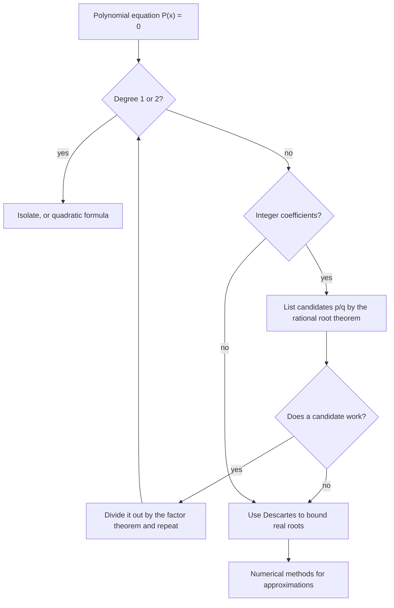

# Advanced Algebra

> [Mathematics](../../README.md) · Level: Advanced · Prerequisites: [Complex Numbers](../13-complex-numbers/README.md), [Polynomials](../06-polynomials/README.md), [Systems of Linear Equations](../05-systems-of-equations/README.md), [Inequalities](../03-inequalities/README.md) · Estimated time: 300 min

## 1. Introduction

Linear and quadratic equations have been solved for four thousand years. The next two degrees took
a village: in the 1540s Scipione del Ferro and Niccolò Tartaglia discovered formulas for the cubic,
published by Gerolamo Cardano in 1545, and Lodovico Ferrari reduced the quartic to a cubic. These
were not mere curiosities. The cubic formula was what first forced Renaissance mathematicians to
take square roots of negative numbers seriously, and therefore what produced
[complex numbers](../13-complex-numbers/README.md) in the first place.

Then the programme stopped. For nearly three centuries nobody could solve the quintic by radicals —
that is, by a formula using only the five arithmetic operations and $n$-th roots. In 1799 Paolo
Ruffini sketched a proof that no such formula exists; in 1824 Niels Henrik Abel published a complete
one; and in 1832 Évariste Galois, dead at twenty, explained *why*, in a theory that became modern
algebra. The story is the great cautionary tale of mathematics: a problem can be impossible not
because nobody is clever enough, but because the structure of the situation forbids it.

This tutorial is the toolbox that sits between elementary polynomial manipulation and that
structural answer. It has four threads.

1. **Solving equations as far as exact methods go.** The fundamental theorem of algebra (worth
   stating and understanding, §7.2), multiplicity and the shape of graphs (§7.3), the rational root
   theorem with proof (§7.4), and Descartes' rule of signs (§7.5) together decide a great deal about
   the roots of a polynomial with rational coefficients.
2. **Rewriting rational expressions.** Partial fraction decomposition (§7.6) splits a complicated
   fraction into simple ones, which is exactly what integration and Laplace-transform inversion
   need.
3. **Systems and patterns.** Nonlinear systems (§7.7), arithmetic and geometric sequences with their
   sum formulas derived — not quoted — (§7.8), sigma notation and telescoping (§7.9), and linear
   systems solved without matrices (§7.10).
4. **The boundary of the possible.** A precise account of solvability by radicals and the quintic
   (§7.11), with a forward pointer to [Abstract Algebra](../../13-abstract-algebra/README.md), where
   Galois theory lives.

## 2. Prerequisites

**Polynomials and their arithmetic.** Adding, multiplying and factoring polynomials; the meaning of
degree and leading coefficient; the division algorithm. This is the content of
[Polynomials](../06-polynomials/README.md), and §5 restates the definitions in the form used here.

**Quadratic equations.** Completing the square, the discriminant $\Delta = b^2-4ac$, and the
conclusion that $\Delta<0$ gives a conjugate pair of complex roots. Both the derivation and examples
are in [Polynomials](../06-polynomials/README.md) and
[Complex Numbers](../13-complex-numbers/README.md).

**Complex arithmetic.** Adding, multiplying and dividing complex numbers, conjugates, moduli, and the
fact that every nonzero complex number has exactly two square roots
([Complex Numbers](../13-complex-numbers/README.md), §7.9). The fundamental theorem of algebra is
stated there and used here.

**Linear systems.** Solving two equations in two unknowns by substitution and by elimination, and
recognising when a system is inconsistent or has infinitely many solutions. See
[Systems of Linear Equations](../05-systems-of-equations/README.md).

**Inequalities and sign charts.** Determining the sign of a product from the signs of its factors on
intervals between the zeros. This is developed in [Inequalities](../03-inequalities/README.md) and is
the only tool needed to sketch a polynomial; reading intercepts off a graph is assumed throughout.

## 3. Learning Objectives

After this tutorial you will be able to

1. explain the history and the content of the quadratic, cubic and quartic formulas, and why the
   quintic is different;
2. state the fundamental theorem of algebra, use it to count roots, and explain the idea of its
   proof;
3. determine the multiplicity of a root and use it to describe the local shape of a graph;
4. state and prove the rational root theorem, and use it to find all rational roots of a polynomial
   with integer coefficients;
5. apply Descartes' rule of signs to bound the number of positive and negative real roots;
6. decompose a proper rational function into partial fractions in all four cases, and verify a
   decomposition by recombining;
7. solve systems of nonlinear equations by substitution and elimination, recognising extraneous
   solutions;
8. derive the closed forms for arithmetic and geometric sums, and compute sums written in sigma
   notation, including telescoping sums;
9. solve $2\times2$ and $3\times3$ linear systems by elimination without matrix notation, and
   classify the solution set;
10. state the Abel–Ruffini theorem and explain in outline how Galois theory decides solvability by
    radicals.

## 4. Intuition

### 4.1 A polynomial is a machine with switches

Think of a polynomial $P$ as a machine: feed in a number, get out a number. A **root** is an input
that switches the machine off. Factoring is the act of discovering the switches: if
$P(x) = (x-2)(x+3)$, the machine is off at $2$ and at $-3$ and nowhere else, because a product is
zero exactly when one of its factors is.

The graph is the machine's diary. Between consecutive roots the sign cannot change without passing
through zero, so the graph stays on one side of the axis on each interval. A root where the factor
appears an even number of times is a *bounce*: the graph touches the axis and turns back. A root
where the factor appears an odd number of times is a *crossing*. This is why multiplicity — not just
the list of roots — determines the picture.

### 4.2 Why formulas run out

A formula for the roots is a recipe: perform these operations on the coefficients, and out come the
answers. For degree $2$ the recipe is the quadratic formula; for degrees $3$ and $4$ recipes exist
but are long. The surprise is that for degree $5$ no recipe can exist. The obstruction is not
analytic but *structural*: the roots of a general quintic are permuted among themselves in a way
(the group $S_5$) that cannot be built from the operations a radical formula allows. Galois turned
"can this be solved?" into "what is the symmetry group of its roots?", and answered it. Section
7.11 gives the outline.

### 4.3 Undoing a sum

Adding fractions such as $\dfrac{2}{x-1}+\dfrac{3}{x+2}$ produces a single fraction. Partial
fractions run the film backwards: given the single fraction, recover the simple ones. This is not
idle algebra. Integrating a rational function is easy term by term once it is split, and inverting a
Laplace transform depends on exactly this decomposition. The method is "guess the shape, then solve
for the coefficients", and §7.6 shows that the guess is always right.

### 4.4 Patterns and accumulation

A sequence is a list; a series is a running total. Two patterns dominate applications because they
are the two ways quantity grows in practice: adding a fixed amount each step (arithmetic) and
multiplying by a fixed factor each step (geometric). Both have closed-form sums, and both derivations
are one-line tricks — pairing terms in one case, multiplying by the ratio and subtracting in the
other. Once you see the tricks, you never need to memorise the formulas.

## 5. Formal Definition

**Definition 5.1 (Polynomial).** A **polynomial in $x$ over a field $F$** (here $F = \mathbb{R}$ or
$\mathbb{C}$) is a formal expression
$$P(x) = a_nx^n + a_{n-1}x^{n-1} + \cdots + a_1x + a_0, \qquad a_k \in F.$$
If $a_n \neq 0$, the **degree** is $\deg P := n$ and $a_n$ is the **leading coefficient**; $P$ is
**monic** when $a_n = 1$. The **zero polynomial** has no degree (some texts assign $-\infty$). The
set of all polynomials over $F$ is written $F[x]$.

**Definition 5.2 (Root).** A number $r \in \mathbb{C}$ is a **root** (or **zero**) of $P$ when
$P(r) = 0$. Equivalently, by the factor theorem below, $(x-r)$ divides $P(x)$.

**Definition 5.3 (Multiplicity).** Let $r$ be a root of the nonzero polynomial $P$. The
**multiplicity** of $r$ is the largest integer $m \ge 1$ such that $(x-r)^m$ divides $P(x)$. A root
of multiplicity $1$ is **simple**; of multiplicity $2$, **double**; and so on.

**Theorem 5.4 (Remainder and factor theorems).** Let $P \in F[x]$ and $a \in F$. The remainder on
dividing $P(x)$ by $x-a$ is $P(a)$. Consequently $x-a$ divides $P(x)$ if and only if $P(a) = 0$.

*Proof.* The division algorithm gives unique $Q \in F[x]$ and $R \in F$ with
$P(x) = (x-a)Q(x) + R$, because the divisor has degree $1$, so the remainder has degree $<1$ and is a
constant. Substituting $x = a$ kills the first term and yields $P(a) = R$. Hence $R = 0$ exactly
when $P(a) = 0$. $\square$

**Definition 5.5 (Rational function; partial fractions).** A **rational function** is a quotient
$R(x) = P(x)/Q(x)$ with $Q \neq 0$. It is **proper** when $\deg P < \deg Q$. A **partial fraction
decomposition** of a proper rational function is an identity
$$R(x) = (\text{polynomial part}) + \sum_j \frac{A_j}{x-r_j} + \sum_j \frac{B_jx+C_j}{x^2+b_jx+c_j} + \cdots$$
in which every denominator is a power of a real linear factor or of an irreducible real quadratic
factor, as in §7.6.

**Definition 5.6 (Sequences and series).** A **sequence** is a function from $\mathbb{N}$ to
$\mathbb{R}$, written $(a_n)$. A **series** is a formal sum $\sum_{k=1}^{n}a_k$ with **partial sums**
$S_n = a_1+\cdots+a_n$. The sequence is **arithmetic** with **common difference** $d$ when
$a_{n+1}-a_n = d$, and **geometric** with **common ratio** $r$ when $a_{n+1} = ra_n$ for all $n$.

## 6. Mathematical Notation

| Symbol | Read as | Meaning |
|---|---|---|
| $\deg P$ | "degree of P" | the highest exponent with non-zero coefficient |
| $F[x]$ | "F bracket x" | all polynomials in $x$ with coefficients in $F$ |
| $(x-r)^m \mid P$ | "$(x-r)^m$ divides $P$" | the division leaves zero remainder |
| $P(a)$ | "P of a" | the value of $P$ at $a$; the remainder on dividing by $x-a$ |
| $R(x) = P/Q$ | "R of x equals P over Q" | a rational function |
| $\dfrac{A}{x-r}$ | "A over x minus r" | partial fraction with a linear denominator |
| $\dfrac{Bx+C}{x^2+bx+c}$ | "B x plus C over quadratic" | partial fraction for an irreducible quadratic |
| $\sum_{k=m}^{n} a_k$ | "sum from k equals m to n of a-sub-k" | $a_m+a_{m+1}+\cdots+a_n$ |
| $\prod_{k=m}^{n} a_k$ | "product from k equals m to n" | $a_m a_{m+1}\cdots a_n$ |
| $S_n$ | "S sub n" | the $n$-th partial sum |
| $a_1,\ d$ | "a one", "d" | first term and common difference of an arithmetic sequence |
| $a_1,\ r$ | "a one", "r" | first term and common ratio of a geometric sequence |
| $\lvert r\rvert < 1$ | "modulus of r less than one" | the convergence condition for a geometric series |
| $p/q$ in lowest terms | — | $\gcd(p,q) = 1$; required in the rational root theorem |

Two conventions. Sequences are indexed from $1$ unless stated; a sum written
$\sum_{k=1}^{n}$ has $n$ terms, while $\sum_{k=0}^{n}$ has $n+1$ — off-by-one errors here are the
commonest mistake in the chapter (§11). And "irreducible quadratic" always means a real quadratic
$x^2+bx+c$ with negative discriminant, so that it has no real linear factor.

## 7. Core Concepts

### 7.1 Polynomial equations and the search for root formulas

**Degree 1.** $ax+b = 0$ with $a \neq 0$ has the unique root $x = -b/a$.

**Degree 2.** Completing the square derives the quadratic formula:
$$ax^2+bx+c = a\left(x+\frac{b}{2a}\right)^2 - \frac{b^2-4ac}{4a} = 0
\implies x = \frac{-b\pm\sqrt{b^2-4ac}}{2a}.$$
Over $\mathbb{C}$ the square root always exists, so there are always two roots counted with
multiplicity. This is the model that the higher-degree formulas try to imitate.

**Degree 3.** First remove the quadratic term. Substituting $x = y - \frac{b}{3a}$ turns
$ax^3+bx^2+cx+d = 0$ into the **depressed cubic**
$$y^3+py+q = 0.$$
Now set $y = u+v$. Since $(u+v)^3 = u^3+v^3+3uv(u+v)$, we get
$$y^3 = u^3+v^3+3uv\,y, \qquad\text{so}\qquad y^3-3uv\,y-(u^3+v^3) = 0.$$
Matching coefficients with $y^3+py+q = 0$ requires
$$uv = -\frac{p}{3}, \qquad u^3+v^3 = -q.$$
Cubing the first relation gives $u^3v^3 = -p^3/27$, so $u^3$ and $v^3$ are the two roots of
$$t^2+qt-\frac{p^3}{27} = 0, \qquad t = -\frac{q}{2}\pm\sqrt{\frac{q^2}{4}+\frac{p^3}{27}}.$$
Taking cube roots and adding produces **Cardano's formula**
$$y = \sqrt[3]{-\frac{q}{2}+\sqrt{\frac{q^2}{4}+\frac{p^3}{27}}}
    + \sqrt[3]{-\frac{q}{2}-\sqrt{\frac{q^2}{4}+\frac{p^3}{27}}},$$
where the two cube roots must be chosen so that their product is $-p/3$. Each choice of compatible
cube roots gives one root of the cubic; the other two come from the three cube roots of unity (see
[Complex Numbers](../13-complex-numbers/README.md), §7.7).

*Example.* For $y^3+3y+4 = 0$ we have $p = 3$, $q = 4$, so $q^2/4+p^3/27 = 4+1 = 5$ and
$$y = \sqrt[3]{\sqrt5-2} - \sqrt[3]{\sqrt5+2}.$$
Since $\sqrt[3]{\sqrt5+2} = \frac{1+\sqrt5}{2}$ and $\sqrt[3]{\sqrt5-2} = \frac{\sqrt5-1}{2}$ (both
cube to the claimed values), $y = \frac{\sqrt5-1}{2}-\frac{1+\sqrt5}{2} = -1$. Indeed
$y^3+3y+4 = (y+1)(y^2-y+4)$, so the other two roots are $\frac12\pm\frac{\sqrt{15}}{2}i$.

When $q^2/4+p^3/27 < 0$ the formula requires square roots of negative numbers even though all three
roots are real. This is the **casus irreducibilis**: the cubic that historically forced complex
numbers into mathematics cannot be solved by real radicals alone.

**Degree 4.** Ferrari's method depresses the quartic, writes it as a difference of two squares with
a parameter, and chooses the parameter so that the remaining quadratic is a perfect square; that
choice satisfies a cubic (the **resolvent cubic**). So the quartic reduces to a cubic, just as the
cubic reduced to a quadratic. The resulting formula is long but elementary.

**Degree 5.** No formula exists in general (§7.11). The pattern "reduce degree $n$ to degree $n-1$"
breaks: there is no resolvent of the required kind, and the reason is group-theoretic.

### 7.2 The fundamental theorem of algebra

**Theorem 7.1 (Fundamental theorem of algebra).** Every nonconstant polynomial with complex
coefficients has at least one root in $\mathbb{C}$.

**Corollary 7.2 (Factorisation and counting).** If $P$ has degree $n \ge 1$ and leading coefficient
$c_n$, then
$$P(z) = c_n(z-\alpha_1)(z-\alpha_2)\cdots(z-\alpha_n)$$
for some $\alpha_1,\dots,\alpha_n \in \mathbb{C}$, repetitions allowed. Hence $P$ has exactly $n$
roots counted with multiplicity, and at most $n$ distinct roots.

*Proof.* Induct on $n$: Theorem 7.1 gives a root $\alpha_1$; the factor theorem gives
$P = (z-\alpha_1)Q$ with $\deg Q = n-1$; apply induction to $Q$. $\square$

**Why it holds, in one paragraph.** Far from the origin the leading term dominates, so
$\lvert P(z)\rvert \to \infty$ as $\lvert z\rvert\to\infty$; hence $\lvert P\rvert$ attains a minimum
at some point $z_0$. If $P(z_0)\neq0$, expand $P(z_0+h) = P(z_0)+c_kh^k+\cdots$ in the lowest
non-zero power $k\ge1$ and choose $h$ with $h^k = -P(z_0)/c_k$; then
$P(z_0+h) \approx P(z_0)(1-t^k)$ for $h = th_0$, which is smaller than $P(z_0)$ in modulus for small
$t>0$. That contradicts minimality, so $P(z_0) = 0$. The two analytic ingredients — that a
continuous function attains a minimum on a closed bounded set, and the notion of limit — are supplied
by [Real Analysis](../../14-real-analysis/README.md); the algebraic ingredient, the existence of
$k$-th roots, is Theorem 7.4 of [Complex Numbers](../13-complex-numbers/README.md). The full argument
is written out in §7.8 of [Complex Numbers](../13-complex-numbers/README.md).

**Consequences worth stating separately.**

* *Real polynomials.* If $P$ has real coefficients, nonreal roots occur in conjugate pairs, so
  $$P(x) = c\prod_i(x-r_i)^{m_i}\prod_j\left(x^2+b_jx+c_j\right)^{k_j}$$
  with all $r_i, b_j, c_j$ real and every quadratic irreducible ($b_j^2-4c_j<0$). This is the
  factorisation partial fractions needs.
* *Odd degree.* A real polynomial of odd degree always has a real root, since nonreal roots use up
  degree in pairs.
* *Existence is not construction.* The theorem asserts that roots exist; it provides no formula and
  no algorithm, which is why §7.11 is a separate story and why numerical methods
  ([Numerical Analysis](../../19-numerical-analysis/README.md)) are needed in practice.

### 7.3 Multiplicity and the shape of graphs

**Proposition 7.3 (Multiplicity via derivatives).** Let $P$ be a polynomial and $r$ a root. Then $r$
has multiplicity $m$ if and only if
$$P(r) = P'(r) = \cdots = P^{(m-1)}(r) = 0, \qquad P^{(m)}(r) \neq 0.$$

*Proof.* Write $P(x) = (x-r)^mQ(x)$ with $Q(r)\neq0$; this is possible exactly by the definition of
multiplicity. Differentiating $m$ times with the product rule, every term of $P^{(m)}$ still contains
a factor $(x-r)$ except the term $\frac{d^m}{dx^m}(x-r)^m\cdot Q(x) = m!\,Q(x)$; hence
$P^{(m)}(r) = m!Q(r)\neq0$. Conversely, the first $m-1$ derivatives vanish at $r$ only if the
factor $(x-r)^m$ is present. $\square$

For a root of multiplicity $m$, near $x = r$ the polynomial behaves like $c(x-r)^m$ with
$c \neq 0$. The consequences for the graph are collected in the table.

| Multiplicity $m$ | Sign of $P$ near $r$ | Graph at $(r,0)$ |
|---|---|---|
| $1$ (simple) | changes sign | crosses the axis transversally |
| even ($2,4,\dots$) | same sign on both sides | touches the axis and turns back |
| odd $\ge 3$ | changes sign | crosses, flattening against the axis |
| $m$ large | — | flatter, since $\lvert x-r\rvert^m$ is tiny near $r$ |

**Proposition 7.4 (Multiplicities add up).** If $P$ has degree $n$ and distinct roots
$r_1,\dots,r_k$ with multiplicities $m_1,\dots,m_k$, then $m_1+\cdots+m_k \le n$, with equality
exactly when $P$ splits completely over the field in question.

*Proof.* Repeatedly applying the factor theorem, $P(x) = (x-r_1)^{m_1}\cdots(x-r_k)^{m_k}Q(x)$ with
$Q$ having no root among the $r_i$; comparing degrees gives the inequality, and equality means $Q$ is
constant. $\square$

Two further facts, both consequences of calculus, guide every sketch: a polynomial of degree $n$ has
at most $n-1$ **turning points** (between two consecutive turning points the derivative has a root,
and $\deg P' = n-1$); and the **end behaviour** is that of the leading term, so both tails go the same
way when $n$ is even and opposite ways when $n$ is odd. Together with the sign chart of the roots,
these facts determine the qualitative graph completely; Section 9.2 works an example.

### 7.4 The rational root theorem

**Theorem 7.5 (Rational root theorem).** Let
$$P(x) = a_nx^n+a_{n-1}x^{n-1}+\cdots+a_0$$
have integer coefficients with $a_n \neq 0$ and $a_0 \neq 0$. If $p/q$ is a root with $p,q$ integers,
$q \neq 0$ and $\gcd(p,q) = 1$, then
$$p \mid a_0 \qquad\text{and}\qquad q \mid a_n.$$

*Proof.* Substituting $x = p/q$ into $P(x) = 0$ and multiplying by $q^n$,
$$a_np^n+a_{n-1}p^{n-1}q+\cdots+a_1pq^{n-1}+a_0q^n = 0.$$
Rearrange the first $n$ terms: $a_np^n = -q\left(a_{n-1}p^{n-1}+\cdots+a_0q^{n-1}\right)$, so
$q \mid a_np^n$. Since $\gcd(p,q) = 1$ we have $\gcd(p^n,q) = 1$, and by Euclid's lemma
$q \mid a_n$. Similarly, rearranging the last $n$ terms gives
$a_0q^n = -p\left(a_np^{n-1}+\cdots+a_1q^{n-1}\right)$, so $p \mid a_0q^n$, and since
$\gcd(p,q) = 1$ we get $p \mid a_0$. $\square$

**Corollary 7.6 (Monic case).** If $P$ is monic with integer coefficients, every rational root is an
integer dividing $a_0$.

*Proof.* Here $a_n = 1$, so $q \mid 1$, hence $q = \pm1$ and $p/q$ is an integer. $\square$

**Using the theorem.** The theorem does not say which candidates work; it gives a finite list
$\pm p/q$ with $p$ dividing $a_0$ and $q$ dividing $a_n$, each of which must be tested. For
$P(x) = 2x^3+x^2-13x+6$ the candidates are
$\pm1,\ \pm2,\ \pm3,\ \pm6,\ \pm\frac12,\ \pm\frac32$. Testing gives $P(2) = 16+4-26+6 = 0$, and
dividing by $x-2$ yields $2x^2+5x-3 = (2x-1)(x+3)$, so the roots are $2,\ \frac12,\ -3$. Example 9.1
carries out the division.

Two cautions. The theorem needs **integer** coefficients (multiplying through by a common
denominator is usually harmless, but changes the candidate list), and it needs $\gcd(p,q)=1$; the
fraction $\frac{2}{4}$ is really $\frac12$, and using the unreduced form produces spurious
candidates.

### 7.5 Descartes' rule of signs

**Theorem 7.7 (Descartes' rule of signs).** Let $P$ be a polynomial with real coefficients, written in
descending powers with zero coefficients omitted. Let $s$ be the number of **sign changes** in its
coefficient sequence. Then the number of positive real roots of $P$, counted with multiplicity, is at
most $s$, and differs from $s$ by an even number. The number of negative real roots, counted with
multiplicity, is obtained by the same rule applied to $P(-x)$.

Zero coefficients are ignored; a root at $0$ is neither positive nor negative and is removed by
factoring out the highest power of $x$ first.

*Example.* For $P(x) = x^4+3x^3-2x^2+x-5$ the signs are $+,+,-,+,-$, which change $3$ times, so $P$
has $3$ or $1$ positive roots. Since $P(-x) = x^4-3x^3-2x^2-x-5$ has signs $+,-,-,-,-$, changing once,
$P$ has exactly $1$ negative root. Testing the candidates of the rational root theorem
($\pm1,\pm5$) shows that $P$ has no rational root, so the positive root, if unique, is irrational.

Three remarks. The rule bounds roots **counted with multiplicity**, so a double root consumes two
from the count. It says nothing about *where* the roots are, only how many. And it is a statement
about real roots; complex roots are invisible to it.

### 7.6 Partial fractions

**Setup.** Let $R(x) = \dfrac{P(x)}{Q(x)}$ be a rational function with $\deg P < \deg Q$ (if not,
divide first). Factor $Q$ over $\mathbb{R}$ into linear factors $(x-r)^m$ and irreducible quadratics
$(x^2+bx+c)^k$ with $b^2-4c<0$. The decomposition then has one term per *power* of each factor:

| Case | Factor in $Q$ | Contribution to the decomposition |
|---|---|---|
| 1 | distinct linear $x-r$ | $\dfrac{A}{x-r}$ |
| 2 | repeated linear $(x-r)^m$ | $\dfrac{A_1}{x-r}+\dfrac{A_2}{(x-r)^2}+\cdots+\dfrac{A_m}{(x-r)^m}$ |
| 3 | distinct irreducible quadratic $x^2+bx+c$ | $\dfrac{Bx+C}{x^2+bx+c}$ |
| 4 | repeated irreducible quadratic $(x^2+bx+c)^k$ | $\sum_{j=1}^{k}\dfrac{B_jx+C_j}{(x^2+bx+c)^j}$ |

The unknown coefficients are found by clearing denominators and comparing coefficients of powers of
$x$, or by substituting convenient values of $x$. Both routes are legitimate because a polynomial
that vanishes at more points than its degree is identically zero. The number of unknowns equals
$\deg Q$, which is exactly the number of linear conditions obtained by comparing coefficients; the
system is always solvable and the decomposition is unique.

**Case 1, distinct linear factors.** With $Q = \prod_i(x-r_i)$,
$$\frac{P(x)}{\prod_i(x-r_i)} = \sum_i\frac{A_i}{x-r_i}, \qquad
A_i = \frac{P(r_i)}{\prod_{j\neq i}(r_i-r_j)}.$$
Multiplying by $Q$ and setting $x = r_i$ kills every term except the $i$-th, which is the
**cover-up rule**.

*Worked example.* Decompose $\dfrac{5x-3}{(x-1)(x+3)}$. Write
$$\frac{5x-3}{(x-1)(x+3)} = \frac{A}{x-1}+\frac{B}{x+3}.$$
Clearing denominators, $5x-3 = A(x+3)+B(x-1)$. Setting $x=1$: $2 = 4A$, so $A = \frac12$. Setting
$x=-3$: $-18 = -4B$, so $B = \frac92$.
**Check by recombining:**
$$\frac{1/2}{x-1}+\frac{9/2}{x+3} = \frac{(x+3)+9(x-1)}{2(x-1)(x+3)} = \frac{10x-6}{2(x-1)(x+3)} = \frac{5x-3}{(x-1)(x+3)}. \checkmark$$

**Case 2, a repeated linear factor.** With a factor $(x-r)^m$, include every power up to $m$.

*Worked example.* Decompose $\dfrac{x^2+2}{(x-1)^2(x+1)}$. Write
$$\frac{x^2+2}{(x-1)^2(x+1)} = \frac{A}{x-1}+\frac{B}{(x-1)^2}+\frac{C}{x+1}.$$
Clearing denominators:
$$x^2+2 = A(x-1)(x+1)+B(x+1)+C(x-1)^2.$$
At $x=1$: $3 = 2B$, so $B = \frac32$. At $x=-1$: $3 = 4C$, so $C = \frac34$. Comparing $x^2$
coefficients: $1 = A+C$, so $A = \frac14$.
**Check by recombining.** The numerator is
$\frac14(x^2-1)+\frac32(x+1)+\frac34(x^2-2x+1) = \left(\frac14+\frac34\right)x^2+\left(\frac32-\frac32\right)x+\left(-\frac14+\frac32+\frac34\right) = x^2+2. \checkmark$

**Case 3, an irreducible quadratic.** Use a linear numerator $Bx+C$.

*Worked example.* Decompose $\dfrac{3x^2+2x+1}{x(x^2+1)}$. Write
$$\frac{3x^2+2x+1}{x(x^2+1)} = \frac{A}{x}+\frac{Bx+C}{x^2+1}.$$
Clearing denominators: $3x^2+2x+1 = A(x^2+1)+(Bx+C)x = (A+B)x^2+Cx+A$. Comparing coefficients,
$A = 1$, $C = 2$, $A+B = 3$ so $B = 2$.
**Check.** $\dfrac1x+\dfrac{2x+2}{x^2+1} = \dfrac{(x^2+1)+x(2x+2)}{x(x^2+1)} = \dfrac{3x^2+2x+1}{x(x^2+1)}. \checkmark$

**Case 4, a repeated irreducible quadratic.** Include every power, each with its own linear numerator.

*Worked example.* Decompose $\dfrac{x^3+2x^2+x+3}{(x^2+1)^2}$. Write
$$\frac{x^3+2x^2+x+3}{(x^2+1)^2} = \frac{Bx+C}{x^2+1}+\frac{Dx+E}{(x^2+1)^2}.$$
Clearing denominators:
$$x^3+2x^2+x+3 = (Bx+C)(x^2+1)+Dx+E = Bx^3+Cx^2+(B+D)x+(C+E).$$
Comparing: $B=1$, $C=2$, $B+D = 1$ so $D = 0$, $C+E = 3$ so $E = 1$.
**Check.** $\dfrac{x+2}{x^2+1}+\dfrac{1}{(x^2+1)^2} = \dfrac{(x+2)(x^2+1)+1}{(x^2+1)^2} = \dfrac{x^3+2x^2+x+2+1}{(x^2+1)^2}. \checkmark$

**Improper fractions.** If $\deg P \ge \deg Q$, divide first and decompose the remainder.

*Worked example.* $\dfrac{x^3+x}{x^2-1}$. Division gives $x^3+x = x(x^2-1)+2x$, so
$$\frac{x^3+x}{x^2-1} = x+\frac{2x}{(x-1)(x+1)} = x+\frac{1}{x-1}+\frac{1}{x+1},$$
because $\dfrac{1}{x-1}+\dfrac{1}{x+1} = \dfrac{(x+1)+(x-1)}{(x-1)(x+1)} = \dfrac{2x}{x^2-1}$. $\checkmark$

### 7.7 Systems of nonlinear equations

Two methods cover almost everything.

**Substitution.** Solve one equation for one variable (or for a simple expression such as $xy$),
substitute into the other, and solve the resulting one-variable equation. Every solution of the
original system appears; but if a step squared both sides or multiplied by an expression that can
vanish, candidate solutions must be checked in the *original* system.

**Elimination.** Add or subtract multiples of the equations to cancel a term. This works well when
both equations contain the same symmetric expressions.

*Worked example (line and circle).* Solve
$$\begin{cases}x^2+y^2 = 25,\\ x+y = 7.\end{cases}$$
From the second, $y = 7-x$. Substituting:
$$x^2+(7-x)^2 = 25 \implies 2x^2-14x+49 = 25 \implies x^2-7x+12 = 0 \implies x = 3\ \text{or}\ x = 4.$$
Then $y = 4$ or $y = 3$, so the solutions are $(3,4)$ and $(4,3)$.
**Check.** $9+16 = 25$ and $3+4 = 7$; $16+9 = 25$ and $4+3 = 7$. Both satisfy the original system.
Geometrically, the line cuts the circle in two points.

*Symmetric systems.* For $x+y = s$ and $xy = p$, the pair $\{x,y\}$ is the set of roots of
$t^2-st+p = 0$. So solving the system reduces to a quadratic. For example, $x+y = 5$, $xy = 6$ gives
$t^2-5t+6 = 0$, i.e. $\{x,y\} = \{2,3\}$, and both orderings are solutions.

*More solutions than expected.* The system $x^2+y^2 = 10$, $xy = 3$ has four solutions. Squaring
$x+y$ is the efficient route: $(x+y)^2 = x^2+2xy+y^2 = 10+6 = 16$, so $x+y = \pm4$. With $xy = 3$,
the pair $\{x,y\}$ solves $t^2\mp4t+3 = 0$, giving $\{1,3\}$ for the $+$ sign and $\{-1,-3\}$ for
the $-$ sign. Hence $(1,3),(3,1),(-1,-3),(-3,-1)$.
**Check.** $1+9 = 10$ and $1\cdot3 = 3$; $9+1 = 10$; $1+9 = 10$ and $(-1)(-3) = 3$. All four work.

*Counting.* Two curves of degrees $m$ and $n$ can meet in at most $mn$ points unless they share a
component (Bézout's theorem, proved in algebraic geometry). For a line and a circle that bound is
$2$; for two circles it is $2$; for a circle and a cubic it is $6$. The bound is a useful check that
no solution has been missed.

### 7.8 Arithmetic and geometric sequences and series

**Arithmetic sequences.** $a_{n+1}-a_n = d$ gives, by induction,
$$a_n = a_1+(n-1)d.$$
For the sum, pair the first term with the last, the second with the second-to-last, and so on. Each
pair sums to $a_1+a_n$, and there are $n/2$ pairs (with the middle term unpaired when $n$ is odd,
which the formula handles because the unpaired term is $\frac{a_1+a_n}{2}$). Formally, write the sum
forwards and backwards and add:
$$\begin{aligned}
S_n &= a_1 + (a_1+d) + \cdots + \bigl(a_1+(n-1)d\bigr),\\
S_n &= a_n + (a_n-d) + \cdots + \bigl(a_n-(n-1)d\bigr).
\end{aligned}$$
Adding term by term, every column equals $a_1+a_n$, so $2S_n = n(a_1+a_n)$ and
$$S_n = \frac{n}{2}\left(a_1+a_n\right) = \frac{n}{2}\left(2a_1+(n-1)d\right).$$
For example $1+2+\cdots+100 = \frac{100\cdot101}{2} = 5050$.

**Geometric sequences.** $a_{n+1} = ra_n$ gives $a_n = a_1r^{n-1}$. For the sum, multiply by $r$ and
subtract:
$$\begin{aligned}
S_n &= a_1+a_1r+\cdots+a_1r^{n-1},\\
rS_n &= a_1r+\cdots+a_1r^{n-1}+a_1r^n.
\end{aligned}$$
Subtracting cancels all intermediate terms:
$$(1-r)S_n = a_1-a_1r^n, \qquad\text{so}\qquad S_n = a_1\frac{1-r^n}{1-r} \quad (r \neq 1).$$
If $r = 1$ the series is constant and $S_n = na_1$; the formula's limit as $r\to1$ agrees.

**Infinite geometric series.** If $\lvert r\rvert<1$ then $r^n\to0$, so the partial sums converge to
$$S = \sum_{k=1}^{\infty}a_1r^{k-1} = \frac{a_1}{1-r}.$$
If $\lvert r\rvert\ge1$ and $a_1\neq0$ the terms do not tend to $0$, so the series diverges. The
convergence statement is the definition of an infinite series as the limit of its partial sums,
made precise in [Calculus](../../07-calculus/README.md).

*Examples.*
$$1+\frac12+\frac14+\cdots = \frac{1}{1-\frac12} = 2, \qquad
0.999\ldots = \frac{9}{10}+\frac{9}{100}+\cdots = \frac{\frac{9}{10}}{1-\frac{1}{10}} = 1.$$
The second is a proof that the decimal $0.999\ldots$ is the number $1$, not a number "just below"
it. Applications of these two formulas — interest, annuities, bouncing balls — are collected in
Section 12.

### 7.9 Sigma notation and telescoping sums

**Notation and rules.** $\sum_{k=m}^{n}a_k = a_m+a_{m+1}+\cdots+a_n$, and
$$\sum_{k=m}^{n}\left(\alpha a_k+\beta b_k\right) = \alpha\sum_{k=m}^{n}a_k+\beta\sum_{k=m}^{n}b_k,
\qquad \sum_{k=m}^{n}1 = n-m+1.$$
Re-indexing shifts every occurrence of $k$: putting $j = k-1$ in $\sum_{k=1}^{n}k$ gives
$\sum_{j=0}^{n-1}(j+1)$, the same number.

**The standard sums.** The first is arithmetic; the others follow by telescoping:
$$\sum_{k=1}^{n}k = \frac{n(n+1)}{2}, \qquad
\sum_{k=1}^{n}k^2 = \frac{n(n+1)(2n+1)}{6}, \qquad
\sum_{k=1}^{n}k^3 = \left(\frac{n(n+1)}{2}\right)^2.$$

*Derivation of the first two.* From $(k+1)^2-k^2 = 2k+1$, summing over $k = 1,\dots,n$ telescopes the
left side:
$$(n+1)^2-1 = \sum_{k=1}^{n}\left(2k+1\right) = 2\sum_{k=1}^{n}k+n,$$
so $2\sum k = n^2+2n-n = n(n+1)$, giving the arithmetic sum. From $(k+1)^3-k^3 = 3k^2+3k+1$,
$$(n+1)^3-1 = 3\sum_{k=1}^{n}k^2+3\sum_{k=1}^{n}k+n;$$
substituting $\sum k = n(n+1)/2$ and solving for $\sum k^2$ gives
$\sum k^2 = \frac{n(n+1)(2n+1)}{6}$. The cube formula follows similarly from
$(k+1)^4-k^4$.

**Telescoping.** If $a_k = b_k-b_{k+1}$ then
$$\sum_{k=1}^{n}a_k = b_1-b_{n+1},$$
because every intermediate $b_j$ appears once with a plus and once with a minus. Partial fractions
manufacture such decompositions. For instance
$$\frac{1}{k(k+1)} = \frac1k-\frac{1}{k+1} \implies
\sum_{k=1}^{n}\frac{1}{k(k+1)} = 1-\frac{1}{n+1} = \frac{n}{n+1}.$$
**Check.** For $n=1$: $\frac1{1\cdot2} = \frac12$ and $\frac{1}{2} = \frac12$. For $n=3$:
$\frac12+\frac16+\frac1{12} = \frac{6+2+1}{12} = \frac34$, matching $\frac{3}{4}$. Both agree.

### 7.10 Linear systems without matrices

A linear system is solved by **elimination**: use one equation to remove a variable from the others,
repeat until the system is **triangular** (each equation introduces one new variable), then
**back-substitute**.

*Two variables.* Solve
$$\begin{cases}2x+3y = 12,\\ x-y = 1.\end{cases}$$
From the second, $x = y+1$. Substituting into the first: $2(y+1)+3y = 12$, so $5y = 10$, $y = 2$ and
$x = 3$. Check: $6+6 = 12$, $3-2 = 1$. The solution is $(3,2)$, the intersection point of the two
lines.

*Three variables.* Solve
$$\begin{cases}x+y+z = 6,\\ 2x-y+z = 3,\\ x+2y-z = 2.\end{cases}$$
Eliminate $z$ from the second and third using the first ($z = 6-x-y$):
$$2x-y+(6-x-y) = 3 \implies x-2y = -3, \qquad x+2y-(6-x-y) = 2 \implies 2x+3y = 8.$$
Now a $2\times2$ system: from $x = 2y-3$, substitute: $2(2y-3)+3y = 8$, so $7y = 14$, $y = 2$ and
$x = 1$. Back-substitute: $z = 6-1-2 = 3$.
**Check** in the third original equation: $1+4-3 = 2$. Correct.

*Classification.* Elimination ends in one of three ways.

| Outcome after elimination | Conclusion | Geometry |
|---|---|---|
| a triangular system with a pivot in every variable | unique solution | lines/planes meet in one point |
| a row $0 = c$ with $c \neq 0$ | no solution | the equations are inconsistent |
| a row $0 = 0$ (a free variable remains) | infinitely many solutions | a line, plane or larger set |

An example of the third case: $x+y+z = 2$, $2x+3y+4z = 5$, $3x+4y+5z = 7$. Subtracting twice the
first from the second gives $y+2z = 1$, and subtracting three times the first from the third gives
the same equation, so one equation is redundant. Solving $y = 1-2z$ and back-substituting gives
$x = 1+z$, so the solution set is the line $\{(1+z,\ 1-2z,\ z) : z\in\mathbb{R}\}$; for instance
$z=0$ gives $(1,1,0)$, which satisfies all three equations.

Matrices are nothing but a bookkeeping device for exactly these operations — the coefficients are
written in an array so that "subtract twice the first row from the second" becomes a single row
operation. [Linear Algebra](../../08-linear-algebra/README.md) develops the notation and the theory
of when a system has a unique solution.

### 7.11 Solvability by radicals and the quintic

**Definition 7.8 (Solvable by radicals).** A polynomial is **solvable by radicals** over a field $F$
if each of its roots can be obtained from the coefficients by finitely many operations of addition,
subtraction, multiplication, division and extraction of $n$-th roots.

Degrees $2,3,4$ are solvable by radicals: the quadratic formula, Cardano's formula and Ferrari's
method are exactly such expressions. For two and a half centuries mathematicians searched for the
degree-$5$ analogue. The search ended in a negative theorem.

**Theorem 7.9 (Abel–Ruffini, 1824).** There is no expression in radicals in the coefficients that
gives the roots of every quintic. Equivalently, the general polynomial equation of degree $n$ is not
solvable by radicals for any $n \ge 5$.

The reason is not that the roots fail to exist — the fundamental theorem of algebra guarantees them
— but that they cannot be *reached* by the allowed operations. Galois's insight was to attach to a
polynomial a **group**: the set of permutations of its roots that preserve every algebraic relation
among them. His criterion is:

> A polynomial is solvable by radicals if and only if its Galois group is a **solvable group**,
> meaning it has a chain of subgroups $G = G_0 \triangleright G_1 \triangleright \cdots \triangleright G_k = \{e\}$
> in which every quotient $G_{i}/G_{i+1}$ is abelian.

The symmetric group $S_n$ is solvable for $n \le 4$ but not for $n \ge 5$, because the alternating
group $A_n$ is simple for $n \ge 5$; that is the structural fact behind the theorem. The general
degree-$n$ polynomial has Galois group $S_n$, so for $n\ge5$ there is no radical formula.

**A concrete example.** The polynomial $P(x) = x^5-x-1$ has Galois group $S_5$ over $\mathbb{Q}$ and
is therefore not solvable by radicals — even though it has one positive real root
($x \approx 1.1673$) and four nonreal roots, all computable numerically to any accuracy. By
contrast $x^5-2$ *is* solvable by radicals: its roots are $\sqrt[5]{2}$ times the fifth roots of
unity, and those are expressible with radicals (the exact value of $\cos72^\circ$ is derived in the
challenge exercises of [Complex Numbers](../13-complex-numbers/README.md)).
**Solvability is a property of the polynomial, not of its degree alone.**

That structural answer is the beginning of abstract algebra:
[Abstract Algebra](../../13-abstract-algebra/README.md) builds groups, rings, fields and Galois
theory, and proves this theorem in full.

## 8. Formulas and Properties

### 8.1 Polynomials and their roots

| Statement | Content | Hypotheses |
|---|---|---|
| Remainder theorem | remainder of $P$ divided by $x-a$ is $P(a)$ | none |
| Factor theorem | $x-a \mid P \iff P(a) = 0$ | none |
| Degree of a product | $\deg(PQ) = \deg P+\deg Q$ | $P,Q \neq 0$ |
| Number of roots | at most $n$ distinct roots over any field; exactly $n$ with multiplicity over $\mathbb{C}$ | $\deg P = n$ |
| Multiplicity criterion | $r$ has multiplicity $m$ iff $P^{(j)}(r)=0$ for $j<m$ and $P^{(m)}(r)\neq0$ | $P \neq 0$ |
| Multiplicities sum | $\sum_i m_i \le \deg P$, with equality iff $P$ splits | $P \neq 0$ |
| Turning points | at most $n-1$ | $\deg P = n \ge 1$ |
| Conjugate pairs | real coefficients: $P(\alpha)=0 \Rightarrow P(\bar\alpha)=0$ | coefficients real |

**Vieta's formulas.** If $P(x) = a_nx^n+\cdots+a_0 = a_n\prod_{k=1}^n(x-\alpha_k)$, then
$$\sum_k\alpha_k = -\frac{a_{n-1}}{a_n}, \qquad \sum_{j<k}\alpha_j\alpha_k = \frac{a_{n-2}}{a_n}, \qquad
\prod_k\alpha_k = (-1)^n\frac{a_0}{a_n}.$$
They follow by expanding the product: the coefficient of $x^{n-1}$ is $-a_n\sum\alpha_k$, and the
constant term is $a_n(-1)^n\prod\alpha_k$. For a quadratic, $\alpha+\beta = -b/a$ and
$\alpha\beta = c/a$; for a cubic, $\alpha+\beta+\gamma = -b/a$, $\alpha\beta+\beta\gamma+\gamma\alpha = c/a$
and $\alpha\beta\gamma = -d/a$.

### 8.2 Root-finding tools

| Tool | Gives | Requires |
|---|---|---|
| Quadratic formula | both roots exactly | degree $2$ |
| Rational root theorem | a finite list of candidates for rational roots | integer coefficients |
| Descartes' rule | an upper bound, with parity, on positive/negative real roots | real coefficients |
| Factor theorem | removes a known root by division | one known root |
| Numerical methods | approximations to any accuracy | continuity; see [Numerical Analysis](../../19-numerical-analysis/README.md) |

### 8.3 Partial fraction shapes

For $R = P/Q$ proper, with $Q$ factored over $\mathbb{R}$:

| Denominator factor | Terms |
|---|---|
| $x-r$ | $\dfrac{A}{x-r}$ |
| $(x-r)^m$ | $\dfrac{A_1}{x-r}+\cdots+\dfrac{A_m}{(x-r)^m}$ |
| $x^2+bx+c$ irreducible | $\dfrac{Bx+C}{x^2+bx+c}$ |
| $(x^2+bx+c)^k$ irreducible | $\dfrac{B_1x+C_1}{x^2+bx+c}+\cdots+\dfrac{B_kx+C_k}{(x^2+bx+c)^k}$ |

The coefficients are unique; see §7.6 for the four worked cases and their verifications.

### 8.4 Sequences and sums

| Quantity | Formula | Condition |
|---|---|---|
| Arithmetic $n$-th term | $a_n = a_1+(n-1)d$ | constant difference $d$ |
| Arithmetic sum | $S_n = \frac{n}{2}\left(a_1+a_n\right) = \frac n2\left(2a_1+(n-1)d\right)$ | — |
| Geometric $n$-th term | $a_n = a_1r^{n-1}$ | constant ratio $r$ |
| Geometric sum | $S_n = a_1\dfrac{1-r^n}{1-r}$ | $r \neq 1$ |
| Geometric sum, $r=1$ | $S_n = na_1$ | — |
| Infinite geometric sum | $S = \dfrac{a_1}{1-r}$ | $\lvert r\rvert<1$ |
| Sum of integers | $\sum_{k=1}^n k = \dfrac{n(n+1)}{2}$ | — |
| Sum of squares | $\sum_{k=1}^n k^2 = \dfrac{n(n+1)(2n+1)}{6}$ | — |
| Sum of cubes | $\sum_{k=1}^n k^3 = \left(\dfrac{n(n+1)}{2}\right)^2$ | — |
| Telescoping | $\sum_{k=1}^n(b_k-b_{k+1}) = b_1-b_{n+1}$ | — |

### 8.5 Linear systems

For $a_1x+b_1y = c_1$, $a_2x+b_2y = c_2$, the number $D = a_1b_2-a_2b_1$ decides the shape of the
solution set:

* $D \neq 0$: exactly one solution;
* $D = 0$ and the equations are proportional (including the constants): infinitely many solutions;
* $D = 0$ and the equations are not proportional: no solution.

The same trichotomy holds in every dimension: elimination either produces a pivot in each variable
(unique), a contradiction (none), or a free variable (infinitely many).

## 9. Step-by-Step Examples

### Example 9.1 (Easy–medium): all roots by the rational root theorem

Solve $2x^3+x^2-13x+6 = 0$.

The candidates are $\pm p/q$ with $p \mid 6$ and $q \mid 2$:
$$\pm1,\ \pm2,\ \pm3,\ \pm6,\ \pm\frac12,\ \pm\frac32.$$
Test $x = 2$: $2\cdot8+4-26+6 = 16+4-26+6 = 0$. So $x-2$ is a factor. Divide:
$$2x^3+x^2-13x+6 = (x-2)\left(2x^2+5x-3\right).$$
**Check of the division.** $(x-2)(2x^2+5x-3) = 2x^3+5x^2-3x-4x^2-10x+6 = 2x^3+x^2-13x+6$. Correct.

Factor the quadratic: $2x^2+5x-3 = (2x-1)(x+3)$, since $2x^2+6x-x-3 = 2x^2+5x-3$. Hence
$$2x^3+x^2-13x+6 = (x-2)(2x-1)(x+3),$$
and the roots are $x = 2$, $x = \frac12$, $x = -3$.
**Check by Vieta.** Sum $= 2+\frac12-3 = -\frac12 = -a_2/a_3$; product
$= 2\cdot\frac12\cdot(-3) = -3 = -a_0/a_3$. Both agree with $a_3 = 2$, $a_2 = 1$, $a_0 = 6$.

### Example 9.2 (Medium): multiplicity and the shape of a graph

Analyse the graph of $P(x) = (x-1)^2(x+2)^3(x^2+1)$.

*Degree and end behaviour.* The degree is $2+3+2 = 7$, odd, with leading coefficient $1$. So
$P(x)\to-\infty$ as $x\to-\infty$ and $P(x)\to+\infty$ as $x\to+\infty$.

*Zeros and multiplicities.* $x = 1$ has multiplicity $2$ (even): the graph touches the axis and turns
back. $x = -2$ has multiplicity $3$ (odd, greater than $1$): the graph crosses the axis, flattening
as it does so. The factor $x^2+1$ is always positive, so it contributes no real root and no sign
change.

*Sign chart.* The sign of $P$ is the product of the signs of its factors, and $(x-1)^2>0$ for
$x\neq1$ while $x^2+1>0$ always. So the sign is the sign of $(x+2)^3$, i.e. the sign of $x+2$:

| Interval | Sign of $P$ | Reason |
|---|---|---|
| $x<-2$ | negative | $x+2<0$, all other factors positive |
| $-2<x<1$ | positive | $x+2>0$ |
| $x>1$ | positive | $x+2>0$ |

*Intercept.* $P(0) = (-1)^2\cdot2^3\cdot1 = 8$.

*Turning points.* At most $7-1 = 6$. The graph descends from $-\infty$, crosses at $x=-2$ with an
inflection-like flattening, rises to a local maximum, comes down to touch the axis at $x=1$ (a local
minimum, since the sign is positive on both sides), then rises to $+\infty$.

**Check at a sample point.** $P(-1) = (-2)^2\cdot1^3\cdot2 = 8>0$, consistent with the sign chart on
$(-2,1)$; $P(2) = 1^2\cdot4^3\cdot5 = 320>0$, consistent with $x>1$.

### Example 9.3 (Medium–hard): a full partial fraction decomposition

Decompose $\dfrac{3x^2+2x-1}{(x-1)(x^2+1)}$.

The denominator is already a product of a linear factor and an irreducible quadratic
($x^2+1$ has discriminant $-4<0$), so the shape is
$$\frac{3x^2+2x-1}{(x-1)(x^2+1)} = \frac{A}{x-1}+\frac{Bx+C}{x^2+1}.$$
Clear denominators:
$$3x^2+2x-1 = A(x^2+1)+(Bx+C)(x-1) = (A+B)x^2+(C-B)x+(A-C).$$
Compare coefficients:
$$A+B = 3, \qquad C-B = 2, \qquad A-C = -1.$$
From the third, $C = A+1$; then the second gives $B = C-2 = A-1$; and the first gives
$A+(A-1) = 3$, so $A = 2$, $B = 1$, $C = 3$. Therefore
$$\frac{3x^2+2x-1}{(x-1)(x^2+1)} = \frac{2}{x-1}+\frac{x+3}{x^2+1}.$$
**Check by recombining.**
$$\frac{2(x^2+1)+(x+3)(x-1)}{(x-1)(x^2+1)} = \frac{2x^2+2+x^2+2x-3}{(x-1)(x^2+1)} = \frac{3x^2+2x-1}{(x-1)(x^2+1)}. \checkmark$$
Two independent spot checks confirm it: at $x=0$ both sides equal $1$, and at $x=2$ both equal $3$.

### Example 9.4 (Hard): a system with a line and a circle

Solve
$$\begin{cases}x^2+y^2 = 25,\\ y = x+1.\end{cases}$$

Substitute the second into the first:
$$x^2+(x+1)^2 = 25 \implies 2x^2+2x+1 = 25 \implies x^2+x-12 = 0 \implies (x-3)(x+4) = 0.$$
So $x = 3$, giving $y = 4$, or $x = -4$, giving $y = -3$. The solutions are $(3,4)$ and $(-4,-3)$.
**Check.** $9+16 = 25$ with $4 = 3+1$; $16+9 = 25$ with $-3 = -4+1$. Correct.

**Geometry.** The line $y = x+1$ is a secant of the circle: it meets it in exactly two points, which
matches the two solutions, and substitution produced a genuine quadratic, so none were lost or
invented. A line that missed the circle would give a negative discriminant and no real solutions.

### Example 9.5 (Medium): a geometric series in a physical model

A ball is dropped from $2$ m and on every bounce rises to $\frac34$ of its previous height. Find the
total vertical distance travelled, and the first bounce after which the height is below $1$ mm.

*Distance.* The ball falls $2$ m, then rises $\frac32$ m and falls the same, then rises
$2\left(\frac34\right)^2$ and falls the same, and so on. Each rebound of height $h$ contributes $2h$ to
the total (up and down), so the total vertical distance is
$$2+2\sum_{j=1}^{\infty}\frac32\left(\frac34\right)^{j-1} = 2+2\cdot\frac{\frac32}{1-\frac34} = 2+2\cdot6 = 14\ \text{m}.$$
**Check.** Up to and including the fall that follows the $n$-th rebound the distance is
$$2+2\cdot\frac32\cdot\frac{1-\left(\frac34\right)^n}{1-\frac34} = 2+12\left(1-\left(\frac34\right)^n\right),$$
which increases to $14$. For $n=1$ it gives $2+12\cdot\frac14 = 5$ m, matching the explicit count
$2$ m down $+\,1.5$ m up $+\,1.5$ m down $=5$ m.

*Height after bounce $n$.* The height is $h_n = 2\left(\frac34\right)^n$. Solve $2\left(\frac34\right)^n<0.001$:
$$n\ln\frac34<\ln0.0005 \implies n>\frac{\ln0.0005}{\ln0.75}\approx\frac{-7.6009}{-0.2877}\approx26.4.$$
So the first bounce below $1$ mm is number $27$.
**Check.** $2(0.75)^{26}\approx0.00111$ m $>1$ mm, while $2(0.75)^{27}\approx0.000834$ m $<1$ mm.

### Example 9.6 (Hard): a telescoping sum built from partial fractions

Compute $\displaystyle\sum_{k=1}^{n}\frac{1}{k(k+1)(k+2)}$.

Partial fractions: write
$$\frac{1}{k(k+1)(k+2)} = \frac{A}{k}+\frac{B}{k+1}+\frac{C}{k+2}.$$
Clearing denominators, $1 = A(k+1)(k+2)+Bk(k+2)+Ck(k+1)$. Setting $k=0$: $1 = 2A$, $A = \frac12$.
Setting $k=-1$: $1 = -B$, $B = -1$. Setting $k=-2$: $1 = 2C$, $C = \frac12$. So
$$\frac{1}{k(k+1)(k+2)} = \frac12\left(\frac1k-\frac{2}{k+1}+\frac{1}{k+2}\right)
= \frac12\left(\frac{1}{k(k+1)}-\frac{1}{(k+1)(k+2)}\right).$$
**Check the identity** by recombining:
$\frac{1}{k(k+1)}-\frac{1}{(k+1)(k+2)} = \frac{(k+2)-k}{k(k+1)(k+2)} = \frac{2}{k(k+1)(k+2)}$, so
halving gives the claimed left side. $\checkmark$

Now telescope with $b_k = \frac{1}{2k(k+1)}$:
$$\sum_{k=1}^{n}\frac{1}{k(k+1)(k+2)} = \frac12\sum_{k=1}^{n}\left(\frac{1}{k(k+1)}-\frac{1}{(k+1)(k+2)}\right)
= \frac12\left(\frac{1}{1\cdot2}-\frac{1}{(n+1)(n+2)}\right) = \frac14-\frac{1}{2(n+1)(n+2)}.$$
**Check for $n=1$:** the sum is $\frac16$; the formula gives $\frac14-\frac{1}{2\cdot2\cdot3} = \frac14-\frac1{12} = \frac16$,
and for $n=2$ both sides give $\frac{5}{24}$.

### Example 9.7 (Hard): a linear system with infinitely many solutions

Solve
$$\begin{cases}x+y+z = 2,\\ 2x+3y+4z = 5,\\ 3x+4y+5z = 7.\end{cases}$$

Eliminate $x$ from the second and third equations using the first. Subtract $2$ times the first from
the second:
$$(2x+3y+4z)-2(x+y+z) = 5-4 \implies y+2z = 1.$$
Subtract $3$ times the first from the third:
$$(3x+4y+5z)-3(x+y+z) = 7-6 \implies y+2z = 1.$$
The two eliminations give the same equation, so the system has a **free variable**. Take $z$ as the
parameter; then $y = 1-2z$ and
$$x = 2-y-z = 2-(1-2z)-z = 1+z.$$
The solution set is
$$\left\{(1+z,\;1-2z,\;z) : z\in\mathbb{R}\right\},$$
a line in $\mathbb{R}^3$.
**Check.** Substituting into the second equation:
$2(1+z)+3(1-2z)+4z = 2+2z+3-6z+4z = 5$. And into the third:
$3(1+z)+4(1-2z)+5z = 3+3z+4-8z+5z = 7$. Both hold for every $z$; for $z=0$ the point is $(1,1,0)$,
which satisfies $1+1+0 = 2$ as well.

**Interpretation.** The three equations describe three planes, and the third is the sum of the first
two ($(x+y+z)+(2x+3y+4z) = 3x+4y+5z$ and $2+5 = 7$). Three planes meeting along a line is exactly
the "one redundant equation" case of §7.10.

## 10. Visual Explanations

The first decision in any polynomial equation is which tool applies; the flowchart prevents both
wasted effort and missed roots.

Graph shapes near a root follow from multiplicity alone (§7.3): odd multiplicity crosses, even
multiplicity touches, and a repeated root uses up several of the $n$ roots.

## 11. Common Mistakes

1. **Assuming every candidate from the rational root theorem is a root.** The theorem produces a
   list to *test*; most candidates usually fail. It also requires integer coefficients and the
   fraction in lowest terms.
2. **Ignoring the parity in Descartes' rule.** $3$ sign changes allow $3$ or $1$ positive roots, not
   "at most $3$ and maybe $2$".
3. **Counting a double root once.** Vieta's formulas and Descartes count multiplicity; a double root
   consumes two of the $n$ roots.
4. **Forgetting that a complex pair uses two degrees.** A real cubic with one nonreal root is
   impossible; the conjugate must also be a root.
5. **Missing powers in a repeated factor.** For $(x-1)^3$ the decomposition needs
   $A/(x-1)+B/(x-1)^2+C/(x-1)^3$, not just the first term.
6. **Using a constant numerator over an irreducible quadratic.** The correct numerator is linear,
   $Bx+C$.
7. **Forgetting to divide when the fraction is improper.** A decomposition is stated only for
   $\deg P<\deg Q$; otherwise perform polynomial division first.
8. **Solving a nonlinear system and forgetting to check.** Squaring, or multiplying by a variable
   expression, can introduce solutions that do not satisfy the original equations.
9. **Off-by-one in a sum.** $\sum_{k=1}^{n}$ has $n$ terms; the arithmetic mean used in the pairing
   proof is of the first and last terms, and $a_n = a_1+(n-1)d$, not $a_1+nd$. Likewise
   $\frac{a_1}{1-r}$ requires $\lvert r\rvert<1$; otherwise the geometric series diverges and
   $0.999\ldots$ would not equal $1$.

## 12. Applications

**Engineering and Laplace transforms.** Partial fractions invert rational Laplace transforms: a
transfer function such as $\frac{3s+2}{(s-1)(s^2+1)}$ decomposes into terms whose inverse transforms
are an exponential and a sinusoid, so every control-systems course uses the four cases of §7.6.

**Integration of rational functions.** After partial fractions, every term integrates to a
logarithm, a power, or an arctangent; see [Calculus](../../07-calculus/README.md).

**Finance and growth.** Compound interest, loan amortisation and bond pricing are geometric series:
the present value of an annuity of $\$C$ per period at rate $i$ is $C/i$ for a perpetuity and
$C\frac{1-(1+i)^{-n}}{i}$ for $n$ periods. Arithmetic growth (fixed increment) and geometric growth
(fixed percentage) are the two basic discrete models; the closed forms of §7.8 give long-term
predictions directly, without iteration.

## 13. Exercises

The problem set contains **38 exercises**:

* **Beginner (1–12):** division with remainder, the factor theorem, multiplicities, the shape of a
  decomposition, simple partial fractions, arithmetic and geometric terms, and a symmetric system.
* **Intermediate (13–24):** the rational root theorem, Descartes' rule, repeated factors and
  irrational quadratics in partial fractions, improper fractions, nonlinear systems, series sums,
  telescoping, and a $3\times3$ elimination.
* **Advanced (25–34):** double roots, constructing polynomials from data, sign analysis, a mixed
  partial fraction, symmetric systems, sums from $S_n$, telescoping with odd denominators, and
  classifying a system with a parameter.
* **Challenge (35–38):** a symmetric cubic system, repeated roots with a parameter, the quintic
  $x^5-x-1$, and reciprocal polynomials from Vieta.

Attempt every problem before opening the solutions.

## 14. Solutions

Complete worked solutions for all 38 exercises are in [solutions.md](solutions.md); each states the
strategy, shows every step, and verifies the answer by recombining or substituting back.

## 15. Summary

* Polynomials of degree $n$ have exactly $n$ complex roots counted with multiplicity, and at most
  $n$ distinct roots; the fundamental theorem of algebra guarantees existence, not formulas.
* Quadratic, cubic and quartic equations are solvable by radicals (Cardano, Ferrari); the general
  quintic is not (Abel–Ruffini), and Galois theory explains why in terms of solvable groups.
* Multiplicity controls the local shape of a graph: odd multiplicity crosses, even touches, larger
  multiplicity is flatter; multiplicities sum to at most the degree.
* The rational root theorem restricts rational roots of an integer polynomial to $\pm p/q$ with
  $p\mid a_0$ and $q\mid a_n$; for monic polynomials they are integers dividing $a_0$. Descartes'
  rule bounds the number of positive roots by the sign changes, with the same parity, and applies to
  $P(-x)$ for negative roots.
* Partial fractions require a proper fraction, a complete real factorisation of the denominator, and
  one term per power of each factor; the coefficients are unique and should be checked by
  recombining.
* Nonlinear systems are solved by substitution or elimination, then verified in the original
  equations because the steps may not be reversible.
* Arithmetic sums use pairing, $S_n = \frac n2(a_1+a_n)$; geometric sums use the multiply-and-
  subtract trick, $S_n = a_1\frac{1-r^n}{1-r}$, with limit $\frac{a_1}{1-r}$ when $\lvert r\rvert<1$.
* Sigma notation is linear; the standard sums $\sum k$, $\sum k^2$, $\sum k^3$ are proved by
  telescoping, and telescoping turns a sum of differences into a two-term answer.
* Linear systems are solved by elimination to triangular form plus back-substitution; the outcome is
  unique, none, or infinitely many, the last appearing as a free variable. No formula solves the
  general quintic, but every quintic has roots and numerical methods find them; solvability by
  radicals is a structural property decided by the Galois group.

## 16. Further Learning

The natural continuation is [Abstract Algebra](../../13-abstract-algebra/README.md), where groups,
rings, fields and Galois theory are developed and the Abel–Ruffini theorem is proved in full. The
preceding topic, [Complex Numbers](../13-complex-numbers/README.md), supplies the roots that make
complete factorisation possible. For numerical work,
[Numerical Analysis](../../19-numerical-analysis/README.md) treats root-finding algorithms and their
convergence, and [Linear Algebra](../../08-linear-algebra/README.md) develops matrices, rank and the
full classification of linear systems.

Standard references:

* Michael Spivak, *Calculus*, Chapters 3 and 25 — polynomial behaviour and the fundamental theorem
  of algebra.
* Ian Stewart, *Galois Theory* — the clearest account of why the quintic has no radical formula.
* Serge Lang, *Undergraduate Algebra* — the route from the rational root theorem to Galois theory.
* Ron Larson, *Precalculus* — partial fractions, sequences and series at the level used here.

