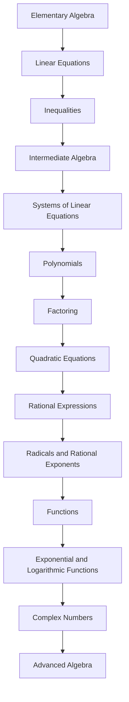

<!-- Generated by tools/build_indexes.py from tools/curriculum.json. Do not edit by hand. -->

# Algebra

*Symbolic reasoning and the study of structure*

[Mathematics](../README.md) › Algebra

From linear equations to complex numbers. Algebra teaches you to reason about whole classes of quantities at once, and it is the language in which geometry, calculus and everything after it is written.

## At a glance

| | |
|---|---|
| Topics | 14 (14 complete, 0 draft, 0 planned) |
| Estimated study time | ~121 hours |
| Prerequisites | [02-pre-algebra](../02-pre-algebra/README.md) |

## Study order

The numbers are the recommended order. Study a topic only after the ones before it —
the dependency chain below is the shortest safe route through the discipline.

## Topic inventory

| # | Topic | Level | Est. time | Status | Materials |
|---|---|---|---|---|---|
| 1 | [Elementary Algebra](01-elementary-algebra/README.md) | Beginner | 8 h | Complete | [Tutorial](01-elementary-algebra/README.md) · [Exercises](01-elementary-algebra/exercises.md) · [Solutions](01-elementary-algebra/solutions.md) |
| 2 | [Linear Equations](02-linear-equations/README.md) | Beginner | 8 h | Complete | [Tutorial](02-linear-equations/README.md) · [Exercises](02-linear-equations/exercises.md) · [Solutions](02-linear-equations/solutions.md) |
| 3 | [Inequalities](03-inequalities/README.md) | Intermediate | 8 h | Complete | [Tutorial](03-inequalities/README.md) · [Exercises](03-inequalities/exercises.md) · [Solutions](03-inequalities/solutions.md) |
| 4 | [Intermediate Algebra](04-intermediate-algebra/README.md) | Intermediate | 10 h | Complete | [Tutorial](04-intermediate-algebra/README.md) · [Exercises](04-intermediate-algebra/exercises.md) · [Solutions](04-intermediate-algebra/solutions.md) |
| 5 | [Systems of Linear Equations](05-systems-of-equations/README.md) | Intermediate | 8 h | Complete | [Tutorial](05-systems-of-equations/README.md) · [Exercises](05-systems-of-equations/exercises.md) · [Solutions](05-systems-of-equations/solutions.md) |
| 6 | [Polynomials](06-polynomials/README.md) | Intermediate | 9 h | Complete | [Tutorial](06-polynomials/README.md) · [Exercises](06-polynomials/exercises.md) · [Solutions](06-polynomials/solutions.md) |
| 7 | [Factoring](07-factoring/README.md) | Intermediate | 8 h | Complete | [Tutorial](07-factoring/README.md) · [Exercises](07-factoring/exercises.md) · [Solutions](07-factoring/solutions.md) |
| 8 | [Quadratic Equations](08-quadratic-equations/README.md) | Intermediate | 9 h | Complete | [Tutorial](08-quadratic-equations/README.md) · [Exercises](08-quadratic-equations/exercises.md) · [Solutions](08-quadratic-equations/solutions.md) |
| 9 | [Rational Expressions](09-rational-expressions/README.md) | Intermediate | 8 h | Complete | [Tutorial](09-rational-expressions/README.md) · [Exercises](09-rational-expressions/exercises.md) · [Solutions](09-rational-expressions/solutions.md) |
| 10 | [Radicals and Rational Exponents](10-radicals-and-rational-exponents/README.md) | Intermediate | 7 h | Complete | [Tutorial](10-radicals-and-rational-exponents/README.md) · [Exercises](10-radicals-and-rational-exponents/exercises.md) · [Solutions](10-radicals-and-rational-exponents/solutions.md) |
| 11 | [Functions](11-functions/README.md) | Intermediate | 10 h | Complete | [Tutorial](11-functions/README.md) · [Exercises](11-functions/exercises.md) · [Solutions](11-functions/solutions.md) |
| 12 | [Exponential and Logarithmic Functions](12-exponential-and-logarithmic-functions/README.md) | Intermediate | 10 h | Complete | [Tutorial](12-exponential-and-logarithmic-functions/README.md) · [Exercises](12-exponential-and-logarithmic-functions/exercises.md) · [Solutions](12-exponential-and-logarithmic-functions/solutions.md) |
| 13 | [Complex Numbers](13-complex-numbers/README.md) | Intermediate | 8 h | Complete | [Tutorial](13-complex-numbers/README.md) · [Exercises](13-complex-numbers/exercises.md) · [Solutions](13-complex-numbers/solutions.md) |
| 14 | [Advanced Algebra](14-advanced-algebra/README.md) | Advanced | 10 h | Complete | [Tutorial](14-advanced-algebra/README.md) · [Exercises](14-advanced-algebra/exercises.md) · [Solutions](14-advanced-algebra/solutions.md) |

### What each topic covers

- **Elementary Algebra** — Expressions, the field properties, simplification, formulas and modelling.
- **Linear Equations** — Solving with justification, fractional coefficients, absolute value, applications.
- **Inequalities** — Order axioms, interval notation, absolute-value inequalities and sign charts.
- **Intermediate Algebra** — Rational exponents, radicals, rational expressions, division and the binomial theorem.
- **Systems of Linear Equations** — Substitution, elimination, three variables and the geometry of solution sets.
- **Polynomials** — Degree, arithmetic, end behaviour, the division algorithm and Vieta's formulas.
- **Factoring** — Common factors, grouping, quadratics, special forms and general strategies.
- **Quadratic Equations** — Four solving methods, completing the square, the discriminant and the vertex form.
- **Rational Expressions** — Domains, simplification, LCD arithmetic, complex fractions and rational equations.
- **Radicals and Rational Exponents** — Root laws, simplification, conjugates, radical equations and extraneous roots.
- **Functions** — Domain, range, graphs, transformations, composition, inverses and families.
- **Exponential and Logarithmic Functions** — Exponential growth, the number e, logarithms as inverses and their laws.
- **Complex Numbers** — The complex plane, arithmetic, conjugates, polar form and roots of unity.
- **Advanced Algebra** — Polynomial equations, the fundamental theorem of algebra, partial fractions, sequences.

## Related disciplines

- [04-geometry](../04-geometry/README.md)
- [06-precalculus](../06-precalculus/README.md)
- [08-linear-algebra](../08-linear-algebra/README.md)

## Status key

- **Complete** — tutorial, exercises and full solutions exist and the tutorial meets the
  [authoring standard](../CONTRIBUTING.md).
- **Draft** — some material exists but the topic is not finished.
- **Planned** — identified in the curriculum, not written yet.

Overall progress and the full topic inventory live in [ROADMAP.md](../ROADMAP.md).
