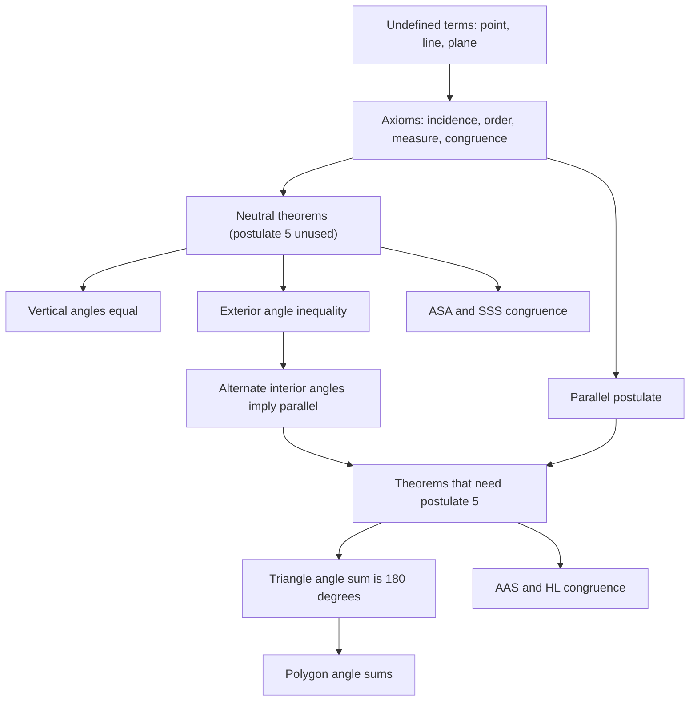
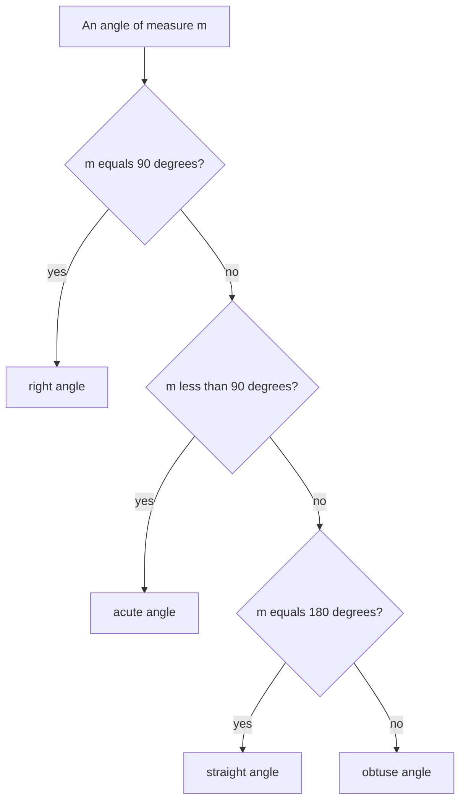
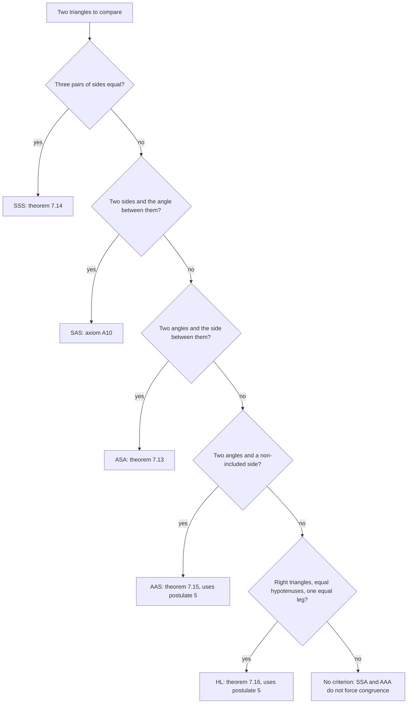

# Euclidean Geometry

> [Mathematics](../../README.md) › [Geometry](../README.md) · Level: Beginner → Intermediate · Prerequisites: [whole-number arithmetic](../../01-arithmetic/01-natural-numbers/README.md), [elementary algebra](../../03-algebra/01-elementary-algebra/README.md), [mathematical thinking](../../00-foundations/01-mathematical-thinking/README.md) · Estimated time: 12 h

## 1. Introduction

Geometry is the oldest deductive science. Egyptian and Babylonian scribes computed areas and volumes more than three thousand years before Euclid, but they did so with recipes: "take two thirds of a side, square it, add …". A recipe says what to do; it does not say why the answer is right, and it gives no way to handle the case it was not designed for. Between the sixth and fourth centuries BCE, Greek mathematicians began to demand something stronger: that each claim be *derived* from claims already accepted.

Around 300 BCE, Euclid of Alexandria turned that demand into a book. The *Elements* opens with twenty-three definitions, five **postulates** and five **common notions**, and then derives hundreds of results from them: the Pythagorean theorem, the theory of similar figures, the construction of the regular pentagon, the classification of the five Platonic solids, and the infinitude of primes. The book's importance is not any single theorem but the **format**: a short list of assumptions followed by statements forced by those assumptions, each step justified.

Why can geometry not do without assumptions? Because every argument must start somewhere. If you challenge a claim, a proof answers "this follows from that"; challenge the premise and the answer is another derivation, and so on. The chain cannot run backwards for ever, so it must begin with statements accepted without proof. Those are the **axioms**. Everything else is a **theorem**: a statement that follows from the axioms by logic alone.

The alternative to axioms is not "no assumptions" but *hidden* assumptions. The history of geometry is full of arguments that were convincing because the picture looked a certain way, and wrong because the picture was only a picture. Two lines drawn on paper that look parallel meet far away if the paper is really a sphere; a triangle drawn with a ruler has angle sum $180°$, but a triangle whose sides are arcs of great circles on the globe can have angle sum $270°$ (Exercise 37). If an argument never mentions the assumption that distinguishes the plane from the sphere, its conclusion cannot depend on it — so the "theorem" must fail somewhere.

The most famous case is the **parallel postulate**. Euclid stated it as a postulate and seems to have disliked it: he postponed its use until Proposition 29 of Book I. For twenty centuries mathematicians tried to *prove* it from the other four. They failed, and the failures were productive: Saccheri (1733) and Lambert (1766) derived whole chapters of a geometry in which it fails without finding a contradiction; Bolyai (1832) and Lobachevsky (1829) accepted that geometry as a genuine subject; Beltrami (1868) built a model of it inside Euclidean space; Hilbert (1899) rebuilt the axioms so carefully that "which assumption is used where" became a mechanical question.

This chapter teaches Euclidean geometry as the *Elements* does, with the benefit of Hilbert's hindsight. You will learn what an axiomatic system is and why some terms are left undefined; Euclid's postulates and common notions and what each one buys; the vocabulary of elementary geometry stated precisely; the angle theorems that need no parallel postulate (vertical angles, the exterior angle inequality); the theorems that do need it (the parallel-line theorems, the triangle angle sum); the five congruence criteria with an honest account of which are axioms and which are theorems; straightedge-and-compass construction and the limits of it; and how to write a geometry proof that a sceptic can check line by line.

Every statement below is either proved from the stated axioms or explicitly flagged as an axiom or as a cited standard theorem. Diagrams describe configurations; they never justify a step.

## 2. Prerequisites

| Prerequisite | Why it is needed here |
|---|---|
| [Whole-number arithmetic](../../01-arithmetic/01-natural-numbers/README.md) | Counting, adding and multiplying lengths; the arithmetic of angle measures. |
| [Decimals](../../01-arithmetic/04-decimals/README.md) | Angles are usually measured in decimal degrees, such as $37.5°$. |
| [Ratios and proportions](../../01-arithmetic/06-ratios-and-proportions/README.md) | Needed for the preview of similarity in §7.13. |
| [Elementary algebra](../../03-algebra/01-elementary-algebra/README.md) | Almost every angle exercise ends in a linear equation such as $3x + 12 = 90$. |
| [Mathematical thinking](../../00-foundations/01-mathematical-thinking/README.md) | Statement, hypothesis, conclusion, counterexample, proof. |
| [Set theory](../../00-foundations/03-set-theory/README.md) | Only the notation: a segment is a set of points, and $\{P : \ldots\}$ appears in the definitions. |

Two things are deliberately *not* prerequisites, because they are what the chapter is about: a previous course in geometry, and trigonometry. No trigonometric function is used anywhere.

## 3. Learning Objectives

By the end of this chapter you will be able to:

1. Distinguish an undefined term, a definition, an axiom and a theorem, with an example of each.
2. State Euclid's five postulates and five common notions and explain what each one allows.
3. Define segment, ray, angle and polygon inside an axiom system, and explain why "point" is undefined.
4. Classify angles and compute complements and supplements.
5. Use the angle addition postulate correctly, including its interior-ray hypothesis.
6. Prove that vertical angles are equal and identify the axioms the proof uses.
7. State and prove the corresponding, alternate-interior and same-side-interior angle theorems, and distinguish each from its converse.
8. Prove the triangle angle-sum theorem and explain why it is *equivalent* to the parallel postulate.
9. Prove that Playfair's axiom is equivalent to Euclid's fifth postulate.
10. Decide which congruence criterion applies in a given situation, and explain why SSA and AAA are not criteria.
11. Prove ASA and SSS from SAS, AAS from ASA, and explain why SAS must be taken as an axiom.
12. Carry out the basic straightedge-and-compass constructions and prove that two of them are correct.
13. Write a geometry proof in the given/prove/statement-reason format with every line justified.
14. Recognise and repair the two classic errors: assuming what is to be proved, and treating a diagram as evidence.

## 4. Intuition

### 4.1 Axioms are the rules of a game

Think of chess. The rules do not say what a knight *is*; they say how it *moves*. Anything that moves that way is a knight — a carved horse, a bottle cap, a pencil mark. The rules are neither true nor false; they define the game, and a position is legal if it can be reached from the initial position by legal moves.

An axiomatic system works the same way. The **undefined terms** — point, line, plane — are the pieces; they have no meaning inside the system. The **axioms** are the legal moves. A **theorem** is a legal position: a statement reachable from the axioms by logic. Hilbert made this vivid by remarking that "point", "line" and "plane" could be replaced by "table", "chair" and "beer mug" and every theorem would remain correct, provided the axioms were still satisfied.

So geometry is not the study of the pictures in the book. A picture is a *model* — one realisation of the axioms, as a particular chess set is one realisation of the rules. A theorem asserts: in *every* model of the axioms, this is so. Since the plane of the page is a model, the theorem is true of the page; but it does not rest on the page.

### 4.2 Why the eye is not a proof

You draw two segments; they look equal; you measure and they differ by a millimetre. You draw a triangle; its angles look like $180°$; but a pencil line $0.2$ mm thick on a triangle $10$ cm across already leaves an uncertainty of about $0.1°$ per angle, so the sum is determined only to $\pm 0.3°$. And no measurement, however careful, proves a statement about *all* triangles.

Worse, the eye is systematically deceived. There are pairs of straight lines a human being cannot distinguish from parallel that meet a metre away; there are figures in which equal segments look unequal because of their surroundings; and there are classical "proofs" that every triangle is isosceles whose only defect is a diagram in which a point is drawn where it cannot be (§11.2).

The remedy is a discipline, not a better pencil: **every claim must trace back to an axiom, a definition, a theorem already proved, or a hypothesis of the problem**. A diagram may say which configuration to consider; it may never say that a point lies between two others, that two lines meet, or that two segments are equal.

### 4.3 What a theorem actually says

A theorem is not an unconditional fact about the world. It has the form "**if** the axioms hold, **then** …". Even "the angles of a triangle sum to $180°$" says: in any model of axioms (A1)–(A11) below, every triangle has angle sum $180°$. Change one axiom and the statement may become false while the reasoning from the changed axioms remains perfectly good. That is not a weakness; it is what makes geometry applicable. When a surveyor asserts that a parcel of land has angles summing to $180°$, the surveyor also asserts — about the world, not about logic — that the land is flat enough to satisfy the axioms.

### 4.4 The plan of the chapter



Read the graph downwards as "is used to prove". The left branch is *neutral geometry*: everything there is provable without the fifth postulate. The right branch is Euclidean geometry proper, and its first entry — "equal alternate interior angles when lines are parallel" — is exactly where Euclid first used his fifth postulate.

## 5. Formal Definition

### 5.1 Primitive terms

**Definition 5.1.** The system has three sorts of objects — **points**, **lines**, **planes** — and three primitive relations: *incidence* ("$P$ lies on $\ell$", written $P \in \ell$), *betweenness* ("$B$ is between $A$ and $C$", written $A{-}B{-}C$), and *congruence* ("$\overline{AB} \cong \overline{CD}$", "$\angle A \cong \angle B$"). None of them is defined; they acquire meaning only through the axioms of §5.4. This is not a shortcut: any definition of "point" contains the word "point" or a synonym, hence is circular.

**Definition 5.2.** Points are **collinear** if some line contains them all; lines are **concurrent** if some point lies on them all.

### 5.2 Segments, rays, lines

**Definition 5.3 (Segment).** For distinct $A$, $B$,

$$\overline{AB} := \{P : A{-}P{-}B,\ \text{or}\ P = A,\ \text{or}\ P = B\}.$$

The points $A$, $B$ are its **endpoints**; the other points of $\overline{AB}$ are **interior** to it.

**Definition 5.4 (Ray).** The **ray** with endpoint $A$ through $B$ is $\overrightarrow{AB} := \{P : P \in \overline{AB},\ \text{or}\ A{-}B{-}P\}$. Two rays with a common endpoint are **opposite rays** if they lie in one line and meet only at that endpoint.

**Definition 5.5 (Line).** The unique line through distinct $A$, $B$ is $\overleftrightarrow{AB}$; existence and uniqueness are axiom (A1).

**Definition 5.6 (Length, midpoint).** The **length** $AB$ of $\overline{AB}$ is the number assigned by axiom (A6). A point $M$ is the **midpoint** of $\overline{AB}$ if $A{-}M{-}B$ and $AM = MB = \tfrac12 AB$.

### 5.3 Angles

**Definition 5.7 (Angle).** An **angle** is the union of two rays with a common endpoint. For rays $\overrightarrow{OA}$, $\overrightarrow{OB}$ the angle is $\angle AOB$; $O$ is the **vertex**, the rays are the **sides**. If the sides are opposite rays the angle is **straight**; if they coincide the configuration is degenerate and is not an angle here.

**Definition 5.8 (Interior).** A point $X$ is **interior** to $\angle AOB$ if it lies on the same side of $\overleftrightarrow{OA}$ as $B$ and on the same side of $\overleftrightarrow{OB}$ as $A$. A ray $\overrightarrow{OX}$ is interior if $X$ is.

**Definition 5.9 (Measure, classification).** Axiom (A8) assigns to every angle a number $m\angle AOB \in (0°, 180°)$, and gives straight angles measure $180°$.

| Name | Measure | Description |
|---|---|---|
| acute | $0° < m < 90°$ | sharper than a right angle |
| right | $m = 90°$ | the sides are perpendicular, written $\perp$ |
| obtuse | $90° < m < 180°$ | wider than a right angle |
| straight | $m = 180°$ | the sides are opposite rays |

A **reflex** angle (measure in $(180°, 360°)$) is the union of two rays taken the long way round; it is always defined as $360°$ minus an ordinary angle, and it is needed only in §7.14.

**Definition 5.10 (Special pairs).** Let $\angle AOB$ and $\angle BOC$ share the vertex $O$ and the side $\overrightarrow{OB}$, with interiors on opposite sides of $\overleftrightarrow{OB}$; they are **adjacent**. If $m\angle AOB + m\angle BOC = 90°$ they are **complementary**; if the sum is $180°$ they are **supplementary**, and the pair is a **linear pair** when $\overrightarrow{OA}$ and $\overrightarrow{OC}$ are opposite rays. Two angles are **vertical** if they are the non-adjacent angles formed by two intersecting lines, equivalently if their sides are two pairs of opposite rays. An interior ray $\overrightarrow{OX}$ is the **bisector** of $\angle AOB$ if $m\angle AOX = m\angle XOB$.

### 5.4 The axiom system used here

Hilbert's system (1899), simplified to what plane geometry needs.

**Incidence.** **(A1)** Through two distinct points there passes exactly one line. **(A2)** Every line contains two points, and there exist three non-collinear points. **(A3)** Two distinct lines have at most one common point.

**Order.** **(A4)** Of three distinct collinear points, exactly one is between the other two. **(A5) (Separation)** A line $\ell$ splits the points not on it into two **half-planes**: if $P$, $Q$ are in different half-planes, $\overline{PQ}$ meets $\ell$ in exactly one point; if they are in the same half-plane, $\overline{PQ}$ misses $\ell$.

**Measure.** **(A6)** To each ordered pair $(A,B)$ is assigned $AB \ge 0$, with $AB = 0$ iff $A = B$ and $AB = BA$; and for each point $A$, each ray from $A$ and each $r > 0$ there is exactly one point $B$ of the ray with $AB = r$. **(A7)** If $A{-}B{-}C$ then $AC = AB + BC$. **(A8)** Each angle has a measure $m \in (0°, 180°)$, straight angles measure $180°$, and on each side of a ray there is exactly one ray making a prescribed angle with it. **(A9) (Angle addition)** If $\overrightarrow{OC}$ is interior to $\angle AOB$ then $m\angle AOC + m\angle COB = m\angle AOB$; conversely, if $0 < m\angle AOC < m\angle AOB$ and the measures add, then $\overrightarrow{OC}$ is interior.

**Congruence.** **(A10) (SAS)** If two sides and the included angle of one triangle are congruent to two sides and the included angle of another, the triangles are congruent. Segments and angles are *defined* to be congruent when their measures are equal, so (A6) and (A8) cover them.

**Parallels.** **(A11) (Playfair)** Through a point not on a line there passes **at most one** parallel to that line.

Note what (A11) does not say: it does not assert that a parallel exists. Existence is a theorem (§7.3). **(A11)** is the modern form of Euclid's fifth postulate; §7.8 proves the two are interchangeable.

**A cited lemma.** Twice below we use that two distinct circles have at most two common points, and that the common points of two circles with centres $A$, $B$ lie on opposite sides of $\overleftrightarrow{AB}$. This is **Euclid III.10**; it follows from the circle axioms and (A5), and deriving it fully needs continuity theory, so it is flagged as a cited standard result. It is used only in the proof of SSS (§7.12).

### 5.5 Parallelism, transversals, congruence of figures

**Definition 5.11.** Lines $\ell$, $m$ are **parallel** ($\ell \parallel m$) if they have no common point, and **perpendicular** ($\ell \perp m$) if they meet at right angles.

**Definition 5.12 (Transversal).** A line $t$ is a **transversal** of $\ell$ and $m$ if it meets $\ell$ at $E$, meets $m$ at $F$, and $E \ne F$. Draw $m$ below $\ell$ and $t$ slanting across; at each intersection four angles appear (upper-left, upper-right, lower-right, lower-left). Then:

| Pair type | Which angles | Position |
|---|---|---|
| corresponding | upper-left at $E$ with upper-left at $F$ (and the other three positions) | same side of $t$, same side of the two lines |
| alternate interior | lower-left at $E$ with upper-right at $F$ (and the mirror pair) | between $\ell$ and $m$, opposite sides of $t$ |
| same-side interior | lower-left at $E$ with upper-left at $F$ (and the mirror pair) | between $\ell$ and $m$, same side of $t$ |
| alternate exterior | upper-left at $E$ with lower-right at $F$ (and the mirror pair) | outside the strip, opposite sides of $t$ |

Equivalently: the **interior** angles at $E$ are the two having the ray $\overrightarrow{EF}$ as a side, and the interior angles at $F$ are the two having $\overrightarrow{FE}$ as a side. The two descriptions agree, and the ray description is the one used in proofs.

**Definition 5.13 (Congruent, similar).** Two figures are **congruent** if a **rigid motion** (a map of the plane preserving all distances) carries one to the other. For triangles, $\triangle ABC \cong \triangle DEF$ means that the correspondence $A \mapsto D$, $B \mapsto E$, $C \mapsto F$ is realised by a rigid motion; in particular all three pairs of sides and all three pairs of angles are equal. **The order of the letters is part of the statement**: $\triangle ABC \cong \triangle DFE$ asserts something different and usually false. Two figures are **similar** ($\sim$) if one is carried to the other by a rigid motion followed by a uniform scaling; for triangles this means equal angles in pairs and proportional corresponding sides.

**Definition 5.14 (Polygon).** Let $n \ge 3$ and let $A_1, \dots, A_n$ be distinct points, no three consecutive ones collinear, such that the segments $\overline{A_1A_2}, \dots, \overline{A_nA_1}$ meet only at endpoints. Their union is a **polygon** with $n$ sides and $n$ vertices. It is **convex** if every segment joining two of its points lies inside it, equivalently if it lies on one side of each side-line. It is **regular** if all sides are congruent and all interior angles are equal.

## 6. Mathematical Notation

| Symbol | Read aloud | Meaning |
|---|---|---|
| $\overleftrightarrow{AB}$ | "line $AB$" | the unique line through $A$ and $B$ |
| $\overline{AB}$ | "segment $AB$" | the set of points between $A$ and $B$, endpoints included |
| $AB$ | "length of $AB$" | the number assigned by (A6); no bar |
| $\overrightarrow{AB}$ | "ray $AB$" | starts at $A$, passes through $B$, continues for ever |
| $\angle ABC$, $m\angle ABC$ | "angle $ABC$", "measure of angle $ABC$" | the figure, and the number in $(0°, 180°)$ |
| $\triangle ABC$ | "triangle $ABC$" | polygon with vertices $A$, $B$, $C$ |
| $\cong$, $\sim$ | "is congruent to", "is similar to" | Definition 5.13 |
| $\ell \parallel m$, $\ell \perp m$ | "parallel", "perpendicular" | Definition 5.11 |
| $A{-}B{-}C$ | "$B$ is between $A$ and $C$" | betweenness; assumed only from axioms |
| $P \in \ell$ | "$P$ lies on ell" | incidence |
| $(3x+10)°$ | "three $x$ plus ten, degrees" | an angle measure given by an expression |
| $\square$ | "end of proof" | marks a completed proof |
| tick marks, arc marks | — | equal numbers of ticks (arcs) mark congruent segments (angles) |

Two conventions matter. First, $AB$ is a *number* and $\overline{AB}$ is a *set of points*; writing $\overline{AB} = 5$ is a type error. Second, $\angle A$ and $m\angle A$ are different kinds of object: the figure and its measure. Informal writing uses $\angle A$ for the measure; here $m\angle$ always marks the number.

## 7. Core Concepts

### 7.1 How the deductive machine runs

Four kinds of sentence occur, and confusing them is the source of most bad proofs.

| Kind | Status | Example |
|---|---|---|
| undefined term | no meaning assigned; only the axioms constrain it | "point", "line", "between" |
| definition | an abbreviation for something already available | "a midpoint of $\overline{AB}$ is $M$ with $A{-}M{-}B$ and $AM = MB$" |
| axiom | assumed, not proved, used as a reason | "through two points there is exactly one line" |
| theorem | proved from axioms, definitions and earlier theorems | "vertical angles are equal" |

A **proof** is a finite list of statements, each of which is a hypothesis, an axiom, a definition applied to earlier objects, a theorem already proved, or a consequence of earlier statements by a stated logical rule; the last statement is the claim.

Two properties of an axiom system matter historically. A system is **consistent** if no contradiction follows from it; consistency is shown by exhibiting a *model*, an actual structure satisfying all the axioms — for (A1)–(A11) the coordinate plane $\mathbb{R}^2$ with $AB = \sqrt{(x_B-x_A)^2 + (y_B-y_A)^2}$. An axiom is **independent** if it is not a consequence of the others; independence of the parallel postulate was settled by models in which it fails (Beltrami 1868, Poincaré 1882). That is why the postulate cannot be proved: a proof would hold in every model, including the hyperbolic ones where it is false.

### 7.2 Euclid's five postulates and five common notions

In Heath's standard rendering of the *Elements*, Book I:

> **Postulate 1.** Let it be granted that a straight line may be drawn from any one point to any other point.
> **Postulate 2.** That a terminated straight line may be produced to any length in a straight line.
> **Postulate 3.** And that a circle may be described with any centre and distance.
> **Postulate 4.** That all right angles are equal to one another.
> **Postulate 5.** That, if a straight line falling on two straight lines makes the interior angles on the same side less than two right angles, the two straight lines, if produced indefinitely, meet on that side on which are the angles less than the two right angles.

> **Common notion 1.** Things which are equal to the same thing are also equal to one another. **2.** If equals be added to equals, the wholes are equal. **3.** If equals be subtracted from equals, the remainders are equal. **4.** Things which coincide with one another are equal to one another. **5.** The whole is greater than the part.

Read in modern language, each postulate is a licence:

| Statement | Modern content | Role |
|---|---|---|
| Postulate 1 | two distinct points determine a segment, and it exists | existence of lines, (A1) |
| Postulate 2 | a segment extends past either endpoint | lines are unbounded, used in (A6) |
| Postulate 3 | a circle exists with any centre and radius | the compass, and all constructions |
| Postulate 4 | all right angles have the same measure | fixes $90°$ as a constant, (A8) |
| Postulate 5 | a criterion for two lines to meet | the parallel postulate |
| Common notion 1 | transitivity of equality | used in §7.5, §7.10 |
| Common notions 2, 3 | adding or subtracting equals preserves equality | the algebra of measures |
| Common notion 4 | superposition: figures that coincide are equal | the seed of SAS, (A10) |
| Common notion 5 | a part is smaller than the whole | used in the exterior-angle argument |

Postulate 5 is odd in one respect: it is the only one asserting that something *exists* only under a condition, and the condition is a statement about angles far from the meeting point. Euclid seems to have felt the oddity; he uses it first in Proposition 29, twenty-eight propositions into Book I.

Note also what is **missing**: no axiom of betweenness, none that a line has infinitely many points, none of continuity. Euclid works with these as unstated intuitions about the diagram. Hilbert supplies them explicitly, and (A4), (A5), (A6) are their descendants. This is not pedantry: the classical false proof of §11.2 exploits precisely the gap.

### 7.3 First consequences

**Theorem 7.1 (Uniqueness of the midpoint).** Every segment has exactly one midpoint.

*Proof.* Let $AB = L > 0$. By (A6) applied to the ray $\overrightarrow{AB}$ with $r = L/2$ there is exactly one point $M$ of the ray with $AM = L/2 < L$; so $M \ne B$, and either $A{-}M{-}B$ or $A{-}B{-}M$. The second would give $AM = AB + BM > L$ by (A7), contradiction. Hence $A{-}M{-}B$ and $MB = L - L/2 = L/2$. Uniqueness is the uniqueness in (A6). $\square$

**Theorem 7.2 (Perpendicular at a point).** Through a point $P$ of a line $\ell$ there is exactly one line perpendicular to $\ell$.

*Proof.* Let $X \ne P$ lie on $\ell$. By (A8) there is, on each side of $\overrightarrow{PX}$, exactly one ray making $90°$ with it; the two rays form one line $m$, and by (A9) applied to a straight angle the other two angles at $P$ are $180° - 90° = 90°$. Any perpendicular to $\ell$ at $P$ gives such a ray, so by uniqueness it is $m$. $\square$

**Theorem 7.3 (Existence of a parallel).** Through a point $P$ not on a line $\ell$ there passes at least one line parallel to $\ell$.

*Proof.* Choose $R \in \ell$ and let $\rho$ be one of the two rays of $\ell$ from $R$; let $\alpha$ be the angle at $R$ between $\overrightarrow{RP}$ and $\rho$. On the side of $\overleftrightarrow{RP}$ opposite to $\rho$, lay off at $P$ the ray $\rho'$ with $m\angle(\overrightarrow{PR}, \rho') = \alpha$ (axiom (A8)), and let $m$ be its line. The angles at $R$ and at $P$ are alternate interior for the transversal $\overleftrightarrow{RP}$ and are equal, so $m \parallel \ell$ by the alternate interior criterion (Corollary 7.7.1 below, which does not depend on this theorem). $\square$

So the *existence* of parallels is free; this is why Playfair's axiom says "at most one" — the content is uniqueness.

### 7.4 Angles on a line

**Theorem 7.4 (Linear pairs are supplementary).** If $\angle AOB$ and $\angle BOC$ form a linear pair then $m\angle AOB + m\angle BOC = 180°$.

*Proof.* By definition $\overrightarrow{OA}$, $\overrightarrow{OC}$ are opposite rays and the angles are adjacent, so $\overrightarrow{OB}$ is interior to the straight angle $\angle AOC$. That angle measures $180°$ by (A8), and (A9) gives the sum. $\square$

**Corollary 7.4.1.** Two angles supplementary to the same angle are equal: if $m\angle 1 + m\angle 2 = 180°$ and $m\angle 1 + m\angle 3 = 180°$ then $m\angle 2 = m\angle 3$. *Proof:* both equal $180° - m\angle 1$; apply common notion 1. $\square$

**Rule (A9), as used below.** If $\overrightarrow{OC}$ is interior to $\angle AOB$ then $m\angle AOC + m\angle COB = m\angle AOB$. The hypothesis "interior" is not decoration: if $\overrightarrow{OC}$ lies outside, the sum of the two measures is *larger* than $m\angle AOB$ (§11.3).

### 7.5 Vertical angles are equal

**Theorem 7.5 (Vertical angles).** If two lines meet, the vertical angles are equal.

*Proof.* Let $\overleftrightarrow{AB}$ and $\overleftrightarrow{CD}$ meet at $O$, with $A{-}O{-}B$ and $C{-}O{-}D$; it suffices to prove $m\angle AOC = m\angle BOD$.

1. $\angle AOC$ and $\angle COB$ form a linear pair (they share $\overrightarrow{OC}$, and $\overrightarrow{OA}$, $\overrightarrow{OB}$ are opposite), so $m\angle AOC + m\angle COB = 180°$ by Theorem 7.4.
2. $\angle COB$ and $\angle BOD$ form a linear pair (they share $\overrightarrow{OB}$, and $\overrightarrow{OC}$, $\overrightarrow{OD}$ are opposite), so $m\angle COB + m\angle BOD = 180°$.
3. Both $m\angle AOC$ and $m\angle BOD$ equal $180° - m\angle COB$, hence they are equal (common notion 1). The other pair is the same argument with labels exchanged. $\square$

Three remarks. The proof uses only (A8), (A9) and arithmetic: no parallel postulate. It does not depend on which of the four angles the diagram puts where, because it names the linear pairs by their rays. And its **converse is false**: two equal angles need not be vertical (two $40°$ angles side by side are equal and not vertical), which is the error of §11.4.

### 7.6 The exterior angle inequality (Euclid I.16)

**Theorem 7.6 (Exterior angle inequality).** Let $ABC$ be a triangle and $B{-}C{-}D$. Then $m\angle ACD > m\angle BAC$ and $m\angle ACD > m\angle ABC$.

*Proof.* Let $E$ be the midpoint of $\overline{AC}$ (Theorem 7.1). Extend the ray $\overrightarrow{BE}$ beyond $E$ to $F$ with $EF = EB$ (axiom (A6)) and draw $\overline{CF}$.

*Step 1.* $AE = CE$, $BE = EF$, and $m\angle AEB = m\angle CEF$ (vertical angles on the lines $\overleftrightarrow{AC}$, $\overleftrightarrow{BF}$). By SAS, $\triangle AEB \cong \triangle CEF$, hence $m\angle BAC = m\angle BAE = m\angle ECF = m\angle ACF$.

*Step 2 (where $F$ is).* Since $E$ lies strictly between $A$ and $C$, the segment $\overline{BF}$ meets $\overleftrightarrow{AC}$ exactly at $E$, so $B$ and $F$ are on opposite sides of $\overleftrightarrow{AC}$ (A5). Also $B$ and $D$ are on opposite sides of $\overleftrightarrow{AC}$, because $\overline{BD}$ lies in the line $\overleftrightarrow{BC}$, which meets $\overleftrightarrow{AC}$ only at $C$, and $C$ is between $B$ and $D$. Hence $F$ and $D$ are on the **same** side of $\overleftrightarrow{AC}$.

*Step 3.* The lines $\overleftrightarrow{BE}$ and $\overleftrightarrow{BC}$ are distinct and meet only at $B$ (as $E$ is interior to $\overline{AC}$ and the triangle is non-degenerate). Since $E$, $F$ lie on the same ray from $B$, they are on the same side of $\overleftrightarrow{BC}$; and $E$, $A$ are on the same side of $\overleftrightarrow{BC}$ because $E$ is between $A$ and $C$. So $F$ and $A$ are on the same side of $\overleftrightarrow{BC} = \overleftrightarrow{CD}$.

*Step 4.* By Definition 5.8, Steps 2 and 3 say that $F$ is interior to $\angle ACD$. So $\overrightarrow{CF}$ is interior, and (A9) gives $m\angle ACF + m\angle FCD = m\angle ACD$ with $m\angle FCD > 0$; hence $m\angle BAC = m\angle ACF < m\angle ACD$.

*Step 5 (the second inequality).* Extend $\overline{AC}$ beyond $C$ to $D'$ and apply Steps 1–4 to obtain $m\angle ABC < m\angle BCD'$. But $\angle BCD'$ and $\angle ACD$ are vertical angles of the lines $\overleftrightarrow{AC}$ and $\overleftrightarrow{BC}$, hence equal by Theorem 7.5. $\square$

The inequality is strict, and it never adds the angles of a triangle to $180°$ — doing that would already require the parallel postulate.

**Corollary 7.6.1.** The sum of any two angles of a triangle is less than $180°$.

*Proof.* With $B{-}C{-}D$, the angles $\angle ACB$, $\angle ACD$ are a linear pair, so $m\angle ACD = 180° - m\angle ACB$. By Theorem 7.6, $m\angle BAC < 180° - m\angle ACB$; add $m\angle ACB$. The other pairs are the same argument at the other vertices. $\square$

### 7.7 Parallel lines I: the direction that needs no postulate

Throughout, $\ell$ and $m$ are cut by a transversal $t$ at $E$, $F$.

**Theorem 7.7 (Euclid I.27).** If a pair of alternate interior angles is equal then $\ell \parallel m$.

*Proof.* Suppose the lines meet at $G$. Name $A$, $B \in \ell$ with $A{-}E{-}B$, and $C$, $D \in m$ with $C{-}F{-}D$, so that the equal alternate interior pair is $\angle AEF$ and $\angle EFD$; then $A$ and $D$ lie on opposite sides of $t$. The point $G$ is on one side of $t$; suppose it is on the side of $D$ (the other case is the mirror image).

In $\triangle EFG$ the ray $\overrightarrow{EG}$ is $\overrightarrow{EB}$ (as $G \in \ell$ on the side of $B$), so the interior angle at $E$ is $\angle BEF$; the angle $\angle AEF$, which with $\angle BEF$ makes the straight angle on $\ell$, is therefore an **exterior** angle of $\triangle EFG$. Also $\overrightarrow{FG} = \overrightarrow{FD}$, so the interior angle at $F$ is $\angle EFD$. By Theorem 7.6 the exterior angle exceeds the remote interior angle: $m\angle AEF > m\angle EFD$, contradicting the hypothesis. $\square$

**Corollary 7.7.1 (corresponding angles equal $\Rightarrow$ parallel).** The angle vertical to a corresponding angle is alternate interior to its partner; apply Theorem 7.5 and Theorem 7.7. $\square$

**Corollary 7.7.2 (same-side interior supplementary $\Rightarrow$ parallel).** If the same-side interior angles are $\theta$, $\phi$ with $\theta + \phi = 180°$, the angle adjacent to $\phi$ on $m$ has measure $180° - \phi = \theta$ and is alternate interior to $\theta$; apply Theorem 7.7. $\square$

**Corollary 7.7.3.** If $\ell \perp t$ and $m \perp t$ then $\ell \parallel m$ (all corresponding angles are right angles).

These are the **converses** of the familiar parallel-line theorems, and they are the ones provable without any assumption about parallels. Their direction is `angles equal ⟹ lines parallel`, the opposite of what a student usually wants.

### 7.8 The parallel postulate: Playfair's form and its history

Euclid's Postulate 5 is quoted in §7.2. Its modern replacement is due to Playfair (1795), though the idea is in Proclus:

> **Playfair's axiom (A11).** Through a point not on a line there passes at most one parallel to that line.

**Theorem 7.8.** Postulate 5 and Playfair's axiom are equivalent, given (A1)–(A10).

*Proof that 5 $\Rightarrow$ Playfair.* Let $P \notin \ell$ and suppose $m_1 \ne m_2$ are distinct lines through $P$, both parallel to $\ell$. Choose $Q \in \ell$, put $t = \overleftrightarrow{PQ}$, and let $S$ be one side of $t$. Let $\alpha_i$ be the interior angle at $P$ on side $S$ (between $\overrightarrow{PQ}$ and the ray of $m_i$ on side $S$), and $\gamma$ the interior angle at $Q$ on side $S$ (between $\overrightarrow{QP}$ and the ray of $\ell$ on side $S$). On the other side the angles are $180° - \alpha_i$ and $180° - \gamma$. Since $m_i$ never meets $\ell$, Postulate 5 forbids a sum below $180°$ on either side, so $\alpha_i + \gamma \ge 180°$ and $(180° - \alpha_i) + (180° - \gamma) \ge 180°$, i.e. $\alpha_i \ge 180° - \gamma$ and $\alpha_i \le 180° - \gamma$. Thus $\alpha_i = 180° - \gamma$ for $i = 1,2$: both $m_i$ make the same angle with $\overrightarrow{PQ}$ on side $S$, so by the uniqueness in (A8) their rays on side $S$ coincide and $m_1 = m_2$, a contradiction.

*Proof that Playfair $\Rightarrow$ 5.* Let $\ell$, $m$ be cut by $t$ at $E$, $F$ with interior angles $\alpha$ (at $E$) and $\beta$ (at $F$) on side $S$, and $\alpha + \beta < 180°$. On the side of $t$ opposite to $S$ lay off at $E$ the ray $\overrightarrow{EK}$ with $m\angle KEF = \beta$ (axiom (A8)) and let $n = \overleftrightarrow{EK}$; the angles $\angle KEF$ and $\beta$ are alternate interior, so $n \parallel m$ by Theorem 7.7. If $n = \ell$ then $\angle KEF$ and $\angle AEF$ (with $A \in \ell$ on side $S$) form a linear pair, giving $\alpha + \beta = 180°$, contrary to hypothesis; so $n \ne \ell$. Now $n$ and $\ell$ are two distinct lines through $E$ and $n \parallel m$, so by Playfair $\ell$ is not parallel to $m$; hence they meet at some $X$. Were $X$ on the side opposite $S$, the triangle $EFX$ would have interior angles $180° - \alpha$, $180° - \beta$ there, and the exterior angle $\alpha$ at $E$; Theorem 7.6 would give $\alpha > 180° - \beta$, i.e. $\alpha + \beta > 180°$, contradiction. So $X$ is on side $S$. $\square$

**History.** The attempts to avoid Postulate 5 are a case study in how a *negative* result can matter more than a proof.

| Period | Author | What happened |
|---|---|---|
| 3rd c. BCE | Euclid | states the postulate reluctantly; first use in I.29 |
| 2nd c. BCE – 5th c. CE | Posidonius, Geminus, Ptolemy, Proclus | "proofs" that replace it by definitions or by hidden assumptions |
| 11th–13th c. | Omar Khayyam, Nasir al-Din al-Tusi | study birectangular figures; prove the postulate from an unstated hypothesis |
| 1733 | Saccheri | assumes it false, derives a coherent geometry, rejects it only as "repugnant to the nature of a straight line" |
| 1766 | Lambert | repeats the analysis, notes the analogy with spherical geometry, still does not accept it |
| 1794–1833 | Legendre | several "proofs"; his theorem that the angle sum is at most $180°$ is correct, his last step is not |
| 1829–1832 | Lobachevsky, Bolyai | publish a geometry in which the postulate fails: hyperbolic geometry |
| 1854 | Riemann | spaces of variable curvature; spherical geometry is the positive-curvature case |
| 1868 | Beltrami | realises hyperbolic geometry on a surface in $\mathbb{R}^3$: relative consistency |
| 1882 | Poincaré | the disk model, which makes hyperbolic geometry a working tool |
| 1899 | Hilbert | *Grundlagen der Geometrie*: a complete axiom system with independence proofs |

The moral for this chapter is narrow and useful: **every use of Postulate 5 must be declared.** A theorem proved without it holds in far more geometries than Euclid imagined; a theorem proved with it holds only in the Euclidean plane.

### 7.9 Statements equivalent to the postulate

Over the neutral axioms (A1)–(A10) the following are equivalent; "equivalent" means each, added to (A1)–(A10), yields the others.

| Statement | Status here |
|---|---|
| Euclid's Postulate 5 | axiom |
| Playfair's axiom (A11) | proved equivalent, Theorem 7.8 |
| the angles of every triangle sum to $180°$ | proved in §7.11; converse cited |
| a rectangle exists (a quadrilateral with four right angles) | cited |
| the angles of every convex quadrilateral sum to $360°$ | cited |
| Pythagoras' theorem, $a^2+b^2=c^2$ | cited (Triangles topic) |
| similar non-congruent triangles exist | cited (Wallis, 1663) |
| the AAS congruence criterion is valid | proved in §7.12; converse cited |
| some line has all its points equidistant from another line | cited |

Two warnings. Each entry needs the neutral axioms to make sense: "Pythagoras implies the postulate" is a statement about a system rich enough for areas and squares. And the equivalences are theorems, often deep ones — Legendre spent decades on the third row — so here they are cited, with the citation named.

### 7.10 Parallel lines II: the direction that needs the postulate

**Theorem 7.9 (Euclid I.29).** If $\ell \parallel m$ then every pair of alternate interior angles is equal.

*Proof.* Let $t$ meet $\ell$ at $E$, $m$ at $F$. Let $\alpha$ be the interior angle at $E$ on side $S$ of $t$, and let $\beta$ be the interior angle at $F$ on the same side. The alternate interior partner of $\alpha$ is the interior angle $\beta'$ at $F$ on the other side, and $\beta + \beta' = 180°$ because these two angles form a linear pair on $m$. The alternate interior angles are therefore equal exactly when $\alpha = \beta'$. If $\alpha > \beta'$ then

$$\alpha + \beta = \alpha + 180° - \beta' = 180° + (\alpha - \beta') > 180°,$$

so on the other side of $t$, where the interior angles are $180° - \alpha$ and $\beta'$, the sum is $180° - (\alpha - \beta') < 180°$. By Postulate 5, $\ell$ and $m$ meet on that side, contradicting $\ell \parallel m$. Hence $\alpha = \beta'$. $\square$

**Corollary 7.9.1 (parallel $\Rightarrow$ corresponding angles equal).** *Proof.* The angle vertical to the corresponding angle at $E$ is alternate interior to its partner, so it equals that partner (Theorem 7.9) and so does its vertical partner (Theorem 7.5). $\square$

**Corollary 7.9.2 (parallel $\Rightarrow$ same-side interior angles supplementary).** *Proof.* If the same-side interior angles are $\alpha$ at $E$ and $\beta$ at $F$, then $\beta' = 180° - \beta$ (linear pair on $m$) is alternate interior to $\alpha$, so $\alpha = 180° - \beta$ by Theorem 7.9. $\square$

**Corollary 7.9.3 (parallel $\Rightarrow$ alternate exterior angles equal).** An alternate exterior angle is vertical to an alternate interior angle; apply Theorems 7.5 and 7.9. $\square$

**Corollary 7.9.4 (transitivity).** If $\ell \parallel m$ and $m \parallel n$ then $\ell \parallel n$; otherwise two distinct parallels to $m$ would pass through the intersection point of $\ell$ and $n$, contradicting (A11). $\square$

**The two directions must not be confused:**

| Hypothesis | Conclusion | Theorem | Uses Postulate 5? |
|---|---|---|---|
| alternate interior equal | $\ell \parallel m$ | 7.7 | no |
| $\ell \parallel m$ | alternate interior equal | 7.9 | **yes** |
| corresponding equal | $\ell \parallel m$ | 7.7.1 | no |
| $\ell \parallel m$ | corresponding equal | 7.9.1 | **yes** |
| same-side interior supplementary | $\ell \parallel m$ | 7.7.2 | no |
| $\ell \parallel m$ | same-side interior supplementary | 7.9.2 | **yes** |

### 7.11 The triangle angle-sum theorem

**Theorem 7.10 (Euclid I.32).** In every triangle $ABC$, $m\angle A + m\angle B + m\angle C = 180°$.

*Proof.* Let $B{-}C{-}D$. By Theorem 7.3 and Playfair there is exactly one line $p$ through $C$ parallel to $\overleftrightarrow{AB}$. Let $E$ be a point of $p$ on the side of $\overleftrightarrow{AC}$ opposite to $B$ (such a point exists because $p$ meets $\overleftrightarrow{AC}$ only at $C$).

1. With transversal $\overleftrightarrow{AC}$, the angles $\angle BAC$ and $\angle ACE$ are alternate interior (they are on opposite sides of $\overleftrightarrow{AC}$, by the choice of $E$), so $m\angle ACE = m\angle BAC$ by Theorem 7.9.
2. With transversal $\overleftrightarrow{BC}$, the angles $\angle ABC$ and $\angle ECD$ are corresponding, so $m\angle ECD = m\angle ABC$ by Corollary 7.9.1.
3. The ray $\overrightarrow{CE}$ lies between $\overrightarrow{CA}$ and $\overrightarrow{CD}$ (see Remark 7.10.1), so two applications of (A9) give $m\angle ACB + m\angle ACE + m\angle ECD = m\angle ACD = 180°$.
4. Substituting Steps 1 and 2 gives $m\angle A + m\angle B + m\angle C = 180°$. $\square$

**Remark 7.10.1 (why Step 3 needs an argument).** Step 3 asserts the *order* of three rays at $C$; that is not a consequence of incidence, and reading it off a diagram would be exactly the error of §11.2. Here is a complete case argument. If $\overrightarrow{CE}$ were not between $\overrightarrow{CA}$ and $\overrightarrow{CD}$, then Steps 1–2 together with the linear pair $m\angle BCE = 180° - m\angle ECD$ would yield $m\angle B = m\angle A + m\angle C$; repeating with the parallel through $A$ (to $BC$) would give, in the analogous bad case, $m\angle C = m\angle A + m\angle B$; and with the parallel through $B$, $m\angle A = m\angle B + m\angle C$. Each equation forces a *different* angle to be strictly the largest, so all three cannot hold; hence at least one vertex is in the good configuration and the computation above applies there. Betweenness claims need arguments of this kind. In a neutral geometry the good configuration cannot be forced, which is exactly why this theorem needs Postulate 5.

**Corollary 7.10.2 (exterior angle equals the sum of the remote interior angles).** With $B{-}C{-}D$, $m\angle ACD = m\angle A + m\angle B$. *Proof.* $\angle ACB$ and $\angle ACD$ are a linear pair, so $m\angle ACD = 180° - m\angle C = m\angle A + m\angle B$ by Theorem 7.10. $\square$

**Theorem 7.11 (the converse; cited).** Over (A1)–(A10) plus the Archimedean property of $\mathbb{R}$, these are equivalent: (a) Playfair's axiom; (b) every triangle has angle sum $180°$; (c) some triangle has angle sum $180°$. Here (a) $\Rightarrow$ (b) is Theorem 7.10 and (b) $\Rightarrow$ (c) is immediate; (c) $\Rightarrow$ (a) is Legendre's theorem, resting on the **Saccheri–Legendre theorem** that in neutral geometry every triangle has angle sum *at most* $180°$. The Archimedean property is needed for that theorem and is not among our axioms, which is why the implication is cited. Full treatments: Hartshorne, *Geometry: Euclid and Beyond*, Ch. 11; Greenberg, *Euclidean and Non-Euclidean Geometries*, Ch. 4.

The practical consequence: **whenever an argument uses "the angles of a triangle add to $180°$", it has used the parallel postulate**, even if the word "parallel" never appears.

### 7.12 Congruence: which criteria are axioms and which are theorems

Definition 5.13 says two triangles are congruent when a rigid motion carries one to the other. That is useless as a test — to exhibit the motion you must already know the triangles match — so the subject needs criteria concluding congruence from three pieces of data, and at least one of them must be assumed. Euclid took SAS as common notion 4 (superposition); Hilbert took it as axiom (A10). Everything else is a theorem, and the theorems split into those provable in neutral geometry (ASA, SSS) and those needing the parallel postulate (AAS, HL).

**Theorem 7.12 (Isosceles triangle theorem; Euclid I.5).** If $AB = AC$ in $\triangle ABC$ then $m\angle B = m\angle C$.

*Proof.* Compare the triangles $\triangle ABC$ and $\triangle ACB$ — the same three points read in the two possible orders. Side $\overline{AB}$ of the first corresponds to $\overline{AC}$ of the second, and $AB = AC$; the angle at $A$ corresponds to itself; side $\overline{AC}$ of the first corresponds to $\overline{AB}$ of the second, and $AC = AB$. So SAS applies: $\triangle ABC \cong \triangle ACB$, and under this congruence the angle at $B$ corresponds to the angle at $C$. $\square$

The trick — comparing a triangle with its mirror image in the same three points — turns a symmetry into an application of SAS.

**Theorem 7.13 (ASA).** If two angles and the included side of one triangle are congruent to two angles and the included side of another, the triangles are congruent.

*Proof.* Let $\triangle ABC$, $\triangle A'B'C'$ satisfy $m\angle A = m\angle A'$, $m\angle B = m\angle B'$, $AB = A'B'$. On the ray $\overrightarrow{AC}$ let $C''$ satisfy $AC'' = A'C'$ (axiom (A6)). By SAS, $\triangle ABC'' \cong \triangle A'B'C'$ (using $AB = A'B'$, $m\angle BAC'' = m\angle A'$, $AC'' = A'C'$), so $m\angle ABC'' = m\angle A'B'C' = m\angle ABC$. Now $C$ and $C''$ lie on the same ray from $A$, hence on the same side of $\overleftrightarrow{AB}$, so at $B$ the rays $\overrightarrow{BC}$, $\overrightarrow{BC''}$ make the same angle with $\overrightarrow{BA}$ on the same side; by the uniqueness in (A8) they coincide. Thus $C''$ lies on both $\overrightarrow{AC}$ and $\overrightarrow{BC}$, whose lines meet only at $C$ (axiom (A3)); so $C'' = C$ and $\triangle ABC \cong \triangle A'B'C'$. $\square$

**Theorem 7.14 (SSS).** If the three sides of one triangle are congruent to the three sides of another, the triangles are congruent.

*Proof.* Let $AB = A'B'$, $BC = B'C'$, $CA = C'A'$. Choose $C''$ on the same side of $\overleftrightarrow{AB}$ as $C$ with $m\angle ABC'' = m\angle A'B'C'$ and $BC'' = B'C'$ (axioms (A8), (A6)). By SAS, $\triangle ABC'' \cong \triangle A'B'C'$, so $AC'' = A'C' = AC$. Thus $C$ and $C''$ lie in the same half-plane of $\overleftrightarrow{AB}$ and satisfy $AC = AC''$, $BC = BC''$: they are common points of the two circles with centres $A$, $B$ and those radii. By the cited circle lemma (§5.4) two such circles have at most one common point in a given half-plane, so $C = C''$ and $\triangle ABC \cong \triangle A'B'C'$. $\square$

**Theorem 7.15 (AAS).** If two angles and a non-included side of one triangle are congruent to the corresponding two angles and side of another, the triangles are congruent.

*Proof.* Let $m\angle A = m\angle A'$, $m\angle B = m\angle B'$, $BC = B'C'$. By Theorem 7.10, $m\angle C = 180° - m\angle A - m\angle B = 180° - m\angle A' - m\angle B' = m\angle C'$. Now ASA applies with the side $\overline{BC}$ included between the angles at $B$ and $C$. $\square$

**Theorem 7.16 (HL, hypotenuse–leg).** If two right triangles have congruent hypotenuses and one pair of congruent legs, they are congruent.

*Proof.* Let $\triangle ABC$, $\triangle A'B'C'$ have right angles at $C$, $C'$, hypotenuses $AB = A'B'$ and legs $AC = A'C'$. Place the second so that $A' = A$, $C' = C$, and $B'$ lies on the ray from $C$ opposite to $\overrightarrow{CB}$; then $B$, $C$, $B'$ are collinear with $C$ between them (Theorem 7.2). Since $AB = AB'$, the triangle $ABB'$ is isosceles at $A$, so $m\angle ABC = m\angle AB'C$ by Theorem 7.12. Comparing $\triangle ABC$ and $\triangle AB'C$: right angles at $C$ are equal, the angles at $B$ and $B'$ are equal, and $AB = AB'$; by AAS, $\triangle ABC \cong \triangle AB'C$, so $BC = B'C = B'C'$ and SAS finishes. $\square$

**Status of the criteria.**

| Criterion | Data | Status here | Needs Postulate 5? | Holds in hyperbolic geometry? |
|---|---|---|---|---|
| SAS | two sides, included angle | **axiom** (A10) | no | yes |
| ASA | two angles, included side | Theorem 7.13 | no | yes |
| SSS | three sides | Theorem 7.14 (with the cited circle lemma) | no | yes |
| AAS | two angles, non-included side | Theorem 7.15 | **yes** (uses the angle sum) | **no** |
| HL | hypotenuse, leg, right angle | Theorem 7.16 | **yes** (uses AAS) | **no** |

Two "criteria" are absent because they are not criteria. **SSA** (two sides and a non-included angle) does not force congruence: the side opposite the given angle can swing to either side of the perpendicular, as Exercise 35 shows explicitly. **AAA** forces similarity, not congruence: it fixes the shape and leaves the size free (§7.13).

### 7.13 Similarity: a preview

Triangles are **similar** when their angles are equal in pairs and their corresponding sides are proportional:

$$\triangle ABC \sim \triangle DEF \iff m\angle A = m\angle D,\ m\angle B = m\angle E,\ m\angle C = m\angle F, \quad \frac{AB}{DE} = \frac{BC}{EF} = \frac{CA}{FD}.$$

**The AA criterion (cited).** If two angles of one triangle equal two angles of another, the triangles are similar. The proof marks off a copy of the smaller triangle inside the larger and uses the parallel-line theorems to show that the marked line is parallel to the third side (the side-splitter theorem, which uses Corollary 7.9.1). The full development belongs to the Triangles topic ([Geometry](../README.md)); here only the logical geography matters.

Similarity is *equivalent to the parallel postulate*, like the angle sum. **Wallis's postulate** (1663) — given any triangle, a similar triangle of arbitrary size exists — is equivalent to Postulate 5. The intuition is that in hyperbolic geometry the angle sum of a triangle determines its area, so scaling changes the angles and no non-congruent similar triangles exist. Statements that look like facts about shape are often facts about the parallel postulate in disguise.

### 7.14 Polygons and their angle sums

**Theorem 7.17 (Interior angle sum of a convex polygon).** The interior angles of a convex $n$-gon $(n \ge 3)$ sum to $(n-2)\cdot 180°$.

*Proof by induction on $n$.* For $n = 3$ this is Theorem 7.10. Suppose the result for fewer than $n$ sides and let $A_1\cdots A_n$ be convex. The diagonal $\overline{A_1A_3}$ lies inside the polygon (convexity) and splits it into the triangle $A_1A_2A_3$ and the convex $(n-1)$-gon $A_1A_3A_4\cdots A_n$; the angles of the $n$-gon are those of the two pieces, with the angles at $A_1$ and $A_3$ splitting additively (axiom (A9)). The total is $180° + (n-3)\cdot 180° = (n-2)\cdot 180°$. $\square$

**Theorem 7.18 (Exterior angle sum of a convex polygon).** With each exterior angle defined as $180°$ minus the interior angle at the same vertex, the exterior angles of a convex $n$-gon sum to $360°$.

*Proof.* $\sum_{i=1}^n (180° - \theta_i) = n\cdot 180° - (n-2)\cdot 180° = 360°$, using Theorem 7.17. $\square$

The sum is independent of $n$, which is why one can walk around any convex polygon turning through a full circle. For non-convex polygons the angles must be signed (§11.6).

### 7.15 Construction with straightedge and compass

Euclid's first three postulates are not abstract existence claims; they are **licences to draw**. A straightedge draws the line through two constructed points and extends a segment; a compass draws a circle with a constructed centre through a constructed point. Two instruments, and the rule that every new point must be an intersection of previously drawn objects.

**Construction (Euclid I.1: equilateral triangle).** Given $\overline{AB}$: draw the circle with centre $A$ through $B$; draw the circle with centre $B$ through $A$; let $C$ be a common point; draw $\overline{AC}$, $\overline{BC}$.

*Proof that $AC = BC = AB$.* $C$ lies on the circle centred at $A$ through $B$, so $AC = AB$; it lies on the circle centred at $B$ through $A$, so $BC = BA = AB$. $\square$

The proof is three lines, but the construction hides an assumption: **that the circles meet.** Postulate 3 asserts that a circle exists, not that two given circles intersect. The gap is real, and Exercise 38 exhibits a model of the incidence and order axioms in which the two circles of this construction share no point. Filling it needs a continuity axiom (Hilbert's circle axiom, or Dedekind's axiom for the line).

**The standard constructions.** Each is carried out with the two instruments, and each comes with a correctness proof of the form "the constructed figure has the required property, by SSS or SAS plus the definition of a circle".

| Construction | Method | Why it works |
|---|---|---|
| copy a segment | draw a ray, mark the length with the compass | (A6), uniqueness on a ray |
| copy an angle | arc cutting both sides, transfer the chord, draw the ray | SSS |
| perpendicular bisector of $\overline{AB}$ | equal circles at $A$ and $B$; join the two intersection points | SSS, Theorem 7.12, Theorem 7.4 |
| perpendicular at a point of a line | the same, with the point as midpoint of a short segment | the same |
| drop a perpendicular from a point | circle at the point cutting the line twice, then bisect | the same |
| bisect an angle | arc, then equal arcs from its two intersections; join to the vertex | SSS |
| parallel through a point | copy the angle the given line makes with a transversal | Theorem 7.7 |
| divide a segment into $n$ equal parts | parallel projection from an auxiliary ray | Corollary 7.9.1 |

**Constructible numbers, and what is impossible.** With a unit segment given, the constructible points of a line correspond to the **constructible numbers**, a subfield of $\mathbb{R}$ closed under square roots. Hence $60°$ is constructible (Construction I.1), so $30°$, $15°$, … are too; but $20°$ is not, because trisecting $60°$ would give a root of an irreducible cubic (**Wantzel**, 1837, who also settled the constructibility of the regular $n$-gon: exactly when $n$ is a power of $2$ times a product of distinct Fermat primes, Gauss 1796). Doubling the cube fails for the same reason ($\sqrt[3]{2}$ has degree $3$), and squaring the circle fails because $\pi$ is transcendental (**Lindemann**, 1882). These are theorems about the two instruments, not about geometry: with a marked ruler or an angle trisector the "impossible" constructions become possible.

### 7.16 A proof-writing template for geometry

```
Given:    the hypotheses, with a precise description of the configuration
Prove:    the conclusion, in the same vocabulary as the hypotheses
Plan:     one or two sentences: which theorem or construction does the work
Proof:    numbered statements, each with its reason
```

Three rules separate a proof from a description. **Introduce every object before using it** — if the proof needs a point, say where it comes from ("let $M$ be the midpoint of $\overline{AB}$, Theorem 7.1"). **Give a reason for every statement**, from exactly this list: *given*, *definition*, *axiom (numbered)*, *theorem (numbered)*, *construction*, *algebra*. **Never cite the diagram**: "as the figure shows" is not a reason, and if the fact is needed it must be derived or the proof split into cases.

**Model proof.** *Given:* $\angle AOB$ and $\angle BOC$ form a linear pair; $\overrightarrow{OX}$ bisects $\angle AOB$ and $\overrightarrow{OY}$ bisects $\angle BOC$. *Prove:* $\overrightarrow{OX} \perp \overrightarrow{OY}$.

| # | Statement | Reason |
|---|---|---|
| 1 | $m\angle AOB + m\angle BOC = 180°$ | linear pair, Theorem 7.4 |
| 2 | $\overrightarrow{OX}$ is interior to $\angle AOB$ and $m\angle XOB = \tfrac12 m\angle AOB$ | definition of angle bisector |
| 3 | $\overrightarrow{OY}$ is interior to $\angle BOC$ and $m\angle BOY = \tfrac12 m\angle BOC$ | definition of angle bisector |
| 4 | $\overrightarrow{OB}$ is interior to $\angle XOY$ | the two bisectors lie in the two halves of the straight angle, which are adjacent along $\overrightarrow{OB}$ |
| 5 | $m\angle XOY = m\angle XOB + m\angle BOY$ | angle addition (A9), applied to statement 4 |
| 6 | $m\angle XOY = \tfrac12\bigl(m\angle AOB + m\angle BOC\bigr) = 90°$ | statements 2, 3, 1 |
| 7 | $\overrightarrow{OX} \perp \overrightarrow{OY}$ | definition of perpendicular |

Statement 4 is the one a careless proof omits, and without it statement 5 has no justification. That is exactly the error of §11.3.

**Checklist before handing in a proof.** Is every claim justified by one of the six allowed reasons? Is every object introduced, with its existence justified? Has the hypothesis been used (a proof that never uses it is usually wrong)? Has a theorem been confused with its converse? Is any step justified by "clearly" or by the picture? If a parallel line appears, has Postulate 5 been invoked by name?

## 8. Formulas and Properties

Every entry states its hypotheses, because in geometry the hypotheses *are* the theorem.

| Statement | Hypotheses | Formula | Why it is true |
|---|---|---|---|
| linear pair | $\angle AOB$, $\angle BOC$ adjacent, $\overrightarrow{OA}$, $\overrightarrow{OC}$ opposite | $m\angle AOB + m\angle BOC = 180°$ | straight angle plus (A9), Theorem 7.4 |
| vertical angles | two lines meeting at $O$ | $m\angle AOC = m\angle BOD$ | both are $180°$ minus the same angle, Theorem 7.5 |
| complement, supplement | $\angle 1$, $\angle 2$ complementary / supplementary | $90° - m\angle 1$; $180° - m\angle 1$ | definition |
| exterior angle inequality | $ABC$ a triangle, $B{-}C{-}D$ | $m\angle ACD > m\angle BAC$, $> m\angle ABC$ | SAS and (A5), Theorem 7.6 — **no** Postulate 5 |
| two angles of a triangle | $ABC$ a triangle | $m\angle A + m\angle B < 180°$ | Theorem 7.6 (Corollary 7.6.1) — **no** Postulate 5 |
| alternate interior | alternate interior angles equal | $\ell \parallel m$ | Theorem 7.7 — **no** Postulate 5 |
| alternate interior | $\ell \parallel m$ | alternate interior angles equal | Theorem 7.9 — **Postulate 5** |
| same-side interior | $\ell \parallel m$ | the two angles sum to $180°$ | Theorem 7.9 + linear pair (Corollary 7.9.2) |
| triangle angle sum | $ABC$ a triangle | $m\angle A + m\angle B + m\angle C = 180°$ | Theorem 7.10 — **Postulate 5** |
| exterior angle equality | $B{-}C{-}D$ | $m\angle ACD = m\angle A + m\angle B$ | Corollary 7.10.2 — **Postulate 5** |
| isosceles base angles | $AB = AC$ | $m\angle B = m\angle C$ | SAS on $\triangle ABC$ and $\triangle ACB$, Theorem 7.12 |
| polygon interior sum | convex $n$-gon, $n \ge 3$ | $(n-2)\cdot 180°$ | diagonal induction, Theorem 7.17 |
| polygon exterior sum | convex $n$-gon | $360°$ | Theorem 7.18 |
| regular $n$-gon angle | regular $n$-gon | $\dfrac{(n-2)\cdot 180°}{n}$ | Theorem 7.17 $\div\, n$ |
| midpoint | $M$ midpoint of $\overline{AB}$ | $AM = MB = \tfrac12 AB$ | definition; existence and uniqueness by (A6) |

Three derivations are used constantly.

**Supplement of a supplement.** If $\angle 2$ and $\angle 3$ are both supplementary to $\angle 1$ then $m\angle 2 = 180° - m\angle 1 = m\angle 3$, by substitution and common notion 1. This is the mechanism behind the vertical-angle theorem and behind almost every angle chase in the chapter.

**Same-side interior angles of a trapezoid.** If $\ell \parallel m$ and $t$ is a transversal, the interior angles on the same side sum to $180°$ (Corollary 7.9.2). Hence in a quadrilateral with one pair of opposite sides parallel, the two angles on each leg are supplementary.

**Regular polygon angles.** Theorem 7.17 gives the total $(n-2)180°$ and regularity divides it equally, so each interior angle is $180° - \frac{360°}{n}$. For $n = 3,4,5,6$ this gives $60°, 90°, 108°, 120°$. The hexagon tiles the plane (three angles of $120°$ fill $360°$), the pentagon does not ($3 \cdot 108° = 324°$, $4\cdot 108° > 360°$).

## 9. Step-by-Step Examples

### 9.1 Example 1 (easy): a linear pair

*Problem.* $\angle AOB$ and $\angle BOC$ form a linear pair, with $m\angle AOB = (3x+12)°$ and $m\angle BOC = (2x+3)°$. Find $x$ and both measures.

*Solution.* By Theorem 7.4 the angles are supplementary: $(3x+12) + (2x+3) = 180$. Collecting terms gives $5x + 15 = 180$, so $5x = 165$ and $x = 33$. Then $m\angle AOB = 3(33)+12 = 111°$ and $m\angle BOC = 2(33)+3 = 69°$. Check: $111 + 69 = 180$ ✓, and both measures lie in $(0°, 180°)$ as (A8) requires.

### 9.2 Example 2 (easy): vertical angles

*Problem.* Two lines meet at $O$. One angle measures $(5x-8)°$ and the angle vertical to it measures $(3x+20)°$. Find $x$ and all four angles.

*Solution.* Vertical angles are equal (Theorem 7.5), so $5x - 8 = 3x + 20$, giving $2x = 28$ and $x = 14$. The vertical pair each measure $5(14) - 8 = 62°$, which checks against $3(14) + 20 = 62°$. Each remaining angle is supplementary to $62°$ (Theorem 7.4), hence $118°$. Check: $62 + 118 = 180$ ✓ and $2\cdot 62 + 2\cdot 118 = 360$ ✓.

### 9.3 Example 3 (medium): parallel lines with a transversal

*Problem.* The lines $\ell$ and $m$ are parallel and a transversal cuts them. A pair of alternate interior angles measure $(7x-4)°$ and $(5x+30)°$. Find $x$, those angles, and the remaining six.

*Solution.* Since $\ell \parallel m$, alternate interior angles are equal (Theorem 7.9): $7x - 4 = 5x + 30$, so $2x = 34$ and $x = 17$. The pair each measure $7(17) - 4 = 115°$, checking against $5(17)+30 = 115°$. The other pair of alternate interior angles is supplementary to these (linear pair at each vertex), hence $65°$, and by the corollaries of §7.9 the eight angles consist of four of $115°$ and four of $65°$. Check by Corollary 7.9.2: same-side interior angles are $115°$ and $65°$, summing to $180°$ ✓.

*The general principle.* In a transversal configuration with parallel lines there are only **two** distinct angle measures, and they are supplementary; each of the eight angles equals one of them.

### 9.4 Example 4 (medium): angle sum and exterior angle

*Problem.* In $\triangle ABC$, $m\angle A = (2x+15)°$, $m\angle B = (x+5)°$, and the exterior angle at $C$ measures $(4x-10)°$. Find $x$ and all four angles.

*Solution.* By Corollary 7.10.2 the exterior angle at $C$ equals the sum of the two remote interior angles: $4x - 10 = (2x+15) + (x+5)$, so $4x - 10 = 3x + 20$ and $x = 30$. Then $m\angle A = 75°$, $m\angle B = 35°$, and the exterior angle is $110°$. The interior angle at $C$ is supplementary to the exterior angle (linear pair, Theorem 7.4, not the exterior angle theorem): $180° - 110° = 70°$. Check the angle sum: $75 + 35 + 70 = 180$ ✓, and the exterior angle: $75 + 35 = 110$ ✓.

### 9.5 Example 5 (medium): a congruence proof in two columns

*Problem.* Let $AB = AD$ and $CB = CD$, with $B$ and $D$ on opposite sides of $\overleftrightarrow{AC}$. Prove $\triangle ABC \cong \triangle ADC$ and that $\overrightarrow{AC}$ bisects $\angle BAD$.

*Plan.* The triangles share $\overline{AC}$ and the given equalities supply the other two sides, so SSS applies; SAS does not, because no angle is known.

| # | Statement | Reason |
|---|---|---|
| 1 | $AB = AD$ | given |
| 2 | $CB = CD$ | given |
| 3 | $AC = AC$ | the same segment |
| 4 | $\triangle ABC \cong \triangle ADC$ | SSS (Theorem 7.14), correspondence $A \mapsto A$, $B \mapsto D$, $C \mapsto C$ |
| 5 | $m\angle BAC = m\angle DAC$ | corresponding parts of congruent triangles |
| 6 | $\overrightarrow{AC}$ bisects $\angle BAD$ | $\overrightarrow{AC}$ is interior to $\angle BAD$ (as $B$, $D$ lie on opposite sides of $\overleftrightarrow{AC}$) and the parts are equal by 5 |

Statement 6 is where the hypothesis about sides is used: without it, $\overrightarrow{AC}$ could be the bisector of the *exterior* angle at $A$.

### 9.6 Example 6 (medium–hard): the exterior angles of a triangle sum to $360°$

*Problem.* One exterior angle is drawn at each vertex of $\triangle ABC$. Prove that the three sum to $360°$.

*Solution.* Each exterior angle is supplementary to the interior angle at the same vertex, so with exterior angles $\alpha, \beta, \gamma$,

$$\alpha + \beta + \gamma = (180° - m\angle A) + (180° - m\angle B) + (180° - m\angle C) = 540° - 180° = 360°,$$

using Theorem 7.10. $\square$ This is the case $n = 3$ of Theorem 7.18: the sum of the exterior angles does not depend on the shape, although each exterior angle does. Note the inherited dependence on Postulate 5 — in hyperbolic geometry both statements fail.

### 9.7 Example 7 (hard): the apex bisector of an isosceles triangle

*Problem.* In $\triangle ABC$ with $AB = AC$, let $M$ be the midpoint of $\overline{BC}$. Prove that $\overline{AM} \perp \overline{BC}$ and that $\overline{AM}$ bisects $\angle BAC$.

*Solution.* $AB = AC$ (given), $BM = MC$ ($M$ is the midpoint), $AM = AM$ (shared), so by SSS (Theorem 7.14) $\triangle ABM \cong \triangle ACM$ with $A \mapsto A$, $B \mapsto C$, $M \mapsto M$. Under this correspondence $\angle AMB$ corresponds to $\angle AMC$, so $m\angle AMB = m\angle AMC$; but $B{-}M{-}C$, so these form a linear pair and sum to $180°$ (Theorem 7.4), hence each is $90°$ and $\overline{AM} \perp \overline{BC}$. Likewise $\angle BAM$ corresponds to $\angle CAM$, so the angles are equal; and $\overrightarrow{AM}$ is interior to $\angle BAC$ because $M$ lies between $B$ and $C$. $\square$

Two remarks: in an isosceles triangle the median to the base, the altitude to the base and the apex bisector are the *same line*; and the interiority used in the last sentence is a hypothesis about $M$ being a midpoint, not a feature of the picture.

### 9.8 Example 8 (hard): the converse of the isosceles theorem

*Problem.* Prove that if $m\angle B = m\angle C$ in $\triangle ABC$ then $AB = AC$. Deduce that a triangle with three equal angles is equilateral.

*Solution.* Compare the triangles $\triangle ABC$ and $\triangle ACB$. The side $\overline{BC}$ of the first corresponds to $\overline{CB}$ of the second, and these are the same segment. The angle at $B$ of the first corresponds to the angle at $C$ of the second and they are equal by hypothesis; the angle at $C$ corresponds to the angle at $B$ and these are equal for the same reason. So ASA (Theorem 7.13) gives $\triangle ABC \cong \triangle ACB$, and under this congruence $\overline{AB}$ corresponds to $\overline{AC}$; hence $AB = AC$. $\square$

*Deduction.* If $m\angle A = m\angle B = m\angle C$ then $m\angle B = m\angle C$ gives $AB = AC$, and $m\angle A = m\angle C$ gives $BC = BA$; so $AB = BC = CA$. $\square$

This is the companion of Theorem 7.12 and is proved by the same trick of comparing a triangle with itself. Both are neutral. The *similarity* statement "equal angles force proportional sides" is not (§7.13).

## 10. Visual Explanations

### 10.1 Classifying an angle



The chart is exhaustive because (A8) gives $0° < m < 180°$ for every non-straight angle: there is no gap and no fifth case in that range.

### 10.2 Choosing a congruence criterion



The last box is the important one: the absence of an arrow is a mathematical fact, not an oversight, and Exercise 35 constructs the counterexample.

### 10.3 The transversal configuration, described without a picture

*Draw two horizontal lines, $\ell$ above $m$, with a transversal $t$ slanting down from left to right. Mark $E = t \cap \ell$ and $F = t \cap m$. At $E$ label the upper-left angle $1$, upper-right $2$, lower-right $3$, lower-left $4$; at $F$ label $5,6,7,8$ in the same order.*

| Claim | Justification |
|---|---|
| $1 = 5$, $2 = 6$, $3 = 7$, $4 = 8$ | corresponding angles, Corollary 7.9.1 |
| $3 = 5$ and $4 = 6$ | alternate interior angles, Theorem 7.9 |
| $3 + 6 = 180°$ and $4 + 5 = 180°$ | same-side interior angles, Corollary 7.9.2 |
| $1 = 8$ and $2 = 7$ | alternate exterior angles, Corollary 7.9.3 |
| $1 = 3$, $2 = 4$, $5 = 7$, $6 = 8$ | vertical angles, Theorem 7.5 |

The table is the figure in the only form that cannot mislead: every row is a *claim* with its justification. A reader who draws the configuration and checks the table is doing something useful; a reader who draws it and believes the table because it matches the drawing is doing what §11.2 warns against.

## 11. Common Mistakes

### 11.1 Assuming what is to be proved

The most common serious error is to use the conclusion, or a statement equivalent to it, as a step. Two typical shapes: *"Since the angles of a triangle add to $180°$ we get $\angle A + \angle B = 180° - \angle C$; therefore the parallel postulate holds"* — the first clause already used the postulate (Theorem 7.11), so nothing is proved. And *"draw the parallel through $C$; then the alternate interior angles are equal"* — that equality is Theorem 7.9, which needs Postulate 5; if the point is to prove something from the neutral axioms, this is circular.

**How to avoid it.** Before using a theorem, name it and check its hypotheses, and check whether it was proved before or after the result you are proving. A dependency graph (§4.4) makes this mechanical. A subtler version is treating a *definition* as a theorem: "a square has four equal sides" is definitional, "a rectangle has equal diagonals" is a theorem, and "a rhombus has perpendicular diagonals" is a theorem.

### 11.2 Using a diagram as evidence

Consider the classical fallacy. In $\triangle ABC$ draw the bisector of $\angle A$ and the perpendicular bisector of $\overline{BC}$, meeting at $P$; drop $PE \perp AB$, $PF \perp AC$, and join $PB$, $PC$. The diagram "shows" $E$ on the segment $AB$ and $F$ on the segment $AC$, and then $\triangle APE \cong \triangle APF$ (AAS), $\triangle BPE \cong \triangle CPF$ (HL), so $BE = CF$ and $AB = AC$: every triangle is isosceles.

The reasoning is valid *given the positions it assumes*. What fails is the assumption, read off the drawing, that $E$ and $F$ both lie on the segments. In a general triangle one perpendicular foot falls outside its side, and the final step then reads $AB = AC$ only for the drawn configuration. The diagram is not badly drawn; it is the wrong kind of evidence, because *a diagram can show only one configuration* while the argument needs all of them.

**How to avoid it.** For every "the figure shows" or "clearly", ask which axiom or theorem justifies it. If none does, the statement is a *case hypothesis*: either prove the case must occur (as in Remark 7.10.1) or split into cases. Practical test: cover the diagram and read the proof aloud; any step that becomes unintelligible was justified by the picture.

### 11.3 Applying angle addition without an interior ray

Axiom (A9) requires $\overrightarrow{OC}$ to be **interior** to $\angle AOB$; if $C$ is outside, $m\angle AOB = m\angle AOC + m\angle COB$ is false. Concretely, with $m\angle AOB = 60°$ and $\overrightarrow{OC}$ making $20°$ with $\overrightarrow{OA}$ on the far side of $\overrightarrow{OA}$ from $B$, we get $m\angle AOC = 20°$ and $m\angle COB = 80°$, and $20 + 80 = 100 \ne 60$. The same trap appears in exterior-angle computations and in the polygon formulas. The fix is always the same: prove interiority, or use the full-turn identity $m\angle AOC + m\angle COB + m\angle BOA = 360°$ for three distinct rays taken in cyclic order.

### 11.4 Confusing a theorem with its converse

"Vertical angles are equal" is a theorem; its converse, "equal angles are vertical", is false (two $40°$ angles sharing a vertex and a side are equal and not vertical). In the parallel-line setting the confusion is systematic, because the two directions have different status: equal alternate interior angles $\Rightarrow$ parallel is **neutral** (Theorem 7.7), while parallel $\Rightarrow$ equal alternate interior angles **needs Postulate 5** (Theorem 7.9). A proof that uses the second while claiming neutrality is wrong even when its conclusion is true. The same warning applies to the isosceles theorem and Example 8, to the perpendicular bisector theorem (Exercise 27), and to Pythagoras and its converse.

### 11.5 Mixing up the exterior angle theorem and the linear pair

The exterior angle at $C$ satisfies two different statements that are easy to conflate: $m\angle ACD + m\angle ACB = 180°$ is the **linear pair** and needs no postulate, while $m\angle ACD = m\angle BAC + m\angle ABC$ is the **exterior angle theorem** (Corollary 7.10.2) and needs Postulate 5. A computation that uses the second when the exercise is meant to be neutral has silently assumed the parallel postulate; a student who uses the linear pair but writes "exterior angle theorem" as the reason has produced a correct number with a false justification, which is still an error, because the reason column is the proof. A related slip: the theorem names the *remote* interior angles, not the adjacent one.

### 11.6 Forgetting convexity in polygon formulas

Theorem 7.17 is stated for **convex** polygons. The numeric formula $(n-2)180°$ does hold for all polygons — provable by triangulating from a vertex that sees every other vertex, or by an induction allowing one reflex vertex — but the proof given here fails, because the diagonal $\overline{A_1A_3}$ may leave the polygon. Worse, Theorem 7.18 as stated is false for non-convex polygons: at a reflex vertex the traversal turns the wrong way, the turning angle must be counted with a sign, and only the sum of *signed* exterior angles is $360°$. State convexity when you use these formulas.

### 11.7 Notation and correspondence errors

Three errors of this kind account for most lost marks. **Wrong correspondence:** $\triangle ABC \cong \triangle DEF$ asserts $A \leftrightarrow D$, $B \leftrightarrow E$, $C \leftrightarrow F$; if the match pairs $A$ with $F$, write $\triangle ABC \cong \triangle FED$. The order is data. **Length versus segment versus measure:** $AB = 5$ compares numbers, $\overline{AB} \cong \overline{CD}$ compares figures, $m\angle A = 30°$ gives a measure; writing $\overline{AB} = \overline{CD}$ is a type error that usually hides a missing justification. **Using SSA or AAA as a criterion:** neither is a congruence criterion (Exercise 35 for SSA; §7.13 for AAA).

### 11.8 Unjustified existence

"Let $X$ be the intersection of the two circles" — is there one? "Extend $\overline{AB}$ to meet $\ell$ at $X$" — do they meet? These are existence claims needing proofs. The gap is visible in Construction I.1 (Exercise 38) and is why a continuity axiom is needed. The usual fixes: cite (A6) for marking a length on a ray; cite Playfair for the parallel through a point; cite Postulate 5 when two lines meet only under an angle-sum condition; and prove that an intersection point lies where you need it, as in Remark 7.10.1. Whenever you write "let $X$ be …", ask whether $X$ could fail to exist.

## 12. Applications

### 12.1 Surveying and geodesy

Surveying is applied Euclidean geometry with instruments. A **theodolite** measures horizontal and vertical angles, and a total station adds electronic distance measurement. The classical technique, **triangulation**, fixes a network of points from one measured baseline and a chain of triangles, and the geometry is exactly this chapter's: the angle sum of each triangle is a *check* on the measurements (a triangle summing to $179.4°$ signals measurement error, not a new geometry); the exterior angle theorem converts a chain of bearings into a single direction, which is how a traverse is closed; and congruence criteria underpin resection, in which three known points and two measured angles determine the observer's position.

The Great Trigonometrical Survey of India (from 1802) and the first geodetic surveys of Europe were built this way, and their anomalous angle sums contributed to the discovery that the Earth is not a perfect sphere — a reminder that a non-$180°$ angle sum is evidence about the *space*, not about the theorem. **Trilateration** — measuring distances instead of angles, as GPS does — rests on the same incidence axioms: distances from three fixed points determine a point, the two-dimensional analogue of the SSS construction.

### 12.2 Architecture and structural engineering

* **Triangulation of frames.** A quadrilateral frame deforms; a triangle does not. That is SSS in physical form: three side lengths determine a triangle, so a triangulated truss cannot change shape without changing a member length. Roof trusses, crane jibs and bicycle frames are triangulated for this reason.
* **Setting out right angles.** Builders use the $3$–$4$–$5$ triangle: mark $3$ and $4$ units along two walls and adjust until the diagonal is $5$. This is the converse of the Pythagorean theorem, and its validity rests on the Euclidean foundations.
* **Gothic and Renaissance design.** Masons set out vault ribs and tracery with straightedge-and-compass procedures ("ad quadratum", "ad triangulum"); Brunelleschi's dome in Florence was built without centring using a herringbone bond whose geometry was worked out with cords — compass constructions at architectural scale.
* **Sight lines and models.** Apparent height is proportional to distance, a similar-triangle fact (§7.13) used in every scale model, shadow-length measurement and perspective drawing.

### 12.3 Computer graphics

* **Triangle meshes.** Surfaces in game engines and CAD are triangulated because three vertices determine a plane patch, while a non-planar quadrilateral does not — splitting it is a *geometric choice* that changes the rendered shape.
* **Transformations.** A rigid motion is a rotation plus a translation, and congruence is exactly the statement that two objects are related by such a map (Definition 5.13). Isometries of the plane are the matrices $\begin{pmatrix} R & t \\ 0 & 1\end{pmatrix}$ with $R$ orthogonal, composed by matrix multiplication.
* **Camera and projection.** A perspective camera projects along lines through a centre, so images of parallel lines meet at a vanishing point — a statement about similar triangles, and in the limit about the projective completion of the plane.
* **Clipping and visibility.** Testing which side of a line a point lies on is a sign test on a cross product, i.e. an incidence and order computation; robust code must handle the degenerate cases (collinear points, zero-area triangles) that the betweenness axioms make precise.
* **Curved surfaces.** Rendering on a sphere needs non-Euclidean geometry: a triangle on the globe can have angle sum $270°$ (Exercise 37), which is why every map projection distorts something.

### 12.4 Art

* **Linear perspective.** Alberti's *De pictura* (1435) and Piero della Francesca's *De prospectiva pingendi* formalise picture-making as a central projection: parallel lines in the scene become lines meeting at a vanishing point. The underlying configuration is the similar-triangle one of §7.13, and the rigorous development is projective geometry (Desargues 1639, Poncelet 1822).
* **Proportion and the regular solids.** The *Elements* ends with the five Platonic solids, and Book XIII relates the regular pentagon to the golden ratio — the shapes of the tradition from the Parthenon to Leonardo's drawings for Pacioli's *De divina proportione*.
* **Ornament.** Islamic geometric patterns are generated by repeated compass-and-straightedge constructions on a grid of circles; their analysis is a standard application of §7.15.
* **Measurement by shadow.** The height of a tower follows from similar triangles and the length of its shadow — the method attributed to Thales, and the most direct use of this chapter's material.

### 12.5 Navigation, astronomy, optics

A sight of the sun or a star gives an angle above the horizon, and two such angles place a ship on a circle of position; the mathematics is spherical, but the local arguments are those developed here. **Parallax** — the apparent shift of a nearby star against the background as the Earth moves — is a very long, very thin triangle whose error analysis is a study of the exterior angle inequality. The law of reflection, "angle of incidence equals angle of reflection", is stated in terms of vertical angles and linear pairs with respect to the surface normal (Euclid's *Catoptrics*). Eratosthenes' measurement of the Earth's circumference uses one angle, one distance and the fact that the sun's rays are nearly parallel — an application of the alternate interior angle theorem with the rays as transversal.

## 13. Exercises

The problem set is in [exercises.md](exercises.md): 40 problems numbered continuously and graded Beginner → Intermediate → Advanced → Challenge. It contains angle chasing, congruence and construction proofs, proof-writing drills, and problems testing the logical distinctions of this chapter (converse versus theorem, neutral versus Euclidean, axiom versus theorem).

Write the reason for every line *while* writing the step; that habit is the whole skill.

## 14. Solutions

Complete worked solutions are in [solutions.md](solutions.md). Each names the theorem or axiom used at every step, and several include a second approach or a remark on the pitfall the problem is designed to expose. Read a solution only after producing an attempt of your own.

## 15. Summary

* **Axiomatic structure.** Undefined terms (point, line, plane), axioms constraining them, definitions abbreviating, theorems following by logic. Euclid fixed the format; Hilbert supplied the missing axioms of order and continuity.
* **Euclid's postulates.** Draw a segment; extend it; draw a circle; all right angles are equal; and the parallel postulate. The first three are construction licences, the fourth fixes $90°$, the fifth controls the global shape of the plane.
* **Two layers.** A linear pair is supplementary and vertical angles are equal without any parallel assumption; the exterior angle of a triangle exceeds either remote interior angle; equal alternate interior or corresponding angles force lines to be parallel. All of this survives in hyperbolic geometry.
* **The postulate's reach.** Parallel lines give equal alternate interior, equal corresponding and supplementary same-side interior angles; the triangle angle sum is $180°$; an exterior angle equals the sum of the remote interior angles; the polygon formulas follow. All of this needs Postulate 5.
* **Equivalents.** Playfair's axiom, the triangle angle sum, the existence of rectangles, the validity of AAS, the existence of similar non-congruent triangles, and Pythagoras' theorem are equivalent over neutral geometry.
* **Congruence.** SAS is the axiom; ASA and SSS are theorems of neutral geometry; AAS and HL are theorems of Euclidean geometry; SSA and AAA are not criteria.
* **Construction.** Straightedge and compass realize Postulates 1–3. Equilateral triangles, bisectors, perpendiculars and parallels are constructible and provable; angle trisection, cube doubling and circle squaring are not.
* **Proof discipline.** State given and goal, introduce every object with a justification, give a reason for each line, never cite the diagram, and check for circular reasoning and converse confusion.

## 16. Further Learning

**Within this repository**

* [Geometry](../README.md) — the discipline index and study order: triangles, circles, coordinate geometry, solid geometry, transformations, analytic geometry, non-Euclidean geometry. The natural successor is *Triangles*, where congruence and angle results become tools for the Pythagorean theorem, areas and the similarity theory previewed in §7.13.
* [Trigonometry](../../05-trigonometry/README.md) — the numerical study of right-triangle ratios; it depends on similarity (§7.13).
* [Topology](../../17-topology/README.md) — where the continuity assumptions flagged in Exercise 38 become the definitions of open set, limit and connectedness.
* [Real Analysis](../../14-real-analysis/README.md) — for the completeness of $\mathbb{R}$ behind the measure axioms and for the Archimedean property invoked in Theorem 7.11.
* [Mathematical Thinking](../../00-foundations/01-mathematical-thinking/README.md) and [Set Theory](../../00-foundations/03-set-theory/README.md) — the underlying logic and the set notation used in the definitions.
* [Contributing & Authoring Standard](../../CONTRIBUTING.md) and [Mathematical Notation](../../MATHEMATICAL_NOTATION.md) — the conventions this chapter follows.

**Standard texts**

* Euclid, *Elements*, Book I. T. L. Heath's translation (1908) is the standard English version, and its commentary is as valuable as the text.
* D. Hilbert, *Grundlagen der Geometrie* (1899); English translation *Foundations of Geometry*. The source of the modern axiom system and of the independence proofs.
* R. Hartshorne, *Geometry: Euclid and Beyond* (Springer, 2000). Chapters 1–3 cover this chapter's material at a higher level of rigour, including the Saccheri–Legendre theory cited in Theorem 7.11.
* M. J. Greenberg, *Euclidean and Non-Euclidean Geometries: Development and History* (4th ed., Freeman, 2008). The standard account of the parallel postulate and its history.
* E. E. Moise, *Elementary Geometry from an Advanced Standpoint* (3rd ed., Addison-Wesley, 1990). Careful treatments of betweenness and of the circle-intersection lemma used in Theorem 7.14.
* J. Stillwell, *The Four Pillars of Geometry* (Springer, 2005). Straightedge-and-compass, coordinate, transformation and projective approaches side by side — the best preparation for the later topics in this discipline.

**Next.** Work the exercises, then continue with *Triangles* (via the [Geometry](../README.md) index), which develops the Pythagorean theorem, area, the triangle inequality, the centres of a triangle and a full treatment of similarity. The later non-Euclidean chapter revisits §7.8 and shows what happens when Postulate 5 is replaced.
