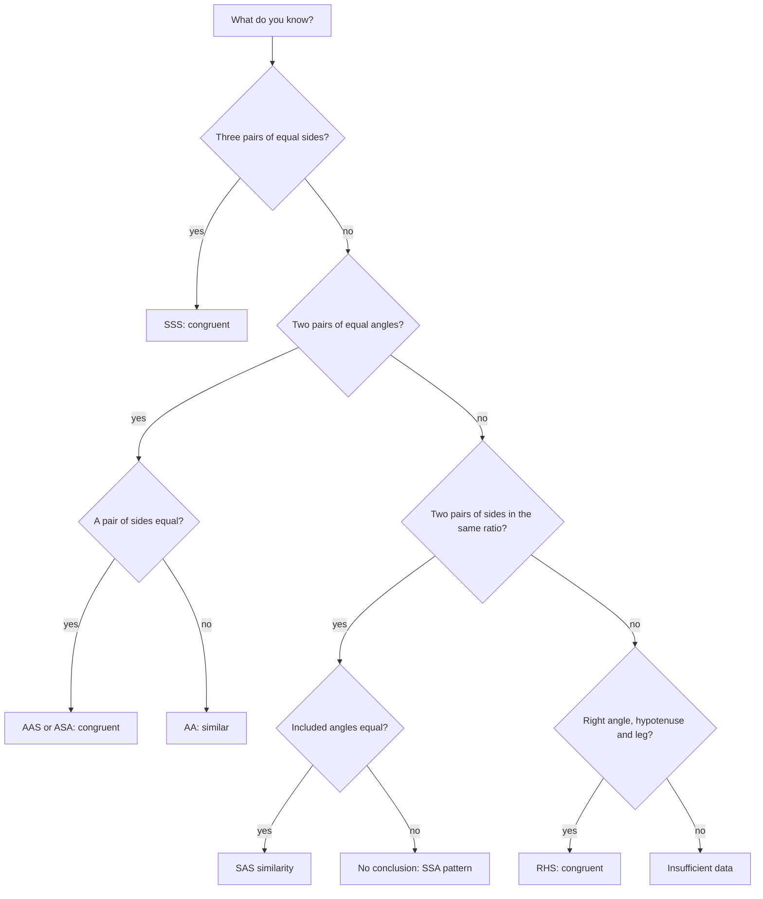

# Triangles

> [Mathematics](../../README.md) › [Geometry](../README.md) › Triangles · Level: Intermediate · Prerequisites: [Fractions](../../01-arithmetic/03-fractions/README.md), [Ratios and Proportions](../../01-arithmetic/06-ratios-and-proportions/README.md), [Elementary Algebra](../../03-algebra/01-elementary-algebra/README.md), [Intermediate Algebra](../../03-algebra/04-intermediate-algebra/README.md) · Estimated time: 10 hours

## 1. Introduction

A triangle is three points that do not lie on one line, together with the three segments joining them.
Nothing in geometry is simpler, and almost nothing is more useful. The triangle is the unit from which
other shapes are built: polygons are triangulated, bridges are lattices of triangles, a 3-D model in a
computer is a list of triangles, and a surveyor measuring a plot of land measures triangles.

The reason is *rigidity*. Four sticks pinned into a quadrilateral wobble, because the angles can change while
the side lengths stay fixed; three sticks pinned into a triangle cannot move, since there is exactly one
triangle with prescribed side lengths. That fact — proved below as the SSS criterion — is why engineers trust
triangles and why three measurements determine a plot. There is a second reason: triangles are where
*deduction* becomes visible, since proof by cases, proof by contradiction, construction proofs, dissection
proofs and algebraic proofs all appear here first.

The guiding questions are: which sets of measurements determine a triangle and which do not; what exactly is
preserved when two triangles have the same shape but different size; how do length, angle and area interact;
and why do the four classical centres exist.

We assume only the standard facts about points, lines, angles and parallels listed in Section 7.1.
Everything else, including the angle sum, the triangle inequality, every congruence and similarity
criterion, the Pythagorean theorem, the area formulas, Heron's formula and the concurrency of the four
families of cevians, is proved here.

## 2. Prerequisites

* **Fractions and ratio** — simplifying, combining and scaling: $\tfrac{3}{4} = \tfrac{6}{8}$,
  $\tfrac{2}{3}\cdot\tfrac{9}{4} = \tfrac{3}{2}$, and solving $\tfrac{x}{5} = \tfrac{3}{4}$. See
  [Fractions](../../01-arithmetic/03-fractions/README.md) and
  [Ratios, Rates and Proportions](../../01-arithmetic/06-ratios-and-proportions/README.md).
* **Algebra and radicals** — expanding $(a+b)^2$, factorising $X^2 - Y^2$, solving linear equations,
  simplifying $\sqrt{72} = 6\sqrt2$ and rationalising $\tfrac{1}{\sqrt2}$. See
  [Elementary Algebra](../../03-algebra/01-elementary-algebra/README.md) and
  [Intermediate Algebra](../../03-algebra/04-intermediate-algebra/README.md).
* **Reading a proof** — telling a definition from a theorem, checking each step. See
  [Mathematical Thinking](../../00-foundations/01-mathematical-thinking/README.md).

No trigonometry is assumed: Section 7.8 introduces the sine of an angle as a clearly marked *preview* of
[Trigonometry](../../05-trigonometry/README.md), using only the definition of sine in a right triangle.

## 3. Learning Objectives

After working through this tutorial and its exercises you will be able to:

1. Classify a triangle by sides and by angles, and prove that equilateral triangles are equiangular.
2. State and prove the triangle inequality, and decide whether three given lengths form a triangle.
3. Use the criteria SAS, ASA, AAS, SSS and RHS, explain what a criterion is, and prove by counterexample
   that SSA is not one.
4. Prove AA similarity, derive SAS and SSS similarity from it, and compute with ratios of sides and with
   the ratio $k^2$ of areas.
5. Prove the Pythagorean theorem twice — by similar triangles and by dissection — and prove its converse.
6. Compute exact side ratios in $45^\circ$–$45^\circ$–$90^\circ$ and $30^\circ$–$60^\circ$–$90^\circ$
   triangles.
7. Compute areas with $\tfrac12 bh$, with $\tfrac12 ab\sin C$ and with Heron's formula, and explain why
   each formula holds.
8. Prove that medians, altitudes, perpendicular bisectors and angle bisectors are each concurrent, and
   identify the centroid, orthocentre, circumcentre and incentre; use the $2:1$ ratio, $K = rs$ and the
   equidistance characterisations.
9. Prove inequalities between parts of a triangle, such as the bounds on the sum of the medians, and
   recognise a triangle in surveying, structures, graphics and navigation.

## 4. Intuition

**Rigidity.** Push the corner of a picture frame and it becomes a parallelogram: the four sides are
unchanged but the shape is not. A triangle made of three hinged rods cannot be deformed, because the two
free ends of two rods must meet at a point whose distances from the other ends are fixed, and there are only
two such points — mirror images across the first rod. Three sides therefore determine the triangle *up to
reflection*, and reflection is allowed in the word "congruent".

**The shortest path.** To walk from $A$ to $C$ you may go directly or detour through $B$; no detour is
shorter. That is $AB + BC \ge AC$, with equality only when $B$ lies on $AC$.

**Photocopying and paint.** Congruence is "same shape and size"; similarity is "same shape". An enlargement
by $150\%$ produces a similar triangle, not a congruent one. Similarity preserves every angle, multiplies
every length by the same factor $k$, and therefore multiplies every area by $k^2$ — which is why a map at
scale $1:50\,000$ has areas $(50\,000)^2$ times too small. Area itself is the amount of paint needed to
cover a figure, counted in unit squares; two facts drive every computation: cutting a figure into pieces
does not change the total (additivity), and moving a piece does not change it either (invariance). With
those facts a parallelogram becomes a rectangle and a triangle becomes half a parallelogram.

**Four questions, four centres.** Where does a triangular plate balance (centroid)? Where must a tower stand
to be equally far from three villages (circumcentre)? Where a fountain, equally far from three straight paths
(incentre)? Where do the altitudes meet (orthocentre)? Each answer is a concurrency theorem.

## 5. Formal Definition

We work in the Euclidean plane. The full axiomatic development of the plane belongs to the first topic of
this discipline; the assumptions we need are listed in Section 7.1. Everything not on that list is proved.

**Definition 5.1 (triangle).** Let $A$, $B$, $C$ be three points not all on one line. The **triangle**
$\triangle ABC$ is the union of the segments $AB$, $BC$, $CA$; the points are its **vertices**, the segments
its **sides**, and $\angle BAC$, $\angle ABC$, $\angle BCA$ its **interior angles**. A triangle is
**non-degenerate** when its vertices are not collinear, and "triangle" always means a non-degenerate one.

**Definition 5.2 (sides and angles).** In $\triangle ABC$ we write $a = BC$, $b = CA$, $c = AB$: each side
is named by the lower-case letter of the vertex it does not contain. We write $A$, $B$, $C$ for the
*measures* of the interior angles at those vertices when no confusion is possible. Measures are in
degrees unless radians are stated.

**Definition 5.3 (angle vocabulary).** Two angles are **supplementary** when their measures sum to
$180^\circ$ and **complementary** when they sum to $90^\circ$; a **straight angle** is formed by two
opposite rays. Lines are **parallel** ($\ell_1 \parallel \ell_2$) when coplanar and non-meeting, and
**perpendicular** ($\ell_1 \perp \ell_2$) when they meet at a right angle. A **transversal** meets two given
lines in two distinct points, and the angles it forms are **corresponding**, **alternate interior** or
**same-side interior** according to position.

**Definition 5.4 (congruence).** Two figures are **congruent**, written $F \cong G$, when a rigid motion of
the plane — a composition of translations, rotations and reflections — carries $F$ onto $G$. For triangles
$\triangle ABC \cong \triangle DEF$ means that the motion sends $A \mapsto D$, $B \mapsto E$, $C \mapsto F$;
the order of the letters is part of the statement.

**Definition 5.5 (similarity).** Two figures are **similar**, written $F \sim G$, when a rigid motion
followed by a scaling about a point with factor $k > 0$ carries $F$ onto $G$. For triangles
$\triangle ABC \sim \triangle DEF$ means that corresponding angles are equal and corresponding sides are
proportional:

$$
\angle A = \angle D, \quad \angle B = \angle E, \quad \angle C = \angle F, \qquad
\frac{AB}{DE} = \frac{BC}{EF} = \frac{CA}{FD} = k .
$$

The number $k$ is the **similarity ratio** from $\triangle DEF$ to $\triangle ABC$.

**Definition 5.6 (special triangles).** A triangle is **equilateral** when $a=b=c$, **isosceles** when at
least two sides are equal, and **scalene** when all three sides differ. It is **acute**, **right** or
**obtuse** when its largest angle is respectively less than, equal to, or greater than $90^\circ$. The
side opposite the right angle is the **hypotenuse**, the other two are the **legs**.

**Definition 5.7 (cevians and centres).** A **median** joins a vertex to the midpoint of the opposite side
($m_a$ is the median from $A$). An **altitude** joins a vertex to the opposite *line* at a right angle
($h_a$ is the altitude to $BC$, and also its length). The **perpendicular bisector** of a side passes
through the midpoint of that side perpendicular to it. An **angle bisector** is a ray from a vertex that
halves the angle there. The three medians are concurrent at the **centroid** $G$, the three altitudes at the
**orthocentre** $H$, the three perpendicular bisectors at the **circumcentre** $O$, and the three angle
bisectors at the **incentre** $I$; Section 7.10 proves each concurrency, which is what makes these
definitions legitimate.

**Definition 5.8 (perimeter, area, radii).** The **perimeter** is $a+b+c$ and the **semiperimeter** is
$s = \tfrac12(a+b+c)$. The **area** $K$ is defined by the axioms (A1)–(A4) of Section 7.5; we write $K$
rather than $A$ because $A$ names a vertex and an angle. The **inradius** $r$ is the distance from $I$ to any
side, and the **circumradius** $R$ is the common distance $OA = OB = OC$. The corresponding circles are the
**incircle** and the **circumcircle**, studied in [the next topic](../03-circles/README.md).

## 6. Mathematical Notation

| Symbol | Read as | Meaning |
|---|---|---|
| $\triangle ABC$ | triangle $ABC$ | the figure with vertices $A$, $B$, $C$ |
| $\angle ABC$ | angle $ABC$ | angle with vertex $B$ and arms $BA$, $BC$ |
| $A$, $B$, $C$ | angle $A$, angle $B$, angle $C$ | the measures of the interior angles |
| $a$, $b$, $c$ | side $a$, side $b$, side $c$ | $a = BC$, $\;b = CA$, $\;c = AB$ |
| $\cong$, $\sim$ | congruent to, similar to | Definitions 5.4 and 5.5 |
| $\parallel$, $\perp$ | parallel to, perpendicular to | line relations |
| $m_a$, $h_a$ | median to $a$, altitude to $a$ | lengths from the vertex $A$ |
| $s$ | semiperimeter | $\tfrac12(a+b+c)$ |
| $K$, $[F]$ | area | area of a figure, defined in Section 7.5 |
| $r$, $R$ | inradius, circumradius | distances from $I$ and from $O$ |
| $G$, $H$, $O$, $I$ | centroid, orthocentre, circumcentre, incentre | the four centres |

Two conventions save space. First, "$\angle A = 60^\circ$" and "$A = 60^\circ$" mean the same thing; a side
is always lower case. Second, **"cyclically"** after a displayed identity means the letters may be permuted
as $A \to B \to C \to A$; "$AB + BC > AC$, cyclically" states all three triangle inequalities.

## 7. Core Concepts

The order is logical, not by difficulty:
angles and parallels → classification → inequality → congruence → area → similarity → Pythagoras →
special triangles → Heron → centres. Area precedes similarity because the cleanest proof that a line
parallel to a side cuts the other sides proportionally uses area; similarity in turn makes the
Pythagorean theorem a two-line computation.

### 7.1 The background toolkit: angles, parallels and the angle sum

We take the following as starting assumptions. They are the standard content of the first book of Euclid,
and a full axiomatic treatment belongs to the first topic of this discipline.

* **(P1) Lines.** Through two distinct points there passes exactly one line.
* **(P2) Segment extension.** Every segment extends beyond either endpoint to any length.
* **(P3) Angle addition.** If the ray $BD$ lies inside $\angle ABC$, then
  $\angle ABC = \angle ABD + \angle DBC$; angle measures are positive real numbers, and all right angles
  share the measure $90^\circ$.
* **(P4) Parallel postulate (Playfair).** Through a point $P$ not on a line $\ell$ there passes exactly
  one line parallel to $\ell$.
* **(P5) Euclid's fifth postulate.** If a transversal meets two lines so that the interior angles on one
  side sum to less than $180^\circ$, the lines meet on that side.
* **(P6) SAS.** Two sides and the included angle determine a triangle up to congruence.

(P6) is the primitive congruence axiom of Hilbert's axiomatisation; the other criteria are theorems
(Section 7.4). (P5) is what makes the geometry Euclidean.

**Theorem 7.1 (angles on a line).** If a ray $BD$ stands on the line $AC$ with $A \ne C$, then
$\angle ABD + \angle DBC = 180^\circ$.

**Proof.** The two angles fill the straight angle $\angle ABC$ formed by the opposite rays $BA$ and $BC$,
which measures $180^\circ$ by (P3). $\blacksquare$

**Theorem 7.2 (alternate interior angles).** Let $\ell_1 \parallel \ell_2$, and let a transversal $t$ meet
$\ell_1$ at $A$ and $\ell_2$ at $B$. Then alternate interior angles are equal and same-side interior
angles are supplementary. Conversely, equal corresponding angles force the two lines to be parallel.

**Proof.** Consider the two interior angles on one side of $t$, say $\alpha$ at $A$ and $\beta$ at $B$. If
$\alpha + \beta < 180^\circ$, then by (P5) the lines meet on that side, contradicting parallelism. So each
same-side pair sums to at least $180^\circ$. The two angles at $A$ on opposite sides of $t$ sum to
$180^\circ$ by Theorem 7.1, and likewise at $B$, so the two same-side sums add to $360^\circ$; each being at
least $180^\circ$, both equal $180^\circ$. An alternate interior angle to $\alpha$ is
$180^\circ - \alpha = \beta$.

For the converse, equal corresponding angles make each same-side pair sum to $180^\circ$. If the lines met
on one side, those two angles would be two angles of a triangle, hence sum to less than $180^\circ$ by
Theorem 7.3 — impossible. So the lines meet on neither side. (Theorem 7.3 uses only the first part of this
theorem, so there is no circularity.) $\blacksquare$

**Theorem 7.3 (angle sum).** In every triangle $A + B + C = 180^\circ$.

**Proof.** Let $\ell$ be the line through $A$ parallel to $BC$, which exists by (P4). The ray $AB$, the ray
$AC$ and the line $\ell$ form three angles at $A$ filling the straight angle on the side of $\ell$ away
from $BC$: call the outer ones $\beta'$ and $\gamma'$. By Theorem 7.2 applied to the transversals $AB$ and
$AC$, $\beta' = B$ and $\gamma' = C$. Since $\beta' + A + \gamma' = 180^\circ$ by Theorem 7.1, the result
follows. $\blacksquare$

**Corollary 7.4 (exterior angle).** If $BC$ is extended beyond $C$ to $D$, then $\angle ACD = A + B >
A$ and $\angle ACD > B$.

**Proof.** By Theorem 7.1, $\angle ACD = 180^\circ - C$, and by Theorem 7.3,
$A + B = 180^\circ - C$. Positivity of $A$ and $B$ gives the inequalities. $\blacksquare$

**Corollary 7.5.** A triangle has at most one angle $\ge 90^\circ$.

**Proof.** Two such angles plus the positive third would exceed $180^\circ$, contradicting Theorem 7.3.
$\blacksquare$

**Theorem 7.6 (isosceles triangle theorem).** If $AB = AC$ then $B = C$.

**Proof.** Let $AD$ bisect $\angle A$, meeting $BC$ at $D$. Then $AB = AC$, $AD = AD$ and
$\angle BAD = \angle DAC$, so $\triangle ABD \cong \triangle ACD$ by (P6) and $B = C$. $\blacksquare$

**Theorem 7.7 (converse).** If $B = C$ then $AB = AC$.

**Proof.** With $AD$ the bisector of $\angle A$, the triangles $ABD$ and $ACD$ have
$\angle BAD = \angle DAC$, $AD$ common and $B = C$, so they are congruent by ASA (Theorem 7.15, which
depends only on (P6) and Theorem 7.1). Hence $AB = AC$. $\blacksquare$

**Theorem 7.8 (side–angle comparison).** If $AB > AC$ then $C > B$; conversely, if $C > B$ then $AB > AC$.

**Proof.** Since $AB > AC$, there is a point $D$ on the segment $AB$ with $AD = AC$. Triangle $ACD$ is
isosceles, so $\angle ADC = \angle ACD$ by Theorem 7.6. Because $D$ lies strictly between $A$ and $B$, the
ray $CD$ lies strictly inside $\angle ACB$, hence $C > \angle ACD$. Also $\angle ADC$ is exterior to
triangle $DBC$ at $D$, so $\angle ADC > B$ by Corollary 7.4. Chaining,

$$
C > \angle ACD = \angle ADC > B .
$$

For the converse, exactly one of $AB < AC$, $AB = AC$, $AB > AC$ holds; the first gives $B > C$, the second
gives $B = C$, and both contradict $C > B$. $\blacksquare$

The two halves together say **the longer side faces the larger angle**, in both directions — the tool that
converts comparisons of lengths into comparisons of angles.

### 7.2 Classification

**Definition 7.9.** A triangle is **equilateral** when all sides are equal, **isosceles** when at least
two are equal, **scalene** when all three differ; it is **acute**, **right** or **obtuse** according to its
largest angle.

**Theorem 7.10 (equilateral $\Leftrightarrow$ equiangular).** $AB = BC = CA$ if and only if
$A = B = C = 60^\circ$.

**Proof.** If the sides are equal, Theorem 7.6 applied twice gives $A = B = C$, and Theorem 7.3 gives
$3A = 180^\circ$. If the angles are equal, Theorem 7.7 applied twice gives $BC = AB = AC$.
$\blacksquare$

| Class | Defining property | Angles | Example |
|---|---|---|---|
| Equilateral | $a=b=c$ | $60^\circ, 60^\circ, 60^\circ$ | $5, 5, 5$ |
| Isosceles | exactly two sides equal | two equal base angles | $13, 13, 10$ |
| Scalene | all sides different | all angles different | $4, 5, 6$ |
| Acute | all angles $< 90^\circ$ | — | $5, 5, 6$ |
| Right | one angle $= 90^\circ$ | hypotenuse faces $90^\circ$ | $3, 4, 5$ |
| Obtuse | one angle $> 90^\circ$ | longest side faces it | $3, 3, 5$ |

In an isosceles triangle the equal sides are the **legs**, the third side the **base**, the angles at the
ends of the base the **base angles** (equal by Theorem 7.6), and the remaining angle the **vertex angle**;
then $2(\text{base angle}) + (\text{vertex angle}) = 180^\circ$. Corollary 7.5 makes "the largest angle"
unambiguous, and Theorem 7.8 shows that the longest side faces it — which is why the hypotenuse is the
longest side of a right triangle.

### 7.3 The triangle inequality

**Theorem 7.11 (triangle inequality).** In every triangle each side is shorter than the sum of the other
two: $a + b > c$, and cyclically.

**Proof.** It suffices to prove $AB + AC > BC$. Extend $BA$ beyond $A$ to a point $D$ with $AD = AC$
(possible by (P2)). Then $B$, $A$, $D$ are collinear in that order,

$$
BD = BA + AD = AB + AC,
$$

and triangle $ACD$ is isosceles with $AD = AC$, so $\angle ACD = \angle CDA$ by Theorem 7.6. Because $A$
lies between $B$ and $D$, the ray $DA$ is the ray $DB$, so $\angle CDA = \angle CDB$. Also the ray $CA$
lies inside $\angle BCD$, so $\angle BCD > \angle ACD$ by (P3). Chaining,

$$
\angle BCD > \angle ACD = \angle CDB .
$$

In triangle $BCD$ the side facing $\angle BCD$ is $BD$ and the side facing $\angle CDB$ is $BC$; by
Theorem 7.8, $BD > BC$. Since $BD = AB + AC$, we get $AB + AC > BC$. $\blacksquare$

**Corollary 7.12 (difference bound).** In every triangle $|b - c| < a < b + c$.

**Proof.** The right-hand inequality is Theorem 7.11. From $a + b > c$ we get $a > c - b$, and from
$a + c > b$ we get $a > b - c$; hence $a > |b - c|$. $\blacksquare$

**Remark 7.13 (equality case and existence).** If $a + b = c$, no non-degenerate triangle exists: the
condition means $B$ lies on the segment $AC$, so the figure is a **degenerate** triangle of area zero.
Conversely, if three positive numbers satisfy the three strict inequalities, a triangle with those sides
exists: with $B = (0,0)$ and $C = (a,0)$, the distance from $C$ to a point $P(\theta)$ at distance $c$
from $B$ varies continuously with the angle $\theta$, equals $|c-a| < b$ at $\theta = 0^\circ$ and
$a + c > b$ at $\theta = 180^\circ$, so it equals $b$ for some $\theta$ in between. The continuity step is
the only analysis used in this tutorial; classically the same conclusion comes from intersecting the two
circles of radii $b$ and $c$. To *test* three lengths, check only that the largest is smaller than the sum
of the other two.

### 7.4 Congruence

Definition 5.4 is useless for computation, because it quantifies over infinitely many motions. What we
need is a **criterion**: a short list of measurements that forces congruence.

**Definition 7.14 (congruence criterion).** A list of measurements of a triangle is a **congruence
criterion** when any two triangles with the same values are congruent. The standard list is SAS (two sides
and the included angle), ASA (two angles and the included side), AAS (two angles and a non-included side),
SSS (three sides) and RHS (right angle, hypotenuse, side). The list SSA is *not* a criterion: see
Example 7.19.

We take **SAS as an axiom**, (P6); everything else in this subsection is proved from it.

**Theorem 7.15 (ASA).** If $\angle B = \angle E$, $\angle C = \angle F$ and $BC = EF$, then
$\triangle ABC \cong \triangle DEF$.

**Proof.** Suppose $AB > DE$ and choose $G$ on the segment $AB$ with $BG = DE$. In triangles $GBC$ and
$DEF$ we have $BG = DE$, $\angle GBC = \angle ABC = \angle DEF$ (because $G$ lies on the ray $BA$) and
$BC = EF$; by (P6), $\triangle GBC \cong \triangle DEF$. Hence $\angle GCB = \angle DFE = \angle ACB$.
But $G$ lies strictly between $A$ and $B$, so the ray $CG$ lies strictly inside $\angle ACB$ and
$\angle GCB < \angle ACB$ by (P3) — a contradiction. Hence $AB \le DE$, and the same argument with the
triangles exchanged gives $DE \le AB$. So $AB = DE$, and (P6) applied to $AB$, $\angle B$ and $BC$ now
gives $\triangle ABC \cong \triangle DEF$. $\blacksquare$

**Theorem 7.16 (AAS).** If $\angle A = \angle D$, $\angle B = \angle E$ and $BC = EF$, then
$\triangle ABC \cong \triangle DEF$.

**Proof.** By Theorem 7.3, $\angle C = 180^\circ - \angle A - \angle B = 180^\circ - \angle D - \angle E
= \angle F$. Now $BC$ is the side included between the equal angles $B$ and $C$, and $EF$ between the equal
angles $E$ and $F$, so Theorem 7.15 applies. $\blacksquare$

**Theorem 7.17 (SSS).** If $AB = DE$, $BC = EF$ and $CA = FD$, then $\triangle ABC \cong \triangle DEF$.

**Proof.** Move the second triangle rigidly so that $D$ lands on $A$, $E$ on $B$, and $F$ on the side of
the line $AB$ opposite to $C$ (a reflection is a rigid motion). Keep the name $F$, so that $AF = CA$ and
$BF = CB$. Triangle $ACF$ is isosceles, so $\angle ACF = \angle CFA$; triangle $BCF$ is isosceles, so
$\angle BCF = \angle BFC$. When $CF$ meets the segment $AB$, the ray $CF$ lies inside $\angle ACB$ and
inside $\angle AFB$, so

$$
\angle ACB = \angle ACF + \angle FCB = \angle AFC + \angle CFB = \angle AFB .
$$

By (P6) applied to $AC = AF$, the angle at $C$ and $CB = FB$, we get $\triangle ABC \cong \triangle ABF$;
and $\triangle ABF$ is a rigid copy of $\triangle DEF$. $\blacksquare$

*On generality.* The displayed identity treats the case in which $CF$ meets the segment $AB$; when it
meets the line $AB$ outside the segment, the same two isosceles triangles are combined with a difference
of angles and the conclusion $\angle ACB = \angle AFB$ is unchanged. A case-free derivation of SSS from
SAS appears in Hilbert's *Grundlagen der Geometrie*; taking SSS as an axiom alongside SAS is equally
sound, and nothing later depends on the choice.

**Remark 7.18 (RHS).** Two right triangles with equal hypotenuses and one pair of equal legs are congruent;
the proof needs Pythagoras and is Corollary 7.34.

**Example 7.19 (SSA is not a criterion).** Take $AB = 4\sqrt2$, $AC = 4$ and $\angle ABC = 30^\circ$. The
angle at $B$ is included between $BA$ and $BC$, so the given side $AC$ is *opposite* the given angle: this
is the SSA pattern. Two non-congruent triangles carry exactly these data.

| Triangle | $\angle B$ | $\angle C$ | $\angle A$ | $BC$ |
|---|---|---|---|---|
| $T_1$ | $30^\circ$ | $45^\circ$ | $105^\circ$ | $2(\sqrt6+\sqrt2) \approx 7.727$ |
| $T_2$ | $30^\circ$ | $135^\circ$ | $15^\circ$ | $2(\sqrt6-\sqrt2) \approx 2.071$ |

In both rows the side opposite $B$ is $AC = 4$ and the side opposite $C$ is $AB = 4\sqrt2$; the third sides
differ, so the triangles are not congruent — nor even similar, since their angle triples differ. Example
9.4 constructs both from the given data and checks the lengths with Pythagoras.

The failure is easy to see geometrically. The data fix the ray $BC$ and the distance $AC = 4$, so $C$ lies
on the circle of radius $4$ about $A$, and the ray from $B$ meets that circle twice exactly when the
perpendicular distance from $A$ to the ray is less than $4$ — true here, since
$4\sqrt2\,\sin 30^\circ = 2\sqrt2 \approx 2.83 < 4$. The hinge at $B$ can swing to two positions. In
trigonometry the same phenomenon is the **ambiguous case** of the law of sines.

Two closing remarks. A criterion must record *positions*: "two sides and an angle" is ambiguous, SAS being a
criterion and SSA not. And once two triangles are congruent, all six corresponding parts are equal — CPCTC,
"corresponding parts of congruent triangles are congruent" — which makes congruence the workhorse of
elementary geometry.

### 7.5 Area

Area is measured in unit squares. Four rules generate every formula in this tutorial: **(A1) invariance**
(congruent figures have equal areas); **(A2) additivity** (a figure cut into finitely many pieces of disjoint
interiors has area equal to the sum of the pieces' areas); **(A3) unit square** (a rectangle with side lengths
$p$, $q$ has area $pq$); and **(A4) positivity** (a figure with non-empty interior has positive area).

**Theorem 7.20 (parallelogram).** A parallelogram with base $b$ and height $h$ has area $bh$.

**Proof.** Let $ABCD$ have $AB = CD = b$, and drop perpendiculars from $D$ and $C$ to the line $AB$, meeting
it at $D'$ and $C'$. Since $DD'$ and $CC'$ are both perpendicular to $AB$, they are parallel, and $D'C'CD$
is a rectangle with $D'C' = DC = b$ and height $h$, hence area $bh$ by (A3). Triangles $ADD'$ and $BCC'$
have $AD = BC$, $DD' = CC' = h$ and right angles at the feet, so they are congruent by SAS and have equal
areas by (A1). By (A2) the parallelogram is the rectangle with $BCC'$ removed and $ADD'$ added, so its area
is $bh$ as well. $\blacksquare$

**Theorem 7.21 (triangle).** A triangle with base $b$ and height $h$ has area $K = \tfrac12 bh$.

**Proof.** Let $M$ be the midpoint of $BC$. Rotating $\triangle ABC$ by $180^\circ$ about $M$ sends $B$ to
$C$ and $A$ to a point $A'$ with $BA' \parallel AC$ and $CA' \parallel AB$, so $ABCA'$ is a parallelogram
with base $b$ and height $h$, of area $bh$ by Theorem 7.20. The rotation is rigid, so $\triangle A'CB
\cong \triangle ABC$ and the two halves have equal area by (A1) and (A2); each is $\tfrac12 bh$.
$\blacksquare$

**Corollary 7.22 (equal bases and heights).** Triangles on the same base with third vertices on a line
parallel to the base have equal area; more generally, if $D$ lies on the segment $AB$ then
$[ACD]/[BCD] = AD/BD$.

**Proof.** Both triangles in the first claim have the same altitude from $C$ to the line $AB$. In the
second, $[ACD] = \tfrac12 AD\cdot h$ and $[BCD] = \tfrac12 BD\cdot h$ with the same $h$; divide.
$\blacksquare$

**Theorem 7.23 (basic proportionality theorem).** In $\triangle ABC$ let $D$ lie on $AB$ and $E$ on $AC$
with $DE \parallel BC$. Then

$$
\frac{AD}{DB} = \frac{AE}{EC}, \qquad \frac{AD}{AB} = \frac{AE}{AC} = \frac{DE}{BC}.
$$

**Proof.** Triangles $BDE$ and $CDE$ have the common base $DE$, and $B$, $C$ lie on a line parallel to $DE$,
so their distances to $DE$ are equal and $[BDE] = [CDE]$ by Corollary 7.22. Since $A$, $D$, $B$ are
collinear, Corollary 7.22 also gives

$$
\frac{[ADE]}{[BDE]} = \frac{AD}{DB}, \qquad \frac{[ADE]}{[CDE]} = \frac{AE}{EC},
$$

and the left sides are equal, so $AD/DB = AE/EC$. Adding $1$ gives $AB/DB = AC/EC$; taking reciprocals and
subtracting from $1$ gives $AD/AB = AE/AC$.

For the third ratio, draw through $D$ the line parallel to $AC$ meeting $BC$ at $F$. Then $DECF$ has
$DE \parallel FC$ and $DF \parallel EC$, so it is a parallelogram and $DE = FC$. The first part applied to
$DF \parallel AC$ in $\triangle ABC$ gives $BD/DA = BF/FC$, hence
$BC = BF + FC = FC\,(1 + DB/AD) = FC \cdot AB/AD$, that is $FC/BC = AD/AB$. $\blacksquare$

**Theorem 7.24 (converse).** If $D$ lies on $AB$, $E$ lies on $AC$ and $AD/DB = AE/EC$, then
$DE \parallel BC$.

**Proof.** Let the parallel through $D$ to $BC$ meet $AC$ at $E'$. By Theorem 7.23,
$AD/DB = AE'/E'C$. As $t \mapsto t/(AC - t)$ is strictly increasing on $(0, AC)$ and
$AE'/E'C = AE/EC$, we get $AE' = AE$, hence $E' = E$. $\blacksquare$

### 7.6 Similarity

**Definition 7.25 (similar triangles).** Two triangles are **similar** when corresponding angles are equal
and corresponding sides are proportional. In $\triangle ABC \sim \triangle DEF$ the correspondence is
$A \leftrightarrow D$, $B \leftrightarrow E$, $C \leftrightarrow F$, and the common value $k$ of the side
ratios is the **similarity ratio**.

**Theorem 7.26 (AA criterion).** If two angles of one triangle equal two angles of another, the triangles
are similar.

**Proof.** Let $\angle A = \angle D$ and $\angle B = \angle E$; then $\angle C = \angle F$ by Theorem 7.3.
Interchanging the two triangles if necessary, assume $DE \le AB$, so that the points below lie on the *segments*
$AB$ and $AC$. On the rays $AB$ and $AC$ mark $B''$ and $C''$ with $AB'' = DE$ and $AC'' = DF$. Then
$\triangle AB''C'' \cong \triangle DEF$ by (P6). Also $\angle AB''C'' = \angle E = \angle B$, and these are
corresponding angles for the transversal $AB$, so $B''C'' \parallel BC$ by the converse part of
Theorem 7.2. Theorem 7.23 applied to $\triangle ABC$ and the parallel line $B''C''$ now gives

$$
\frac{AB''}{AB} = \frac{AC''}{AC} = \frac{B''C''}{BC},
$$

that is $DE/AB = DF/AC = EF/BC$, since $B''C'' = EF$ by the congruence. Together with the equal angles,
this is similarity. $\blacksquare$

**Theorem 7.27 (SAS similarity).** If $\angle A = \angle D$ and $AB/DE = AC/DF$, then
$\triangle ABC \sim \triangle DEF$.

**Proof.** Interchanging the triangles if necessary, assume $DE \le AB$. Mark $B''$ on $AB$ and $C''$ on $AC$
with $AB'' = DE$, $AC'' = DF$. The hypothesis gives $AB''/AB = AC''/AC$, so $B''C'' \parallel BC$ by
Theorem 7.24 and $\triangle AB''C'' \sim \triangle ABC$ by AA with ratio $AB''/AB = DE/AB$. Also
$\triangle AB''C'' \cong \triangle DEF$ by (P6), so $DEF$ has the same angles and the same side ratios as
$ABC$. $\blacksquare$

**Theorem 7.28 (SSS similarity).** If $AB/DE = BC/EF = CA/FD$, then $\triangle ABC \sim \triangle DEF$.

**Proof.** Interchanging the triangles if necessary, assume $DE \le AB$. Mark $B''$ on $AB$ and $C''$ on $AC$
with $AB'' = DE$, $AC'' = DF$. As in Theorem 7.27, $B''C'' \parallel BC$ and
$\triangle AB''C'' \sim \triangle ABC$. Hence $B''C''/BC = AB''/AB = DE/AB = EF/BC$, so $B''C'' = EF$, and
$\triangle AB''C'' \cong \triangle DEF$ by SSS (Theorem 7.17). Therefore $\triangle ABC \sim \triangle DEF$.
$\blacksquare$

**Theorem 7.29 (areas of similar triangles).** If $\triangle ABC \sim \triangle DEF$ with ratio
$k = AB/DE$, then $[ABC]/[DEF] = k^2$.

**Proof.** Drop the altitudes $AH$ and $DK$. The right triangles $ABH$ and $DEK$ have $\angle B = \angle E$
and a right angle, so they are similar by AA, and $AH/DK = AB/DE = k$. By Theorem 7.21,

$$
\frac{[ABC]}{[DEF]} = \frac{\tfrac12 BC\cdot AH}{\tfrac12 EF\cdot DK}
= \frac{BC}{EF}\cdot\frac{AH}{DK} = k \cdot k = k^2. \qquad \blacksquare
$$

**Corollary 7.30 (midsegment theorem).** If $D$, $E$ are the midpoints of $AB$, $AC$, then
$DE \parallel BC$ and $DE = \tfrac12 BC$.

**Proof.** $AD/AB = AE/AC = \tfrac12$, so $DE \parallel BC$ by Theorem 7.24, and
$\triangle ADE \sim \triangle ABC$ by Theorem 7.27 with ratio $\tfrac12$; hence $DE/BC = \tfrac12$.
$\blacksquare$

Three warnings. **AAA is not a congruence criterion** — it fixes the shape only. **"Two sides in
proportion and an angle" is not a similarity criterion** when the angle is not included, since the SSA
phenomenon survives scaling. And **similarity multiplies areas by $k^2$**, not by $k$: doubling the sides
quadruples the area.

### 7.7 The Pythagorean theorem

**Theorem 7.31 (Pythagoras, by similar triangles).** In a right triangle with legs $a$, $b$ and hypotenuse
$c$, $\;a^2 + b^2 = c^2$.

**Proof.** Let the right angle be at $C$, so $a = BC$, $b = CA$, $c = AB$. Drop the altitude from $C$ to
$AB$, meeting $AB$ at $D$. Triangles $ACD$ and $ABC$ have the angle at $A$ in common and a right angle each,
so they are similar by Theorem 7.26. Hence

$$
\frac{AD}{AC} = \frac{AC}{AB}, \qquad\text{that is}\qquad AC^2 = AB\cdot AD .
$$

Likewise $\triangle CBD \sim \triangle ABC$ through the common angle at $B$, so
$BD/BC = BC/AB$, that is $BC^2 = AB\cdot BD$. Adding and using $AD + BD = AB$,

$$
AC^2 + BC^2 = AB\,(AD + BD) = AB^2 .
$$

In the notation above, $b^2 + a^2 = c^2$. $\blacksquare$

**Theorem 7.32 (Pythagoras, by dissection).** The same identity holds, by an argument that uses only
areas.

**Proof.** Let $a > b$ be the legs and $\alpha$, $\beta$ the acute angles, so $\alpha + \beta = 90^\circ$ by
Theorem 7.3. In a square of side $a+b$, mark on each side the point dividing it into segments of lengths $a$
and $b$, in cyclic order, and join the four marked points. Each corner triangle has legs $a$, $b$ and a
right angle, so all four are congruent to the given triangle by SAS (P6) and each has area $\tfrac12 ab$. The
inner quadrilateral has four sides of length $c$. At each marked point the three angles present — one angle
$\alpha$ of a corner triangle, the interior angle $\theta$ of the inner quadrilateral, and one angle $\beta$
of the next corner triangle — fill a straight angle, since the marked point lies on a side of the square;
hence $\theta = 180^\circ - (\alpha+\beta) = 90^\circ$, and the inner quadrilateral is a square of area $c^2$.
By (A2), $(a+b)^2 = 4\cdot\tfrac12 ab + c^2 = 2ab + c^2$, that is $a^2 + 2ab + b^2 = 2ab + c^2$, and
cancelling $2ab$ gives $a^2 + b^2 = c^2$. $\blacksquare$

**Theorem 7.33 (converse of Pythagoras).** If a triangle with sides $a$, $b$, $c$ satisfies $a^2+b^2=c^2$,
then the angle opposite $c$ is a right angle.

**Proof.** Construct a right triangle with legs $a$, $b$; by Theorem 7.31 its hypotenuse $c'$ satisfies
$c'^2 = a^2+b^2 = c^2$, so $c' = c$. The two triangles agree on all three sides, hence are congruent by
Theorem 7.17, and the angle opposite $c$ equals the constructed right angle. $\blacksquare$

**Corollary 7.34 (RHS congruence).** Two right triangles with equal hypotenuses and one pair of equal legs
are congruent.

**Proof.** With hypotenuses $c$ and equal legs $a$, Theorem 7.31 makes the remaining legs
$\sqrt{c^2-a^2}$ in both triangles, so SSS gives congruence. $\blacksquare$

**Remark 7.35 (triples, and the three cases).** A **Pythagorean triple** is a triple of positive integers
with $a^2+b^2=c^2$; the smallest are $(3,4,5)$, $(5,12,13)$, $(8,15,17)$, $(7,24,25)$, $(20,21,29)$. For
integers $m > n \ge 1$, $(m^2-n^2)^2 + (2mn)^2 = (m^2+n^2)^2$ by expansion, so each such pair produces a
triple; when $m,n$ are coprime and of opposite parity the triple is primitive, and every primitive triple
arises this way. Note the direction of the theorem: it concerns a *right* triangle. Comparing $a^2+b^2$ with
$c^2$ decides the shape — larger means the angle at $C$ is acute, smaller means it is obtuse. This is the
germ of the law of cosines.

### 7.8 Special right triangles and the sine preview

**Definition 7.36 (sine of an angle — preview).** In a right triangle the **sine** of an acute angle is the
ratio of the opposite leg to the hypotenuse. For an obtuse angle set
$\sin(180^\circ - \theta) = \sin\theta$, the choice that makes Theorem 7.39 true for obtuse triangles too.
The systematic theory is in [Trigonometry](../../05-trigonometry/README.md); here we need only the ratio.

**Theorem 7.37 ($45^\circ$–$45^\circ$–$90^\circ$).** If the acute angles are both $45^\circ$, the legs are
equal, and a leg $l$ gives hypotenuse $l\sqrt2$.

**Proof.** The third angle is $45^\circ$, so the triangle is isosceles by Theorem 7.7 and the legs are equal;
by Theorem 7.31, $c^2 = l^2+l^2 = 2l^2$, so $c = l\sqrt2$. $\blacksquare$

**Theorem 7.38 ($30^\circ$–$60^\circ$–$90^\circ$).** Such a triangle has sides in the ratio
$1 : \sqrt3 : 2$, with $1$ opposite $30^\circ$, $\sqrt3$ opposite $60^\circ$ and $2$ opposite the right
angle.

**Proof.** Take an equilateral triangle of side $2$; each angle is $60^\circ$ by Theorem 7.10. The segment
from a vertex to the midpoint of the opposite side gives two triangles with three pairs of equal sides
($2$, $1$ and the common segment), so they are congruent by SSS (Theorem 7.17); hence that segment is
perpendicular to the opposite side (Theorem 7.1) and bisects the angle at the vertex. Each half is therefore
a $30^\circ$–$60^\circ$–$90^\circ$ triangle with hypotenuse $2$ and one leg $1$. The other leg is
$\sqrt{2^2-1^2} = \sqrt3$ by Theorem 7.31, and every $30^\circ$–$60^\circ$–$90^\circ$ triangle is similar to
this one by Theorem 7.26. $\blacksquare$

Hence $\sin 45^\circ = \tfrac{\sqrt2}{2}$, $\sin 30^\circ = \tfrac12$ and $\sin 60^\circ =
\tfrac{\sqrt3}{2}$ — the first exact values of trigonometry, obtained without any trigonometry.

**Theorem 7.39 (area from two sides and the included angle).** For any triangle,
$K = \tfrac12 ab\sin C$.

**Proof.** Drop the altitude from $A$ to the line $BC$, of length $h$. In the right triangle formed with
the side $AC = b$, the angle at $C$ is either $C$ or $180^\circ - C$, and in both cases Definition 7.36
gives $h = b\sin C$. Then $K = \tfrac12 a h$ by Theorem 7.21. $\blacksquare$

With $C = 90^\circ$ this reduces to $\tfrac12 ab$, as it must; with $a = b = c$ and $C = 60^\circ$ it gives
the area of an equilateral triangle, $\tfrac{\sqrt3}{4}a^2$.

### 7.9 Heron's formula

Theorem 7.21 needs a height and Theorem 7.39 an angle; Heron's formula needs neither, which is exactly what
surveying requires.

**Theorem 7.40 (Heron of Alexandria, c. 60 AD).** With $s = \tfrac12(a+b+c)$,

$$
K = \sqrt{s(s-a)(s-b)(s-c)} .
$$

**Proof.** Let $h$ be the altitude from $A$ to the line $BC$, with foot $H$, and let $x = BH$ be the
*signed* distance from $B$ to $H$, positive on the side of $C$. Then $CH = a - x$, and Pythagoras
(Theorem 7.31) in the right triangles $ABH$, $ACH$ gives

$$
h^2 = c^2 - x^2, \qquad h^2 = b^2 - (a-x)^2 .
$$

Equating and cancelling $-x^2$ gives $c^2 = b^2 - a^2 + 2ax$, hence $x = (a^2+c^2-b^2)/(2a)$. Multiplying
the first identity by $4a^2$ and substituting $x$,

$$
4a^2h^2 = 4a^2c^2 - (a^2+c^2-b^2)^2 .
$$

The right side is a difference of squares with $X = 2ac$ and $Y = a^2+c^2-b^2$, so it factors twice:

$$
4a^2h^2 = \bigl(2ac - a^2 - c^2 + b^2\bigr)\bigl(2ac + a^2 + c^2 - b^2\bigr)
= \bigl(b^2-(a-c)^2\bigr)\bigl((a+c)^2-b^2\bigr)
= (b-a+c)(b+a-c)(a+c-b)(a+b+c).
$$

Since $b+c-a = 2(s-a)$, $a+b-c = 2(s-c)$, $a+c-b = 2(s-b)$ and $a+b+c = 2s$, this is
$16\,s(s-a)(s-b)(s-c)$. Finally $K = \tfrac12 ah$, so $16K^2 = 4a^2h^2$, giving
$K^2 = s(s-a)(s-b)(s-c)$; all four factors are positive by Theorem 7.11, so $K$ is their positive square
root. $\blacksquare$

**Remark 7.41 (checks and generalisation).** For the $13$–$14$–$15$ triangle, $s = 21$ and
$K = \sqrt{21\cdot 8\cdot 7\cdot 6} = 84$: an integer area from integer sides, which is why such triangles are
called **Heronian**. For an equilateral triangle of side $a$, $s = \tfrac{3a}{2}$ and
$K = \sqrt{\tfrac{3a}{2}\cdot\tfrac{a}{2}\cdot\tfrac{a}{2}\cdot\tfrac{a}{2}} = \tfrac{\sqrt3}{4}a^2$,
agreeing with Theorem 7.38. The proof also yields $16K^2 = 4a^2b^2 - (a^2+b^2-c^2)^2$, sometimes the fastest
way to compute. For a cyclic quadrilateral with sides $a$, $b$, $c$, $d$ and the same $s$,
**Brahmagupta's formula** states $K = \sqrt{(s-a)(s-b)(s-c)(s-d)}$; it is stated without proof, and the
[next topic](../03-circles/README.md) supplies the circle theory behind it.

### 7.10 Medians, altitudes, bisectors and the four centres

Four families of lines, four coincidences. Every proof below follows the same pattern: prove a **locus**
statement ("the points equidistant from $X$ and $Y$ form a line"), then note that the intersection of two
of the lines is equidistant from all three objects, hence lies on the third line.

**Theorem 7.42 (perpendicular bisector locus).** A point $P$ is equidistant from $A$ and $B$ if and only if
it lies on the perpendicular bisector of $AB$.

**Proof.** Let $M$ be the midpoint of $AB$. If $P$ is on the perpendicular bisector, then $PM \perp AB$,
$MA = MB$ and $PM$ is common, so $\triangle PMA \cong \triangle PMB$ by SAS and $PA = PB$. Conversely, if
$PA = PB$, then $\triangle PMA \cong \triangle PMB$ by SSS, so $\angle PMA = \angle PMB$; these are
supplementary by Theorem 7.1, hence each is $90^\circ$. $\blacksquare$

**Theorem 7.43 (circumcentre).** The three perpendicular bisectors of a triangle are concurrent, at a point
equidistant from the three vertices.

**Proof.** The perpendicular bisectors of $AB$ and $AC$ meet, since they are perpendicular to two
non-parallel lines; call the intersection $O$. By Theorem 7.42, $OA = OB$ and $OA = OC$, so $OB = OC$ and
$O$ lies on the perpendicular bisector of $BC$. $\blacksquare$

The point is the **circumcentre** $O$ and the common distance $R$ the **circumradius**; the circle of radius
$R$ about $O$ passes through all three vertices. In an acute triangle $O$ lies inside, in an obtuse triangle
outside. In a right triangle $O$ is the midpoint of the hypotenuse: with $M$ that midpoint and $N$ the
midpoint of $AC$, $MN \parallel BC$ by Corollary 7.30, so $MA = MC$, while $MA = MB$ by construction.

**Theorem 7.44 (angle bisector locus).** A point inside an angle lies on its bisector if and only if it is
equidistant from the two sides.

**Proof.** Let $P$ be inside $\angle XOY$ and let $U$, $V$ be the feet of the perpendiculars from $P$ to the
lines $OX$, $OY$. If $OP$ bisects the angle, the right triangles $OPU$ and $OPV$ share the hypotenuse $OP$
and have $\angle UOP = \angle POV$, so they are congruent by AAS (Theorem 7.16) and $PU = PV$. Conversely,
if $PU = PV$, those right triangles have equal hypotenuses and one pair of equal legs, so they are congruent
by RHS (Corollary 7.34), whence $\angle UOP = \angle POV$. $\blacksquare$

**Theorem 7.45 (incentre).** The three angle bisectors of a triangle are concurrent, at a point equidistant
from the three sides.

**Proof.** Let the bisectors of $\angle A$ and $\angle B$ meet at $I$. By Theorem 7.44, $I$ is equidistant
from $AB$ and $AC$, and from $BA$ and $BC$; hence its distances to $AC$ and $BC$ are equal, so by
Theorem 7.44 it lies on the bisector of $\angle C$. $\blacksquare$

The point is the **incentre** $I$; its distance $r$ to each side is the **inradius**, and the circle of
radius $r$ about $I$ touches all three sides.

**Theorem 7.46 (area and inradius).** $K = rs$.

**Proof.** The segments $IA$, $IB$, $IC$ cut the triangle into $IBC$, $ICA$, $IAB$, whose heights to the
sides $a$, $b$, $c$ are all $r$. By (A2) and Theorem 7.21,
$K = \tfrac12 ar + \tfrac12 br + \tfrac12 cr = sr$. $\blacksquare$

**Theorem 7.47 (centroid).** The three medians are concurrent, and their intersection $G$ divides each
median in the ratio $2:1$ from the vertex: if $BE$ is a median then $BG = 2\,GE$.

**Proof.** Let $BE$ and $CF$ be the medians from $B$ and $C$, meeting at $G$, with $E$ the midpoint of $AC$
and $F$ the midpoint of $AB$. By Corollary 7.30, $FE \parallel BC$ and $FE = \tfrac12 BC$, so triangles
$GEF$ and $GBC$ are similar by AA (alternate interior angles at $E$, $B$ and at $F$, $C$) with ratio
$\tfrac12$. Hence $GE/GB = GF/GC = \tfrac12$.

Now let the third median $AD$ meet $BE$ at $G'$. Since $D$ is the midpoint of $BC$ and $E$ that of $AC$, the
midsegment theorem gives $DE \parallel AB$ and $DE = \tfrac12 AB$, so triangles $G'ED$ and $G'BA$ are
similar with ratio $\tfrac12$ and $G'E = \tfrac12 G'B$. On the segment $BE$ there is exactly one point $X$
with $XB = 2\,XE$ (namely $XE = \tfrac13 BE$), so $G' = G$; hence $AD$ passes through $G$. $\blacksquare$

The centroid is the **centre of mass** of a uniform triangular plate, and its barycentric coordinates are
how computer graphics interpolates data across a triangle.

**Theorem 7.48 (orthocentre).** The three altitudes of a triangle are concurrent.

**Proof.** Through $A$, $B$, $C$ draw the lines $\ell_A$, $\ell_B$, $\ell_C$ parallel to $BC$, $CA$, $AB$
respectively, and put $A' = \ell_B \cap \ell_C$, $B' = \ell_C \cap \ell_A$, $C' = \ell_A \cap \ell_B$. These
lines are pairwise non-parallel, since they are parallel to the sides of a non-degenerate triangle, so
$A'B'C'$ is a triangle and $B'C' = \ell_A \parallel BC$. The quadrilateral $AB'CB$ has $AB' \parallel BC$ and
$B'C \parallel AB$, so it is a parallelogram and $AB' = BC$; likewise $AC'BC$ is a parallelogram, so
$AC' = CB$. Hence $AB' = AC'$, and since $B'$ and $C'$ lie on opposite rays of $\ell_A$ from $A$, the point
$A$ is the midpoint of $B'C'$. Therefore the altitude from $A$, perpendicular to $BC$ and hence to $B'C'$,
is the perpendicular bisector of $B'C'$, and cyclically the three altitudes are the three perpendicular
bisectors of $A'B'C'$; by Theorem 7.43 they are concurrent. $\blacksquare$

The point is the **orthocentre** $H$. In a right triangle it is the right-angle vertex, since the altitude
from each acute vertex is a leg; in an obtuse triangle it lies outside.

**Theorem 7.49 (Euler line — stated).** In any triangle the centroid $G$, the orthocentre $H$ and the
circumcentre $O$ are collinear, and $HG = 2\,GO$.

The line is the **Euler line**; in an isosceles triangle it is the axis of symmetry, and in an equilateral
triangle all four centres coincide. The proof uses the homothety of centre $G$ and ratio $-\tfrac12$, which
sends $H$ to $O$, and belongs to the planned topic on geometric transformations. The midpoint of $OH$ is the
centre of the **nine-point circle**, through the three midpoints of the sides, the three feet of the
altitudes and the three midpoints of $HA$, $HB$, $HC$.

## 8. Formulas and Properties

| Result | Statement | Hypothesis | Proved in |
|---|---|---|---|
| Angle sum | $A + B + C = 180^\circ$ | every triangle | 7.3 |
| Exterior angle | $\angle ACD = A + B$ | $D$ on the ray $BC$ beyond $C$ | 7.4 |
| Triangle inequality | $a + b > c$ | every triangle | 7.11 |
| Difference bound | $\lvert b-c\rvert < a < b+c$ | every triangle | 7.12 |
| Pythagoras | $a^2 + b^2 = c^2$ | right angle at $C$ | 7.31, 7.32 |
| Converse of Pythagoras | $a^2+b^2 = c^2 \Rightarrow \angle C = 90^\circ$ | given the three sides | 7.33 |
| Isosceles $45^\circ$ | legs $l$, hypotenuse $l\sqrt2$ | acute angles $45^\circ$ | 7.37 |
| Isosceles $30^\circ$ | sides $x$, $x\sqrt3$, $2x$ | angles $30^\circ$, $60^\circ$, $90^\circ$ | 7.38 |
| Area from base | $K = \tfrac12 bh$ | $b$ a side, $h$ its altitude | 7.21 |
| Area from two sides | $K = \tfrac12 ab \sin C$ | $C$ included between $a$ and $b$ | 7.39 |
| Heron | $K = \sqrt{s(s-a)(s-b)(s-c)}$ | sides $a$, $b$, $c$ | 7.40 |
| Similarity | sides $\times k$, areas $\times k^2$ | $\triangle ABC \sim \triangle DEF$ | 7.26–7.29 |
| Area and inradius | $K = rs$ | $r$ the inradius | 7.46 |
| Centroid ratio | $BG = 2\,GE$ | $BE$ a median | 7.47 |

Each row states its hypothesis because each formula fails without it: Heron's formula is meaningless for a
quadrilateral, $\tfrac12 ab\sin C$ needs the *included* angle, and Pythagoras without a right angle is false.
Three sides call for Heron, two sides and the included angle for $\tfrac12 ab\sin C$, a base and its altitude
for $\tfrac12 bh$.

## 9. Step-by-Step Examples

**Example 9.1 (angles).** In $\triangle ABC$, $A = 48^\circ$ and $B = 65^\circ$. Find $C$ and classify the
triangle. By Theorem 7.3, $C = 180^\circ - 48^\circ - 65^\circ = 67^\circ$. All three angles are less than
$90^\circ$, so the triangle is acute; all three are different, so it is also scalene.

**Example 9.2 (triangle inequality).** Which of $(5,8,14)$ and $(6,8,10)$ are side lengths of a triangle? For
$(5,8,14)$ the largest side is $14$ and $5 + 8 = 13 < 14$, so no such triangle exists (Theorem 7.11). For
$(6,8,10)$ all three inequalities hold, so a triangle exists (Remark 7.13); moreover $6^2+8^2 = 100 = 10^2$,
so by Theorem 7.33 it is right-angled with hypotenuse $10$.

**Example 9.3 (congruence).** Let $ABCD$ be a quadrilateral with $AB = AD$ and $CB = CD$. Prove that
$\angle ABC = \angle ADC$. *Strategy: find triangles sharing three sides.* Draw $AC$. In triangles $ABC$ and
$ADC$, $AB = AD$, $BC = DC$ and $AC$ is common, so $\triangle ABC \cong \triangle ADC$ by SSS (Theorem 7.17),
and corresponding angles are equal. (Likewise $\angle BAC = \angle DAC$, so $AC$ bisects $\angle BAD$.)

**Example 9.4 (the SSA construction of Example 7.19).** Given $AB = 4\sqrt2$, $\angle ABC = 30^\circ$ and
$AC = 4$, construct every triangle with these data. Drop the perpendicular from $A$ to $BC$, foot $F$. In
the right triangle $ABF$ the angle at $B$ is $30^\circ$, so $AF = AB\sin 30^\circ = 2\sqrt2$ (Definitions
7.36, Theorem 7.38) and $BF = \sqrt{AB^2-AF^2} = 2\sqrt6$ (Theorem 7.31). Now $C$ lies on the ray $BF$ at
distance $4$ from $A$, so $FC = \sqrt{AC^2-AF^2} = 2\sqrt2$, and there are two positions:
$BC = 2\sqrt6 \pm 2\sqrt2$.

If $F$ lies between $B$ and $C$, then $\sin C = AF/AC = \tfrac{\sqrt2}{2}$ with $C$ acute, so $C = 45^\circ$
and $A = 105^\circ$. If $C$ lies between $B$ and $F$, the angle $\angle ACF$ of the right triangle is again
$45^\circ$, so the interior angle at $C$ is its supplement $135^\circ$ and $A = 15^\circ$. These are the two
triangles of Example 7.19: they share $AB$, $AC$ and $\angle B$ but not $BC$, so they are not congruent; they
are not similar either, since a similarity would have ratio $AB/AB = 1$ and hence be a congruence.

**Example 9.5 (similarity: measuring a tree).** A stick of length $1.5$ m stands vertically and casts a
shadow of $2$ m; at the same moment a tree casts a shadow of $12$ m. Both triangles are right-angled, and
the sun's rays make the same angle with the ground, so the triangles are similar by AA (Theorem 7.26). The
ratio of heights equals the ratio of shadows: $h/1.5 = 12/2 = 6$, so $h = 9$ m. This is the method Thales is
said to have used on the pyramids.

**Example 9.6 (special triangle).** A right triangle has a $30^\circ$ angle and hypotenuse $14$. By
Theorem 7.38 its legs are $7$ and $7\sqrt3$, so its area is $\tfrac12 \cdot 7 \cdot 7\sqrt3 =
\tfrac{49\sqrt3}{2} \approx 42.4$. Its altitude to the hypotenuse satisfies $\tfrac12 \cdot 14 \cdot h = K$,
so $h = \tfrac{7\sqrt3}{2} \approx 6.06$ — smaller than both legs, as it must be.

**Example 9.7 (Heron and the inradius).** For the triangle with sides $13$, $14$, $15$: $s = 21$ and
$K = \sqrt{21\cdot 8\cdot 7\cdot 6} = 84$. The altitudes are $2K$ divided by each side: $\tfrac{168}{15} =
11.2$, $12$ and $\tfrac{168}{13} \approx 12.92$. The inradius follows from Theorem 7.46: $r = K/s = 4$. As a
check, $\sin C = 2K/(ab) = 168/(13\cdot 14) = \tfrac{12}{13}$, consistent with the $5$–$12$–$13$ triangle
hidden in the figure.

**Example 9.8 (centroid).** In a triangle the median $AM$ has length $12$. By Theorem 7.47,
$AG = \tfrac23 \cdot 12 = 8$ and $GM = \tfrac13\cdot 12 = 4$. If $N$ is the midpoint of $AG$ and $P$ the
midpoint of $GM$, then $AN = NG = 4$ and $GP = PM = 2$, so the points $A$, $N$, $G$, $P$, $M$ cut the median
into pieces $4, 4, 2, 2$ — the centroid is twice as far from the vertex as from the midpoint, exactly the
$2:1$ ratio.

**Example 9.9 (doubling a median).** Prove that in $\triangle ABC$ with midpoint $M$ of $BC$,
$AB + AC > 2\,AM$. Extend $AM$ beyond $M$ to $D$ with $MD = MA$. Triangles $AMB$ and $DMC$ are congruent by
SAS — the angles at $M$ are equal because each is supplementary to $\angle AMC$ (Theorem 7.1) — so $AB = DC$
and $AB \parallel DC$; likewise $AMC \cong DMB$ gives $AC = DB$. In $\triangle ABD$, Theorem 7.11 gives
$AB + BD > AD = 2\,AM$, that is $AB + AC > 2\,AM$. Doubling a median turns a statement about a cevian into a
statement about the sides, and the same trick proves many inequalities.

## 10. Visual Explanations

## 11. Common Mistakes

1. **Believing SSA.** Two sides and a non-included angle do not determine a triangle; Example 7.19 exhibits
   two different triangles with the same SSA data. The error is tempting because the data *look* like SAS.
2. **Using Pythagoras without a right angle.** $a^2+b^2=c^2$ characterises right triangles: in an obtuse
   triangle $a^2+b^2<c^2$, and the conclusion of Theorem 7.33 fails without the equality.
3. **Confusing the similarity ratio with the area ratio.** Areas scale by $k^2$; doubling the sides
   quadruples the area.
4. **Writing a congruence with the vertices in the wrong order.** $\triangle ABC \cong \triangle DFE$ claims
   $A \leftrightarrow D$, $B \leftrightarrow F$, $C \leftrightarrow E$; if that is not the correspondence you
   mean, the statement is false even when the triangles are congruent.
5. **Skipping the triangle inequality.** Three lengths do not always form a triangle, and a degenerate
   "triangle" with $a+b=c$ has zero area, so Heron's formula returns $0$.
6. **Treating an altitude as a side.** In an obtuse triangle two altitudes fall outside; $\tfrac12 bh$ uses
   the distance to the *line* containing the base, not to the segment.7. **Using a non-included angle in $\tfrac12 ab\sin C$**, or taking $s$ in Heron's formula to be the whole
   perimeter. Both errors silently give a wrong area: the first uses the wrong angle, the second multiplies
   the "area" by $16$.
8. **Assuming the centroid is the circumcentre.** They coincide only in equilateral triangles; in general
   they are distinct points on the Euler line, and only the centroid and incentre always lie inside.

## 12. Applications

* **Surveying and land area.** A plot is measured by triangulation: the surveyor records side lengths and uses
  Heron's formula, or two sides and the included angle with $\tfrac12 ab\sin C$ (Theorems 7.39, 7.40).
* **Indirect measurement.** Heights of trees, buildings and mountains come from similar triangles (Example
  9.5) or right-triangle ratios; an inaccessible distance is the unknown side of a measurably-determined
  triangle.
* **Structures.** A truss is a triangulated framework: because three sides determine a triangle (SSS), every
  panel is rigid, while a rectangular panel would need a diagonal — hence the braces on gates and doors.
* **Computer graphics and navigation.** Surfaces are stored as lists of triangles, and barycentric
  coordinates interpolate colour, texture and depth across each one; GPS receivers locate a point from
  distances to satellites, which is trilateration — the spatial version of Remark 7.13.

## 13. Exercises

The problem set is in [exercises.md](exercises.md): thirty-six problems graded from direct computation to
competition-style proof, covering every section above except the two previews.

## 14. Solutions

Complete worked solutions, with the strategy and every step, are in [solutions.md](solutions.md). Attempt the
problems first; reading a solution you have not attempted teaches very little.

## 15. Summary

* Three non-collinear points determine a triangle; a triangle is the rigid unit of plane geometry.
* The **angle sum** is $180^\circ$, proved from the parallel postulate; an exterior angle equals the sum of
  the two remote interior angles.
* The **triangle inequality** $a+b>c$ is proved by constructing an isosceles triangle on an extended side; it
  is the shortest-path principle and decides which triples are side lengths.
* **Congruence criteria** are SAS (axiom), ASA, AAS, SSS and RHS. SSA is not one, because the opposite side
  can swing to two positions; $AB = 4\sqrt2$, $AC = 4$, $\angle B = 30^\circ$ is an explicit counterexample.
* **Similarity criteria** are AA (fundamental, from the basic proportionality theorem), SAS and SSS;
  similarity multiplies lengths by $k$ and areas by $k^2$.
* **Pythagoras** $a^2+b^2=c^2$ holds exactly for right triangles; it has a similarity proof and a dissection
  proof, and its converse follows from SSS. The special triangles have sides in the ratios $1:1:\sqrt2$ and
  $1:\sqrt3:2$.
* **Area** is computed by $\tfrac12 bh$, by $\tfrac12 ab\sin C$, and by Heron's formula
  $\sqrt{s(s-a)(s-b)(s-c)}$; the inradius satisfies $K = rs$.
* **Four families of cevians are concurrent**: medians at the centroid (dividing each in $2:1$), altitudes at
  the orthocentre, perpendicular bisectors at the circumcentre, angle bisectors at the incentre; the
  centroid, orthocentre and circumcentre lie on the **Euler line**, with $HG = 2\,GO$.
* Most triangle problems yield to one of five moves: find a congruence, find a similarity, apply Pythagoras,
  compute an area two ways, or double a median.

## 16. Further Learning

* [Circles](../03-circles/README.md) continues the story: the circumcircle, the inscribed angle theorem and
  power of a point are the natural next tools after congruence and similarity.
* [Trigonometry](../../05-trigonometry/README.md) turns the sine preview of Section 7.8 into a full theory,
  including the law of sines and the law of cosines, which extend Pythagoras to all triangles.
* [Geometric Transformations](../README.md) develops the maps used in Definitions 5.4 and 5.5, and supplies
  the homothety proof of the Euler line; [Real Analysis](../../14-real-analysis/README.md) makes precise the
  continuity of Remark 7.13 and generalises the triangle inequality to metric spaces.
* Standard texts: Euclid, *Elements*, Book I; H. S. M. Coxeter and S. L. Greitzer, *Geometry Revisited*;
  S. Lang and G. Murrow, *Geometry: A High School Course*.
