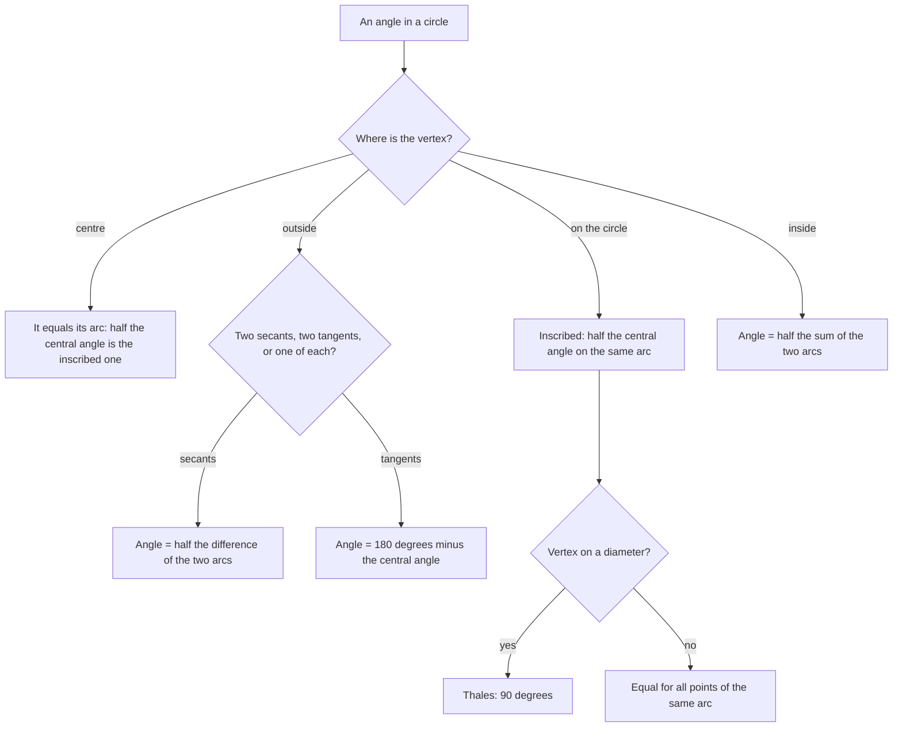

# Circles

> [Mathematics](../../README.md) › [Geometry](../README.md) › Circles · Level: Intermediate · Prerequisites: [Triangles](../02-triangles/README.md), [Fractions](../../01-arithmetic/03-fractions/README.md), [Elementary Algebra](../../03-algebra/01-elementary-algebra/README.md) · Estimated time: 9 hours

## 1. Introduction

A circle is the set of points at a fixed distance from a fixed point. That is the whole definition, and it
fits in one line. Yet the circle is the most constrained figure in plane geometry: every chord, every tangent
and every angle inside it obeys relations that are not obvious from the definition and that no other curve
shares. A wheel is round because every point of the rim is equidistant from the axle; a radio tower serves
three villages equally well when it stands at the centre of their circumcircle; a GPS receiver locates itself
by intersecting circles.

The circle also marks the point where Greek geometry reached its peak. Book III of the *Elements* is devoted
to circles, and Book IV constructs regular polygons inside them. Two thousand years later the circle is still
where the most beautiful elementary theorems live: the inscribed angle theorem, Thales' theorem, the
two-tangent theorem, and the power of a point.

There is a practical reason to study circles immediately after
[triangles](../02-triangles/README.md). Almost every circle theorem is proved *by finding a triangle*: the
isosceles triangle formed by two radii, the similar triangles formed by two chords, the right triangle
formed by a tangent and a radius. The congruence and similarity criteria, the exterior angle theorem and
Pythagoras are the tools; the circle supplies the configurations.

The topic answers four questions:

* How are length, angle and area measured on a circle, and why does $\pi$ appear in both the circumference
  and the area?
* Which angles in a circle are determined by which arcs?
* When does a line touch a circle instead of cutting it, and what does that force?
* How do chords, secants and tangents through one point relate to each other, and why is that relation
  independent of the direction chosen?

## 2. Prerequisites

* **Triangles** — congruence (SSS, SAS, ASA, AAS, RHS), similarity (AA), the angle sum, the exterior angle
  theorem, the isosceles triangle theorem and Pythagoras with its converse. All of these are developed in
  [Triangles](../02-triangles/README.md), and they are used constantly below.
* **Fractions and ratio** — reading $\tfrac{\theta}{360^\circ}$ as a proportion of a whole. See
  [Fractions](../../01-arithmetic/03-fractions/README.md).
* **Elementary algebra** — expanding $(x-h)^2$, completing the square, solving a quadratic equation. See
  [Elementary Algebra](../../03-algebra/01-elementary-algebra/README.md).
* **Square roots** — simplifying $\sqrt{50} = 5\sqrt2$. See
  [Intermediate Algebra](../../03-algebra/04-intermediate-algebra/README.md).

Trigonometry is *not* assumed. Radian measure is introduced in Section 7.3 as a preview, and the one
trigonometric quantity used later, $\sin\theta$, is defined in Section 7.3 by a right triangle; the full
theory is in [Trigonometry](../../05-trigonometry/README.md).

## 3. Learning Objectives

After working through this tutorial and its exercises you will be able to:

1. State the definitions of circle, chord, diameter, arc, sector, segment, tangent and secant, and use them
   correctly.
2. Explain why the circumference is $2\pi r$ and give the standard dissection argument for the area $\pi r^2$.
3. Prove and use the perpendicular-from-the-centre theorem for chords, its converse, and the characterisation
   of a tangent by the distance from the centre.
4. Convert between degrees and radians, and compute arc lengths and sector areas.
5. Prove the inscribed angle theorem in all three configurations, and use its corollaries: angles in the same
   segment, the angle in a semicircle, and the supplementary opposite angles of a cyclic quadrilateral.
6. Prove Thales' theorem and its converse.
7. Prove the tangent–radius theorem, the two-tangent theorem, and the alternate segment theorem.
8. Prove the intersecting chords, secant and tangent–secant theorems, and use the power of a point.
9. Write the equation of a circle, find its centre and radius by completing the square, and find the
   circumcircle of a triangle.
10. Solve problems that combine several of these results, and prove new statements by identifying the right
    circle configuration.

## 4. Intuition

**A circle is a distance, not a drawing.** "All points at distance $r$ from $O$" is a rule, and every
theorem about circles is a consequence of that rule plus the geometry of triangles. When a problem mentions a
circle, the first move is almost always to draw the radii to the points of interest: two radii make an
isosceles triangle, and isosceles triangles are where the angle theorems of the previous topic apply.

**Why $\pi$ appears twice.** Wrap a string around a circle: the length is a fixed multiple of the diameter,
and that multiple is $\pi$. Now cut the circle into many thin sectors and lay them alternately point up and
point down. The pieces almost form a rectangle whose base is half the circumference, $\pi r$, and whose
height is $r$. Hence the area is $\pi r \cdot r = \pi r^2$. The argument is not a proof — the pieces do not
make a perfect rectangle — but it explains why the *same* constant appears in both formulas, and Section 7.1
makes the reasoning precise enough to trust.

**Angles see arcs.** An angle with its vertex at the centre "sees" the whole arc in front of it, so its
measure is the arc's measure. Move the vertex out to the circumference and the angle halves: it sees the same
arc, but from farther away. That is the inscribed angle theorem, and every other angle theorem in the circle
is a rearrangement of it.

**Tangents are limits of secants.** A line through an outside point that cuts the circle in two points can be
rotated until the two intersections merge into one. At that instant the line is tangent, and the product
$PA \cdot PB$ of the two distances has become $PT^2$. This is why the tangent–secant theorem looks like the
chord theorem with one factor repeated, and why "power of a point" is a single quantity that works for
chords, secants and tangents alike.

**Everything is a triangle in disguise.** The centre and a chord form an isosceles triangle; a tangent and a
radius form a right triangle; two chords through a point form similar triangles; a cyclic quadrilateral is
two triangles sharing a diagonal. If you can see the triangle, you can prove the circle theorem.

## 5. Formal Definition

**Definition 5.1 (circle).** Let $O$ be a point of the plane and $r > 0$ a real number. The **circle** with
**centre** $O$ and **radius** $r$ is the set

$$
\Gamma(O,r) = \{X : OX = r\}.
$$

The **interior** of the circle is $\{X : OX < r\}$ and the **exterior** is $\{X : OX > r\}$; the interior
together with the circle is the **closed disk**. A point of the circle is said to **lie on** it.

**Definition 5.2 (chord, diameter, secant).** A **chord** is a segment joining two points of the circle. A
chord that passes through the centre is a **diameter**; its length is $2r$, the largest possible chord (proved
in Corollary 7.5). A line meeting the circle in two points is a **secant**; a segment of a secant with both
endpoints on the circle is a chord.

**Definition 5.3 (arc, semicircle).** Two points $A \ne B$ of a circle divide it into two **arcs** with
endpoints $A$ and $B$: the **minor arc** (the shorter one) and the **major arc**. When $AB$ is a diameter the
two arcs are **semicircles**. The **measure of an arc** in degrees is the measure of the central angle that
subtends it, so a full circle measures $360^\circ$ and a semicircle $180^\circ$. The **length** of an arc is
a length in the units of the radius, computed in Section 7.3.

**Definition 5.4 (central angle).** A **central angle** is an angle $\angle AOB$ whose vertex is the centre;
it subtends the arc $AB$ lying inside the angle.

**Definition 5.5 (inscribed angle).** An **inscribed angle** is an angle $\angle BAC$ whose vertex $A$ lies on
the circle and whose arms are chords $AB$, $AC$. It **subtends** the arc $BC$ that lies inside the angle
(equivalently, the arc $BC$ not containing $A$).

**Definition 5.6 (sector, segment).** A **sector** is the part of a disk bounded by two radii and an arc; its
**angle** is the central angle between the radii. A **segment** (or *circular segment*) is the part of a disk
cut off by a chord, bounded by the chord and one of the arcs it determines. The **height** of a segment is the
greatest distance from its arc to its chord.

**Definition 5.7 (tangent).** A line is **tangent** to a circle when it meets the circle in exactly one point;
that point is the **point of contact** (or point of tangency). Two circles are **tangent** when they meet in
exactly one point, either **internally** (one inside the other) or **externally**.

**Definition 5.8 (cyclic quadrilateral).** A quadrilateral is **cyclic** when all four of its vertices lie on
one circle; that circle is its **circumcircle**. A polygon is **inscribed** in a circle when all its vertices
lie on the circle, and **circumscribed** about it when all its sides are tangent to it.

**Definition 5.9 (circumcircle and incircle of a triangle).** For a triangle, the circumcircle is the circle
through its three vertices (its centre is the circumcentre of
[Triangles §7.10](../02-triangles/README.md)) and the incircle is the circle tangent to its three sides (its
centre is the incentre).

**Definition 5.10 (concentric, congruent).** Circles with the same centre are **concentric**. Two circles are
**congruent** when their radii are equal; congruent circles are related by a rigid motion.

## 6. Mathematical Notation

| Symbol | Read as | Meaning |
|---|---|---|
| $\Gamma(O,r)$ | circle with centre $O$ and radius $r$ | $\{X : OX = r\}$ |
| $r$, $d$ | radius, diameter | $d = 2r$ |
| $\widehat{AB}$ | arc $AB$ | the arc with endpoints $A$, $B$ |
| $\angle AOB$ | angle $A O B$ | central angle at $O$ |
| $\angle BAC$ | angle $B A C$ | inscribed angle with vertex $A$ |
| $\pi$ | pi | the ratio of circumference to diameter, $\pi \approx 3.14159$ |
| $\theta$ | theta | an angle measure; in radians unless degrees are shown |
| $s$ | arc length | length along the circle |
| $K$ | area | area of a sector, segment or figure |
| $PA \cdot PB$ | $P A$ times $P B$ | product of distances from $P$ |
| $\operatorname{pow}(P)$ | power of $P$ | $OP^2 - r^2$, see Section 7.8 |
| $x^2 + y^2 = r^2$ | — | equation of the circle of radius $r$ about the origin |

Two conventions. A **radian** measure carries no degree sign: $\theta = \tfrac{\pi}{2}$ means $90^\circ$. And
when a point $P$ lies between $A$ and $B$ on a line, we write $PA + PB = AB$ without further comment.

## 7. Core Concepts

The section is ordered so that each result uses only earlier ones:

$$
\pi \;\to\; \text{chords} \;\to\; \text{arcs and sectors} \;\to\; \text{inscribed angles} \;\to\;
\text{Thales} \;\to\; \text{cyclic quadrilaterals} \;\to\; \text{tangents} \;\to\; \text{power of a point}
\;\to\; \text{coordinates.}
$$

### 7.1 The number $\pi$: circumference and area

**Definition 7.1 ($\pi$).** For every circle, the ratio of the circumference $C$ to the diameter $d = 2r$ is
the same number; it is denoted $\pi$. Hence

$$
C = 2\pi r .
$$

The constancy of the ratio is a genuine theorem about Euclidean geometry: two circles are similar figures
(one is a scaled copy of the other), and similarity multiplies *every* length by the same factor, so
$C_1/C_2 = d_1/d_2$. Since $\pi$ is defined by that ratio, the identity $C = \pi d$ is a restatement of the
definition; the content is that the ratio does not depend on the circle.

**Theorem 7.2 (area of a disk).** The area of the disk bounded by a circle of radius $r$ is

$$
K = \pi r^2 .
$$

*Intuitive argument.* Cut the disk into $n$ equal sectors, like a cake. Each sector is very nearly a
triangle with two sides equal to $r$ and a short arc as base; its area is close to $\tfrac12 \cdot (\text{arc})
\cdot r$. Rearrange the $n$ sectors alternately point up and point down. They form a wavy strip of height
$r$ whose top and bottom edges together make up the whole circumference, so the strip has base about
$\tfrac12 C = \pi r$ and area about $\pi r \cdot r = \pi r^2$. As $n$ grows the strip becomes flatter and the
approximation improves without bound, so the area is $\pi r^2$.

*Why this is not yet a proof.* The sectors are not exactly triangles, and "improves without bound" needs a
definition of limit. The honest statement is that the area of the inscribed regular $n$-gon,
$\tfrac12 n r^2 \sin(360^\circ/n)$, tends to $\pi r^2$ as $n \to \infty$; the passage to the limit is carried
out in [Real Analysis](../../14-real-analysis/README.md). For computation, the formula is exact; for
justification, the dissection argument plus the limit gives it. From now on we use $K = \pi r^2$ freely.

Two consequences are used constantly. A **semicircle** of radius $r$ has area $\tfrac12 \pi r^2$, and the area
of a figure built from circles and triangles is computed by adding and subtracting such pieces, using
additivity of area (A2) of [Triangles §7.5](../02-triangles/README.md).

### 7.2 Chords and the perpendicular bisector theorem

Everything about chords follows from one observation: the triangle formed by the centre and the endpoints of a
chord is isosceles.

**Lemma 7.3 (how a line meets a circle).** Let $\ell$ be a line, $O$ a point at distance $d$ from $\ell$, and
$F$ the foot of the perpendicular from $O$ to $\ell$. Then $\ell$ meets the circle $\Gamma(O,r)$

* in **two** points if $d < r$,
* in **exactly one** point (namely $F$) if $d = r$,
* in **no** points if $d > r$.

**Proof.** For any point $X$ on $\ell$, the triangle $OFX$ is right-angled at $F$ (or degenerate when
$X = F$), so Pythagoras gives $OX^2 = OF^2 + FX^2 = d^2 + FX^2$. Hence $OX = r$ exactly when
$FX^2 = r^2 - d^2$. If $d < r$ there are exactly two points of $\ell$ at that distance from $F$, one on each
side; if $d = r$ the only solution is $FX = 0$, that is $X = F$; if $d > r$ there is no real solution.
$\blacksquare$

This lemma is the dictionary between "distance from the centre" and "number of intersections", and it is what
turns the geometric definition of a tangent into a computable condition.

**Theorem 7.4 (perpendicular from the centre).** Let $AB$ be a chord of $\Gamma(O,r)$ and let $M$ be the foot
of the perpendicular from $O$ to $AB$. Then $M$ is the midpoint of $AB$: $AM = MB$. Conversely, if $M$ is the
midpoint of a chord $AB$, then $OM \perp AB$.

**Proof.** For the first claim, $OA = OB = r$ and $OM$ is common, with right angles at $M$, so the right
triangles $OMA$ and $OMB$ are congruent by RHS (Corollary 7.34 of
[Triangles](../02-triangles/README.md)); hence $AM = MB$. For the converse, $OA = OB$ and $MA = MB$, so $O$
and $M$ both lie on the perpendicular bisector of $AB$ (Theorem 7.42 of
[Triangles](../02-triangles/README.md)); hence the line $OM$ *is* that perpendicular bisector and
$OM \perp AB$. $\blacksquare$

**Corollary 7.5 (chords and distance from the centre).** In a circle of radius $r$:

* the perpendicular bisector of every chord passes through the centre;
* a chord at distance $a$ from the centre has length $2\sqrt{r^2 - a^2}$;
* equal chords are equidistant from the centre, and chords equidistant from the centre are equal;
* the diameter is the longest chord, and its length is $2r$.

**Proof.** A chord $AB$ has midpoint $M$, and $OM \perp AB$ by Theorem 7.4, so $OM$ is the perpendicular
bisector and the centre lies on it. Pythagoras in the right triangle $OMA$ gives
$AM = \sqrt{r^2 - OM^2}$, so $AB = 2\sqrt{r^2 - OM^2}$, which is largest when $OM = 0$, that is when the chord
passes through the centre. If $AB = CD = 2a$, their distances from the centre are both
$\sqrt{r^2 - a^2}$; conversely equal distances give equal half-chords. $\blacksquare$

The formula $AB = 2\sqrt{r^2 - a^2}$ is the workhorse of chord problems: it converts a distance into a chord
and back. It also shows that the centre lies on the perpendicular bisector of *every* chord, which gives the
standard construction of the centre of a given circle: draw any two chords and intersect their perpendicular
bisectors.

**Theorem 7.6 (equal chords, equal arcs).** In one circle, two chords are equal if and only if they subtend
equal central angles, if and only if they cut off equal minor arcs.

**Proof.** Let $AB$ and $CD$ be chords with $AB = CD$. Triangles $OAB$ and $OCD$ have all three sides equal
($OA = OB = OC = OD = r$ and $AB = CD$), so they are congruent by SSS; hence $\angle AOB = \angle COD$. Since
arc measure is defined as central-angle measure, the minor arcs are equal. Each implication reverses, because
congruent central angles give congruent triangles by SAS and hence equal chords. $\blacksquare$

### 7.3 Arcs, sectors and radian measure

Degrees are a convention inherited from Babylonian astronomy: a full turn is $360^\circ$. A circle also has a
*intrinsic* unit, one that comes from the circle itself and makes every formula in calculus and physics
cleaner.

**Definition 7.7 (radian measure).** Let an arc of length $s$ on a circle of radius $r$ subtend a central
angle $\theta$. The **radian measure** of $\theta$ is

$$
\theta = \frac{s}{r} .
$$

The ratio does not depend on the radius: two arcs subtending the same central angle in concentric circles are
similar figures, and similarity multiplies both $s$ and $r$ by the same factor. A full turn has
$s = 2\pi r$, so it measures $2\pi$ radians; hence

$$
180^\circ = \pi \text{ radians}, \qquad 1^\circ = \frac{\pi}{180}\text{ radians}, \qquad
1\text{ radian} = \frac{180^\circ}{\pi} \approx 57.296^\circ .
$$

**Theorem 7.8 (arc length).** An arc subtending the central angle $\theta$ (in radians) on a circle of radius
$r$ has length

$$
s = r\theta .
$$

**Proof.** This is Definition 7.7 rearranged. $\blacksquare$

**Theorem 7.9 (sector area).** A sector of angle $\theta$ (in radians) in a circle of radius $r$ has area

$$
K = \tfrac12 r^2\theta = \tfrac12 rs .
$$

**Proof.** The sector is the fraction $\tfrac{\theta}{2\pi}$ of the disk, because sectors of equal angle in the
same circle are congruent and area is additive (A1), (A2) of [Triangles §7.5](../02-triangles/README.md).
Hence $K = \tfrac{\theta}{2\pi}\cdot \pi r^2 = \tfrac12 r^2\theta$, and substituting $s = r\theta$ gives
$\tfrac12 rs$. $\blacksquare$

The formula $\tfrac12 rs$ has the same shape as the area of a triangle with base $s$ and height $r$, which is
exactly the "sector is nearly a triangle" picture of Theorem 7.2, now made exact for the sector itself.

**Remark 7.10 (segments and chords).** A **segment** cut off by a chord subtending $\theta \in (0,\pi)$ is the
sector minus the triangle formed by the two radii and the chord. If $\theta$ is measured in radians,

$$
K_{\text{segment}} = \tfrac12 r^2\theta - \tfrac12 r^2 \sin\theta
= \tfrac12 r^2(\theta - \sin\theta).
$$

The triangle's area uses the formula $\tfrac12 ab\sin C$ of
[Triangles §7.8](../02-triangles/README.md) with $a = b = r$ and $C = \theta$. The chord itself has length
$2r\sin(\theta/2)$, which is the "half-chord" relation of Corollary 7.5 written with a sine; the systematic
treatment of sine, cosine and their graphs belongs to [Trigonometry](../../05-trigonometry/README.md), so we
use these two formulas only as previews.

| Angle | Degrees | Radians | Arc length on radius $r$ | Sector area |
|---|---|---|---|---|
| full turn | $360^\circ$ | $2\pi$ | $2\pi r$ | $\pi r^2$ |
| half turn | $180^\circ$ | $\pi$ | $\pi r$ | $\tfrac12\pi r^2$ |
| quarter turn | $90^\circ$ | $\tfrac{\pi}{2}$ | $\tfrac{\pi}{2}r$ | $\tfrac{\pi}{4}r^2$ |
| sixth turn | $60^\circ$ | $\tfrac{\pi}{3}$ | $\tfrac{\pi}{3}r$ | $\tfrac{\pi}{6}r^2$ |

### 7.4 The inscribed angle theorem

An angle at the centre sees an arc directly: its measure *is* the arc's measure. An angle at the circumference
sees the same arc from farther away, and the surprise is that it sees exactly half of it — no matter where on
the circumference the vertex sits.

**Theorem 7.11 (inscribed angle theorem).** Let $A$, $B$, $C$ lie on a circle with centre $O$, and let the
inscribed angle $\angle BAC$ subtend the arc $BC$ not containing $A$. Then

$$
\angle BAC = \tfrac12 \angle BOC .
$$

**Proof.** There are three configurations, according to where the centre $O$ lies relative to the angle
$\angle BAC$. The first is proved outright, and the other two are reduced to it by drawing the diameter
through $A$.

*Case 1: $O$ lies on one arm of the angle.* Suppose $O$ lies on the ray $AB$, so that $AB$ is a diameter.
Triangle $AOC$ is isosceles with $OA = OC = r$, so $\angle OAC = \angle OCA$ (Theorem 7.6 of
[Triangles](../02-triangles/README.md)); call this common value $\alpha$. The angle $\angle BOC$ is an
exterior angle of triangle $AOC$ at $O$, so by Corollary 7.4 of [Triangles](../02-triangles/README.md),

$$
\angle BOC = \angle OAC + \angle OCA = 2\alpha = 2\angle BAC .
$$

*Case 2: $O$ lies inside the angle.* Draw the diameter through $A$ and let it meet the circle again at $D$.
The ray $AD$ splits $\angle BAC$ into $\angle BAD$ and $\angle DAC$, and it also splits $\angle BOC$ into
$\angle BOD$ and $\angle DOC$. Each half is a Case 1 configuration, so

$$
\angle BAD = \tfrac12\angle BOD, \qquad \angle DAC = \tfrac12\angle DOC .
$$

Adding, and using additivity of angles (P3) of [Triangles §7.1](../02-triangles/README.md),

$$
\angle BAC = \tfrac12\left(\angle BOD + \angle DOC\right) = \tfrac12 \angle BOC .
$$

*Case 3: $O$ lies outside the angle.* Draw the diameter through $A$, meeting the circle again at $D$, so that
the ray $AD$ lies outside $\angle BAC$. Both $\angle BAD$ and $\angle CAD$ are Case 1 configurations, and
$\angle BAC$ is their difference while $\angle BOC$ is the corresponding difference of central angles:

$$
\angle BAC = \angle BAD - \angle CAD
= \tfrac12\angle BOD - \tfrac12\angle COD = \tfrac12 \angle BOC . \qquad \blacksquare
$$

Every other angle theorem about circles is a corollary of this one theorem, which is why the case analysis is
worth the trouble.

**Corollary 7.12 (angles in the same segment).** If $A$ and $A'$ lie on the same arc $BC$, then
$\angle BAC = \angle BA'C$.

**Proof.** Both angles equal $\tfrac12\angle BOC$ by Theorem 7.11, with the same central angle because they
subtend the same arc. $\blacksquare$

**Corollary 7.13 (Thales' theorem; angle in a semicircle).** If $AB$ is a diameter and $C$ is any other point
of the circle, then $\angle ACB = 90^\circ$.

**Proof.** The arc $AB$ not containing $C$ is a semicircle, so $\angle AOB = 180^\circ$; Theorem 7.11 gives
$\angle ACB = 90^\circ$. $\blacksquare$

**Theorem 7.14 (converse of Thales).** Let $A$, $B$, $C$ lie on a circle. If $\angle ACB = 90^\circ$, then
$AB$ is a diameter.

**Proof.** Let $O$ be the centre. By Theorem 7.11, $\angle AOB = 2\angle ACB = 180^\circ$, so $A$, $O$, $B$ are
collinear and $AB$ passes through the centre; that is, $AB$ is a diameter. $\blacksquare$

Theorem 7.14 is the circle form of the statement, proved in
[Triangles §7.10](../02-triangles/README.md), that the midpoint of the hypotenuse of a right triangle is
equidistant from the three vertices.

### 7.5 Cyclic quadrilaterals

**Theorem 7.15 (opposite angles of a cyclic quadrilateral).** If $ABCD$ is a cyclic quadrilateral, then

$$
\angle A + \angle C = 180^\circ, \qquad \angle B + \angle D = 180^\circ .
$$

**Proof.** By Theorem 7.11, $\angle A = \angle BAD = \tfrac12\, m(\text{arc } BCD)$, the arc from $B$ to $D$
passing through $C$, and $\angle C = \angle BCD = \tfrac12\, m(\text{arc } DAB)$, the arc from $D$ to $B$
passing through $A$. Those two arcs together make the whole circle, so their measures sum to $360^\circ$;
hence

$$
\angle A + \angle C = \tfrac12\left(360^\circ\right) = 180^\circ .
$$

The same argument with $B$ and $D$ gives the second identity. $\blacksquare$

**Corollary 7.16 (exterior angle).** In a cyclic quadrilateral, the exterior angle at a vertex equals the
interior angle at the opposite vertex.

**Proof.** The exterior angle at $C$ is supplementary to $\angle C$; so is $\angle A$ by Theorem 7.15.
$\blacksquare$

**Theorem 7.17 (converse).** If a convex quadrilateral $ABCD$ has $\angle A + \angle C = 180^\circ$, then it is
cyclic.

**Proof.** We first prove the converse of Corollary 7.12. Let $B$, $C$, $P$ be non-collinear, let $Q$ be a
point on the opposite side of $BC$ from $P$, and suppose $\angle BPC + \angle BQC = 180^\circ$. Let $\Gamma$ be
the circle through $B$, $C$, $P$, and let $E \ne B$ be the second intersection of the line $BQ$ with $\Gamma$,
which exists by Lemma 7.3. Since $B$, $C$, $P$, $E$ are concyclic, exactly one of two things happens.

* If $E$ and $P$ are on opposite sides of $BC$, then $\angle BEC = 180^\circ - \angle BPC = \angle BQC$
  (Theorem 7.15, then the hypothesis). Here $E$ and $Q$ lie on the same side of $BC$, hence on the same ray
  from $B$; if $E \ne Q$, one of them is between $B$ and the other, the angle at the nearer is an exterior
  angle of triangle $EQC$, and it is strictly larger than the angle at the farther (Corollary 7.4 of
  [Triangles](../02-triangles/README.md)) — contradicting the equality.
* If $E$ and $P$ are on the same side of $BC$, then $\angle BEC = \angle BPC$ (Corollary 7.12), so
  $\angle BEC + \angle BQC = 180^\circ$. Now $E$ and $Q$ lie on opposite rays from $B$, so $B$ lies between
  $E$ and $Q$ and both angles are angles of triangle $EQC$; two angles of a triangle sum to less than
  $180^\circ$ (Theorem 7.3 of [Triangles](../02-triangles/README.md)), a contradiction again.

So $E = Q$ and $Q$ lies on $\Gamma$. (If the line $BQ$ is tangent to $\Gamma$ at $B$, the same conclusion
follows from the alternate segment theorem of Section 7.7, applied to the chord $BC$.)

Now apply this to the quadrilateral. In a convex quadrilateral the vertices $A$ and $C$ lie on opposite sides
of the diagonal $BD$, and the hypothesis says $\angle DAB + \angle BCD = 180^\circ$. The criterion just proved,
with $B$, $D$ in the roles of $B$, $C$ and with $P = A$, $Q = C$, shows that $A$, $B$, $C$, $D$ are concyclic.
$\blacksquare$

The converse is the standard test for four concyclic points: compute two opposite angles, and if they are
supplementary, the four points lie on a circle. It converts an angle computation into a circle, which is
often the fastest route to a proof.

### 7.6 Tangents

**Theorem 7.18 (tangent–radius).** A line $\ell$ is tangent to $\Gamma(O,r)$ at a point $P$ of the circle if
and only if $OP \perp \ell$.

**Proof.** Let $F$ be the foot of the perpendicular from $O$ to $\ell$ and put $d = OF$. Since $F$ is the
closest point of $\ell$ to $O$, $d \le OP = r$, with equality exactly when $F = P$. By Lemma 7.3, $\ell$ meets
the circle in exactly one point exactly when $d = r$. Hence

$$
\ell \text{ is tangent at } P \iff d = r \iff F = P \iff OP \perp \ell. \qquad \blacksquare
$$

**Theorem 7.19 (two-tangent theorem).** Let $P$ be a point outside $\Gamma(O,r)$, and let the two tangents
from $P$ touch the circle at $A$ and $B$. Then

$$
PA = PB, \qquad \angle APO = \angle OPB .
$$

**Proof.** By Theorem 7.18, $OA \perp PA$ and $OB \perp PB$, so triangles $OAP$ and $OBP$ are right-angled at
$A$ and $B$. They share the hypotenuse $OP$ and have $OA = OB = r$, so they are congruent by RHS (Corollary
7.34 of [Triangles](../02-triangles/README.md)). Hence $PA = PB$ and the angles at $P$ are equal.
$\blacksquare$

**Corollary 7.20 (angle between two tangents).** In the notation of Theorem 7.19,

$$
\angle APB + \angle AOB = 180^\circ .
$$

**Proof.** The quadrilateral $OAPB$ has right angles at $A$ and $B$, so its four angles sum to $360^\circ$ by
Theorem 7.3 of [Triangles](../02-triangles/README.md) applied to the two triangles $OAP$, $OBP$; hence the
remaining two sum to $180^\circ$. $\blacksquare$

**Theorem 7.21 (alternate segment theorem).** Let $t$ be the tangent to a circle at $A$, let $AB$ be a chord,
and let $C$ be a point of the circle on the side of $AB$ opposite to the tangent ray that forms the angle with
$AB$. Then the angle between $t$ and $AB$ equals $\angle ACB$.

**Proof.** Let $AD$ be the diameter through $A$. By Theorem 7.18, $t \perp AD$; by Thales' theorem
(Corollary 7.13), $\angle ABD = 90^\circ$. Hence, in the right triangle $ABD$,

$$
\angle(\text{tangent}, AB) = 90^\circ - \angle DAB = \angle ADB .
$$

The angles $\angle ADB$ and $\angle ACB$ subtend the same arc $AB$ with their vertices on the same arc, so they
are equal by Corollary 7.12. $\blacksquare$

The theorem is usually quoted as "the angle between the tangent and a chord equals the angle in the alternate
segment", and it is the tangent analogue of the inscribed angle theorem: both compute an angle from the arc
$AB$, one with the vertex on the tangent, one with the vertex on the circle.

### 7.7 Power of a point

**Definition 7.22 (power).** The **power** of a point $P$ with respect to $\Gamma(O,r)$ is the number

$$
\operatorname{pow}(P) = OP^2 - r^2 .
$$

It is positive outside the circle, zero on it and negative inside. The theorems below show that the same
number can be computed from *any* chord, secant or tangent through $P$, which is why it deserves a name.

**Theorem 7.23 (intersecting chords).** Let two chords $AB$ and $CD$ of a circle meet at an interior point $P$.
Then

$$
PA \cdot PB = PC \cdot PD .
$$

**Proof.** Triangles $PAC$ and $PDB$ have $\angle APC = \angle DPB$ (vertical angles, equal by Theorem 7.1 of
[Triangles](../02-triangles/README.md)) and $\angle PAC = \angle PDB$, because both are inscribed angles
subtending the arc $BC$ (Corollary 7.12). So the triangles are similar by AA, and

$$
\frac{PA}{PD} = \frac{PC}{PB}, \qquad\text{hence}\qquad PA\cdot PB = PC\cdot PD. \qquad \blacksquare
$$

**Theorem 7.24 (secants from an exterior point).** Let $P$ be outside the circle, and let a secant through $P$
meet the circle at $A$ and $B$ with $A$ between $P$ and $B$; let another secant meet it at $C$ and $D$ with $C$
between $P$ and $D$. Then

$$
PA \cdot PB = PC \cdot PD .
$$

**Proof.** Triangles $PAC$ and $PDB$ share the angle at $P$, and $\angle PAC = 180^\circ - \angle BAC =
\angle BDC = \angle PDB$, using Theorem 7.15 for the cyclic quadrilateral $ABDC$ and the collinearity of
$P$, $A$, $B$ and of $P$, $C$, $D$. So the triangles are similar by AA, and $PA/PD = PC/PB$, which gives the
identity. $\blacksquare$

**Theorem 7.25 (tangent and secant).** Let $PT$ be tangent at $T$ and let a secant from $P$ meet the circle at
$A$ and $B$ with $A$ between $P$ and $B$. Then

$$
PT^2 = PA \cdot PB .
$$

**Proof.** Triangles $PTA$ and $PBT$ have the angle at $P$ in common, and $\angle PTA = \angle PBT$: the first
is the angle between the tangent $PT$ and the chord $TA$, the second is the angle in the alternate segment
(Theorem 7.21). Hence the triangles are similar by AA, and

$$
\frac{PT}{PB} = \frac{PA}{PT}, \qquad\text{so}\qquad PT^2 = PA\cdot PB. \qquad \blacksquare
$$

**Remark 7.26 (why the three theorems are one theorem).** Let $P$ be a point at distance $d$ from the centre
and consider any line through $P$ meeting the circle at $X$ and $Y$ (with $X = Y = T$ when the line is tangent).
Let $M$ be the midpoint of the chord $XY$ and let $a = XM$; write $t$ for the signed distance from $M$ to $P$.
Pythagoras in the right triangles $OMX$ and $OMP$, as in Corollary 7.5, gives

$$
a^2 = r^2 - OM^2, \qquad t^2 = OP^2 - OM^2, \qquad\text{so}\qquad |a^2 - t^2| = |r^2 - OP^2| .
$$

Since $PX$ and $PY$ are $|a + t|$ and $|a - t|$ in some order, $PX \cdot PY = |a^2 - t^2|$. Hence

$$
PX \cdot PY = r^2 - OP^2 = -\operatorname{pow}(P) \ \ (\text{$P$ inside}), \qquad
PX \cdot PY = OP^2 - r^2 = \operatorname{pow}(P) \ \ (\text{$P$ outside}),
$$

and in the tangent case $X = Y = T$ gives $PT^2 = \operatorname{pow}(P)$. The three theorems of this section
are the three signs of one identity.

### 7.8 The equation of a circle

Coordinates turn the definition "distance $r$ from $O$" into an equation.

**Theorem 7.27 (equation of a circle).** The circle with centre $(h,k)$ and radius $r > 0$ is exactly the set
of points $(x,y)$ satisfying

$$
(x-h)^2 + (y-k)^2 = r^2 .
$$

**Proof.** For points $P = (h,k)$ and $X = (x,y)$, the distance formula — which is Pythagoras applied to the
horizontal and vertical displacements — gives $PX^2 = (x-h)^2 + (y-k)^2$. The equation $PX = r$ is therefore
equivalent to the displayed identity. $\blacksquare$

**Theorem 7.28 (general form).** The equation

$$
x^2 + y^2 + Dx + Ey + F = 0
$$

represents a circle exactly when $D^2 + E^2 - 4F > 0$, and then the centre is
$\left(-\tfrac{D}{2}, -\tfrac{E}{2}\right)$ with radius $\tfrac12\sqrt{D^2+E^2-4F}$. When
$D^2+E^2-4F = 0$ it represents the single point $\left(-\tfrac{D}{2}, -\tfrac{E}{2}\right)$, and when
$D^2+E^2-4F < 0$ it represents no point.

**Proof.** Complete the squares:

$$
x^2 + Dx + y^2 + Ey + F = \left(x + \tfrac{D}{2}\right)^2 + \left(y + \tfrac{E}{2}\right)^2
- \frac{D^2+E^2}{4} + F .
$$

Setting the left side equal to zero and rearranging gives
$\left(x+\tfrac{D}{2}\right)^2 + \left(y+\tfrac{E}{2}\right)^2 = \tfrac14\left(D^2+E^2-4F\right)$, which is
Theorem 7.27 with the stated centre and radius, provided the right-hand side is positive. $\blacksquare$

**Remark 7.29 (a line meets a circle in at most two points, again).** Substituting the equation of a line into
the equation of a circle gives a quadratic equation in one variable, so there are two, one or no intersection
points according to the sign of the discriminant. A single intersection means the quadratic has a double root,
which is exactly the tangency condition. This is Lemma 7.3 in coordinates, and it is the practical way to test
whether a line is tangent to a given circle.

## 8. Formulas and Properties

| Result | Statement | Hypothesis | Proved in |
|---|---|---|---|
| Circumference | $C = 2\pi r$ | any circle | 7.1 (definition of $\pi$) |
| Area of a disk | $K = \pi r^2$ | any circle | 7.2 |
| Chord from distance | $AB = 2\sqrt{r^2-a^2}$ | chord at distance $a$ from the centre | 7.5 |
| Arc length | $s = r\theta$ | $\theta$ in radians | 7.8 |
| Sector area | $K = \tfrac12 r^2\theta = \tfrac12 rs$ | $\theta$ in radians | 7.9 |
| Segment area | $K = \tfrac12 r^2(\theta - \sin\theta)$ | $\theta$ in radians, $\theta \le \pi$ | 7.10 |
| Inscribed angle | $\angle BAC = \tfrac12\angle BOC$ | $A$, $B$, $C$ on the circle, $O$ the centre | 7.11 |
| Cyclic quadrilateral | $\angle A + \angle C = 180^\circ$ | $ABCD$ cyclic | 7.15 |
| Tangent and radius | tangent $\iff$ perpendicular to the radius | point of contact | 7.18 |
| Two tangents | $PA = PB$, $OP$ bisects $\angle APB$ | $P$ outside the circle | 7.19 |
| Intersecting chords | $PA\cdot PB = PC\cdot PD$ | $P$ inside the circle | 7.23 |
| Secants | $PA\cdot PB = PC\cdot PD$ | $P$ outside, $A$, $C$ nearer to $P$ | 7.24 |
| Tangent and secant | $PT^2 = PA\cdot PB$ | $P$ outside, $A$ nearer to $P$ | 7.25 |
| Equation | $(x-h)^2 + (y-k)^2 = r^2$ | centre $(h,k)$, radius $r$ | 7.27 |

The hypotheses matter. The arc and sector formulas require **radians**: with $\theta$ in degrees they become
$s = \tfrac{\pi r\theta}{180^\circ}$ and $K = \tfrac{\pi r^2\theta}{360^\circ}$. The power-of-a-point products
require $A$ to be the *nearer* intersection on each secant, otherwise the product is the other pairing. And a
chord formula needs the distance from the centre, not the distance from an arbitrary point.

## 9. Step-by-Step Examples

**Example 9.1 (circumference and area).** A circle has radius $5$. Then $C = 2\pi\cdot 5 = 10\pi \approx 31.42$
and $K = \pi\cdot 25 = 25\pi \approx 78.54$. If instead the area is $144\pi$, then $r^2 = 144$, so $r = 12$ and
$C = 24\pi \approx 75.40$.

**Example 9.2 (chord distance).** A circle of radius $17$ has a chord of length $30$. Half the chord is $15$,
and the distance from the centre is $\sqrt{17^2 - 15^2} = \sqrt{289-225} = \sqrt{64} = 8$ by Corollary 7.5.
The same computation in reverse: a chord at distance $8$ from the centre of a circle of radius $17$ has length
$2\sqrt{289-64} = 30$.

**Example 9.3 (arc, sector and segment).** A sector of a circle of radius $12$ has angle $150^\circ$, that is
$\theta = \tfrac{5\pi}{6}$ radians. Its arc has length $s = 12\cdot\tfrac{5\pi}{6} = 10\pi \approx 31.42$, and
its area is $K = \tfrac12\cdot 144\cdot\tfrac{5\pi}{6} = 60\pi \approx 188.50$. The segment cut off by the same
chord has area

$$
\tfrac12\cdot 144\left(\tfrac{5\pi}{6} - \sin 150^\circ\right) = 72\left(\tfrac{5\pi}{6} - \tfrac12\right)
= 60\pi - 36 \approx 152.50 .
$$

The triangle subtracted here has area $\tfrac12 r^2\sin\theta = 72\cdot\tfrac12 = 36$, which is
$\tfrac12\cdot 12\cdot 12\cdot\sin 150^\circ$, as Theorem 7.39 of
[Triangles](../02-triangles/README.md) requires.

**Example 9.4 (angles in a circle).** A central angle $\angle AOB = 130^\circ$ is subtended by an inscribed
angle at any point $C$ of the major arc: $\angle ACB = 65^\circ$ by Theorem 7.11. A point $D$ on the minor arc
sees the *other* arc, so $\angle ADB = 180^\circ - 65^\circ = 115^\circ$; indeed $A$, $C$, $B$, $D$ form a
cyclic quadrilateral, and $65^\circ + 115^\circ = 180^\circ$ by Theorem 7.15.

For a cyclic quadrilateral, three angles determine the fourth. If the angles at $A$, $B$, $C$ are $85^\circ$,
$70^\circ$ and $95^\circ$, then the angle at $D$ must satisfy $\angle B + \angle D = 180^\circ$, so
$\angle D = 110^\circ$; the other pair checks: $85^\circ + 95^\circ = 180^\circ$. Data that do not pair
correctly — for instance $85^\circ$, $95^\circ$, $100^\circ$ — cannot occur in a cyclic quadrilateral, since
the fourth angle would have to be both $80^\circ$ and $85^\circ$.

**Example 9.5 (two tangents).** From a point $P$ with $OP = 17$, tangents are drawn to a circle of radius $8$.
By Theorem 7.18 each tangent is perpendicular to the radius at the point of contact, so $PT = \sqrt{17^2-8^2} =
\sqrt{225} = 15$ (Pythagoras). By Theorem 7.19 the two tangent lengths are equal, and by Corollary 7.20 the
angle between them is $180^\circ - \angle AOB$; the quadrilateral $OAPB$ has two right angles and two equal
sides $PA = PB = 15$.

**Example 9.6 (power of a point).** Two chords of a circle meet at an interior point $P$; one chord is cut into
pieces of lengths $4$ and $9$, the other into pieces $x$ and $x+5$. By Theorem 7.23,
$4\cdot 9 = x(x+5)$, that is $x^2 + 5x - 36 = 0$, so $(x+9)(x-4) = 0$ and $x = 4$ (the negative root is
impossible). The pieces are $4$, $9$, $4$, $9$.

For an exterior point, a tangent of length $8$ and a secant whose near segment is $4$ give
$PA\cdot PB = 64$, hence $PB = 16$ and the far segment is $AB = 12$ (Theorem 7.25).

**Example 9.7 (circumcircle by coordinates).** Find the circle through $A = (0,0)$, $B = (6,0)$ and
$C = (0,8)$. The perpendicular bisector of $AB$ is $x = 3$; that of $AC$ is $y = 4$. They meet at $(3,4)$,
which is therefore the centre (Theorem 7.43 of [Triangles](../02-triangles/README.md)), and the radius is
$\sqrt{3^2+4^2} = 5$. The equation is

$$
(x-3)^2 + (y-4)^2 = 25, \qquad\text{or}\qquad x^2 + y^2 - 6x - 8y = 0 .
$$

The triangle $ABC$ is right-angled at $A$, and its hypotenuse has length $10 = 2r$, which is Thales' theorem
read backwards (Corollary 7.13).

**Example 9.8 (a proof using two theorems).** Prove that if two circles intersect at $A$ and $B$, then their
common chord $AB$ is perpendicular to the line joining the centres. Let the centres be $O_1$, $O_2$. Since
$O_1A = O_1B$, the point $O_1$ lies on the perpendicular bisector of $AB$ (Theorem 7.42 of
[Triangles](../02-triangles/README.md)); so does $O_2$. Two distinct points determine that perpendicular
bisector, so the line $O_1O_2$ *is* the perpendicular bisector of $AB$, in particular perpendicular to it. It
also bisects $AB$, which is a fact worth remembering.

## 10. Visual Explanations

The first question in a circle problem is always *what kind of angle is given, and what does it subtend?* The
chart organises the answers.

Only the first two branches are proved in this tutorial; the "outside" and "inside" formulas for the angle
between two secants or two chords are Exercise 28 and are consequences of the inscribed angle theorem.

| Configuration | Relation | Reference |
|---|---|---|
| Central angle and arc | equal measures | Definition 5.3 |
| Inscribed and central angle | $\angle BAC = \tfrac12\angle BOC$ | Theorem 7.11 |
| Two inscribed angles, same arc | equal | Corollary 7.12 |
| Angle in a semicircle | $90^\circ$ | Corollary 7.13 |
| Cyclic quadrilateral | opposite angles sum to $180^\circ$ | Theorem 7.15 |
| Tangent and chord | equals the angle in the alternate segment | Theorem 7.21 |

## 11. Common Mistakes

1. **Using the wrong arc.** An inscribed angle is half the central angle standing on the *same* arc. If the
   vertex lies on the minor arc, the angle subtends the major arc and is obtuse; halving the "obvious" small
   central angle gives the wrong answer.
2. **Assuming every quadrilateral is cyclic.** Opposite angles are supplementary only when the four vertices
   lie on one circle. In a general quadrilateral the four angles merely sum to $360^\circ$.
3. **Using degrees in $s = r\theta$.** The formula holds in radians only; with degrees the arc is
   $\tfrac{\pi r\theta}{180^\circ}$.
4. **Confusing the radius with the diameter.** Since $d = 2r$, the formulas are $C = \pi d = 2\pi r$ and
   $K = \pi r^2 = \tfrac14\pi d^2$; mixing $r$ and $d$ in one substitution is the commonest arithmetic slip in
   the topic.
5. **Dropping the square root in chord problems.** A chord at distance $a$ has length $2\sqrt{r^2-a^2}$, not
   $2(r-a)$; since $\sqrt{r^2-a^2} > r-a$, the erroneous value is too small.
6. **Pairing the wrong segments in the power theorems.** Each product joins the two distances from $P$ along
   the *same* line. Mixing $PA$ with $PD$ from different secants gives nonsense.
7. **Believing a tangent can be drawn from an interior point.** From a point inside the circle no tangent
   exists; Theorem 7.18 shows that a tangent line stays at distance $r$ from the centre, so it cannot pass
   through a point closer than $r$.
8. **Forgetting that the perpendicular from the centre bisects the chord** — and its converse, that the
   perpendicular bisector of a chord passes through the centre, which is the standard way to find a centre.

## 12. Applications

* **Wheels, gears and rotation.** A wheel of radius $r$ rolls a distance $2\pi r$ per turn, and a point on the
  rim travels along an arc of length $r\theta$; gear ratios are ratios of circumferences. Every rotating
  machine is an application of Definition 7.1 and Theorem 7.8.
* **Surveying and construction.** Setting out a circular arc — a road bend, a dome, an arch — uses the
  perpendicular-from-the-centre theorem and the chord formula: with two chords and their perpendicular
  bisectors the centre is located, and the radius follows from a chord and a sagitta (the height of a
  segment).
* **Positioning and trilateration.** A GPS receiver knows its distances from several satellites; each distance
  places it on a circle (in the plane) or a sphere (in space), and the intersection of the circles locates it.
  The common-chord argument of Example 9.8 is the two-circle version of the same idea.
* **Computer graphics and collision detection.** Circles are the cheapest bounding volumes: testing whether two
  circles meet reduces to comparing $O_1O_2$ with $r_1 + r_2$, and the equation of Theorem 7.27 is the
  standard primitive in drawing and ray tracing.
* **Astronomy and navigation.** Eratosthenes measured the Earth's radius from the difference of shadow angles;
  great-circle navigation computes distances along arcs of circles on a sphere, which is Theorem 7.8 applied
  on a curved surface.

## 13. Exercises

The problem set is in [exercises.md](exercises.md): thirty-six problems from direct computation to
competition-style proof, covering every section above.

## 14. Solutions

Complete worked solutions, with the strategy and every step, are in [solutions.md](solutions.md).

## 15. Summary

* A circle is the set of points at a fixed distance from its centre; $\pi$ is the ratio of circumference to
  diameter, so $C = 2\pi r$ and $K = \pi r^2$.
* The perpendicular from the centre bisects a chord, and a chord at distance $a$ has length
  $2\sqrt{r^2-a^2}$. Distances from the centre and numbers of intersections are related by Lemma 7.3.
* Radian measure is $\theta = s/r$; then $s = r\theta$ and the sector area is $\tfrac12 r^2\theta$; a segment
  has area $\tfrac12 r^2(\theta - \sin\theta)$.
* **The inscribed angle theorem** — an angle at the circumference is half the angle at the centre on the same
  arc — is proved by a three-case argument, and everything else about angles in circles follows from it.
* Corollaries: angles in the same segment are equal; the angle in a semicircle is a right angle (Thales);
  opposite angles of a cyclic quadrilateral are supplementary, and conversely.
* A tangent is perpendicular to the radius at the point of contact; the two tangents from an exterior point
  are equal and the line to the centre bisects the angle between them; the angle between a tangent and a chord
  equals the angle in the alternate segment.
* **Power of a point**: for any line through $P$, the product of the two distances to the circle is
  $|OP^2 - r^2|$; hence $PA\cdot PB = PC\cdot PD$ for chords and secants and $PT^2 = PA\cdot PB$ for a tangent.
* A circle with centre $(h,k)$ and radius $r$ has equation $(x-h)^2 + (y-k)^2 = r^2$; completing the square
  recovers the centre and radius from the general form.
* Most circle problems are solved by one of four moves: draw radii to make isosceles triangles, find an
  inscribed angle, use a power-of-a-point product, or use a tangent–radius right triangle.

## 16. Further Learning

* [Triangles](../02-triangles/README.md) supplies every tool used here; the congruence and similarity criteria
  are the engine behind all the proofs above.
* [Trigonometry](../../05-trigonometry/README.md) develops sine and cosine from the unit circle, turning
  $s = r\theta$ into the calculus of circular functions and giving the law of sines with $a = 2R\sin A$.
* The planned **Coordinate Geometry** topic in [Geometry](../README.md) extends Section 7.8 to conics, polar
  coordinates and the algebraic study of curves.
* [Real Analysis](../../14-real-analysis/README.md) makes the limiting argument of Theorem 7.2 rigorous and
  defines arc length for general curves.
* Standard texts: Euclid, *Elements*, Book III (the classical treatment of circles); H. S. M. Coxeter,
  *Introduction to Geometry*; G. Polya, *Mathematical Discovery*, for the dissection and limiting heuristics.
