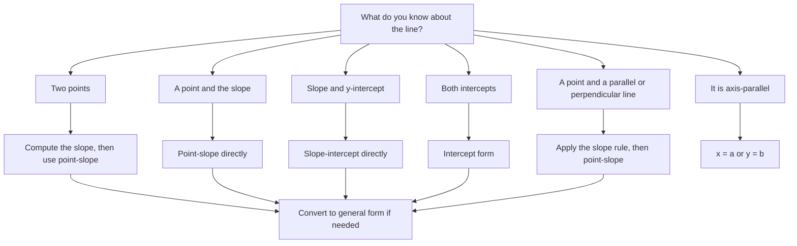
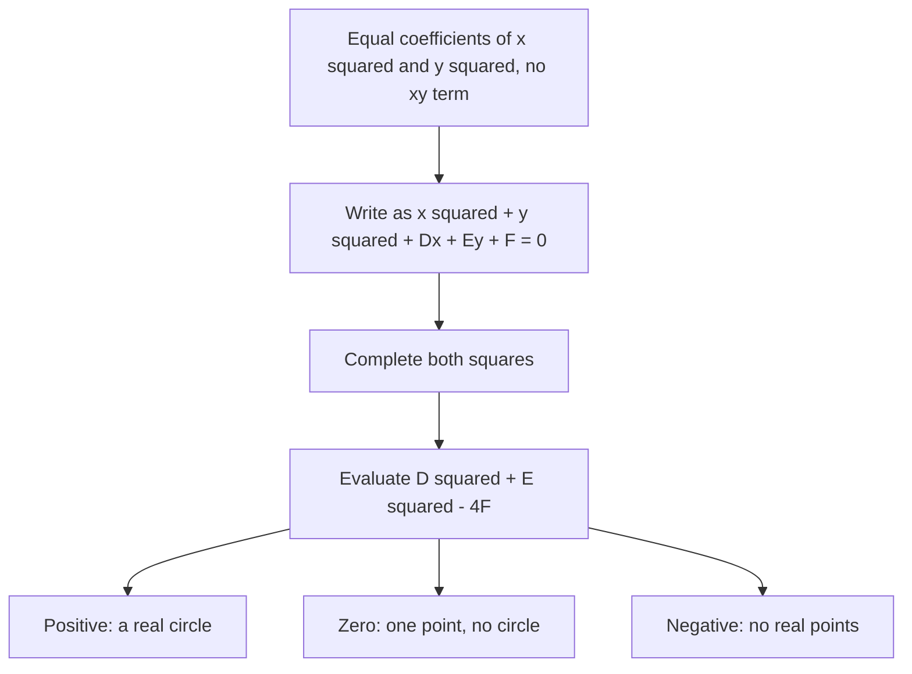

# Coordinate Geometry

> [Geometry](../README.md) · Level: Intermediate · Prerequisites: [Elementary Algebra](../../03-algebra/01-elementary-algebra/README.md), [Intermediate Algebra](../../03-algebra/04-intermediate-algebra/README.md), [Polynomials](../../03-algebra/06-polynomials/README.md), [Systems of Linear Equations](../../03-algebra/05-systems-of-equations/README.md) · Estimated time: 9 h

## 1. Introduction

Geometry before coordinates is a science of construction: you draw a figure, argue about congruent
triangles, and conclude that two segments are equal. Coordinate geometry replaces the drawing with two
numbers per point. Every geometric question then becomes algebraic, and every algebraic identity
becomes a geometric fact.

The method pays in three currencies. **Measurement becomes routine**: lengths, areas and distances
all follow from a handful of formulas. **Curves acquire equations**: a circle is both "points at a
fixed distance from a centre" and $x^2+y^2=r^2$, and the equation can be manipulated, intersected and
classified — the doorway to calculus, linear algebra and computer graphics. **Proofs become
computations**: a statement about a general triangle can be proved by naming its vertices and
simplifying, with no clever auxiliary line required.

It also has a price. A coordinate proof may hide *why* a statement is true, and a badly chosen frame
turns three lines of reasoning into two pages of expansion. Skill in the subject is largely skill in
choosing coordinates and in picking the most convenient of the many equivalent line equations.

Historically the method is due to René Descartes (*La Géométrie*, 1637) and, in more algorithmic form,
to Pierre de Fermat. The decisive idea was not the grid but the *correspondence*: a curve and an
equation are two descriptions of one object.

## 2. Prerequisites

* **Linear equations and rearrangement** — [Elementary Algebra](../../03-algebra/01-elementary-algebra/README.md).
* **Simultaneous equations**, including the three-case structure (one, none, or infinitely many
  solutions) — [Systems of Linear Equations](../../03-algebra/05-systems-of-equations/README.md).
* **Quadratics and completing the square** — [Polynomials](../../03-algebra/06-polynomials/README.md)
  and [Intermediate Algebra](../../03-algebra/04-intermediate-algebra/README.md).
* **Radicals**, in particular $\sqrt{a^2}=\lvert a\rvert$ — [Intermediate Algebra](../../03-algebra/04-intermediate-algebra/README.md).
* **Euclidean facts**: the Pythagorean theorem, the congruence criteria (SAS, ASA, SSS), similar
  triangles and the ratio theorem, and angles at a transversal of parallel lines. These belong to the
  earlier topics of this discipline (see the [Geometry index](../README.md)); the distance and slope
  formulas rest directly on Pythagoras and on similar triangles, so without them the formulas will
  seem arbitrary.

## 3. Learning Objectives

By the end of this topic you will be able to:

1. Locate points, name quadrants, and use the fact that two ordered pairs are equal only if both
   coordinates agree.
2. Derive the distance formula from the Pythagorean theorem and use it in the plane and in space.
3. Derive and apply the midpoint and section formulas, including external division.
4. Compute and interpret slope, and prove the parallel and perpendicular criteria.
5. Write a line's equation in general, slope-intercept, point-slope, two-point and intercept form,
   converting freely and stating the exceptional cases.
6. Derive the point-to-line distance formula and use it for parallel lines.
7. Convert a circle equation to standard form by completing the square and classify its graph.
8. Prove the midpoint theorem, concurrency of the medians, parallelogram criteria and Varignon's
   theorem by coordinates.
9. Compare a synthetic and a coordinate proof of one statement and explain the trade-offs.
10. Model shortest paths, tangency and circles through three points.

## 4. Intuition

**Coordinates are addresses.** A grid gives every building an address: "five blocks east, three blocks
north of the post office". Two numbers replace a location, and the order matters — (5 east, 3 north) is
not (3 east, 5 north), which is why a point is an *ordered* pair.

**Distance is a diagonal.** Walking the streets from one address to another takes $5+3=8$ blocks. A
bird flies the hypotenuse of the right triangle with legs $5$ and $3$, so it covers
$\sqrt{5^2+3^2}$. The distance formula is not a new theorem; it is Pythagoras in disguise.

**Slope is steepness per step.** A road rising $3$ metres for every $5$ forward has slope $3/5$.
Because the road is straight, every stretch has the same rise-to-run ratio, so the ratio belongs to the
line rather than to the stretch.

**An equation is a membership test.** The equation $y=2x+1$ is a machine: feed it the $x$-coordinate
of a point, and it returns the $y$ the point must have to be on the line. A point is on the line
exactly when the machine returns the point's own $y$. Two lines cross exactly where both tests accept
the same point — which is why solving a linear system and finding an intersection are the same job.

**Perpendicular is a quarter turn.** Rotating a direction vector by $90^\circ$ swaps rise and run and
flips one sign, so a slope $m$ becomes $-1/m$. That observation contains the whole perpendicular
criterion.

## 5. Formal Definition

**Definition 5.1 (Cartesian plane).** Choose two perpendicular number lines — the *$x$-axis*
(horizontal) and the *$y$-axis* (vertical) — meeting at the *origin* $O$, with a common unit. To each
point $P$ assign the ordered pair $(x,y)$, where $x$ is the signed distance from $P$ to the $y$-axis
measured parallel to the $x$-axis, and $y$ is the signed distance from $P$ to the $x$-axis measured
parallel to the $y$-axis. The set

$$
\mathbb{R}^2=\{(x,y) : x\in\mathbb{R},\ y\in\mathbb{R}\}
$$

with this correspondence is the *Cartesian plane*; $x$ is the *abscissa* and $y$ the *ordinate*.

**Definition 5.2 (Equality).** $(x_1,y_1)=(x_2,y_2)$ means $x_1=x_2$ **and** $y_1=y_2$. Both
coordinates must agree; there is no trade-off.

**Definition 5.3 (Quadrants).** The axes split the plane into four quadrants, according to the signs of
the coordinates.

| Quadrant | First | Second | Third | Fourth |
|---|---|---|---|---|
| Signs | $x>0,\ y>0$ | $x<0,\ y>0$ | $x<0,\ y<0$ | $x>0,\ y<0$ |

Points with $x=0$ or $y=0$ lie on an axis and belong to no quadrant.

**Definition 5.4 (Distance).** For $P(x_1,y_1)$ and $Q(x_2,y_2)$,
$d(P,Q):=\sqrt{(x_2-x_1)^2+(y_2-y_1)^2}$. The colon-equals marks a definition; Theorem 7.1 shows it
matches the geometric length.

**Definition 5.5 (Collinear).** Points are *collinear* if one line contains all of them.

**Definition 5.6 (Graph).** The *graph* of an equation in $x$ and $y$ is the set of points whose
coordinates satisfy it. "Lies on the curve" and "satisfies the equation" are the same statement.

**Definition 5.7 (Line).** A *line* is the graph of an equation $Ax+By+C=0$ with $(A,B)\ne(0,0)$.
Section 7.7 shows this covers all six classical forms.

**Definition 5.8 (Slope).** For distinct $P(x_1,y_1)$, $Q(x_2,y_2)$ with $x_1\ne x_2$, the *slope* of
$PQ$ is
$$m:=\frac{y_2-y_1}{x_2-x_1}=\frac{\Delta y}{\Delta x}.$$
If $x_1=x_2$ the slope is *undefined* and the segment is vertical; if $y_1=y_2$ the slope is $0$ and
the segment is horizontal. Here $\Delta$ always means *change in*.

**Definition 5.9 (Circle).** A *circle* with centre $C(h,k)$ and radius $r>0$ is
$\{(x,y) : (x-h)^2+(y-k)^2=r^2\}$. The corresponding set with $\le r^2$ is the closed *disk*.

## 6. Mathematical Notation

| Symbol | Read as | Meaning |
|---|---|---|
| $(x,y)$ | "the point $x$ comma $y$" | ordered pair of coordinates |
| $\mathbb{R}^2$ | "R two" | the set of all ordered pairs of reals |
| $d(P,Q)$, $\lvert PQ\rvert$ | "distance from $P$ to $Q$" | length of segment $PQ$ |
| $\Delta x,\ \Delta y$ | "delta $x$, delta $y$" | change in $x$, change in $y$ |
| $m$ | "slope" or "gradient" | $\Delta y/\Delta x$ |
| $(h,k)$, $r$ | "h comma k", "r" | centre and radius of a circle |
| $Ax+By+C=0$ | "general form" | a line, $(A,B)\ne(0,0)$ |
| $y=mx+b$ | "slope-intercept form" | slope $m$, $y$-intercept $b$ |
| $y-y_1=m(x-x_1)$ | "point-slope form" | line through $(x_1,y_1)$ with slope $m$ |
| $\frac{x}{a}+\frac{y}{b}=1$ | "intercept form" | $x$-intercept $a$, $y$-intercept $b$ |
| $\perp$, $\parallel$ | "perpendicular to", "parallel to" | relations between lines |
| $\lvert\cdot\rvert$ | "absolute value of" | non-negative magnitude |

Read $m=\dfrac{\Delta y}{\Delta x}$ aloud as "the slope is delta $y$ over delta $x$". Read
$d(P,Q)=\sqrt{(x_2-x_1)^2+(y_2-y_1)^2}$ as "the distance from $P$ to $Q$ is the square root of the
square of the $x$-difference plus the square of the $y$-difference".

## 7. Core Concepts

### 7.1 The plane as a set of pairs

Every point has exactly one coordinate pair and every pair determines exactly one point, so a statement
about all points is a statement about all pairs. The bridge between the two descriptions is *signed
separation*: the horizontal gap between $P$ and $Q$ is $\lvert x_2-x_1\rvert$, the vertical gap is
$\lvert y_2-y_1\rvert$, and these are the legs of a right triangle with hypotenuse $PQ$. Every formula
below descends from those two numbers.

Before computing, sketch the points and note the signs of $\Delta x$ and $\Delta y$. Most sign errors
are visible in the sketch long before they appear in the algebra.

### 7.2 The distance formula, derived from Pythagoras

**Theorem 7.1 (Distance formula).** For $P(x_1,y_1)$ and $Q(x_2,y_2)$,
$\lvert PQ\rvert=\sqrt{(x_2-x_1)^2+(y_2-y_1)^2}$.

**Proof.** If $x_1=x_2$ the points are on a vertical line and the distance is $\lvert y_2-y_1\rvert$,
which the formula reproduces since $\sqrt{0^2+(\Delta y)^2}=\lvert\Delta y\rvert$; the case
$y_1=y_2$ is symmetric. Otherwise let $R=(x_2,y_1)$. Then $PR$ is horizontal of length
$\lvert x_2-x_1\rvert$, $RQ$ is vertical of length $\lvert y_2-y_1\rvert$, and the angle at $R$ is
right, so Pythagoras gives

$$
\lvert PQ\rvert^2=\lvert PR\rvert^2+\lvert RQ\rvert^2=(x_2-x_1)^2+(y_2-y_1)^2 .
$$

Both sides are non-negative, so taking square roots proves the formula; $P=Q$ gives $0=0$.
$\blacksquare$

The squares make the formula sign-blind, so the order of the points does not matter — the algebraic
shadow of "distance is symmetric". The same argument applied twice gives
$\sqrt{(\Delta x)^2+(\Delta y)^2+(\Delta z)^2}$ in space. The formula makes $\mathbb{R}^2$ a *metric
space*: $d(P,Q)\ge0$ with equality only for $P=Q$; $d(P,Q)=d(Q,P)$; and
$d(P,R)\le d(P,Q)+d(Q,R)$, the triangle inequality — a straight path is no longer than a broken one.

### 7.3 The midpoint formula

**Theorem 7.2 (Midpoint).** The midpoint of $PQ$ is
$M=\left(\frac{x_1+x_2}{2},\frac{y_1+y_2}{2}\right)$.

**Proof (parameter form).** Every point of the segment is $P+t(Q-P)$ for a unique $t\in[0,1]$, with
$t=0$ at $P$ and $t=1$ at $Q$. The halfway point is $t=\tfrac12$:

$$
P+\tfrac12(Q-P)=\left(x_1+\tfrac12(x_2-x_1),\ y_1+\tfrac12(y_2-y_1)\right)
=\left(\frac{x_1+x_2}{2},\ \frac{y_1+y_2}{2}\right). \qquad\blacksquare
$$

**Second proof (distance formula).** Let $M$ have the stated coordinates. Then

$$
\lvert PM\rvert^2=\left(\frac{x_2-x_1}{2}\right)^2+\left(\frac{y_2-y_1}{2}\right)^2=\tfrac14\lvert PQ\rvert^2,
$$

and the same computation gives $\lvert MQ\rvert^2=\tfrac14\lvert PQ\rvert^2$. Also

$$
\frac{y_M-y_1}{x_M-x_1}=\frac{(y_2-y_1)/2}{(x_2-x_1)/2}=\frac{y_2-y_1}{x_2-x_1},
$$

so $M$ lies on the line $PQ$ (the vertical case is immediate from the coordinates). A point of the
segment at distance $\tfrac12\lvert PQ\rvert$ from $P$ is the midpoint, and it is unique, so $M$ is that
point. $\blacksquare$

The geometric picture behind the second proof is the intercept theorem: perpendiculars from $P$, $M$,
$Q$ to an axis cut it in the same ratio as they cut the segment $PQ$.

The parameter form generalises without change to three dimensions. Note what the formula is *not*: it
is an average of coordinates, not an average of distances.

### 7.4 The section formula

**Theorem 7.3 (Internal division).** Let $R$ lie on segment $PQ$ with $PR:RQ=m:n$, $m,n>0$. Then
$$R=\left(\frac{n x_1+m x_2}{m+n},\ \frac{n y_1+m y_2}{m+n}\right).$$

**Proof.** Write $R=P+t(Q-P)$ with $t\in(0,1)$. The ratio condition says $t/(1-t)=m/n$, so
$tn=m(1-t)$ and $t=\frac{m}{m+n}$. Hence

$$
x_R=x_1+\frac{m}{m+n}(x_2-x_1)=\frac{(m+n)x_1+mx_2-mx_1}{m+n}=\frac{n x_1+m x_2}{m+n},
$$

and the $y$-coordinate is identical with $y$ in place of $x$. $\blacksquare$

Read it as a **weighted average that favours the far endpoint**: the coordinate of $Q$ carries the
weight $m$, the length of the *other* piece. Checks: $m=n$ returns the midpoint formula; as $m\to0$,
$R\to P$; as $n\to0$, $R\to Q$. For $P(-2,3)$, $Q(4,-3)$ and $m:n=1:2$,
$R=\left(\frac{2(-2)+4}{3},\frac{2(3)-3}{3}\right)=(0,1)$, and indeed $R-P=(2,-2)$ while
$Q-R=(4,-4)=2(2,-2)$.

**Theorem 7.4 (External division).** If $R$ lies on the line $PQ$ outside the segment with
$PR:RQ=m:n$ and $m\ne n$, then
$$R=\left(\frac{m x_2-n x_1}{m-n},\ \frac{m y_2-n y_1}{m-n}\right).$$

**Proof.** The same computation with $t=\frac{m}{m-n}$, valid because $R$ lies beyond $Q$ when $m>n$
and beyond $P$ when $m<n$. $\blacksquare$

**The centroid.** If $M$ is the midpoint of $BC$ in triangle $ABC$, and $AG:GM=2:1$, Theorem 7.3 gives
$G=\frac{1\cdot A+2\cdot M}{3}=\frac{A+2\cdot\frac{B+C}{2}}{3}=\frac{A+B+C}{3}$: the centroid is the
average of the vertices. Section 7.10 proves that all three medians pass through it.

### 7.5 Slope is a property of the line

**Theorem 7.5 (Slope is independent of the chosen points).** Two pairs of distinct points on the same
non-vertical line determine the same ratio $\Delta y/\Delta x$.

**Proof.** Drawing horizontal and vertical lines through each pair produces two right triangles whose
legs are pairwise parallel; such triangles are similar by the corresponding-angle theorem for parallel
lines, and similarity equates the ratios of vertical to horizontal legs. $\blacksquare$

Consequences: $m>0$ rises left to right, $m<0$ falls, $m=0$ is horizontal, and a larger $\lvert m\rvert$
means steeper. A vertical line has no slope, because $\Delta x=0$; "infinite slope" is shorthand, not a
number. Slope is not an angle: the inclination $\theta$ from the positive $x$-axis satisfies
$m=\tan\theta$, developed in [Trigonometry](../../05-trigonometry/README.md).

### 7.6 Parallel and perpendicular lines

A non-vertical line with slope $m$ has *direction vector* $(1,m)$: one step right, $m$ steps up. A
vertical line has direction $(0,1)$. The two criteria below are statements about these vectors.

**Theorem 7.6 (Parallel criterion).** Two non-vertical lines with slopes $m_1,m_2$ are parallel iff
$m_1=m_2$; a vertical line is parallel only to vertical lines.

**Proof.** With $u=(1,m_1)$, $v=(1,m_2)$, the lines are parallel iff $v=\lambda u$. Comparing first
coordinates forces $\lambda=1$, hence $m_2=m_1$; conversely equal slopes give equal direction vectors.
A vertical direction $(0,1)$ is never a multiple of $(1,m)$. $\blacksquare$

**Theorem 7.7 (Perpendicular criterion).** Two non-vertical lines with slopes $m_1,m_2$ are
perpendicular iff $m_1m_2=-1$.

**Proof.** Perpendicular lines have perpendicular direction vectors, so the dot product vanishes:
$(1,m_1)\cdot(1,m_2)=1+m_1m_2=0$. $\blacksquare$

Two ways to remember it. A quarter turn maps $(1,m)$ to $(-m,1)$, whose slope is $-1/m$; and the
criterion says "flip the fraction, change the sign": perpendicular to $2/3$ is $-3/2$, not $-2/3$ and
not $3/2$. Note the exception that the formula cannot express: a horizontal line (slope $0$) is
perpendicular to every vertical line.

### 7.7 Equations of a line in all common forms

| Name | Equation | Valid when | Best used when |
|---|---|---|---|
| General | $Ax+By+C=0$, $(A,B)\ne(0,0)$ | always | one uniform shape; integer coefficients |
| Slope-intercept | $y=mx+b$ | not vertical | slope and $y$-intercept wanted |
| Point-slope | $y-y_1=m(x-x_1)$ | not vertical | a point and the slope are known |
| Two-point | $(y-y_1)(x_2-x_1)=(x-x_1)(y_2-y_1)$ | $x_1\ne x_2$ | two points are known |
| Intercept | $\dfrac{x}{a}+\dfrac{y}{b}=1$ | $a,b\ne0$ | both intercepts are known |
| Axis-parallel | $x=a$ or $y=b$ | — | the line is vertical or horizontal |

**Theorem 7.8 (General form to slope).** If $B\ne0$, then $Ax+By+C=0$ is equivalent to
$y=-\frac{A}{B}x-\frac{C}{B}$, so $m=-A/B$ and $b=-C/B$. If $B=0$ the line is vertical, $x=-C/A$.

**Proof.** Solve for $y$; legal because $B\ne0$. $\blacksquare$

Two corollaries save real time. First, the coefficient vector $(A,B)$ is *normal* to the line: if
$X_1,X_2$ both satisfy the equation, subtracting gives $A\Delta x+B\Delta y=0$, i.e.
$(A,B)\cdot(X_2-X_1)=0$. Second, **general form is unique up to a non-zero factor**: $2x-y+3=0$ and
$4x-2y+6=0$ are the same line, so compare ratios of coefficients, never coefficients themselves.

**Conversion algorithm.** (1) Clear denominators and collect everything on the left to get
$Ax+By+C=0$. (2) If $B\ne0$, solve for $y$: slope-intercept form. (3) If $A,B\ne0$, the intercepts are
$a=-C/A$, $b=-C/B$; dividing by $-C$ gives intercept form. (4) Substitute a known point into
point-slope form. (5) Multiply out to return to general form.

**Worked conversion.** Take $4x-3y-12=0$. Then $y=\frac43x-4$, so $m=\frac43$ and $b=-4$; the
intercepts are $x=3$ and $y=-4$, so $\frac{x}{3}+\frac{y}{-4}=1$; through $(3,0)$ the point-slope form
is $y=\frac43(x-3)$; and a perpendicular has slope $-\frac34$, which through the origin is $3x+4y=0$.

A line is fixed by two independent conditions. Given three, either one is redundant or no line exists —
the geometric content of the three-case theory of linear systems.

### 7.8 Distance from a point to a line

**Definition 7.1.** The distance from $P$ to a line $l$ is the minimum of $d(P,X)$ over $X\in l$; the
minimum is attained at the *foot of the perpendicular*, where the line through $P$ perpendicular to
$l$ meets $l$.

**Theorem 7.9 (Point-to-line distance).** For $P(x_0,y_0)$ and $l: Ax+By+C=0$ with $(A,B)\ne(0,0)$,
$$d(P,l)=\frac{\lvert Ax_0+By_0+C\rvert}{\sqrt{A^2+B^2}}.$$

**Proof (normal projection).** First, $n=(A,B)$ is normal to $l$: if $X_1,X_2\in l$ then subtracting
their equations gives $n\cdot(X_2-X_1)=0$. Choose *any* point $X_1$ on $l$; the perpendicular distance
from $P$ to $l$ is the length of the projection of $P-X_1$ onto $n$:

$$
d(P,l)=\frac{\lvert(P-X_1)\cdot n\rvert}{\lVert n\rVert}
=\frac{\lvert A(x_0-x_1)+B(y_0-y_1)\rvert}{\sqrt{A^2+B^2}} .
$$

Because $Ax_1+By_1=-C$, the numerator equals $\lvert Ax_0+By_0+C\rvert$, and the arbitrary $X_1$ has
cancelled. $\blacksquare$

The cancellation is the point: $Ax_1+By_1+C$ measures how far a point is from *satisfying* the
equation, and dividing by $\sqrt{A^2+B^2}$ converts that algebraic excess into a length.

**Theorem 7.10 (Distance between parallel lines).** For $Ax+By+C_1=0$ and $Ax+By+C_2=0$ (the same
$A,B$), $d=\lvert C_2-C_1\rvert/\sqrt{A^2+B^2}$.

**Proof.** Apply Theorem 7.9 to any point of the first line. $\blacksquare$

The hypotheses matter: the coefficients must be *identical*. Comparing $2x-3y=4$ with $4x-6y=16$ by
subtracting constants gives $12$; the correct comparison, $2x-3y-4=0$ against $2x-3y-8=0$, gives
$4/\sqrt{13}$.

**Foot of the perpendicular.** Projecting $P$ onto $l$ gives
$F=P-\frac{Ax_0+By_0+C}{A^2+B^2}(A,B)$; intersecting the perpendicular line through $P$ with $l$ gives
the same point (Example 4), and the two routes are a useful mutual check.

### 7.9 Circles: equations and completing the square

**Theorem 7.11 (Standard and general form).** The circle with centre $(h,k)$ and radius $r>0$ is
$(x-h)^2+(y-k)^2=r^2$. Expanded, this becomes $x^2+y^2+Dx+Ey+F=0$ with $D=-2h$, $E=-2k$,
$F=h^2+k^2-r^2$. Conversely, completing the square gives

$$
\left(x+\frac{D}{2}\right)^2+\left(y+\frac{E}{2}\right)^2=\frac{D^2+E^2-4F}{4},
$$

so the graph is a circle with centre $\left(-\frac{D}{2},-\frac{E}{2}\right)$ and radius
$\frac12\sqrt{D^2+E^2-4F}$ when $D^2+E^2-4F>0$; a single point when that number is $0$; and empty when
it is negative.

**Proof.** Expand and compare; the difference is the constant $\frac{D^2+E^2}{4}-F$. A sum of two
squares is non-negative, vanishes only when both squares vanish, and is never negative. $\blacksquare$

**Necessary shape conditions.** The coefficients of $x^2$ and $y^2$ must be equal and there must be no
$xy$ term. Thus $2x^2+3y^2-4x=0$ is an ellipse, and $x^2+y^2+xy=1$ is a rotated ellipse; both belong to
the conic sections of analytic geometry.

**Theorem 7.12 (Circle through three points).** Through any three non-collinear points there is exactly
one circle.

**Proof.** Its centre must be equidistant from all three, hence on the perpendicular bisector of each
pair. The bisectors of $AB$ and $BC$ are perpendicular to two non-parallel segments, so they meet in
exactly one point $C_0$; that point is equidistant from all three. Uniqueness is forced, since every
qualifying centre must lie on both bisectors. $\blacksquare$

In practice, substitute the three points into $x^2+y^2+Dx+Ey+F=0$ and solve the resulting $3\times3$
linear system, as in [Systems of Linear Equations](../../03-algebra/05-systems-of-equations/README.md).

**Theorem 7.13 (Tangent and radius).** For the circle $x^2+y^2=r^2$ and a point $(a,b)$ on it, the
tangent is $ax+by=r^2$.

**Proof.** If $ab\ne0$ the radius has slope $b/a$, so the tangent has slope $-a/b$; through $(a,b)$ it
is $y-b=-\frac{a}{b}(x-a)$, i.e. $ax+by=a^2+b^2=r^2$. If $a=0$ or $b=0$ the tangent is $y=\pm r$ or
$x=\pm r$, which is what the formula gives. $\blacksquare$

**Line–circle incidence.** Substituting a line into a circle equation gives a quadratic; its
discriminant decides between two intersections (secant, giving a chord), one double root (tangent) and
no real roots (no contact). Comparing the distance from the centre with $r$ via Theorem 7.9 always
agrees, and is often cheaper.

### 7.10 Using coordinates to prove geometric theorems

A coordinate proof has three phases: **set up** (choose a frame), **translate** (write hypotheses and
conclusion as equations), **compute**. Placement advice, in order of usefulness: put a vertex at the
origin; put one side on the $x$-axis; put any axis of symmetry on the $y$-axis so symmetric points are
$(u,v)$ and $(-u,v)$. Never keep six free coordinates when a translation and a rotation can reduce a
general triangle to three — and note that translations and rotations lose no generality because they
preserve length, angle, midpoint and parallelism (justified formally in
[Geometric Transformations](../06-transformations/README.md)). Count your parameters: a triangle up to
rigid motion has three, not six.

**Theorem 7.14 (Midpoint theorem).** If $M$ and $N$ are the midpoints of $AB$ and $AC$ in triangle
$ABC$, then $MN\parallel BC$ and $\lvert MN\rvert=\frac12\lvert BC\rvert$.

**Proof.** With $A(x_1,y_1)$, $B(x_2,y_2)$, $C(x_3,y_3)$,
$M=\left(\frac{x_1+x_2}{2},\frac{y_1+y_2}{2}\right)$ and $N=\left(\frac{x_1+x_3}{2},\frac{y_1+y_3}{2}\right)$,
so

$$
\overrightarrow{MN}=N-M=\left(\frac{x_3-x_2}{2},\frac{y_3-y_2}{2}\right)=\tfrac12\overrightarrow{BC}.
$$

The vector equation states both conclusions at once: parallel directions, and lengths in ratio $1:2$,
since scaling a vector by $\lambda$ scales its length by $\lvert\lambda\rvert$. $\blacksquare$

The computation is dimension-free: the same lines prove the analogue in space.

**Theorem 7.15 (Medians are concurrent).** The three medians of a triangle meet in one point, which
divides each in the ratio $2:1$ from the vertex.

**Proof.** Let $M_A=\frac{B+C}{2}$ and define $G=\frac{A+B+C}{3}$. Then

$$
G=A+\frac23\left(M_A-A\right)=A+\frac23\left(\frac{B+C}{2}-A\right)=\frac{A+B+C}{3}.
$$

The first expression exhibits $G$ as the point $\frac23$ of the way from $A$ to $M_A$, so $G$ is on the
median from $A$ and divides it $2:1$. But the last expression is *symmetric* in $A,B,C$, so relabelling
the vertices returns the same point; hence $G$ also lies on the other two medians. $\blacksquare$

The symmetry is the whole proof. Normally, concurrence means three pairwise intersections coincide — a
nuisance; here the candidate was written in a form that does not distinguish the vertices.

**Theorem 7.16 (Parallelogram criteria).** For four points $A,B,C,D$ in order, no three collinear, the
following are equivalent: (1) both pairs of opposite sides are parallel; (2) the diagonals bisect each
other; (3) $\overrightarrow{AB}=\overrightarrow{DC}$.

**Proof.** (3) is $B-A=C-D$, i.e. $A+C=B+D$. (3)$\Rightarrow$(2): then
$\frac{A+C}{2}=\frac{B+D}{2}$, a single point that is the midpoint of both diagonals.
(2)$\Rightarrow$(3) reverses the step. (3)$\Rightarrow$(1): $B-A=C-D$ makes $AB$ and $DC$ equal and
parallel, and the same equation rearranged as $D-A=C-B$ makes $AD$ and $BC$ equal and parallel.
(1)$\Rightarrow$(2): a parallelogram has equal opposite sides, so $\lvert AB\rvert=\lvert DC\rvert$;
equal parallel segments with the same orientation give equal vectors, and the orientation agrees because
$A,B,C,D$ occur in order. $\blacksquare$

**Theorem 7.17 (Varignon).** The midpoints of the four sides of any quadrilateral are the vertices of a
parallelogram; if the quadrilateral is convex, that parallelogram has half its area.

**Proof.** For midpoints $P$ of $AB$, $Q$ of $BC$, $R$ of $CD$, $S$ of $DA$,

$$
\overrightarrow{PQ}=Q-P=\frac{B+C}{2}-\frac{A+B}{2}=\frac{C-A}{2},\qquad
\overrightarrow{SR}=R-S=\frac{C+D}{2}-\frac{D+A}{2}=\frac{C-A}{2}.
$$

So $\overrightarrow{PQ}=\overrightarrow{SR}$, and $PQRS$ is a parallelogram by Theorem 7.16. The area
claim is Exercise 26. The parallelogram claim needs no lengths, angles or cases, and no convexity.
$\blacksquare$

### 7.11 The same fact proved twice: diagonals of a parallelogram

**The fact.** In a parallelogram the diagonals bisect each other.

**Synthetic proof.** Let $ABCD$ be a parallelogram with diagonals meeting at $O$. Since $AB\parallel DC$,
the alternate angles satisfy $\angle OAB=\angle OCD$; since $AD\parallel BC$, $\angle OBA=\angle ODC$.
Also $AB=DC$ because opposite sides of a parallelogram are equal. Hence triangles $AOB$ and $COD$ agree
in one side and two adjacent angles (ASA), so $AO=OC$ and $BO=OD$: $O$ is the midpoint of both
diagonals. $\blacksquare$

**Coordinate proof.** Put $A=(0,0)$, $B=(p,q)$, $D=(r,s)$. Since $ABCD$ is a parallelogram, the fourth
vertex is $C=B+D-A=(p+r,q+s)$ — the translation form of "$BC$ is parallel and equal to $AD$". The
midpoint of $AC$ is $\left(\frac{p+r}{2},\frac{q+s}{2}\right)$, and so is the midpoint of $BD$. The
midpoints coincide, so the diagonals bisect each other. $\blacksquare$

| | Synthetic | Coordinate |
|---|---|---|
| Length | About eight lines | About four lines |
| Ingredients | Alternate angles, ASA, opposite sides equal | Midpoint formula, parallelogram as translation |
| Reveals *why* | Yes: the two halves are congruent | Only indirectly |
| Generalises to | Any affine plane | $\mathbb{R}^n$, any field of scalars |
| Risk | A hidden lemma (that the diagonals meet) | Algebraic slips or a poor frame |

The synthetic proof also needs the lemma that the diagonals actually intersect; the coordinate proof
gets that free, because the computation produces the point. On the other hand, the synthetic proof
shows the *mechanism*: a half-turn about $O$ maps the parallelogram onto itself, which is why every
opposite pair matches — the beginning of symmetry-group thinking, developed in
[Geometric Transformations](../06-transformations/README.md).

**Rule of thumb.** Use coordinates for statements about lengths, midpoints, ratios, perpendicularity or
a numerical configuration; use synthetic arguments for incidence, congruence structure, or
generalisations to non-metric settings. When unsure, check with coordinates, then look for the reason.

## 8. Formulas and Properties

| Name | Formula | Hypotheses |
|---|---|---|
| Distance | $d=\sqrt{(x_2-x_1)^2+(y_2-y_1)^2}$ | none |
| Midpoint | $M=\left(\frac{x_1+x_2}{2},\frac{y_1+y_2}{2}\right)$ | none |
| Internal section | $R=\left(\frac{nx_1+mx_2}{m+n},\frac{ny_1+my_2}{m+n}\right)$ | $m,n>0$, $PR:RQ=m:n$ |
| External section | $R=\left(\frac{mx_2-nx_1}{m-n},\frac{my_2-ny_1}{m-n}\right)$ | $m\ne n$, $R$ outside the segment |
| Slope | $m=\frac{y_2-y_1}{x_2-x_1}$ | $x_1\ne x_2$ |
| Slope from general form | $m=-\frac{A}{B}$ | $B\ne0$ |
| Parallel | $m_1=m_2$ | both slopes defined |
| Perpendicular | $m_1m_2=-1$ | both slopes defined and non-zero |
| Point–slope line | $y-y_1=m(x-x_1)$ | not vertical |
| Intercept line | $\frac{x}{a}+\frac{y}{b}=1$ | $a,b\ne0$ |
| Point–line distance | $d=\frac{\lvert Ax_0+By_0+C\rvert}{\sqrt{A^2+B^2}}$ | $(A,B)\ne(0,0)$ |
| Parallel-line distance | $d=\frac{\lvert C_2-C_1\rvert}{\sqrt{A^2+B^2}}$ | identical $A,B$ |
| Circle | $(x-h)^2+(y-k)^2=r^2$ | $r>0$ |
| Circle radius | $r=\frac12\sqrt{D^2+E^2-4F}$ | $D^2+E^2-4F>0$ |
| Tangent at $(a,b)$ on $x^2+y^2=r^2$ | $ax+by=r^2$ | $a^2+b^2=r^2$ |
| Centroid | $G=\left(\frac{x_1+x_2+x_3}{3},\frac{y_1+y_2+y_3}{3}\right)$ | three vertices |
| Triangle area | $\frac12\lvert x_1(y_2-y_3)+x_2(y_3-y_1)+x_3(y_1-y_2)\rvert$ | non-collinear |
| Collinearity test | $x_1(y_2-y_3)+x_2(y_3-y_1)+x_3(y_1-y_2)=0$ | — |

Every entry has its proof in §7; the table is a reference, not a substitute for the derivations. Two
consistency checks are worth adopting as habits. First, a general-form equation and its slope must
agree: if $2x-3y+6=0$ then $m=2/3$, and moving $2$ right must move $3/2$ up on the graph. Second,
compute a triangle's area by the shoelace formula and again as $\frac12\cdot\text{base}\cdot\text{height}$
using Theorem 7.9; agreement is strong evidence against a sign error, since both come from the same
determinant.

## 9. Step-by-Step Examples

### Example 1 — Distance and midpoint

For $P(-2,1)$ and $Q(4,9)$: $\Delta x=4-(-2)=6$ and $\Delta y=9-1=8$, so

$$
d(P,Q)=\sqrt{6^2+8^2}=\sqrt{100}=10,\qquad
M=\left(\frac{-2+4}{2},\frac{1+9}{2}\right)=(1,5).
$$

**Check.** $M$ is $5$ units from each endpoint, since $\sqrt{3^2+4^2}=5$, and all three points are
collinear because both halves have slope $4/3$.

### Example 2 — Section formula, internal and external

For $A(-1,4)$, $B(5,-2)$, find the point $R$ with $AR:RB=2:1$ inside the segment, and the point $S$ with
$AS:SB=2:1$ outside it.

**Strategy.** Use Theorem 7.3 with $m=2$, $n=1$: the coordinates of $B$ carry the weight $2$, the
weight of the *opposite* piece.

$$
x_R=\frac{1(-1)+2(5)}{3}=3,\qquad y_R=\frac{1(4)+2(-2)}{3}=0;
$$

$$
x_S=\frac{2(5)-1(-1)}{1}=11,\qquad y_S=\frac{2(-2)-1(4)}{1}=-8 .
$$

**Check.** $\lvert AR\rvert=\sqrt{16+16}=4\sqrt2$ and $\lvert RB\rvert=\sqrt{4+4}=2\sqrt2$, a ratio of
$2:1$. Also $\overrightarrow{AS}=(12,-12)=2\overrightarrow{AB}$, so $\lvert AS\rvert=2\lvert AB\rvert$
and $\lvert SB\rvert=\lvert AB\rvert$, as required for external division with $S$ beyond $B$.

### Example 3 — One line, four forms

The line through $(2,-1)$ and $(5,7)$ has slope $m=\frac{7-(-1)}{5-2}=\frac83$.

*Point-slope:* $y+1=\frac83(x-2)$.
*Slope-intercept:* $y=\frac83x-\frac{16}{3}-1=\frac83x-\frac{19}{3}$.
*General:* multiply $y+1=\frac83(x-2)$ by $3$ to get $3y+3=8x-16$, i.e. $8x-3y-19=0$.
*Intercept:* from $8x-3y=19$, $\dfrac{x}{19/8}+\dfrac{y}{-19/3}=1$.

**Check.** $8(2)-3(-1)-19=0$ and $8(5)-3(7)-19=0$. The intercepts $a=2.375$ and $b\approx-6.33$ are
consistent with a positive slope crossing the $x$-axis near $2.4$.

### Example 4 — Foot of the perpendicular and the distance formula

Find the foot of the perpendicular from $P(1,0)$ to $l: 2x-y+1=0$, and $d(P,l)$.

**Route one.** The line has slope $2$, so the perpendicular has slope $-\frac12$; through $(1,0)$ it is
$y=-\frac12(x-1)$, i.e. $x+2y-1=0$. Solving with $y=2x+1$ gives $x+4x+2-1=0$, so $x=-\frac15$ and
$y=\frac35$: the foot is $F\left(-\frac15,\frac35\right)$.

**Route two.** Theorem 7.9 with $A=2$, $B=-1$, $C=1$:

$$
d(P,l)=\frac{\lvert 2(1)-0+1\rvert}{\sqrt{4+1}}=\frac{3}{\sqrt5}=\frac{3\sqrt5}{5}\approx1.342 .
$$

**Check.** $F$ satisfies $2\left(-\frac15\right)-\frac35+1=0$, and
$\lvert PF\rvert=\sqrt{\left(\frac65\right)^2+\left(\frac35\right)^2}=\sqrt{\frac{45}{25}}=\frac{3\sqrt5}{5}$.
Also the slope of $PF$ is $\frac{3/5}{-6/5}=-\frac12$, the negative reciprocal of $2$.

### Example 5 — Completing the square

Describe $x^2+y^2-6x+10y+18=0$.

$$
\begin{aligned}
x^2-6x+y^2+10y&=-18\\
(x^2-6x+9)+(y^2+10y+25)&=-18+9+25\\
(x-3)^2+(y+5)^2&=16 .
\end{aligned}
$$

The graph is the circle with centre $(3,-5)$ and radius $4$. Here $D^2+E^2-4F=36+100-72=64>0$, and
$\frac12\sqrt{64}=4$ agrees.

**Check.** $(3,-1)$ gives $0+16=16$, so it is on the circle; $(3,1)$ gives $36>16$, so it is outside.
The extreme points $(-1,-5)$ and $(7,-5)$ also satisfy the equation.

### Example 6 — Tangency, by two methods

For which $k$ is $y=x+k$ tangent to $x^2+y^2=8$?

**Discriminant.** Substituting: $x^2+(x+k)^2=8$, i.e. $2x^2+2kx+(k^2-8)=0$, whose discriminant is
$4k^2-8(k^2-8)=64-4k^2$. Setting this to zero gives $k^2=16$, so $k=\pm4$.

**Distance.** The distance from the centre $(0,0)$ to $x-y+k=0$ must equal the radius: $\lvert k\rvert/\sqrt2=\sqrt8$,
so $\lvert k\rvert=4$.

**Check.** For $k=4$ the double root is $x=-\frac{2k}{4}=-2$, and $(-2)^2+2^2=8$ with $2=-2+4$, so the
tangency point is $(-2,2)$; symmetry gives $(2,-2)$ for $k=-4$.

### Example 7 — Concurrency checked in coordinates

Show that the medians of the triangle $A(0,0)$, $B(6,0)$, $C(2,8)$ concur, and find the point.

**Strategy.** Intersect two medians, then verify that the third passes through the intersection; the
general proof is Theorem 7.15.

Midpoints: $M_C=(3,0)$ on $AB$, $M_B=(1,4)$ on $AC$, $M_A=(4,4)$ on $BC$.

Median $CM_C$: $(x,y)=(2+t,\ 8-8t)$. Median $BM_B$: $(x,y)=(6-5s,\ 4s)$. Equating,
$2+t=6-5s$ and $8-8t=4s$; the second gives $s=2-2t$, so $2+t=6-10+10t$, hence $t=\frac23$ and
$s=\frac23$. The intersection is $\left(2+\frac23,8-\frac{16}{3}\right)=\left(\frac83,\frac83\right)$.

The third median, from $A$ to $M_A(4,4)$, is the line $y=x$, which contains $\left(\frac83,\frac83\right)$.

**Check.** The centroid formula gives $\left(\frac{0+6+2}{3},\frac{0+0+8}{3}\right)=\left(\frac83,\frac83\right)$.
On $CM_C$ the value $t=\frac23$ means $CG:GM_C=2:1$; numerically $\lvert CG\rvert=\frac{\sqrt{260}}{3}$
and $\lvert GM_C\rvert=\frac{\sqrt{65}}{3}$, a ratio of exactly $2$ since $260=4\cdot65$.

### Example 8 — A shortest path found by reflection

$A(1,1)$ and $B(5,3)$ lie above the $x$-axis. Find the point $P$ on the axis minimising $AP+PB$.

**Strategy.** Reflect $A$ to $A'(1,-1)$. Reflection preserves distance, so $AP=A'P$ and
$AP+PB=A'P+PB\ge A'B$ by the triangle inequality, with equality exactly when $A'$, $P$, $B$ are
collinear with $P$ between them. So $P$ is where $A'B$ crosses the axis.

That line has slope $\frac{3-(-1)}{5-1}=1$ and equation $y+1=x-1$, i.e. $y=x-2$; it crosses $y=0$ at
$x=2$. Thus $P=(2,0)$ and the minimum is
$A'B=\sqrt{4^2+4^2}=4\sqrt2\approx5.657$.

**Check.** $AP=\sqrt2$ and $PB=\sqrt{9+9}=3\sqrt2$, total $4\sqrt2$. For $P'=(3,0)$ the total is
$\sqrt5+\sqrt{13}\approx5.842>5.657$; for $P''=(1,0)$ it is $1+5=6$. The derivative test agrees: with
$f(x)=\sqrt{(x-1)^2+1}+\sqrt{(x-5)^2+9}$, $f'(2)=\frac{1}{\sqrt2}-\frac{3}{3\sqrt2}=0$.

## 10. Visual Explanations

**Choosing a form for a line.** Each leaf names the fastest starting point, not the only possible one.

**Classifying a circle equation.** The single number $D^2+E^2-4F$ decides everything.

**Incidence dictionary.** The whole of "geometry to algebra" for the objects of this topic.

| Geometric statement | Algebraic statement |
|---|---|
| $P$ lies on the line $l$ | $Ax_0+By_0+C=0$ |
| $P,Q,R$ are collinear | the shoelace expression vanishes |
| Lines are parallel | $m_1=m_2$, or $(A_1,B_1)$ is a multiple of $(A_2,B_2)$ |
| Lines are perpendicular | $m_1m_2=-1$, or $A_1A_2+B_1B_2=0$ |
| Two lines meet once | the $2\times2$ system has a unique solution |
| A line meets a circle twice, once, never | discriminant $>0$, $=0$, $<0$ |
| $P$ is the midpoint of $QR$ | $P=\frac12(Q+R)$ |
| $ABCD$ is a parallelogram | $\overrightarrow{AB}=\overrightarrow{DC}$ |

**Reading Theorem 7.9 as a projection.** Draw $l$, the point $P$, and the normal $n=(A,B)$ based at a
point $X_1$ of $l$. The perpendicular from $P$ to $l$ is parallel to $n$, so its length is the component
of $P-X_1$ along $n$. Sliding $X_1$ along $l$ does not change that component — which is exactly why the
algebra cancels $X_1$.

## 11. Common Mistakes

1. **Swapping $\Delta x$ and $\Delta y$.** Slope is rise over run, $\Delta y/\Delta x$. The reciprocal
   turns a slope of $2$ into $\frac12$ and spoils every line that follows.
2. **Subtracting in inconsistent order.** Use "second minus first" in both coordinates;
   $\frac{y_1-y_2}{x_2-x_1}$ is the *negative* of the slope.
3. **Subtracting in the midpoint.** It is an average, $\frac{x_1+x_2}{2}$, not the half-gap
   $\frac{x_2-x_1}{2}$.
4. **Attaching the section ratio to the wrong endpoint.** In $\frac{nx_1+mx_2}{m+n}$, the weight $m$
   multiplies the endpoint you move towards. Test with $m=n$: the midpoint must come out.
5. **"Perpendicular slope = reciprocal".** It is the negative reciprocal, $m_2=-1/m_1$. A product of
   $+1$ describes the reflection in $y=x$, not perpendicularity.
6. **Forcing a vertical line into $y=mx+b$.** A vertical line has no slope; write $x=a$.
7. **Sign errors with the general form.** $Ax+By=C$ and $Ax+By+C=0$ differ by the sign of $C$;
   Theorem 7.9 presupposes the second.
8. **Confusing $r^2$ with $r$.** After completing the square the right side is $r^2$: $16$ means
   radius $4$, and $0$ means a single point, not a circle of radius $0$.
9. **Assuming every quadratic is a circle.** Equal $x^2$ and $y^2$ coefficients, no $xy$ term, and
   $D^2+E^2-4F>0$ are all required.
10. **Comparing parallel lines without matching coefficients.** Theorem 7.10 needs identical $A,B$;
    scale one equation first.
11. **Circular reasoning.** Writing the fourth vertex of a parallelogram as $B+D-A$ is legitimate only
    when justified by "$BC$ parallel and equal to $AD$".
12. **Dropping the absolute value.** A distance is non-negative; without $\lvert\cdot\rvert$ the formula
    gives a signed distance whose sign says which side of the line the point is on.

## 12. Applications

**Computer graphics.** Every click becomes a ray, and "was this polygon selected?" is a distance or
half-plane test. The *signed* form of Theorem 7.9 tells a renderer which side of an edge a fragment
lies on — the basis of rasterisation and anti-aliasing. Bounding circles and squared-distance
comparisons make collision detection cheap.

**Robotics and navigation.** A robot following a wall needs the perpendicular distance to that wall,
and the foot of the perpendicular gives the closest point to steer towards. Circular obstacles are
avoided along the two tangent lines from the robot's position, computed exactly as in Example 6. GPS
positions the receiver at the intersection of circles (spheres in space); subtracting the circle
equations linearises the problem into the linear system solved in §7.7, and one point is then selected by
the remaining nonlinear condition.

**Surveying and cartography.** Boundary polygons are laid out in coordinates, areas come from the
shoelace formula, and offsets are measured perpendicular to a baseline. Setting a local origin on the
main baseline is precisely the placement advice of §7.10.

**Statistics and data science.** The least-squares line minimises a sum of squared vertical distances,
and the projection machinery behind Theorem 7.9 reappears as the normal equations. Distance to a
hyperplane is the decision rule of linear classifiers, and the formula generalises verbatim with more
coefficients.

**Economics, design and architecture.** A budget constraint $p_1x_1+p_2x_2=M$ is a line in general
form whose slope $-p_1/p_2$ is the exchange rate between the goods and whose intercepts are the
affordable quantities. Circles tangent to two lines (fillets, arches) and circles through fixed points
(Theorem 7.12) are everyday constructions; writing them as equations lets CAD software solve for the
parameters instead of drawing by trial and error.

## 13. Exercises

[exercises.md](exercises.md) contains 35 problems, graded from direct substitution to full coordinate
proofs and open-ended exploration. Attempt them with the tutorial closed: the Beginner section builds
fluency, and the Challenge section shows which strategies generalise.

## 14. Solutions

[solutions.md](solutions.md) gives a complete worked solution for every exercise, with the strategy and
the checks, numbered to match.

## 15. Summary

* Coordinates identify points with ordered pairs, so every geometric question becomes a question about
  numbers.
* The distance formula is Pythagoras applied to the legs $\lvert\Delta x\rvert$ and $\lvert\Delta y\rvert$.
* The midpoint is the coordinate average; the section formula is a weighted average whose weights are
  the *opposite* pieces of the ratio.
* Slope is well defined on a line because similar triangles force the same ratio everywhere; it is
  undefined for vertical lines.
* Non-vertical lines are parallel iff $m_1=m_2$ and perpendicular iff $m_1m_2=-1$; horizontal is
  perpendicular to vertical.
* Every line is $Ax+By+C=0$ with normal vector $(A,B)$ and slope $-A/B$ when $B\ne0$; the equation is
  unique up to a non-zero factor.
* The distance from a point to a line is a projection onto the unit normal:
  $\lvert Ax_0+By_0+C\rvert/\sqrt{A^2+B^2}$.
* A circle is $(x-h)^2+(y-k)^2=r^2$; the general form is classified by the sign of $D^2+E^2-4F$.
* Coordinate proofs replace constructions with algebra: choose the frame to minimise parameters,
  translate every hypothesis, compute, and check one case numerically.
* Synthetic and coordinate proofs of the same fact teach different things — mechanism versus
  certitude — and a good geometer can produce both.

## 16. Further Learning

**Next in this repository.** [Geometric Transformations](../06-transformations/README.md) formalises the
"rigid motions preserve everything" remark used in §7.10 and shows how the symmetries of a figure form
an algebraic structure. The conic sections are the next layer of coordinate geometry and are listed as
analytic geometry in the [Geometry index](../README.md).
[Trigonometry](../../05-trigonometry/README.md) supplies $m=\tan\theta$ and the rotation formulas; the
[Linear Algebra](../../08-linear-algebra/README.md) discipline develops matrices and linear maps, which
turn every computation here into a single matrix equation.

**Standard references.**

* H. S. M. Coxeter, *Introduction to Geometry* — the classical treatment, strong on the interplay of
  synthetic and algebraic methods.
* R. Hartshorne, *Geometry: Euclid and Beyond* — rigorous Euclidean geometry with careful attention to
  what coordinates may and may not assume.
* S. L. Loney, *The Elements of Coordinate Geometry* — an old but exceptionally complete drill book.
* I. M. Gelfand and A. Shen, *Algebra* — the algebraic fluency (linear systems, quadratics) this topic
  assumes.

**Practice.** Take any diagram from an earlier geometry topic, choose coordinates, and prove one of its
theorems; then find the synthetic proof and compare. Ten such pairs teach more than a hundred routine
exercises.

