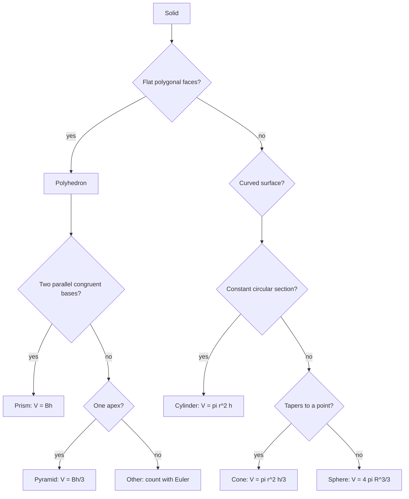

# Solid Geometry

> [Mathematics](../../README.md) › [Geometry](../README.md) · Level: Intermediate · Prerequisites: plane geometry (angles, congruence, similarity, Pythagoras), area formulas, elementary algebra · Estimated time: 9 h

## 1. Introduction

Plane geometry lives on a sheet of paper. Solid geometry lives in the room you are sitting in: the box
on the shelf, the pipe under the floor, the dome above the station. The extra dimension changes almost
every question. In the plane two lines either meet or are parallel; in space they can also **miss each
other entirely**. In the plane a triangle is rigid once its sides are fixed; in space a polyhedron is
not. In the plane a figure has one measure, area; in space a solid has two, volume and surface area,
and they scale differently.

This topic does three things. It **organises space** (points, lines and planes; skew lines; how a plane
cuts a solid). It **classifies polyhedra**, the central result being Euler's formula
$$V-E+F=2,$$
which relates the numbers of vertices, edges and faces of any convex polyhedron and is one of the first
genuinely *topological* theorems: it is blind to lengths and angles and sees only how the pieces are
connected. And it **measures solids** — prisms, pyramids, cylinders, cones, spheres — with derivations
rather than decrees. The two highlights are the factor $\tfrac13$ in the pyramid formula, which follows
from cutting a triangular prism into three equal tetrahedra, and the sphere formulas, which follow from
Cavalieri's principle, the three-dimensional form of "equal widths at every height means equal area".

The mathematics is old: Euclid's *Elements* XI–XIII contain the definitions and the five regular
solids, and Archimedes proved that a sphere has two-thirds the volume of its circumscribing cylinder.
What is modern is the point of view — proof instead of assertion, coordinates instead of only
constructions, and a direct line from $V-E+F$ to the Euler characteristic and the classification of
surfaces.

## 2. Prerequisites

* **Angles in polygons.** The angle sum of a triangle is $180^\circ$; the interior angle of a regular
  $n$-gon is $\dfrac{(n-2)180^\circ}{n}$, which gives $60^\circ,90^\circ,108^\circ,120^\circ$ for
  $n=3,4,5,6$. Section 7.7 rests entirely on this.
* **Congruence and similarity.** If two figures are similar with linear ratio $k$, areas are in ratio
  $k^2$ and volumes in ratio $k^3$. Cross-sections of a pyramid use the area version.
* **The Pythagorean theorem**, for space diagonals, slant heights and the 3D distance formula.
* **Area formulas:** $\tfrac12bh$ (triangle), $bh$ (rectangle, parallelogram), $\pi r^2$ (circle),
  $\tfrac12(a+b)h$ (trapezium), $\tfrac12\cdot\text{perimeter}\cdot\text{apothem}$ (regular polygon).
* **Circumference** $C=2\pi r$ — the lateral-area derivations for cylinder and cone are this in
  disguise.
* **Algebra:** expanding $(a+b)^2$, square roots, linear equations, and the AM–GM inequality
  $\frac{x+y+z}{3}\ge\sqrt[3]{xyz}$ for positive $x,y,z$ (used in Example 8 and in property P5).
  Factoring and the quadratic formula are reviewed in
  [Intermediate Algebra](../../03-algebra/04-intermediate-algebra/README.md).

Two steps use a **limiting argument**: the area of a sphere (Section 7.5) and the stack-of-slabs
justification of Cavalieri. Both are flagged where they occur; [Calculus](../../07-calculus/README.md)
makes them rigorous.

## 3. Learning Objectives

After this tutorial you will be able to:

1. Describe the incidence relations of points, lines and planes, and distinguish intersecting,
   parallel and skew lines.
2. Decide whether points are coplanar and compute the angle between planes from their normals.
3. State Euler's formula with its hypotheses, prove it by flattening to a planar graph, and exhibit a
   polyhedron for which it fails.
4. Identify the faces, edges, vertices, base, apex, height and slant height of a solid, and classify it
   as a prism, pyramid, cylinder, cone or sphere.
5. Derive $V=Bh$ and $V=\tfrac13Bh$ and apply them to prisms, cylinders, pyramids, cones and frusta.
6. Derive $V=\tfrac43\pi R^3$ and $A=4\pi R^2$ for the sphere by Cavalieri's principle.
7. Compute volumes and surface areas of composite solids, counting only exposed faces.
8. Find the cross-section of a cube, cone or sphere by a given plane, and draw nets of prisms,
   cylinders, pyramids and cones.
9. Prove there are exactly five Platonic solids and verify each with Euler's formula and the angle
   deficit.
10. Use coordinates in $\mathbb{R}^3$: distance, midpoint, sphere equation, plane equation.
11. Apply the results to packaging, architecture and engineering, and explain the significance of the
    surface-to-volume ratio.

## 4. Intuition

### 4.1 Slices

A creature confined to a plane sees a passing sphere as a dot that grows into a circle and shrinks
again: it never sees the sphere, only a sequence of **cross-sections**. A CT scanner, a contour map and
an engineering drawing work the same way. Most of this topic is the art of understanding a solid
through the plane figures it produces when sliced, and of rebuilding it from those slices.

### 4.2 Volume is water, surface is paint

Two numbers describe size. **Volume** answers "how much water fills it?" — a count of unit cubes.
**Surface area** answers "how much paint covers it?" — a count of unit squares. They scale differently:
double every length and volume multiplies by $2^3=8$ while surface area multiplies by $2^2=4$. Hence a
large tank is far more efficient than many small ones, a mouse loses heat much faster than an elephant,
and a sphere gives the most volume for the least skin.

### 4.3 $V-E+F$ is a conservation law

Dent a cube made of clay: the counts $V,E,F$ do not change, so $V-E+F$ stays $2$. Numbers that survive
deformation are **topological invariants**, and $V-E+F$ is the first one students meet. It is not
universal: drill a tunnel through the cube and it drops to $0$. The formula therefore describes a
*shape type*, not solids in general — which is exactly why the hypotheses in Section 7.2 matter.

### 4.4 Why one third?

A prism and a pyramid on the same base and with the same height look alike in plan, but the pyramid
tapers. Intuition says it is smaller; *how much* smaller is the surprise: exactly one third. The reason
is a dissection — a triangular prism splits into three tetrahedra of equal volume — and because any
pyramid can be cut into tetrahedra sharing its apex, the factor $\tfrac13$ is universal. By Cavalieri it
passes to cones. The same factor explains the sphere: a hemisphere is a cylinder with a cone removed,
so its volume is $\pi R^3-\tfrac13\pi R^3=\tfrac23\pi R^3$.

## 5. Formal Definition

### 5.1 Space, Lines, Planes

**Definition 5.1.** $\mathbb{R}^3$ is the set of ordered triples $(x,y,z)$ of real numbers, with
$$|PQ|=\sqrt{(x_2-x_1)^2+(y_2-y_1)^2+(z_2-z_1)^2}$$
for $P=(x_1,y_1,z_1)$, $Q=(x_2,y_2,z_2)$. We work in $\mathbb{R}^3$ throughout.

The following **incidence facts** follow from the coordinate description.

* **(I1)** Through two distinct points passes exactly one line.
* **(I2)** Through three non-collinear points passes exactly one plane.
* **(I3)** Two distinct planes meet in nothing or in a line.
* **(I4)** If two points of a line lie in a plane, the whole line does.
* **(I5)** There exist four non-coplanar points.

**Definition 5.2.** Two lines are **parallel** if coplanar and disjoint; **skew** if not coplanar. A line
$\ell$ is **perpendicular to a plane** $\Pi$ at $P$ if it meets $\Pi$ only at $P$ and is perpendicular
to every line of $\Pi$ through $P$. Two planes are **perpendicular** if one contains a line
perpendicular to the other.

*Criterion.* If $\ell$ meets $\Pi$ at $P$ and is perpendicular to two distinct lines of $\Pi$ through
$P$, then $\ell\perp\Pi$: with $P$ at the origin and $\ell$ on the $z$-axis, $\Pi$ is $z=0$, and every
direction in $\Pi$ is $(a,b,0)\perp(0,0,1)$.

### 5.2 Polyhedra

**Definition 5.3 (Polygon).** A plane figure bounded by segments $A_1A_2,\dots,A_nA_1$ ($n\ge3$) in
which non-adjacent segments do not meet, adjacent ones are not collinear, and the boundary is a simple
closed curve (no holes). It is **convex** if every interior angle is less than $180^\circ$.

**Definition 5.4 (Polyhedron).** A bounded region of space whose boundary is a finite union of polygons
(**faces**) such that: two distinct faces meet in nothing, a vertex or a whole edge; every edge belongs
to **exactly two** faces; the boundary surface is **connected**; every face is a polygon in the sense of
Definition 5.3. A polyhedron is **convex** if the segment joining any two of its points lies inside it.

**Definition 5.5 (Euler characteristic).** For a polyhedron with $V$ vertices, $E$ edges and $F$ faces,
$\chi=V-E+F$.

**Definition 5.6 (Simple).** A polyhedron is **simple** if its boundary surface can be deformed
continuously, without tearing or gluing, into the surface of a ball. Every convex polyhedron is simple;
a solid with a tunnel through it is not.

### 5.3 The Classical Solids

**Prism.** A polygon $B$ in a plane $\Pi$, a vector $\mathbf{v}$ not parallel to $\Pi$, and its
translate $B+\mathbf{v}$: the **prism** is the union of segments joining each point of $B$ to its
translate. The **height** $h$ is the distance between the two base planes; the prism is **right** if
$\mathbf{v}\perp\Pi$, and a **regular prism** if it is right with a regular $n$-gon base.

**Pyramid.** A polygon $B$ in a plane $\Pi$ and a point $A\notin\Pi$: the **pyramid** is the union of
segments from $A$ (**apex**) to points of $B$. Its **height** is the distance from $A$ to $\Pi$. It is
**regular** if $B$ is regular and the perpendicular from $A$ lands on the centre of $B$; then the
**slant height** $l$ is the height of any lateral face.

**Frustum.** Cutting a pyramid or cone by a plane parallel to the base and discarding the part with the
apex leaves a **frustum**.

**Cylinder, cone.** The same constructions with a circular base; **right** when the axis (joining the
centres of the bases, or the apex to the centre of the base) is perpendicular to the base. For a right
cone, $l=\sqrt{r^2+h^2}$ by Pythagoras.

**Sphere.** For a centre $O$ and $R>0$, the **sphere** is the set of points at distance exactly $R$
from $O$; the **ball** is the set at distance at most $R$. A plane at distance $d<R$ cuts the sphere in
a circle of radius $\sqrt{R^2-d^2}$; at $d=R$ it is a **tangent plane**; through $O$ it gives a **great
circle**. "Sphere" names the surface, "ball" the solid.

### 5.4 Regular Polyhedra

**Definition 5.7.** A **Platonic solid** is a convex polyhedron in which every face is a regular
$p$-gon, exactly $q$ faces meet at every vertex, and the arrangement around every vertex is congruent.

### 5.5 Volume and Surface Area

No finite number of cubes tiles a sphere, so volume is characterised by properties and then computed.

**Definition 5.8 (Volume).** A function assigning a non-negative number to each solid, with

* **(V1) Normalisation:** the unit cube has volume $1$;
* **(V2) Congruence:** congruent solids have equal volume;
* **(V3) Additivity:** volumes add over pieces meeting in a set of zero volume;
* **(V4) Cavalieri:** if two solids lie between the same parallel planes and every plane parallel to
  them cuts both in regions of equal area, the volumes are equal.

**Definition 5.9 (Surface area).** A function assigning a non-negative number to each surface, with
normalisation (the unit square has area $1$), congruence, and additivity over pieces meeting in a curve.
Unlike volume, surface area has no Cavalieri principle of its own; it is computed by unrolling (nets) or
as a limit of areas of inscribed polyhedral surfaces. That limit is what makes the sphere's area
$4\pi R^2$ rather than "infinitely many flat triangles".

For the solids of this chapter such a volume exists and is unique. For arbitrary sets it need not:
that is the content of measure theory, developed in [Real Analysis](../../14-real-analysis/README.md).

## 6. Mathematical Notation

| Symbol | Read as | Meaning |
|---|---|---|
| $\mathbb{R}^3$ | R three | ordered triples $(x,y,z)$ of reals |
| $\ell,m$ | ell, em | lines |
| $\Pi$ | pi (capital) | a plane — never the constant $\pi$ |
| $\lvert PQ\rvert$ | length of $PQ$ | distance between points |
| $\angle$ | angle | $\angle ABC$ has vertex $B$ |
| $\perp,\ \parallel$ | perpendicular, parallel | relations between lines and planes |
| $V$ | volume — or number of vertices | context decides; standard in both senses |
| $E,F$ | number of edges, of faces | |
| $\chi$ | chi | Euler characteristic $V-E+F$ |
| $B$ | base area | |
| $h,l$ | height, slant height | $h$ is perpendicular, $l$ lies in a lateral face |
| $r,R$ | radii | $R$ for a sphere or the larger radius of a frustum |
| $d$ | diameter or distance | $d=2r$ for a circle |
| $P$ | perimeter | of a base polygon |
| $a$ | apothem | centre-to-side distance of a regular polygon |
| $\pi$ | pi | $3.14159\ldots$ |
| $\delta$ | delta | angle deficit at a vertex |
| $p,q$ | — | sides per face, faces per vertex |

Angles in the development formulas are in **radians**, where $180^\circ=\pi$ rad. The symbol $V$ is
overloaded (volume, or vertex count); this document never uses both meanings in one sentence.

## 7. Core Concepts

### 7.1 Points, Lines and Planes in Space

A point needs three numbers, a line one parameter, a plane two. That count explains most of the
differences from plane geometry.

**Lines and planes.** A line is $\{P_0+t\mathbf{v}:t\in\mathbb{R}\}$ with $\mathbf{v}\ne\mathbf{0}$; a
plane is $\{P:\mathbf{n}\cdot(P-P_0)=0\}$, that is $ax+by+cz=d$ with $\mathbf{n}=(a,b,c)\ne\mathbf{0}$
a **normal**. Eliminating $t$ gives the symmetric form $\frac{x-x_0}{v_1}=\frac{y-y_0}{v_2}=\frac{z-z_0}{v_3}$,
where a zero component means the corresponding numerator is zero.

**Three positions for two lines.** Intersecting (coplanar, meeting), parallel (coplanar, disjoint), or
**skew** (not coplanar). The pair $\{(0,0,s)\}$ and $\{(1,t,0)\}$ is skew: the directions $(0,0,1)$ and
$(0,1,0)$ are not parallel, so a meeting would force a common plane; but $(0,0,s)=(1,t,0)$ gives
$0=1$, impossible.

**Distance between skew lines.** It is attained by the segment perpendicular to both. *Why:* if $AB$ is
not perpendicular to $\ell_1$, sliding $A$ by a small $s$ along $\ell_1$ changes the distance to
$\sqrt{|AB|^2+s^2-2s(\text{projection})}$, which is smaller for one sign of $s$; the same holds for
$\ell_2$. In the example above the shortest segment is $(0,0,0)$ to $(1,0,0)$, of length $1$, and it is
perpendicular to both lines.

**Angles and distances.** The angle between two planes is the angle between their normals; the planes
are perpendicular iff their normals are. For $P_1=(x_1,y_1,z_1)$ and $\Pi:ax+by+cz=d$,
$$\operatorname{dist}(P_1,\Pi)=\frac{|ax_1+by_1+cz_1-d|}{\sqrt{a^2+b^2+c^2}},$$
the numerator measuring failure to satisfy the equation and the denominator converting it to a length.

**Coplanarity.** $A,B,C,D$ are coplanar iff $AB,AC,AD$ are linearly dependent, i.e. the determinant with
those vectors as rows vanishes. Determinants belong to [Linear Algebra](../../08-linear-algebra/README.md).

### 7.2 Polyhedra and Euler's Formula

**Theorem 7.1 (Euler).** For a simple polyhedron, in particular any convex one,
$$V-E+F=2.$$

**Proof.** *Step 1: flatten.* Put a light source just outside a face $F_0$, close to its centre. The
shadows of the other faces tile the plane of $F_0$ exactly once. The result is a drawing of a connected
graph in the plane with $V$ vertices, $E$ edges and $F$ faces — the $F-1$ shadows plus the unbounded
outer region, which corresponds to $F_0$. This is a **Schlegel diagram**; convexity guarantees that no
face is edge-on, so the projection is one-to-one on each face.

*Step 2: count.* For any connected plane graph, $V-E+F=2$. Take a **spanning tree**: all $V$ vertices,
$V-1$ edges, connected and acyclic. A tree drawn in the plane has one face, so
$V-(V-1)+1=2$. Now add the remaining $E-(V-1)$ edges in their already-drawn positions. Each joins two
vertices already connected by a path, so it cannot cross anything; it lies inside a single face and,
closing a new region, splits that face in two. So $E$ and $F$ both increase by $1$ and $V-E+F$ never
changes. At the end $V-E+F=2$. $\square$

**What the hypotheses are for.**

* *Faces must be polygons (disks).* If a face is an annulus, the diagram gains a region without gaining
  an edge, and the count shifts.
* *Each edge in exactly two faces.* Other incidence patterns are not polyhedra in Definition 5.4.
* *Connected.* Two separated tetrahedra have $V=8$, $E=12$, $F=8$, so $V-E+F=4$: one copy of the formula
  per component.
* *Simple, not merely connected.* Take a square frame: a slab with a square hole, giving a solid with a
  tunnel. Split the annular top and bottom into four trapezoids each, so all faces are polygons. There
  are $16$ vertices (four on each of the outer top, outer bottom, inner top, inner bottom rims), and
  $16$ rim edges $+8$ vertical edges $+8$ corner-to-corner diagonals, so $E=32$. The faces are $8$ top
  and bottom trapezoids $+4$ outer walls $+4$ inner walls, so $F=16$. Then
  $$V-E+F=16-32+16=0 .$$
  The surface is a **torus**; in general $V-E+F=2-2g$, where $g$ is the number of tunnels ("genus").
* *A shared vertex is not enough.* Two tetrahedra glued at one vertex: $V=7$, $E=12$, $F=8$, so
  $V-E+F=3$. But near the glued vertex the surface is not locally a disc, so this is not a polyhedron.

**Counting consequences.** Every edge is counted twice from the faces and twice from the vertices:
$$2E=\sum_{\text{faces}}p_f=\sum_{\text{vertices}}q_v .$$
If all faces have $p$ sides and all vertices $q$ edges, then $pF=qV=2E$, and Euler gives
$$\frac1p+\frac1q=\frac12+\frac1E .$$

**Every polyhedron has a face with at most five sides.** If every face had at least $6$ sides then
$F\le E/3$; and since at least $3$ edges meet at every vertex, $V\le 2E/3$. Hence
$$2=V-E+F\le\tfrac{2E}{3}-E+\tfrac{E}{3}=0,$$
a contradiction.

**Fullerenes.** A simple polyhedron with only pentagonal and hexagonal faces has exactly $12$
pentagons. With $F_5,F_6$ pentagons and hexagons: $2E=5F_5+6F_6$, $3V=2E$, so
$$2=\tfrac{2E}{3}-E+F_5+F_6=-\tfrac{5F_5+6F_6}{6}+F_5+F_6=\tfrac{F_5}{6},$$
giving $F_5=12$ whatever $F_6$ is. For $\mathrm{C}_{60}$, $F_6=20$, $E=(60+120)/2=90$, $V=60$.

### 7.3 Prisms and Cylinders

**Volume.** Slice a prism by planes parallel to its base. Each slab has volume approximately (base
area) × (thickness), and refining the slices makes the error vanish; this is (V4). It also shows that an
**oblique** prism has the same volume as a right one with the same base and height, since every
horizontal cross-section is a translate of the base and has area $B$.

**Lateral area.** In a right prism each lateral face is a rectangle of height $h$ and width equal to one
base side, so the lateral area is $Ph$. For an oblique prism the lateral faces are parallelograms and
the lateral area is not $Ph$.

$$V=Bh,\qquad S_{\text{lat}}=Ph,\qquad S_{\text{total}}=2B+Ph .$$

**Cylinder.** Put $B=\pi r^2$ and $P=2\pi r$:
$$V=\pi r^2h,\qquad S_{\text{lat}}=2\pi rh,\qquad S_{\text{total}}=2\pi r(r+h).$$
The lateral area has a second derivation that explains the clean formula: cut along a vertical line and
unroll. The result is a rectangle $2\pi r\times h$, with no stretching, because a cylinder is
*developable*. The same argument gives the lateral area of any right prism.

**Units.** $1\ \mathrm{m}=100\ \mathrm{cm}$ gives $1\ \mathrm{m^2}=10^4\ \mathrm{cm^2}$ and
$1\ \mathrm{m^3}=10^6\ \mathrm{cm^3}$; and $1\ \mathrm{mL}=1\ \mathrm{cm^3}$, $1\ \mathrm{L}=1000\ \mathrm{cm^3}$.

### 7.4 Pyramids and Cones

**Lateral area of a regular pyramid.** Each lateral face is an isosceles triangle with base $s_i$ (a
side of the base polygon) and height $l$; its area is $\tfrac12s_il$. Summing,
$$S_{\text{lat}}=\sum_i\tfrac12s_il=\tfrac12l\,P .$$
This needs regularity: otherwise the faces have different slant heights and must be done one by one.

**Volume: $V=\tfrac13Bh$.** *Step 1: a triangular prism splits into three tetrahedra of equal volume.*
Let the prism have base $ABC$ and top $A'B'C'$ with lateral edges $AA',BB',CC'$, and consider
$$T_1=ABCA',\qquad T_2=A'B'BC,\qquad T_3=A'B'C'C .$$
They tile the prism (slice it by the planes $A'BC$ and $A'B'C$). Now compare:

* $T_1$ with base $AA'B$ and apex $C$; $T_2$ with base $A'B'B$ and apex $C$. Both bases lie in the
  lateral face $ABB'A'$, and the diagonal $A'B$ splits that parallelogram into two congruent triangles.
  Equal bases in one plane with a common apex give equal volumes.
* $T_2$ with base $B'BC$ and apex $A'$; $T_3$ with base $B'C'C$ and apex $A'$. Both bases lie in the
  lateral face $BCC'B'$ and the diagonal $B'C$ splits it into two congruent triangles. Equal volumes.

So all three are equal and sum to $Bh$, hence each is $\tfrac13Bh$. Since $T_1$ is a pyramid with base
$ABC$ and height $h$, every triangular pyramid has volume $\tfrac13Bh$.

*Step 2: every pyramid reduces to triangular ones.* Triangulate the base into triangles of areas
$B_1,\dots,B_k$ with $\sum B_i=B$. Each triangle with the apex forms a tetrahedron of the same height
$h$, so
$$V=\sum_i\tfrac13B_ih=\tfrac13h\sum_iB_i=\tfrac13Bh .$$
Nothing assumed the foot of the perpendicular to be central, so **oblique** pyramids obey the same
formula.

**Cone.** At height $y$ above the base the cross-section is a circle of radius $r(1-y/h)$ by similar
triangles, hence of area $\pi r^2(1-y/h)^2$. A pyramid with base area $\pi r^2$ and height $h$ has
exactly the same cross-sections, so by Cavalieri $V=\tfrac13\pi r^2h$.

**Lateral area of a cone.** Cut along a generator and unroll: the lateral surface becomes a sector of
radius $l$ (every rim point is at distance $l$ from the apex) whose arc is the circumference $2\pi r$.
A sector of radius $l$ and arc $s$ has area $\tfrac12ls$, being the fraction $\frac{s}{2\pi l}$ of a disc
of area $\pi l^2$. Hence
$$S_{\text{lat}}=\tfrac12\cdot l\cdot 2\pi r=\pi rl,\qquad \theta=\frac{2\pi r}{l}\ \text{rad}.$$

$$V=\tfrac13\pi r^2h,\qquad S_{\text{lat}}=\pi rl,\qquad S_{\text{total}}=\pi r(r+l),\qquad l=\sqrt{r^2+h^2}.$$

**Frustum.** For a conical frustum of height $h$ and radii $R>r$, complete it to a cone of height $H$.
Similar triangles give $\frac{R}{H}=\frac{r}{H-h}$, so $H=\frac{Rh}{R-r}$, and
$$\begin{aligned}
V&=\tfrac13\pi R^2H-\tfrac13\pi r^2(H-h)
=\tfrac13\pi h\left[\frac{R^3}{R-r}-\frac{r^3}{R-r}\right]\\
&=\tfrac13\pi h\cdot\frac{R^3-r^3}{R-r}=\tfrac13\pi h\left(R^2+Rr+r^2\right).
\end{aligned}$$
The same computation with areas gives $V=\frac h3\left(B_1+B_2+\sqrt{B_1B_2}\right)$, and unrolling
gives the lateral area $\pi(R+r)l$ with $l=\sqrt{h^2+(R-r)^2}$.

### 7.5 The Sphere

**Volume by Cavalieri.** Place a hemisphere of radius $R$ flat face down on a table, and beside it a
cylinder of radius $R$ and height $R$ containing an upside-down cone whose apex is at the centre of the
cylinder's bottom face and whose base is the top disc. Cut both solids by a horizontal plane at height
$y$, $0\le y\le R$.

* *Hemisphere:* the section is a circle of radius $\rho$ with $\rho^2+y^2=R^2$ (Pythagoras in the right
  triangle centre–section-centre–rim), so its area is $\pi(R^2-y^2)$.
* *Cylinder minus cone:* the cylinder contributes $\pi R^2$ and the cone, by similarity, has radius $y$
  and contributes $\pi y^2$; the difference is $\pi(R^2-y^2)$.

The areas agree at every height, so
$$V_{\text{hemisphere}}=\pi R^3-\tfrac13\pi R^3=\tfrac23\pi R^3,\qquad
\boxed{V=\tfrac43\pi R^3}.$$
This is Archimedes' result; he asked for a sphere inscribed in a cylinder on his tombstone.

**Surface area, short argument.** Cut the ball into many thin pyramids with apex at the centre and bases
a partition of the surface into pieces of area $a_i$. Each has volume $\tfrac13a_iR$, so
$$V=\sum_i\tfrac13a_iR=\tfrac13RA \;\Longrightarrow\;
A=\frac{3V}{R}=\frac{3}{R}\cdot\frac43\pi R^3=4\pi R^2 .$$
The pieces have curved bases rather than flat ones; the error vanishes as the partition is refined, a
limiting step made rigorous with integrals in [Calculus](../../07-calculus/README.md).

**Archimedes' zone theorem.** Approximate a horizontal band between heights $y$ and $y+\Delta y$ by a
frustum of average radius $\bar x$ and slant height $\Delta s$; its area is $2\pi\bar x\Delta s$, the same
"unroll into a rectangle" idea as for the cylinder. On the circle $x=R\cos t$, $y=R\sin t$ we have
$\Delta s\approx R\,\Delta t$ and $\Delta y\approx R\cos t\,\Delta t=\bar x\,\Delta t$, so
$\bar x\,\Delta s\approx R\,\Delta y$. Therefore a band of height $\Delta y$ has area $2\pi R\,\Delta y$:
**its area depends only on its height, not on where it sits.** Summing over the whole sphere, whose total
height is $2R$,
$$A=2\pi R\cdot 2R=4\pi R^2 .$$
A cap or zone of height $h$ therefore has area $2\pi Rh$. This is why a cylindrical label wraps a globe
exactly, and why the surface of a hemisphere equals the lateral surface of a cylinder of the same radius
and height.

**Consistency.** Increasing $R$ by a small $\Delta R$ adds a shell of area about $4\pi R^2$ and volume
about $4\pi R^2\Delta R$, so $dV/dR=4\pi R^2=A$, which agrees with differentiating $\tfrac43\pi R^3$.

**Archimedes' comparison.** The circumscribing cylinder of a sphere of radius $R$ has radius $R$, height
$2R$, volume $2\pi R^3$ and lateral area $4\pi R^2$. The sphere has $\tfrac43\pi R^3=\tfrac23\cdot2\pi R^3$
and $4\pi R^2$: two-thirds the volume, exactly the same lateral area.

### 7.6 Cross-Sections and Nets

**Definition 7.2.** The **cross-section** of a solid $S$ by a plane $\Pi$ is $S\cap\Pi$.

Cross-sections are how solids are described in practice: plan, elevation and side view in engineering
drawings, hundreds of slices in a CT scan, level curves on a map.

**Sections of a cube.** A plane cuts a cube in a triangle, quadrilateral, pentagon or hexagon — never
more, because each side lies in one of the six faces and a plane meets a face in at most one segment.

* *No regular pentagon.* A pentagon section means the plane misses exactly one face. The six faces form
  three pairs of parallel faces, and a plane cuts parallel faces in parallel lines; missing one face
  leaves the other two pairs both cut twice. So the pentagon has **two pairs of parallel sides**, which a
  regular pentagon does not have.
* *Regular hexagon.* For the unit cube $0\le x,y,z\le1$ and the plane $x+y+z=\tfrac32$, which is
  perpendicular to a body diagonal and passes through the cube's centre, the section is a regular hexagon
  of side $1/\sqrt2$ and area $\tfrac{3\sqrt3}{2}\cdot\tfrac12=\tfrac{3\sqrt3}{4}\approx1.299$.
* *Equilateral triangle.* The plane through three vertices adjacent to a corner cuts an equilateral
  triangle of side $\sqrt2$ and area $\tfrac{\sqrt3}{2}\approx0.866$.
* *Rectangle.* The plane through two opposite edges gives a $1\times\sqrt2$ rectangle of area
  $\sqrt2\approx1.414$.

**Sections of a cone** are the conic sections, studied in
[Analytic Geometry](../07-analytic-geometry/README.md): a plane perpendicular to the axis gives a
circle; tilted, an ellipse; parallel to exactly one generator, a parabola; steeper, cutting both nappes,
a hyperbola; through the apex, a point, a line, or two lines.

**Sections of a sphere** are always circles; a plane at distance $d<R$ from the centre cuts a circle of
radius $\sqrt{R^2-d^2}$, and the largest sections are the great circles.

**Nets.** A **net** is a connected plane figure that folds, without overlap, into the surface of a solid.

* A cube has exactly **eleven** distinct nets up to rotation and reflection.
* A right prism unfolds to its two bases plus one rectangle per lateral face; a cylinder to a
  $2\pi r\times h$ rectangle plus two discs; a cone to a sector of radius $l$ and angle $2\pi r/l$ plus
  one disc; a regular pyramid to its base plus congruent isosceles triangles.
* A sphere has **no** net: no flat sheet bends into a sphere without stretching. The sphere has nonzero
  Gaussian curvature and the plane has zero, and Gaussian curvature survives bending (Gauss's *Theorema
  Egregium*). Hence every flat map of the Earth distorts area, shape or both.

### 7.7 The Platonic Solids

**Lemma 7.3 (Angle condition).** If a convex polyhedron has regular $p$-gons as faces and $q$ faces at
each vertex, then $\frac1p+\frac1q>\frac12$.

*Proof.* At a vertex the face angles must sum to strictly less than $360^\circ$: exactly $360^\circ$
would make the faces flat, and more would make them overlap. The interior angle of a regular $p$-gon is
$\frac{(p-2)180^\circ}{p}$, so
$$q\cdot\frac{(p-2)180^\circ}{p}<360^\circ
\iff q(p-2)<2p \iff pq-2p-2q<0 \iff (p-2)(q-2)<4 .$$
Dividing by $2pq$ gives the stated form. $\square$

**Theorem 7.4.** There are exactly five Platonic solids.

*Proof.* Since $p,q\ge3$, $(p-2)(q-2)<4$ leaves only
$(p-2,q-2)\in\{(1,1),(1,2),(1,3),(2,1),(3,1)\}$, i.e. $(p,q)\in\{(3,3),(3,4),(3,5),(4,3),(5,3)\}$.
Each pair determines the solid, so there are at most five. All five exist:

| $(p,q)$ | Solid | $V$ | $E$ | $F$ | $V-E+F$ |
|---|---|---|---|---|---|
| $(3,3)$ | tetrahedron | $4$ | $6$ | $4$ | $2$ |
| $(4,3)$ | cube | $8$ | $12$ | $6$ | $2$ |
| $(3,4)$ | octahedron | $6$ | $12$ | $8$ | $2$ |
| $(5,3)$ | dodecahedron | $20$ | $30$ | $12$ | $2$ |
| $(3,5)$ | icosahedron | $12$ | $30$ | $20$ | $2$ |

Explicit coordinates verify existence: the tetrahedron $(1,1,1),(1,-1,-1),(-1,1,-1),(-1,-1,1)$ with all
edges $2\sqrt2$; the cube $(\pm1,\pm1,\pm1)$; the octahedron $(\pm1,0,0),(0,\pm1,0),(0,0,\pm1)$; the
icosahedron $(0,\pm1,\pm\varphi)$ and cyclic permutations with $\varphi=\frac{1+\sqrt5}{2}$; the
dodecahedron as its dual. Each $E$ also satisfies $\frac1p+\frac1q=\frac12+\frac1E$: $\frac23=\frac12+\frac16$
for the tetrahedron, $\frac{7}{12}=\frac12+\frac1{12}$ for cube and octahedron,
$\frac{8}{15}=\frac12+\frac1{30}$ for dodecahedron and icosahedron. $\square$

**Angle deficit and Descartes' theorem.** The **deficit** at a vertex is
$\delta=360^\circ-(\text{sum of face angles there})$; it measures how sharply the surface bends. For
every convex polyhedron,
$$\sum_{\text{vertices}}\delta=4\pi .$$
*Proof.* If face $f$ has $p_f$ sides its angle sum is $(p_f-2)\pi$, so the total of all face angles is
$$\sum_f(p_f-2)\pi=\pi\cdot2E-2\pi F=2\pi(E-F),$$
using $\sum_fp_f=2E$. The total available angle at the $V$ vertices is $2\pi V$, hence
$\sum_v\delta=2\pi V-2\pi(E-F)=2\pi(V-E+F)=4\pi$ by Euler's formula. $\square$

For a Platonic solid every vertex has the same deficit $\delta=4\pi/V$:

| Solid | Angle sum at a vertex | $\delta$ | $V\delta$ |
|---|---|---|---|
| tetrahedron | $3\cdot60^\circ=180^\circ$ | $180^\circ$ | $720^\circ$ |
| cube | $3\cdot90^\circ=270^\circ$ | $90^\circ$ | $720^\circ$ |
| octahedron | $4\cdot60^\circ=240^\circ$ | $120^\circ$ | $720^\circ$ |
| dodecahedron | $3\cdot108^\circ=324^\circ$ | $36^\circ$ | $720^\circ$ |
| icosahedron | $5\cdot60^\circ=300^\circ$ | $60^\circ$ | $720^\circ$ |

**Duality.** The **dual** has a vertex at the centre of each face, an edge crossing each edge, and a face
around each vertex: it swaps $V$ and $F$ and preserves $E$, turning $(p,q)$ into $(q,p)$. So the cube and
octahedron are dual, the dodecahedron and icosahedron are dual, and the tetrahedron is self-dual.

Relaxing "regular faces" while keeping the same arrangement at every vertex leads to the thirteen
Archimedean solids, including the truncated icosahedron of the football and of $\mathrm{C}_{60}$. The
finiteness of the list is the first instance of a general phenomenon: crystals exhibit only $2$-, $3$-,
$4$- and $6$-fold rotational symmetry.

### 7.8 Coordinates in Three Dimensions

$$|PQ|=\sqrt{(\Delta x)^2+(\Delta y)^2+(\Delta z)^2},\qquad
M=\left(\tfrac{x_1+x_2}{2},\tfrac{y_1+y_2}{2},\tfrac{z_1+z_2}{2}\right).$$
The distance formula is Pythagoras applied twice: first in the horizontal plane to get the length of the
projection, then in the vertical plane through the projection and the segment.

* **Sphere:** $(x-a)^2+(y-b)^2+(z-c)^2=R^2$. Expanded as $x^2+y^2+z^2+Dx+Ey+Fz+G=0$, completing the
  square recognises it as a sphere, a single point, or the empty set.
* **Plane:** $ax+by+cz=d$ with $(a,b,c)\ne\mathbf{0}$, normal $(a,b,c)$. Planes are parallel iff their
  normals are parallel.
* **Line:** $(x_0,y_0,z_0)+t(u,v,w)$.
* **Tetrahedron:** three edges from one vertex, as vectors $\mathbf{u},\mathbf{v},\mathbf{w}$, give
  $V=\tfrac16|\det(\mathbf{u},\mathbf{v},\mathbf{w})|$, since the determinant is the volume of the
  parallelepiped and the tetrahedron is one sixth of it.

Two products do most of the work in three dimensions: the **dot product**
$\mathbf{u}\cdot\mathbf{v}=u_1v_1+u_2v_2+u_3v_3$, which detects perpendicularity and computes projections
and angles, and the **cross product** $\mathbf{u}\times\mathbf{v}$, perpendicular to both, whose length is
the area of the parallelogram they span. Both are developed in
[Linear Algebra](../../08-linear-algebra/README.md).

## 8. Formulas and Properties

### 8.1 The Formula Table

| Solid | Volume | Lateral area | Total surface | Hypotheses |
|---|---|---|---|---|
| Prism | $Bh$ | $Ph$ | $2B+Ph$ | $V$ for any prism; the lateral formula needs a **right** prism |
| Cylinder | $\pi r^2h$ | $2\pi rh$ | $2\pi r(r+h)$ | right circular; the side unrolls to $2\pi r\times h$ |
| Pyramid | $\tfrac13Bh$ | $\tfrac12Pl$ | $B+\tfrac12Pl$ | $V$ for any pyramid; the lateral formula needs a **regular** one |
| Cone | $\tfrac13\pi r^2h$ | $\pi rl$ | $\pi r(r+l)$ | right circular, $l=\sqrt{r^2+h^2}$ |
| Conical frustum | $\tfrac13\pi h(R^2+Rr+r^2)$ | $\pi(R+r)l$ | $\pi(R^2+r^2)+\pi(R+r)l$ | $l=\sqrt{h^2+(R-r)^2}$ |
| Ball | $\tfrac43\pi R^3$ | — | $4\pi R^2$ | $A$ is the area of the sphere, which has no base |
| Spherical zone | — | $2\pi Rh$ | — | two parallel planes at distance $h$; independent of position |
| General frustum | $\tfrac h3\left(B_1+B_2+\sqrt{B_1B_2}\right)$ | — | — | parallel similar bases |

Prisms and cylinders share one formula, and pyramids and cones share another; only the way the base area
is written differs.

| Counting statement | Formula | Hypotheses |
|---|---|---|
| Euler | $V-E+F=2$ | simple polyhedron |
| Edge counts | $2E=\sum_f p_f=\sum_v q_v$ | each edge in exactly two faces |
| Regular case | $\frac1p+\frac1q=\frac12+\frac1E$ | $p$-gons, $q$ per vertex |
| Descartes | $\sum_v\delta_v=4\pi$ | convex polyhedron |
| Fullerene | $F_5=12$ | only pentagons and hexagons, $q=3$ |
| Platonic list | $(p-2)(q-2)<4$ | convex, regular faces, uniform vertices |

### 8.2 Properties

**P1 (Additivity).** Volumes of pieces add; surface areas of pieces add **except** for the cut faces,
which are not part of the outer surface. This is the commonest source of double counting.

**P2 (Scaling).** Scaling by $k>0$ multiplies lengths by $k$, areas by $k^2$, volumes by $k^3$ — because
a length needs one direction, an area two, a volume three, and the unit cube of side $k$ holds $k^3$ unit
cubes.

**P3 (Surface-to-volume ratio).** For similar solids, $A/V\propto1/k$. A cube of side $1$ cm has
$A/V=6\ \mathrm{cm^{-1}}$; one of side $10$ cm has $0.6\ \mathrm{cm^{-1}}$.

**P4 (Isoperimetric inequality, quoted).** $36\pi V^2\le A^3$, with equality exactly for the ball: of all
solids with a given surface area the ball has the greatest volume. The proof belongs to geometric measure
theory; for the ball, $36\pi V^2=36\pi\cdot\tfrac{16}{9}\pi^2R^6=64\pi^3R^6=A^3$.

**P5 (Cheapest closed cylinder).** Of all closed right circular cylinders of volume $V$, the one with
least surface has $h=2r$. Indeed $h=V/(\pi r^2)$, so
$$A=2\pi r^2+\frac{2V}{r}=2\pi r^2+\frac{V}{r}+\frac{V}{r}\ \ge\ 3\sqrt[3]{2\pi V^2}$$
by AM–GM, with equality iff $2\pi r^2=\frac{V}{r}$, i.e. $V=2\pi r^3=\pi r^2h$, i.e. $h=2r$. Real tins
are close to this shape; the deviations come from seams, rims and the shape of the contents.

**P6 (Cone development).** A cone with base radius $r$ and slant $l$ develops into a sector of radius $l$
and angle $2\pi r/l$. So $r=\tfrac l2$ gives a semicircle and $r=l$ the degenerate flat disc.

**P7 (No net for a sphere).** No flat pattern folds into a sphere without stretching, so every map of the
Earth distorts something.

**P8 (Composites).** Add volumes; add only exposed surfaces. A pipe is a cylinder minus an inner cylinder:
volume $\pi(R^2-r^2)h$, surface = outer + inner + two annular ends.

## 9. Step-by-Step Examples

### Example 1 (Easy): A Box

A box measures $12\times9\times8\ \mathrm{cm}$. Find its volume, surface area and space diagonal.

$$V=12\cdot9\cdot8=108\cdot8=864\ \mathrm{cm^3},$$
$$A=2(12\cdot9)+2(12\cdot8)+2(9\cdot8)=216+192+144=552\ \mathrm{cm^2},$$
$$d=\sqrt{12^2+9^2+8^2}=\sqrt{144+81+64}=\sqrt{289}=17\ \mathrm{cm}.$$
The exact root shows that $8,9,12,17$ is a Pythagorean quadruple.

### Example 2 (Easy–Medium): A Regular Hexagonal Prism

A right prism has a regular hexagonal base of side $4\ \mathrm{cm}$ and height $10\ \mathrm{cm}$.

**Base area.** The hexagon is six equilateral triangles of side $4$, so
$$B=6\cdot\frac{\sqrt3}{4}\cdot4^2=24\sqrt3\approx41.57\ \mathrm{cm^2},$$
in agreement with $B=\tfrac{3\sqrt3}{2}s^2$.

**Volume and surface.**
$$V=Bh=240\sqrt3\approx415.69\ \mathrm{cm^3},\qquad
S=6\cdot(4\cdot10)+2\cdot24\sqrt3=240+48\sqrt3\approx323.14\ \mathrm{cm^2}.$$

### Example 3 (Medium): A Square Pyramid

A regular square pyramid has base side $6\ \mathrm{cm}$ and height $4\ \mathrm{cm}$.

**Slant height.** The apothem of the base is $3$, so $l=\sqrt{4^2+3^2}=5\ \mathrm{cm}$.

**Lateral area.** $P=24$, so $S_{\text{lat}}=\tfrac12\cdot24\cdot5=60\ \mathrm{cm^2}$ — check: four
triangles of $\tfrac12\cdot6\cdot5=15$ each.

**Total and volume.** $S=60+36=96\ \mathrm{cm^2}$ and $V=\tfrac13\cdot36\cdot4=48\ \mathrm{cm^3}$.

### Example 4 (Medium): A Cone

A right cone has radius $3\ \mathrm{cm}$ and height $4\ \mathrm{cm}$.

**Slant height.** $l=\sqrt{3^2+4^2}=5\ \mathrm{cm}$.

**Volume and surface.** $V=\tfrac13\pi\cdot9\cdot4=12\pi\approx37.70\ \mathrm{cm^3}$;
$S=15\pi+9\pi=24\pi\approx75.40\ \mathrm{cm^2}$.

**Development.** The sector has radius $5$ and arc $6\pi$, so $\theta=\tfrac{6\pi}{5}$ rad $=216^\circ$,
and its area $\tfrac12\cdot5\cdot6\pi=15\pi$ matches the lateral area.

### Example 5 (Medium): Spheres

**(a)** For $R=6$: $V=\tfrac43\pi\cdot216=288\pi\approx904.78\ \mathrm{cm^3}$ and
$A=4\pi\cdot36=144\pi\approx452.39\ \mathrm{cm^2}$.

**(b)** If $V=36\pi$ then $R^3=27$, so $R=3\ \mathrm{cm}$ and $A=36\pi\approx113.10\ \mathrm{cm^2}$.

**(c)** If $A=100\pi$ then $R^2=25$, so $R=5$ and $V=\tfrac{500}{3}\pi\approx523.60\ \mathrm{cm^3}$.

In (b), $V$ and $A$ are numerically equal because $\tfrac43\pi R^3=4\pi R^2$ forces $R=3$.

### Example 6 (Medium–Hard): Recovering $V$ and $E$

A convex polyhedron has $12$ pentagonal faces and three faces at each vertex. Find $E$, $V$ and identify
the solid.

**Edges.** Each edge belongs to two pentagons: $5\cdot12=2E$, so $E=30$.

**Vertices.** $V-E+F=2$ gives $V-30+12=2$, so $V=20$; check $3\cdot20=60=2E$ ✓.

The solid is the regular **dodecahedron**. With $F$ variable the same computation shows the counts are
forced: $F=12$, $E=30$, $V=20$.

### Example 7 (Hard): The Regular Hexagonal Section of a Cube

Find the area of the section of the unit cube by the plane through the midpoints of six edges,
perpendicular to a body diagonal.

**The plane.** The cube is $0\le x,y,z\le1$; the plane $x+y+z=\tfrac32$ has normal $(1,1,1)$, so it is
perpendicular to the diagonal from $(0,0,0)$ to $(1,1,1)$, and it passes through the cube's centre
$\left(\tfrac12,\tfrac12,\tfrac12\right)$.

**The six points.** On the edge from $(1,0,0)$ to $(1,1,0)$ the sum $x+y+z$ rises from $1$ to $2$, so it
equals $\tfrac32$ at the midpoint $\left(1,\tfrac12,0\right)$. Such edges join a vertex with one $1$ to one
with two $1$s; there are three vertices of each kind and each is joined to two of the other kind, giving
six edges, each cut at its midpoint.

**Side length.** Consecutive midpoints such as $\left(1,\tfrac12,0\right)$ and $\left(1,0,\tfrac12\right)$
are separated by
$$s=\sqrt{0+\tfrac14+\tfrac14}=\frac{1}{\sqrt2}.$$

**Regularity.** The rotation $(x,y,z)\mapsto(y,z,x)$ cycles the six points and preserves distances, so
all sides and angles are equal.

**Area.** $\tfrac{3\sqrt3}{2}s^2=\tfrac{3\sqrt3}{4}\approx1.299$. (The rectangle through two opposite
edges has area $\sqrt2\approx1.414$, which is larger.)

### Example 8 (Hard): The Largest Cylinder Inside a Cone

A cone has base radius $6\ \mathrm{cm}$ and height $12\ \mathrm{cm}$. A cylinder stands on the cone's base
with the same axis. Maximise its volume.

**Constraint.** A vertical section is an isosceles triangle of base $12$, height $12$, containing a
rectangle $2r\times h$. Similar triangles give $\frac{6-r}{6}=\frac{h}{12}$, so $h=12-2r$ with
$0\le r\le6$.

**Volume.**
$$V(r)=\pi r^2(12-2r)=2\pi r^2(6-r).$$

**AM–GM.** Apply $x+y+z\ge3\sqrt[3]{xyz}$ to $\tfrac r2,\tfrac r2,6-r$, whose sum is $6$:
$$\frac{r}{2}\cdot\frac{r}{2}\cdot(6-r)\le\left(\frac{6}{3}\right)^3=8
\;\Longrightarrow\; r^2(6-r)\le32,$$
with equality iff $\tfrac r2=6-r$, i.e. $r=4$.

**Answer.** $r=4$, $h=4$, $V=2\pi\cdot32=64\pi\approx201.06\ \mathrm{cm^3}$. The cone holds
$\tfrac13\pi\cdot36\cdot12=144\pi$, so the cylinder fills $4/9$ of it.

## 10. Visual Explanations

### 10.1 Choosing a Formula

The tree selects a *formula*, not a definition: an oblique prism passes the "parallel congruent bases"
test but its lateral faces are parallelograms, so its lateral area is not $Ph$.

### 10.2 What a Slice Reveals

| Solid | Horizontal slice | Axial slice | Slice at $45^\circ$ |
|---|---|---|---|
| cube | square | rectangle | triangle, pentagon or hexagon |
| cylinder | circle | rectangle | ellipse, or two parallel lines |
| cone | circle | isosceles triangle | ellipse, parabola or hyperbola |
| pyramid | similar polygon | triangle | triangle or quadrilateral |
| sphere | circle | circle | circle |

### 10.3 Nets and Euler Counts

| Solid | Net | $V$ | $E$ | $F$ | $V-E+F$ |
|---|---|---|---|---|---|
| cube | $6$ squares ($11$ arrangements) | $8$ | $12$ | $6$ | $2$ |
| cylinder | $2\pi r\times h$ rectangle + $2$ discs | — | — | — | — |
| cone | sector $+$ disc | — | — | — | — |
| tetrahedron | $4$ equilateral triangles | $4$ | $6$ | $4$ | $2$ |
| octahedron | $8$ triangles | $6$ | $12$ | $8$ | $2$ |
| dodecahedron | $12$ pentagons | $20$ | $30$ | $12$ | $2$ |
| icosahedron | $20$ triangles | $12$ | $30$ | $20$ | $2$ |
| square frame | — | $16$ | $32$ | $16$ | $0$ |

The last row is the exception that proves the rule: a tunnel changes the answer.

## 11. Common Mistakes

**1. Using the slant height as the height.** The volume of a pyramid or cone uses the perpendicular
height $h$; the slant height $l=\sqrt{r^2+h^2}>h$ belongs in the lateral area. Substituting $l$ for $h$
always overestimates the volume.

**2. Double counting shared faces.** Two cubes glued face to face have $10a^2$ of surface, not $12a^2$.
Ask which faces are exposed.

**3. Wrong base count.** A closed cylinder has *two* circular ends; an open pipe has none; a silo's top is
*replaced* by the dome, not added to it.

**4. Radius versus diameter.** A cylinder of diameter $10$ has $r=5$, so $V=25\pi h$, not $100\pi h$ — a
factor of $4$ error. Convert to radii first.

**5. Forgetting the $\tfrac13$.** A cone inside a cylinder of the same base and height fills one third of
it. The reverse error — using $\tfrac13$ for a prism — is equally common.

**6. Applying Euler's formula to any solid.** A frame with a tunnel gives $0$; two tetrahedra joined at a
point give $3$; two separate tetrahedra give $4$. Check the hypotheses first.

**7. Mixing up the sphere formulas.** Volume $\tfrac43\pi R^3$ (cubed) versus area $4\pi R^2$ (squared).
A useful check: the sphere's area is exactly four great circles, $4\cdot\pi R^2$.

**8. Unit errors.** $1\ \mathrm{m^2}=10\,000\ \mathrm{cm^2}$, not $100$; $1\ \mathrm{L}=1000\ \mathrm{cm^3}$,
so a litre box with a $10\times10$ cm base is $10$ cm tall.

**9. Linear thinking about scaling.** Doubling every length multiplies the volume by $8$ and the area by
$4$. This is why drug doses, cooking times and heat loss cannot be scaled linearly.

**10. Assuming every pyramid is regular.** "Square base $6\times6$, height $4$" does not determine the
lateral area unless the apex is above the centre; otherwise the four faces are different triangles.

**11. Nets that overlap.** Two squares meeting only at a vertex, or a square attached along a diagonal,
cannot fold into a cube. Check that every edge of the solid is matched once.

**12. Using $h$ instead of $l$ in a cone's lateral area.** The rim is at distance $l$ from the apex all the
way round, so unrolling uses $l$: $S_{\text{lat}}=\pi rl$, not $\tfrac12\cdot2\pi r\cdot h$.

## 12. Applications

### 12.1 Packaging

Packaging minimises material for a given volume, and the tools are P2 and P4. One large box uses far less
cardboard per litre than several small ones, since doubling the dimensions multiplies volume by $8$ but
surface by only $4$ — which is why concentrates are sold as small tins plus water at home, and why
shipping containers are large.

Cylinders dominate because they pack, stack and roll, and are cheap to form from a rectangular blank.
Property P5 shows that the cheapest closed cylinder has $h=2r$; real cans deviate because of seams,
stackable rims and filling equipment. Corrugated board is the same idea in another guise: fluting raises
bending stiffness roughly with the *cube* of the thickness while adding little mass.

### 12.2 Architecture

* **Domes.** A hemispherical dome of radius $R$ has surface $2\pi R^2$ and encloses $\tfrac23\pi R^3$; its
  shell area equals that of a cylinder of the same radius and height (Archimedes' zone theorem), which
  makes cost estimates easy.
* **Pyramids.** The Great Pyramid had a base near $230\ \mathrm{m}$ square and a height near
  $146\ \mathrm{m}$, so its volume was about $\tfrac13\cdot230^2\cdot146\approx2.6\times10^6\ \mathrm{m^3}$.
* **Geodesic domes.** Fuller's domes triangulate a sphere, starting from the icosahedron — the Platonic
  solid with the most faces. Triangles are rigid, and the spherical shape gives the best volume for the
  surface.
* **Roof areas.** A pitched roof is two rectangles plus two gable triangles; a hipped roof is four
  trapezoids or triangles. The "exposed faces only" rule applies exactly.

### 12.3 Engineering

* **Tanks and pressure vessels.** A sphere has the least surface for a given volume and carries pressure
  uniformly, which is why gas is stored in spheres and capsules. A cylindrical tank of radius $r$ and
  height $h$ holds $\pi r^2h$; the ends are usually hemispherical caps, not flat discs, for the same
  reason.
* **Hoppers and stockpiles.** A conical hopper holds $\tfrac13\pi r^2h$; a conical pile whose height equals
  its diameter holds only about $0.26$ of the volume of a cylinder with the same footprint. Getting the
  $\tfrac13$ wrong misstates capacity by a factor of three.
* **Earthworks.** Trench, tunnel and stockpile volumes are estimated slice by slice: with cross-sectional
  area $A(x)$, the volume is about $\sum A(x)\Delta x$ — Cavalieri used as a numerical method, and the
  integral $\int A(x)\,dx$ in calculus.
* **Sheet-metal work.** Parts are designed as nets. A press-formed panel must be developable (plane,
  cylinder or cone), because a non-developable surface would have to stretch and would tear. This is why
  car bodies are assemblies of small curved panels.
* **3D printing and graphics.** A watertight polygonal mesh satisfies $V-E+F=2$; slicers report meshes with
  the wrong Euler characteristic as having holes or self-intersections.

### 12.4 Biology and Physics

$A/V\propto1/L$ governs heat loss, diffusion and buoyancy: a bacterium exchanges gases directly across
its membrane, while an elephant needs lungs. Small droplets evaporate quickly for the same purely
geometric reason.

## 13. Exercises

[exercises.md](exercises.md) contains 36 problems in four bands: Beginner (standard volumes and areas),
Intermediate (composite solids, frusta, Euler counts, nets), Advanced (proofs, the prism dissection,
Cavalieri, optimisation) and Challenge (the sphere derivation, a torus, maximal sections). Attempt them
before opening the solutions.

## 14. Solutions

[solutions.md](solutions.md) gives a complete worked solution for every exercise, with the strategy,
every algebraic step and the checks.

## 15. Summary

* **Space.** A line is a point plus a direction, a plane a point plus a normal. Two lines may meet, be
  parallel, or be skew; the distance between skew lines is measured along a common perpendicular. For a
  plane $ax+by+cz=d$, the distance from a point is $|ax_0+by_0+cz_0-d|/\sqrt{a^2+b^2+c^2}$.
* **Euler.** $V-E+F=2$ for simple polyhedra, proved by flattening to a planar graph and adding edges to a
  spanning tree. It fails for solids with tunnels ($0$ for a frame) and for surfaces that are not locally
  discs.
* **Counting.** $2E=\sum p_f=\sum q_v$; $\frac1p+\frac1q=\frac12+\frac1E$; some face has at most five
  sides; a fullerene has exactly $12$ pentagons.
* **Five Platonic solids.** $(p-2)(q-2)<4$ leaves $(3,3),(4,3),(3,4),(5,3),(3,5)$. The deficit is
  $4\pi/V$ per vertex and always totals $4\pi$ (Descartes).
* **Volumes.** $Bh$ (prism, cylinder); $\tfrac13Bh$ (pyramid, cone) via the three-tetrahedra dissection
  and Cavalieri; $\tfrac43\pi R^3$ (ball) via cylinder-minus-cone; frusta by subtracting cones.
* **Areas.** $Ph$, $2\pi rh$, $\tfrac12Pl$, $\pi rl$, $4\pi R^2$; a spherical zone of height $h$ has area
  $2\pi Rh$, independent of where it lies.
* **Sections and nets.** A cube's sections have at most six sides, can be a regular hexagon, never a
  regular pentagon. A cone's sections are the conics. A sphere has no net.
* **Scaling.** Lengths $k$, areas $k^2$, volumes $k^3$, hence $A/V\propto1/L$ and the isoperimetric
  preference for the ball.

## 16. Further Learning

Within the repository:

* [Geometry](../README.md) — the discipline index, with the plane geometry this topic builds on.
* [Analytic Geometry](../07-analytic-geometry/README.md) — conic sections, the curves cut from a cone.
* [Coordinate Geometry](../04-coordinate-geometry/README.md) — lines and circles in the plane, the
  two-dimensional precursor of Section 7.8.
* [Linear Algebra](../../08-linear-algebra/README.md) — vectors, dot and cross products, determinants.
* [Calculus](../../07-calculus/README.md) — makes the limiting arguments rigorous and introduces volumes
  of revolution.
* [Topology](../../17-topology/README.md) — the Euler characteristic, genus, and the Gauss–Bonnet theorem
  that generalises Descartes' deficit theorem.
* [Applied Mathematics](../../23-applied-mathematics/README.md) — where these estimates become models.

Standard texts:

* Euclid, *Elements*, Books XI–XIII — the definitions and the five regular solids.
* H. S. M. Coxeter, *Regular Polytopes* — the definitive account of the Platonic and Archimedean solids.
* R. Hartshorne, *Geometry: Euclid and Beyond* — a rigorous modern development, including volume and
  Hilbert's axioms.
* T. L. Heath, *The Thirteen Books of Euclid's Elements* — translation and commentary showing exactly what
  the Greeks proved and assumed.

Next: [Analytic Geometry](../07-analytic-geometry/README.md) for the algebraic study of curves, then
[Topology](../../17-topology/README.md) to see why $V-E+F$ was never really about polyhedra.
