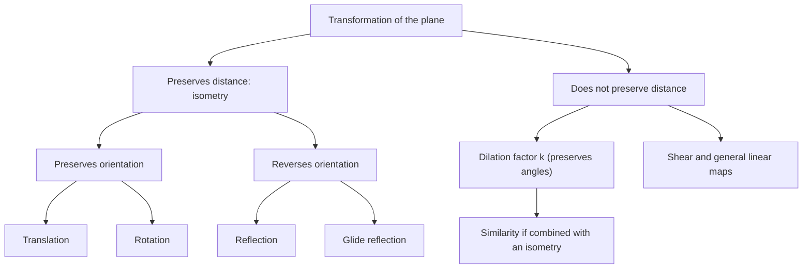

# Geometric Transformations

> [Geometry](../README.md) · Level: Intermediate · Prerequisites: [Coordinate Geometry](../04-coordinate-geometry/README.md), [Elementary Algebra](../../03-algebra/01-elementary-algebra/README.md), [Trigonometry](../../05-trigonometry/README.md) · Estimated time: 8 h

## 1. Introduction

A transformation is a rule that moves every point of the plane to a new point. That one sentence
contains most of the subject. Translate: slide everything by the same vector. Rotate: turn everything
about a fixed point. Reflect: flip everything across a line. Scale: stretch everything away from a
point. Each is a *function of the plane into itself*, and once that is understood, questions about
figures become questions about functions — which can be composed, inverted, and classified.

The gain is not merely notational. Three ideas become available that are clumsy in classical geometry.

1. **Motion as a test of equality.** Two figures are congruent exactly when some distance-preserving
   transformation carries one onto the other; they are similar exactly when some transformation that
   multiplies all lengths by a common factor does. "Same shape" stops being a primitive notion and
   becomes an existence statement about a function.
2. **Symmetry as an algebraic object.** The set of transformations that carry a figure onto itself is
   closed under composition and inversion: it is a *group*. A square has eight symmetries, a regular
   $n$-gon has $2n$, a circle has infinitely many, and the pattern of a tiled floor has one of a small
   list of possible groups. Classifying figures by symmetry replaces case-by-case reasoning with
   algebra.
3. **Composition as a language for machines.** In computer graphics, a robot arm, or a CAD model, the
   position of a part is obtained by composing rotations, translations and scalings. The fact that
   composition is *not* commutative — order matters — is the source of a whole class of practical bugs
   and of the matrix conventions that prevent them.

The topic is also where the plane starts to look like algebra: rotations and reflections are
multiplication by $2\times2$ matrices, translations are additions of vectors, and every isometry has the
form $x\mapsto Ax+b$ with $A$ an orthogonal matrix. That is the doorway to linear algebra and to the
geometry of robotics.

## 2. Prerequisites

* **Coordinates, distance, slope and line equations** — [Coordinate Geometry](../04-coordinate-geometry/README.md).
  Transformations are written in coordinates, and "preserves distance" is tested with the distance
  formula.
* **Trigonometry**: sine and cosine of standard angles, the identities
  $\cos^2\theta+\sin^2\theta=1$, $\cos(\alpha+\beta)$, $\sin(\alpha+\beta)$ —
  [Trigonometry](../../05-trigonometry/README.md).
* **Functions and inverses**: domain, range, composition $f\circ g$, inverse $f^{-1}$ —
  [Elementary Algebra](../../03-algebra/01-elementary-algebra/README.md).
* **Matrix multiplication** is *previewed* here, not assumed: §7.8 explains the $2\times2$ case from
  scratch. The full theory is in the [Linear Algebra](../../08-linear-algebra/README.md) discipline.
* **Angle facts**: the angle sum of a triangle, angles on a straight line, and the interior angle of a
  regular polygon, $\frac{(n-2)180^\circ}{n}$.

## 3. Learning Objectives

By the end of this topic you will be able to:

1. Describe a transformation as a function of the plane, and use the notation $T(P)$, $T\circ S$ and
   $T^{-1}$ correctly.
2. Write the coordinate formulas for translations, rotations about the origin and about an arbitrary
   centre, reflections in the axes, in $y=x$, in $y=-x$ and in a line through the origin, glide
   reflections, and dilations.
3. Prove that every isometry preserves distance (and that a dilation multiplies all distances by
   $\lvert k\rvert$), and explain why preserving distance forces the preservation of angles.
4. Represent rotations, reflections and dilations by $2\times2$ matrices, and recognise translations as
   the non-linear (affine) part.
5. Compute compositions in the correct order, and demonstrate by counterexample that composition is not
   commutative.
6. Find the inverse of each type of transformation and verify it by composition.
7. Determine the line and rotational symmetries of a figure, and describe its symmetry group.
8. Explain the ideas behind frieze and wallpaper patterns and state the classification results.
9. Prove that exactly three regular polygons tile the plane, using the angle-sum argument.

## 4. Intuition

**A transformation is a machine for points.** Feed it a point, it returns a point. Feed it a whole
figure — which is just a set of points — and you get the image of the figure, because the machine is
applied to every point at once. This is why one formula describes the motion of an entire shape.

**Distance-preserving means rigid.** Pick up a paper triangle and move it: no side changes length, no
angle changes. Any motion of a rigid body in the plane is a translation, a rotation, a reflection, or a
glide reflection — those four exhaust the possibilities. A dilation is *not* rigid: it is a scaling of a
photograph, changing lengths while keeping every ratio and every angle.

**Order matters.** Put on your left sock, then your left shoe: a working sequence. Reverse it: a
different, less useful outcome. Transformations compose the same way. Rotating and then reflecting is
not the same as reflecting and then rotating, and §7.9 computes both results explicitly.

**Symmetry is a motion you cannot see.** Fold a square along a diagonal and the two halves match: a
reflection symmetry. Turn it through $90^\circ$ about its centre and it looks unchanged: a rotational
symmetry. A figure's symmetry group is the collection of all such invisible motions, and its size is a
measure of how symmetric the figure is.

**Tiling is symmetry plus a tile.** A floor pattern is a tile together with the motions that repeat it.
The mathematics of wallpaper is the classification of the possible repetition patterns, and the reason
only three regular polygons tile is an arithmetic accident of the angle $360^\circ$.

## 5. Formal Definition

**Definition 5.1 (Transformation).** A *transformation of the plane* is a function $T:\mathbb{R}^2\to
\mathbb{R}^2$. For a point $P$, $T(P)$ is its *image*. For a set $F$ (a figure), the *image* is
$T[F]=\{T(P) : P\in F\}$, written $T(F)$ when no confusion arises. The *preimage* of $Q$ is
$T^{-1}(Q)=\{P : T(P)=Q\}$.

**Definition 5.2 (Fixed point).** $P$ is a *fixed point* of $T$ if $T(P)=P$. The *fixed set* is the set
of all fixed points.

**Definition 5.3 (Isometry).** $T$ is an *isometry* (or *rigid motion*) if
$$d\bigl(T(P),T(Q)\bigr)=d(P,Q)\qquad\text{for all }P,Q\in\mathbb{R}^2 .$$
Every isometry is injective, and every isometry of the plane is surjective; we use both facts, the
second only in the classification of §7.7.

**Definition 5.4 (Translation).** For a vector $(a,b)$, the *translation* by $(a,b)$ is
$$T_{(a,b)}(x,y)=(x+a,\ y+b).$$

**Definition 5.5 (Rotation).** For a point $C$ and an angle $\theta$ measured anticlockwise, the
*rotation* $R_{C,\theta}$ fixes $C$ and carries each point $P\ne C$ to the point $P'$ with
$\lvert CP'\rvert=\lvert CP\rvert$ and $\angle PCP'=\theta$, on the anticlockwise side.

**Definition 5.6 (Reflection).** For a line $\ell$, the *reflection* $r_\ell$ fixes every point of
$\ell$ and carries each point $P\notin\ell$ to the point $P'$ such that $\ell$ is the perpendicular
bisector of $PP'$.

**Definition 5.7 (Glide reflection).** A *glide reflection* is the composition of a reflection in a
line $\ell$ and a translation parallel to $\ell$ with non-zero vector. The line $\ell$ is its *axis*.

**Definition 5.8 (Dilation).** For a centre $C$ and a factor $k\ne0$, the *dilation* $D_{C,k}$ is
$$D_{C,k}(P)=C+k\,(P-C),$$
in vector notation: the point on the line $CP$ whose displacement from $C$ is $k$ times that of $P$.

**Definition 5.9 (Symmetry of a figure).** A *symmetry* of a figure $F$ is an isometry $T$ with
$T(F)=F$. The *symmetry group* $\operatorname{Sym}(F)$ is the set of all symmetries of $F$, with
composition as the operation; it always contains the identity and is closed under composition and
inversion.

**Definition 5.10 (Orientation).** A transformation $T$ *preserves orientation* if for every triangle
$ABC$ the signed area of $T(A)T(B)T(C)$ has the same sign as that of $ABC$; it *reverses orientation*
if the sign is always opposite. Translations, rotations and dilations preserve orientation; reflections
and glide reflections reverse it.

## 6. Mathematical Notation

| Symbol | Read as | Meaning |
|---|---|---|
| $T:\mathbb{R}^2\to\mathbb{R}^2$ | "T maps the plane to itself" | a transformation |
| $T(P)$ | "T of P" | the image of $P$ |
| $T(F)$ | "the image of the figure F" | the set of images of its points |
| $T\circ S$ | "T composed with S" | apply $S$ **first**, then $T$ |
| $T^{-1}$ | "T inverse" | the transformation undoing $T$ |
| $\operatorname{id}$ | "the identity" | $\operatorname{id}(P)=P$ for all $P$ |
| $T_{(a,b)}$ | "translation by a comma b" | $(x,y)\mapsto(x+a,y+b)$ |
| $R_{C,\theta}$ | "rotation about C through theta" | anticlockwise turn about $C$ |
| $R_\theta$ | "R theta" | rotation about the origin |
| $r_\ell$ | "reflection in ell" | mirror in the line $\ell$ |
| $D_{C,k}$ | "dilation centre C factor k" | scaling from $C$ by $k$ |
| $\operatorname{Sym}(F)$ | "the symmetry group of F" | all isometries fixing $F$ |
| $\det A$ | "determinant of A" | signed area scaling factor of a matrix |
| $A^{\mathsf T}$ | "A transpose" | rows and columns exchanged |

Read $T\circ S$ aloud as "T after S". The convention is forced by the function notation
$(T\circ S)(P)=T(S(P))$: the right-hand transformation acts first.

## 7. Core Concepts

### 7.1 Transformations as functions

Everything that can be said about functions can be said about transformations.

* **Composition.** $T\circ S$ is again a transformation, and composition is associative:
  $T\circ(S\circ R)=(T\circ S)\circ R$. It is **not** commutative in general (§7.9).
* **Identity.** $\operatorname{id}(P)=P$ satisfies $T\circ\operatorname{id}=\operatorname{id}\circ T=T$.
* **Inverse.** If $T$ is a bijection, $T^{-1}$ exists and $T\circ T^{-1}=T^{-1}\circ T=\operatorname{id}$.
  Every isometry and every dilation is a bijection; a general transformation, such as a projection, need
  not be.
* **Images of sets.** $T$ applied to a segment gives a segment, to a line gives a line (for isometries
  and dilations), to a circle gives a circle, and to a polygon gives a polygon with the same number of
  vertices in the same cyclic order (reversed for orientation-reversing maps).

Two remarks that prevent most confusion later. First, a transformation is determined by what it does to
*every* point, not just to the vertices of a drawing; the standard mistake is to check a rule on two
points and assume the rest. Second, the notation $T(P)$ and $T(F)$ uses the same symbol for a point and
for a set; context distinguishes them, exactly as in $f(x)$ and $f[A]$ for a general function.

### 7.2 Translations

**Formula.** $T_{(a,b)}(x,y)=(x+a,y+b)$; in vector form $P\mapsto P+v$ with $v=(a,b)$.

**Properties.**

* $T_v$ is an isometry: $\bigl(P+v\bigr)-\bigl(Q+v\bigr)=P-Q$, so differences, and hence lengths, are
  unchanged.
* Angles, orientation, midpoints, parallelism and areas are all preserved.
* If $v\ne(0,0)$ there are **no fixed points**. The fixed set of the identity translation is the whole
  plane; the identity is the only translation that fixes anything.
* **Composition adds:** $T_v\circ T_w=T_{v+w}=T_w\circ T_v$. Translations commute with each other —
  the exception that proves the rule about non-commutativity.
* **Inverse:** $T_v^{-1}=T_{-v}$.
* **Invariant lines.** A line is carried to itself as a set exactly when it is parallel to $v$; any other
  line is carried to a distinct parallel line. (When $v=0$ every line is fixed, since the map is the
  identity.)

**Example.** $T_{(3,-5)}$ sends $(2,7)$ to $(5,2)$. Check the distance from $(2,7)$ to $(5,2)$ is
$\sqrt{9+25}=\sqrt{34}$, so the point really moved $\sqrt{34}$, the length of $(3,-5)$.

### 7.3 Rotations

**About the origin.** Let $P=(x,y)=(r\cos\phi,r\sin\phi)$ in polar form, and rotate through $\theta$.
The image has the same radius and angle $\phi+\theta$, so by the addition formulas

$$
R_\theta(x,y)=\bigl(r\cos(\phi+\theta),\ r\sin(\phi+\theta)\bigr)
=\bigl(x\cos\theta-y\sin\theta,\ x\sin\theta+y\cos\theta\bigr).
$$

**About a general centre $C=(a,b)$.** Translate $C$ to the origin, rotate, translate back:

$$
R_{C,\theta}(x,y)=\bigl(a+(x-a)\cos\theta-(y-b)\sin\theta,\ \ b+(x-a)\sin\theta+(y-b)\cos\theta\bigr).
$$

**Standard angles** (about the origin):

| $\theta$ | Formula | Example |
|---|---|---|
| $90^\circ$ | $(-y,\ x)$ | $(4,0)\mapsto(0,4)$ |
| $180^\circ$ | $(-x,\ -y)$ | $(2,3)\mapsto(-2,-3)$ |
| $270^\circ$ | $(y,\ -x)$ | $(4,0)\mapsto(0,-4)$ |
| $-90^\circ$ | $(y,\ -x)$ | $(3,1)\mapsto(1,-3)$ |

**Properties.** A rotation is an isometry (proof in Theorem 7.3); it preserves orientation; it has
exactly one fixed point, the centre, unless $\theta$ is a multiple of $360^\circ$, in which case it is
the identity. Composition about the same centre adds angles: $R_{C,\alpha}\circ R_{C,\beta}=R_{C,\alpha+\beta}$.
Rotations about *different* centres do not generally compose to a rotation about either centre; the
composition is a rotation through the sum of the angles about a new centre, or a translation when the
angles sum to a multiple of $360^\circ$.

### 7.4 Reflections

**Formulas.** With $\ell$ through the origin making angle $\alpha$ with the $x$-axis, reflection in
$\ell$ is

$$
r_\ell(x,y)=\bigl(x\cos 2\alpha+y\sin 2\alpha,\ \ x\sin 2\alpha-y\cos 2\alpha\bigr).
$$

The special cases are worth memorising:

| Mirror | Formula | Effect on $(2,5)$ |
|---|---|---|
| $x$-axis | $(x,-y)$ | $(2,-5)$ |
| $y$-axis | $(-x,y)$ | $(-2,5)$ |
| $y=x$ | $(y,x)$ | $(5,2)$ |
| $y=-x$ | $(-y,-x)$ | $(-5,-2)$ |
| line at angle $\alpha$ | formula above | — |

**Derivation of the general formula.** In polar form, reflecting the ray at angle $\phi$ in the line at
angle $\alpha$ gives the ray at angle $2\alpha-\phi$. So $r_\ell$ maps
$(r\cos\phi,r\sin\phi)$ to $(r\cos(2\alpha-\phi),r\sin(2\alpha-\phi))$. Expand with the addition
formulas and use $\cos\phi=x/r$, $\sin\phi=y/r$:

$$
r\cos(2\alpha-\phi)=x\cos2\alpha+y\sin2\alpha,\qquad
r\sin(2\alpha-\phi)=x\sin2\alpha-y\cos2\alpha . \qquad\blacksquare
$$

Check $\alpha=0$: $(x,-y)$, the $x$-axis. Check $\alpha=45^\circ$: $\cos90^\circ=0$, $\sin90^\circ=1$,
so $(y,x)$, the line $y=x$. Check $\alpha=90^\circ$: $(-x,y)$, the $y$-axis.

**Properties.** A reflection is an isometry; it reverses orientation; its fixed set is exactly the
mirror line $\ell$; and $r_\ell\circ r_\ell=\operatorname{id}$, so $r_\ell^{-1}=r_\ell$. A reflection is
an *involution*: its own inverse.

### 7.5 Glide reflections

**Definition.** Reflect in a line $\ell$, then translate by a vector $v$ parallel to $\ell$:
$g=r_\ell$ followed by $T_v$. For $\ell$ the $x$-axis and $v=(a,0)$ with $a\ne0$,

$$
g(x,y)=(x+a,\ -y).
$$

**Properties.**

* $g$ is an isometry (composition of two isometries) and reverses orientation.
* $g$ has **no fixed points**. A fixed point would need $x+a=x$ and $-y=y$, i.e. $a=0$ and $y=0$;
  since $a\ne0$ is required, none exists.
* $g\circ g=T_{(2a,0)}$: applying the glide twice translates by twice the glide vector. Indeed
  $g(g(x,y))=g(x+a,-y)=(x+2a,y)$. So $g^{-1}=T_{(-2a,0)}\circ g$, another glide reflection with the
  same axis and opposite glide vector.
* For a general axis $\ell$ and vector $v$ parallel to $\ell$, the same two statements hold:
  $g^2=T_{2v}$ and $g$ has no fixed points.

The glide reflection is the transformation that surprises beginners, because it is neither a
reflection nor a translation yet looks like both. Every footprint trail is a glide reflection: reflect a
foot and slide it forward.

### 7.6 Dilations

**Formula.** $D_{C,k}(P)=C+k(P-C)$. With $C$ the origin, $D_k(x,y)=(kx,ky)$.

**Properties.**

* If $k=1$ it is the identity; if $k=-1$ about the origin it is the half-turn $(x,y)\mapsto(-x,-y)$.
* All lengths are multiplied by $\lvert k\rvert$: $d(D(P),D(Q))=\lvert k\rvert\,d(P,Q)$. So a dilation is
  an isometry only when $\lvert k\rvert=1$.
* All angles are preserved, and so is orientation (the determinant is $k^2>0$ in two dimensions).
* Areas are multiplied by $k^2$; this is why enlarging a photograph by $2$ quadruples the ink.
* The fixed set is $\{C\}$ when $k\ne1$; when $k=1$ everything is fixed.
* Lines map to parallel lines; a line through the centre maps to itself.
* Composition about the same centre multiplies factors: $D_{C,k}\circ D_{C,l}=D_{C,kl}$. About different
  centres, the composition is a dilation with factor $kl$ about a third centre (or a translation when
  $kl=1$).
* **Inverse:** $D_{C,k}^{-1}=D_{C,1/k}$.

A *similarity* is a dilation composed with an isometry. It preserves all angles and multiplies all
lengths by a fixed factor; this is the transformation-theoretic definition of similar figures.

### 7.7 Isometries preserve distance and angle

**Theorem 7.1 (Composition of isometries).** If $S$ and $T$ are isometries then $T\circ S$ is an
isometry.

**Proof.** For any $P,Q$,
$d\bigl(T(S(P)),T(S(Q))\bigr)=d\bigl(S(P),S(Q)\bigr)=d(P,Q)$, using first that $T$ preserves distances
and then that $S$ does. $\blacksquare$

This one line covers glide reflections (reflection then translation) and any longer composition.

**Theorem 7.2 (Translations and dilations).** $T_v$ preserves distances; $D_{C,k}$ multiplies them by
$\lvert k\rvert$.

**Proof.** $\lvert(P+v)-(Q+v)\rvert=\lvert P-Q\rvert$; and
$\lvert D(P)-D(Q)\rvert=\lvert k(P-Q)\rvert=\lvert k\rvert\,\lvert P-Q\rvert$. $\blacksquare$

**Theorem 7.3 (Rotations and reflections).** $R_{C,\theta}$ and $r_\ell$ preserve distances.

**Proof.** By Theorem 7.2 and the translation trick, it suffices to treat rotations and reflections
about/through the origin. Both have the form $X\mapsto MX$ with

$$
R_\theta=\begin{pmatrix}\cos\theta&-\sin\theta\\ \sin\theta&\cos\theta\end{pmatrix},
\qquad
S_\alpha=\begin{pmatrix}\cos2\alpha&\sin2\alpha\\ \sin2\alpha&-\cos2\alpha\end{pmatrix}.
$$

For either matrix $M$ one checks $M^{\mathsf T}M=I$: for $R_\theta$ this is
$\cos^2\theta+\sin^2\theta=1$; for $S_\alpha$ it is the same identity with $2\alpha$ in place of
$\theta$. Hence, for any vector $w$,

$$
\lvert Mw\rvert^2=(Mw)\cdot(Mw)=w^{\mathsf T}M^{\mathsf T}Mw=w^{\mathsf T}w=\lvert w\rvert^2 .
$$

Applying this to $w=P-Q$ gives $\lvert MP-MQ\rvert=\lvert P-Q\rvert$. $\blacksquare$

**Theorem 7.4 (Angles are preserved).** Isometries preserve angles. More generally, so does every
transformation of the form $X\mapsto MX$ with $M^{\mathsf T}M=I$, and so does every dilation.

**Proof.** For such an $M$, the computation above applied to two vectors gives
$(Mu)\cdot(Mv)=u^{\mathsf T}M^{\mathsf T}Mv=u\cdot v$. The angle between $Mu$ and $Mv$ is determined by
$\cos\angle=\dfrac{(Mu)\cdot(Mv)}{\lvert Mu\rvert\,\lvert Mv\rvert}=\dfrac{u\cdot v}{\lvert u\rvert\,\lvert v\rvert}$,
the same as the angle between $u$ and $v$. A dilation multiplies both numerator and denominator by
$k^2$, leaving the cosine unchanged. $\blacksquare$

**Corollary (collinearity and betweenness).** Isometries map lines to lines and preserve betweenness, so
they map segments to segments, triangles to congruent triangles, circles to circles of the same radius,
and polygons to congruent polygons. Consequently congruence of figures is exactly the existence of an
isometry carrying one to the other — the definition used in the rest of this repository.

**Theorem 7.5 (Classification of plane isometries).** Every isometry of the plane is exactly one of: a
translation, a rotation, a reflection, or a glide reflection.

**Proof sketch.** Every isometry has the form $T(X)=AX+b$ where $A$ is a $2\times2$ matrix with
$A^{\mathsf T}A=I$ (orthogonal) and $b\in\mathbb{R}^2$; this is the content of Exercise 27. If
$\det A=1$, then $A$ is a rotation matrix $R_\theta$: when $\theta\ne0$ the equation $X=R_\theta X+b$
has the unique solution $C=(I-R_\theta)^{-1}b$, and $T$ is the rotation about $C$ through $\theta$; when
$\theta=0$, $T$ is the translation $X\mapsto X+b$. If $\det A=-1$, then $A$ is a reflection matrix; if
$T$ has a fixed point it is a reflection in the line through that point, and if it has none it is a
glide reflection. $\blacksquare$

The classification is what makes "rigid motion" a finite list rather than a vague idea, and it is the
reason a symmetry group can be computed by listing four types of motion.

### 7.8 Matrix representation of linear transformations (preview)

A transformation of the form $X\mapsto MX$ with $M$ a $2\times2$ matrix is called *linear*: it fixes the
origin and respects sums, $M(u+v)=Mu+Mv$, and scalars, $M(\lambda u)=\lambda Mu$.

$$
\begin{pmatrix}a&b\\ c&d\end{pmatrix}\begin{pmatrix}x\\ y\end{pmatrix}
=\begin{pmatrix}ax+by\\ cx+dy\end{pmatrix}.
$$

| Transformation | Matrix | $\det$ | Orientation |
|---|---|---|---|
| Rotation $R_\theta$ | $\begin{pmatrix}\cos\theta&-\sin\theta\\ \sin\theta&\cos\theta\end{pmatrix}$ | $1$ | preserved |
| Reflection in $x$-axis | $\begin{pmatrix}1&0\\ 0&-1\end{pmatrix}$ | $-1$ | reversed |
| Reflection in $y$-axis | $\begin{pmatrix}-1&0\\ 0&1\end{pmatrix}$ | $-1$ | reversed |
| Reflection in $y=x$ | $\begin{pmatrix}0&1\\ 1&0\end{pmatrix}$ | $-1$ | reversed |
| Dilation $D_k$ | $\begin{pmatrix}k&0\\ 0&k\end{pmatrix}$ | $k^2$ | preserved |
| Shear $S$ | $\begin{pmatrix}1&1\\ 0&1\end{pmatrix}$ | $1$ | preserved |

The determinant has a geometric meaning: it is the factor by which areas are multiplied, with a negative
sign meaning that orientation is reversed. A shear preserves area and orientation but is *not* an
isometry — it changes lengths and angles — which shows that "area-preserving" and "rigid" are different
requirements.

**Translations are not linear**, because $T_v(0)=v\ne0$. They are *affine*: every isometry and every
dilation has the form

$$
X\longmapsto MX+b
$$

with $M$ as in the table and $b$ a translation vector. In computer graphics this pair is stored as a
single $3\times3$ matrix acting on *homogeneous* coordinates $(x,y,1)$:

$$
\begin{pmatrix}M&b\\ 0\ 0&1\end{pmatrix}
\begin{pmatrix}x\\ y\\ 1\end{pmatrix}
=\begin{pmatrix}M(x,y)+b\\ 1\end{pmatrix},
$$

whose advantage is that composition of affine maps becomes ordinary matrix multiplication — one reason
GPUs can chain dozens of transformations per vertex cheaply.

### 7.9 Composition and non-commutativity

**Composition is applying one transformation after another**, with the rightmost acting first:
$(T\circ S)(P)=T(S(P))$. Two facts are needed for fluency.

**Theorem 7.6 (Associativity holds, commutativity fails).** Composition of transformations is
associative, because it is composition of functions; it is not commutative, as the following
counterexample shows.

**Proof of non-commutativity by explicit counterexample.** Let $F$ be the reflection in the $x$-axis,
$F(x,y)=(x,-y)$, and $R$ the rotation by $90^\circ$ about the origin, $R(x,y)=(-y,x)$. Then

$$
(F\circ R)(x,y)=F(-y,x)=(-y,-x),\qquad
(R\circ F)(x,y)=R(x,-y)=(y,x).
$$

These differ: for instance at $(1,1)$ the first gives $(-1,-1)$ and the second gives $(1,1)$. Indeed
$F\circ R$ is the reflection in the line $y=-x$, while $R\circ F$ is the reflection in $y=x$.
$\blacksquare$

The example is worth internalising: **a reflection and a rotation composed in different orders give
different reflections**, both of which are perfectly plausible if you only check one point. Note also
that each composite is orientation-reversing, because a reflection has determinant $-1$ and a rotation
has determinant $+1$.

**Useful composition rules**, all provable from the formulas:

| Composition | Result |
|---|---|
| $T_v\circ T_w$ | $T_{v+w}$ (translations commute) |
| $R_{C,\alpha}\circ R_{C,\beta}$ | $R_{C,\alpha+\beta}$ |
| $r_\beta\circ r_\alpha$ (lines through the origin at angles $\alpha$, $\beta$) | rotation by $2(\beta-\alpha)$ |
| $D_{C,k}\circ D_{C,l}$ | $D_{C,kl}$ |
| $r_\ell\circ r_\ell$ | $\operatorname{id}$ |
| reflection in parallel lines $x=a$, $x=b$ | translation by $2(b-a)$ |
| reflection in intersecting lines at angle $\theta$ | rotation by $2\theta$ about the intersection |
| rotation then translation, angle $\theta\ne0$ | rotation through $\theta$ about a new centre |

**Theorem 7.7 (Two reflections).** The composition of the reflections in two parallel lines is a
translation by twice the distance between them, perpendicular to them. The composition of the
reflections in two intersecting lines is a rotation about their intersection through twice the angle
between them.

**Proof (parallel case).** For the lines $x=a$ and $x=b$, reflection in $x=a$ is $x\mapsto 2a-x$ and in
$x=b$ is $x\mapsto2b-x$. Composing in either order,

$$
x\longmapsto 2b-(2a-x)=x+2(b-a),
$$

a translation by $2(b-a)$, which is twice the separation, perpendicular to the lines. (The other order
gives $x+2(a-b)$: same distance, opposite direction — a second illustration of non-commutativity.)

**Proof (intersecting case).** Let the lines meet at $O$ with directions $\alpha$ and $\beta$. Reflect
first in the line at $\alpha$, then in the line at $\beta$. A ray from $O$ at angle $\phi$ goes to angle
$2\alpha-\phi$, then to $2\beta-(2\alpha-\phi)=\phi+2(\beta-\alpha)$. So every ray is rotated by the
same angle $2(\beta-\alpha)$ about $O$, and $O$ is fixed; the composition is that rotation.
$\blacksquare$

### 7.10 Inverse transformations

**Definition.** $T^{-1}$ is the transformation with $T^{-1}(T(P))=P$ and $T(T^{-1}(P))=P$ for all $P$; it
exists exactly when $T$ is a bijection, and then it is unique.

| Transformation | Inverse | Check |
|---|---|---|
| $T_{(a,b)}$ | $T_{(-a,-b)}$ | $(x+a-a,\ y+b-b)=(x,y)$ |
| $R_{C,\theta}$ | $R_{C,-\theta}$ | angles add to $0$ |
| $r_\ell$ | $r_\ell$ | reflection is an involution |
| glide $T_v\circ r_\ell$ | $T_{-v}\circ r_\ell$ | $(T_{-v}r_\ell)(T_v r_\ell)=\operatorname{id}$ since $r_\ell$ commutes with translations parallel to $\ell$ |
| $D_{C,k}$ | $D_{C,1/k}$ | factors multiply to $1$ |
| affine $X\mapsto MX+b$ | $X\mapsto M^{-1}(X-b)$ | needs $\det M\ne0$ |

**Geometric meaning.** The inverse of a translation is a translation back; of a rotation, the opposite
rotation; of a reflection, itself; of a dilation, the reciprocal scaling; of a glide reflection, the
glide in the opposite direction. Taking inverses reverses the order of a composition:

$$
(T\circ S)^{-1}=S^{-1}\circ T^{-1},
$$

which is the "socks and shoes" rule and is proved by composing both sides with $T\circ S$.

### 7.11 Symmetry of figures

**Definition.** $\operatorname{Sym}(F)=\{T \text{ an isometry} : T(F)=F\}$. The identity belongs, and the
set is closed under composition and inverses, so it forms a *group* under composition. Its size
$\lvert\operatorname{Sym}(F)\rvert$ measures the symmetry of $F$.

**Counts for standard figures.**

| Figure | Lines of symmetry | Rotational symmetries | $\lvert\operatorname{Sym}(F)\rvert$ |
|---|---|---|---|
| Scalene triangle | $0$ | $1$ (identity only) | $1$ |
| Isosceles (non-equilateral) triangle | $1$ | $1$ | $2$ |
| Equilateral triangle | $3$ | $3$ ($120^\circ,240^\circ,\operatorname{id}$) | $6$ |
| Non-square rectangle | $2$ | $2$ ($180^\circ,\operatorname{id}$) | $4$ |
| Square | $4$ | $4$ ($90^\circ,180^\circ,270^\circ,\operatorname{id}$) | $8$ |
| Rhombus (non-square) | $2$ | $2$ | $4$ |
| Parallelogram (non-rhombus, non-rectangle) | $0$ | $2$ | $2$ |
| Regular $n$-gon | $n$ | $n$ | $2n$ |
| Circle | infinitely many | all rotations | infinite |

**Theorem 7.8 (Symmetries of a regular $n$-gon).** A regular $n$-gon has exactly $n$ rotations and $n$
reflections as symmetries, hence $2n$ in total. This group is the *dihedral group* $D_n$.

**Proof.** A symmetry must send the centre to itself (the centre is the unique point equidistant from all
vertices) and must permute the vertices while preserving their cyclic order and adjacency. Rotations
about the centre through $360^\circ k/n$ for $k=0,1,\dots,n-1$ give $n$ symmetries. For odd $n$ each
reflection axis passes through one vertex and the midpoint of the opposite side; for even $n$ an axis
either joins two opposite vertices or joins the midpoints of two opposite sides. In either case there are
exactly $n$ such axes, giving the other $n$ symmetries. No other isometry qualifies, since an isometry is
determined by the images of three non-collinear points, and the centre together with one vertex
determines the rest. $\blacksquare$

**The square, concretely.** With $r$ the rotation by $90^\circ$ and $s$ a reflection,
$\operatorname{Sym}(\text{square})=\{\operatorname{id},r,r^2,r^3,s,rs,r^2s,r^3s\}$ and the relations
$r^4=\operatorname{id}$, $s^2=\operatorname{id}$, $srs=r^{-1}$ determine the whole multiplication table.
The last relation is the algebraic statement "reflecting twice in different orders gives opposite
rotations".

**Symmetry and tiling are cousins.** If a figure is tiled by copies of a tile, the transformations
carrying the tiling to itself are its symmetry group; the tile is a fundamental domain for the repeated
motion.

### 7.12 Frieze and wallpaper patterns

A *frieze pattern* is a design invariant under a translation in one direction, with bounded width — the
repeating border of a Greek temple or a strip of wallpaper. Two classification theorems, both proved in
the nineteenth century, are worth knowing by statement.

* **Frieze groups.** There are exactly **seven** isomorphism classes of symmetry groups of frieze
  patterns. They are distinguished by which of the four elementary operations occur: translation,
  horizontal reflection (in the frieze axis), vertical reflection, and half-turn; glide reflections and
  rotations appear as consequences of combinations.
* **Wallpaper groups.** There are exactly **seventeen** plane crystallographic groups: the symmetry
  groups of patterns invariant under two independent translations. Every periodic wallpaper design, and
  every two-dimensional crystal, has one of these seventeen.
* **Crystallographic restriction.** In any such pattern, the only possible rotational orders are
  $1,2,3,4,6$. A five-fold rotation is impossible. The reason is arithmetic: represent the lattice by
  vectors, and the rotation matrix in that basis has integer entries, so its trace
  $2\cos(2\pi/n)$ is an integer; since $\lvert2\cos(2\pi/n)\rvert\le2$, we need
  $2\cos(2\pi/n)\in\{-2,-1,0,1,2\}$, giving $n\in\{1,2,3,4,6\}$.
* **Why "ideas" and not a full classification here.** Proving the seven and seventeen theorems requires
  a case analysis of glide axes, rotation centres and reflections that runs to many pages. What matters
  at this level is the mechanism: a periodic pattern is generated by a *fundamental domain* plus a
  discrete group of isometries, and the group's structure constrains the design severely.

**Design consequences.** A strip pattern can have at most the symmetries of its frieze group, so a
designer who wants variety should choose which of the seven to use rather than adding ornaments at
random. A wallpaper designer likewise chooses one of seventeen lattices and point-symmetry types; this
is exactly the vocabulary of Islamic geometric ornament, of textile repeats, and of digital texture
tiling.

### 7.13 Tessellations and why only three regular polygons tile

A *tessellation* (tiling) is a covering of the plane by non-overlapping regions with no gaps. A
*regular* tessellation uses congruent copies of one regular polygon.

**Theorem 7.9 (The three regular tilings).** The only regular polygons that tile the plane are the
equilateral triangle, the square and the regular hexagon.

**Proof.** Let the regular polygon have $n$ sides. Its interior angle is $\alpha=\frac{(n-2)180^\circ}{n}$.
At a vertex of the tiling, $k\ge3$ tiles must meet (two would leave a gap or overlap), and their angles
must fill the full turn:

$$
k\alpha=360^\circ
\quad\Longrightarrow\quad
k\cdot\frac{(n-2)180^\circ}{n}=360^\circ
\quad\Longrightarrow\quad
k=\frac{2n}{n-2}=2+\frac{4}{n-2}.
$$

Since $k$ is an integer, $n-2$ must divide $4$. As $n\ge3$, the possibilities are
$n-2\in\{1,2,4\}$, i.e. $n\in\{3,4,6\}$, with $k=6,4,3$ respectively. Each of these values really does
work: six equilateral triangles, four squares, three hexagons meet at every vertex, and the
corresponding tilings are the familiar triangular, square and hexagonal grids. $\blacksquare$

**Remarks.**

* The argument uses only the vertex condition. For regular polygons that condition is also sufficient,
  which is why the three cases really do tile; for irregular tiles it is not — a set of angles summing
  to $360^\circ$ at each vertex need not close up globally.
* $n=5$ fails immediately: $\alpha=108^\circ$ and $360/108=3.33\ldots$, so three pentagons leave a
  $36^\circ$ gap and four overlap. Regular pentagons do not tile the plane, although *irregular*
  pentagons can (there are fifteen known families of convex pentagon tilings).
* Combinations of regular polygons give the eight *semiregular* (Archimedean) tilings, in which several
  polygon types meet in the same pattern at every vertex. Allowing two sizes of a regular polygon gives
  further tilings, so "only three" is a statement about *one congruent regular polygon*, not about
  polygonal tilings in general.

## 8. Formulas and Properties

| Transformation | Formula (origin-based) | Matrix | Fixed set | Inverse | Orientation |
|---|---|---|---|---|---|
| Translation $T_{(a,b)}$ | $(x+a,\ y+b)$ | — (affine part $b$) | none if $(a,b)\ne0$ | $T_{(-a,-b)}$ | preserved |
| Rotation $R_\theta$ | $(x\cos\theta-y\sin\theta,\ x\sin\theta+y\cos\theta)$ | $\begin{pmatrix}\cos\theta&-\sin\theta\\ \sin\theta&\cos\theta\end{pmatrix}$ | origin | $R_{-\theta}$ | preserved |
| Rotation about $(h,k)$ | translate, rotate, translate back | — | $(h,k)$ | $R_{(h,k),-\theta}$ | preserved |
| Reflection in $x$-axis | $(x,-y)$ | $\begin{pmatrix}1&0\\0&-1\end{pmatrix}$ | the axis | itself | reversed |
| Reflection in $y$-axis | $(-x,y)$ | $\begin{pmatrix}-1&0\\0&1\end{pmatrix}$ | the axis | itself | reversed |
| Reflection in $y=x$ | $(y,x)$ | $\begin{pmatrix}0&1\\1&0\end{pmatrix}$ | $y=x$ | itself | reversed |
| Reflection in $y=-x$ | $(-y,-x)$ | $\begin{pmatrix}0&-1\\-1&0\end{pmatrix}$ | $y=-x$ | itself | reversed |
| Reflection at angle $\alpha$ | $(x\cos2\alpha+y\sin2\alpha,\ x\sin2\alpha-y\cos2\alpha)$ | $\begin{pmatrix}\cos2\alpha&\sin2\alpha\\ \sin2\alpha&-\cos2\alpha\end{pmatrix}$ | that line | itself | reversed |
| Glide reflection | $(x+a,-y)$ for axis $x$-axis | — | none | glide with vector $(-a,0)$ | reversed |
| Dilation $D_{C,k}$ | $C+k(P-C)$ | $kI$ | $\{C\}$ if $k\ne1$ | $D_{C,1/k}$ | preserved |

**Properties shared by all isometries.** They preserve distance, angle, collinearity, betweenness,
circles and areas; they map triangles to congruent triangles; and they form a group under composition.
Orientation is preserved by translations and rotations (determinant $+1$) and reversed by reflections
and glide reflections (determinant $-1$).

**Composition checklist.** Write compositions in the order "last applied on the left". For affine maps
$X\mapsto M_1X+b_1$ and $X\mapsto M_2X+b_2$, the composite is
$X\mapsto M_1M_2X+(M_1b_2+b_1)$ — matrix product and transformed translation. This single formula
reproduces every rule in §7.9 and is the working tool in graphics and robotics.

**Area and length scaling.** An isometry multiplies lengths by $1$ and areas by $1$; a dilation by
$\lvert k\rvert$ and $k^2$; an affine map with matrix $M$ multiplies areas by $\lvert\det M\rvert$. A
shear with matrix $\begin{pmatrix}1&1\\0&1\end{pmatrix}$ keeps areas but distorts lengths, which is why
area computations may use affine maps while congruence may not.

## 9. Step-by-Step Examples

### Example 1 — The four elementary motions on one point

Take $P(3,-2)$. Then

* $T_{(4,5)}(P)=(3+4,\,-2+5)=(7,3)$;
* $R_{90^\circ}(P)=(-(-2),\,3)=(2,3)$ using $(x,y)\mapsto(-y,x)$;
* $r_{y\text{-axis}}(P)=(-3,-2)$;
* $D_{(0,0),2}(P)=(6,-4)$.

**Check.** Each image is at the expected distance from the origin: $\lvert OP\rvert=\sqrt{13}$, and the
rotation and reflection images also have $\sqrt{13}$; only the dilation changes it, to
$\sqrt{36+16}=\sqrt{52}=2\sqrt{13}$. $\checkmark$

### Example 2 — Using the rotation matrix

Rotation by $90^\circ$ has matrix $R=\begin{pmatrix}0&-1\\ 1&0\end{pmatrix}$. Applying it to $(2,5)$:

$$
R\begin{pmatrix}2\\ 5\end{pmatrix}=\begin{pmatrix}0\cdot2-1\cdot5\\ 1\cdot2+0\cdot5\end{pmatrix}=\begin{pmatrix}-5\\ 2\end{pmatrix},
$$

which matches $(-y,x)$. **Check:** $R^{\mathsf T}R=\begin{pmatrix}0&1\\-1&0\end{pmatrix}\begin{pmatrix}0&-1\\1&0\end{pmatrix}=\begin{pmatrix}1&0\\0&1\end{pmatrix}$,
so $R$ is orthogonal, and indeed $\lvert(-5,2)\rvert=\sqrt{29}=\lvert(2,5)\rvert$.

### Example 3 — Rotation about a point other than the origin

Rotate $P(4,3)$ through $90^\circ$ about $C(1,1)$.

**Strategy.** Subtract $C$, rotate, add $C$ back. With $P-C=(3,2)$ and the quarter-turn $(x,y)\mapsto(-y,x)$:

$$
P'=C+(-2,3)=(1-2,\,1+3)=(-1,4).
$$

**Check.** $\lvert CP\rvert=\sqrt{9+4}=\sqrt{13}$ and $\lvert CP'\rvert=\sqrt{4+9}=\sqrt{13}$. Also
$(P-C)\cdot(P'-C)=(3,2)\cdot(-2,3)=-6+6=0$, so the angle at $C$ is indeed $90^\circ$. Using the general
formula directly: $x'=1+3\cos90^\circ-2\sin90^\circ=1-2=-1$ and
$y'=1+3\sin90^\circ+2\cos90^\circ=1+3=4$. $\checkmark$

### Example 4 — Composition is not commutative

Let $F(x,y)=(x,-y)$ (reflection in the $x$-axis) and $R(x,y)=(-y,x)$ (quarter-turn). Compute both orders
at $P(1,1)$:

$$
(F\circ R)(1,1)=F(-1,1)=(-1,-1),\qquad (R\circ F)(1,1)=R(1,-1)=(1,1).
$$

**Conclusion.** The two composites disagree at a single point, so they are different transformations.
Indeed $F\circ R$ is the reflection in $y=-x$, since $(x,y)\mapsto(-y,-x)$, while $R\circ F$ is the
reflection in $y=x$, since $(x,y)\mapsto(y,x)$. Both are orientation-reversing: each is the composite of
one reflection (determinant $-1$) with one rotation (determinant $+1$).

### Example 5 — Images of lines

**Reflection in the $y$-axis.** A point of $y=2x+1$ is $(x,\,2x+1)$, whose image is $(-x,\,2x+1)$. Put
$X=-x$, so $x=-X$; then the image satisfies $Y=2(-X)+1=-2X+1$. The image line is $y=-2x+1$. Its slope is
the negative of the original slope, as a mirror in a vertical line should give.

**Quarter-turn.** A point of $y=3x-1$ is $(x,\,3x-1)$, with image $(-(3x-1),\,x)=(1-3x,\,x)$. Put
$Y=x$; then $X=1-3Y$, i.e. $Y=\frac{1-X}{3}$. The image is $y=\frac{1-x}{3}$, or $x+3y=1$.

**Check.** The original line meets the $y$-axis at $(0,-1)$; under a quarter-turn that point goes to
$(1,0)$, and $(1,0)$ does satisfy $x+3y=1$. The original has slope $3$; the image has slope $-\frac13$,
the negative reciprocal, as a $90^\circ$ rotation requires.

### Example 6 — A glide reflection dissected

Let $g(x,y)=(x+3,-y)$: reflection in the $x$-axis followed by translation by $(3,0)$.

* **No fixed point:** $x+3=x$ is impossible.
* **Square:** $g(g(x,y))=g(x+3,-y)=(x+6,y)=T_{(6,0)}$.
* **Inverse:** $g^{-1}(x,y)=(x-3,-y)$, and indeed $g(g^{-1}(x,y))=g(x-3,-y)=(x,y)$.
* **Axis:** the $x$-axis is mapped to itself as a set (points on it slide along it), which is why the
  glide "looks like" a translation when you watch only the axis.

**Check with a point.** $(0,0)\mapsto(3,0)\mapsto(6,0)$: two applications move the point $6$ units, in
agreement with $g^2=T_{(6,0)}$.

### Example 7 — Two reflections make a rotation

Reflect first in the $x$-axis (angle $\alpha=0^\circ$) and then in the line at $30^\circ$; the theorem
predicts a rotation by $2(30^\circ-0^\circ)=60^\circ$.

Apply to $(1,0)$: the first reflection fixes it, and the second uses
$(x\cos60^\circ+y\sin60^\circ,\ x\sin60^\circ-y\cos60^\circ)$, giving
$\left(\tfrac12,\tfrac{\sqrt3}{2}\right)$, the point at $60^\circ$, as predicted.

Apply to $(0,1)$: the first reflection gives $(0,-1)$; the second gives
$\left(0\cdot\tfrac12+(-1)\tfrac{\sqrt3}{2},\ 0\cdot\tfrac{\sqrt3}{2}-(-1)\tfrac12\right)=\left(-\tfrac{\sqrt3}{2},\tfrac12\right)$,
which is at angle $150^\circ=90^\circ+60^\circ$. Both images are rotated by $60^\circ$, and the
intersection point $(0,0)$ is fixed, so the composite is exactly $R_{60^\circ}$.

**Check lengths.** $\lvert(1,0)\rvert=1=\lvert(\tfrac12,\tfrac{\sqrt3}{2})\rvert$, and
$\lvert(0,1)\rvert=1=\lvert(-\tfrac{\sqrt3}{2},\tfrac12)\rvert$: a composition of two isometries is an
isometry. $\checkmark$

### Example 8 — The angle condition for regular tilings

For a regular $n$-gon the interior angle is $\alpha=(n-2)180^\circ/n$ and the number of tiles at a vertex
must be $k=360^\circ/\alpha=2+\frac{4}{n-2}$:

| $n$ | $\alpha$ | $k=360^\circ/\alpha$ | Tiles? |
|---|---|---|---|
| $3$ | $60^\circ$ | $6$ | yes |
| $4$ | $90^\circ$ | $4$ | yes |
| $5$ | $108^\circ$ | $3.333\ldots$ | no |
| $6$ | $120^\circ$ | $3$ | yes |
| $8$ | $135^\circ$ | $2.667\ldots$ | no |
| $12$ | $150^\circ$ | $2.4$ | no |

Only $n=3,4,6$ give an integer $k\ge3$, which is Theorem 7.9 in tabular form. (Two tiles meeting at a
vertex would need two angles summing to $360^\circ$, each below $180^\circ$, which is impossible for
convex polygons — so $k\ge3$ always.)

## 10. Visual Explanations

**Grouping the transformations.** The first division is by rigidity: isometries preserve all distances,
dilations and shears do not. The second is by orientation.

**Symmetry at a glance.** The counts of §7.11 in one line: an equilateral triangle has $6$ symmetries, a
square $8$, a regular pentagon $10$, a regular hexagon $12$, a non-square rectangle $4$, and a generic
parallelogram $2$.

## 11. Common Mistakes

1. **Composing in the wrong order.** $T\circ S$ means $S$ first. In matrix language the composite is
   $M_TM_S$, and in code the last transformation applied is the *leftmost* factor. Write one test point
   through both steps when in doubt.
2. **Assuming commutativity.** Rotations and reflections do not commute, and neither do rotations about
   different centres. Only translations among themselves (and dilations about a common centre) commute
   freely.
3. **Rotating about the origin by accident.** A rotation formula without a centre applies to the origin.
   For any other centre, subtract it first and add it back.
4. **Forgetting that reflections reverse orientation.** A reflection is not a rotation: no rotation
   turns a left hand into a right hand.
5. **Using $\theta$ instead of $2\theta$ in a reflection.** The reflection formula involves $\cos2\alpha$
   and $\sin2\alpha$, not $\cos\alpha$ and $\sin\alpha$. A quick check: at $\alpha=45^\circ$ the answer
   must be $(y,x)$, which requires $2\alpha=90^\circ$.
6. **Calling a glide reflection a reflection.** A reflection has a whole line of fixed points; a glide
   reflection has none. If the formula contains a slide along the mirror, it is a glide.
7. **Confusing "no fixed points" with "no symmetry".** A non-trivial translation has no fixed points yet
   is a perfectly good symmetry of a frieze pattern.
8. **Thinking a figure's symmetry group is determined by its number of sides.** A rectangle and a rhombus
   both have four sides and four symmetries, but different groups; a general parallelogram has four sides
   and only two symmetries.
9. **Believing any angle that divides $360^\circ$ tiles.** The vertex condition $k\alpha=360^\circ$ is
   necessary and, for regular polygons, sufficient — but for irregular tiles it is only necessary, and
   the global pattern may fail to close up.
10. **Reversing $T^{-1}$ order.** $(T\circ S)^{-1}=S^{-1}\circ T^{-1}$, not $T^{-1}\circ S^{-1}$; test
    by composing with $T\circ S$ on one point.

## 12. Applications

**Computer graphics.** Every object on screen is placed by a composition of scalings, rotations and
translations, applied to model coordinates and then to camera and screen coordinates. Because affine maps
compose as matrices, a whole chain collapses into one $3\times3$ matrix per object, which is why GPUs can
transform millions of vertices per frame. The determinant's sign controls orientation, used for back-face
culling; the inverse maps screen clicks back into the model, used for picking. Sprite animation is a
sequence of translations, and rotation about a joint is a rotation about a non-origin point.

**Robotics.** A planar robot's pose is a rotation followed by a translation — an element of the group
$\mathrm{SE}(2)$. A chain of links composes one such transformation per joint, giving forward kinematics;
the inverse recovers joint angles from a desired pose, and path following expresses the world in the
robot's frame. The classification of plane isometries (Theorem 7.5) guarantees that any rigid
displacement has a translation-plus-rotation description, so no motion type is missed.

**Crystallography.** A crystal is a lattice plus a motif; its symmetry group is one of the 17 wallpaper
groups in two dimensions (230 space groups in three dimensions), and the crystallographic restriction
forbids five-fold rotational symmetry in a periodic lattice. The five-fold symmetry of quasicrystals
(1982) therefore forced a revision of the definition of a crystal, and the same arithmetic forbids a
periodic tiling by regular pentagons.

**Design and decorative art.** Frieze groups classify border ornaments — all seven types occur in Greek,
Roman, Egyptian and Islamic ornament and in modern typographic rules — and wallpaper groups classify
repeating patterns, so a designer picks a lattice and a motif rather than improvising. Tessellation design
(Escher's prints, tiling puzzles, facade patterns) exploits the three regular tilings and their
semiregular relatives, and Theorem 7.9 tells a designer immediately which regular polygons can meet
edge to edge.

## 13. Exercises

[exercises.md](exercises.md) contains 35 problems, from applying a formula to proving the classification
theorems. Work them with squared paper and a calculator for the trigonometric cases; the point of the
early problems is speed and accuracy, and the point of the later ones is proof.

## 14. Solutions

[solutions.md](solutions.md) gives a complete worked solution for each exercise, numbered to match, with
the strategy and the checks.

## 15. Summary

* A transformation is a function of the plane; figures move because every point moves.
* Translations add a vector, rotations turn about a centre, reflections mirror in a line, glide
  reflections reflect and slide, dilations scale from a centre.
* Isometries preserve distance; preserving distance forces preservation of angle, collinearity and area,
  because rotation and reflection matrices satisfy $M^{\mathsf T}M=I$.
* Every plane isometry is a translation, a rotation, a reflection or a glide reflection.
* Rotations, reflections and dilations are linear maps $X\mapsto MX$; translations make them affine,
  $X\mapsto MX+b$; homogeneous coordinates turn both into matrix products.
* Composition is associative and generally not commutative; two reflections in parallel lines give a
  translation, in intersecting lines a rotation through twice the angle.
* Each type has an explicit inverse; inverses reverse the order of a composition.
* The symmetries of a figure form a group; a regular $n$-gon has $2n$ of them (dihedral group $D_n$).
* Frieze patterns have 7 symmetry types and wallpaper patterns 17; periodic lattices allow rotational
  orders $1,2,3,4,6$ only.
* Exactly three regular polygons tile: triangle, square, hexagon, because $k=2+4/(n-2)$ must be an
  integer.

## 16. Further Learning

**Next in this repository.** Symmetry groups are the gateway to
[Abstract Algebra](../../13-abstract-algebra/README.md); the matrix representation of §7.8 is developed
systematically in [Linear Algebra](../../08-linear-algebra/README.md), where orthogonal matrices,
determinants and change of basis are treated in full. For the geometry of the plane at a higher level,
see the [Topology](../../17-topology/README.md) discipline, where transformations become homeomorphisms
and the symmetries of a figure become a group acting on a space. Non-Euclidean geometry — listed in the
[Geometry index](../README.md) — studies spaces whose isometries behave differently, and
[Complex Analysis](../../15-complex-analysis/README.md) turns rotations and dilations into multiplication
by complex numbers.

**Standard references.**

* H. S. M. Coxeter and W. O. J. Moser, *Generators and Relations for Discrete Groups* — the standard
  treatment of frieze and wallpaper groups.
* D. Hilbert and S. Cohn-Vossen, *Geometry and the Imagination* — an unsurpassed visual account of
  symmetry and tiling.
* M. A. Armstrong, *Groups and Symmetry* — a gentle, thoroughly geometric introduction to groups via
  symmetries of figures.
* G. Strang, *Introduction to Linear Algebra* — for the matrix machinery behind §7.8 and §7.9.
* B. Grünbaum and G. C. Shephard, *Tilings and Patterns* — the encyclopaedic reference on tessellation.

**Practice.** Choose any bordered object nearby — a railing, a tiled wall, a patterned rug — and
identify its frieze or wallpaper group by listing its symmetries. Then take a square and write out the
full multiplication table of its eight symmetries, verifying each entry by composing transformations of
a labelled square.

