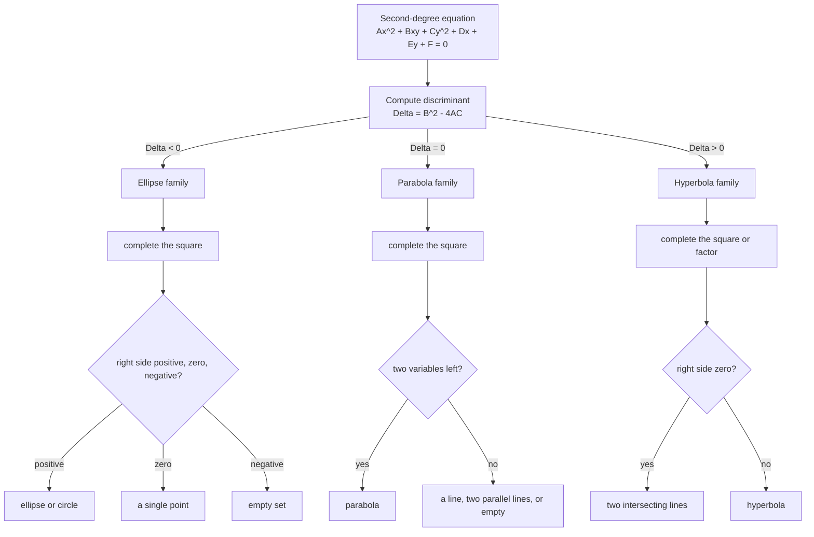

# Analytic Geometry and Conic Sections

> [Mathematics](../../README.md) › [Geometry](../README.md) · Level: Intermediate · Prerequisites: coordinate geometry (distance formula, lines, completing the square), trigonometry, elementary algebra · Estimated time: 8 h

## 1. Introduction

Analytic geometry is the translation of geometry into algebra. A curve becomes an equation, and a
geometric question — "where does this curve bend?", "how far is the focus from the vertex?", "when do
these two curves meet?" — becomes a question about a formula that can be answered by calculation.

This topic applies that method to the most important family of curves in mathematics: the **conic
sections**. They are the curves a plane cuts from a cone — circle, ellipse, parabola, hyperbola — and
they turn out to be exactly the curves given by equations of the second degree
$$Ax^2+Bxy+Cy^2+Dx+Ey+F=0 .$$
That coincidence is one of the deepest facts in classical geometry, and it is what makes conics both
beautiful and useful.

Three descriptions will be developed and proved equivalent.

1. **The locus description.** A conic is the set of points whose distance from a fixed point (the
   **focus**) is a fixed multiple $e$ (the **eccentricity**) of its distance from a fixed line (the
   **directrix**). $e=1$ gives the parabola, $e<1$ the ellipse, $e>1$ the hyperbola.
2. **The two-focus description.** An ellipse is the set of points whose distances to two fixed points
   add to a constant; a hyperbola is the set whose distances differ by a constant. This is the
   definition behind the string construction and behind Kepler's orbits.
3. **The section description.** A conic is the intersection of a double cone with a plane.

The payoff is a body of formulas — foci, vertices, axes, asymptotes, eccentricity — that describes
planetary orbits, satellite dishes, whispering galleries, lithotripters, cooling towers and radio
navigation. The mathematics is genuinely useful, and almost all of it is accessible with the algebra of
completing the square.

The topic sits deliberately between two neighbours. [Coordinate Geometry](../04-coordinate-geometry/README.md)
handles lines and circles with the same method; the precalculus curriculum treats conics as a chapter of
algebra. This treatment is the *geometric* one: every standard equation is derived from a locus
definition, and the conical origin of the curves is proved rather than asserted.

## 2. Prerequisites

* **The distance formula** in the plane, the midpoint formula, and the equation of a line — from
  [Coordinate Geometry](../04-coordinate-geometry/README.md).
* **Completing the square.** Turning $x^2+Dx$ into $\left(x+\tfrac D2\right)^2-\tfrac{D^2}{4}$ is used in
  every classification problem.
* **Algebra of equations.** Expanding $(x+c)^2$, collecting like terms, dividing by a non-zero constant,
  and solving quadratics.
* **Basic trigonometry.** $\cos\theta$, $\sin\theta$, the identity $\cos^2\theta+\sin^2\theta=1$, and the
  rotation formulas from [Trigonometry](../../05-trigonometry/README.md).
* **The Pythagorean theorem**, for the relation between $a,b,c$ in ellipses and hyperbolas.
* **Functions and graphs**, including shifting and scaling, and the idea of a locus as a set of points
  satisfying a condition.

## 3. Learning Objectives

After this tutorial you will be able to:

1. Define a conic as a locus by the focus–directrix ratio, and state the role of the eccentricity.
2. Derive $x^2=4py$ from the focus–directrix definition and show that $y=ax^2$ is the same curve with
   $p=\dfrac{1}{4a}$.
3. Derive $\dfrac{x^2}{a^2}+\dfrac{y^2}{b^2}=1$ from the two-foci definition and prove $a^2=b^2+c^2$.
4. Perform the string construction and explain why it produces an ellipse.
5. Derive $\dfrac{x^2}{a^2}-\dfrac{y^2}{b^2}=1$ from the two-foci definition, and find its asymptotes.
6. Compute foci, vertices, axes, directrices, asymptotes and eccentricity for any standard conic.
7. Classify any second-degree equation by its discriminant, including the degenerate cases.
8. Rotate axes to remove the $xy$ term, and explain why $B^2-4AC$ is invariant.
9. Identify a conic as the section of a cone, and relate the eccentricity to the angle of the section.
10. Write and interpret the polar equation $r=\dfrac{p}{1+e\cos\theta}$.
11. Model orbits, reflectors, acoustic rooms and navigation systems with conics.

## 4. Intuition

### 4.1 The cone and the torch

Put two ice-cream cones tip to tip — a double cone. Shine a torch beam at an angle through one of them.
The edge of the patch of light is the intersection of the cone with the plane of the wall. Tilt the wall
and the shape changes continuously: a circle (beam perpendicular to the axis), then an ellipse, then, at
one critical angle, a curve that never closes — a parabola — and, beyond that, a hyperbola with two
branches, cutting both nappes of the cone.

Nothing mysterious is happening: a plane cutting a cone produces these shapes and no others. What *is*
surprising is that the same curves arise from a completely different construction, in which distances to
points and lines are compared.

### 4.2 A ratio, not a shape

Take a point $F$ (the focus) and a line $\ell$ (the directrix). Ask for the points $P$ whose distance to
$F$ is the same as their distance to $\ell$. The answer is a parabola. Now ask for points whose distance
to $F$ is *half* their distance to $\ell$: the answer is a closed oval, an ellipse. Ask for *twice* the
distance: the answer is a curve escaping to infinity in two branches, a hyperbola.

The ratio is the **eccentricity** $e$. It is a dimensionless number that says how far the curve is from
being a circle: $e=0$ is a circle, $e$ just below $1$ is an ellipse 0-fattened at the ends, $e=1$ is the
boundary case, $e>1$ is a hyperbola. Astronomers quote the eccentricity of a planetary orbit the way a
chemist quotes a molecular weight.

### 4.3 The string picture

Fix two pins in a board, a distance $2c$ apart, and loop a string of length $2a>2c$ around them. Hold the
string taut with a pencil and move the pencil. The pencil traces an **ellipse**: at every instant the two
string segments from the pencil to the pins add up to the string length minus the slack around the pins,
which is constant. The pins are the foci. When $c=0$ the string traces a circle; as $c$ approaches $a$ the
ellipse becomes flatter and flatter, and at $c=a$ the string doubles back on itself and the "ellipse"
degenerates into a segment.

### 4.4 Why these curves are everywhere

The defining property of the parabola is that every ray arriving parallel to its axis reflects through
the focus. That single fact makes the shape the standard design for satellite dishes, headlights, radar
antennas and solar cookers. The ellipse has the companion property that a ray leaving one focus reaches
the other, which is how a "whispering gallery" carries a whisper across a room and how lithotripsy
focuses a shock wave on a kidney stone. And because gravity produces an inverse-square force, every
freely falling body in a two-body system travels on a conic with the Sun at one focus — an observation
that turned conic sections from a curiosity into the language of astronomy.

## 5. Formal Definition

### 5.1 Loci

**Definition 5.1 (Locus).** A **locus** is the set of all points of the plane satisfying a stated
geometric condition. A curve is described analytically when its locus is written as an equation in $x$
and $y$; writing that equation is the *coordinate method*.

**Definition 5.2 (Distance to a line).** For a point $P=(x_0,y_0)$ and a line $\ell:ax+by+c=0$,
$$\operatorname{dist}(P,\ell)=\frac{|ax_0+by_0+c|}{\sqrt{a^2+b^2}}.$$
For vertical and horizontal lines this reduces to an absolute difference of coordinates.

### 5.2 The Focus–Directrix Definition

**Definition 5.3 (Conic, focus–directrix form).** Let $F$ be a fixed point, $\ell$ a fixed line not
containing $F$, and $e>0$. The **conic with focus $F$, directrix $\ell$ and eccentricity $e$** is the
locus
$$\mathcal{C}=\left\{P : \operatorname{dist}(P,F)=e\,\operatorname{dist}(P,\ell)\right\}.$$
The number $e$ is the **eccentricity**. The conic is an **ellipse** when $0<e<1$, a **parabola** when
$e=1$, and a **hyperbola** when $e>1$. A **circle** is the degenerate case $e=0$ of the same construction
with the directrix "at infinity".

The case $e=0$ is excluded above because then the equation reads "distance to $F$ equals zero", which is
the single point $F$. A circle can be obtained as a limit $e\to0^+$ with the directrix receding.

### 5.3 The Two-Focus Definition

**Definition 5.4 (Ellipse).** Let $F_1\ne F_2$ and let $2a>|F_1F_2|$. The **ellipse with foci $F_1,F_2$
and major axis $2a$** is
$$\mathcal{E}=\left\{P : |PF_1|+|PF_2|=2a\right\}.$$

**Definition 5.5 (Hyperbola).** Let $F_1\ne F_2$ and let $0<2a<|F_1F_2|$. The **hyperbola with foci
$F_1,F_2$ and transverse axis $2a$** is
$$\mathcal{H}=\left\{P : \bigl||PF_1|-|PF_2|\bigr|=2a\right\}.$$

The two definitions (5.3 and 5.4/5.5) agree; Section 7.3 and Section 7.4 prove it for the ellipse and
the hyperbola.

### 5.4 The Section Definition

**Definition 5.6 (Conic as a section).** Let $\mathcal{K}$ be a double cone (two congruent circular cones
with a common apex and a common axis) and let $\Pi$ be a plane not through the apex. The intersection
$\mathcal{K}\cap\Pi$ is a **conic section**.

**Definition 5.7 (Degenerate conic).** The intersection of a plane *through* the apex with the double cone
is a point, a single line, or a pair of lines. These are the **degenerate conics**, and they appear as
degenerate cases of the second-degree equation.

### 5.5 The Algebraic Definition

**Definition 5.8 (General second-degree equation).** An equation
$$Ax^2+Bxy+Cy^2+Dx+Ey+F=0, \qquad (A,B,C)\ne(0,0,0),$$
is a **second-degree equation** in $x,y$. Its **discriminant** is
$$\Delta=B^2-4AC .$$

**Theorem 5.9 (Classification).** If the solution set of a second-degree equation is a non-degenerate
conic, then it is an ellipse when $\Delta<0$, a parabola when $\Delta=0$ and a hyperbola when $\Delta>0$.
In the degenerate cases the same sign of $\Delta$ allows, respectively, a point or the empty set, a line,
two parallel lines or the empty set, and two intersecting lines.

The proof is a rotation of axes (Section 7.6). The theorem is the bridge between the geometric and the
algebraic descriptions.

## 6. Mathematical Notation

| Symbol | Read as | Meaning |
|---|---|---|
| $F,F_1,F_2$ | foci | fixed points defining the conic |
| $\ell$ | ell | the directrix, a fixed line |
| $e$ | eccentricity | the ratio $\operatorname{dist}(P,F)/\operatorname{dist}(P,\ell)$ |
| $a$ | semi-major axis | half the major axis of an ellipse; half the transverse axis of a hyperbola |
| $b$ | semi-minor axis | half the minor axis of an ellipse; the hyperbola's conjugate semi-axis |
| $c$ | focal distance | distance from centre to a focus; $a^2=b^2+c^2$ (ellipse), $c^2=a^2+b^2$ (hyperbola) |
| $p$ | focal parameter | distance from vertex to focus in $x^2=4py$ |
| $k$ | semi-latus rectum | $ed$ in the polar form; the value of $r$ at $\theta=\pi/2$ |
| $2a,2b,2c$ | axes | the doubled quantities, i.e. full lengths |
| $\Delta$ | discriminant | $B^2-4AC$ for a second-degree equation |
| $\theta$ | theta | angle of the directrix, or of a rotation of axes |
| $r$ | radius | distance from the pole (focus) in polar coordinates |
| $r_1,r_2$ | focal radii | $\lvert PF_1\rvert$ and $\lvert PF_2\rvert$ |
| $\alpha$ | alpha | half-angle of the cone (between axis and generator) |
| $\beta$ | beta | angle between the cutting plane and the cone's axis |
| $\varphi$ | phi | generic angle parameter in polar form |
| $\lvert AB\rvert$ | length of $AB$ | distance between two points |
| $\pm$ | plus or minus | the two foci, the two branches, the two asymptotes |

Two conventions are used consistently. The **major axis** of an ellipse is the longer one, of length
$2a$; for a hyperbola the **transverse axis** is the one the branches cross, also of length $2a$. And
"directrix" always means the line in Definition 5.3, not one of the tangents.

## 7. Core Concepts

### 7.1 The Coordinate Method

The method has four steps, and every derivation below follows them.

1. **Choose axes** so that the description is as simple as possible — usually centred at the vertex or
   the centre, with the axis of symmetry along a coordinate axis.
2. **Translate the geometric condition** into distances. "Distance to a point" is a square root;
   "distance to a line" is a linear expression (Definition 5.2).
3. **Eliminate the radicals** by squaring, carefully, and simplify to a polynomial equation.
4. **Read off the geometry** from the equation: intercepts give vertices, symmetry gives axes,
   coefficients give foci and asymptotes.

Squaring is the step that needs care: it can introduce solutions that do not satisfy the original
equation (extraneous roots). Each derivation below justifies the squaring by a sign condition, or checks
the result at a known point.

A useful sanity check at every stage: **the type of a conic does not change under translation or
rotation.** So if a derivation produces an equation with both $x^2$ and $y^2$ coefficients positive, the
curve is an ellipse, whatever the original description looked like.

### 7.2 The Parabola

**Standard position.** Put the focus at $F=(0,p)$ and the directrix at $y=-p$, so the vertex is the
origin and the axis of symmetry is the $y$-axis. Let $P=(x,y)$.

**Derivation.** The defining condition $\operatorname{dist}(P,F)=\operatorname{dist}(P,\ell)$ becomes
$$\sqrt{x^2+(y-p)^2}=|y+p| .$$
Both sides are non-negative, so squaring preserves the solution set:
$$x^2+(y-p)^2=(y+p)^2 \;\Longrightarrow\; x^2+y^2-2py+p^2=y^2+2py+p^2
\;\Longrightarrow\; x^2=4py .$$
Conversely, every point of $x^2=4py$ satisfies the original equation, because the two squared quantities
are equal and non-negative. So
$$\boxed{\;x^2=4py\;}$$
is exactly the parabola with focus $(0,p)$ and directrix $y=-p$, where $p\ne0$. If $p>0$ it opens upward;
if $p<0$ downward, with the focus below the vertex.

**The $y=ax^2$ form.** Every function $y=ax^2$ with $a\ne0$ can be written as $x^2=\frac1a y$, which is
$4py$ with
$$p=\frac{1}{4a}.$$
So $y=ax^2$ has focus $\left(0,\dfrac{1}{4a}\right)$ and directrix $y=-\dfrac{1}{4a}$. Two consequences
worth remembering:

* a large $|a|$ (a steep parabola) means a *small* $p$, so the focus is close to the vertex;
* the focus is always on the axis of symmetry, at distance $p$ from the vertex on the inside.

**Vertex form.** Shifting by $(h,k)$ turns $x^2=4py$ into
$$(x-h)^2=4p(y-k),$$
with vertex $(h,k)$, focus $(h,k+p)$ and directrix $y=k-p$. Similarly a parabola opening sideways is
$(y-k)^2=4p(x-h)$, with focus $(h+p,k)$ and directrix $x=h-p$.

**Latus rectum.** The chord through the focus perpendicular to the axis has $y=p$, hence
$x^2=4p^2$ and $x=\pm2p$; its length is $4|p|$. It is the standard "width" measure of a parabola and equals
the coefficient $4p$ in the standard equation.

**Tangent line.** At the point $(x_0,y_0)$ of $y^2=4px$ the tangent is
$$y\,y_0=2p(x+x_0).$$
*Check by differentiating:* $2y\,y'=4p$, so $y'=2p/y_0$; the point-slope form gives
$y-y_0=\frac{2p}{y_0}(x-x_0)$, and multiplying by $y_0$ and using $y_0^2=4px_0$ gives the displayed
equation.

**Reflection property.** A ray parallel to the axis, striking the parabola at $P$, reflects through the
focus. Equivalently, the tangent at $P$ makes equal angles with the segment $PF$ and the line through $P$
parallel to the axis. The proof is a one-line trigonometric computation (Exercise 28); it is the reason
for the design of every dish, headlight and parabolic trough.

### 7.3 The Ellipse

**Standard position.** Put the foci at $F_1=(-c,0)$ and $F_2=(c,0)$ with $c>0$, and let the constant sum
be $2a$ with $a>c>0$. The condition is
$$\sqrt{(x+c)^2+y^2}+\sqrt{(x-c)^2+y^2}=2a .$$

**Derivation.** Write $d_2=\sqrt{(x-c)^2+y^2}$; the equation is $\sqrt{(x+c)^2+y^2}=2a-d_2$. Squaring,
$$(x+c)^2+y^2=4a^2-4a\,d_2+(x-c)^2+y^2 .$$
The $y^2$ cancels, and $(x+c)^2-(x-c)^2=4cx$, so
$$4cx=4a^2-4a\,d_2 \;\Longrightarrow\; a\,d_2=a^2-cx .$$
Here $a^2-cx>0$: if $a^2-cx<0$ then $a\,d_2<0$, impossible since $a>0$ and $d_2\ge0$; and $a^2-cx=0$
would force $d_2=0$, that is $P=F_2$, which would give $|F_1F_2|=2c=2a$, contradicting $a>c$. So
squaring again is reversible:
$$a^2\left[(x-c)^2+y^2\right]=\left(a^2-cx\right)^2 .$$
Expanding,
$$a^2x^2-2a^2cx+a^2c^2+a^2y^2=a^4-2a^2cx+c^2x^2 ,$$
and cancelling $-2a^2cx$ gives
$$\left(a^2-c^2\right)x^2+a^2y^2=a^2\left(a^2-c^2\right).$$
Since $a>c$, put
$$b^2=a^2-c^2>0 .$$
Dividing by $a^2b^2$,
$$\boxed{\;\frac{x^2}{a^2}+\frac{y^2}{b^2}=1,\qquad b^2=a^2-c^2\;}$$
The relation $a^2=b^2+c^2$ is the defining relation of the ellipse: the semi-major axis $a$ is the
hypotenuse of the right triangle whose legs are the semi-minor axis $b$ and the focal distance $c$. That
triangle has vertices at a focus, the centre and a co-vertex, and its hypotenuse is the segment from the
focus to the co-vertex.

**Consistency check.** At $x=a$: $\frac{a^2}{a^2}+0=1$ ✓, and the focal distances are $a-c$ and $a+c$,
whose sum is $2a$ ✓. At $x=0$: $y=\pm b$, and each focal distance is $\sqrt{c^2+b^2}=a$, summing to $2a$ ✓.

**Elements.**

* Vertices $(\pm a,0)$; co-vertices $(0,\pm b)$; centre $(0,0)$; major axis $2a$ along $x$; minor axis
  $2b$ along $y$.
* Foci $(\pm c,0)$ with $c=\sqrt{a^2-b^2}$.
* **Eccentricity** $e=\dfrac{c}{a}=\sqrt{1-\dfrac{b^2}{a^2}}$, always in $[0,1)$. $e=0$ is a circle,
  $e\to1$ a flattened ellipse.
* **Directrices** $x=\pm\dfrac{a}{e}=\pm\dfrac{a^2}{c}$.
* **Latus rectum** (chord through a focus perpendicular to the major axis): at $x=c$,
  $y^2=b^2\left(1-\frac{c^2}{a^2}\right)=\dfrac{b^4}{a^2}$, so the length is $\dfrac{2b^2}{a}$.
* **Focal radii:** for $P=(x,y)$ on the ellipse,
  $$|PF_1|=a+ex,\qquad |PF_2|=a-ex,\qquad\text{sum }2a .$$
  *Derivation of the second:*
  $$(x-c)^2+y^2=x^2-2cx+c^2+b^2-\frac{b^2x^2}{a^2}
  =x^2\left(1-\frac{b^2}{a^2}\right)-2cx+(c^2+b^2)=\frac{c^2x^2}{a^2}-2cx+a^2=(a-ex)^2,$$
  using $c^2+b^2=a^2$ and $1-\frac{b^2}{a^2}=\frac{c^2}{a^2}$.

**The string construction.** Drive two pins into a board at $F_1,F_2$, loop a string of length
$2a+2c$ around them, and hold it taut with a pencil at $P$. The two straight runs have total length
$|PF_1|+|PF_2|=2a$, independent of $P$; so the pencil traces the ellipse. The construction is the
definition made physical, and it explains why a 2-metre loop of string with pins 30 cm apart draws a
nearly circular ellipse ($e=0.15$), while pins close to the ends give a very flat one.

**Orientation.** If the foci are on the $y$-axis, the equation is $\dfrac{x^2}{b^2}+\dfrac{y^2}{a^2}=1$
with $a>b$ and foci $(0,\pm c)$; the larger denominator always sits under the variable of the major axis.
Circle: $a=b$, $c=0$, $e=0$, $x^2+y^2=a^2$.

### 7.4 The Hyperbola

**Standard position.** Foci $F_1=(-c,0)$, $F_2=(c,0)$, and a constant *difference* $2a$ with
$0<a<c$. The condition is
$$\left|\sqrt{(x+c)^2+y^2}-\sqrt{(x-c)^2+y^2}\right|=2a .$$

**Derivation.** Consider the right branch, where the distance to $F_1$ exceeds the distance to $F_2$:
$$\sqrt{(x+c)^2+y^2}=2a+\sqrt{(x-c)^2+y^2}.$$
Squaring and cancelling $y^2$ and $(x-c)^2$,
$$4cx=4a^2+4a\,d_2 \;\Longrightarrow\; cx-a^2=a\,d_2 .$$
Squaring again,
$$c^2x^2-2a^2cx+a^4=a^2\left[(x-c)^2+y^2\right]=a^2x^2-2a^2cx+a^2c^2+a^2y^2 ,$$
so
$$\left(c^2-a^2\right)x^2-a^2y^2=a^2\left(c^2-a^2\right).$$
Since $c>a$, put
$$b^2=c^2-a^2>0,$$
and divide by $a^2b^2$:
$$\boxed{\;\frac{x^2}{a^2}-\frac{y^2}{b^2}=1,\qquad b^2=c^2-a^2\;}$$
The left branch satisfies the same equation, since only the sign of the difference changes.

Note the contrast with the ellipse: there $a$ is the largest of the three, here $c$ is. The relation is
$$c^2=a^2+b^2,$$
so the focal distance is the hypotenuse.

**Elements.**

* Vertices $(\pm a,0)$; the branches cross the $x$-axis there. Centre $(0,0)$; transverse axis $2a$ along
  $x$; conjugate axis $2b$ along $y$.
* Foci $(\pm c,0)$ with $c=\sqrt{a^2+b^2}$.
* **Eccentricity** $e=\dfrac ca=\sqrt{1+\dfrac{b^2}{a^2}}>1$.
* **Asymptotes** $y=\pm\dfrac ba x$. *Why:* solving for $y$ gives
  $y=\pm\frac ba\sqrt{x^2-a^2}$, and for large $|x|$ the factor $\sqrt{x^2-a^2}\approx|x|$; the branches
  approach the lines ever more closely but never meet them.
* **Directrices** $x=\pm\dfrac ae=\pm\dfrac{a^2}{c}$, between the centre and the vertices since
  $\frac{a^2}{c}<a$.
* **Latus rectum** $\dfrac{2b^2}{a}$, the same formula as for the ellipse.
* **Focal radii** on the right branch: $|PF_1|=ex+a$ and $|PF_2|=ex-a$, whose difference is $2a$.

**Orientation.** With the foci on the $y$-axis the equation is $\dfrac{y^2}{a^2}-\dfrac{x^2}{b^2}=1$ and
the asymptotes are $y=\pm\dfrac ab x$; note the reversal, because now the branches open up and down.

**Rectangular hyperbola.** If $a=b$ the asymptotes are $y=\pm x$, perpendicular to each other, and the
hyperbola is called **rectangular** (or equilateral). Rotating $x^2-y^2=a^2$ by $45^\circ$ gives
$xy=\dfrac{a^2}{2}$, so the graph of $y=k/x$ is a rectangular hyperbola — the curve of Boyle's law and of
inverse proportionality.

### 7.5 The Definitions Agree

Three descriptions have been given. Here is how they fit together.

**Two foci and focus–directrix.** For the ellipse $\frac{x^2}{a^2}+\frac{y^2}{b^2}=1$ with $e=c/a$, take
the right focus $F=(c,0)$ and the line $\ell:x=\frac ac$ (equivalently $x=\frac{a^2}{c}$). For a point
$P=(x,y)$ of the ellipse,
$$\operatorname{dist}(P,F)=\sqrt{(x-c)^2+y^2}=a-ex,\qquad
e\operatorname{dist}(P,\ell)=\frac ca\left(\frac ac-x\right)=a-ex .$$
The two are equal, so the ellipse is the focus–directrix locus with that focus and directrix. The same
computation read backwards — squaring $a-ex=\sqrt{(x-c)^2+y^2}$ and simplifying — returns
$\frac{x^2}{a^2}+\frac{y^2}{b^2}=1$, which proves the converse.

For the hyperbola $\frac{x^2}{a^2}-\frac{y^2}{b^2}=1$ with $e=c/a>1$, the focus $(c,0)$ and the directrix
$x=\frac{a^2}{c}$ give
$$\operatorname{dist}(P,F)=ex-a= e\left(x-\frac{a^2}{c}\right)=e\operatorname{dist}(P,\ell)$$
on the right branch, and the algebra reverses in the same way. So all three of ellipse, parabola and
hyperbola are focus–directrix loci, with the same defining ratio $e$ and with the directrix at distance
$\frac ae$ from the centre (for the centred conics) or $|p|$ from the vertex (for the parabola).

**Sections of a cone and eccentricity.** Let the double cone have half-angle $\alpha$ (the angle between
its axis and a generator) and let the cutting plane make an angle $\beta$ with the axis. Then the section
is

| Angle condition | Section | Eccentricity |
|---|---|---|
| $\beta=90^\circ$ | circle | $e=0$ |
| $\alpha<\beta<90^\circ$ | ellipse | $0<e<1$ |
| $\beta=\alpha$ | parabola | $e=1$ |
| $\beta<\alpha$ | hyperbola | $e>1$ |

with the quantitative relation
$$e=\frac{\cos\beta}{\cos\alpha}.$$
*Checks:* a plane perpendicular to the axis ($\beta=90^\circ$) gives $e=0$, a circle ✓; a plane parallel to
a generator ($\beta=\alpha$) gives $e=1$, a parabola ✓; a plane parallel to the axis ($\beta=0$) gives
$e=1/\cos\alpha>1$, a hyperbola ✓. The formula is derived by computing the ratio of the distances from a
point of the section to a focus and a directrix, both supplied by the following construction.

**Dandelin spheres.** Inscribe a sphere in the cone that touches the cutting plane at a point $F$ and
touches the cone along a circle $C$ lying in a plane perpendicular to the axis. For any point $P$ of the
section, the segment from $P$ to $F$ is tangent to the sphere, and so is the generator of the cone through
$P$, from $P$ to the point $Q$ where that generator meets $C$. Tangents from an external point to a sphere
have equal length, so
$$|PF|=|PQ| .$$
The circle $C$ lies in a plane, so its plane meets the cutting plane in a line $\ell$ — the directrix — and
$|PQ|$ is proportional to the distance from $P$ to $\ell$, because both are measured along directions
making fixed angles with the two planes. That constant of proportionality is $e$. With two such spheres,
one in each nappe, one obtains $|PF_1|=|PQ_1|$ and $|PF_2|=|PQ_2|$; since $Q_1,Q_2$ lie on the same
generator, $|Q_1Q_2|$ is the same for every $P$, hence $|PF_1|+|PF_2|$ is constant for the ellipse (and
$||PF_1|-|PF_2||$ constant for the hyperbola). This is the classical proof that a plane section of a cone
is a conic in the two-focus sense.

### 7.6 The General Second-Degree Equation

**Rotation of axes.** Let the new axes be obtained by rotating the old ones through $\theta$. A point with
coordinates $(x',y')$ in the new system has
$$x=x'\cos\theta-y'\sin\theta,\qquad y=x'\sin\theta+y'\cos\theta .$$
Substituting into $Ax^2+Bxy+Cy^2+Dx+Ey+F=0$ and collecting gives a new equation
$$A'x'^2+B'x'y'+C'y'^2+D'x'+E'y'+F'=0$$
with
$$A'=A\cos^2\theta+B\sin\theta\cos\theta+C\sin^2\theta,$$
$$B'=(C-A)\sin2\theta+B\cos2\theta,$$
$$C'=A\sin^2\theta-B\sin\theta\cos\theta+C\cos^2\theta .$$
Note that $A'+C'=A+C$: the trace of the quadratic part is invariant.

**Removing the cross term.** If $B\ne0$, choose $\theta$ with $B'=0$, that is
$$\cot 2\theta=\frac{A-C}{B}.$$
Such a $\theta$ exists because $\cot$ takes every real value on $(0,\pi)$. The rotated equation has no
$x'y'$ term, so its type is read from the signs of $A'$ and $C'$: both positive or both negative gives an
ellipse, one of each gives a hyperbola, and one zero gives a parabola.

**The discriminant is invariant.** A direct calculation (Exercise 31) gives
$$B'^2-4A'C'=B^2-4AC .$$
So $\Delta=B^2-4AC$ can be computed in any orientation, which is why it classifies the conic without any
rotation being performed.

**Classification.**

| $\Delta=B^2-4AC$ | Non-degenerate | Degenerate possibilities |
|---|---|---|
| $<0$ | ellipse (or circle) | a single point, or the empty set |
| $=0$ | parabola | a line, two parallel lines, or the empty set |
| $>0$ | hyperbola | two intersecting lines |

Examples of the degenerate cases: $x^2+y^2=0$ is a point, $x^2+y^2=-1$ is empty, $x^2=1$ is two parallel
lines, $x^2=0$ is one line, $x^2-y^2=0$ is two intersecting lines. All satisfy the stated sign of $\Delta$.

**A linear-algebra view.** Write the quadratic part as
$$\begin{pmatrix}x&y\end{pmatrix}M\begin{pmatrix}x\\y\end{pmatrix},\qquad
M=\begin{pmatrix}A&B/2\\B/2&C\end{pmatrix}.$$
Then $\Delta=-4\det M$, so $\Delta<0$ means the two eigenvalues of $M$ have the same sign (a definite
quadratic form), $\Delta>0$ means opposite signs (indefinite), and $\Delta=0$ means a zero eigenvalue. The
classification is thus a statement about eigenvalues, and rotation of axes is exactly the change to an
eigenvector basis. This is developed in [Linear Algebra](../../08-linear-algebra/README.md).

### 7.7 Polar Forms

Put the focus at the origin and the directrix on the line $x=d$ with $d>0$, and let $e>0$. A point $P$
with polar coordinates $(r,\theta)$ has $x=r\cos\theta$, so
$$\operatorname{dist}(P,F)=r,\qquad \operatorname{dist}(P,\ell)=d-r\cos\theta .$$
The defining condition $r=e(d-r\cos\theta)$ rearranges to
$$r(1+e\cos\theta)=ed,\qquad\text{so}\qquad
\boxed{\;r=\frac{k}{1+e\cos\theta},\quad k=ed\;}$$
The constant $k$ is the **semi-latus rectum**: at $\theta=\pi/2$, $r=k$.

**Interpretation.** The denominator $1+e\cos\theta$ lies between $1-e$ and $1+e$:

* if $0<e<1$ the denominator is always positive, $r$ is bounded, and the curve is a closed ellipse with
  the focus at the origin;
* if $e=1$ the denominator vanishes at $\theta=\pi$, so $r\to\infty$ there: a parabola;
* if $e>1$ the denominator vanishes at $\cos\theta=-1/e$, giving two directions at infinity and hence two
  branches; near $\theta=0$ one branch is traced.

**Matching the standard equations.** For the ellipse with focus at the origin (the other focus on the
positive $x$-axis) the semi-latus rectum is $k=\frac{b^2}{a}=a(1-e^2)$, so
$$r=\frac{a(1-e^2)}{1+e\cos\theta}.$$
At $\theta=0$ this gives $r=a(1-e)$, the **perihelion** distance, and at $\theta=\pi$ it gives
$r=a(1+e)$, the **aphelion** distance. Their sum is $2a$, as it must be.

For the parabola $x^2=4py$ with the focus at the origin, the directrix lies at distance $2p$ from the
focus, so $e=1$ and $k=2p$, giving
$$r=\frac{2p}{1+\cos\theta}$$
when the directrix is on the positive $x$-side; the parabola then opens in the negative $x$-direction.

### 7.8 A Summary Map of the Three Definitions

| Definition | Data | Produces |
|---|---|---|
| Focus–directrix | $F$, line $\ell$, ratio $e$ | all conics, uniformly, with $e$ controlling the type |
| Two foci | $F_1,F_2$, sum or difference $2a$ | ellipses and hyperbolas; the string construction; orbits |
| Plane section of a cone | cone half-angle $\alpha$, plane angle $\beta$ | the same curves, with $e=\cos\beta/\cos\alpha$ |
| Second-degree equation | coefficients $A,B,C,D,E,F$ | the algebraic form; classification by $\Delta$ |
| Polar | focus at the pole, $e$ and $k$ | orbits and trajectories, with $r(\theta)$ explicit |

## 8. Formulas and Properties

### 8.1 The Standard Conics

| Curve | Standard equation | Foci | Vertices | Directrices | Asymptotes | Latus rectum | $e$ |
|---|---|---|---|---|---|---|---|
| Parabola (up) | $x^2=4py$ | $(0,p)$ | $(0,0)$ | $y=-p$ | — | $4\lvert p\rvert$ | $1$ |
| Parabola (right) | $y^2=4px$ | $(p,0)$ | $(0,0)$ | $x=-p$ | — | $4\lvert p\rvert$ | $1$ |
| Ellipse (wide) | $\frac{x^2}{a^2}+\frac{y^2}{b^2}=1$, $a>b$ | $(\pm c,0)$, $c^2=a^2-b^2$ | $(\pm a,0)$ | $x=\pm\frac{a^2}{c}$ | — | $\frac{2b^2}{a}$ | $\frac ca$ |
| Ellipse (tall) | $\frac{x^2}{b^2}+\frac{y^2}{a^2}=1$, $a>b$ | $(0,\pm c)$ | $(0,\pm a)$ | $y=\pm\frac{a^2}{c}$ | — | $\frac{2b^2}{a}$ | $\frac ca$ |
| Hyperbola (horizontal) | $\frac{x^2}{a^2}-\frac{y^2}{b^2}=1$ | $(\pm c,0)$, $c^2=a^2+b^2$ | $(\pm a,0)$ | $x=\pm\frac{a^2}{c}$ | $y=\pm\frac ba x$ | $\frac{2b^2}{a}$ | $\frac ca>1$ |
| Hyperbola (vertical) | $\frac{y^2}{a^2}-\frac{x^2}{b^2}=1$ | $(0,\pm c)$ | $(0,\pm a)$ | $y=\pm\frac{a^2}{c}$ | $y=\pm\frac ab x$ | $\frac{2b^2}{a}$ | $\frac ca>1$ |
| Circle | $x^2+y^2=r^2$ | $(0,0)$ | — | — | — | $2r$ | $0$ |
| Polar form | $r=\frac{k}{1+e\cos\theta}$ | pole | — | $x=\frac ke$ | — | $2k$ | $e$ |

### 8.2 Properties

**P1 (Vertex form by completing the square).** Any second-degree equation without an $xy$ term can be
shifted to standard form by completing the square in $x$ and in $y$. The shift $(h,k)$ is the centre of
the ellipse or hyperbola, or the vertex of the parabola.

**P2 (Which axis?).** In $\frac{x^2}{a^2}+\frac{y^2}{b^2}=1$, the **larger denominator** marks the major
axis; its variable names the direction of the foci. Making this check before computing $c$ prevents most
sign errors.

**P3 (Ellipse versus hyperbola relation).** Ellipse: $a^2=b^2+c^2$, so $a>c$ and $e<1$. Hyperbola:
$c^2=a^2+b^2$, so $c>a$ and $e>1$. The plus and minus in the standard equations decide which quantity is
the hypotenuse.

**P4 (Focal radii).** Ellipse: $|PF_1|=a+ex$, $|PF_2|=a-ex$. Hyperbola (right branch): $|PF_1|=ex+a$,
$|PF_2|=ex-a$. In both cases the sum or difference is constant, which is the defining property.

**P5 (Reflection).** Parabola: rays parallel to the axis pass through the focus. Ellipse: rays from one
focus pass through the other. Hyperbola: rays aimed at one focus reflect as if they came from the other.

**P6 (Tangents).** At $(x_0,y_0)$:

* parabola $y^2=4px$: $yy_0=2p(x+x_0)$;
* ellipse $\frac{x^2}{a^2}+\frac{y^2}{b^2}=1$: $\frac{xx_0}{a^2}+\frac{yy_0}{b^2}=1$;
* hyperbola $\frac{x^2}{a^2}-\frac{y^2}{b^2}=1$: $\frac{xx_0}{a^2}-\frac{yy_0}{b^2}=1$.

Each is obtained by differentiating implicitly or by the standard "replace $x^2$ by $xx_0$" rule, which
works for all three.

**P7 (Invariance).** Translation changes $D,E$ only; rotation changes $A,B,C$ but preserves $A+C$ and
$B^2-4AC$. Hence the type of a conic is unaffected by any rigid motion.

**P8 (Similarity).** Scaling the plane by $\lambda$ multiplies all lengths by $\lambda$ but leaves $e$
unchanged: eccentricity is shape, not size.

## 9. Step-by-Step Examples

### Example 1 (Easy): From $y=ax^2$ to Focus and Directrix

Find the focus and directrix of $y=3x^2$, and check the definition at the point $(1,3)$.

**Standard form.** $y=3x^2$ is $x^2=\frac13y$, so $4p=\frac13$ and $p=\frac1{12}$.

**Elements.** Focus $\left(0,\frac1{12}\right)$; directrix $y=-\frac1{12}$; vertex $(0,0)$; latus rectum
$4p=\frac13$.

**Check at $(1,3)$.** Distance to the focus:
$$\sqrt{1^2+\left(3-\tfrac1{12}\right)^2}=\sqrt{1+\left(\tfrac{35}{12}\right)^2}
=\sqrt{\frac{144+1225}{144}}=\sqrt{\frac{1369}{144}}=\frac{37}{12}.$$
Distance to the directrix: $3+\frac1{12}=\frac{37}{12}$ ✓. The two agree, as the definition requires.

### Example 2 (Easy–Medium): A Parabola from Its Vertex and Focus

A parabola has vertex $(2,-1)$ and focus $(5,-1)$. Find its equation and its directrix.

**Orientation.** The focus lies to the right of the vertex, so the parabola opens rightwards and the axis
is the horizontal line $y=-1$. The focal distance is $p=5-2=3$.

**Equation.** With vertex $(h,k)=(2,-1)$ and horizontal opening,
$$(y-k)^2=4p(x-h) \;\Longrightarrow\; (y+1)^2=12(x-2).$$

**Directrix.** $x=h-p=2-3=-1$.

**Check.** A point with $x=5$ on the curve satisfies $(y+1)^2=36$, so $y=5$ or $y=-7$. For $(5,5)$ the
distance to the focus $(5,-1)$ is $6$, and the distance to $x=-1$ is $5-(-1)=6$ ✓.

### Example 3 (Medium): Reading an Ellipse

For $\dfrac{x^2}{25}+\dfrac{y^2}{9}=1$ find the centre, vertices, co-vertices, foci, eccentricity,
directrices, latus rectum, and the focal distances of the point $(0,3)$.

**Elements.** $a=5$ (under $x$, the larger denominator), $b=3$, so
$$c=\sqrt{a^2-b^2}=\sqrt{25-9}=4,\qquad e=\frac ca=\frac45=0.8 .$$
Centre $(0,0)$; vertices $(\pm5,0)$; co-vertices $(0,\pm3)$; foci $(\pm4,0)$; directrices
$x=\pm\frac{a^2}{c}=\pm\frac{25}{4}=\pm6.25$; latus rectum $\frac{2b^2}{a}=\frac{18}{5}=3.6$.

**Focal distances at $(0,3)$.** Each is $\sqrt{4^2+3^2}=5$, so the sum is $10=2a$ ✓ — and indeed the
formulas give $a+ex=5+0=5$ and $a-ex=5-0=5$ at $x=0$.

*Check.* $c^2=a^2-b^2=16$ and $e^2=1-\frac{b^2}{a^2}=1-\frac{9}{25}=\frac{16}{25}$ ✓.

### Example 4 (Medium): An Ellipse from Its Foci and Major Axis

An ellipse has foci $(\pm3,0)$ and major axis of length $10$. Find its equation and eccentricity.

**Semi-axes.** The major axis is $2a=10$, so $a=5$; the focal distance is $c=3$. Then
$$b^2=a^2-c^2=25-9=16 .$$

**Equation and eccentricity.**
$$\frac{x^2}{25}+\frac{y^2}{16}=1,\qquad e=\frac35=0.6 .$$
The directrices are $x=\pm\frac{25}{3}$, and the latus rectum is $\frac{2\cdot16}{5}=6.4$.

**Check.** At $x=5$ the focal distances are $5-3=2$ and $5+3=8$, summing to $10$ ✓.

### Example 5 (Medium): A Tall Ellipse

An ellipse has foci $(0,\pm4)$ and eccentricity $0.8$. Find its equation.

**Semi-axes.** The foci are on the $y$-axis, so the major axis is vertical and $c=4$. From $e=c/a=0.8$,
$$a=\frac{4}{0.8}=5,\qquad b^2=a^2-c^2=25-16=9 .$$

**Equation.** The larger denominator goes under $y$:
$$\frac{y^2}{25}+\frac{x^2}{9}=1 .$$
Equivalently $\frac{x^2}{9}+\frac{y^2}{25}=1$; the order of the terms does not matter, only which
denominator is larger.

**Check.** $e=\frac45=0.8$ ✓ and $b^2+c^2=9+16=25=a^2$ ✓.

### Example 6 (Medium): Reading a Hyperbola

For $\dfrac{x^2}{16}-\dfrac{y^2}{9}=1$ find the vertices, foci, asymptotes, eccentricity, directrices and
latus rectum.

**Elements.** $a=4$, $b=3$, and this time $c$ is the hypotenuse:
$$c=\sqrt{a^2+b^2}=\sqrt{16+9}=5,\qquad e=\frac ca=\frac54=1.25 .$$
Vertices $(\pm4,0)$; foci $(\pm5,0)$; asymptotes $y=\pm\frac34x$; directrices
$x=\pm\frac{a^2}{c}=\pm\frac{16}{5}=3.2$; latus rectum $\frac{2b^2}{a}=\frac{18}{4}=4.5$.

**Check at $(4,0)$.** Distances to the foci are $|4-5|=1$ and $|4+5|=9$, with difference $8=2a$ ✓.

**Asymptote check.** For large $x$, $y=\pm3\sqrt{x^2-16}/4\approx\pm\frac34x$ ✓.

### Example 7 (Hard): Completing the Square for an Ellipse

Identify and describe $9x^2+4y^2-18x+16y-11=0$.

**Discriminant first.** $A=9$, $B=0$, $C=4$, so $\Delta=0-4\cdot9\cdot4=-144<0$: an ellipse (or a point,
or empty).

**Group and complete.**
$$9(x^2-2x)+4(y^2+4y)=11 .$$
Since $x^2-2x=(x-1)^2-1$ and $y^2+4y=(y+2)^2-4$,
$$9\left[(x-1)^2-1\right]+4\left[(y+2)^2-4\right]=11
\;\Longrightarrow\;9(x-1)^2+4(y+2)^2=11+9+16=36 .$$
Divide by $36$:
$$\frac{(x-1)^2}{4}+\frac{(y+2)^2}{9}=1 .$$

**Description.** Centre $(1,-2)$; the larger denominator $9$ is under $y$, so the major axis is vertical
with $a=3$, $b=2$; $c=\sqrt{9-4}=\sqrt5\approx2.236$; $e=\frac{\sqrt5}{3}\approx0.745$; foci
$(1,-2\pm\sqrt5)$; vertices $(1,1)$ and $(1,-5)$; co-vertices $(3,-2)$ and $(-1,-2)$; directrices
$y=-2\pm\frac{9}{\sqrt5}$.

**Check.** At the centre's height $y=-2$ the equation gives $(x-1)^2=4$, so $x=3$ or $x=-1$ ✓, matching
the co-vertices.

### Example 8 (Hard): Removing the $xy$ Term

Classify and describe $2x^2+4xy+5y^2=6$.

**Discriminant.** $\Delta=4^2-4\cdot2\cdot5=16-40=-24<0$: an ellipse.

**Rotation angle.** With $A=2$, $B=4$, $C=5$,
$$\cot2\theta=\frac{A-C}{B}=\frac{-3}{4} .$$
So $\tan2\theta=-\frac43$, and choosing $2\theta$ in the second quadrant gives
$\cos2\theta=-\frac35$, $\sin2\theta=\frac45$. Then
$$\cos\theta=\sqrt{\frac{1+\cos2\theta}{2}}=\sqrt{\frac{1-\frac35}{2}}=\sqrt{\frac15}=\frac1{\sqrt5},
\qquad
\sin\theta=\sqrt{\frac{1-\cos2\theta}{2}}=\sqrt{\frac{1+\frac35}{2}}=\sqrt{\frac45}=\frac2{\sqrt5}.$$

**New coefficients.**
$$A'=2\cdot\frac15+4\cdot\frac25+5\cdot\frac45=\frac25+\frac85+4=\frac{2+8+20}{5}=6,$$
$$C'=2\cdot\frac45-4\cdot\frac25+5\cdot\frac15=\frac85-\frac85+1=1,$$
$$B'=(5-2)\cdot\frac45+4\cdot\left(-\frac35\right)=\frac{12}{5}-\frac{12}{5}=0 .$$
Check the invariants: $A'+C'=7=A+C$ ✓ and $B'^2-4A'C'=-24=B^2-4AC$ ✓.

**Standard form.** $6x'^2+y'^2=6$, that is
$$x'^2+\frac{y'^2}{6}=1 .$$
The ellipse has semi-axes $1$ along the rotated $x'$-axis and $\sqrt6\approx2.449$ along the rotated
$y'$-axis, and is turned through $\theta=\arctan2\approx63.4^\circ$ from the original axes.

**Check with a point.** Along the $x'$-axis, where $(x,y)=\frac{1}{\sqrt5}(1,2)$, the left side is
$$2\cdot\frac15+4\cdot\frac{2}{5}+5\cdot\frac45=\frac{2+8+20}{5}=6,$$
as required.

### Example 9 (Medium): Designing a Satellite Dish

A parabolic dish has diameter $1.2\ \mathrm{m}$ and depth $0.2\ \mathrm{m}$. Where must the receiver be
placed?

**Model.** Put the vertex at the origin and the axis vertical: $x^2=4py$.

**Use the rim.** The rim is at $x=0.6$, $y=0.2$, so
$$0.6^2=4p(0.2) \;\Longrightarrow\;0.36=0.8p \;\Longrightarrow\;p=0.45\ \mathrm{m}.$$

**Answer.** The focus is $45\ \mathrm{cm}$ above the vertex, which is $45-20=25\ \mathrm{cm}$ above the
plane of the rim. The receiver (the feed horn) goes there; a deeper dish would have a shorter focal length
and a wider field of view, a shallower one a longer focal length and a narrower beam.

### Example 10 (Hard): Reading a Polar Equation

Describe $r=\dfrac{6}{2+\cos\theta}$.

**Normalise.** Divide numerator and denominator by $2$:
$$r=\frac{3}{1+\tfrac12\cos\theta},$$
so $e=\frac12$ (an ellipse) and $k=3$.

**Semi-axes.** For an ellipse $k=a(1-e^2)$, hence
$$a=\frac{k}{1-e^2}=\frac{3}{1-\frac14}=4,\qquad c=ea=2,\qquad b=\sqrt{a^2-c^2}=\sqrt{16-4}=2\sqrt3 .$$

**Check at the apsides.** $\theta=0$ gives $r=\frac{6}{3}=2=a-c$ (perihelion ✓); $\theta=\pi$ gives
$r=\frac{6}{1}=6=a+c$ (aphelion ✓). Their sum $8=2a$ ✓.

## 10. Visual Explanations

### 10.1 A Classification Procedure

### 10.2 How the Eccentricity Controls the Shape

| $e$ | Curve | Foci | Asymptotes | Typical use |
|---|---|---|---|---|
| $0$ | circle | one point (the centre) | none | wheels, lenses, domes |
| $0<e<0.3$ | nearly circular ellipse | close to the centre | none | most planetary orbits |
| $0.3<e<0.95$ | clearly oval ellipse | well inside | none | comets, whispering galleries |
| $e=1$ | parabola | at distance $p$ from the vertex | none (a single branch) | dishes, headlights, trajectories at escape speed |
| $e>1$ | hyperbola | outside the vertices | two crossing lines | scattering, cooling towers, navigation |

### 10.3 The Same Curve, Four Ways

| Description | Parabola | Ellipse | Hyperbola |
|---|---|---|---|
| focus–directrix | $e=1$ | $e<1$ | $e>1$ |
| two foci | — (one focus at infinity) | sum of distances $2a$ | difference of distances $2a$ |
| cone section | plane parallel to a generator | plane steeper than a generator | plane steeper than the axis |
| equation | $x^2=4py$ | $\frac{x^2}{a^2}+\frac{y^2}{b^2}=1$ | $\frac{x^2}{a^2}-\frac{y^2}{b^2}=1$ |

## 11. Common Mistakes

**1. Reading $a$ and $b$ from the wrong denominator.** In $\frac{x^2}{9}+\frac{y^2}{25}=1$ the larger
denominator is $25$, so $a=5$ with a **vertical** major axis. Writing $a=3$ produces a wrong $c$ and a
wrong $e$.

**2. Using the ellipse relation for a hyperbola.** Ellipse: $a^2=b^2+c^2$. Hyperbola: $c^2=a^2+b^2$. A
quick check: for an ellipse $c<a$ and $e<1$; for a hyperbola $c>a$ and $e>1$. If your numbers violate one
of these, the relation is the wrong one.

**3. Believing $e$ has units.** Eccentricity is a ratio of two lengths, hence a pure number. "An
eccentricity of $0.5$ cm" is meaningless.

**4. Putting the directrix at $x=ae$ instead of $x=a/e$.** For the ellipse the directrix is at
$\frac{a^2}{c}=\frac ae$, always *outside* the ellipse; $ae=c$ would place it at the focus.

**5. Assuming $y=ax^2$ has focus $(0,a)$.** The focus is $\left(0,\frac{1}{4a}\right)$. For $y=3x^2$ it is
at $\frac1{12}$, not at $3$ — a factor of $36$ difference.

**6. Losing a branch when squaring.** For hyperbolas the equation contains $\pm2a$; treating the difference
as $2a$ without the absolute value yields only one branch, and squaring can also drop the sign information
about which focus is nearer.

**7. Careless completing the square.** To turn $9x^2-18x$ into $9(x-1)^2-9$ you must subtract $9$, not
$1$: the factor outside multiplies the correction. Forgetting this changes the constant term and can turn
an ellipse into the empty set.

**8. Applying the discriminant to an equation that is not in general form.** $B^2-4AC$ uses the
coefficients of $x^2$, $xy$ and $y^2$ **before** any division; but if you divide the whole equation by a
constant the sign of $\Delta$ is unchanged, so that particular operation is safe.

**9. Calling every quadratic relation a conic of the expected type.** $y=x^2+x$ is a parabola but its
vertex is not at the origin; $x=5$ is a degenerate "parabola" in the classification, a line; and
$x^2+y^2=-1$ has no graph at all.

**10. Forgetting that $2a>2c$ is needed for an ellipse.** A string shorter than the distance between the
pins draws nothing; the equation produces a negative $b^2$ and no real points. The condition is the
definition, not a technicality.

**11. Mixing up $k$ and $p$ in polar form.** In $r=\frac{k}{1+e\cos\theta}$ the constant $k$ is the
semi-latus rectum, while $p$ is the vertex-to-focus distance of $x^2=4py$. For the parabola in this form
$k=2p$.

## 12. Applications

### 12.1 Orbits

Newton's law of gravitation and Newton's second law together imply that a body moving under the
inverse-square force of a much heavier body follows a conic with the heavy body at a focus (Kepler's first
law, proved by Newton). The polar equation $r=\dfrac{a(1-e^2)}{1+e\cos\theta}$ gives the whole orbit: the
perihelion at $\theta=0$ is $a(1-e)$ and the aphelion at $\theta=\pi$ is $a(1+e)$.

| Body | Eccentricity | Comment |
|---|---|---|
| Venus | $0.007$ | almost circular |
| Earth | $0.017$ | nearly circular, so the seasons are driven by axial tilt, not distance |
| Mars | $0.093$ | noticeably oval |
| Mercury | $0.206$ | the most eccentric planet |
| Halley's comet | $0.967$ | a very long, thin ellipse with a period of about $76$ years |
| 'Oumuamua | $1.20$ | hyperbolic: it came from outside the solar system |

For bound orbits the period $T$ and semi-major axis $a$ satisfy Kepler's third law $T^2\propto a^3$.

### 12.2 Optics and Antennas

* **Parabolic dishes.** A ray arriving parallel to the axis reflects through the focus, so a small receiver
  there collects the whole aperture. The same property, run backwards, makes a headlight or a torch: a bulb
  at the focus emerges as a parallel beam. Example 10 computes the feed position for a real dish.
* **Elliptical rooms.** A sound emitted at one focus reaches the other focus after one reflection, having
  travelled the same distance by every path. The result is a **whispering gallery**: a whisper at one focus
  is audible clearly at the other even across a large room (the "ear" of Dionysius, and the whispering
  gallery of St Paul's Cathedral in London). The same geometry, at much higher energy, is used in
  **lithotripsy**, where a shock wave generated at one focus of an ellipsoidal reflector converges on a
  kidney stone at the other focus.
* **Hyperbolic lenses and mirrors.** A ray aimed at one focus of a hyperbola leaves as if it came from the
  other; hyperbolas appear in the corrector plates of catadioptric telescopes (Cassegrain designs) and in
  wide-angle lens groups.
* **Solar concentrators.** Parabolic troughs and dishes concentrate sunlight by a factor of hundreds,
  because the whole aperture is imaged onto the focal line or point.

### 12.3 Acoustic and Architectural Design

Ellipsoidal and parabolic surfaces are used in concert halls (a curved ceiling that would otherwise focus
sound is often reshaped to avoid a "hot spot"), in open-air theatres, and in the design of reflectors
behind stage shells. Architects also use the shapes structurally: parabolic arches carry loads in pure
compression, and the hyperbolic cooling tower of a power station is a hyperboloid of one sheet whose
ruled surface can be built from straight steel bars — the same asymptote structure, rotated in space.

### 12.4 Navigation and Measurement

**LORAN** and its modern relatives locate a receiver by measuring the *difference* of the arrival times of
signals from pairs of transmitters. A constant time difference is a constant difference of distances, which
is a hyperbola; intersecting two such hyperbolas fixes the position. **GPS** uses spheres instead, but the
principle — a locus defined by a distance condition — is the same. **Sonar and radar ranging**, and the
"hyperbolic positioning" used in wildlife tracking, follow the same recipe.

### 12.5 Physics Beyond Geometry

The same equations reappear throughout physics: the trajectory of a projectile (a parabola, once air
resistance is ignored), the shape of a hanging chain (not a parabola but a catenary — a good reminder that
similar-looking curves can differ), the $1/r$ potential of the hydrogen atom, and the invariant
hyperbolas $x^2-c^2t^2=\text{const}$ of special relativity, where the "hyperbolic" structure of
spacetime is not a metaphor.

## 13. Exercises

[exercises.md](exercises.md) contains 36 problems: Beginner (reading standard equations, finding foci and
directrices), Intermediate (completing the square, tangency, applied focal problems), Advanced
(derivations, the reflection property, invariance of the discriminant, varying classification) and
Challenge (the optical properties proved in full, Dandelin's spheres, the diameter of a parabola, and an
orbit calculation).

## 14. Solutions

[solutions.md](solutions.md) gives a complete worked solution for every exercise, with the strategy,
every algebraic step, and the checks.

## 15. Summary

* **One ratio, three curves.** A conic is the locus of points whose distance from a focus is $e$ times
  their distance from a directrix: $e<1$ ellipse, $e=1$ parabola, $e>1$ hyperbola, $e=0$ circle.
* **Parabola.** $x^2=4py$ has focus $(0,p)$ and directrix $y=-p$; conversely $y=ax^2$ has
  $p=\frac{1}{4a}$. Latus rectum $4|p|$.
* **Ellipse.** $\frac{x^2}{a^2}+\frac{y^2}{b^2}=1$ with $a^2=b^2+c^2$, foci $(\pm c,0)$,
  $e=\frac ca<1$, directrices $x=\pm\frac{a^2}{c}$, latus rectum $\frac{2b^2}{a}$, focal radii
  $a\pm ex$. The string construction draws it.
* **Hyperbola.** $\frac{x^2}{a^2}-\frac{y^2}{b^2}=1$ with $c^2=a^2+b^2$, foci $(\pm c,0)$,
  $e=\frac ca>1$, asymptotes $y=\pm\frac ba x$, directrices $x=\pm\frac{a^2}{c}$, latus rectum
  $\frac{2b^2}{a}$. The rectangular case $a=b$ gives perpendicular asymptotes and $xy=$ const.
* **Classification.** $\Delta=B^2-4AC$ decides the family: $<0$ ellipse, $=0$ parabola, $>0$ hyperbola;
  degenerate members exist in every family. $\Delta$ is invariant under rotation, as is $A+C$.
* **Cone sections.** The section is an ellipse, parabola or hyperbola according to whether the cutting
  plane's angle $\beta$ with the axis exceeds, equals or is less than the cone's half-angle $\alpha$, and
  $e=\cos\beta/\cos\alpha$. Dandelin spheres prove the equivalence with the focus definitions.
* **Polar form.** $r=\frac{k}{1+e\cos\theta}$ with $k$ the semi-latus rectum; for an ellipse
  $k=a(1-e^2)$, giving perihelion $a(1-e)$ and aphelion $a(1+e)$.
* **Applications.** Orbits, parabolic dishes, elliptical whispering galleries and lithotripters,
  hyperbolic lenses, LORAN positioning, cooling towers.

## 16. Further Learning

Within this repository:

* [Geometry](../README.md) — the discipline index; [Solid Geometry](../05-solid-geometry/README.md)
  explains the cone whose section these curves are.
* [Coordinate Geometry](../04-coordinate-geometry/README.md) — lines and circles by the same method.
* [Trigonometry](../../05-trigonometry/README.md) — the rotation formulas used in Section 7.6, and the
  angle computations in the reflection proofs.
* [Precalculus](../../06-precalculus/README.md) — the discipline that treats conics as an algebraic topic;
  its conic-sections chapter is the natural companion to this geometric treatment, and the two are meant
  to be read side by side rather than duplicated.
* [Calculus](../../07-calculus/README.md) — derivatives give the tangents used in P6, and integrals give
  the areas enclosed by conics.
* [Linear Algebra](../../08-linear-algebra/README.md) — quadratic forms and eigenvalues, which is what the
  classification by $\Delta$ really is.
* [Differential Equations](../../16-differential-equations/README.md) — where Kepler's laws are derived
  from Newton's.

Standard texts:

* Apollonius of Perga, *Conics* — the ancient treatise that named the curves and proved most of their
  properties synthetically.
* D. Hilbert and S. Cohn-Vossen, *Geometry and the Imagination* — a beautiful account of conics, Dandelin
  spheres and the optical properties.
* H. S. M. Coxeter, *Introduction to Geometry* — a precise modern treatment, including the focus–directrix
  theory and the cone.
* J. Stewart, *Calculus* — the chapter on conic sections, polar coordinates and conics in polar form, for
  the computational follow-up.

Next: [Calculus](../../07-calculus/README.md) for the analytic study of these curves, and
[Topology](../../17-topology/README.md) for the projective viewpoint in which all non-degenerate conics
are the same object.
