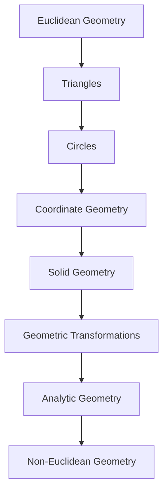

<!-- Generated by tools/build_indexes.py from tools/curriculum.json. Do not edit by hand. -->

# Geometry

*Shape, space and rigorous deduction*

[Mathematics](../README.md) › Geometry

Euclid's axiomatic method is the ancestor of all mathematics. From congruent triangles to coordinates, transformations and non-Euclidean spaces, geometry is where proof becomes visible.

## At a glance

| | |
|---|---|
| Topics | 8 (8 complete, 0 draft, 0 planned) |
| Estimated study time | ~73 hours |
| Prerequisites | [01-arithmetic](../01-arithmetic/README.md) |

## Study order

The numbers are the recommended order. Study a topic only after the ones before it —
the dependency chain below is the shortest safe route through the discipline.

## Topic inventory

| # | Topic | Level | Est. time | Status | Materials |
|---|---|---|---|---|---|
| 1 | [Euclidean Geometry](01-euclidean-geometry/README.md) | Beginner | 12 h | Complete | [Tutorial](01-euclidean-geometry/README.md) · [Exercises](01-euclidean-geometry/exercises.md) · [Solutions](01-euclidean-geometry/solutions.md) |
| 2 | [Triangles](02-triangles/README.md) | Intermediate | 10 h | Complete | [Tutorial](02-triangles/README.md) · [Exercises](02-triangles/exercises.md) · [Solutions](02-triangles/solutions.md) |
| 3 | [Circles](03-circles/README.md) | Intermediate | 9 h | Complete | [Tutorial](03-circles/README.md) · [Exercises](03-circles/exercises.md) · [Solutions](03-circles/solutions.md) |
| 4 | [Coordinate Geometry](04-coordinate-geometry/README.md) | Intermediate | 9 h | Complete | [Tutorial](04-coordinate-geometry/README.md) · [Exercises](04-coordinate-geometry/exercises.md) · [Solutions](04-coordinate-geometry/solutions.md) |
| 5 | [Solid Geometry](05-solid-geometry/README.md) | Intermediate | 9 h | Complete | [Tutorial](05-solid-geometry/README.md) · [Exercises](05-solid-geometry/exercises.md) · [Solutions](05-solid-geometry/solutions.md) |
| 6 | [Geometric Transformations](06-transformations/README.md) | Intermediate | 8 h | Complete | [Tutorial](06-transformations/README.md) · [Exercises](06-transformations/exercises.md) · [Solutions](06-transformations/solutions.md) |
| 7 | [Analytic Geometry](07-analytic-geometry/README.md) | Intermediate | 8 h | Complete | [Tutorial](07-analytic-geometry/README.md) · [Exercises](07-analytic-geometry/exercises.md) · [Solutions](07-analytic-geometry/solutions.md) |
| 8 | [Non-Euclidean Geometry](08-non-euclidean-geometry/README.md) | Advanced | 8 h | Complete | [Tutorial](08-non-euclidean-geometry/README.md) · [Exercises](08-non-euclidean-geometry/exercises.md) · [Solutions](08-non-euclidean-geometry/solutions.md) |

### What each topic covers

- **Euclidean Geometry** — Axioms, postulates, angles, parallel lines, and geometry as a deductive system.
- **Triangles** — Congruence, similarity, the Pythagorean theorem, area and triangle centres.
- **Circles** — Chords, tangents, inscribed angles, power of a point and circle theorems.
- **Coordinate Geometry** — Lines, distance, midpoint, slope, and algebraic proofs of geometric facts.
- **Solid Geometry** — Polyhedra, spheres, cylinders, cones, volume, surface area and cross-sections.
- **Geometric Transformations** — Isometries, dilations, composition, symmetry groups and tessellations.
- **Analytic Geometry** — Conic sections from the focus-directrix definition and their equations.
- **Non-Euclidean Geometry** — The parallel postulate, spherical and hyperbolic geometry, curvature.

## Related disciplines

- [05-trigonometry](../05-trigonometry/README.md)
- [17-topology](../17-topology/README.md)
- [24-advanced-topics](../24-advanced-topics/README.md)

## Status key

- **Complete** — tutorial, exercises and full solutions exist and the tutorial meets the
  [authoring standard](../CONTRIBUTING.md).
- **Draft** — some material exists but the topic is not finished.
- **Planned** — identified in the curriculum, not written yet.

Overall progress and the full topic inventory live in [ROADMAP.md](../ROADMAP.md).
