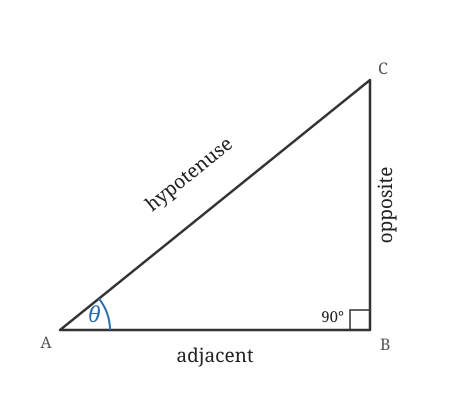
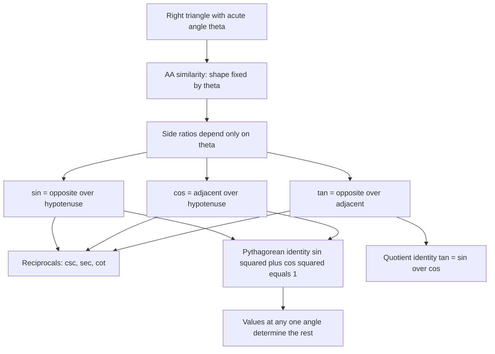

# Trigonometric Functions

> [Trigonometry](../README.md) · Level: Intermediate · Prerequisites: [Geometry](../../04-geometry/README.md), [Ratios and Proportions](../../01-arithmetic/06-ratios-and-proportions/README.md) · Estimated time: 10 h

## 1. Introduction

Stand in a flat field at noon and look at a tree. You cannot reach the top with a tape measure, yet you can find the tree's height with a stick, a shadow and a length of string. The trick is not a trick at all: it is the observation that **the shape of a right triangle is fixed by one acute angle**, so the *ratios* of its sides are fixed too, no matter how large the triangle is. Measure one ratio on a small triangle you can hold in your hand, and the same ratio holds in the huge triangle you cannot reach.

That observation is the whole of trigonometry. The Greek words are *trigonon* (triangle) and *metron* (measure); the subject began as the practical art of computing with triangles, and it became one of the most important families of functions in all of mathematics.

Why does it matter beyond triangles? Because a rotating wheel, a plucked string, a tide, an alternating current and a sound wave all repeat, and every repeating quantity can be described by the same two functions that describe a right triangle. The bridge between the triangle picture and the wave picture is the **unit circle**, which is the subject of the [next topic](../02-unit-circle/README.md).

This tutorial builds the right-triangle definitions from scratch, derives the exact values of the special angles with nothing but Pythagoras, and shows how to solve a right triangle from partial information. It closes by explaining what a right triangle *cannot* do — namely, describe an angle of $120^\circ$ — and why the definitions must therefore be extended.

## 2. Prerequisites

You should be comfortable with:

* **Similar triangles** — that triangles with equal angles have proportional sides, and that the ratio of two corresponding sides is the same in both. This is the engine of the whole topic; the [Geometry](../../04-geometry/README.md) discipline develops it.
* **Ratios and proportions** — writing $a : b$, forming $\frac{a}{b}$, and solving $\frac{a}{b} = \frac{c}{d}$ for an unknown. See [Ratios and Proportions](../../01-arithmetic/06-ratios-and-proportions/README.md).
* **The Pythagorean theorem** — in a right triangle with legs $a, b$ and hypotenuse $c$, $a^2 + b^2 = c^2$.
* **Square roots and simplifying radicals** — for example $\sqrt{8} = 2\sqrt{2}$ and $\frac{1}{\sqrt{3}} = \frac{\sqrt{3}}{3}$.
* **Solving linear and simple quadratic equations** — see [Elementary Algebra](../../03-algebra/01-elementary-algebra/README.md).
* **The angle sum of a triangle** — the three interior angles add to $180^\circ$.

Nothing here uses calculus, coordinate geometry or complex numbers. The one place where a calculator is needed is marked explicitly.

## 3. Learning Objectives

By the end of this tutorial you will be able to:

1. Explain, with a proof, why the ratio of two sides of a right triangle depends only on the acute angle and not on the size of the triangle.
2. Define $\sin\theta$, $\cos\theta$, $\tan\theta$, $\csc\theta$, $\sec\theta$ and $\cot\theta$ on a right triangle, and say which sides each one compares.
3. Derive the exact values of the trigonometric functions at $30^\circ$, $45^\circ$ and $60^\circ$ from the equilateral triangle and the isosceles right triangle.
4. Reproduce the exact-value table for $0^\circ, 30^\circ, 45^\circ, 60^\circ, 90^\circ$ from memory and justify each entry.
5. Solve a right triangle given two sides, or one side and one acute angle.
6. Model and solve problems involving angles of elevation and depression, shadows, ladders and ramps.
7. Prove from the definitions that $\tan\theta = \dfrac{\sin\theta}{\cos\theta}$, that the reciprocal pairs hold, and that $\sin^2\theta + \cos^2\theta = 1$.
8. Use the cofunction identities $\sin(90^\circ - \theta) = \cos\theta$ and $\tan(90^\circ - \theta) = \cot\theta$.
9. Explain why the right-triangle definitions cannot handle obtuse or negative angles, and describe what a replacement definition must supply.
10. Recognise and avoid the standard errors: confusing $\sin 30^\circ$ with $\sin 60^\circ$, writing $\tan 90^\circ = 0$, and using the wrong side as "adjacent".

## 4. Intuition

### 4.1 Shadows scale with the object

Put a $1\ \mathrm{m}$ stick upright in the sun. It casts a shadow of, say, $0.7\ \mathrm{m}$. Now put a $2\ \mathrm{m}$ stick next to it. Sunlight is parallel, so the second stick and its shadow form a triangle that is exactly the first triangle, doubled. Its shadow is $1.4\ \mathrm{m}$. A $10\ \mathrm{m}$ pole casts $7\ \mathrm{m}$.

The **ratio** shadow-to-height is $0.7$ for all three. That number is a property of the *sun's elevation*, not of the stick. Change the time of day and the ratio changes; change the object and the ratio stays. This is the central idea: the angle encodes the ratio, and the ratio encodes the angle.

### 4.2 A right triangle is a shadow problem

Any right triangle can be viewed as an object standing perpendicular to its shadow. The acute angle at the ground is the "elevation" of the line of sight from one end of the shadow to the top of the object. So a right triangle is completely specified, up to scale, by one acute angle: that is, by the *shape*. Two quantities describe the triangle's size and shape separately:

* **shape**, controlled by the acute angle $\theta$ — this fixes all three side ratios;
* **scale**, controlled by one side length — this fixes the actual sizes.

Trigonometry is the bookkeeping of that split. If you know the angle you know the shape; if you know one side you know the scale; and then you know everything.

### 4.3 The vocabulary of "opposite" and "adjacent"

The words *opposite* and *adjacent* are always relative to a stated angle, not to the triangle. In a right triangle $ABC$ with the right angle at $C$:

* the side **opposite** $A$ is $BC$ — the side that does not touch $A$;
* the side **adjacent** to $A$ is $AC$ — the leg that touches $A$ but is not the hypotenuse;
* the **hypotenuse** $AB$ is opposite the right angle.

If you now look at angle $B$ instead, the labels swap: $AC$ is opposite $B$ and $BC$ is adjacent to $B$. Rotating the page does not change the triangle, but it changes which side is "opposite". Most beginner errors come from this swap, so make a habit of naming the angle before naming the sides.

### 4.4 An analogy: a machine that converts angles into ratios

Think of each trigonometric function as a machine. You feed in an angle; it returns a number that is a ratio of lengths. The machine is *stateless*: it always gives the same output for the same input, because the shape of a right triangle with that acute angle is unique. Later, when the machine is rebuilt on the unit circle, it will accept every angle, including negative ones and ones larger than a full turn — but it will agree with the right-triangle machine on the angles a right triangle can actually have.

## 5. Formal Definition

Throughout, an **angle** is measured in degrees unless stated otherwise, and Greek letters ($\alpha$, $\beta$, $\theta$, $\phi$) denote angles.

**Definition 5.1 (Similar triangles).** Two triangles are *similar*, written $\triangle ABC \sim \triangle A'B'C'$, when

$$\angle A = \angle A', \qquad \angle B = \angle B', \qquad \angle C = \angle C',$$

and the corresponding sides are proportional:

$$\frac{AB}{A'B'} = \frac{BC}{B'C'} = \frac{CA}{C'A'}.$$

The common value is the **scale factor** from $\triangle A'B'C'$ to $\triangle ABC$.

The standard criterion used below is: *if two angles of one triangle equal two angles of another, the triangles are similar* (the AA criterion). It holds because the third angles then also agree, by the angle sum.

**Definition 5.2 (Right-triangle terminology).** In a right triangle, the side opposite the right angle is the **hypotenuse**; the other two sides are the **legs**. If $\theta$ is one of the acute angles, the leg that forms one side of $\theta$ is **adjacent** to $\theta$, and the remaining leg (which does not touch $\theta$) is **opposite** $\theta$. We abbreviate

$$o = \text{opposite}, \qquad a = \text{adjacent}, \qquad h = \text{hypotenuse}.$$

**Definition 5.3 (Acute angle).** An angle $\theta$ is *acute* when $0^\circ < \theta < 90^\circ$. A right triangle has exactly two acute angles, and they are complementary: their sum is $90^\circ$.

**Theorem 5.4 (Ratios depend only on the angle).** Let $\triangle ABC$ and $\triangle A'B'C'$ be right triangles with right angles at $C$ and $C'$, and suppose $\angle A = \angle A' = \theta$ with $0^\circ < \theta < 90^\circ$. Then

$$\frac{BC}{AB} = \frac{B'C'}{A'B'}, \qquad \frac{AC}{AB} = \frac{A'C'}{A'B'}, \qquad \frac{BC}{AC} = \frac{B'C'}{A'C'},$$

and the same holds for the three inverted ratios.

*Proof.* The two triangles have the right angle equal and the angle $\theta$ equal. Hence their third angles are also equal, because each triangle's angles sum to $180^\circ$. By the AA criterion the triangles are similar, so there is a number $k > 0$ with

$$A'B' = k\,AB, \qquad B'C' = k\,BC, \qquad A'C' = k\,AC.$$

Dividing the second equation by the first,

$$\frac{B'C'}{A'B'} = \frac{k\,BC}{k\,AB} = \frac{BC}{AB}.$$

The factor $k$ cancels: the ratio is unchanged by rescaling. The other two equalities follow by dividing the appropriate pairs. Because all sides are positive, inverting both sides of an equality of positive ratios preserves it, giving the three reciprocal ratios. $\blacksquare$

Theorem 5.4 is what licenses Definition 5.5: a ratio computed in *any* right triangle with acute angle $\theta$ is *the* value of the function at $\theta$.

**Definition 5.5 (The six trigonometric ratios).** Let $\theta$ be an acute angle of a right triangle with opposite side $o$, adjacent side $a$ and hypotenuse $h$. Define

$$\sin\theta = \frac{o}{h}, \qquad \cos\theta = \frac{a}{h}, \qquad \tan\theta = \frac{o}{a},$$

and their reciprocals

$$\csc\theta = \frac{h}{o}, \qquad \sec\theta = \frac{h}{a}, \qquad \cot\theta = \frac{a}{o}.$$

Read $\sin$ as "sine", $\cos$ as "cosine", $\tan$ as "tangent", $\csc$ as "cosecant", $\sec$ as "secant", $\cot$ as "cotangent". The three primary functions compare:

| Function | Ratio | Memory phrase |
|---|---|---|
| $\sin\theta$ | $\dfrac{\text{opposite}}{\text{hypotenuse}}$ | "SOH" |
| $\cos\theta$ | $\dfrac{\text{adjacent}}{\text{hypotenuse}}$ | "CAH" |
| $\tan\theta$ | $\dfrac{\text{opposite}}{\text{adjacent}}$ | "TOA" |
| $\csc\theta$ | $\dfrac{\text{hypotenuse}}{\text{opposite}}$ | reciprocal of sine |
| $\sec\theta$ | $\dfrac{\text{hypotenuse}}{\text{adjacent}}$ | reciprocal of cosine |
| $\cot\theta$ | $\dfrac{\text{adjacent}}{\text{opposite}}$ | reciprocal of tangent |

**Definition 5.6 (Solving a right triangle).** To *solve* a right triangle is to determine all three side lengths and both acute angles from partial information: either two sides, or one side together with one acute angle.

**Definition 5.7 (Angles of elevation and depression).** The **angle of elevation** of a point $P$ from a point $O$ is the angle between the horizontal ray from $O$ and the line of sight $OP$, measured upward. The **angle of depression** of $O$ from $P$ is the angle between the horizontal ray from $P$ and the line $PO$, measured downward.

## 6. Mathematical Notation

| Symbol | Read as | Meaning |
|---|---|---|
| $\theta, \alpha, \beta, \phi$ | theta, alpha, beta, phi | angles |
| $\angle A$ | angle $A$ | the angle at vertex $A$ |
| $\triangle ABC$ | triangle $ABC$ | the triangle with vertices $A, B, C$ |
| $\sim$ | is similar to | equal angles, proportional sides |
| $\sin\theta$ | sine of theta | $\dfrac{\text{opposite}}{\text{hypotenuse}}$ |
| $\cos\theta$ | cosine of theta | $\dfrac{\text{adjacent}}{\text{hypotenuse}}$ |
| $\tan\theta$ | tangent of theta | $\dfrac{\text{opposite}}{\text{adjacent}}$ |
| $\csc\theta, \sec\theta, \cot\theta$ | cosecant, secant, cotangent | the three reciprocals |
| $\sin^2\theta$ | sine squared theta | $(\sin\theta)^2$ — never $\sin(\theta^2)$ |
| $90^\circ$ | ninety degrees | a quarter turn; the right angle |
| $\approx$ | approximately equals | used only where rounding is stated |
| $o, a, h$ | opposite, adjacent, hypotenuse | the three sides relative to a chosen acute angle |

Two typographic warnings. First, $\sin^{-1}\theta$ does **not** mean $1/\sin\theta$; it denotes the inverse function (the angle whose sine is $\theta$), and this repository writes $\arcsin\theta$ when that is meant. Second, $\sin\theta$ without a multiplication sign is a single symbol: $\sin$ is the name of a function, not a variable multiplied by $\theta$.

## 7. Core Concepts

### 7.1 Why the ratios depend only on the angle

Theorem 5.4 is the foundation, so it is worth seeing it in numbers before using it.

Take the familiar $3$–$4$–$5$ triangle: legs $3$ and $4$, hypotenuse $5$. For the angle $\theta$ opposite the side of length $3$,

$$\sin\theta = \frac{3}{5} = 0.6, \qquad \cos\theta = \frac{4}{5} = 0.8, \qquad \tan\theta = \frac{3}{4} = 0.75.$$

Scale the triangle by $7$: legs $21$ and $28$, hypotenuse $35$. The same angle $\theta$ now gives

$$\sin\theta = \frac{21}{35} = 0.6, \qquad \cos\theta = \frac{28}{35} = 0.8, \qquad \tan\theta = \frac{21}{28} = 0.75.$$

Identical. Scale it by $\tfrac{1}{5}$: legs $\tfrac{3}{5}$ and $\tfrac{4}{5}$, hypotenuse $1$. Again $\sin\theta = \tfrac{3}{5}$, $\cos\theta = \tfrac{4}{5}$. Nothing depends on the size.

Conversely, different angles give different ratios. The triangle with legs $5, 12, 13$ has

$$\sin\phi = \frac{5}{13} \approx 0.3846, \qquad \cos\phi = \frac{12}{13} \approx 0.9231,$$

which are clearly not $0.6$ and $0.8$. So distinct angles give distinct ratios — and Section 7.9 shows that this holds for *every* pair of distinct acute angles, not merely for this example. The mapping from angle to ratio is therefore injective on acute angles, which is why a table of ratios can be run backwards to recover an angle: that is exactly what an inverse trigonometric function does.

Finally, the ratios are not independent of each other. In the $3$–$4$–$5$ triangle, $\sin\theta = 3/5$ and $\cos\theta = 4/5$ always arrive together, because the Pythagorean theorem ties the three sides into one relation. That relation, $\sin^2\theta + \cos^2\theta = 1$, is proved in Section 8.

### 7.2 Reading the six ratios

The six functions are three reciprocal pairs, not six unrelated objects:

$$\csc\theta = \frac{1}{\sin\theta}, \qquad \sec\theta = \frac{1}{\cos\theta}, \qquad \cot\theta = \frac{1}{\tan\theta}.$$

The pairing is worth memorising with its trap: the **co** in *cosecant* pairs with *sine*, and the **sec** in *secant* pairs with *cosine* — the names cross over, which is a historical accident. A mnemonic that survives the accident: the third letter of "secant" is "c", as in cosine; the third letter of "cosecant" is "s", as in sine.

The six are not independent. Two are quotients of the others (Section 7.7 proves it) and the remaining two are reciprocals of $\sin$ and $\cos$; in fact every one of the six is determined by those two alone:

$$\tan\theta = \frac{\sin\theta}{\cos\theta}, \quad \cot\theta = \frac{\cos\theta}{\sin\theta}, \quad \sec\theta = \frac{1}{\cos\theta}, \quad \csc\theta = \frac{1}{\sin\theta}.$$

So the whole theory is governed by the behaviour of $\sin$ and $\cos$; the other four are convenient abbreviations. That is why the identities of Section 8 are nearly all statements about sine and cosine.

Because $o, a > 0$ for a nondegenerate right triangle, all six ratios are positive for acute angles. This is a property of the *acute* case only, and it is the first thing that breaks when angles are extended.

### 7.3 Complementary angles: the "co-" in cosine

In a right triangle with acute angles $\theta$ at $A$ and $\phi$ at $B$,

$$\theta + \phi = 90^\circ.$$

The side opposite $A$ is the side adjacent to $B$ (both are $BC$). Therefore

$$\sin\theta = \frac{BC}{AB} = \cos\phi = \cos(90^\circ - \theta).$$

The same argument applied to the other sides gives the **cofunction identities**:

$$\sin(90^\circ - \theta) = \cos\theta, \qquad \cos(90^\circ - \theta) = \sin\theta,$$
$$\tan(90^\circ - \theta) = \cot\theta, \qquad \cot(90^\circ - \theta) = \tan\theta,$$
$$\sec(90^\circ - \theta) = \csc\theta, \qquad \csc(90^\circ - \theta) = \sec\theta.$$

This is where the prefix "co-" comes from: *cosine* is the sine of the **co**mplementary angle, *cotangent* the tangent of the complementary angle, and so on. The identities turn one table into two: knowing the values at $30^\circ$ immediately gives the values at $60^\circ$.

### 7.4 The special angles, derived exactly

Two triangles are enough to compute every trigonometric function at $30^\circ$, $45^\circ$ and $60^\circ$ exactly. No calculator, no measuring, no decimals.

#### The isosceles right triangle and $45^\circ$

Take a right triangle whose two legs are both $1$. By the Pythagorean theorem the hypotenuse is

$$h = \sqrt{1^2 + 1^2} = \sqrt{2}.$$

The two acute angles are equal (isosceles triangle), and they sum to $90^\circ$, so each is $45^\circ$. Hence

$$\sin 45^\circ = \frac{1}{\sqrt{2}} = \frac{\sqrt{2}}{2}, \qquad \cos 45^\circ = \frac{1}{\sqrt{2}} = \frac{\sqrt{2}}{2}, \qquad \tan 45^\circ = \frac{1}{1} = 1.$$

The rationalisation step is $\dfrac{1}{\sqrt{2}} \cdot \dfrac{\sqrt{2}}{\sqrt{2}} = \dfrac{\sqrt{2}}{2}$; both forms are exact and both are used, but $\sqrt{2}/2$ is preferred because the denominator is an integer.

#### The half-equilateral triangle and $30^\circ$, $60^\circ$

Start with an **equilateral** triangle of side $2$. Its angles are all $60^\circ$. Drop the altitude from one vertex to the opposite side. An altitude of an equilateral triangle bisects the base and bisects the vertex angle (this follows from the congruence of the two triangles it creates: they have a common leg — the altitude — a right angle, and equal hypotenuses, or equivalently they are mirror images). So the altitude splits the triangle into two congruent right triangles, each with

* hypotenuse $2$ (a side of the equilateral triangle),
* one leg $1$ (half of the base),
* the other leg $h$, the altitude,
* angles $30^\circ$ at the top vertex and $60^\circ$ at the base.

Pythagoras gives

$$h^2 + 1^2 = 2^2 \quad\Longrightarrow\quad h^2 = 3 \quad\Longrightarrow\quad h = \sqrt{3}.$$

Now read the ratios off the half-triangle, for the angle of $60^\circ$ at the base:

* opposite the $60^\circ$ angle is the altitude $\sqrt{3}$;
* adjacent to it is half the base, $1$;
* the hypotenuse is $2$.

$$\sin 60^\circ = \frac{\sqrt{3}}{2}, \qquad \cos 60^\circ = \frac{1}{2}, \qquad \tan 60^\circ = \frac{\sqrt{3}}{1} = \sqrt{3}.$$

For the $30^\circ$ angle at the top the roles swap, and the cofunction identities confirm it:

$$\sin 30^\circ = \frac{1}{2}, \qquad \cos 30^\circ = \frac{\sqrt{3}}{2}, \qquad \tan 30^\circ = \frac{1}{\sqrt{3}} = \frac{\sqrt{3}}{3}.$$

The last simplification is again rationalisation: $\dfrac{1}{\sqrt{3}} \cdot \dfrac{\sqrt{3}}{\sqrt{3}} = \dfrac{\sqrt{3}}{3}$.

#### The degenerate angles $0^\circ$ and $90^\circ$

A right triangle cannot contain either $0^\circ$ or $90^\circ$ as an acute angle, so the definitions of Section 5 do not apply directly. The values are obtained by asking what happens as the acute angle approaches the extreme: shrink $\theta$ toward $0^\circ$ in a right triangle with hypotenuse fixed at $h$; the opposite side shrinks toward $0$ and the adjacent side grows toward $h$. Hence $\sin\theta \to 0$, $\cos\theta \to 1$, $\tan\theta \to 0$. Similarly, as $\theta \to 90^\circ$, the opposite side approaches $h$, the adjacent side approaches $0$, and $\tan\theta$ grows without bound. We therefore set

$$\sin 0^\circ = 0, \quad \cos 0^\circ = 1, \quad \tan 0^\circ = 0, \qquad \sin 90^\circ = 1, \quad \cos 90^\circ = 0,$$

and we leave $\tan 90^\circ$ **undefined**, because it would require division by zero. The next topic makes these values part of a single coherent definition on the unit circle, where nothing is "by limiting".

#### The complete exact-value table

| $\theta$ | $0^\circ$ | $30^\circ$ | $45^\circ$ | $60^\circ$ | $90^\circ$ |
|---|---|---|---|---|---|
| $\sin\theta$ | $0$ | $\dfrac{1}{2}$ | $\dfrac{\sqrt{2}}{2}$ | $\dfrac{\sqrt{3}}{2}$ | $1$ |
| $\cos\theta$ | $1$ | $\dfrac{\sqrt{3}}{2}$ | $\dfrac{\sqrt{2}}{2}$ | $\dfrac{1}{2}$ | $0$ |
| $\tan\theta$ | $0$ | $\dfrac{\sqrt{3}}{3}$ | $1$ | $\sqrt{3}$ | undefined |
| $\csc\theta$ | undefined | $2$ | $\sqrt{2}$ | $\dfrac{2\sqrt{3}}{3}$ | $1$ |
| $\sec\theta$ | $1$ | $\dfrac{2\sqrt{3}}{3}$ | $\sqrt{2}$ | $2$ | undefined |
| $\cot\theta$ | undefined | $\sqrt{3}$ | $1$ | $\dfrac{\sqrt{3}}{3}$ | $0$ |

A pattern makes the sine row easy to remember: write the five values as

$$\frac{\sqrt{0}}{2}, \quad \frac{\sqrt{1}}{2}, \quad \frac{\sqrt{2}}{2}, \quad \frac{\sqrt{3}}{2}, \quad \frac{\sqrt{4}}{2},$$

which simplify to $0, \tfrac{1}{2}, \tfrac{\sqrt{2}}{2}, \tfrac{\sqrt{3}}{2}, 1$. The cosine row is the same list in reverse order. This pattern is a memory aid, not a proof — the proof is the two triangles above.

The "undefined" entries are not defects. They record the values of $\theta$ where the denominator of the defining ratio is zero: $\cot 0^\circ$ would need $\cos 0^\circ/\sin 0^\circ = 1/0$; $\tan 90^\circ$ would need $\sin 90^\circ/\cos 90^\circ = 1/0$; similarly $\csc 0^\circ$ and $\sec 90^\circ$.

### 7.5 Solving right triangles

"Solving" a right triangle means producing the three sides and the two acute angles. There are four shapes of input.

**Case 1: two legs $a$ and $b$.** Pythagoras gives $h = \sqrt{a^2+b^2}$; the angle satisfies $\tan\theta = a/b$. To extract $\theta$ from a tangent you need the inverse tangent, written $\arctan$ (Section 9, Example 4).

**Case 2: one leg and the hypotenuse.** Pythagoras gives the other leg; the angle satisfies $\cos\theta = a/h$ or $\sin\theta = o/h$.

**Case 3: one leg and one acute angle.** The hypotenuse follows from $\cos$ or $\sin$ of that angle, the other leg from $\tan$ or from Pythagoras. **Always compute the unknown side from the given information, not from a side you have already rounded** — otherwise rounding errors compound.

**Case 4: the hypotenuse and one acute angle.** Both legs follow from $\sin$ and $\cos$ directly: $o = h\sin\theta$, $a = h\cos\theta$.

Because the two acute angles sum to $90^\circ$, computing one of them computes the other. And because a right triangle is determined up to congruence by two sides or by a side and an acute angle, no case is ambiguous — unlike the general triangle, where "side-side-angle" can produce two different triangles.

### 7.6 Angles of elevation and depression

Surveying, navigation and architecture use two standard angles.

* The **angle of elevation** of $P$ from $O$ is measured upward from the horizontal at $O$ to the line of sight $OP$.
* The **angle of depression** of $O$ from $P$ is measured downward from the horizontal at $P$ to the line $PO$.

The two are always equal when the horizontal lines at $O$ and $P$ are parallel: they are alternate interior angles between two parallel horizontals cut by the transversal $OP$. This is why a lighthouse keeper's angle of depression to a boat equals the boat's angle of elevation to the lighthouse.

The diagram that solves every such problem is a right triangle with

* the horizontal distance along the ground as one leg,
* the vertical height as the other leg (the one *opposite* the elevation angle at the observer),
* the line of sight as the hypotenuse.

Then $\tan(\text{elevation}) = \dfrac{\text{height}}{\text{horizontal distance}}$, which is the single most-used relation in the applications.

### 7.7 The quotient identity $\tan\theta = \dfrac{\sin\theta}{\cos\theta}$

This is not a new assumption; it follows from Definition 5.5 in one line. Multiply numerator and denominator by $1/h$:

$$\tan\theta = \frac{o}{a} = \frac{o/h}{a/h} = \frac{\sin\theta}{\cos\theta}.$$

The step is legal because $h \neq 0$ and because dividing numerator and denominator of a fraction by the same nonzero number does not change its value. Similarly

$$\cot\theta = \frac{a}{o} = \frac{a/h}{o/h} = \frac{\cos\theta}{\sin\theta} = \frac{1}{\tan\theta}.$$

The quotient identity explains the behaviour near $90^\circ$: as $\theta \to 90^\circ$, $\sin\theta \to 1$ while $\cos\theta \to 0^+$, so the quotient grows without bound. It also explains why $\tan 45^\circ = 1$: at $45^\circ$ the two legs are equal (a right triangle with equal acute angles is isosceles), so numerator and denominator of the quotient are equal.

### 7.8 Why the functions must extend beyond acute angles

A right triangle has one right angle and two acute ones. So the right-triangle definitions simply have nothing to say about $120^\circ$, about $-30^\circ$, or about an angle of $3$ radians. Yet such angles occur constantly:

* A wheel rotating at constant speed passes through every angle, not just the first quarter turn.
* A pendulum swings through negative and positive displacements.
* A triangle with an obtuse angle — say $120^\circ$ — has a perfectly good "opposite side" and "hypotenuse", but no right angle to organise them.

The resolution is to keep the *values* and change the *picture*. On a circle of radius $1$ centred at the origin, place a point $P$ at angle $\theta$ measured counterclockwise from the positive $x$-axis, and **define**

$$\cos\theta = \text{the } x\text{-coordinate of } P, \qquad \sin\theta = \text{the } y\text{-coordinate of } P.$$

For acute $\theta$, the right triangle with hypotenuse $1$ shows that this agrees with Definition 5.5: the horizontal leg has length $\cos\theta$ and the vertical leg has length $\sin\theta$, so opposite/hypotenuse is still $\sin\theta$ and adjacent/hypotenuse is still $\cos\theta$. For other angles the coordinates still exist, so the definition still works.

Two consequences appear immediately and are proved in the [next topic](../02-unit-circle/README.md):

* $\sin\theta$ and $\cos\theta$ remain between $-1$ and $1$, but they may be negative: $\sin 120^\circ = \tfrac{\sqrt{3}}{2}$ (positive) while $\cos 120^\circ = -\tfrac{1}{2}$ (negative).
* The functions repeat: adding a full turn changes nothing, so $\sin(\theta + 360^\circ) = \sin\theta$.

The right-triangle theory in this tutorial remains the reference for acute angles. Everything proved here — the quotient identity, the reciprocal identities, the Pythagorean identity, the cofunction identities — survives unchanged in the larger setting, and the unit-circle topic re-proves them in that setting.

### 7.9 How the ratios behave on $(0^\circ, 90^\circ)$

Fix the hypotenuse at $h$ and vary the acute angle $\theta$. Picture the point $P$ on the ray at distance $h$ from the vertex, with the adjacent side along the horizontal.

* As $\theta$ grows, $P$ moves along a quarter circle upward and to the left. Its height above the horizontal (the opposite side) increases strictly, and its horizontal distance from the vertex (the adjacent side) decreases strictly.
* Therefore $o = h\sin\theta$ increases strictly and $a = h\cos\theta$ decreases strictly.
* Since $\tan\theta = o/a$ is a quotient of a strictly increasing positive quantity by a strictly decreasing positive quantity, $\tan\theta$ increases strictly, from $0$ at $0^\circ$ to arbitrarily large values near $90^\circ$.

So on the acute range:

| Function | Behaviour on $(0^\circ, 90^\circ)$ | Range |
|---|---|---|
| $\sin\theta$ | strictly increasing | $(0, 1)$ |
| $\cos\theta$ | strictly decreasing | $(0, 1)$ |
| $\tan\theta$ | strictly increasing | $(0, \infty)$ |
| $\cot\theta$ | strictly decreasing | $(0, \infty)$ |
| $\sec\theta$ | strictly increasing | $(1, \infty)$ |
| $\csc\theta$ | strictly decreasing | $(1, \infty)$ |

The open intervals are correct: the endpoints are excluded because a right triangle cannot have a $0^\circ$ or $90^\circ$ acute angle. Strict monotonicity is what makes the inverse functions well defined: on the acute range each function takes every value in its range exactly once, so an angle can be recovered from a ratio.

## 8. Formulas and Properties

Every statement below is for acute angles of a right triangle, so every quantity is a positive ratio of sides. Each is stated with its hypothesis, and each is proved; none is asserted on authority.

**Property 8.1 (Reciprocal identities).** For $0^\circ < \theta < 90^\circ$,

$$\csc\theta = \frac{1}{\sin\theta}, \qquad \sec\theta = \frac{1}{\cos\theta}, \qquad \cot\theta = \frac{1}{\tan\theta}.$$

*Why.* Immediate from Definition 5.5: inverting a positive ratio gives the reciprocal ratio. For example $\csc\theta = h/o = 1/(o/h) = 1/\sin\theta$. $\blacksquare$

**Property 8.2 (Quotient identities).** For $0^\circ < \theta < 90^\circ$,

$$\tan\theta = \frac{\sin\theta}{\cos\theta}, \qquad \cot\theta = \frac{\cos\theta}{\sin\theta}.$$

*Why.* Section 7.7: multiply $o/a$ above and below by $1/h$. $\blacksquare$

**Property 8.3 (Pythagorean identity).** For $0^\circ < \theta < 90^\circ$,

$$\sin^2\theta + \cos^2\theta = 1.$$

*Why.* In the right triangle, $o^2 + a^2 = h^2$ by Pythagoras. Divide both sides by $h^2 > 0$:

$$\frac{o^2}{h^2} + \frac{a^2}{h^2} = \frac{h^2}{h^2}, \qquad\text{that is,}\qquad \left(\frac{o}{h}\right)^2 + \left(\frac{a}{h}\right)^2 = 1.$$

By Definition 5.5 the two brackets are $\sin\theta$ and $\cos\theta$. $\blacksquare$

The identity is a restatement of the Pythagorean theorem in ratio language. It is the most-used identity in the subject because it lets any one of $\sin\theta$, $\cos\theta$ be computed from the other, up to sign.

**Property 8.4 (Companion Pythagorean identities).** For acute $\theta$,

$$1 + \tan^2\theta = \sec^2\theta, \qquad 1 + \cot^2\theta = \csc^2\theta.$$

*Why.* Divide $\sin^2\theta + \cos^2\theta = 1$ by $\cos^2\theta \neq 0$:

$$\frac{\sin^2\theta}{\cos^2\theta} + 1 = \frac{1}{\cos^2\theta}, \qquad\text{that is,}\qquad \tan^2\theta + 1 = \sec^2\theta.$$

Divide the same identity by $\sin^2\theta \neq 0$ for the second. $\blacksquare$

**Property 8.5 (Cofunction identities).** For $0^\circ < \theta < 90^\circ$,

$$\sin(90^\circ - \theta) = \cos\theta, \qquad \tan(90^\circ - \theta) = \cot\theta, \qquad \sec(90^\circ - \theta) = \csc\theta,$$

and the same three with sine and cosine (respectively tangent and cotangent, secant and cosecant) exchanged.

*Why.* Section 7.3: the side opposite one acute angle is the side adjacent to the other. $\blacksquare$

**Property 8.6 (Bounds).** For $0^\circ < \theta < 90^\circ$,

$$0 < \sin\theta < 1, \qquad 0 < \cos\theta < 1, \qquad \tan\theta > 0, \qquad \sec\theta > 1, \qquad \csc\theta > 1.$$

*Why.* A leg of a nondegenerate right triangle is shorter than the hypotenuse (the hypotenuse is the side opposite the largest angle, and the right angle is the largest). Hence $0 < o < h$ and $0 < a < h$, and dividing by $h$ gives the first two. The rest follow by Property 8.1 and positivity. $\blacksquare$

**Property 8.7 (Monotonicity).** On $(0^\circ, 90^\circ)$ the functions $\sin$, $\tan$, $\sec$ are strictly increasing and $\cos$, $\cot$, $\csc$ are strictly decreasing.

*Why.* Section 7.9. Fix the hypotenuse; the endpoint of the hypotenuse on the ray of angle $\theta$ traces a quarter circle. As $\theta$ increases, the height of that point increases strictly and its horizontal distance decreases strictly, giving the statements for $\sin$ and $\cos$. The quotient $\tan = \sin/\cos$ of a strictly increasing positive function by a strictly decreasing positive one is strictly increasing; the reciprocals reverse the direction. $\blacksquare$

**Property 8.8 (Sine of a sum is not the sum of sines).** For acute $\theta, \phi$ with $\theta + \phi < 90^\circ$,

$$\sin(\theta + \phi) \neq \sin\theta + \sin\phi \quad\text{in general.}$$

*Why.* A single counterexample suffices: $\sin(30^\circ + 30^\circ) = \sin 60^\circ = \tfrac{\sqrt{3}}{2} \approx 0.866$, whereas $\sin 30^\circ + \sin 30^\circ = 1$. The correct formula for $\sin(\theta+\phi)$ is a *sum identity*, and it is proved in the Trigonometric Identities topic, not here. The point of listing this "non-property" is that it is the most common invented identity in the subject: it is false, and it must never be used. $\blacksquare$

**Property 8.9 (Area of a right triangle in terms of an angle).** A right triangle with hypotenuse $h$ and acute angle $\theta$ has legs $h\sin\theta$ and $h\cos\theta$, hence area

$$A = \tfrac{1}{2}h^2\sin\theta\cos\theta.$$

*Why.* The legs are opposite and adjacent to $\theta$, and $o = h\sin\theta$, $a = h\cos\theta$ by Definition 5.5. The area of a right triangle is half the product of its legs. $\blacksquare$

This last formula is used in Section 9, Example 8, to show that the isosceles right triangle has the largest area among all right triangles with a fixed hypotenuse.

## 9. Step-by-Step Examples

The examples run from direct substitution to a multi-step modelling problem. Every numerical claim is checked, and rounding is stated explicitly.

### Example 1 (easy): all six ratios from a $5$–$12$–$13$ triangle

*A right triangle has legs $5$ and $12$. Find all six trigonometric functions of the acute angle $\theta$ opposite the side of length $5$.*

The hypotenuse is not given, so compute it first:

$$h = \sqrt{5^2 + 12^2} = \sqrt{25 + 144} = \sqrt{169} = 13.$$

Relative to $\theta$: opposite $= 5$, adjacent $= 12$, hypotenuse $= 13$. Therefore

$$\sin\theta = \frac{5}{13}, \qquad \cos\theta = \frac{12}{13}, \qquad \tan\theta = \frac{5}{12},$$
$$\csc\theta = \frac{13}{5}, \qquad \sec\theta = \frac{13}{12}, \qquad \cot\theta = \frac{12}{5}.$$

*Check.* $\sin^2\theta + \cos^2\theta = \frac{25}{169} + \frac{144}{169} = \frac{169}{169} = 1$. Also $\tan\theta = \frac{5/13}{12/13} = \frac{5}{12}$, as Property 8.2 requires.

The angle itself, if wanted, is $\theta = \arctan(5/12) \approx 22.62^\circ$. Note that the *ratios* are exact rationals; only the angle requires a calculator.

### Example 2 (easy): exact values without a calculator

*Compute $\sin 30^\circ \cos 60^\circ + \tan 45^\circ$ exactly.*

Read each value from the table of Section 7.4:

$$\sin 30^\circ = \frac{1}{2}, \qquad \cos 60^\circ = \frac{1}{2}, \qquad \tan 45^\circ = 1.$$

Then

$$\sin 30^\circ \cos 60^\circ + \tan 45^\circ = \frac{1}{2}\cdot\frac{1}{2} + 1 = \frac{1}{4} + 1 = \frac{5}{4}.$$

*Check.* $\frac{1}{4} + 1 = 1.25$, and the exact answer $\frac54$ agrees.

Note how the cofunction identity would give the same first factor: $\cos 60^\circ = \sin(90^\circ - 60^\circ) = \sin 30^\circ$, so the product is $\sin^2 30^\circ = \frac14$.

### Example 3 (easy–medium): solving a right triangle from a side and an angle

*A right triangle has hypotenuse $12$ and an acute angle $\theta = 40^\circ$. Find the two legs.*

The leg opposite $\theta$ satisfies $\sin\theta = \dfrac{o}{12}$, so

$$o = 12\sin 40^\circ \approx 12 \times 0.642788 = 7.7135 \approx 7.71.$$

The leg adjacent satisfies $\cos\theta = \dfrac{a}{12}$, so

$$a = 12\cos 40^\circ \approx 12 \times 0.766044 = 9.1925 \approx 9.19.$$

The other acute angle is $90^\circ - 40^\circ = 50^\circ$, and the triangle is solved.

*Check.* Pythagoras must hold to within rounding: $7.71^2 + 9.19^2 = 59.4441 + 84.4561 = 143.9002 \approx 144 = 12^2$. The small excess is exactly the rounding of both legs upward; recomputing with more digits gives $7.713451^2 + 9.192533^2 = 59.4973 + 84.5027 = 144.0000$.

A common error here is to compute $a$ from $a = \sqrt{144 - 7.71^2} = 9.194$, which differs in the second decimal. Both are "right" to the stated precision, but computing each side from the *given* data (as above) avoids propagating a rounded intermediate value.

### Example 4 (medium): solving a right triangle from two legs, with an inverse function

*A right triangle has legs $a = 7$ and $b = 24$. Solve it.*

The hypotenuse:

$$h = \sqrt{7^2 + 24^2} = \sqrt{49 + 576} = \sqrt{625} = 25.$$

For the angle $\theta$ opposite the side of length $7$:

$$\tan\theta = \frac{7}{24} \approx 0.291667.$$

The angle whose tangent is $0.291667$ is found with the inverse tangent:

$$\theta = \arctan\!\left(\frac{7}{24}\right) \approx 16.26^\circ.$$

The other acute angle is $90^\circ - 16.26^\circ = 73.74^\circ$.

*Check.* $\sin\theta = 7/25 = 0.28$ and $\cos\theta = 24/25 = 0.96$; then $\sin^2\theta + \cos^2\theta = 0.0784 + 0.9216 = 1.0000$. Also $\tan 16.26^\circ \approx 0.2917$, consistent with the value used.

### Example 5 (medium): a ladder

*A ladder $5\ \mathrm{m}$ long leans against a vertical wall, making an angle of $68^\circ$ with the ground. How high up the wall does it reach, and how far is the foot of the ladder from the wall?*

The ladder is the hypotenuse. The height reached is the side opposite the angle at the ground; the distance from the wall is the adjacent side.

$$h_{\text{wall}} = 5\sin 68^\circ \approx 5 \times 0.927184 = 4.6359 \approx 4.64\ \mathrm{m},$$
$$d_{\text{foot}} = 5\cos 68^\circ \approx 5 \times 0.374607 = 1.8730 \approx 1.87\ \mathrm{m}.$$

*Check.* $4.64^2 + 1.87^2 = 21.5296 + 3.4969 = 25.0265$, and $5^2 = 25$; the excess is rounding. The ladder is longer than the height, as it must be, since the hypotenuse exceeds each leg.

If instead the problem had given the height reached and asked for the angle, the equation would be $\sin\theta = 4.64/5$, solved by $\theta = \arcsin(0.928) \approx 68.1^\circ$.

### Example 6 (medium–hard): a tower observed from two points, exactly

*From a point $A$ on level ground the angle of elevation of the top of a tower is $30^\circ$. Walking $50\ \mathrm{m}$ directly toward the tower to a point $B$, the angle of elevation becomes $45^\circ$. Find the height of the tower.*

Let $h$ be the height and $d$ the horizontal distance from $B$ to the foot of the tower. Two right triangles share the vertical side $h$:

* from $B$: $\tan 45^\circ = \dfrac{h}{d}$, so $h = d$;
* from $A$: $\tan 30^\circ = \dfrac{h}{d + 50}$, so $h = \dfrac{d + 50}{\sqrt{3}}$.

Equating the two expressions for $h$:

$$d = \frac{d + 50}{\sqrt{3}}.$$

Multiply by $\sqrt{3}$:

$$d\sqrt{3} = d + 50 \quad\Longrightarrow\quad d(\sqrt{3} - 1) = 50 \quad\Longrightarrow\quad d = \frac{50}{\sqrt{3} - 1}.$$

Rationalise by multiplying above and below by $\sqrt{3} + 1$, using $(\sqrt{3}-1)(\sqrt{3}+1) = 3 - 1 = 2$:

$$d = \frac{50(\sqrt{3} + 1)}{2} = 25(\sqrt{3} + 1).$$

Since $h = d$,

$$h = 25(\sqrt{3} + 1) \approx 25 \times 2.732051 = 68.3013 \approx 68.30\ \mathrm{m}.$$

*Check.* $d \approx 68.30$, so $A$ is at $118.30\ \mathrm{m}$ from the foot. Then $118.30 \tan 30^\circ = 118.30 \times 0.577350 = 68.30$. Both triangles give the same height, as required. The exact answer $25(\sqrt3+1)$ is preferable to $68.30$: it is the true value.

### Example 7 (hard): an incline and the components of a force

*A block of weight $200\ \mathrm{N}$ rests on a frictionless ramp inclined at $25^\circ$ to the horizontal. Find the component of the weight along the ramp and the component perpendicular to it.*

The weight acts vertically downward; the ramp makes $25^\circ$ with the horizontal, and the perpendicular to the ramp makes $25^\circ$ with the vertical. So the weight vector is the hypotenuse of a right triangle whose legs are the two sought components, with the $25^\circ$ angle between the weight and the perpendicular:

$$F_{\parallel} = 200\sin 25^\circ \approx 200 \times 0.422618 = 84.52\ \mathrm{N},$$
$$F_{\perp} = 200\cos 25^\circ \approx 200 \times 0.906308 = 181.26\ \mathrm{N}.$$

*Check.* $84.52^2 + 181.26^2 = 7143.6 + 32855.2 = 39998.8 \approx 40000 = 200^2$. Also, at $0^\circ$ the formulas give $0$ and $200\ \mathrm{N}$, and at $90^\circ$ they give $200\ \mathrm{N}$ and $0$ — both physically correct, which is a good sanity check on which function belongs to which component.

### Example 8 (hard): proving properties and maximising an area

*(a) Prove that $\tan\theta = \dfrac{\sin\theta}{\cos\theta}$ for acute $\theta$, using only the definitions. (b) Prove that $1 + \tan^2\theta = \sec^2\theta$. (c) Show that among all right triangles with hypotenuse $1$, the one of largest area has $\theta = 45^\circ$.*

**(a)** Write $o, a, h$ for the sides relative to $\theta$. Then

$$\frac{\sin\theta}{\cos\theta} = \frac{o/h}{a/h} = \frac{o}{h}\cdot\frac{h}{a} = \frac{o}{a} = \tan\theta.$$

The middle step used the rule for dividing fractions, $\dfrac{p/q}{r/s} = \dfrac{p}{q}\cdot\dfrac{s}{r}$, and the cancellation of $h$ is legal because $h > 0$.

**(b)** Start from Property 8.3 and divide by $\cos^2\theta$, which is nonzero for acute $\theta$:

$$\frac{\sin^2\theta}{\cos^2\theta} + \frac{\cos^2\theta}{\cos^2\theta} = \frac{1}{\cos^2\theta}.$$

Each term is now recognisable: $\dfrac{\sin^2\theta}{\cos^2\theta} = \left(\dfrac{\sin\theta}{\cos\theta}\right)^2 = \tan^2\theta$ by part (a), and $\dfrac{1}{\cos^2\theta} = \sec^2\theta$ by Property 8.1. Hence $\tan^2\theta + 1 = \sec^2\theta$.

A second, independent derivation: in the right triangle, divide $o^2 + a^2 = h^2$ by $a^2$ to get $(o/a)^2 + 1 = (h/a)^2$, that is, $\tan^2\theta + 1 = \sec^2\theta$. Both routes agree, as they must.

**(c)** By Property 8.9 the area with $h = 1$ is

$$A(\theta) = \tfrac{1}{2}\sin\theta\cos\theta.$$

We must show $A \le \tfrac14$ with equality exactly at $\theta = 45^\circ$. Start from the algebraic fact

$$(\sin\theta - \cos\theta)^2 \ge 0,$$

which holds because a square is never negative. Expand:

$$\sin^2\theta - 2\sin\theta\cos\theta + \cos^2\theta \ge 0.$$

Use $\sin^2\theta + \cos^2\theta = 1$:

$$1 - 2\sin\theta\cos\theta \ge 0 \quad\Longrightarrow\quad \sin\theta\cos\theta \le \frac{1}{2}.$$

Multiplying by $\tfrac12$ gives $A \le \tfrac14$. Equality in the first line holds exactly when $\sin\theta = \cos\theta$, which for acute $\theta$ happens exactly when $o = a$, that is, when the triangle is isosceles with $\theta = 45^\circ$. Therefore the maximum area is $\tfrac14$ and it is attained at $\theta = 45^\circ$.

*Check.* At $\theta = 45^\circ$, $A = \tfrac12 \cdot \tfrac{\sqrt2}{2}\cdot\tfrac{\sqrt2}{2} = \tfrac12\cdot\tfrac12 = \tfrac14$. At $\theta = 30^\circ$, $A = \tfrac12 \cdot \tfrac12 \cdot \tfrac{\sqrt3}{2} = \tfrac{\sqrt3}{8} \approx 0.2165 < 0.25$. Consistent.

## 10. Visual Explanations

### 10.1 The right triangle and its six ratios

The figure fixes the vocabulary once and for all: the angle $\theta$ sits at the left vertex, the leg it touches is *adjacent*, the leg across from it is *opposite*, and the side across from the right angle is the *hypotenuse*. Every ratio in Definition 5.5 is a comparison of two of these three lengths. If the triangle is reflected or rotated so that $\theta$ moves to another vertex, the labels move with it.

### 10.2 From angle to ratio: the dependency map

Read the diagram as a dependency chain. The only input is the geometry of similar triangles; the ratios are consequences; and the identities are consequences of the ratios. Nothing in this tutorial enters at a later stage than the third box.

### 10.3 The two triangles that generate all exact values

| Triangle | Side lengths | Angles | Values produced |
|---|---|---|---|
| Isosceles right | $1,\ 1,\ \sqrt{2}$ | $45^\circ, 45^\circ, 90^\circ$ | $\sin 45^\circ = \cos 45^\circ = \dfrac{\sqrt2}{2}$, $\tan 45^\circ = 1$ |
| Half-equilateral | $1,\ \sqrt{3},\ 2$ | $30^\circ, 60^\circ, 90^\circ$ | $\sin 30^\circ = \dfrac12$, $\cos 30^\circ = \dfrac{\sqrt3}{2}$, $\sin 60^\circ = \dfrac{\sqrt3}{2}$, $\cos 60^\circ = \dfrac12$ |

Both come from the same source: Pythagoras applied to a triangle whose shape is forced by symmetry. That is why their values involve only $\sqrt{2}$ and $\sqrt{3}$ and no other irrationals.

### 10.4 Which ratio answers which question

| You know | You want | Use |
|---|---|---|
| angle and hypotenuse | opposite side | $o = h\sin\theta$ |
| angle and hypotenuse | adjacent side | $a = h\cos\theta$ |
| angle and adjacent side | opposite side | $o = a\tan\theta$ |
| angle and opposite side | adjacent side | $a = o/\tan\theta$ |
| two legs | angle | $\theta = \arctan(o/a)$ |
| opposite and hypotenuse | angle | $\theta = \arcsin(o/h)$ |
| adjacent and hypotenuse | angle | $\theta = \arccos(a/h)$ |

This table is the working summary of the whole topic: the first four rows solve triangles from a side and an angle, the last three recover an angle from sides.

## 11. Common Mistakes

**1. Confusing $\sin 30^\circ$ with $\sin 60^\circ$.** The values are $\tfrac12$ and $\tfrac{\sqrt3}{2}$; the larger angle has the larger sine. The pairs are easy to remember once you recall the derivation: the *small* angle $30^\circ$ faces the *short* leg, which is half the hypotenuse, so $\sin30^\circ = \tfrac12$. Anyone who writes $\sin 30^\circ = \tfrac{\sqrt3}{2}$ is really quoting $\sin 60^\circ$.

**2. Writing $\tan 90^\circ = 0$ or $\tan 90^\circ = \infty$.** The tangent at $90^\circ$ is *undefined*: it would require division by $\cos 90^\circ = 0$. It is not a very large number, and it is not zero. The same applies to $\cot 0^\circ$, $\csc 0^\circ$ and $\sec 90^\circ$.

**3. Using the wrong leg as "adjacent".** The adjacent leg is the one *touching the chosen angle* other than the hypotenuse. If the triangle is drawn with the angle at the top, the horizontal side may be the *opposite* side. Always name the angle first, then the sides.

**4. Mixing degrees and radians.** A calculator in radian mode returns $\sin 30 = -0.988$ rather than $\sin 30^\circ = 0.5$, because $30$ radians is about $1719^\circ$. Check the mode before trusting any output; the [next topic](../02-unit-circle/README.md) explains why radians exist at all.

**5. Assuming $\sin(\theta + \phi) = \sin\theta + \sin\phi$.** False, as Property 8.8 shows with one counterexample. Similarly $\sin 2\theta \neq 2\sin\theta$ and $\cos(\theta/2) \neq \tfrac12\cos\theta$. There *are* sum and multiple-angle formulas, but they are different formulas, and they belong to the Trigonometric Identities topic.

**6. Treating $\sin^{-1}x$ as $1/\sin x$.** The superscript $-1$ on a function name means the inverse function; the reciprocal is written $\csc x$. To avoid the ambiguity entirely, write $\arcsin x$ for the inverse.

**7. Rounding in the middle of a calculation.** Compute each required quantity from the given data, and round only at the end. In Example 3 the height computed from a rounded base differs in the second decimal from the correct value.

**8. Measuring the angle of elevation from the vertical.** Elevation and depression are measured from the **horizontal**. Measuring from the vertical gives the complementary angle, and then sine and cosine swap roles — a subtle way to get a plausible but wrong answer.

**9. Believing the ratios grow linearly with the angle.** $\sin$ is not a straight line: $\sin 30^\circ = 0.5$, but $\sin 15^\circ \approx 0.259$, not $0.25$. The graph is curved (Section 7.9), and interpolation between tabulated values is only approximately valid for small intervals.

**10. Forgetting that $o$ and $a$ swap when the reference angle changes.** A right triangle has two acute angles; the "opposite" side for one is the "adjacent" side for the other. This is exactly the content of the cofunction identities, and it is the most common source of sign or function mix-ups in multi-step problems.

**11. Writing $\sin^2\theta$ as $\sin(\theta^2)$.** By convention $\sin^2\theta$ means $(\sin\theta)^2$. If a square of the angle is intended, write $\sin(\theta^2)$.

**12. Adding lengths that have different units.** A ratio such as $\tan\theta = 1.5/100$ requires both lengths in the same unit. A rise of $15\ \mathrm{cm}$ over a run of $1\ \mathrm{m}$ is a ratio of $15/100 = 0.15$, not $15/1$.

## 12. Applications

**Heights and distances.** The classical use: given an angle of elevation and a horizontal distance, height $= \text{distance} \times \tan(\text{elevation})$. Surveyors measure a baseline and two angles, and compute the rest of a triangulation network. The same calculation gives the height of a cloud base (ceilometer), of a mountain (from two stations), or of a satellite (from two ground stations with a known separation).

**Navigation and bearings.** A bearing is measured clockwise from north. A course of $d$ kilometres on bearing $\theta$ displaces the vessel

$$\text{north} = d\cos\theta, \qquad \text{east} = d\sin\theta.$$

This is a right triangle whose hypotenuse is the course and whose legs are the coordinate displacements; it is the reason a ship's position can be dead-reckoned from a log of courses and speeds.

**Ramps, roofs and roads.** Gradients are slopes, and slopes are tangents. A "1 in 12" ramp rises one unit for every twelve horizontal units, so its angle is $\arctan(1/12) \approx 4.76^\circ$. Wheelchair-access standards, road grades and roof pitches are all stated this way, and all convert to angles through the tangent.

**Forces and statics.** A force $F$ at angle $\theta$ to a surface has components $F\sin\theta$ (along the surface) and $F\cos\theta$ (perpendicular). Cables, inclined planes, and the resolution of any vector in mechanics use these two projections. Example 7 is the standard inclined-plane computation.

**Waves, rotation and periodic motion.** The height of a point on a rotating wheel above its centre, the displacement of a pendulum for small swings, and the voltage of an alternating current are all described by sine and cosine. The right-triangle picture is not adequate for these (the angle grows without bound), which is exactly why the [unit-circle definition](../02-unit-circle/README.md) is needed.

**Astronomy and geodesy.** Parallax — the apparent shift of a star against the background when the Earth moves — is a tiny angle in a right triangle whose short leg is the Earth's orbital radius. The distance to the star is $r/\tan(\text{parallax})$, and because the angle is tiny, the small-angle approximation (developed in the next topic) makes this simply $r/\theta$ with $\theta$ in radians.

**Computer graphics and engineering.** Rotating a point in the plane, projecting a 3-D scene onto a screen, and computing the normal to a surface all reduce to sines and cosines of angles. Every rotation matrix contains $\cos\theta$ and $\sin\theta$ in exactly the arrangement this tutorial's definitions predict.

## 13. Exercises

The problem set is in [exercises.md](exercises.md). It contains 36 problems in four bands — Beginner (fluency with the definitions and the exact-value table), Intermediate (solving triangles and standard applications), Advanced (proofs and multi-step modelling), and Challenge (competition-flavoured extensions) — numbered continuously.

Attempt them before reading the solutions. In particular, do the exact-value problems without a calculator: the ability to produce $\sin 60^\circ = \tfrac{\sqrt3}{2}$ from the half-equilateral triangle, rather than from a machine, is the point of Section 7.4.

## 14. Solutions

Full worked solutions for every problem, with the reasoning and the intermediate steps, are in [solutions.md](solutions.md). Where a problem admits more than one route, the solution records the alternative.

## 15. Summary

* A right triangle's shape is fixed by one acute angle; consequently the six ratios of its sides are functions of that angle alone (Theorem 5.4).
* For an acute angle $\theta$ with opposite $o$, adjacent $a$ and hypotenuse $h$: $\sin\theta = o/h$, $\cos\theta = a/h$, $\tan\theta = o/a$, and $\csc, \sec, \cot$ are the reciprocals.
* The exact values come from two triangles: the isosceles right triangle ($1,1,\sqrt2$) gives $45^\circ$; the half-equilateral triangle ($1,\sqrt3,2$) gives $30^\circ$ and $60^\circ$.
* Sine of an acute angle is always between $0$ and $1$; cosine likewise; tangent is positive and unbounded near $90^\circ$, where it is undefined.
* $\tan\theta = \dfrac{\sin\theta}{\cos\theta}$ follows from the definitions in one line, and $\sin^2\theta + \cos^2\theta = 1$ is Pythagoras divided by $h^2$.
* Cofunction identities let the values at $\theta$ and $90^\circ - \theta$ be exchanged: the sine of one acute angle is the cosine of the other.
* Solving a right triangle needs two sides, or a side and an acute angle; compute each unknown from the given data, not from a rounded intermediate.
* Angles of elevation and depression are measured from the horizontal and are equal when the two horizontals are parallel.
* The right-triangle definitions cannot express angles $\le 0^\circ$ or $\ge 90^\circ$; the unit circle replaces "opposite over hypotenuse" by "the $y$-coordinate of a point on the circle", which agrees on acute angles and extends everywhere.
* The standard errors — $\sin 30^\circ$ versus $\sin 60^\circ$, $\tan 90^\circ$, degrees versus radians, the wrong adjacent side, inventing $\sin(\theta+\phi) = \sin\theta + \sin\phi$ — all come from skipping the definitions.

## 16. Further Learning

**Next in this discipline.** [The Unit Circle and Radian Measure](../02-unit-circle/README.md) rebuilds sine and cosine on the circle of radius $1$, introduces radians, and turns the triangle functions into the periodic functions that model waves. It is the direct continuation of Section 7.8.

**Later in this discipline.** The remaining topics — Trigonometric Identities, Inverse Trigonometric Functions, Triangle Trigonometry (the laws of sines and cosines) and Trigonometric Equations — all assume the definitions and the exact-value table of this tutorial. Triangle Trigonometry in particular extends the right-triangle methods here to arbitrary triangles.

**Alongside.** [Precalculus](../../06-precalculus/README.md) uses these functions as the model examples of periodic behaviour, and [Calculus](../../07-calculus/README.md) differentiates and integrates them; the derivative formulas are simplest when angles are measured in radians, which is one of the arguments made in the next topic. [Complex Analysis](../../15-complex-analysis/README.md) later identifies $\cos\theta + i\sin\theta$ with a point on the unit circle, unifying trigonometry with exponentials.

**Standard texts.**

* I. M. Gelfand and M. Saul, *Trigonometry* — a short, unusually clear treatment that derives the identities rather than listing them.
* Euclid, *Elements*, Book VI — the original theory of similar triangles on which Theorem 5.4 rests.
* J. Stewart, *Precalculus: Mathematics for Calculus* — the standard modern reference for the right-triangle and unit-circle treatments, with many applied exercises.
* A. P. French, *Newtonian Mechanics*, or any introductory physics text, for the applications of Section 12 to forces and rotation.

**Practice.** Re-derive the exact-value table from the two triangles once a week for a month. It is the single highest-return exercise in elementary trigonometry, and it removes the need for a calculator in most of the problems that follow.

