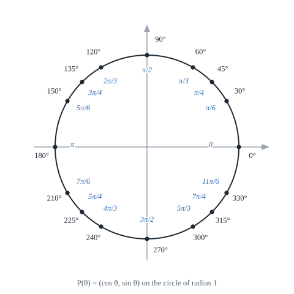
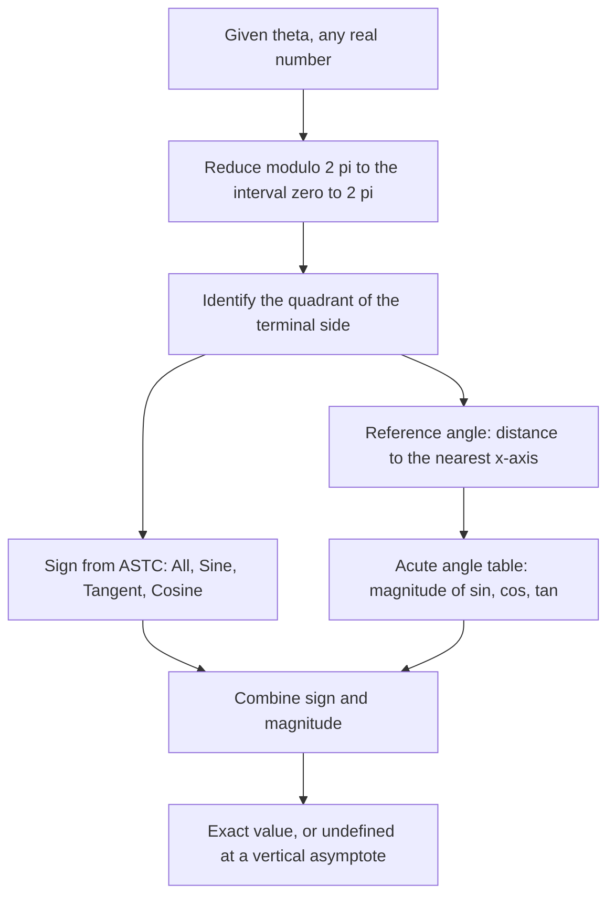

# The Unit Circle and Radian Measure

> [Trigonometry](../README.md) · Level: Intermediate · Prerequisites: [Trigonometric Functions](../01-trigonometric-functions/README.md), [Geometry](../../04-geometry/README.md) · Estimated time: 8 h

## 1. Introduction

The [previous topic](../01-trigonometric-functions/README.md) defined sine and cosine on a right triangle and stopped at $90^\circ$, because a right triangle has no room for a larger acute angle. That boundary is artificial. A wheel does not stop turning at a quarter turn, a pendulum swings through negative and positive displacements, and a sound wave oscillates forever. If sine and cosine are to describe anything that repeats, they must accept *every* angle.

This topic performs the replacement. A point is placed on the circle of radius $1$ centred at the origin, its position measured by the angle from the positive horizontal axis, and its **coordinates** are *defined* to be the cosine and sine of that angle. For acute angles the new definition agrees with the old one exactly, so nothing learned so far is lost; for every other angle it supplies a value where the triangle definition had nothing to say.

The same topic introduces the **radian**, the measure in which the angle is the arc length on the unit circle. Radians are not a convenience. They are the units in which the arc length formula is $s = r\theta$ with no conversion factor, in which angular velocity is $\omega = v/r$, in which $\sin\theta \approx \theta$ for small $\theta$, and — as the [Calculus](../../07-calculus/README.md) discipline shows — the only units in which $\dfrac{d}{d\theta}\sin\theta = \cos\theta$. Choosing degrees is choosing to carry a factor of $\pi/180$ through every formula in analysis.

## 2. Prerequisites

You should be comfortable with:

* **The right-triangle definitions** of sine, cosine and tangent, the exact values at $30^\circ, 45^\circ, 60^\circ$, and the identities $\tan\theta = \sin\theta/\cos\theta$ and $\sin^2\theta + \cos^2\theta = 1$. All of this is in [Trigonometric Functions](../01-trigonometric-functions/README.md).
* **Similar triangles and the geometry of circles** — that arcs of similar sectors are proportional to their radii, and that a full turn is $360^\circ$. See [Geometry](../../04-geometry/README.md).
* **The Pythagorean theorem and the distance formula** — the unit circle is $x^2 + y^2 = 1$ because every point on it is at distance $1$ from the origin.
* **Function notation and graphs** — reading $y = f(x)$, plotting points, and understanding that a function assigns exactly one output to each input. See [Elementary Algebra](../../03-algebra/01-elementary-algebra/README.md) and, for a fuller treatment of graphs, [Precalculus](../../06-precalculus/README.md).
* **Proportion and simple algebra** — solving $k\theta = c$ for $\theta$, and factoring a constant out of an expression such as $2\theta - \pi/2 = 2(\theta - \pi/4)$.

## 3. Learning Objectives

By the end of this tutorial you will be able to:

1. Define the radian as the ratio of arc length to radius, and explain why that ratio does not depend on the size of the circle.
2. Convert between degrees and radians in both directions, exactly and approximately.
3. Use $s = r\theta$ for arc length and $A = \tfrac12 r^2\theta$ for sector area, and derive both from proportionality.
4. Define $\sin\theta$ and $\cos\theta$ as the coordinates of a point on the unit circle, and check that the definition agrees with the right-triangle one for acute angles.
5. Compute exact sine, cosine and tangent values for every multiple of $\pi/6$ and $\pi/4$ around the circle, using reference angles and quadrant signs.
6. Use periodicity, even/odd symmetry, and the supplementary and complementary relations to reduce any angle to a reference angle.
7. State the domain, range, period, zeros, extrema and asymptotes of the sine, cosine and tangent functions, and sketch their graphs.
8. Read off the amplitude, period, phase shift and vertical shift of $y = A\sin(B(\theta - C)) + D$, and write such a model from a description.
9. Model periodic phenomena — tides, temperature, sound — with a sinusoid fitted to data.
10. State the small-angle approximation $\sin\theta \approx \theta$ (radians), justify it by comparing a triangle, a sector and a tangent triangle, and say when it is accurate enough to use.

## 4. Intuition

### 4.1 The angle as an amount of arc

Imagine a piece of string laid along the rim of a circular pond of radius $r$, cut to the length of the arc between two points. Now ask: how big is the angle between the two radii? The length of that string measures the angle, but only relative to the pond: a larger pond gives a longer string for the same angle. The **ratio** string-to-radius is the same in every pond. That ratio is the angle in radians.

So an angle in radians answers the question *how many radii of arc does this angle cut off?* A right angle cuts off a quarter of the circumference, and the circumference is $2\pi$ radii long, so a right angle is $\tfrac{2\pi}{4} = \tfrac{\pi}{2}$ radii of arc. A full turn is $2\pi$ radii of arc, which is why a full turn is $2\pi$ radians.

Seen this way, "radian" is not a unit like a metre; it is a pure number, a length divided by a length. It has no dimension. That is exactly why formulas containing it are clean.

### 4.2 Why the circle of radius one

Ratios are nice because a scale factor cancels. If the sine of an angle is "opposite over hypotenuse", then choosing the hypotenuse to be $1$ makes the ratio equal to the opposite side itself — no division. On the unit circle, the hypotenuse is the radius and it is $1$, so the two legs of the right triangle are literally $\sin\theta$ and $\cos\theta$. The circle becomes a dictionary: each angle is a point, and the coordinates of the point are the values of the two functions.

Making the radius $1$ also puts the origin at the centre of rotation, which is where rotation naturally happens. Every point $P$ at angle $\theta$ has coordinates $(\cos\theta, \sin\theta)$, and rotating by another angle adds to the coordinates' angle. That is why periodicity is obvious in this picture and invisible in the triangle picture.

### 4.3 The same functions, seen twice

The triangle and the circle are two windows onto the same object. The triangle shows *ratio of sides*; the circle shows *position on a rotating arm*. For angles between $0$ and $90^\circ$ both give the same numbers. Beyond $90^\circ$ only the circle makes sense. Below $0^\circ$ (clockwise rotation) only the circle makes sense. And for an angle larger than a full turn, the circle simply goes round again — which is the definition of a periodic function.

### 4.4 Waves are circles seen from the side

A point moving uniformly around a circle, watched from a distant point in the plane of the circle, appears to move back and forth along a line: its height above the centre traces out a sine wave. Every periodic phenomenon — a plucked string, a sound, an alternating current, a tide — has this character, because every one of them is (to a first approximation) a projection of uniform circular motion. Section 7.9 turns this remark into a modelling technique.

## 5. Formal Definition

**Definition 5.1 (Radian measure).** Let a circle of radius $r > 0$ have a central angle $\theta$ that subtends an arc of length $s$. The measure of $\theta$ *in radians* is

$$\theta := \frac{s}{r}.$$

A **radian** is the angle that subtends an arc of length equal to the radius; it corresponds to $s/r = 1$.

The notation $:=$ marks a definition: the right-hand side is what the symbol on the left means.

**Proposition 5.2 (Well-definedness).** The value $s/r$ does not depend on which circle is used to measure a given angle.

*Proof.* Let two circles of radii $r_1, r_2$ have the same central angle $\theta$, subtending arcs of lengths $s_1, s_2$. The two sectors are similar figures: one is a scaled copy of the other with scale factor $k = r_2/r_1$, because scaling the whole figure multiplies every length by $k$ while leaving every angle unchanged. Hence $s_2 = k s_1$, and

$$\frac{s_2}{r_2} = \frac{k s_1}{k r_1} = \frac{s_1}{r_1}.$$

The scale factor cancels, so the ratio depends only on the angle. $\blacksquare$

**Definition 5.3 (Unit circle).** The *unit circle* is the set of points $(x, y)$ in the plane with $x^2 + y^2 = 1$: the circle of radius $1$ centred at the origin.

**Definition 5.4 (Sine and cosine on the unit circle).** Given a real number $\theta$, start at the point $(1,0)$ and travel counterclockwise (for $\theta > 0$) along the unit circle through an arc of length $|\theta|$; for $\theta < 0$ travel clockwise. Let $P(\theta) = (x, y)$ be the point reached. Define

$$\cos\theta := x, \qquad \sin\theta := y.$$

That is, $\cos\theta$ is the $x$-coordinate and $\sin\theta$ is the $y$-coordinate of the point at arc-distance $\theta$ from $(1,0)$.

Because the circumference is $2\pi$, travelling $2\pi$ returns to the starting point; and because the arc length equals the angle in radians on the unit circle, "arc-distance $\theta$" and "angle $\theta$" agree.

**Definition 5.5 (Tangent).** Wherever $\cos\theta \ne 0$,

$$\tan\theta := \frac{\sin\theta}{\cos\theta}.$$

The quotient is undefined exactly when $\cos\theta = 0$, which happens at $\theta = \tfrac{\pi}{2} + k\pi$ for integers $k$.

**Definition 5.6 (Periodic function).** A function $f$ is *periodic* with period $p > 0$ if $f(\theta + p) = f(\theta)$ for every $\theta$ in its domain. The *fundamental period* (or least period) is the smallest such $p$.

The three functions of this topic are periodic: $\sin$ and $\cos$ with fundamental period $2\pi$, and $\tan$ with fundamental period $\pi$. That $2\pi$ and $\pi$ *are* periods is proved in Section 8 (Property 8.5); that no smaller positive number is a period is proved in Exercise 28 for $\tan$ and Exercise 33 for $\sin$.

**Definition 5.7 (Reference angle).** Let $\theta$ be any angle. Reduce it modulo $2\pi$ to lie in $[0, 2\pi)$, and let its terminal side be the ray from the origin to $P(\theta)$. The **reference angle** $\alpha$ is the acute angle between the terminal side and the $x$-axis:

$$
\alpha =
\begin{cases}
\theta, & 0 \le \theta \le \tfrac{\pi}{2},\\
\pi - \theta, & \tfrac{\pi}{2} < \theta \le \pi,\\
\theta - \pi, & \pi < \theta \le \tfrac{3\pi}{2},\\
2\pi - \theta, & \tfrac{3\pi}{2} < \theta < 2\pi.
\end{cases}
$$

The reference angle carries the *magnitude* of the trigonometric values; the quadrant carries the *sign*.

## 6. Mathematical Notation

| Symbol | Read as | Meaning |
|---|---|---|
| $\theta$ | theta | an angle, now an arbitrary real number |
| rad | radian | the unit; $1\ \text{rad} = 180^\circ/\pi$ |
| $\pi$ | pi | the ratio of circumference to diameter, $3.14159\ldots$ |
| $\theta = s/r$ | theta equals s over r | radian measure by arc length |
| $s$ | arc length | length of the arc cut off by the angle |
| $r$ | radius | distance from the centre to the circle |
| $P(\theta)$ | P of theta | the point $(\cos\theta, \sin\theta)$ on the unit circle |
| $\sin\theta, \cos\theta$ | sine, cosine | the $y$- and $x$-coordinates of $P(\theta)$ |
| $\tan\theta$ | tangent | $\sin\theta/\cos\theta$, the slope of the radius |
| $\alpha$ | alpha | conventionally the reference angle |
| $k$ | an integer | $k \in \mathbb{Z}$; used in "$+2k\pi$" |
| $+2k\pi$ | plus two k pi | all angles differing by whole turns |
| $T$ | period | length of one full cycle |
| $f$ | frequency | cycles per unit time, $f = 1/T$ |
| $\omega$ | angular frequency | radians per unit time, $\omega = 2\pi f$ |
| $A, B, C, D$ | amplitude parameters | coefficients in $y = A\sin(B(\theta - C)) + D$ |

Three notational points. First, $\theta$ is now a **real number**, not a geometric object: $\sin$ is a function $\mathbb{R} \to \mathbb{R}$, and "$\sin 2$" means the sine of $2$ radians. Second, the radian symbol is usually omitted in calculus and in this tutorial when the context is clear; $\sin\theta$ with $\theta$ a bare number always means radians. Third, when a value is repeated every turn we write the solution set as $\theta = \alpha + 2k\pi$, $k \in \mathbb{Z}$.

## 7. Core Concepts

### 7.1 Radian measure and why it is the natural one

Definition 5.1 makes the radian a ratio of two lengths. Four consequences explain why it, and not the degree, is the measure used in mathematics.

**The arc length formula has no constant.** With radians, $s = r\theta$ (Section 7.3). With degrees, $s = \dfrac{\pi}{180} r \theta$. The factor $\pi/180$ is pure overhead.

**Angular velocity is exact.** A point moving around a circle of radius $r$ at angular speed $\omega$ radians per second has linear speed $v = r\omega$. In degrees per second the formula would be $v = \dfrac{\pi}{180} r \omega$.

**Small angles are their own sines.** For small $\theta$ in radians, $\sin\theta \approx \theta$, and the error is of order $\theta^3$ (Section 7.10). In degrees the same statement is $\sin\theta^\circ \approx \dfrac{\pi}{180}\theta$, which is true but not illuminating.

**Calculus requires radians.** The derivative of $\sin$ is $\cos$ only when the input is in radians; in degrees a factor $\pi/180$ appears. This is a consequence of the previous point, and it is the reason every formula in physics and engineering assumes radians.

By contrast, $360^\circ$ is a historical artifact of the Babylonian sexagesimal system, chosen because $360$ has many divisors. Nothing in the circle prefers $360$ to $100$ or $1000$. The number $2\pi$, by contrast, is the *circumference of the unit circle* — an intrinsic property of the circle itself. That is the sense in which radians are natural.

### 7.2 Converting between degrees and radians

A full turn is $360^\circ$ and also $2\pi$ radians, so

$$360^\circ = 2\pi\ \text{rad} \quad\Longrightarrow\quad 180^\circ = \pi\ \text{rad}.$$

Dividing by $180$ and by $\pi$ gives the two conversion factors:

$$1^\circ = \frac{\pi}{180}\ \text{rad} \approx 0.0174533\ \text{rad}, \qquad 1\ \text{rad} = \frac{180^\circ}{\pi} \approx 57.29578^\circ.$$

To convert degrees to radians, multiply by $\pi/180$. To convert radians to degrees, multiply by $180/\pi$. The units cancel as in any unit conversion:

$$150^\circ \times \frac{\pi}{180^\circ} = \frac{150\pi}{180} = \frac{5\pi}{6}.$$

| Degrees | $0^\circ$ | $30^\circ$ | $45^\circ$ | $60^\circ$ | $90^\circ$ | $120^\circ$ | $135^\circ$ | $150^\circ$ | $180^\circ$ |
|---|---|---|---|---|---|---|---|---|---|
| Radians | $0$ | $\dfrac{\pi}{6}$ | $\dfrac{\pi}{4}$ | $\dfrac{\pi}{3}$ | $\dfrac{\pi}{2}$ | $\dfrac{2\pi}{3}$ | $\dfrac{3\pi}{4}$ | $\dfrac{5\pi}{6}$ | $\pi$ |

| Degrees | $210^\circ$ | $225^\circ$ | $240^\circ$ | $270^\circ$ | $300^\circ$ | $315^\circ$ | $330^\circ$ | $360^\circ$ |
|---|---|---|---|---|---|---|---|---|
| Radians | $\dfrac{7\pi}{6}$ | $\dfrac{5\pi}{4}$ | $\dfrac{4\pi}{3}$ | $\dfrac{3\pi}{2}$ | $\dfrac{5\pi}{3}$ | $\dfrac{7\pi}{4}$ | $\dfrac{11\pi}{6}$ | $2\pi$ |

Two checks worth internalising: $90^\circ = \pi/2 \approx 1.571$ rad, and $1$ rad is a little less than $60^\circ$ (since $\pi/3 \approx 1.047$).

### 7.3 Arc length and sector area

**Arc length.** A full circle of radius $r$ has arc length $2\pi r$ and angular measure $2\pi$ radians. Since arc length is proportional to angle, for a general angle $\theta$,

$$\frac{s}{2\pi r} = \frac{\theta}{2\pi} \quad\Longrightarrow\quad s = r\theta.$$

The formula is valid only when $\theta$ is measured in **radians**; substituting degrees gives an answer too large by a factor $180/\pi$.

**Sector area.** A full disc has area $\pi r^2$ and angular measure $2\pi$. By the same proportionality,

$$\frac{A}{\pi r^2} = \frac{\theta}{2\pi} \quad\Longrightarrow\quad A = \tfrac{1}{2} r^2 \theta.$$

An alternative derivation shows the structure: the sector is a triangle of "base" $s$ and "height" $r$ in the limit of many thin slices, so $A \approx \tfrac12 s r = \tfrac12 r^2\theta$ — the same formula. The exact statement follows from the proportionality above, not from the slicing intuition.

**Perimeter of a sector** is $2r + s = 2r + r\theta$, because the two radii are part of the boundary.

**Chord length.** A chord subtending a central angle $\theta$ is the base of an isosceles triangle with equal sides $r$ and apex angle $\theta$. Dropping the altitude bisects the apex, giving a right triangle with hypotenuse $r$, angle $\theta/2$, and opposite side half the chord:

$$\tfrac{1}{2}c = r\sin\frac{\theta}{2} \quad\Longrightarrow\quad c = 2r\sin\frac{\theta}{2}.$$

### 7.4 The unit circle: defining sine and cosine for all angles

Definition 5.4 is the heart of the topic. Its consequences:

* **Domain.** Every real $\theta$ gives a point $P(\theta)$, so $\sin$ and $\cos$ are defined on all of $\mathbb{R}$. Negative $\theta$ means clockwise travel; $\theta > 2\pi$ means going round more than once.
* **Range.** The coordinates of a point on the unit circle satisfy $-1 \le x \le 1$ and $-1 \le y \le 1$, so
$$-1 \le \sin\theta \le 1, \qquad -1 \le \cos\theta \le 1.$$
* **Pythagorean identity.** Since $P(\theta)$ lies on $x^2 + y^2 = 1$,
$$\cos^2\theta + \sin^2\theta = 1$$
for **every** $\theta$, not merely acute ones.
* **Tangent as a slope.** $\tan\theta = \dfrac{\sin\theta}{\cos\theta} = \dfrac{y}{x}$ is the slope of the line from the origin to $P(\theta)$.

**Agreement with the right-triangle definitions.** Let $0 < \theta < \pi/2$ and let $P = (\cos\theta, \sin\theta)$ be the corresponding point. Drop the perpendicular from $P$ to the $x$-axis, meeting it at $Q$. Then triangle $OQP$ has a right angle at $Q$, hypotenuse $OP = 1$ (the radius), and angle $\angle QOP = \theta$. By the right-triangle definition applied to *this* triangle,

$$\cos\theta = \frac{OQ}{OP} = OQ = x_P, \qquad \sin\theta = \frac{QP}{OP} = QP = y_P.$$

So the two definitions give the same numbers. For a right triangle of any size with acute angle $\theta$, scale the unit triangle by its hypotenuse $h$: the sides are $h\cos\theta$ and $h\sin\theta$ by similarity, exactly as the ratio definition requires.

### 7.5 Signs by quadrant and reference angles

The signs of the coordinates change from quadrant to quadrant:

| Quadrant | Range of $\theta$ | $\cos\theta$ | $\sin\theta$ | $\tan\theta$ |
|---|---|---|---|---|
| I | $\left(0, \tfrac{\pi}{2}\right)$ | $+$ | $+$ | $+$ |
| II | $\left(\tfrac{\pi}{2}, \pi\right)$ | $-$ | $+$ | $-$ |
| III | $\left(\pi, \tfrac{3\pi}{2}\right)$ | $-$ | $-$ | $+$ |
| IV | $\left(\tfrac{3\pi}{2}, 2\pi\right)$ | $+$ | $-$ | $-$ |

On the axes the functions take the quadrantal values $(1,0)$, $(0,1)$, $(-1,0)$, $(0,-1)$, and $\tan$ is undefined where the point is $(0,\pm1)$.

The mnemonic **ASTC** ("All Students Take Calculus", starting in quadrant I and proceeding counterclockwise) records which function is positive: **A**ll in I, **S**ine in II, **T**angent in III, **C**osine in IV.

The computational procedure is:

1. Reduce $\theta$ modulo $2\pi$ so that it lies in $[0, 2\pi)$.
2. Identify the quadrant, and hence the sign of each function.
3. Compute the reference angle $\alpha$ from Definition 5.7.
4. Read the magnitude from the acute-angle table of the previous topic.

For example, $\theta = 5\pi/6$ is in quadrant II, so $\sin > 0$, $\cos < 0$, $\tan < 0$; the reference angle is $\pi - 5\pi/6 = \pi/6$; therefore

$$\sin\frac{5\pi}{6} = +\frac{1}{2}, \qquad \cos\frac{5\pi}{6} = -\frac{\sqrt3}{2}, \qquad \tan\frac{5\pi}{6} = -\frac{\sqrt3}{3}.$$

The reference angle is measured from the **nearest** horizontal axis, never from the vertical one. Measuring from the vertical silently converts sine into cosine.

### 7.6 Periodicity, symmetry, and related angles

**Periodicity.** Adding a whole turn returns $P(\theta)$ to itself:

$$\sin(\theta + 2\pi) = \sin\theta, \qquad \cos(\theta + 2\pi) = \cos\theta, \qquad \tan(\theta + \pi) = \tan\theta.$$

The third holds because adding $\pi$ negates both coordinates (Section 8, Property 8.6), and the quotient of two negated numbers is unchanged.

**Even and odd.** Reflection in the $x$-axis sends $\theta$ to $-\theta$ and $(x,y)$ to $(x,-y)$. Hence

$$\cos(-\theta) = \cos\theta \ (\text{even}), \qquad \sin(-\theta) = -\sin\theta \ (\text{odd}), \qquad \tan(-\theta) = -\tan\theta.$$

**Supplementary angles.** Reflection in the $y$-axis sends $\theta$ to $\pi - \theta$ and $(x,y)$ to $(-x,y)$. Hence

$$\sin(\pi - \theta) = \sin\theta, \qquad \cos(\pi - \theta) = -\cos\theta.$$

**Antipodal angles.** A half-turn sends $\theta$ to $\theta + \pi$ and $(x,y)$ to $(-x,-y)$:

$$\sin(\theta + \pi) = -\sin\theta, \qquad \cos(\theta+\pi) = -\cos\theta.$$

**Complementary angles.** Reflection in the line $y = x$ sends $\theta$ to $\pi/2 - \theta$ and swaps the coordinates:

$$\sin\left(\frac{\pi}{2} - \theta\right) = \cos\theta, \qquad \cos\left(\frac{\pi}{2} - \theta\right) = \sin\theta,$$

recovering the cofunction identities of the previous topic.

Each identity above is a statement about a symmetry of the circle, and each is proved in Section 8 by naming the symmetry. That is the advantage of the unit circle over the triangle: every identity has a picture.

### 7.7 The graphs of sine, cosine and tangent

**Sine.** Plotting $y = \sin\theta$ over one period gives the classic wave: it starts at $0$, rises to $1$ at $\pi/2$, returns to $0$ at $\pi$, falls to $-1$ at $3\pi/2$, and returns to $0$ at $2\pi$. It is odd, has zeros at every $\theta = k\pi$, maxima $1$ at $\theta = \tfrac{\pi}{2} + 2k\pi$, and minima $-1$ at $\theta = \tfrac{3\pi}{2} + 2k\pi$.

**Cosine.** The same wave shifted left by $\pi/2$: $y = \cos\theta$ starts at $1$, reaches $0$ at $\pi/2$, $-1$ at $\pi$, $0$ at $3\pi/2$, and $1$ at $2\pi$. It is even, with zeros at $\theta = \tfrac{\pi}{2} + k\pi$, maxima at $2k\pi$ and minima at $\pi + 2k\pi$.

**Tangent.** Since $\tan\theta = y/x$, the function is zero when $y = 0$ (at $\theta = k\pi$) and undefined when $x = 0$ (at $\theta = \tfrac{\pi}{2} + k\pi$), where the graph has vertical asymptotes. Between consecutive asymptotes it increases strictly from $-\infty$ to $+\infty$. Its range is all of $\mathbb{R}$, and its period is $\pi$.

| Feature | $y = \sin\theta$ | $y = \cos\theta$ | $y = \tan\theta$ |
|---|---|---|---|
| Domain | $\mathbb{R}$ | $\mathbb{R}$ | $\theta \ne \tfrac{\pi}{2} + k\pi$ |
| Range | $[-1,1]$ | $[-1,1]$ | $\mathbb{R}$ |
| Period | $2\pi$ | $2\pi$ | $\pi$ |
| Zeros | $k\pi$ | $\tfrac{\pi}{2} + k\pi$ | $k\pi$ |
| Maxima | $\tfrac{\pi}{2} + 2k\pi$ | $2k\pi$ | none |
| Minima | $\tfrac{3\pi}{2} + 2k\pi$ | $\pi + 2k\pi$ | none |
| Asymptotes | none | none | $\tfrac{\pi}{2} + k\pi$ |
| Symmetry | odd | even | odd |
| Shape on one period | increases to $1$, decreases to $-1$, increases to $0$ | decreases to $-1$, increases to $1$ | increases from $-\infty$ to $+\infty$ on each branch |

Why does tangent have period $\pi$ rather than $2\pi$? Because the quotient $y/x$ is unchanged when both coordinates change sign, and a half-turn does exactly that. The line from the origin to $P(\theta+\pi)$ is the *same line* as to $P(\theta)$, just traversed to the opposite side, so it has the same slope.

### 7.8 Amplitude, period, phase shift and vertical shift

A general sinusoid is written

$$y = A\sin\big(B(\theta - C)\big) + D.$$

| Parameter | Name | Effect |
|---|---|---|
| $\lvert A\rvert$ | amplitude | half the distance between maximum and minimum; vertical stretch |
| $B$ | angular frequency factor | compresses horizontally; period $= \dfrac{2\pi}{\lvert B\rvert}$ |
| $C$ | phase shift | horizontal translation; right by $C$ if $C > 0$ |
| $D$ | vertical shift | moves the midline to $y = D$ |

The range is $[D - |A|,\, D + |A|]$, and the midline is $y = D$. A negative $A$ reflects the graph in the midline; the amplitude is still $|A|$.

**Why the period is $2\pi/|B|$.** The sine repeats when its argument increases by $2\pi$:

$$B(\theta + P) - B\theta = BP = 2\pi \quad\Longrightarrow\quad P = \frac{2\pi}{\lvert B\rvert}.$$

For tangent the same computation with the period $\pi$ gives $P = \pi/|B|$.

**Reading the phase shift correctly.** The argument must be factored so that $B$ multiplies $(\theta - C)$. For example,

$$2\theta - \frac{\pi}{2} = 2\left(\theta - \frac{\pi}{4}\right),$$

so $y = 3\sin\left(2\theta - \tfrac{\pi}{2}\right) + 1$ has $B = 2$, $C = \pi/4$ — a shift of $\pi/4$ to the **right**, not a shift of $\pi/2$. Failing to factor out $B$ is the single most common transformation error.

**Frequency.** If $\theta$ represents time $t$, then $f = \dfrac{|B|}{2\pi}$ is the number of cycles per unit time, the period is $T = 1/f$, and $|B| = 2\pi f$ is the angular frequency, often written $\omega$.

### 7.9 Modelling periodic phenomena

A periodic quantity with a sinusoidal shape is modelled by choosing four numbers:

1. **Midline** $D = \dfrac{\text{maximum} + \text{minimum}}{2}$.
2. **Amplitude** $|A| = \dfrac{\text{maximum} - \text{minimum}}{2}$.
3. **Period** $T$ from the time between successive maxima (or successive zeros with the same direction), giving $|B| = \dfrac{2\pi}{T}$.
4. **Phase** from the time at which the maximum occurs: if the maximum is at $t = t_0$, the cosine form $y = D + A\cos(B(t - t_0))$ has the right phase automatically.

The cosine form is the easiest to fit, because $\cos 0 = 1$ is the maximum. Converting to the sine form, if needed, uses $\cos u = \sin\left(u + \tfrac{\pi}{2}\right)$.

**Tides.** Sea level rises and falls roughly twice a day. The dominant lunar semidiurnal constituent has a period of about $12.42$ hours, but for a harbour on a given day a period of $12$ hours is often accurate enough over a few cycles. Depths are then modelled as $D(t) = \text{mean} + \text{amplitude}\cdot\cos(\omega t + \phi)$.

**Temperature.** The daily or annual temperature cycle is approximately sinusoidal, with the maximum lagging the solstice by a few weeks because the ground and water take time to heat.

**Sound.** A pure tone of frequency $f$ hertz is a pressure variation $p(t) = A\sin(2\pi f t + \phi)$; $A$ is the loudness (amplitude), $f$ the pitch, and $\phi$ the phase. Complex sounds are sums of such terms — the beginning of Fourier analysis.

**Alternating current.** Mains voltage is $V(t) = V_0\sin(2\pi f t)$ with $f = 50$ or $60$ Hz; the root-mean-square value $V_0/\sqrt2$ comes from averaging $\sin^2$ over a period.

### 7.10 The small-angle approximation

For small $\theta$ measured in radians,

$$\sin\theta \approx \theta, \qquad \tan\theta \approx \theta, \qquad \cos\theta \approx 1 - \frac{\theta^2}{2}.$$

**Justification from the unit circle.** Let $0 < \theta < \pi/2$ and place $A = (1,0)$, $P = (\cos\theta, \sin\theta)$ and $T = (1, \tan\theta)$ on the unit circle and its tangent at $A$. Three regions are nested:

* the triangle $OAP$, with base $OA = 1$ and height $\sin\theta$, so its area is $\tfrac12\sin\theta$;
* the sector $OAP$, whose area is $\tfrac12 r^2\theta = \tfrac12\theta$;
* the triangle $OAT$, with base $OA = 1$ and height $\tan\theta$, so its area is $\tfrac12\tan\theta$.

Because the triangle is contained in the sector, which is contained in the larger triangle,

$$\tfrac12\sin\theta < \tfrac12\theta < \tfrac12\tan\theta \quad\Longrightarrow\quad \sin\theta < \theta < \tan\theta.$$

Divide the chain by the positive number $\sin\theta$:

$$1 < \frac{\theta}{\sin\theta} < \frac{1}{\cos\theta}.$$

As $\theta \to 0$, $\cos\theta \to 1$, so the right-hand bound tends to $1$; by the squeeze principle the middle term also tends to $1$. Hence $\dfrac{\sin\theta}{\theta} \to 1$, which is exactly the statement $\sin\theta \approx \theta$ for small $\theta$. Multiplying by $\cos\theta \to 1$ gives $\tan\theta/\theta \to 1$ as well.

**How good is it?** The relative error of $\sin\theta \approx \theta$ is about $\theta^2/6$. The standard Taylor expansion $\sin\theta = \theta - \theta^3/6 + \theta^5/120 - \cdots$, proved in the calculus discipline, makes this precise.

| $\theta$ (rad) | $\theta$ (deg) | $\theta$ | $\sin\theta$ | absolute error | relative error | $\theta^2/6$ |
|---|---|---|---|---|---|---|
| $0.01$ | $0.573^\circ$ | $0.01$ | $0.00999983$ | $1.7\times10^{-7}$ | $0.0017\%$ | $0.0017\%$ |
| $0.1$ | $5.73^\circ$ | $0.1$ | $0.09983342$ | $1.67\times10^{-4}$ | $0.167\%$ | $0.167\%$ |
| $0.2$ | $11.46^\circ$ | $0.2$ | $0.19866933$ | $1.33\times10^{-3}$ | $0.665\%$ | $0.667\%$ |
| $0.5$ | $28.65^\circ$ | $0.5$ | $0.47942554$ | $2.06\times10^{-2}$ | $4.11\%$ | $4.17\%$ |
| $1.0$ | $57.30^\circ$ | $1.0$ | $0.84147098$ | $1.59\times10^{-1}$ | $15.9\%$ | $16.7\%$ |

The approximation is good to $1\%$ while $\theta^2/6 < 0.01$, that is while $\theta < \sqrt{0.06} \approx 0.245$ rad $\approx 14^\circ$. Beyond that it degrades quickly, and by $57^\circ$ it is wrong by $16\%$.

**Why the units matter.** The inequality $\sin\theta < \theta < \tan\theta$ compares a *length* ($\sin\theta$, the height of $P$) with an *arc length* ($\theta$). Comparing them is only legitimate when the arc is measured in the same units as the radius — that is, in radians. If $\theta$ is in degrees, $\sin 30^\circ = 0.5$ but $30 \not\approx 0.5$; the correct statement is $\sin 30^\circ \approx 30 \cdot \pi/180 = 0.5236$, and indeed $0.5$ is close to $0.5236$.

## 8. Formulas and Properties

**Property 8.1 (Degree–radian conversion).** For any angle,

$$\theta_{\text{rad}} = \theta_{\text{deg}}\cdot\frac{\pi}{180}, \qquad \theta_{\text{deg}} = \theta_{\text{rad}}\cdot\frac{180}{\pi}.$$

*Why.* A full turn is $360^\circ$ and $2\pi$ radians; since both measures are proportional to the angle, the ratio of the two scales is fixed: $360^\circ \leftrightarrow 2\pi$, hence $180^\circ \leftrightarrow \pi$. $\blacksquare$

**Property 8.2 (Arc length).** For a circle of radius $r$ and a central angle $\theta$ measured in **radians**,

$$s = r\theta.$$

*Why.* Section 7.3: arc length is proportional to angle, and the full circumference $2\pi r$ corresponds to the full angle $2\pi$; solving the proportion gives $s = r\theta$. $\blacksquare$

**Property 8.3 (Sector area).** For a sector of radius $r$ and central angle $\theta$ in radians,

$$A = \tfrac{1}{2}r^2\theta.$$

*Why.* Area is proportional to angle, and the full disc area $\pi r^2$ corresponds to $2\pi$; the proportion $A/(\pi r^2) = \theta/(2\pi)$ gives the result. $\blacksquare$

**Property 8.4 (Pythagorean identity, all angles).** For every real $\theta$,

$$\cos^2\theta + \sin^2\theta = 1.$$

*Why.* $P(\theta) = (\cos\theta, \sin\theta)$ lies on the unit circle $x^2+y^2 = 1$. $\blacksquare$

**Property 8.5 (Periodicity).** For every $\theta$ and every integer $k$,

$$\sin(\theta + 2k\pi) = \sin\theta, \qquad \cos(\theta + 2k\pi) = \cos\theta, \qquad \tan(\theta + k\pi) = \tan\theta.$$

*Why.* Adding $2k\pi$ traverses $k$ complete turns and returns to the same point. Adding $k\pi$ sends $(x,y)$ to $(-x,-y)$ when $k$ is odd, so the ratio $y/x$ is unchanged. $\blacksquare$

**Property 8.6 (Symmetry relations).** For every $\theta$ for which both sides are defined,

$$\sin(-\theta) = -\sin\theta, \qquad \cos(-\theta) = \cos\theta, \qquad \tan(-\theta) = -\tan\theta,$$
$$\sin(\pi-\theta) = \sin\theta, \qquad \cos(\pi-\theta) = -\cos\theta, \qquad \tan(\pi-\theta) = -\tan\theta,$$
$$\sin(\theta+\pi) = -\sin\theta, \qquad \cos(\theta+\pi) = -\cos\theta, \qquad \tan(\theta+\pi) = \tan\theta,$$
$$\sin\left(\tfrac{\pi}{2}-\theta\right) = \cos\theta, \qquad \cos\left(\tfrac{\pi}{2}-\theta\right) = \sin\theta.$$

*Why.* Each line names a symmetry of the unit circle applied to the point $(x,y) = (\cos\theta, \sin\theta)$:

| Transformation of the angle | Transformation of the point | Geometric symmetry |
|---|---|---|
| $\theta \mapsto -\theta$ | $(x,y) \mapsto (x,-y)$ | reflection in the $x$-axis |
| $\theta \mapsto \pi - \theta$ | $(x,y) \mapsto (-x,y)$ | reflection in the $y$-axis |
| $\theta \mapsto \theta + \pi$ | $(x,y) \mapsto (-x,-y)$ | half-turn about the origin |
| $\theta \mapsto \tfrac{\pi}{2} - \theta$ | $(x,y) \mapsto (y,x)$ | reflection in the line $y = x$ |

Reading the coordinates off the transformed point gives each identity. For example, the half-turn sends $\sin\theta$ to $-y = -\sin\theta$, which is the statement $\sin(\theta+\pi) = -\sin\theta$. $\blacksquare$

**Property 8.7 (Signs by quadrant).** With $\theta$ reduced to $[0, 2\pi)$:

$$\begin{array}{c|cccc}
 & \text{I} & \text{II} & \text{III} & \text{IV}\\
\hline
\sin & + & + & - & -\\
\cos & + & - & - & +\\
\tan & + & - & + & -
\end{array}$$

*Why.* In quadrant II, $x < 0$ and $y > 0$; in III both are negative; in IV $x > 0$, $y < 0$. $\blacksquare$

**Property 8.8 (Bounds).** For every real $\theta$,

$$-1 \le \sin\theta \le 1, \qquad -1 \le \cos\theta \le 1, \qquad \tan\theta \in \mathbb{R}.$$

*Why.* The coordinates of a point on the unit circle lie between $-1$ and $1$ inclusive; the values $1$ and $-1$ are attained at the four quadrantal points. Tangent, being a ratio of two coordinates, takes every real value: as $\theta$ runs over an interval between consecutive asymptotes, $y/x$ runs over all of $\mathbb{R}$. $\blacksquare$

**Property 8.9 (Small-angle inequalities).** For $0 < \theta < \tfrac{\pi}{2}$,

$$\sin\theta < \theta < \tan\theta.$$

*Why.* Section 7.10: compare the areas of triangle $OAP$, sector $OAP$ and triangle $OAT$. $\blacksquare$

**Property 8.10 (Sinusoid parameters).** For $A \ne 0$, $B \ne 0$, the function

$$y = A\sin\big(B(\theta - C)\big) + D$$

has amplitude $|A|$, period $\dfrac{2\pi}{|B|}$, phase shift $C$, vertical shift $D$, midline $y = D$, and range $[D-|A|, D+|A|]$.

*Why.* The sine takes values in $[-1,1]$, so $A\sin(\cdot) + D$ takes values in $[D-|A|, D+|A|]$; the amplitude is half the width of that interval. The period computation is in Section 7.8. $\blacksquare$

## 9. Step-by-Step Examples

### Example 1 (easy): conversions in both directions

*(a) Convert $150^\circ$ to radians. (b) Convert $\dfrac{7\pi}{6}$ to degrees. (c) Convert $2$ radians to degrees, to two decimal places. (d) Convert $40^\circ$ to radians, exactly and approximately.*

**(a)** Multiply by $\pi/180$:

$$150^\circ \cdot \frac{\pi}{180} = \frac{150\pi}{180} = \frac{5\pi}{6}.$$

**(b)** Multiply by $180/\pi$; the $\pi$ cancels:

$$\frac{7\pi}{6}\cdot\frac{180}{\pi} = \frac{7 \cdot 180}{6} = 7 \cdot 30 = 210^\circ.$$

**(c)** $2 \cdot \dfrac{180}{\pi} = \dfrac{360}{\pi} \approx 114.5916^\circ$.

**(d)** $40^\circ \cdot \dfrac{\pi}{180} = \dfrac{2\pi}{9} \approx 0.6981$.

*Check.* In (b), $7\pi/6$ is a little more than $\pi$, so the angle must be a little more than $180^\circ$; $210^\circ$ is correct. In (d), $40^\circ$ is between $30^\circ = \pi/6 \approx 0.524$ and $45^\circ = \pi/4 \approx 0.785$, and $0.698$ lies between them.

### Example 2 (easy–medium): arc length, sector area and perimeter

*A sector of a circle of radius $6\ \mathrm{cm}$ has central angle $\dfrac{5\pi}{6}$. Find its arc length, its area, and the perimeter of the sector.*

Use Property 8.2 with $\theta$ already in radians:

$$s = r\theta = 6\cdot\frac{5\pi}{6} = 5\pi \approx 15.708\ \mathrm{cm}.$$

Use Property 8.3:

$$A = \tfrac12 r^2\theta = \tfrac12 \cdot 36 \cdot \frac{5\pi}{6} = \frac{180\pi}{12} = 15\pi \approx 47.124\ \mathrm{cm}^2.$$

The perimeter is the arc plus the two radii:

$$P = 2r + s = 12 + 5\pi \approx 27.708\ \mathrm{cm}.$$

*Check.* The sector is $\frac{5\pi/6}{2\pi} = \frac{5}{12}$ of the disc. A full disc has area $36\pi$, and $\frac{5}{12}\cdot 36\pi = 15\pi$, matching. Likewise the arc is $\frac{5}{12}$ of the circumference $12\pi$, giving $5\pi$.

The error to avoid here is substituting $150$ for $\theta$: $s = 6 \cdot 150 = 900$ is meaningless. If the angle is given in degrees, convert first.

### Example 3 (medium): exact values around the circle

*Evaluate exactly: $\sin\dfrac{5\pi}{6}$, $\cos\dfrac{5\pi}{6}$, $\tan\dfrac{5\pi}{6}$, $\sin\dfrac{4\pi}{3}$, $\cos\dfrac{7\pi}{4}$, $\tan\dfrac{2\pi}{3}$.*

**$\theta = 5\pi/6$.** This lies between $\pi/2$ and $\pi$, so it is in quadrant II: sine positive, cosine and tangent negative. The reference angle is $\pi - 5\pi/6 = \pi/6$. Reading the acute values at $\pi/6$:

$$\sin\frac{5\pi}{6} = +\frac{1}{2}, \qquad \cos\frac{5\pi}{6} = -\frac{\sqrt3}{2}, \qquad \tan\frac{5\pi}{6} = \frac{1/2}{-\sqrt3/2} = -\frac{\sqrt3}{3}.$$

**$\theta = 4\pi/3$.** Between $\pi$ and $3\pi/2$: quadrant III, so sine and cosine are negative and tangent positive. The reference angle is $4\pi/3 - \pi = \pi/3$. Hence

$$\sin\frac{4\pi}{3} = -\frac{\sqrt3}{2}, \qquad \cos\frac{4\pi}{3} = -\frac{1}{2}, \qquad \tan\frac{4\pi}{3} = \sqrt3.$$

**$\theta = 7\pi/4$.** Between $3\pi/2$ and $2\pi$: quadrant IV, cosine positive. The reference angle is $2\pi - 7\pi/4 = \pi/4$, so

$$\cos\frac{7\pi}{4} = +\frac{\sqrt2}{2}.$$

**$\theta = 2\pi/3$.** Quadrant II, reference angle $\pi/3$:

$$\tan\frac{2\pi}{3} = -\tan\frac{\pi}{3} = -\sqrt3.$$

*Checks.* Each sign matches the ASTC table, and each magnitude matches the acute table. As a further check, $\tan(5\pi/6) = -0.5774$ is plausible because the terminal side is close to the $y$-axis, where the slope is steep but negative; and $\tan(2\pi/3) = -1.732$ is steeper in magnitude but still negative.

### Example 4 (medium): reference angles and a simple equation on $[0, 2\pi)$

*(a) Find the reference angle of $300^\circ$ and evaluate $\sin 300^\circ$, $\cos 300^\circ$, $\tan 300^\circ$. (b) Solve $\sin\theta = -\dfrac{\sqrt3}{2}$ for $\theta \in [0, 2\pi)$.*

**(a)** $300^\circ$ lies in quadrant IV, where cosine is positive and sine and tangent are negative. Its reference angle is $360^\circ - 300^\circ = 60^\circ$. Therefore

$$\sin 300^\circ = -\sin 60^\circ = -\frac{\sqrt3}{2}, \qquad \cos 300^\circ = +\cos 60^\circ = \frac{1}{2}, \qquad \tan 300^\circ = -\tan 60^\circ = -\sqrt3.$$

In radians, $300^\circ = 5\pi/3$, so the same values are $\sin\frac{5\pi}{3} = -\frac{\sqrt3}{2}$, $\cos\frac{5\pi}{3} = \frac12$, $\tan\frac{5\pi}{3} = -\sqrt3$.

**(b)** The reference angle with sine magnitude $\frac{\sqrt3}{2}$ is $\frac{\pi}{3}$. Sine is negative in quadrants III and IV, so the solutions are

$$\theta = \pi + \frac{\pi}{3} = \frac{4\pi}{3} \qquad\text{and}\qquad \theta = 2\pi - \frac{\pi}{3} = \frac{5\pi}{3}.$$

*Check.* $\sin\frac{4\pi}{3} = -\frac{\sqrt3}{2}$ (Example 3) and $\sin\frac{5\pi}{3} = -\sin\frac{\pi}{3} = -\frac{\sqrt3}{2}$. Both lie in $[0,2\pi)$, and there are no others: a horizontal line $y = -\frac{\sqrt3}{2}$ meets the unit circle exactly twice.

### Example 5 (medium–hard): analysing a sinusoid

*For $y = 3\sin\left(2\theta - \dfrac{\pi}{2}\right) + 1$, state the amplitude, period, phase shift, midline and range, and locate the maximum and minimum on one period.*

First factor the argument so that the coefficient multiplies $(\theta - C)$:

$$2\theta - \frac{\pi}{2} = 2\left(\theta - \frac{\pi}{4}\right).$$

Comparing with $A\sin(B(\theta - C)) + D$: $A = 3$, $B = 2$, $C = \pi/4$, $D = 1$. Hence

* amplitude $= |3| = 3$;
* period $= \dfrac{2\pi}{|2|} = \pi$;
* phase shift $= \dfrac{\pi}{4}$ to the right;
* midline $y = 1$;
* range $= [1-3,\, 1+3] = [-2,\, 4]$.

The maximum $4$ occurs when the sine equals $1$:

$$2\theta - \frac{\pi}{2} = \frac{\pi}{2} + 2k\pi \quad\Longrightarrow\quad 2\theta = \pi + 2k\pi \quad\Longrightarrow\quad \theta = \frac{\pi}{2} + k\pi.$$

The minimum $-2$ occurs when the sine equals $-1$:

$$2\theta - \frac{\pi}{2} = -\frac{\pi}{2} + 2k\pi \quad\Longrightarrow\quad \theta = k\pi.$$

*Check.* At $\theta = 0$: $y = 3\sin(-\pi/2) + 1 = -3 + 1 = -2$, the minimum. At $\theta = \pi/2$: $y = 3\sin(\pi - \pi/2) + 1 = 3 + 1 = 4$, the maximum. The maxima are $\pi$ apart, which is the period — consistent.

Had we failed to factor out the $2$, we would have reported a shift of $\pi/2$ instead of $\pi/4$, a factor-of-two error that also flips the sign convention in many textbooks.

### Example 6 (hard): modelling a tide

*At a port, the water depth is $6.2\ \mathrm{m}$ at midnight high tide and $2.2\ \mathrm{m}$ at the next low tide, at 06:00. Assume a sinusoidal cycle with period $12$ hours. (a) Write a model for the depth $t$ hours after midnight. (b) Find when the depth is at least $5\ \mathrm{m}$. (c) Find the depth at 03:00.*

**(a)** The midline is the average of the extremes and the amplitude is half their difference:

$$D = \frac{6.2 + 2.2}{2} = 4.2, \qquad A = \frac{6.2 - 2.2}{2} = 2.0.$$

The period is $12$, so $|B| = \dfrac{2\pi}{12} = \dfrac{\pi}{6}$. The maximum occurs at $t = 0$, which is exactly the behaviour of $\cos$ with no phase shift:

$$h(t) = 4.2 + 2.0\cos\left(\frac{\pi t}{6}\right), \qquad t \text{ in hours}.$$

**(b)** Require $h(t) \ge 5$:

$$4.2 + 2\cos\left(\frac{\pi t}{6}\right) \ge 5 \quad\Longrightarrow\quad \cos\left(\frac{\pi t}{6}\right) \ge 0.4.$$

The equation $\cos u = 0.4$ has $u = \arccos(0.4) \approx 1.1593$ rad, and cosine is at least $0.4$ for $u \in [-1.1593, 1.1593]$ — that is, symmetrically about the maximum. Hence

$$-\frac{1.1593 \cdot 6}{\pi} \le t \le \frac{1.1593 \cdot 6}{\pi}, \qquad\text{that is,}\qquad -2.214 \le t \le 2.214.$$

In $[0, 12]$ this gives $0 \le t \le 2.214$ and, one period later, $9.786 \le t \le 12$. So the depth is at least $5\ \mathrm{m}$ for about $2$ hours $13$ minutes after midnight, and again from about 09:47 until noon.

**(c)** At $t = 3$:

$$h(3) = 4.2 + 2\cos\left(\frac{\pi \cdot 3}{6}\right) = 4.2 + 2\cos\frac{\pi}{2} = 4.2 + 0 = 4.2\ \mathrm{m}.$$

*Check.* The pattern of a cosine is high–mean–low–mean–high. At $t = 3$ (halfway between high and low) the depth should be the mean, and it is. At $t = 6$ the formula gives $4.2 + 2\cos\pi = 2.2$, the low tide, as required.

### Example 7 (hard): a sound wave

*A pure tone has pressure $p(t) = 0.5\sin(880\pi t)$ pascals, with $t$ in seconds. Find the amplitude, the angular frequency, the period and the frequency. When does the pressure first reach its maximum after $t = 0$?*

Comparing with $A\sin(2\pi f t)$: the amplitude is $0.5\ \mathrm{Pa}$ and the angular frequency is $\omega = 880\pi\ \mathrm{rad/s}$. The period is

$$T = \frac{2\pi}{\omega} = \frac{2\pi}{880\pi} = \frac{1}{440}\ \mathrm{s} \approx 2.27\ \mathrm{ms},$$

and the frequency is

$$f = \frac{1}{T} = 440\ \mathrm{Hz},$$

which is the standard tuning pitch A above middle C.

The maximum of $\sin$ occurs when its argument equals $\pi/2 + 2k\pi$. The first positive time is

$$880\pi t = \frac{\pi}{2} \quad\Longrightarrow\quad t = \frac{1}{1760}\ \mathrm{s} \approx 0.568\ \mathrm{ms}.$$

*Check.* A quarter of a period after the start should be the first maximum: $T/4 = \frac{1}{4}\cdot\frac{1}{440} = \frac{1}{1760}$ s, matching.

### Example 8 (hard): the small-angle approximation in use

*(a) Estimate $\sin 0.1$ by the small-angle approximation and compute the relative error. (b) A tree $10\ \mathrm{m}$ tall subtends an angle of $0.02$ rad from an observer. Estimate the distance to the tree and say how accurate the estimate is.*

**(a)** Directly, $\sin 0.1 \approx 0.1$. The true value is $0.09983342$, so the absolute error is $1.67\times10^{-4}$ and the relative error is

$$\frac{0.1 - 0.09983342}{0.1} = 1.67\times10^{-3} = 0.167\%.$$

This matches the prediction $\theta^2/6 = 0.01/6 = 0.00167$ from Section 7.10.

**(b)** For a small angle, the tree is approximately an arc of a circle centred at the observer, so $\theta = s/r$ with $s = 10\ \mathrm{m}$:

$$d \approx \frac{10}{0.02} = 500\ \mathrm{m}.$$

Equivalently, from the exact right triangle $\tan\theta = 10/d$, giving $d = 10/\tan(0.02) = 499.97\ \mathrm{m}$ — the approximation is off by $3\ \mathrm{cm}$ in $500\ \mathrm{m}$, a relative error of $6\times10^{-5}$, because $\theta^2/6 \approx 6.7\times10^{-5}$.

*Check on the units.* The computation used $\theta$ in radians. In degrees, $0.02$ rad is $1.146^\circ$, and had we mistakenly written $d = 10/\sin(1.146^\circ)$ the units would still have worked out, because the sine of an angle is a pure ratio — but the small-angle shortcut "$d \approx h/\theta$" would have failed badly, since $10/1.146 = 8.7\ \mathrm{m}$ is nonsense.

## 10. Visual Explanations

### 10.1 The unit circle with the special angles

The figure shows the sixteen angles that are multiples of $\pi/6$ and $\pi/4$, each marked on the circle, labelled outside in degrees and inside in radians. Each marked point has coordinates $(\cos\theta, \sin\theta)$ for the angle it represents: its horizontal coordinate is the cosine of that angle and its vertical coordinate the sine, which is why the caption writes the point as $P(\theta) = (\cos\theta, \sin\theta)$.

Two features are worth reading off the picture:

* the mirror symmetry across the $x$-axis (cosine even, sine odd) and across the $y$-axis (the supplementary relation $\sin(\pi-\theta) = \sin\theta$);
* the fact that the labels inside the circle are *evenly spaced in arc length*, which is precisely the statement that radian measure is arc length.

### 10.2 Exact values for every special angle

| $\theta$ | $\theta$ (deg) | $\sin\theta$ | $\cos\theta$ | $\tan\theta$ |
|---|---|---|---|---|
| $0$ | $0^\circ$ | $0$ | $1$ | $0$ |
| $\dfrac{\pi}{6}$ | $30^\circ$ | $\dfrac{1}{2}$ | $\dfrac{\sqrt3}{2}$ | $\dfrac{\sqrt3}{3}$ |
| $\dfrac{\pi}{4}$ | $45^\circ$ | $\dfrac{\sqrt2}{2}$ | $\dfrac{\sqrt2}{2}$ | $1$ |
| $\dfrac{\pi}{3}$ | $60^\circ$ | $\dfrac{\sqrt3}{2}$ | $\dfrac{1}{2}$ | $\sqrt3$ |
| $\dfrac{\pi}{2}$ | $90^\circ$ | $1$ | $0$ | undefined |
| $\dfrac{2\pi}{3}$ | $120^\circ$ | $\dfrac{\sqrt3}{2}$ | $-\dfrac{1}{2}$ | $-\sqrt3$ |
| $\dfrac{3\pi}{4}$ | $135^\circ$ | $\dfrac{\sqrt2}{2}$ | $-\dfrac{\sqrt2}{2}$ | $-1$ |
| $\dfrac{5\pi}{6}$ | $150^\circ$ | $\dfrac{1}{2}$ | $-\dfrac{\sqrt3}{2}$ | $-\dfrac{\sqrt3}{3}$ |
| $\pi$ | $180^\circ$ | $0$ | $-1$ | $0$ |
| $\dfrac{7\pi}{6}$ | $210^\circ$ | $-\dfrac{1}{2}$ | $-\dfrac{\sqrt3}{2}$ | $\dfrac{\sqrt3}{3}$ |
| $\dfrac{5\pi}{4}$ | $225^\circ$ | $-\dfrac{\sqrt2}{2}$ | $-\dfrac{\sqrt2}{2}$ | $1$ |
| $\dfrac{4\pi}{3}$ | $240^\circ$ | $-\dfrac{\sqrt3}{2}$ | $-\dfrac{1}{2}$ | $\sqrt3$ |
| $\dfrac{3\pi}{2}$ | $270^\circ$ | $-1$ | $0$ | undefined |
| $\dfrac{5\pi}{3}$ | $300^\circ$ | $-\dfrac{\sqrt3}{2}$ | $\dfrac{1}{2}$ | $-\sqrt3$ |
| $\dfrac{7\pi}{4}$ | $315^\circ$ | $-\dfrac{\sqrt2}{2}$ | $\dfrac{\sqrt2}{2}$ | $-1$ |
| $\dfrac{11\pi}{6}$ | $330^\circ$ | $-\dfrac{1}{2}$ | $\dfrac{\sqrt3}{2}$ | $-\dfrac{\sqrt3}{3}$ |
| $2\pi$ | $360^\circ$ | $0$ | $1$ | $0$ |

Only four magnitudes occur in the sine and cosine columns — $\frac12$, $\frac{\sqrt2}{2}$, $\frac{\sqrt3}{2}$ and $1$ — together with $0$. The whole table is generated by one acute-angle table plus signs.

### 10.3 A procedure for evaluating any trigonometric function

Following the chart for $\theta = -5\pi/6$: reduce to $7\pi/6$ (add $2\pi$), quadrant III, tangent positive and sine and cosine negative, reference angle $7\pi/6 - \pi = \pi/6$, magnitude $\frac12$ for sine. Hence $\sin(-5\pi/6) = -\frac12$, and the odd symmetry $\sin(-\theta) = -\sin\theta$ gives the same value directly.

## 11. Common Mistakes

**1. Using degrees in $s = r\theta$ or $A = \tfrac12r^2\theta$.** These formulas hold only for radians. A sector of radius $10$ with angle $30^\circ$ has arc length $10 \cdot \pi/6 \approx 5.24$, not $10 \cdot 30 = 300$. The symptom of the error is a length far larger than the circumference.

**2. Mixing degrees and radians in one expression.** $150^\circ = \frac{5\pi}{6}$ rad, and $\sin 150^\circ = \frac12$ while $\sin 150 \approx -0.714$ (because $150$ radians is about $8594^\circ$). Always ask which measure the symbol carries. In calculus and beyond, a bare number is radians.

**3. Writing $\tan\dfrac{\pi}{2} = 0$ or $\tan\dfrac{\pi}{2} = \infty$.** At $\theta = \pi/2$ the point is $(0,1)$, so $\cos\theta = 0$ and the quotient $\sin/\cos$ does not exist. The tangent has a vertical asymptote there; the function is *undefined*, and it is not a number.

**4. Measuring the reference angle from the vertical axis.** The reference angle is the acute angle to the nearest **horizontal** axis. For $\theta = 5\pi/6$ the reference angle is $\pi/6$, not $\pi/3$. Using $\pi/3$ swaps sine and cosine and produces a wrong sign as well as a wrong magnitude.

**5. Sign errors by quadrant.** The values near $150^\circ$ inherit the magnitudes of $30^\circ$, but the cosine is negative: $\cos 150^\circ = -\frac{\sqrt3}{2}$, not $+\frac{\sqrt3}{2}$. The mirror-image reasoning is easy to check on the unit circle: at $150^\circ$ the point is in the second quadrant, so its $x$-coordinate must be negative.

**6. Confusing $\sin 30^\circ$ with $\sin 60^\circ$.** Still the commonest exact-value error, and it persists into radians: $\sin\frac{\pi}{6} = \frac12$ and $\sin\frac{\pi}{3} = \frac{\sqrt3}{2}$. The smaller angle has the smaller sine.

**7. Believing the period of tangent is $2\pi$.** It is $\pi$. The tangent's graph repeats after half a turn because a half-turn negates both coordinates of $P(\theta)$ and the ratio is unchanged. Drawing two full branches before repeating is a reliable sign of this mistake.

**8. Not factoring $B$ out before reading the phase shift.** In $y = \sin\left(2\theta - \frac{\pi}{2}\right)$ the shift is $\frac{\pi}{4}$, because $2\theta - \frac{\pi}{2} = 2\left(\theta - \frac{\pi}{4}\right)$; reading the shift as $\frac{\pi}{2}$ is wrong by a factor of $2$. Always write $B\left(\theta - C\right)$ explicitly.

**9. Reporting a negative amplitude.** The amplitude of $y = -3\sin\theta$ is $3$, not $-3$: amplitude is a distance, $|A|$. The minus sign is a reflection in the midline, not a size.

**10. Using $2\pi$ as the period of $\sin(B\theta)$.** The period is $\frac{2\pi}{|B|}$; the factor $B$ compresses the graph by $B$. For $y = \sin(4\theta)$ the period is $\frac{\pi}{2}$, not $2\pi$.

**11. Confusing frequency and angular frequency.** A tone of $440\ \mathrm{Hz}$ has period $\frac{1}{440}$ s and angular frequency $2\pi \cdot 440 = 880\pi$ rad/s. Using $440$ in place of $880\pi$ in $p(t) = A\sin(\omega t)$ makes the pitch $440/(2\pi) \approx 70$ Hz.

**12. Applying the small-angle approximation with degrees.** $\sin 5^\circ \approx 0.0872$, which is $5\pi/180 = 0.0873$, not $5$. The approximation compares an arc length with the angle that measures it, which is legitimate only in radians.

**13. Losing the "$+2k\pi$".** The equation $\sin\theta = \frac12$ has two solutions in $[0,2\pi)$ — $\frac{\pi}{6}$ and $\frac{5\pi}{6}$ — and infinitely many over $\mathbb{R}$, namely $\frac{\pi}{6} + 2k\pi$ and $\frac{5\pi}{6} + 2k\pi$. Writing only $\frac{\pi}{6}$ answers a different question.

**14. Assuming $\sin(2\theta) = 2\sin\theta$ or $\sin(\theta + \phi) = \sin\theta + \sin\phi$.** Both are false; one counterexample each: $\sin\pi = 0$ but $2\sin\frac{\pi}{2} = 2$, and $\sin\frac{\pi}{2} = 1$ but $\sin\frac{\pi}{4} + \sin\frac{\pi}{4} = \sqrt2 \ne 1$. The correct multiple-angle and sum formulas are proved in the Trigonometric Identities topic.

## 12. Applications

**Circular motion and rotation.** A point moving around a circle of radius $r$ at angular speed $\omega$ has position $(r\cos\omega t,\, r\sin\omega t)$, speed $v = r\omega$, and period $T = 2\pi/\omega$. Every rotating machine — wheel, turbine, motor, hard drive — is described this way, and the radian makes the speed formula exact rather than carrying a factor of $\pi/180$.

**Navigation and geography.** A great-circle arc on the Earth's surface has length $s = R\theta$ with $R \approx 6371\ \mathrm{km}$ and $\theta$ the central angle in radians. One minute of arc of latitude is therefore about $6371 \cdot \frac{\pi}{180\cdot 60} \approx 1.852\ \mathrm{km}$ — the definition of the nautical mile.

**Astronomy and the parsec.** A star whose parallax is one arcsecond lies at a distance of one parsec. The computation is the small-angle formula: $d = \frac{1\ \mathrm{AU}}{\theta}$ with $\theta = 1'' = \frac{\pi}{180\cdot 3600} \approx 4.85\times10^{-6}$ rad, giving $d \approx 3.09\times10^{13}\ \mathrm{km}$. The whole distance ladder of astronomy rests on $\sin\theta \approx \theta$.

**Tides and coastal engineering.** Harbour depths are modelled by sinusoids fitted to tide tables; the times when the depth exceeds a vessel's draught determine the sailing window, exactly as in Example 6.

**Sound, music and signal processing.** A pure tone is $A\sin(2\pi f t + \phi)$; musical intervals are frequency ratios; and any periodic signal is a sum of such terms (Fourier series), which is why the sine and cosine of this topic become the basis of all signal processing, from audio compression to radio.

**Alternating current and power.** Mains voltage is sinusoidal with frequency $50$ or $60$ Hz. Power is proportional to $V^2$, and the average of $\sin^2$ over a period is $\frac12$, which is where the factor $1/\sqrt2$ in RMS voltages comes from.

**Mechanical engineering.** Belt drives, cams, crankshafts and gears all convert rotation into translation through sines and cosines. The length of a belt around two pulleys, the stroke of a piston and the motion of a cam follower are all arc-length and projection calculations of the kind in Section 7.3.

**Clocks and calendars.** The hands of a clock are rotating radii; the angle between them at 3:20 is a difference of angular speeds, computed in radians per minute. Seasonal cycles in climate, agriculture, retail and epidemiology are modelled as sinusoids with a period of one year.

**Computer graphics and robotics.** Rotating a point in the plane uses the matrix with rows $(\cos\theta, -\sin\theta)$ and $(\sin\theta, \cos\theta)$; a robot arm's forward kinematics is a chain of such rotations. The unit circle is the configuration space of a single joint.

## 13. Exercises

The problem set is in [exercises.md](exercises.md). It contains 36 problems in four bands — Beginner (conversions, arc length, quadrant signs and exact values), Intermediate (sector problems, simple equations on an interval, and reading sinusoid parameters), Advanced (proofs of the symmetry and periodicity properties, and modelling), and Challenge (rigorous proofs, a grazing-area problem and an open-ended modelling task) — numbered continuously.

Work the exact-value problems without a calculator. The conversion problems are worth doing both ways until the common angles are automatic; the modelling problems are worth doing with a sketch of the data before any formula is written.

## 14. Solutions

Full worked solutions for every problem, with the strategy and every intermediate step, are in [solutions.md](solutions.md). Where a problem admits more than one method, the solution shows the alternative.

## 15. Summary

* A **radian** is the ratio of arc length to radius, $\theta = s/r$; it is independent of the circle used, and it is dimensionless.
* $180^\circ = \pi$ rad, so $1^\circ = \pi/180$ rad and $1$ rad $= 180/\pi \approx 57.30^\circ$.
* Arc length is $s = r\theta$ and sector area is $A = \tfrac12r^2\theta$, both with $\theta$ in radians.
* On the unit circle, $P(\theta) = (\cos\theta, \sin\theta)$: cosine is the $x$-coordinate, sine the $y$-coordinate, and $\tan\theta = y/x$ is the slope of the radius.
* Because $P(\theta)$ lies on $x^2+y^2 = 1$, the identity $\cos^2\theta + \sin^2\theta = 1$ holds for every angle.
* The signs of the functions are given by the quadrant (ASTC), and the magnitudes by the reference angle — the acute angle to the nearest horizontal axis.
* $\sin$ and $\cos$ have period $2\pi$, $\tan$ has period $\pi$; $\cos$ is even and $\sin$, $\tan$ are odd.
* The graphs: sine and cosine oscillate between $-1$ and $1$ with period $2\pi$; tangent is increasing on each interval between successive vertical asymptotes at $\frac{\pi}{2} + k\pi$, with range $\mathbb{R}$.
* For $y = A\sin(B(\theta - C)) + D$: amplitude $|A|$, period $2\pi/|B|$, phase shift $C$, midline $y = D$, range $[D-|A|, D+|A|]$.
* Periodic data are modelled by fitting the midline and amplitude to the extremes, the period to the cycle length, and the phase to the time of a maximum; the cosine form is easiest to phase.
* For small $\theta$ in radians, $\sin\theta < \theta < \tan\theta$, so $\sin\theta \approx \theta$ with relative error about $\theta^2/6$ — good to $1\%$ below about $14^\circ$.

## 16. Further Learning

**Next in this discipline.** The Trigonometric Identities topic, next in [the discipline](../README.md), turns the symmetry relations of Section 7.6 into a systematic algebra: Pythagorean, sum, difference, double-angle and half-angle identities, all proved from the unit circle. Inverse Trigonometric Functions then reverses the definitions of this topic, restricting each function to a branch on which it is one-to-one — the monotonicity question raised by Exercise 33.

**Later in this discipline.** Triangle Trigonometry proves the laws of sines and cosines, which extend the right-triangle methods of the [previous topic](../01-trigonometric-functions/README.md) to arbitrary triangles; Trigonometric Equations uses the periodicity established here to write general solutions.

**Alongside.** [Precalculus](../../06-precalculus/README.md) treats these functions as the model examples of periodic behaviour. [Calculus](../../07-calculus/README.md) differentiates and integrates them — the derivative formulas $\frac{d}{d\theta}\sin\theta = \cos\theta$ and $\frac{d}{d\theta}\cos\theta = -\sin\theta$ require radians, which is the final argument for the measure introduced here. [Complex Analysis](../../15-complex-analysis/README.md) identifies $(\cos\theta, \sin\theta)$ with $e^{i\theta}$, turning the circle into the complex exponential, and [Differential Equations](../../16-differential-equations/README.md) uses sines and cosines as the natural solutions of oscillation equations.

**Standard texts.**

* I. M. Gelfand and M. Saul, *Trigonometry* — derives the unit-circle definitions and the identities with unusual economy.
* J. Stewart, *Precalculus: Mathematics for Calculus* — full chapters on radian measure, the unit circle, graphs of the trigonometric functions and sinusoidal modelling.
* G. B. Thomas, *Calculus*, or any standard calculus text, for the analytic payoff: the derivatives and the small-angle expansion $\sin\theta = \theta - \theta^3/6 + \cdots$.
* Any introductory physics text (for example R. P. Feynman, *The Feynman Lectures on Physics*, Vol. I, Chapters 21–23) for oscillation treated as projected circular motion.

**Practice.** Sketch $y = \sin\theta$, $y = \cos\theta$ and $y = \tan\theta$ from memory, marking zeros, extrema and asymptotes, once a day for a week. Every graph problem in precalculus and calculus is a variation on those three sketches.

