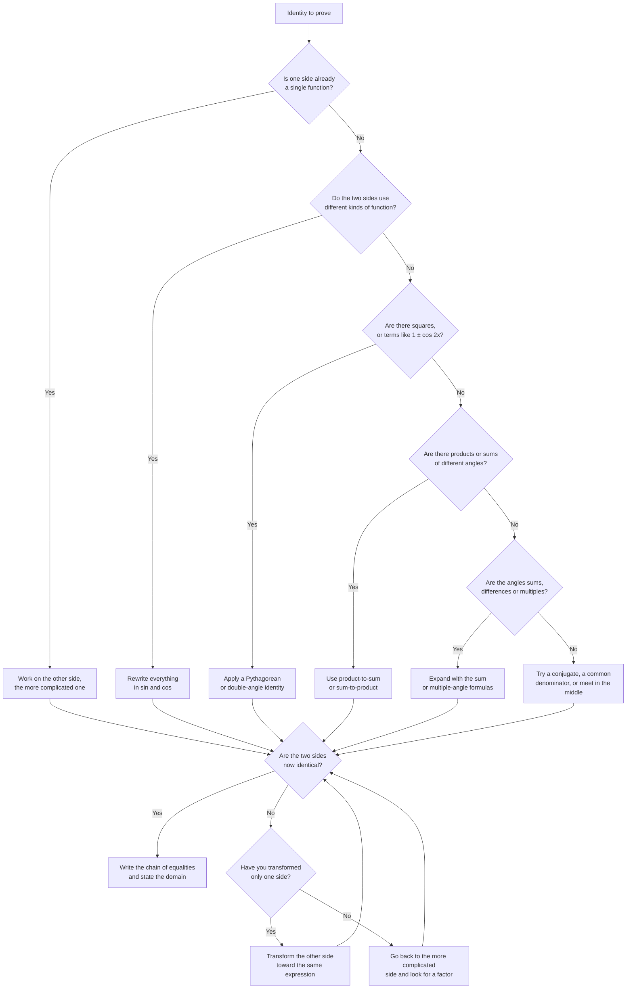

# Trigonometric Identities

> [Mathematics](../../README.md) › [Trigonometry](../README.md) · Level: Advanced · Prerequisites: [Trigonometric Functions](../01-trigonometric-functions/README.md), [The Unit Circle and Radian Measure](../02-unit-circle/README.md), [Intermediate Algebra](../../03-algebra/04-intermediate-algebra/README.md), [Geometry](../../04-geometry/README.md) · Estimated time: 600 min

## 1. Introduction

An equation asks a question. "For which $x$ is $2x+1=7$?" has the answer $x=3$, and no other number
works. An **identity** makes a promise instead: two expressions are the same for *every* value of the
variable for which both are defined. The statement

$$\sin^2\theta+\cos^2\theta=1$$

is not a question about $\theta$. It is a fact about the unit circle, true at $\theta=17^\circ$, at
$\theta=-3.2$ radians, at $\theta=10^6$ degrees, and at every other real number.

That contrast — a solution set versus a theorem — is the subject of this tutorial in miniature.
Solving a trigonometric equation produces *numbers*; proving a trigonometric identity produces a
*chain of reasoning* that is valid everywhere at once. The two activities even use opposite habits.
To solve an equation you may add, multiply or square both sides and then check your answers; to prove
an identity you may only replace an expression by one that is equal to it on the whole domain.

Identities are the algebra of everything that oscillates. Calculus differentiates $\sin x$ by
expanding $\sin(x+h)$, which is the addition formula; it integrates products such as
$\sin 5x\cos 3x$ by turning them into sums, which is the product-to-sum formula. Physics adds two
waves of different frequency and hears beats; electrical engineering adds voltages that are out of
phase and draws a phasor diagram; computer graphics rotates a point by composing two rotations, and
the composition law for rotations *is* the pair of addition formulas. Fourier analysis, the design of
loudspeaker crossovers, the geometry of a surveyor's theodolite and the solution of the wave equation
all rest on the identities proved here.

The chapter is deliberately organised as one long deduction. The unit circle gives a single identity.
That identity gives two companions. The geometry of projections gives the sum formulas. The sum
formulas give everything else: double angles, half angles, products as sums, sums as products, and the
special identities satisfied by the three angles of a triangle. Everything in the final table can be
reconstructed from one circle and one picture, and a reader who can do that reconstruction never needs
to memorise the table again.

## 2. Prerequisites

You should be comfortable with the following. Each item names the place where the repository teaches
it, or a nearby tutorial when the exact topic is still being written.

* **Right-triangle trigonometry.** The definitions of sine, cosine and tangent as ratios of sides,
  and the exact values for $30^\circ$, $45^\circ$ and $60^\circ$, as taught in
  [Trigonometric Functions](../01-trigonometric-functions/README.md).
* **The unit circle and radian measure.** Points on $x^2+y^2=1$, the correspondence between angles and
  points, the signs of sine and cosine in each quadrant, and the use of radians, as taught in
  [The Unit Circle and Radian Measure](../02-unit-circle/README.md).
* **Function notation and domains.** What $f(x)$ means, what the domain of an expression is, and why
  an expression containing a denominator is undefined where that denominator vanishes.
* **Algebraic manipulation.** Expanding products, factoring, finding common denominators, and
  multiplying numerator and denominator by the same nonzero quantity. The relevant techniques are in
  [Intermediate Algebra](../../03-algebra/04-intermediate-algebra/README.md).
* **The Pythagorean theorem and similar triangles.** Used for the geometric proofs of the sum
  formulas. See [Geometry](../../04-geometry/README.md).
* **The idea of a proof.** A proof is a finite sequence of statements, each justified by a definition,
  an axiom, or a previously proved result. [Mathematical Thinking](../../00-foundations/01-mathematical-thinking/README.md)
  introduces the standard.

No calculus is assumed anywhere in this tutorial.

## 3. Learning Objectives

After working through this tutorial you will be able to:

1. Distinguish an identity from a conditional equation, and explain why a single numerical check can
   refute a claimed identity but can never prove one.
2. Derive $\sin^2\theta+\cos^2\theta=1$ from the definition of sine and cosine on the unit circle, and
   derive $1+\tan^2\theta=\sec^2\theta$ and $1+\cot^2\theta=\csc^2\theta$ from it.
3. Use the reciprocal and quotient identities fluently, stating the excluded values.
4. Prove an identity by transforming one side into the other, choosing a strategy based on the
   structure of the expressions, and never assuming the identity being proved.
5. Derive the addition formulas for sine and cosine from a projection argument, and extend them from
   acute angles to all real angles.
6. Derive the tangent addition formula, the double-angle formulas and the half-angle formulas from the
   addition formulas.
7. Convert products of sines and cosines into sums, and sums into products, and use both directions
   in computation.
8. Prove conditional identities, including the identities satisfied by the angles of a triangle.
9. Evaluate trigonometric expressions exactly at angles such as $15^\circ$, $75^\circ$ and $22.5^\circ$.
10. Recognise and avoid the standard errors: cancelling across a sum, assuming what is to be proved,
    and losing track of the domain.

## 4. Intuition

Think of a trigonometric expression as a *description of a journey on the unit circle*. The number
$\theta$ is a distance walked around the rim; $\cos\theta$ and $\sin\theta$ are the coordinates of the
place you stop. Many different descriptions name the same place: "walk $\theta$", "walk $\theta+2\pi$",
"walk $-\theta$ then reflect", "walk to the mirror image of $\theta$". Every identity is a statement
that two descriptions arrive at the same point.

The first identity is the statement that the point is *on the circle*. If you are standing on the rim
of a circle of radius one centred at the origin, your coordinates satisfy $x^2+y^2=1$. This is not an
extra rule about trigonometry; it is the definition of the circle read backwards.

The addition formulas describe what happens when you *rotate twice*. If you rotate by $\beta$ and then
by $\alpha$, you have rotated by $\alpha+\beta$. The coordinates of the final point can be computed in
two ways, and comparing them is exactly the identity. The picture is a right triangle carried around
by a rotation: the triangle's hypotenuse has length $1$, its legs have lengths $\cos\alpha$ and
$\sin\alpha$, and when the whole triangle is turned through $\beta$ each leg acquires a component in
the $x$-direction and a component in the $y$-direction.

A useful physical analogy is a *recipe scaling*. Doubling an angle is not the same as doubling its
sine — a recipe for twice as many people is not made by doubling the oven temperature. The
double-angle formulas say precisely how the coordinates change when the angle doubles, and the
correction terms are what make trigonometry subtle.

Finally, identities are *compression*. A computer storing a table of $\sin$ values needs only values on
a quarter of the circle plus the identities that move any other angle back into that quarter. Every
trigonometric library in every programming language is built on that observation.

## 5. Formal Definition

Throughout, angles are measured in radians unless a degree sign is written explicitly.

**Definition 5.1 (The six circular functions).** For a real number $\theta$, let $P(\theta)=(x,y)$ be
the point where the ray from the origin making a directed angle $\theta$ with the positive $x$-axis
meets the unit circle $x^2+y^2=1$. Define

$$\cos\theta:=x,\qquad \sin\theta:=y,$$

and, wherever the denominators are nonzero,

$$\tan\theta:=\frac{y}{x},\qquad \sec\theta:=\frac{1}{x},\qquad \csc\theta:=\frac{1}{y},\qquad \cot\theta:=\frac{x}{y}.$$

The **domain** of each function is the set of $\theta$ for which its defining expression is defined:
$\sin$ and $\cos$ are defined for all real $\theta$; $\tan$ and $\sec$ are undefined when $\cos\theta=0$;
$\cot$ and $\csc$ are undefined when $\sin\theta=0$.

**Definition 5.2 (Identity).** Let $D\subseteq\mathbb{R}$, and let $f$ and $g$ be functions whose
common domain contains $D$. The equation $f(x)=g(x)$ is an **identity on $D$** if

$$\forall x\in D,\quad f(x)=g(x).$$

When the domain is understood, we write $f\equiv g$ and read it as "$f$ is identically equal to $g$".

For example, $\sin^2\theta+\cos^2\theta=1$ is an identity on $\mathbb{R}$, and
$\tan\theta=\dfrac{\sin\theta}{\cos\theta}$ is an identity on
$\{\theta\in\mathbb{R}:\cos\theta\neq 0\}$ but is not an identity on $\mathbb{R}$, because neither side
is defined at $\theta=\pi/2$.

**Definition 5.3 (Conditional equation).** An equation in $x$ that is true for at least one but not
all values in its domain is a **conditional equation**. Its **solution set** is
$\{x\in D:f(x)=g(x)\}$.

The equation $\sin\theta=\tfrac12$ is conditional: its solution set is
$\{\pi/6+2k\pi\}\cup\{5\pi/6+2k\pi\}$. The equation $\sin\theta=\sin\theta$ is an identity, and
$\sin\theta=2$ is neither: it is a conditional equation with empty solution set.

**Definition 5.4 (Equivalent expressions).** Two expressions in a variable are **equivalent on $D$** if
they have the same value at every point of $D$. Proving an identity is exactly the task of showing
that its two sides are equivalent on the common domain.

**Definition 5.5 (Proof of an identity).** A proof of $f(x)=g(x)$ on $D$ is a finite chain

$$f(x)=e_1(x)=e_2(x)=\cdots=e_n(x)=g(x)$$

such that each equality is either a definition, an algebraic identity (such as expanding a product or
adding fractions), a previously established trigonometric identity, or a substitution valid on $D$;
and such that every expression in the chain is defined for every $x\in D$.

Two consequences of this definition deserve emphasis.

* A proof is a *chain of equalities*, not a sequence of manipulations of an equation. Adding the same
  quantity to both sides of the identity being proved is not allowed, because that treats the
  statement as an equation to be solved.
* Checking a hundred values is not a proof. Checking one value at which the two sides differ *is* a
  disproof.

**Definition 5.6 (Conditional identity).** A trigonometric identity that holds only under an extra
hypothesis relating the variables — typically $A+B+C=\pi$ for the angles of a triangle — is called a
**conditional identity**.

## 6. Mathematical Notation

| Symbol | Read as | Meaning |
|---|---|---|
| $\sin\theta$ | sine of theta | $y$-coordinate of the point at angle $\theta$ on the unit circle |
| $\cos\theta$ | cosine of theta | $x$-coordinate of that point |
| $\tan\theta$ | tangent of theta | $\sin\theta/\cos\theta$ |
| $\sec\theta$ | secant of theta | $1/\cos\theta$ |
| $\csc\theta$ | cosecant of theta | $1/\sin\theta$ |
| $\cot\theta$ | cotangent of theta | $\cos\theta/\sin\theta$ |
| $\theta,\alpha,\beta,\gamma$ | theta, alpha, beta, gamma | angles, measured in radians unless marked $^\circ$ |
| $\sin^2\theta$ | sine squared of theta | $(\sin\theta)^2$; the exponent applies to the value |
| $\sin^{-1}\theta$ | arcsine of theta | the *inverse* function, not $1/\sin\theta$; this tutorial writes $\arcsin$ to avoid the clash |
| $\equiv$ | is identically equal to | equality for every value in the stated domain |
| $D$ | the domain | the set of values for which both sides are defined |
| $A,B,C$ | capital letters | angles of a triangle; side $a$ is opposite $A$, and so on |
| $\pm$ | plus or minus | two signs taken consistently; the choice is made by the quadrant |
| $k$ | an integer | used in general solutions such as $\theta=\pi/6+2k\pi$ |
| QI, QII, QIII, QIV | first to fourth quadrant | the four open quarters of the plane, counted anticlockwise from the positive $x$-axis |

Degrees and radians are both used, always with an explicit symbol: $15^\circ$ for degrees, and a bare
number such as $0.26$ or $3\pi/4$ for radians. An identity proved in radians is automatically true in
degrees, because the conversion is a rescaling of the variable; the formulas themselves do not change
form.

When a formula contains a fraction, its validity is restricted to values at which every denominator in
the formula is nonzero. Those restrictions are part of the statement, not an afterthought, and they
are listed with each formula in Section 8.

## 7. Core Concepts

### 7.1 The Unit Circle Is the Source

Everything in this tutorial flows from one sentence: **the point at angle $\theta$ on the unit circle
has coordinates $(\cos\theta,\sin\theta)$.** That sentence is Definition 5.1, and it already contains
the first identity.

The circle is the set of points $(x,y)$ with $x^2+y^2=1$. The point $(\cos\theta,\sin\theta)$ lies on
it. Therefore

$$\cos^2\theta+\sin^2\theta=1 \qquad\text{for every } \theta\in\mathbb{R}.$$

This derivation deserves to be read slowly, because it shows what an identity *is*. We did not verify
the formula at several angles and generalise. We used a structural fact — every point of the unit
circle satisfies the circle's equation — and the definition of the two functions. The result is
therefore true at every angle simultaneously, including angles nobody has ever computed.

Three immediate consequences are worth recording.

* **Boundedness.** Since $\sin^2\theta\le 1$ and $\cos^2\theta\le 1$, we have
  $-1\le\sin\theta\le 1$ and $-1\le\cos\theta\le 1$ for all $\theta$. Neither sine nor cosine can ever
  leave the interval $[-1,1]$.
* **The sign of a quadrant.** The identity fixes the *magnitude* of each function once the other is
  known, and the quadrant fixes the sign. This is the standard technique for the exercises: from
  $\sin\theta=\tfrac{5}{13}$ and "$\theta$ is in the second quadrant" we deduce
  $\cos\theta=-\sqrt{1-\tfrac{25}{169}}=-\tfrac{12}{13}$.
* **Factored forms.** Subtracting $\cos^2\theta$ from both sides and factoring gives
  $$\sin^2\theta=1-\cos^2\theta=(1-\cos\theta)(1+\cos\theta),$$
  and symmetrically $\cos^2\theta=(1-\sin\theta)(1+\sin\theta)$. These factorisations convert a
  difference of squares into a product, and they are the single most useful algebraic move in identity
  proofs.

### 7.2 Identities Versus Equations, in Practice

The distinction is easy to state and easy to forget under pressure. Three habits keep it clear.

**A conditional equation has a solution set; an identity has a domain.** The equation
$2\sin\theta=1$ has the solution set $\{\pi/6+2k\pi,\ 5\pi/6+2k\pi:k\in\mathbb{Z}\}$. The identity
$2\sin\theta\cos\theta=\sin 2\theta$ has no solution set at all: it is true for every $\theta$, and
asking "which $\theta$ satisfy it" is the wrong question.

**A numerical check can refute, never confirm.** If a proposed identity fails at $\theta=0.4$, it is
false. If it holds at a thousand values, it may still fail at the thousand-and-first. Proofs are
required because the domain is infinite. (There is one important exception: if both sides are
polynomials of degree at most $n$ in $\sin\theta$ and $\cos\theta$, then agreement at enough points
does force equality — but this is a theorem about polynomials, not a licence to check numerically.)

**An identity can be true on a smaller domain than it appears to have.** The statement
$\tan\theta=\dfrac{\sin\theta}{\cos\theta}$ is true wherever it is meaningful, which is
$\theta\neq\pi/2+k\pi$. Written without qualification it is neither true nor false at $\theta=\pi/2$;
it is meaningless there. Every formula in this tutorial carries an implicit "for all values at which
both sides are defined", and the important ones carry an explicit list.

A useful test for the reader: when asked whether a statement is an identity, try to substitute a value
that makes a denominator zero, and try a value in a different quadrant. Most false "identities"
collapse under one of those two probes.

### 7.3 The Pythagorean Identity and Its Two Companions

The identity

$$\sin^2\theta+\cos^2\theta=1$$

is called the **Pythagorean identity**, because in the right triangle with hypotenuse $1$, the two
coordinates are the legs and the circle's equation is the Pythagorean theorem. Dividing it by
$\cos^2\theta$ and by $\sin^2\theta$ produces two companions.

**Companion 1.** For $\cos\theta\neq 0$,

$$\frac{\sin^2\theta}{\cos^2\theta}+\frac{\cos^2\theta}{\cos^2\theta}=\frac{1}{\cos^2\theta},
\qquad\text{that is,}\qquad \tan^2\theta+1=\sec^2\theta.$$

**Companion 2.** For $\sin\theta\neq 0$,

$$\frac{\sin^2\theta}{\sin^2\theta}+\frac{\cos^2\theta}{\sin^2\theta}=\frac{1}{\sin^2\theta},
\qquad\text{that is,}\qquad 1+\cot^2\theta=\csc^2\theta.$$

Neither companion is a new geometric fact. Each is the Pythagorean identity divided by a square, and
the division is legitimate exactly where that square is nonzero. This is why the companions exclude
the angles at which $\cos\theta$ or $\sin\theta$ vanishes: at those angles $\sec\theta$ or $\csc\theta$
is undefined anyway, so nothing is lost.

**A geometric reading of the first companion.** Let $P=(\cos\theta,\sin\theta)$ be a point of the unit
circle with $\cos\theta>0$, and let the tangent to the circle at $P$ meet the $x$-axis at $Q$. The
radius $OP$ is perpendicular to the tangent $PQ$, so triangle $OPQ$ is right-angled at $P$, with
$OP=1$ and angle $\angle POQ=\theta$. Similar triangles (or the definition of secant) give
$OQ=\sec\theta$ and $PQ=\tan\theta$. Pythagoras in triangle $OPQ$ then reads
$1+\tan^2\theta=\sec^2\theta$. The identity is literally the Pythagorean theorem in a different right
triangle.

**Which form to use.** The three identities are one identity in three costumes. When an expression
contains $1-\sin^2\theta$, replace it by $\cos^2\theta$. When it contains $\sec^2\theta-1$, replace it
by $\tan^2\theta$. When it contains $\csc^2\theta-\cot^2\theta$, replace it by $1$. Recognising which
costume is being worn is most of the skill of identity proving.

### 7.4 Reciprocal and Quotient Identities

These follow directly from Definition 5.1 and are collected here for reference and for their domains.

| Identity | Valid for | Derivation |
|---|---|---|
| $\sec\theta=\dfrac{1}{\cos\theta}$ | $\cos\theta\neq 0$ | definition |
| $\csc\theta=\dfrac{1}{\sin\theta}$ | $\sin\theta\neq 0$ | definition |
| $\cot\theta=\dfrac{1}{\tan\theta}$ | $\sin\theta\neq 0$ and $\cos\theta\neq 0$ | $\dfrac{\cos\theta}{\sin\theta}=\dfrac{1}{\sin\theta/\cos\theta}$ |
| $\tan\theta=\dfrac{\sin\theta}{\cos\theta}$ | $\cos\theta\neq 0$ | definition |
| $\cot\theta=\dfrac{\cos\theta}{\sin\theta}$ | $\sin\theta\neq 0$ | definition |
| $\sin\theta\csc\theta=1$ | $\sin\theta\neq 0$ | multiply the second row by $\sin\theta$ |
| $\cos\theta\sec\theta=1$ | $\cos\theta\neq 0$ | multiply the first row by $\cos\theta$ |
| $\tan\theta\cot\theta=1$ | both defined | multiply the third row by $\tan\theta$ |

Two warnings. First, $\sec\theta$ is the reciprocal of $\cos\theta$, not its inverse function; the
inverse function is $\arccos\theta$, written $\cos^{-1}\theta$ when no confusion arises. Second, the
identity $\tan\theta=\sin\theta/\cos\theta$ is often used to *convert everything to sines and cosines*,
which is the most reliable general strategy in Section 7.6.

The quotient identities also explain the periods. Since $\tan\theta=\sin\theta/\cos\theta$ and both
sine and cosine change sign under $\theta\mapsto\theta+\pi$, the two sign changes cancel and
$\tan(\theta+\pi)=\tan\theta$. The period of tangent is $\pi$, not $2\pi$.

### 7.5 Negative Angles, Periodicity and Cofunctions

These identities are not usually listed among the "famous" ones, but the extension of the addition
formulas from acute to all angles depends on them, and every reduction of a large angle depends on
them too. Each has a one-line proof from the unit circle.

**Reflection in the $x$-axis.** The point at angle $-\theta$ is the reflection of the point at angle
$\theta$ across the horizontal axis. Reflection preserves $x$ and negates $y$:

$$\cos(-\theta)=\cos\theta,\qquad \sin(-\theta)=-\sin\theta,\qquad \tan(-\theta)=-\tan\theta.$$

Sine and tangent are **odd** functions; cosine is **even**.

**Rotation by $\pi$.** The point at angle $\theta+\pi$ is the reflection of the point at angle $\theta$
through the origin, so both coordinates change sign:

$$\sin(\theta+\pi)=-\sin\theta,\qquad \cos(\theta+\pi)=-\cos\theta,\qquad \tan(\theta+\pi)=\tan\theta.$$

**Full turns.** Adding $2\pi$ returns to the same point:

$$\sin(\theta+2\pi)=\sin\theta,\qquad \cos(\theta+2\pi)=\cos\theta.$$

**Supplementary angles.** Combining the previous two,

$$\sin(\pi-\theta)=\sin\theta,\qquad \cos(\pi-\theta)=-\cos\theta,\qquad \tan(\pi-\theta)=-\tan\theta.$$

The first of these is the algebraic reason the ambiguous case exists in triangle trigonometry: two
different angles in a triangle can have the same sine.

**Cofunctions.** Reflection in the line $y=x$ swaps the coordinates, and the angle $\theta$ becomes
$\pi/2-\theta$:

$$\sin\!\left(\frac{\pi}{2}-\theta\right)=\cos\theta,\qquad
\cos\!\left(\frac{\pi}{2}-\theta\right)=\sin\theta,\qquad
\tan\!\left(\frac{\pi}{2}-\theta\right)=\cot\theta.$$

The word "cosine" is an abbreviation of *sinus complementi*, the sine of the complementary angle. The
cofunction identities are that etymology made precise.

### 7.6 Proving Identities: The Rules of the Game

An identity proof is a rewriting problem with one strict rule: **you may replace an expression only by
an expression equal to it on the whole domain.** In particular you may not add something to both
sides, cross-multiply, or square both sides, because those operations transform the *statement* rather
than an *expression*. (Cross-multiplication can be salvaged if every step is reversible and every
denominator is nonzero, but the safest habit is not to do it.)

Within that rule, five strategies cover almost every exercise.

**Strategy 1: start with the more complicated side.** The simpler side is your target. Transforming
the complicated side toward the target gives a chain of equalities that ends where it should. Starting
from the simple side usually produces a chain that grows and goes nowhere.

**Strategy 2: convert everything to sines and cosines.** When secants, cosecants, tangents and
cotangents appear on both sides, rewrite all of them using the quotient and reciprocal identities. The
expression may become longer, but it becomes uniform, and uniform expressions are easier to combine.

**Strategy 3: combine fractions, then factor.** Sums of fractions are handled by common denominators;
differences of squares are handled by factoring; and the Pythagorean identity in the form
$1-\cos^2\theta=(1-\cos\theta)(1+\cos\theta)$ links the two moves. A very common shape is

$$\frac{1}{1-\cos x}+\frac{1}{1+\cos x}=\frac{(1+\cos x)+(1-\cos x)}{1-\cos^2 x}
=\frac{2}{\sin^2 x}=2\csc^2 x.$$

**Strategy 4: multiply by a conjugate.** Expressions such as $1+\sin x$ or $\sec x-\tan x$ are
cleared by multiplying numerator and denominator by $1-\sin x$ or $\sec x+\tan x$. The denominator
becomes a difference of squares, and the Pythagorean identity finishes the job.

**Strategy 5: meet in the middle.** If neither side alone reaches the other, transform both sides
toward a common expression. This is legitimate provided the chain is written as two separate chains
that end at the same place:

$$L(x)=M(x)\qquad\text{and}\qquad R(x)=M(x)\quad\Longrightarrow\quad L(x)=R(x).$$

The following table lists the standard moves and the shape that triggers them.

| If the expression contains | Try |
|---|---|
| $\sec$, $\csc$, $\cot$, $\tan$ | rewrite in $\sin$ and $\cos$ |
| $1-\sin^2x$, $1-\cos^2x$ | $1-\sin^2x=\cos^2x$, $1-\cos^2x=\sin^2x$ |
| $\sec^2x-1$, $\csc^2x-1$ | $\tan^2x$, $\cot^2x$ |
| $1\pm\cos x$ or $1\pm\sin x$ in a denominator | multiply by the conjugate |
| two fractions added | common denominator |
| $2\sin x\cos x$ | $\sin 2x$ |
| $\cos 2x$ in a sum with $1$ | $2\cos^2x-1$ or $1-2\sin^2x$ |
| a product such as $\sin 5x\cos 3x$ | product-to-sum |
| a sum such as $\sin 7x+\sin 3x$ | sum-to-product |
| angles $\alpha\pm\beta$ | addition formulas |

Finally, **state the domain**. A proof that silently divides by $\sin x$ is incomplete if the exercise
allows $\sin x=0$. Writing "for $\sin x\neq 0$" takes one line and removes the only remaining gap in
the argument.

### 7.7 The Sum and Difference Formulas

The addition formulas are the engine of the whole subject. Everything later in this tutorial is
obtained from them by substitution.

**Theorem 7.7 (Addition formulas).** For all real $\alpha$ and $\beta$,

$$\cos(\alpha+\beta)=\cos\alpha\cos\beta-\sin\alpha\sin\beta,$$

$$\sin(\alpha+\beta)=\sin\alpha\cos\beta+\cos\alpha\sin\beta.$$

**Proof for acute angles (projection).** Assume $0<\alpha$, $0<\beta$ and $\alpha+\beta<\pi/2$. Let
$P$ be the point at angle $\beta$ on the unit circle and $Q$ the point at angle $\alpha+\beta$, so
$Q=(\cos(\alpha+\beta),\sin(\alpha+\beta))$ by Definition 5.1.

Drop the perpendicular from $Q$ to the line $OP$ and call the foot $N$. The triangle $ONQ$ is
right-angled at $N$, its hypotenuse is $OQ=1$, and the angle at $O$ is
$\angle POQ=(\alpha+\beta)-\beta=\alpha$. Right-triangle trigonometry therefore gives

$$ON=\cos\alpha,\qquad NQ=\sin\alpha,$$

with both lengths positive because $\alpha$ is acute.

Now express the two segments as vectors. The unit vector along $OP$ is
$\mathbf{u}=(\cos\beta,\sin\beta)$, so

$$\overrightarrow{ON}=\cos\alpha\,\mathbf{u}=(\cos\alpha\cos\beta,\ \cos\alpha\sin\beta).$$

The unit vector obtained by rotating $\mathbf{u}$ through $+\pi/2$ is
$\mathbf{v}=(-\sin\beta,\cos\beta)$, and $\overrightarrow{NQ}$ is perpendicular to $OP$ in the
direction of increasing angle, so

$$\overrightarrow{NQ}=\sin\alpha\,\mathbf{v}=(-\sin\alpha\sin\beta,\ \sin\alpha\cos\beta).$$

Adding the two vectors gives

$$Q=\overrightarrow{ON}+\overrightarrow{NQ}
=(\cos\alpha\cos\beta-\sin\alpha\sin\beta,\ \cos\alpha\sin\beta+\sin\alpha\cos\beta).$$

Comparing coordinates with $Q=(\cos(\alpha+\beta),\sin(\alpha+\beta))$ proves both formulas on the
acute region. $\blacksquare$

The figure is drawn for acute angles because that is where "the foot of the perpendicular" is visibly
inside the picture. The formula itself has no such restriction. The standard reductions below show
how any pair of angles is brought into the acute case; a complete one-step proof follows them.

1. **The boundary case $\alpha+\beta=\pi/2$.** If $\beta=\pi/2-\alpha$, then
   $\cos\beta=\sin\alpha$ and $\sin\beta=\cos\alpha$ by the cofunction identities, so the right-hand
   side of the cosine formula is $\cos\alpha\sin\alpha-\sin\alpha\cos\alpha=0=\cos(\pi/2)$, and the
   right-hand side of the sine formula is $\sin^2\alpha+\cos^2\alpha=1=\sin(\pi/2)$.
2. **The obtuse-sum case $\pi/2<\alpha+\beta<\pi$.** Write $\alpha=\pi/2-a$ and $\beta=\pi/2-b$ with
   $0<a,b<\pi/2$. Then $a+b=\pi-(\alpha+\beta)$ lies in $(0,\pi/2)$, so the acute case applies to
   $a+b$. Using $\cos(\pi-\gamma)=-\cos\gamma$ and $\sin(\pi-\gamma)=\sin\gamma$,
   $$\cos(\alpha+\beta)=-\cos(a+b)=-\bigl(\cos a\cos b-\sin a\sin b\bigr)
   =\cos\alpha\cos\beta-\sin\alpha\sin\beta,$$
   because $\cos a=\sin\alpha$, $\sin a=\cos\alpha$, $\cos b=\sin\beta$, $\sin b=\cos\beta$; the sine
   formula is checked the same way.
3. **Angles outside $(0,\pi)$.** Periodicity reduces an angle modulo $2\pi$. Replacing a variable
   $\theta$ by $\theta+\pi$ multiplies $\sin\theta$ and $\cos\theta$ by $-1$ and multiplies both sides
   of each formula by $-1$, so the truth of the formula is unaffected. Repeating reduces any pair to
   $0\le\alpha,\beta<\pi$.
4. **One angle obtuse.** If $\alpha=\pi-a$ with $0<a<\pi/2$, then $\cos\alpha=-\cos a$ and
   $\sin\alpha=\sin a$, and a direct substitution shows that the two formulas at $(\alpha,\beta)$ are
   equivalent to the two formulas at $(a,-\beta)$. The same reduction applies to $\beta$.

**A one-step proof for all angles.** The case analysis can be avoided entirely. Let
$P=(\cos\alpha,\sin\alpha)$ and $Q=(\cos\beta,\sin\beta)$. Expanding the squared distance,

$$|PQ|^2=(\cos\alpha-\cos\beta)^2+(\sin\alpha-\sin\beta)^2
=2-2(\cos\alpha\cos\beta+\sin\alpha\sin\beta).$$

On the other hand, the triangle $OPQ$ has two sides of length $1$ and included angle
$\lvert\alpha-\beta\rvert\in[0,\pi]$. The law of cosines in coordinate form — put the vertex at the
origin, one side along the $x$-axis and the other at angle $\theta$, and expand
$(b\cos\theta-a)^2+(b\sin\theta)^2$ — gives $\lvert PQ\rvert^2=2-2\cos(\alpha-\beta)$. Comparing the
two expressions,

$$\cos(\alpha-\beta)=\cos\alpha\cos\beta+\sin\alpha\sin\beta$$

for every pair of real angles. Replacing $\beta$ by $-\beta$ gives the cosine sum formula, and the
sine formulas follow from the cofunction identity:

$$\sin(\alpha+\beta)=\cos\left(\frac{\pi}{2}-\alpha-\beta\right)
=\cos\left(\frac{\pi}{2}-\alpha\right)\cos\beta+\sin\left(\frac{\pi}{2}-\alpha\right)\sin\beta
=\sin\alpha\cos\beta+\cos\alpha\sin\beta.$$

**Corollary 7.8 (Difference formulas).** For all real $\alpha$ and $\beta$, the two statements above
can be written with a difference of angles:

$$\cos(\alpha-\beta)=\cos\alpha\cos\beta+\sin\alpha\sin\beta,$$

$$\sin(\alpha-\beta)=\sin\alpha\cos\beta-\cos\alpha\sin\beta.$$

The sign pattern is easy to remember: **cosine keeps the opposite sign, sine keeps its own sign.**

The cosine difference formula has a useful reading in vector language. If
$\mathbf{u}=(\cos\alpha,\sin\alpha)$ and $\mathbf{v}=(\cos\beta,\sin\beta)$ are unit vectors, then
$\mathbf{u}\cdot\mathbf{v}=\cos\alpha\cos\beta+\sin\alpha\sin\beta=\cos(\alpha-\beta)$. The dot
product of two unit vectors is the cosine of the angle between them, and the identity is the
computation that shows it.

### 7.8 The Tangent Addition Formula

Divide the sine formula by the cosine formula and divide numerator and denominator by
$\cos\alpha\cos\beta$:

$$\tan(\alpha+\beta)=\frac{\sin(\alpha+\beta)}{\cos(\alpha+\beta)}
=\frac{\sin\alpha\cos\beta+\cos\alpha\sin\beta}{\cos\alpha\cos\beta-\sin\alpha\sin\beta}
=\frac{\tan\alpha+\tan\beta}{1-\tan\alpha\tan\beta}.$$

The derivation requires $\cos\alpha\neq0$, $\cos\beta\neq0$ and $\cos(\alpha+\beta)\neq0$; the last
condition also guarantees that the denominator $1-\tan\alpha\tan\beta$ is nonzero, since that
denominator is $\cos(\alpha+\beta)/(\cos\alpha\cos\beta)$.

Replacing $\beta$ by $-\beta$ gives

$$\tan(\alpha-\beta)=\frac{\tan\alpha-\tan\beta}{1+\tan\alpha\tan\beta},$$

with the same kind of restriction. The special case $\beta=\pi/4$ is worth memorising:

$$\tan\!\left(\alpha+\frac{\pi}{4}\right)=\frac{1+\tan\alpha}{1-\tan\alpha}.$$

### 7.9 Double-Angle Formulas

Put $\beta=\alpha$ in the addition formulas.

$$\sin 2\alpha=\sin\alpha\cos\alpha+\cos\alpha\sin\alpha=2\sin\alpha\cos\alpha.$$

$$\cos 2\alpha=\cos^2\alpha-\sin^2\alpha.$$

The cosine formula has two other costumes, obtained by replacing $\sin^2\alpha$ with
$1-\cos^2\alpha$ or $\cos^2\alpha$ with $1-\sin^2\alpha$:

$$\cos 2\alpha=2\cos^2\alpha-1=1-2\sin^2\alpha.$$

All three are the same statement. The choice among them is dictated by what else is in the
expression: if the rest of the expression contains cosines, use $2\cos^2\alpha-1$; if it contains
sines, use $1-2\sin^2\alpha$; if it contains both, use $\cos^2\alpha-\sin^2\alpha$.

The tangent formula follows by putting $\beta=\alpha$ in Theorem 7.8:

$$\tan 2\alpha=\frac{2\tan\alpha}{1-\tan^2\alpha},\qquad \cos\alpha\neq0,\ \cos2\alpha\neq0.$$

Two further forms are often useful. Dividing numerator and denominator of $\sin 2\alpha$ and
$\cos 2\alpha$ by $\cos^2\alpha$ expresses both in terms of $t=\tan\alpha$:

$$\sin 2\alpha=\frac{2t}{1+t^2},\qquad \cos 2\alpha=\frac{1-t^2}{1+t^2}.$$

These are the first two entries of the **Weierstrass substitution**, which turns every rational
expression in sine and cosine into a rational expression in $t=\tan(\alpha/2)$; it is the standard
technique for integrating rational functions of trigonometric functions.

Rearranged, the double-angle formulas also give the **power-reduction formulas**

$$\sin^2\alpha=\frac{1-\cos 2\alpha}{2},\qquad \cos^2\alpha=\frac{1+\cos 2\alpha}{2},$$

which convert a square into a first-power cosine. Calculus uses them constantly, because squares are
hard to integrate and first powers are easy.

### 7.10 Half-Angle Formulas

Replace $\alpha$ by $x/2$ in the power-reduction formulas:

$$\sin^2\frac{x}{2}=\frac{1-\cos x}{2},\qquad \cos^2\frac{x}{2}=\frac{1+\cos x}{2}.$$

Taking square roots introduces a sign:

$$\sin\frac{x}{2}=\pm\sqrt{\frac{1-\cos x}{2}},\qquad
\cos\frac{x}{2}=\pm\sqrt{\frac{1+\cos x}{2}},\qquad
\tan\frac{x}{2}=\pm\sqrt{\frac{1-\cos x}{1+\cos x}}.$$

The sign is not arbitrary: it is the sign of the left-hand side. Since $x/2$ lies in a quadrant
determined by $x$, the rule is: **find the quadrant of $x/2$, then choose the sign that the function
has in that quadrant.** For example, if $x\in(\pi,2\pi)$ then $x/2\in(\pi/2,\pi)$, so $\sin(x/2)>0$
and $\cos(x/2)<0$, and the signs are $+$ and $-$ respectively.

The tangent formula has two rational forms that avoid the square root entirely. Multiply numerator
and denominator of $\tan(x/2)=\sin(x/2)/\cos(x/2)$ by $2\cos(x/2)$:

$$\tan\frac{x}{2}=\frac{2\sin\frac{x}{2}\cos\frac{x}{2}}{2\cos^2\frac{x}{2}}
=\frac{\sin x}{1+\cos x},$$

and multiply by $2\sin(x/2)$ instead:

$$\tan\frac{x}{2}=\frac{2\sin^2\frac{x}{2}}{2\sin\frac{x}{2}\cos\frac{x}{2}}
=\frac{1-\cos x}{\sin x}.$$

Both require the denominators to be nonzero, that is $x\neq\pi+2k\pi$. Each is free of the $\pm$
ambiguity, which makes them the preferred forms in practice.

### 7.11 Product-to-Sum Formulas

Add and subtract the two sine formulas, and likewise the two cosine formulas.

$$\sin(\alpha+\beta)=\sin\alpha\cos\beta+\cos\alpha\sin\beta$$
$$\sin(\alpha-\beta)=\sin\alpha\cos\beta-\cos\alpha\sin\beta$$

Adding gives $2\sin\alpha\cos\beta=\sin(\alpha+\beta)+\sin(\alpha-\beta)$; subtracting gives
$2\cos\alpha\sin\beta=\sin(\alpha+\beta)-\sin(\alpha-\beta)$. Hence

$$\sin\alpha\cos\beta=\tfrac12\bigl[\sin(\alpha+\beta)+\sin(\alpha-\beta)\bigr],$$

$$\cos\alpha\sin\beta=\tfrac12\bigl[\sin(\alpha+\beta)-\sin(\alpha-\beta)\bigr].$$

Similarly, from

$$\cos(\alpha+\beta)=\cos\alpha\cos\beta-\sin\alpha\sin\beta,\qquad
\cos(\alpha-\beta)=\cos\alpha\cos\beta+\sin\alpha\sin\beta,$$

adding gives $2\cos\alpha\cos\beta=\cos(\alpha+\beta)+\cos(\alpha-\beta)$ and subtracting gives
$2\sin\alpha\sin\beta=\cos(\alpha-\beta)-\cos(\alpha+\beta)$. Hence

$$\cos\alpha\cos\beta=\tfrac12\bigl[\cos(\alpha+\beta)+\cos(\alpha-\beta)\bigr],$$

$$\sin\alpha\sin\beta=\tfrac12\bigl[\cos(\alpha-\beta)-\cos(\alpha+\beta)\bigr].$$

Note the reversed order in the last formula: the difference is *near minus far*, and the sign is
positive. This is the one most often mis-remembered.

### 7.12 Sum-to-Product Formulas

Put $u=\alpha+\beta$ and $v=\alpha-\beta$. Then $\alpha=(u+v)/2$ and $\beta=(u-v)/2$, and the four
product-to-sum formulas become, after renaming,

$$\sin u+\sin v=2\sin\frac{u+v}{2}\cos\frac{u-v}{2},$$

$$\sin u-\sin v=2\cos\frac{u+v}{2}\sin\frac{u-v}{2},$$

$$\cos u+\cos v=2\cos\frac{u+v}{2}\cos\frac{u-v}{2},$$

$$\cos u-\cos v=-2\sin\frac{u+v}{2}\sin\frac{u-v}{2}.$$

The derivation is a substitution, not a new idea, which is why it is safe to derive these on the spot
rather than memorise them. Two readings make them intuitive:

* $\sin u+\sin v$ is large when $u$ and $v$ are close, and the formula says so through the factor
  $\cos((u-v)/2)$.
* $\cos u-\cos v$ vanishes when $u=v$, and indeed the right-hand side has the factor
  $\sin((u-v)/2)$.

The sum-to-product formulas are the mathematics of **beats**: two tones of nearly equal frequency
$\omega_1$ and $\omega_2$ combine into a tone at the average frequency modulated by an envelope at the
difference frequency.

### 7.13 Conditional Identities and Triangle Identities

A **conditional identity** is true only under a relation between the variables. The most important
example is the relation among the three angles of a triangle.

**Proposition C1 (supplement identities).** If $A$, $B$, $C$ are the angles of a triangle, then
$A+B+C=\pi$ and

$$\sin(A+B)=\sin C,\qquad \cos(A+B)=-\cos C,\qquad \tan(A+B)=-\tan C,$$

$$\sin\frac{A+B}{2}=\cos\frac{C}{2},\qquad \cos\frac{A+B}{2}=\sin\frac{C}{2}.$$

Each follows from the supplement identities of Section 7.5: $A+B=\pi-C$, and
$\sin(\pi-C)=\sin C$, $\cos(\pi-C)=-\cos C$, $\tan(\pi-C)=-\tan C$.

**Proposition C2.** If $A+B+C=\pi$, then

$$\sin 2A+\sin 2B+\sin 2C=4\sin A\sin B\sin C.$$

**Proof.** By sum-to-product and Proposition C1,

$$\sin 2A+\sin 2B=2\sin(A+B)\cos(A-B)=2\sin C\cos(A-B).$$

Therefore

$$\sin 2A+\sin 2B+\sin 2C=2\sin C\cos(A-B)+2\sin C\cos C
=2\sin C\bigl[\cos(A-B)+\cos C\bigr].$$

Now $\cos C=-\cos(A+B)$, so $\cos(A-B)+\cos C=\cos(A-B)-\cos(A+B)=2\sin A\sin B$ by the fourth
product-to-sum formula. Hence the total is $4\sin A\sin B\sin C$. $\blacksquare$

**Proposition C3.** If $A+B+C=\pi$, then

$$\cos^2A+\cos^2B+\cos^2C+2\cos A\cos B\cos C=1.$$

**Proof.** Since $\cos C=-\cos(A+B)$ and
$\cos(A+B)=\cos A\cos B-\sin A\sin B$, write $x=\cos A$, $y=\cos B$, $p=\sin A$, $q=\sin B$. Then

$$\begin{aligned}
&\cos^2A+\cos^2B+\cos^2C+2\cos A\cos B\cos C\\
&\quad= x^2+y^2+(xy-pq)^2-2xy(xy-pq)\\
&\quad= x^2+y^2+x^2y^2-2xypq+p^2q^2-2x^2y^2+2xypq\\
&\quad= x^2+y^2-x^2y^2+p^2q^2.
\end{aligned}$$

Because $p^2=1-x^2$ and $q^2=1-y^2$,

$$p^2q^2=(1-x^2)(1-y^2)=1-x^2-y^2+x^2y^2,$$

so the total is $x^2+y^2-x^2y^2+1-x^2-y^2+x^2y^2=1$. $\blacksquare$

**Proposition C4.** If $A+B+C=\pi$ and none of the angles is a right angle, then

$$\tan A+\tan B+\tan C=\tan A\tan B\tan C.$$

**Proof.** By Theorem 7.8 applied to $A+B$,

$$\tan(A+B)=\frac{\tan A+\tan B}{1-\tan A\tan B}.$$

But $\tan(A+B)=\tan(\pi-C)=-\tan C$. Multiplying both sides by $1-\tan A\tan B$,

$$\tan A+\tan B=-\tan C+\tan A\tan B\tan C,$$

and rearranging gives the claim. $\blacksquare$

The hypothesis "no right angle" cannot be dropped: if $C=\pi/2$ then $\tan C$ is undefined, while
$\tan A+\tan B$ is finite. The identity is a statement about angles at which all three tangents exist.

A related and frequently used consequence is the **tangent–cotangent pairing**:

$$\tan\frac{A+B}{2}=\cot\frac{C}{2}.$$

It follows from $(A+B)/2=\pi/2-C/2$ and the cofunction identity.

## 8. Formulas and Properties

The tables below are a reference sheet, not a substitute for the derivations. Each row records the
formula, the values for which it is valid, and the reason it is true. A reader who forgets a formula
can reconstruct it from the reason, which is the point of learning the reasons.

### 8.1 The Fundamental Group

| Name | Formula | Valid for | Reason |
|---|---|---|---|
| Pythagorean | $\sin^2\theta+\cos^2\theta=1$ | all $\theta$ | point lies on $x^2+y^2=1$ |
| Companion 1 | $1+\tan^2\theta=\sec^2\theta$ | $\cos\theta\neq0$ | divide the Pythagorean identity by $\cos^2\theta$ |
| Companion 2 | $1+\cot^2\theta=\csc^2\theta$ | $\sin\theta\neq0$ | divide the Pythagorean identity by $\sin^2\theta$ |
| Secant | $\sec\theta=\dfrac{1}{\cos\theta}$ | $\cos\theta\neq0$ | definition |
| Cosecant | $\csc\theta=\dfrac{1}{\sin\theta}$ | $\sin\theta\neq0$ | definition |
| Tangent | $\tan\theta=\dfrac{\sin\theta}{\cos\theta}$ | $\cos\theta\neq0$ | definition |
| Cotangent | $\cot\theta=\dfrac{\cos\theta}{\sin\theta}$ | $\sin\theta\neq0$ | definition |
| Even/odd | $\sin(-\theta)=-\sin\theta$, $\cos(-\theta)=\cos\theta$ | all $\theta$ | reflection in the $x$-axis |
| Period | $\sin(\theta+2\pi)=\sin\theta$, $\cos(\theta+2\pi)=\cos\theta$ | all $\theta$ | full turn |
| Half-turn | $\sin(\theta+\pi)=-\sin\theta$, $\cos(\theta+\pi)=-\cos\theta$ | all $\theta$ | reflection in the origin |
| Supplement | $\sin(\pi-\theta)=\sin\theta$, $\cos(\pi-\theta)=-\cos\theta$ | all $\theta$ | combine the two previous rows |
| Cofunction | $\sin(\pi/2-\theta)=\cos\theta$, $\cos(\pi/2-\theta)=\sin\theta$ | all $\theta$ | reflection in $y=x$ |

### 8.2 The Sum, Difference and Multiple-Angle Group

| Name | Formula | Valid for | Reason |
|---|---|---|---|
| Sine of sum | $\sin(\alpha+\beta)=\sin\alpha\cos\beta+\cos\alpha\sin\beta$ | all $\alpha,\beta$ | projection proof, Theorem 7.7 |
| Cosine of sum | $\cos(\alpha+\beta)=\cos\alpha\cos\beta-\sin\alpha\sin\beta$ | all $\alpha,\beta$ | projection proof, Theorem 7.7 |
| Sine of difference | $\sin(\alpha-\beta)=\sin\alpha\cos\beta-\cos\alpha\sin\beta$ | all $\alpha,\beta$ | replace $\beta$ by $-\beta$ |
| Cosine of difference | $\cos(\alpha-\beta)=\cos\alpha\cos\beta+\sin\alpha\sin\beta$ | all $\alpha,\beta$ | replace $\beta$ by $-\beta$ |
| Tangent of sum | $\tan(\alpha+\beta)=\dfrac{\tan\alpha+\tan\beta}{1-\tan\alpha\tan\beta}$ | $\cos\alpha\cos\beta\cos(\alpha+\beta)\neq0$ | divide sine by cosine |
| Tangent of difference | $\tan(\alpha-\beta)=\dfrac{\tan\alpha-\tan\beta}{1+\tan\alpha\tan\beta}$ | $\cos\alpha\cos\beta\cos(\alpha-\beta)\neq0$ | replace $\beta$ by $-\beta$ |
| Double sine | $\sin 2\alpha=2\sin\alpha\cos\alpha$ | all $\alpha$ | put $\beta=\alpha$ |
| Double cosine | $\cos 2\alpha=\cos^2\alpha-\sin^2\alpha=2\cos^2\alpha-1=1-2\sin^2\alpha$ | all $\alpha$ | put $\beta=\alpha$ |
| Double tangent | $\tan 2\alpha=\dfrac{2\tan\alpha}{1-\tan^2\alpha}$ | $\cos\alpha\neq0$, $\cos2\alpha\neq0$ | put $\beta=\alpha$ |
| Power reduction | $\sin^2\alpha=\dfrac{1-\cos2\alpha}{2}$, $\cos^2\alpha=\dfrac{1+\cos2\alpha}{2}$ | all $\alpha$ | rearrange the double-cosine formula |
| Half-sine squared | $\sin^2\dfrac{x}{2}=\dfrac{1-\cos x}{2}$ | all $x$ | power reduction with $\alpha=x/2$ |
| Half-cosine squared | $\cos^2\dfrac{x}{2}=\dfrac{1+\cos x}{2}$ | all $x$ | power reduction with $\alpha=x/2$ |
| Half-tangent | $\tan\dfrac{x}{2}=\dfrac{\sin x}{1+\cos x}=\dfrac{1-\cos x}{\sin x}$ | $x\neq\pi+2k\pi$ | multiply by $2\cos(x/2)$ or $2\sin(x/2)$ |

### 8.3 Products, Sums and Conditional Identities

| Name | Formula | Valid for | Reason |
|---|---|---|---|
| Sine times cosine | $\sin\alpha\cos\beta=\tfrac12[\sin(\alpha+\beta)+\sin(\alpha-\beta)]$ | all $\alpha,\beta$ | add the two sine formulas |
| Cosine times sine | $\cos\alpha\sin\beta=\tfrac12[\sin(\alpha+\beta)-\sin(\alpha-\beta)]$ | all $\alpha,\beta$ | subtract the two sine formulas |
| Cosine times cosine | $\cos\alpha\cos\beta=\tfrac12[\cos(\alpha+\beta)+\cos(\alpha-\beta)]$ | all $\alpha,\beta$ | add the two cosine formulas |
| Sine times sine | $\sin\alpha\sin\beta=\tfrac12[\cos(\alpha-\beta)-\cos(\alpha+\beta)]$ | all $\alpha,\beta$ | subtract the two cosine formulas |
| Sum of sines | $\sin u+\sin v=2\sin\dfrac{u+v}{2}\cos\dfrac{u-v}{2}$ | all $u,v$ | substitute into the product forms |
| Difference of sines | $\sin u-\sin v=2\cos\dfrac{u+v}{2}\sin\dfrac{u-v}{2}$ | all $u,v$ | substitute into the product forms |
| Sum of cosines | $\cos u+\cos v=2\cos\dfrac{u+v}{2}\cos\dfrac{u-v}{2}$ | all $u,v$ | substitute into the product forms |
| Difference of cosines | $\cos u-\cos v=-2\sin\dfrac{u+v}{2}\sin\dfrac{u-v}{2}$ | all $u,v$ | substitute into the product forms |
| Triangle: supplement | $\sin(A+B)=\sin C$, $\cos(A+B)=-\cos C$ | $A+B+C=\pi$ | $A+B=\pi-C$ |
| Triangle: half-angle | $\sin\dfrac{A+B}{2}=\cos\dfrac{C}{2}$ | $A+B+C=\pi$ | $\dfrac{A+B}{2}=\dfrac{\pi}{2}-\dfrac{C}{2}$ |
| Triangle: sine sum | $\sin2A+\sin2B+\sin2C=4\sin A\sin B\sin C$ | $A+B+C=\pi$ | Proposition C2 |
| Triangle: cosine squares | $\cos^2A+\cos^2B+\cos^2C+2\cos A\cos B\cos C=1$ | $A+B+C=\pi$ | Proposition C3 |
| Triangle: tangents | $\tan A+\tan B+\tan C=\tan A\tan B\tan C$ | $A+B+C=\pi$, no right angle | Proposition C4 |

The dependency graph behind the table is short: the Pythagorean identity comes from the circle; the
sum formulas come from a projection; difference formulas, double angles, tangent addition and
product-to-sum are substitutions into the sum formulas; power reduction and half angles come from the
double-angle formulas; sum-to-product is product-to-sum with renamed variables; and the triangle
identities come from the supplement identities. No row is independent of the circle, which is why the
table is cheaper to reconstruct than to memorise.

## 9. Step-by-Step Examples

The examples run from routine to demanding. Each is checked numerically at the end, because a
numerical check catches sign errors that algebra hides.

### Example 9.1: Completing a Quadrant

**Problem.** Given $\sin\theta=\dfrac{5}{13}$ and $\theta$ in the second quadrant, find the other five
trigonometric functions of $\theta$.

**Solution.** Use the Pythagorean identity.

$$\cos^2\theta=1-\sin^2\theta=1-\frac{25}{169}=\frac{144}{169}.$$

So $\cos\theta=\pm\dfrac{12}{13}$. In the second quadrant the $x$-coordinate of the unit-circle point
is negative, so $\cos\theta=-\dfrac{12}{13}$.

Now use the quotient and reciprocal identities:

$$\tan\theta=\frac{\sin\theta}{\cos\theta}
=\frac{5/13}{-12/13}=-\frac{5}{12},\qquad
\sec\theta=\frac{1}{\cos\theta}=-\frac{13}{12},$$

$$\csc\theta=\frac{1}{\sin\theta}=\frac{13}{5},\qquad
\cot\theta=\frac{1}{\tan\theta}=-\frac{12}{5}.$$

**Check.** $\sin^2\theta+\cos^2\theta=\dfrac{25+144}{169}=1$, and $5^2+12^2=13^2$, so the magnitudes
are those of a $5$–$12$–$13$ triangle. The signs match the quadrant: sine positive, cosine and
tangent negative.

### Example 9.2: Exact Values from the Sum Formulas

**Problem.** Find the exact values of $\sin75^\circ$, $\cos15^\circ$ and $\tan75^\circ$.

**Solution.** Write $75^\circ=45^\circ+30^\circ$ and $15^\circ=45^\circ-30^\circ$. The exact values
for $30^\circ$, $45^\circ$ and $60^\circ$ are assumed known.

$$\begin{aligned}
\sin75^\circ&=\sin(45^\circ+30^\circ)
=\sin45^\circ\cos30^\circ+\cos45^\circ\sin30^\circ\\
&=\frac{\sqrt2}{2}\cdot\frac{\sqrt3}{2}+\frac{\sqrt2}{2}\cdot\frac12
=\frac{\sqrt6+\sqrt2}{4}.
\end{aligned}$$

$$\begin{aligned}
\cos15^\circ&=\cos(45^\circ-30^\circ)
=\cos45^\circ\cos30^\circ+\sin45^\circ\sin30^\circ\\
&=\frac{\sqrt2}{2}\cdot\frac{\sqrt3}{2}+\frac{\sqrt2}{2}\cdot\frac12
=\frac{\sqrt6+\sqrt2}{4}.
\end{aligned}$$

The two answers coincide, as they must, because $15^\circ$ and $75^\circ$ are complementary.

For the tangent, use Theorem 7.8 with $\alpha=45^\circ$, $\beta=30^\circ$:

$$\tan75^\circ=\frac{\tan45^\circ+\tan30^\circ}{1-\tan45^\circ\tan30^\circ}
=\frac{1+\dfrac{\sqrt3}{3}}{1-\dfrac{\sqrt3}{3}}
=\frac{3+\sqrt3}{3-\sqrt3}.$$

Rationalise by multiplying numerator and denominator by $3+\sqrt3$:

$$\tan75^\circ=\frac{(3+\sqrt3)^2}{9-3}=\frac{9+6\sqrt3+3}{6}=2+\sqrt3.$$

**Check.** $\dfrac{\sqrt6+\sqrt2}{4}=0.96593$, which is $\sin75^\circ$ on a calculator;
$2+\sqrt3=3.73205=\tan75^\circ$. Also $\tan75^\circ=\sin75^\circ/\cos75^\circ$ with
$\cos75^\circ=\dfrac{\sqrt6-\sqrt2}{4}=0.25882$: the ratio is $0.96593/0.25882=3.73206$.

### Example 9.3: A Sum with Two Constraints

**Problem.** Let $\alpha$ be in the second quadrant with $\sin\alpha=\dfrac45$, and let $\beta$ be in
the third quadrant with $\cos\beta=\dfrac{5}{13}$. Find $\cos(\alpha+\beta)$, $\sin(\alpha-\beta)$,
and the quadrant containing $\alpha+\beta$.

**Solution.** First find the missing functions with the Pythagorean identity and the quadrant signs.

For $\alpha$ in QII: $\cos\alpha=-\sqrt{1-\tfrac{16}{25}}=-\dfrac35$.

For $\beta$ in QIII: $\sin\beta=-\sqrt{1-\tfrac{25}{169}}=-\dfrac{12}{13}$.

Now apply the formulas.

$$\begin{aligned}
\cos(\alpha+\beta)&=\cos\alpha\cos\beta-\sin\alpha\sin\beta\\
&=\left(-\frac35\right)\left(\frac{5}{13}\right)-\left(\frac45\right)\left(-\frac{12}{13}\right)
=\frac{-15+48}{65}=\frac{33}{65}.
\end{aligned}$$

$$\begin{aligned}
\sin(\alpha-\beta)&=\sin\alpha\cos\beta-\cos\alpha\sin\beta\\
&=\left(\frac45\right)\left(\frac{5}{13}\right)-\left(-\frac35\right)\left(-\frac{12}{13}\right)
=\frac{20-36}{65}=-\frac{16}{65}.
\end{aligned}$$

For the quadrant:

$$\sin(\alpha+\beta)=\sin\alpha\cos\beta+\cos\alpha\sin\beta
=\frac{20+36}{65}=\frac{56}{65}>0,$$

and $\cos(\alpha+\beta)=\dfrac{33}{65}>0$. Both coordinates
are positive, so $\alpha+\beta$ terminates in the first quadrant. This is consistent with the
estimate $\alpha\approx127^\circ$, $\beta\approx247^\circ$, whose sum is about $374^\circ$, that is
$14^\circ$ past a full turn.

**Check.**

$$\left(\frac{33}{65}\right)^2+\left(\frac{56}{65}\right)^2
=\frac{1089+3136}{4225}=\frac{4225}{4225}=1.$$

### Example 9.4: A Proof by Conjugate

**Problem.** Prove that

$$\frac{1-\cos x}{\sin x}=\frac{\sin x}{1+\cos x}$$

for every $x$ at which both sides are defined.

**Solution.** The left side has a $1-\cos x$ that pairs naturally with $1+\cos x$. Multiply numerator
and denominator by $1+\cos x$:

$$\frac{1-\cos x}{\sin x}
=\frac{(1-\cos x)(1+\cos x)}{\sin x\,(1+\cos x)}
=\frac{1-\cos^2 x}{\sin x\,(1+\cos x)}.$$

By the Pythagorean identity $1-\cos^2x=\sin^2x$, so

$$=\frac{\sin^2 x}{\sin x\,(1+\cos x)}=\frac{\sin x}{1+\cos x}.$$

The multiplier $1+\cos x$ is nonzero except when $\cos x=-1$, where $\sin x=0$ and both sides are
undefined; the cancellation of $\sin x$ is therefore legitimate on the domain
$x\neq k\pi$.

**Second approach.** Both sides equal $\tan(x/2)$ by the half-angle formulas of Section 7.10:
the left side is $\dfrac{1-\cos x}{\sin x}$ and the right side is $\dfrac{\sin x}{1+\cos x}$, the two
rational forms of the half-tangent. This is faster but relies on a formula that itself came from the
same manipulation.

**Check.** At $x=1.1$: left $=(1-0.45360)/0.89121=0.61312$; right $=0.89121/1.45360=0.61310$.
Agreement to four decimals.

### Example 9.5: A Double-Angle Proof

**Problem.** Prove that

$$\frac{\cos 2x}{1+\sin 2x}=\frac{1-\tan x}{1+\tan x}$$

for every $x$ at which both sides are defined.

**Solution.** The left side is built from double angles, so expand both of them in terms of $\sin x$
and $\cos x$:

$$\cos 2x=\cos^2x-\sin^2x=(\cos x-\sin x)(\cos x+\sin x),$$

$$1+\sin 2x=\sin^2x+\cos^2x+2\sin x\cos x=(\sin x+\cos x)^2.$$

Therefore

$$\frac{\cos 2x}{1+\sin 2x}
=\frac{(\cos x-\sin x)(\cos x+\sin x)}{(\cos x+\sin x)^2}
=\frac{\cos x-\sin x}{\cos x+\sin x}.$$

Now divide numerator and denominator by $\cos x$:

$$=\frac{1-\dfrac{\sin x}{\cos x}}{1+\dfrac{\sin x}{\cos x}}=\frac{1-\tan x}{1+\tan x}.$$

The conditions are $\cos x\neq0$ (needed for $\tan x$ and for the division), $\cos x+\sin x\neq0$
(needed for $1+\sin2x\neq0$), and $\tan x\neq-1$. These are exactly the points at which one of the
two sides is undefined.

**Check.** At $x=0.3$: $\cos0.6=0.82534$, $1+\sin0.6=1.56464$, ratio $0.52749$;
$(1-\tan0.3)/(1+\tan0.3)=0.69091/1.30909=0.52778$. Agreement to three decimals (the small gap is
rounding in the displayed values; recomputing without rounding gives $0.527492$ on both sides).

### Example 9.6: A Triple-Angle Formula

**Problem.** Prove that

$$\tan 3x=\frac{3\tan x-\tan^3 x}{1-3\tan^2 x}$$

at every point where both sides are defined.

**Solution.** Write $3x=2x+x$ and apply the tangent addition formula:

$$\tan 3x=\frac{\tan 2x+\tan x}{1-\tan 2x\,\tan x}.$$

Put $t=\tan x$, so that $\tan 2x=\dfrac{2t}{1-t^2}$. Then the numerator is

$$\frac{2t}{1-t^2}+t=\frac{2t+t(1-t^2)}{1-t^2}=\frac{3t-t^3}{1-t^2},$$

and the denominator is

$$1-\frac{2t}{1-t^2}\cdot t=\frac{1-t^2-2t^2}{1-t^2}=\frac{1-3t^2}{1-t^2}.$$

Dividing the numerator by the denominator cancels the common factor $1-t^2$:

$$\tan 3x=\frac{3t-t^3}{1-3t^2}.$$

The restrictions are $\cos x\neq0$, $\cos2x\neq0$ (that is $t^2\neq1$), $\cos3x\neq0$, and
$1-3t^2\neq0$; the last is exactly the condition $\cos3x\neq0$ expressed in terms of $t$.

**Check.** At $x=0.2$, $t=0.20271$: $\tan0.6=0.68414$, and
$\dfrac{3(0.20271)-(0.20271)^3}{1-3(0.20271)^2}=\dfrac{0.60813-0.00833}{1-0.12327}=0.68414$.

### Example 9.7: A Triangle Identity with Half-Angles

**Problem.** If $A$, $B$, $C$ are the angles of a triangle, prove that

$$\sin A+\sin B+\sin C=4\cos\frac{A}{2}\cos\frac{B}{2}\cos\frac{C}{2}.$$

**Solution.** Combine the first two terms with the sum-to-product formula:

$$\sin A+\sin B=2\sin\frac{A+B}{2}\cos\frac{A-B}{2}.$$

Because $A+B=\pi-C$, we have

$$\sin\frac{A+B}{2}=\sin\left(\frac{\pi}{2}-\frac{C}{2}\right)=\cos\frac{C}{2}.$$

Hence

$$\sin A+\sin B=2\cos\frac{C}{2}\cos\frac{A-B}{2}.$$

Also $\sin C=2\sin\dfrac{C}{2}\cos\dfrac{C}{2}$, so

$$\begin{aligned}
\sin A+\sin B+\sin C
&=2\cos\frac{C}{2}\left[\cos\frac{A-B}{2}+\sin\frac{C}{2}\right]\\
&=2\cos\frac{C}{2}\left[\cos\frac{A-B}{2}+\cos\frac{A+B}{2}\right].
\end{aligned}$$

The last step uses $\sin\dfrac{C}{2}=\cos\dfrac{A+B}{2}$, which is the half-angle triangle identity.
Now apply the sum-to-product formula to the bracket:

$$\cos\frac{A-B}{2}+\cos\frac{A+B}{2}=2\cos\frac{A}{2}\cos\frac{B}{2}.$$

Therefore

$$\sin A+\sin B+\sin C=2\cos\frac{C}{2}\cdot 2\cos\frac{A}{2}\cos\frac{B}{2}
=4\cos\frac{A}{2}\cos\frac{B}{2}\cos\frac{C}{2}.$$

**Check.** For an equilateral triangle, all three angles are $\pi/3$. The left side is
$3\cdot\dfrac{\sqrt3}{2}=\dfrac{3\sqrt3}{2}=2.59808$; the right side is
$4\left(\cos\dfrac{\pi}{6}\right)^3=4\left(\dfrac{\sqrt3}{2}\right)^3=\dfrac{3\sqrt3}{2}$. Both
expressions equal $\dfrac{3\sqrt3}{2}$ exactly.

## 10. Visual Explanations

### 10.1 Choosing a Proof Strategy

The diagram is a decision procedure, not a theorem. Start at the top with the identity you are trying
to prove and follow the first question whose answer is "yes". Every path ends at the same instruction:
compare the two sides and, if they differ, transform the other side toward the same expression.

### 10.2 Signs by Quadrant

The Pythagorean identity gives magnitudes; the quadrant gives signs. The table is the complete rule
for the three positive functions.

| Quadrant | $\sin\theta$ | $\cos\theta$ | $\tan\theta$ | Positive functions |
|---|---|---|---|---|
| I | $+$ | $+$ | $+$ | all six |
| II | $+$ | $-$ | $-$ | $\sin$, $\csc$ |
| III | $-$ | $-$ | $+$ | $\tan$, $\cot$ |
| IV | $-$ | $+$ | $-$ | $\cos$, $\sec$ |

A mnemonic that survives examination pressure is "all students take calculus": in quadrants I, II,
III, IV the positive functions are **all**, **sine**, **tangent**, **cosine** respectively.

## 11. Common Mistakes

**Mistake 1: treating the identity as an equation.** Adding $\sin x$ to both sides, or squaring both
sides, changes the statement. You may only replace one expression by another that is equal to it. A
proof is a chain $L=e_1=e_2=\cdots=R$, not a sequence of operations applied to a claim.

**Mistake 2: cancelling a term across a sum.** The expression $\dfrac{\sin x+\cos x}{\cos x}$ is not
$\sin x$. Cancellation requires a *factor* common to the whole numerator, not a term. Write
$\dfrac{\sin x+\cos x}{\cos x}=\tan x+1$ instead.

**Mistake 3: confusing $\sin^2x$ with $\sin(x^2)$, and $\sin^{-1}x$ with $\dfrac{1}{\sin x}$.** The
first is $(\sin x)^2$, the second is the arcsine. This tutorial writes $\arcsin$ whenever the inverse
is meant.

**Mistake 4: forgetting that $\sin(A+B)\neq\sin A+\sin B$.** The most consequential error in the
subject. Test it at $A=B=30^\circ$: $\sin60^\circ=0.866$ while $\sin30^\circ+\sin30^\circ=1$.

**Mistake 5: using the wrong sign in the cosine addition formula.** $\cos(\alpha+\beta)$ has a minus
sign in the middle, and $\cos(\alpha-\beta)$ has a plus. Sine is the other way round. The reason is
that cosine is even: when $\beta$ changes sign, $\cos\beta$ does not, so the product
$\sin\alpha\sin\beta$ changes sign and the subtraction becomes an addition.

**Mistake 6: doubling the angle by doubling the sine.** $\sin 2x=2\sin x\cos x$, not $2\sin x$. The
factor $\cos x$ is the correction for the rotation. Only for very small $x$ is $\cos x\approx1$, and
that approximation is the source of the small-angle formula $\sin2x\approx2\sin x$.

**Mistake 7: losing the $\pm$ in a half-angle formula.** The square root formulas have two signs
because squaring erased the sign. Choose by the quadrant of $x/2$. Alternatively use
$\tan(x/2)=\dfrac{1-\cos x}{\sin x}$, which has no sign ambiguity but has its own domain restriction.

**Mistake 8: dropping the domain.** Dividing by $\cos x$ without saying $\cos x\neq0$ leaves a gap in
the proof. In an identity, every division is a claim that the divisor is nonzero on the domain.

**Mistake 9: mixing degrees and radians in a calculator.** A calculator in radian mode returns
$\sin30=-0.988$ rather than $0.5$. The formulas themselves are the same in both units, but the
numerical values are not.

**Mistake 10: concluding that an identity is true from examples.** Three agreeing values prove
nothing. Conversely, one disagreement refutes the identity immediately. Numerical work is a check on a
completed proof, not a substitute for it.

**Mistake 11: misapplying the triangle identities outside a triangle.** $\sin(A+B)=\sin C$ uses
$A+B+C=\pi$. If the three angles do not sum to $\pi$, the identity is false. Always state the
hypothesis.

**Mistake 12: using a formula outside its domain.** $\tan(\alpha+\beta)=\dfrac{\tan\alpha+\tan\beta}{1-\tan\alpha\tan\beta}$
is false when $\cos\alpha=0$ or $\cos\beta=0$, even if the right-hand side happens to be computed as a
finite number by a limit argument. The identity is a statement about defined quantities.

## 12. Applications

### 12.1 Calculus

The derivative of sine is computed from the addition formula:

$$\sin(x+h)=\sin x\cos h+\cos x\sin h.$$

Forming the difference quotient and letting $h\to0$ produces
$\sin'x=\cos x$ and $\cos'x=-\sin x$; the crucial step is the addition formula, not the limit. The
integrals of $\sin^2x$ and $\cos^2x$ are evaluated by power reduction, and integrals of products such
as $\sin5x\cos3x$ by product-to-sum. Nearly every trigonometric integral in a calculus course is an
identity in disguise.

### 12.2 Beats and Interference

Two sound waves of frequencies $\omega_1$ and $\omega_2$ and equal amplitude superpose:

$$\sin\omega_1t+\sin\omega_2t
=2\sin\frac{(\omega_1+\omega_2)t}{2}\cos\frac{(\omega_1-\omega_2)t}{2}.$$

The result is a tone at the mean frequency, whose amplitude is modulated at the difference frequency.
A piano tuner listening for beats is measuring $\lvert\omega_1-\omega_2\rvert/2$. The same algebra
explains the interference pattern of two slits: the intensity is the square of a sum of two cosines,
and product-to-sum turns it into a rapidly varying factor times a slowly varying envelope.

### 12.3 Rotations in Computer Graphics

A rotation through angle $\alpha$ acts on a point $(x,y)$ by

$$\begin{pmatrix}x'\\y'\end{pmatrix}
=\begin{pmatrix}\cos\alpha&-\sin\alpha\\ \sin\alpha&\cos\alpha\end{pmatrix}
\begin{pmatrix}x\\y\end{pmatrix}.$$

Composing two rotations must give the rotation through $\alpha+\beta$, so the product of the two
matrices must be the matrix of $\alpha+\beta$. Multiplying the matrices and comparing entries yields
the addition formulas again: the top-left entry gives $\cos(\alpha+\beta)$, the bottom-left entry
gives $\sin(\alpha+\beta)$. Computer graphics therefore stores one $2\times2$ matrix per object and
relies on the addition formulas every time two transforms are concatenated.

### 12.4 Alternating Current and Phasors

A sinusoidal voltage $V\cos(\omega t+\varphi)$ is represented by a vector of length $V$ at angle
$\varphi$. Adding two voltages of the same frequency is vector addition, which uses the cosine
addition formula; the phase shift between voltage and current in an inductive circuit is an angle
whose cosine is the power factor. The identity
$\cos(\omega t)\cos(\omega t+\varphi)=\tfrac12[\cos\varphi+\cos(2\omega t+\varphi)]$ shows why the
average power over a cycle is $\tfrac12V I\cos\varphi$: the oscillating term averages to zero.

### 12.5 Surveying and Navigation

A surveyor measures angles between lines of sight and computes distances with the sine rule; the
compass bearings that appear in navigation are angles measured from north, and converting a bearing
into a mathematical angle is an application of the supplement and cofunction identities. The triangle
identities of Section 7.13 are the algebra behind the checks that close a traverse.

### 12.6 Signal Processing and Fourier Analysis

A Fourier series writes a periodic signal as a sum of sines and cosines. Multiplying two such series
produces products of sines and cosines, and product-to-sum converts each product into two terms whose
frequencies are the sum and the difference. This is why multiplying two signals in the time domain
corresponds to *convolution* in the frequency domain, and it is the identity that makes radio
modulation work.

## 13. Exercises

The problem set is in [exercises.md](exercises.md). It contains 38 problems, graded from direct
application of the Pythagorean and reciprocal identities, through simplification and proof, to
triangle identities and competition-style challenges. Every problem is solvable from this tutorial,
and the challenge problems are explicitly marked as such.

Attempt the problems before opening [solutions.md](solutions.md); reading a solution is not the same
as being able to produce one.

## 14. Solutions

Full worked solutions, including the strategy and every algebraic step, are in
[solutions.md](solutions.md). Each solution states the domain of the identity when the problem
involves a division or a square root, and each numerical answer is checked to three or four decimal
places.

## 15. Summary

* An **identity** holds for every value in its domain; an **equation** holds for some values. A proof
  is a chain of equalities, never a sequence of operations on the claim.
* The **Pythagorean identity** $\sin^2\theta+\cos^2\theta=1$ is the equation of the unit circle read
  through the definitions of sine and cosine.
* Dividing it by $\cos^2\theta$ and $\sin^2\theta$ gives $1+\tan^2\theta=\sec^2\theta$ and
  $1+\cot^2\theta=\csc^2\theta$.
* The **reciprocal and quotient identities** convert every trigonometric expression to sines and
  cosines; this is the most reliable first move in a proof.
* The **addition formulas** come from a projection of a unit vector onto two perpendicular directions.
  Every other formula in the chapter is a substitution into them.
* **Double angle** is the addition formula with $\beta=\alpha$; **half angle** is the double-angle
  formula rearranged and solved for the square.
* **Product-to-sum** comes from adding and subtracting the addition formulas; **sum-to-product** is
  the same statement with renamed variables.
* In a triangle, $A+B+C=\pi$ produces the conditional identities, including
  $\sin2A+\sin2B+\sin2C=4\sin A\sin B\sin C$.
* State the **domain** in every proof that divides by a trigonometric function.
* Numerical checks catch arithmetic errors but never replace a proof.

## 16. Further Learning

* [Trigonometric Functions](../01-trigonometric-functions/README.md) — right-triangle ratios, exact
  values and the first applications.
* [The Unit Circle and Radian Measure](../02-unit-circle/README.md) — the circle, radians, periodic
  behaviour and graphs.
* [Trigonometry](../README.md) — the discipline index and the study order.
* [Intermediate Algebra](../../03-algebra/04-intermediate-algebra/README.md) — the algebraic
  techniques (factoring, common denominators, conjugates) used in every proof here.
* [Geometry](../../04-geometry/README.md) — the circle theorems behind the geometric proofs.
* [Calculus](../../07-calculus/README.md) — differentiation and integration of trigonometric
  functions, where these identities are used constantly.
* [Complex Analysis](../../15-complex-analysis/README.md) — Euler's formula $e^{i\theta}=\cos\theta+i\sin\theta$,
  from which every identity in this chapter follows in one line of algebra.
* [Trigonometric Equations](../README.md) — the companion topic on solving equations rather than
  proving identities.

Standard references with more exercises at the same level are I. M. Gelfand and M. Saul,
*Trigonometry*; S. L. Loney, *Plane Trigonometry*; and the identity chapters of any precalculus text.
For the geometric proofs in the style used here, T. Needham, *Visual Complex Analysis*, Chapter 1, is
an illuminating modern treatment.

