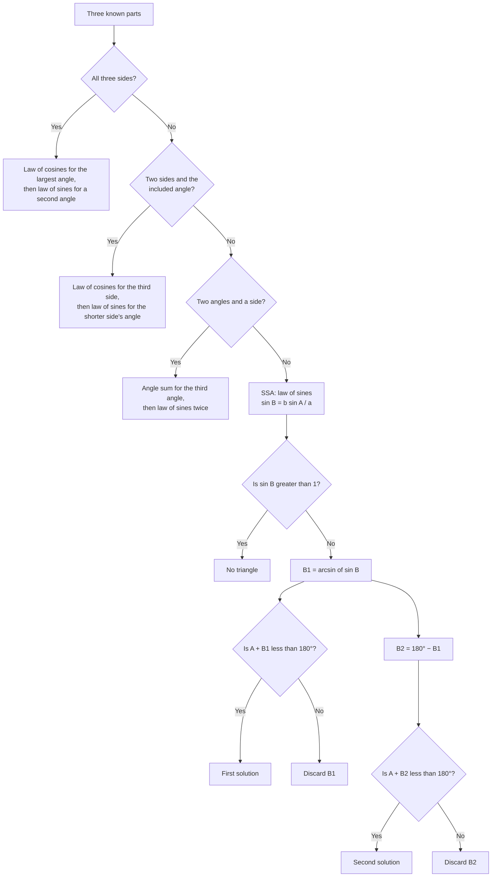
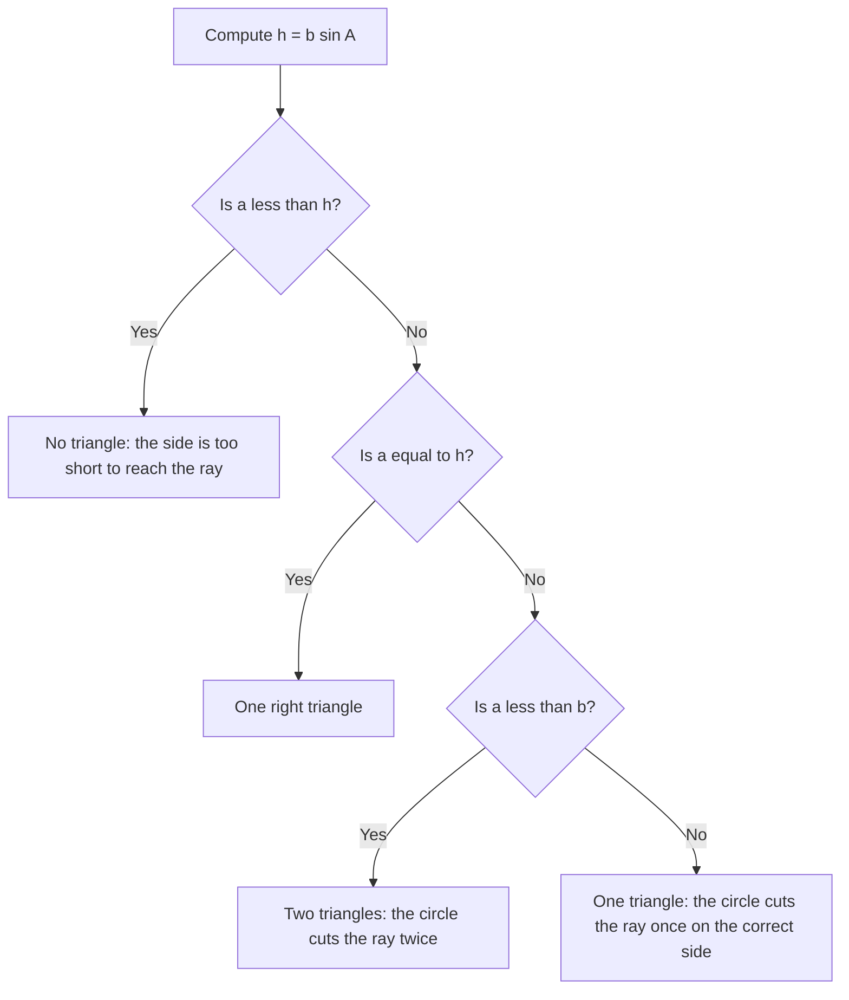

# Triangle Trigonometry

> [Mathematics](../../README.md) › [Trigonometry](../README.md) · Level: Intermediate · Prerequisites: [Trigonometric Functions](../01-trigonometric-functions/README.md), [The Unit Circle and Radian Measure](../02-unit-circle/README.md), [Trigonometric Identities](../03-trigonometric-identities/README.md), [Geometry](../../04-geometry/README.md), [Intermediate Algebra](../../03-algebra/04-intermediate-algebra/README.md) · Estimated time: 480 min

## 1. Introduction

Right-triangle trigonometry answers a narrow question: given an angle and one side of a right
triangle, what are the other sides? That is enough for a ladder against a wall, but not for the
questions that made trigonometry a practical science. A surveyor measuring a plot of land sees no
right angle anywhere. A ship fixing its position from two landmarks sees an oblique triangle. An
astronomer measuring the distance to the Moon from two observatories on Earth uses a triangle whose
base is the Earth's radius and whose apex is the Moon, and none of its angles is a right angle.

Two theorems turn every triangle into a problem about right triangles, and those two theorems are the
subject of this tutorial.

* The **law of sines** says that in any triangle the ratio $\dfrac{a}{\sin A}$ is the same for all
  three sides. It converts an angle–side pair into any other angle or side.
* The **law of cosines** says that $c^2=a^2+b^2-2ab\cos C$. It is the Pythagorean theorem plus a
  correction term that measures how far the angle $C$ is from a right angle, and it handles the case
  where no angle–side pair is known.

Together they solve every triangle that can be solved from three independent measurements, and they
give the area formulas, Heron's formula, the circumradius formula and the parallelogram law for
forces. The same two theorems underlie triangulation, the technique by which a country is mapped and
a satellite constellation is positioned.

Historically, the law of sines was known to Ptolemy in the second century, in the form of a table of
chords of a circle; the law of cosines appears in Euclid's *Elements* (Book II, Propositions 12 and
13) as a statement about squares on sides, a thousand years before the cosine function existed. The
modern algebraic form is a product of the medieval Islamic and later European traditions. The
mathematics in this tutorial is therefore older than the notation it is written in, which is a useful
reminder that the idea is usually simpler than its costume.

## 2. Prerequisites

You should be comfortable with the following.

* **Right-triangle trigonometry.** For a right triangle, $\sin\theta=\dfrac{\text{opposite}}{\text{hypotenuse}}$,
  $\cos\theta=\dfrac{\text{adjacent}}{\text{hypotenuse}}$ and
  $\tan\theta=\dfrac{\text{opposite}}{\text{adjacent}}$, together with the exact values at
  $30^\circ$, $45^\circ$ and $60^\circ$, from
  [Trigonometric Functions](../01-trigonometric-functions/README.md).
* **The unit circle and radian measure.** Angles beyond $90^\circ$, the signs of the trigonometric
  functions by quadrant, and the identity $\sin(\pi-\theta)=\sin\theta$, from
  [The Unit Circle and Radian Measure](../02-unit-circle/README.md).
* **The sum-to-product and supplement identities.** Problems 35 and 36 use them; they are proved in
  [Trigonometric Identities](../03-trigonometric-identities/README.md).
* **The Pythagorean theorem** and similar triangles, from [Geometry](../../04-geometry/README.md).
* **Elementary algebra.** Rearranging formulas, solving quadratic equations, and rationalising
  denominators, from [Intermediate Algebra](../../03-algebra/04-intermediate-algebra/README.md).
* **Inverse trigonometric functions.** The meaning of $\arcsin$, $\arccos$ and $\arctan$ as
  *principal* values, and the fact that $\sin B=\sin(\pi-B)$ has two solutions in $(0,\pi)$.
* **Vectors at an informal level.** A quantity with magnitude and direction, added by the
  parallelogram rule. Section 7.10 develops everything needed; a first meeting with vectors is
  helpful but not essential.

## 3. Learning Objectives

After working through this tutorial you will be able to:

1. State the law of sines and prove it by dropping an altitude, including the case of an obtuse angle.
2. Use the extended form $\dfrac{a}{\sin A}=2R$ to compute the circumradius of a triangle.
3. Analyse a side–side–angle (SSA) configuration completely, deciding whether it has zero, one or two
   solutions, and explain why the ambiguity arises.
4. State the law of cosines and prove it twice: by coordinates and by vectors.
5. Compute the area of a triangle as $\tfrac12ab\sin C$, and derive Heron's formula from the law of
   cosines.
6. Solve any triangle given SSS, SAS, ASA/AAS or SSA, choosing the appropriate law each time.
7. Convert between compass bearings and mathematical angles, and solve navigation problems.
8. Add two forces with the parallelogram law, computing the magnitude and direction of the resultant.
9. Recognise the standard errors — using the law of sines in an SAS case, forgetting the second
   solution, and measuring bearings from the wrong direction.

## 4. Intuition

**Every triangle is two right triangles.** Drop a perpendicular from a vertex to the opposite side,
and the oblique triangle splits into two right triangles sharing that altitude. Every formula in this
chapter is that one observation, applied to a different pair of right triangles. The law of sines
compares the two expressions for the altitude. The law of cosines writes the base as a sum or
difference of two projections. The area formula uses the altitude directly. When a problem looks
hard, drop an altitude and it becomes two right-triangle problems.

**The law of sines is a statement about shape, not size.** In a triangle, the largest side is opposite
the largest angle. The law of sines quantifies that: the ratio $a/\sin A$ is the same for all three
vertices, so doubling every side leaves the ratios unchanged. The common value of the ratio is
$2R$, twice the circumradius, which is the natural "size" of the triangle: the diameter of the
smallest circle that contains it.

**The law of cosines measures departure from a right angle.** If $C=90^\circ$, then $\cos C=0$ and
the law reduces to $c^2=a^2+b^2$, the Pythagorean theorem. For an acute $C$ the cosine is positive
and $c^2$ is *smaller* than $a^2+b^2$: the two sides are folded toward each other, so the opposite
side is short. For an obtuse $C$ the cosine is negative and $c^2$ is *larger*: the sides are opened
out, so the opposite side is long. The term $-2ab\cos C$ is exactly the bookkeeping for that folding
or opening.

**The ambiguous case is a gate, not a mistake.** Suppose you know two sides and an angle that is not
between them. Nail one side down, attach the other side at the given angle, and let its free end swing
like a gate. The far side is a fixed length, so its endpoint sweeps a circle. That circle may miss the
base line entirely, touch it once, cut it once, or cut it twice. Two cuts mean two genuinely different
triangles satisfying the same data. This is not a flaw in the method; it is a fact about triangles
that the law of sines reports honestly as $\sin B=\sin(\pi-B)$.

**Bearings are angles with a convention.** A three-figure bearing is measured clockwise from north,
always written with three digits, so that $060^\circ$ means "sixty degrees east of north". Converting
a bearing into a mathematical angle measured anticlockwise from east is a translation, and most
navigation errors are translation errors.

## 5. Formal Definition

**Definition 5.1 (Triangle and its notation).** A triangle $ABC$ consists of three non-collinear points
$A$, $B$, $C$ and the three segments joining them. The **angles** at the vertices are denoted by the
same capital letters, so $A$ is the angle $\angle BAC$. The **sides** are denoted by the corresponding
lower-case letters: $a=\lvert BC\rvert$ is the side opposite $A$, $b=\lvert CA\rvert$ is opposite $B$,
and $c=\lvert AB\rvert$ is opposite $C$.

Every angle of a non-degenerate triangle satisfies $0<A<\pi$, and the three angles satisfy

$$A+B+C=\pi.$$

Every side is positive and the three sides satisfy the **triangle inequalities**

$$a<b+c,\qquad b<c+a,\qquad c<a+b.$$

Conversely, any three positive numbers satisfying the strict triangle inequalities are the side
lengths of exactly one triangle up to congruence.

**Definition 5.2 (Included angle).** The **included angle** between sides $a$ and $b$ is the angle $C$
at the vertex where those two sides meet. A side and an angle are **opposite** when the side does not
touch the vertex of the angle.

**Definition 5.3 (Solving a triangle).** To **solve** a triangle is to determine all three sides and
all three angles from a sufficient set of given data. A set of data is sufficient when it determines
the triangle up to congruence.

**Definition 5.4 (The six congruence data sets).** Three independent measurements determine a
triangle in the following cases, named by the order of the given parts:

| Name | Given | Determines |
|---|---|---|
| SSS | three sides | one triangle |
| SAS | two sides and the included angle | one triangle |
| ASA | two angles and the included side | one triangle |
| AAS | two angles and a side opposite one of them | one triangle |
| SSA | two sides and an angle opposite one of them | zero, one or two triangles |
| AAA | three angles | a shape, but not a size |

The first four are congruence criteria. AAA determines only the ratios of the sides, so it does not
solve a triangle without an additional length. SSA is the subject of Section 7.4.

**Definition 5.5 (Bearing).** A **three-figure bearing** is the angle measured clockwise from north,
expressed in degrees with three digits before the decimal point. Thus $000^\circ$ is north,
$090^\circ$ is east, $180^\circ$ is south and $270^\circ$ is west. The **back bearing** from $Q$ to
$P$ is the bearing from $P$ to $Q$ plus or minus $180^\circ$.

**Definition 5.6 (Circumcircle and circumradius).** The **circumcircle** of a triangle is the unique
circle through its three vertices; its radius is the **circumradius** $R$. The **inradius** $r$ is the
radius of the inscribed circle, and the **semiperimeter** is $s=\tfrac12(a+b+c)$.

## 6. Mathematical Notation

| Symbol | Read as | Meaning |
|---|---|---|
| $A$, $B$, $C$ | the angles at the vertices | also used for the vertices themselves |
| $a$, $b$, $c$ | the sides | $a$ opposite $A$, $b$ opposite $B$, $c$ opposite $C$ |
| $\lvert AB\rvert$ | length of $AB$ | the distance between the points $A$ and $B$ |
| $K$ | area | used instead of $A$ to avoid a clash with the angle $A$ |
| $s$ | semiperimeter | $s=\tfrac12(a+b+c)$ |
| $R$ | circumradius | radius of the circle through the three vertices |
| $r$ | inradius | radius of the inscribed circle |
| $\angle ABC$ | angle $ABC$ | the angle at $B$ between $BA$ and $BC$ |
| $\pi$ | pi | $180^\circ$; an angle of $\pi$ radians is a straight angle |
| $060^\circ$ | bearing zero six zero | $60^\circ$ clockwise from north |
| $x^\circ\,y'$ | degrees and minutes | $1^\circ=60'$; rarely needed but still used in surveying |
| $\lvert\mathbf{F}\rvert$ | magnitude of $F$ | the size of a force or vector |
| $\theta$ | theta | a generic angle, usually measured from the positive $x$-axis |

Angles are stated in degrees when the problem uses degrees and in radians when the problem uses
radians. A trigonometric function applied to an angle in degrees requires the calculator to be in
degree mode; the formulas themselves are identical in both units.

The notation $a=\lvert BC\rvert$ is used interchangeably with "the side $a$"; in a triangle, the
lower-case letter always refers to the length of the opposite side, never to a vertex.

## 7. Core Concepts

### 7.1 The Angle Sum and the Shape of a Triangle

The single most-used fact about a triangle is

$$A+B+C=\pi.$$

It is proved in [Geometry](../../04-geometry/README.md) by drawing a line through one vertex parallel
to the opposite side: the two alternate interior angles equal $B$ and $C$, and the three angles at the
vertex form a straight line. Two consequences are used constantly.

* **Two angles determine the third.** Given $A$ and $B$, the third is $C=\pi-A-B$. This is why ASA
  and AAS both determine a triangle completely.
* **At most one angle is obtuse or right.** If two angles were at least $\pi/2$, their sum would be
  at least $\pi$, leaving nothing for the third.

The **largest side is opposite the largest angle**. This follows from the law of sines once it is
proved, since $a=2R\sin A$ and sine is increasing on $(0,\pi/2]$ and symmetric about $\pi/2$; it is
also a classical theorem of Euclid. The fact is used in Section 7.8 to choose which angle to compute
first, and in Section 7.4 to count solutions.

### 7.2 The Law of Sines

**Theorem 7.1 (Law of sines).** In every triangle $ABC$,

$$\frac{a}{\sin A}=\frac{b}{\sin B}=\frac{c}{\sin C}.$$

**Proof.** Drop the perpendicular from $C$ to the line $AB$ and let $D$ be its foot; let $h=\lvert CD\rvert$
be the altitude. Two cases arise.

*Case 1: $D$ lies between $A$ and $B$.* Then $ACD$ and $BCD$ are right triangles with hypotenuses $b$
and $a$, and the angles at $A$ and $B$ are the angles of the original triangle. Therefore

$$h=b\sin A\qquad\text{and}\qquad h=a\sin B.$$

Equating the two expressions for $h$,

$$b\sin A=a\sin B,\qquad\text{so}\qquad \frac{a}{\sin A}=\frac{b}{\sin B},$$

because $\sin A$ and $\sin B$ are positive.

*Case 2: one of $A$, $B$ is obtuse.* Suppose $A$ is obtuse. Then the foot $D$ lies outside the segment
$AB$, on the side of $A$. In the right triangle $ACD$ the angle at $A$ is the supplement $\pi-A$, so

$$h=b\sin(\pi-A)=b\sin A,$$

using $\sin(\pi-A)=\sin A$. The right triangle $BCD$ still has angle $B$ at $B$, so $h=a\sin B$.
Equating gives the same conclusion.

Repeating the argument with the altitude dropped from $A$ (or from $B$) gives
$\dfrac{b}{\sin B}=\dfrac{c}{\sin C}$. Hence all three ratios are equal. $\blacksquare$

The proof is worth remembering as a *method*: the altitude is the bridge between two right triangles,
and every oblique-triangle formula in this chapter is obtained by writing the same length in two
ways.

**Corollary 7.2 (Sine form of the area).** The altitude is $h=b\sin A$, so the area is

$$K=\tfrac12 ah=\tfrac12ab\sin C,$$

and cyclically $K=\tfrac12bc\sin A=\tfrac12ca\sin B$.

The corollary is proved independently in Section 7.6, where it is used to derive Heron's formula.

**A note on the ratio.** The law of sines is often written as a statement about proportions:
$\sin A:\sin B:\sin C=a:b:c$. In that form it says that the angles determine the *shape* of the
triangle and the sides determine its *size*.

### 7.3 The Extended Law of Sines and the Circumradius

The common ratio in the law of sines has a geometric meaning: it is the diameter of the circumcircle.

**Theorem 7.3 (Extended law of sines).** For every triangle $ABC$ with circumradius $R$,

$$\frac{a}{\sin A}=\frac{b}{\sin B}=\frac{c}{\sin C}=2R.$$

**Proof.** Let $O$ be the centre of the circumcircle and let $M$ be the midpoint of the chord $BC$. The
radius $OM$ is perpendicular to $BC$, so triangle $BOM$ is right-angled at $M$, with hypotenuse
$OB=R$ and half-chord $BM=a/2$.

It remains to identify the angle at $O$. The **inscribed angle theorem** states that the angle
subtended by a chord at the circumference is half the angle subtended by the same chord at the centre.
It is proved by drawing the radii to the endpoints of the chord and using the fact that a triangle
with two radii is isosceles: the two base angles are equal, and the exterior angle at the centre is
the sum of the two equal base angles.

*If $A$ is acute*, the central angle $\angle BOC$ on the same arc is $2A$. Hence
$\angle BOM=A$, and in the right triangle $BOM$,

$$\frac{a}{2}=BM=R\sin A,\qquad\text{so}\qquad a=2R\sin A.$$

*If $A$ is obtuse*, the inscribed angle subtends the major arc, and the central angle of the minor arc
$BC$ is $2\pi-2A$. Then $\angle BOM=\pi-A$, and

$$\frac{a}{2}=R\sin(\pi-A)=R\sin A,$$

so again $a=2R\sin A$.

*If $A=\pi/2$*, then $BC$ is a diameter, $a=2R$, and $\sin A=1$; the formula holds.

The same argument at the other vertices gives the other two ratios. $\blacksquare$

**Corollary 7.4 (Circumradius formula).** Solving for $R$,

$$R=\frac{a}{2\sin A}=\frac{abc}{4K},$$

where $K$ is the area. The second form follows from $K=\tfrac12bc\sin A$ and $a=2R\sin A$, which give
$K=\dfrac{abc}{4R}$.

The extended law is the fastest way to compute a circumradius, and it is also the reason the
circumcircle appears in problems that seem to have nothing to do with circles.

### 7.4 The Ambiguous Case: Two Sides and a Non-Included Angle

Suppose the data are $A$, $a$ and $b$: an angle, the side opposite it, and another side. The law of
sines gives

$$\sin B=\frac{b\sin A}{a}.$$

This equation determines $\sin B$, not $B$. For every value $y\in(0,1)$ there are **two** angles in
$(0,\pi)$ with sine $y$, namely $B$ and $\pi-B$, and both must be tested against the angle sum
$A+B<\pi$.

**The geometric picture.** Fix the ray from $A$ along which side $c$ lies, and mark $B$ on it with
$AB=c$ unspecified; equivalently, fix side $b=AC$ and angle $A$. The side $a$ is the distance from $C$
to the line through $A$; its endpoint $B$ must lie on a circle of radius $a$ centred at $C$. The line
through $A$ meets that circle in as many points as the geometry allows: none, one (tangency) or two.
Each intersection is a different triangle, and the two intersections on the same side of the foot of
the perpendicular give the two values $B$ and $\pi-B$.

**The complete case analysis.** Let $h=b\sin A$, the perpendicular distance from $C$ to the line
through $A$.

| Given angle $A$ | Condition on $a$ | Number of triangles |
|---|---|---|
| $A<90^\circ$ | $a<h$ | $0$ |
| $A<90^\circ$ | $a=h$ | $1$ (right angle at $B$) |
| $A<90^\circ$ | $h<a<b$ | $2$ |
| $A<90^\circ$ | $a\ge b$ | $1$ |
| $A\ge90^\circ$ | $a\le b$ | $0$ |
| $A\ge90^\circ$ | $a>b$ | $1$ |

**Why the table is correct.** The law of sines gives $\sin B=\dfrac{b\sin A}{a}$.

* If $\dfrac{b\sin A}{a}>1$ there is no angle $B$; this is exactly $a<h$.
* If $\dfrac{b\sin A}{a}=1$ then $B=90^\circ$; this requires $A<90^\circ$ and gives $a=h$.
* If $\dfrac{b\sin A}{a}<1$, the two candidates are $B_1=\arcsin\!\left(\dfrac{b\sin A}{a}\right)\in(0,\pi/2)$
  and $B_2=\pi-B_1$. The candidate $B_1$ is always admissible when $A+B_1<\pi$, which holds because
  $B_1<\pi/2$ and $A<\pi/2$ in the acute case. The candidate $B_2$ is admissible exactly when
  $A+\pi-B_1<\pi$, that is $B_1>A$. Since $\sin B_1=\dfrac{b\sin A}{a}$, the inequality $B_1>A$ is
  equivalent (for acute angles) to $\dfrac{b\sin A}{a}>\sin A$, that is $b>a$. Hence two solutions
  exactly when $a<b$, one when $a\ge b$.
* If $A\ge90^\circ$, then $B<\pi-A\le\pi/2$, so only the acute candidate can occur, and it must also
  satisfy $a>b$ because the side opposite the largest angle is the largest side.

**What to do in practice.** Compute $\sin B$. If it exceeds $1$, report no solution. Otherwise
compute $B_1=\arcsin(\sin B)$ and test $B_2=\pi-B_1$ by checking $A+B_2<\pi$. For each admissible
angle, compute $C=\pi-A-B$ and $c=\dfrac{a\sin C}{\sin A}$.

### 7.5 The Law of Cosines

**Theorem 7.5 (Law of cosines).** In every triangle $ABC$,

$$c^2=a^2+b^2-2ab\cos C,$$

and cyclically

$$a^2=b^2+c^2-2bc\cos A,\qquad b^2=c^2+a^2-2ca\cos B.$$

**Proof 1 (coordinates).** Place $C$ at the origin, put $B$ on the positive $x$-axis at $(a,0)$, and
let $A$ be the point at distance $b$ from $C$ making angle $C$ with the positive $x$-axis. By the
definition of cosine and sine on the unit circle,

$$A=(b\cos C,\ b\sin C).$$

The side $c$ is the distance from $A$ to $B$, so

$$\begin{aligned}
c^2&=(b\cos C-a)^2+(b\sin C-0)^2\\
&=b^2\cos^2C-2ab\cos C+a^2+b^2\sin^2C\\
&=a^2+b^2-2ab\cos C,
\end{aligned}$$

using $\cos^2C+\sin^2C=1$. The computation is valid for every $C\in(0,\pi)$: when $C$ is obtuse,
$\cos C$ is negative and the formula correctly makes $c^2$ larger than $a^2+b^2$. $\blacksquare$

**Proof 2 (vectors).** Let $\mathbf{u}=\overrightarrow{CA}$ and $\mathbf{v}=\overrightarrow{CB}$. Then
$\lvert\mathbf{u}\rvert=b$, $\lvert\mathbf{v}\rvert=a$, and the angle between $\mathbf{u}$ and
$\mathbf{v}$ is $C$. The side $c$ is the length of $\overrightarrow{AB}=\mathbf{v}-\mathbf{u}$, so

$$\begin{aligned}
c^2&=\lvert\mathbf{v}-\mathbf{u}\rvert^2\\
&=\lvert\mathbf{v}\rvert^2+\lvert\mathbf{u}\rvert^2-2\,\mathbf{u}\cdot\mathbf{v}\\
&=a^2+b^2-2ab\cos C,
\end{aligned}$$

because the dot product of two vectors is the product of their lengths times the cosine of the angle
between them. $\blacksquare$

**Remark 7.6 (Pythagorean decomposition).** Drop the altitude from $A$ to the line $BC$ and let $D$ be
its foot. Then $CD=b\cos C$ and $AD=b\sin C$ (with signs, if $C$ is obtuse). The base $DB$ has length
$a-b\cos C$ when $D$ lies between $C$ and $B$, and $a+\lvert b\cos C\rvert$ when $C$ is obtuse — which
is the same expression because $\cos C<0$. Pythagoras in the right triangle $ADB$ gives

$$c^2=AD^2+DB^2=b^2\sin^2C+(a-b\cos C)^2=a^2+b^2-2ab\cos C.$$

This is the form in which Euclid proved the result: the square on the side opposite an acute angle is
less than the sum of the squares on the other two sides, and the deficit is twice the rectangle
contained by one side and the projection of the other upon it.

**Corollary 7.7 (Angle form).** Solving for the cosine,

$$\cos C=\frac{a^2+b^2-c^2}{2ab}.$$

This is the practical form when all three sides are known. The sign of the cosine classifies the
triangle: $c^2<a^2+b^2$ means $C$ is acute, $c^2=a^2+b^2$ means $C$ is right, and $c^2>a^2+b^2$
means $C$ is obtuse.

### 7.6 Area Formulas

**Proposition 7.8.** For every triangle,

$$K=\tfrac12ab\sin C=\tfrac12bc\sin A=\tfrac12ca\sin B.$$

**Proof.** Take $BC$ as the base, of length $a$, and drop the altitude from $A$ to the line $BC$. In
the right triangle formed with side $b$, the altitude is $h=b\sin C$ (or $b\sin(\pi-C)=b\sin C$ if
$C$ is obtuse). Therefore

$$K=\tfrac12\cdot\text{base}\cdot\text{height}=\tfrac12 a\cdot b\sin C.$$

The cyclic permutations give the other two forms. $\blacksquare$

**Proposition 7.9 (Circumradius form).** $K=\dfrac{abc}{4R}$.

**Proof.** From $a=2R\sin A$ we get $\sin A=\dfrac{a}{2R}$. Substituting into
$K=\tfrac12bc\sin A$,

$$K=\tfrac12bc\cdot\frac{a}{2R}=\frac{abc}{4R}. \qquad\blacksquare$$

**Proposition 7.10 (Inradius form).** $K=rs$, where $s=\tfrac12(a+b+c)$ is the semiperimeter.

**Proof.** Join the incentre to the three vertices. The triangle is split into three triangles, each
with height $r$ and bases $a$, $b$, $c$ respectively. Hence

$$K=\tfrac12ar+\tfrac12br+\tfrac12cr=\tfrac12(a+b+c)r=rs. \qquad\blacksquare$$

**Proposition 7.11 (Two angles and the circumradius).** $K=2R^2\sin A\sin B\sin C$.

**Proof.** Substitute $a=2R\sin A$ and $b=2R\sin B$ into $K=\tfrac12ab\sin C$:

$$K=\tfrac12(2R\sin A)(2R\sin B)\sin C=2R^2\sin A\sin B\sin C. \qquad\blacksquare$$

### 7.7 Heron's Formula

Heron's formula computes the area from the three sides alone, with no angle and no altitude.

**Theorem 7.12 (Heron).** If $s=\tfrac12(a+b+c)$, then

$$K=\sqrt{s(s-a)(s-b)(s-c)}.$$

**Proof.** Start from the area formula and square it:

$$K=\tfrac12ab\sin C\quad\Longrightarrow\quad 16K^2=4a^2b^2\sin^2C.$$

Replace $\sin^2C$ by $1-\cos^2C$:

$$16K^2=4a^2b^2-4a^2b^2\cos^2C=4a^2b^2-(2ab\cos C)^2.$$

The law of cosines gives $2ab\cos C=a^2+b^2-c^2$. Substituting,

$$16K^2=4a^2b^2-(a^2+b^2-c^2)^2.$$

The right side is a difference of squares, $X^2-Y^2=(X-Y)(X+Y)$, with $X=2ab$ and
$Y=a^2+b^2-c^2$:

$$\begin{aligned}
16K^2&=\bigl(2ab-a^2-b^2+c^2\bigr)\bigl(2ab+a^2+b^2-c^2\bigr)\\
&=\bigl(c^2-(a-b)^2\bigr)\bigl((a+b)^2-c^2\bigr)\\
&=(c-a+b)(c+a-b)(a+b-c)(a+b+c).
\end{aligned}$$

Now express each factor through the semiperimeter:
$c-a+b=2(s-a)$, $c+a-b=2(s-b)$, $a+b-c=2(s-c)$ and $a+b+c=2s$. Therefore

$$16K^2=16\,s(s-a)(s-b)(s-c),$$

and taking the positive square root (the area is positive) gives the formula. $\blacksquare$

**Remarks.**

* Each factor $s-a$, $s-b$, $s-c$ is positive precisely when the triangle inequalities hold, so the
  radicand is non-negative exactly for genuine triangles. A degenerate triangle with $a+b=c$ gives
  $s-c=0$ and area $0$, as it should.
* Heron's formula is numerically unstable when one side is much longer than the others; practical
  implementations use the equivalent symmetric form
  $16K^2=(a+b+c)(-a+b+c)(a-b+c)(a+b-c)$ or Kahan's rearrangement.
* The formula is attributed to Heron of Alexandria (first century), though it may be older; an
  equivalent statement appears in Chinese mathematics in the *Nine Chapters*.

### 7.8 Solving General Triangles

The four solvable cases have a fixed order of operations. The table is the algorithm.

| Case | Given | First step | Second step | Third step |
|---|---|---|---|---|
| SSS | $a,b,c$ | largest angle by law of cosines | either remaining angle by law of sines | third angle by $A+B+C=\pi$ |
| SAS | $a,b,C$ | third side by law of cosines | angle opposite the shorter known side by law of sines | third angle by the sum |
| ASA | $A,B,c$ | third angle by the sum | $a$ by law of sines | $b$ by law of sines |
| AAS | $A,B,a$ | third angle by the sum | $b$ by law of sines | $c$ by law of sines |
| SSA | $A,a,b$ | $\sin B=\dfrac{b\sin A}{a}$ | classify by Section 7.4 | for each solution, $C$ then $c$ |

**Why the largest angle first in SSS.** The law of cosines returns an angle in $[0,\pi]$ without
ambiguity, so it is exact for any angle. The law of sines, applied afterwards, returns an angle in
$[0,\pi/2]$; if the true angle were obtuse, the arcsine would give the supplement. Computing the
largest angle first ensures that the remaining two angles are acute, so the arcsine is correct for
them.

**Why the shorter side's angle first in SAS.** After the third side is found, the two angles still
unknown are both opposite known sides. The angle opposite the shorter side is the smaller angle, hence
acute, so the arcsine returns it directly. The remaining angle is then found by subtraction.

**Precision.** Carry all intermediate values at full precision and round only at the end. An angle
rounded to one decimal place and then used to compute a side can shift the side in the second
decimal place, which is unacceptable in surveying.

### 7.9 Bearings and Navigation

A bearing describes a direction as an angle from north, measured clockwise.

* **Three-figure bearing:** $055^\circ$ means $55^\circ$ east of north. North is $000^\circ$, east
  $090^\circ$, south $180^\circ$, west $270^\circ$.
* **Back bearing:** the bearing from $Q$ to $P$ when the bearing from $P$ to $Q$ is $\beta$ is
  $\beta+180^\circ$ if $\beta<180^\circ$, and $\beta-180^\circ$ otherwise. In one line,
  $\beta+180^\circ\pmod{360^\circ}$.
* **Mathematical angle:** measured anticlockwise from east. A bearing $\beta$ corresponds to the
  mathematical angle $90^\circ-\beta$ modulo $360^\circ$.

**The standard method.** Draw a clear diagram. Mark north at every point where a course changes.
At a turning point, the interior angle of the triangle is found by comparing the back bearing of the
incoming leg with the forward bearing of the outgoing leg. Then apply the law of cosines or the law of
sines to the resulting triangle.

**Example of the angle computation.** A ship sails from $P$ on bearing $060^\circ$ to $Q$ and then on
bearing $150^\circ$ to $R$. At $Q$, the direction back to $P$ is the back bearing $240^\circ$, and the
direction to $R$ is $150^\circ$. The interior angle is the difference
$240^\circ-150^\circ=90^\circ$. The triangle $PQR$ therefore has a right angle at $Q$, and Pythagoras
computes $PR$.

Bearings are the natural language of navigation because a compass measures from north, while
trigonometry is easier in angles measured from east. Every navigation problem begins with a
translation between the two.

### 7.10 Forces and Vectors

A force is a vector: it has a magnitude in newtons and a direction. Two forces acting at a point add
by the **parallelogram law**: complete the parallelogram whose sides represent the forces, and the
diagonal from the common point represents the resultant.

**Proposition 7.13 (Magnitude of a resultant).** If two forces of magnitudes $F_1$ and $F_2$ act at a
point with angle $\theta$ between their directions, the resultant has magnitude

$$R=\sqrt{F_1^2+F_2^2+2F_1F_2\cos\theta}.$$

**Proof.** In the parallelogram, the diagonal cuts it into two congruent triangles. One of them has
sides $F_1$ and $F_2$ with included angle $\pi-\theta$, because adjacent angles of a parallelogram are
supplementary. The law of cosines gives

$$R^2=F_1^2+F_2^2-2F_1F_2\cos(\pi-\theta)=F_1^2+F_2^2+2F_1F_2\cos\theta,$$

since $\cos(\pi-\theta)=-\cos\theta$. $\blacksquare$

**Direction.** The angle $\alpha$ between the resultant and the force $F_2$ is found from the law of
sines in the same triangle:

$$\frac{\sin\alpha}{F_1}=\frac{\sin(\pi-\theta)}{R}=\frac{\sin\theta}{R}.$$

**Equilibrium.** Three forces acting at a point are in equilibrium exactly when their vectors form a
closed triangle. The magnitudes then satisfy the law of cosines with the *supplements* of the angles
between the forces, which is why equilibrium problems are often solved by drawing the force triangle
rather than the parallelogram.

The vector viewpoint also explains the law of cosines itself: it is the expansion of
$\lvert\mathbf{v}-\mathbf{u}\rvert^2$. Section 7.5 proved it that way.

## 8. Formulas and Properties

| Name | Formula | Hypotheses | Use when |
|---|---|---|---|
| Law of sines | $\dfrac{a}{\sin A}=\dfrac{b}{\sin B}=\dfrac{c}{\sin C}$ | any triangle | a side–angle pair is known |
| Extended law of sines | $\dfrac{a}{\sin A}=2R$ | any triangle, $R$ circumradius | a circumradius or a circumcircle appears |
| Law of cosines, side | $c^2=a^2+b^2-2ab\cos C$ | any triangle | SAS, or SSS to find an angle |
| Law of cosines, angle | $\cos C=\dfrac{a^2+b^2-c^2}{2ab}$ | any triangle | SSS |
| Area, two sides | $K=\tfrac12ab\sin C$ | $a,b$ and included $C$ | area from SAS |
| Area, three sides | $K=\sqrt{s(s-a)(s-b)(s-c)}$ | $s=\tfrac12(a+b+c)$ | area from SSS |
| Area, circumradius | $K=\dfrac{abc}{4R}=2R^2\sin A\sin B\sin C$ | any triangle | $R$ is known |
| Area, inradius | $K=rs$ | $r$ inradius | $r$ is known |
| Circumradius | $R=\dfrac{a}{2\sin A}=\dfrac{abc}{4K}$ | any triangle | circumcircle problems |
| Inradius | $r=\dfrac{K}{s}$ | any triangle | inscribed circle problems |
| Resultant | $R=\sqrt{F_1^2+F_2^2+2F_1F_2\cos\theta}$ | angle $\theta$ between the forces | adding two forces |
| Projection | $a=b\cos C+c\cos B$ | any triangle, signed cosines | resolving a side |

Three special cases deserve to be stated separately because they are used as checks.

* **Right triangle.** If $C=\pi/2$, the law of cosines becomes $c^2=a^2+b^2$ and the law of sines
  becomes $a=c\sin A$, which is the definition of sine in a right triangle. Both laws contain
  right-triangle trigonometry as a special case.
* **Equilateral triangle.** If $a=b=c$, the law of cosines gives $\cos C=\tfrac12$, so every angle is
  $\pi/3$, and the area is $\tfrac{\sqrt3}{4}a^2$.
* **Degenerate triangle.** If $a+b=c$, the area is $0$, and the law of cosines gives $\cos C=-1$,
  that is $C=\pi$. The formulas report the degeneration correctly.

## 9. Step-by-Step Examples

### Example 9.1: AAS by the Law of Sines

**Problem.** In triangle $ABC$, $A=35^\circ$, $B=65^\circ$ and $a=8$ cm. Solve the triangle.

**Solution.** The third angle follows from the angle sum:

$$C=180^\circ-35^\circ-65^\circ=80^\circ.$$

Now the law of sines gives each unknown side from the known pair $(a,A)$:

$$b=\frac{a\sin B}{\sin A}=\frac{8\sin65^\circ}{\sin35^\circ}
=\frac{8(0.90631)}{0.57358}=12.641\ \text{cm},$$

$$c=\frac{a\sin C}{\sin A}=\frac{8\sin80^\circ}{\sin35^\circ}
=\frac{8(0.98481)}{0.57358}=13.736\ \text{cm}.$$

**Answer.** $C=80^\circ$, $b\approx12.64$ cm, $c\approx13.74$ cm.

**Check.** The largest side is $c$, opposite the largest angle $C=80^\circ$; the smallest is $a$,
opposite $A=35^\circ$. Also $a+b=20.64>13.74=c$, so the triangle inequality holds.

### Example 9.2: SAS by the Law of Cosines

**Problem.** In triangle $ABC$, $a=7$, $b=10$ and $C=55^\circ$. Solve the triangle and find its area.

**Solution.** The law of cosines gives the third side:

$$\begin{aligned}
c^2&=a^2+b^2-2ab\cos C\\
&=49+100-2(7)(10)(0.57358)\\
&=149-80.301=68.699,
\end{aligned}$$

so $c=\sqrt{68.699}=8.2885$.

Now use the law of cosines again for one angle; this avoids any ambiguity:

$$\cos A=\frac{b^2+c^2-a^2}{2bc}
=\frac{100+68.699-49}{2(10)(8.2885)}
=\frac{119.699}{165.770}=0.72208,$$

so $A=\arccos(0.72208)=43.77^\circ$. Then

$$B=180^\circ-55^\circ-43.77^\circ=81.23^\circ.$$

The area is

$$K=\tfrac12ab\sin C=\tfrac12(7)(10)(0.81915)=28.67.$$

**Answer.** $c\approx8.289$, $A\approx43.77^\circ$, $B\approx81.23^\circ$, $K\approx28.67$.

**Check.** The angle $B=81.23^\circ$ is opposite $b=10$, the largest side, as required. The law of
sines gives $c/\sin C=8.2885/0.81915=10.118$ and $a/\sin A=7/0.69176=10.119$; the last digit differs
by rounding.

### Example 9.3: Heron, Inradius and Circumradius

**Problem.** A triangle has sides $13$, $14$ and $15$. Find its area, inradius and circumradius.

**Solution.** The semiperimeter is

$$s=\frac{13+14+15}{2}=21.$$

Heron's formula gives

$$K=\sqrt{21(21-13)(21-14)(21-15)}=\sqrt{21\cdot8\cdot7\cdot6}=\sqrt{7056}=84.$$

The inradius is

$$r=\frac{K}{s}=\frac{84}{21}=4,$$

and the circumradius is

$$R=\frac{abc}{4K}=\frac{13\cdot14\cdot15}{4\cdot84}=\frac{2730}{336}=8.125.$$

**Answer.** $K=84$, $r=4$, $R=8.125$.

**Check.** The extended law of sines gives $\sin A=\dfrac{13}{2R}=\dfrac{13}{16.25}=0.8$, so
$A=\arcsin0.8=53.13^\circ$; similarly $\sin B=\dfrac{14}{16.25}=0.86154$, giving $B=59.49^\circ$,
and $\sin C=\dfrac{15}{16.25}=0.92308$, giving $C=67.38^\circ$. The three angles sum to
$180.00^\circ$. The triangle is acute, and its area computed as
$\tfrac12(13)(14)\sin C=\tfrac12(13)(14)(0.92308)=84.0$ agrees.

### Example 9.4: The Ambiguous Case with Two Solutions

**Problem.** In triangle $ABC$, $a=12$, $b=15$ and $A=40^\circ$. Determine how many triangles
satisfy the data and solve each.

**Solution.** By the law of sines,

$$\sin B=\frac{b\sin A}{a}=\frac{15\sin40^\circ}{12}=\frac{15(0.64279)}{12}=0.80349.$$

Since $0<0.80349<1$, there are two candidate angles:

$$B_1=\arcsin(0.80349)=53.46^\circ,\qquad B_2=180^\circ-53.46^\circ=126.54^\circ.$$

Both must be tested against the angle sum.

*For $B_1=53.46^\circ$:* $A+B_1=93.46^\circ<180^\circ$, so this is valid. Then
$C_1=180^\circ-40^\circ-53.46^\circ=86.54^\circ$ and

$$c_1=\frac{a\sin C_1}{\sin A}=\frac{12\sin86.54^\circ}{\sin40^\circ}
=\frac{12(0.99818)}{0.64279}=18.635.$$

*For $B_2=126.54^\circ$:* $A+B_2=166.54^\circ<180^\circ$, so this is also valid. Then
$C_2=180^\circ-40^\circ-126.54^\circ=13.46^\circ$ and

$$c_2=\frac{12\sin13.46^\circ}{\sin40^\circ}=\frac{12(0.23277)}{0.64279}=4.347.$$

**Answer.** Two triangles:

| Solution | $B$ | $C$ | $c$ |
|---|---|---|---|
| 1 | $53.46^\circ$ | $86.54^\circ$ | $18.635$ |
| 2 | $126.54^\circ$ | $13.46^\circ$ | $4.347$ |

**Check.** The condition $h<a<b$ holds: $h=b\sin A=15(0.64279)=9.642$, and
$9.642<12<15$, which is exactly the two-solution row of the table in Section 7.4. The second
triangle is very thin, with $C$ only $13.46^\circ$, which is why its side $c$ is short.

### Example 9.5: SSS

**Problem.** Solve the triangle with sides $a=8$, $b=11$, $c=14$.

**Solution.** Compute the largest angle first, which is $C$ because $c$ is the largest side:

$$\cos C=\frac{a^2+b^2-c^2}{2ab}=\frac{64+121-196}{2(8)(11)}=\frac{-11}{176}=-0.0625.$$

Thus $C=\arccos(-0.0625)=93.58^\circ$, obtuse as expected.

Now compute $A$ with the law of cosines (or with the law of sines, which is safe because $A$ is not
the largest angle):

$$\cos A=\frac{b^2+c^2-a^2}{2bc}=\frac{121+196-64}{2(11)(14)}=\frac{253}{308}=0.82143,$$

so $A=34.77^\circ$. Finally

$$B=180^\circ-93.58^\circ-34.77^\circ=51.64^\circ.$$

**Answer.** $A\approx34.77^\circ$, $B\approx51.64^\circ$, $C\approx93.58^\circ$.

**Check.** $a/\sin A=8/0.57039=14.026$, $b/\sin B=11/0.78401=14.030$,
$c/\sin C=14/0.99799=14.028$; the three ratios agree to three decimal places.

### Example 9.6: A Bearing Problem

**Problem.** A ship sails $20$ km from port $P$ on a bearing of $060^\circ$ to point $Q$, then
$15$ km on a bearing of $150^\circ$ to point $R$. Find the distance $PR$ and the bearing of $R$ from
$P$.

**Solution.** At $Q$, the back bearing to $P$ is $060^\circ+180^\circ=240^\circ$, and the forward
bearing to $R$ is $150^\circ$. The interior angle of triangle $PQR$ at $Q$ is therefore

$$\angle PQR=240^\circ-150^\circ=90^\circ.$$

The triangle is right-angled at $Q$, so

$$PR=\sqrt{20^2+15^2}=\sqrt{400+225}=\sqrt{625}=25\ \text{km}.$$

For the bearing, set up compass coordinates with north as the $y$-axis and east as the $x$-axis:

$$Q=(20\sin60^\circ,\ 20\cos60^\circ)=(17.3205,\ 10),$$

$$R=Q+(15\sin150^\circ,\ 15\cos150^\circ)=(17.3205+7.5,\ 10-12.9904)=(24.8205,\ -2.9904).$$

The bearing of $R$ from $P$ is the angle clockwise from north:

$$\tan\beta=\frac{\text{east}}{\text{north}}=\frac{24.8205}{-2.9904},$$

so $\beta=180^\circ-83.13^\circ=96.87^\circ$. Equivalently, the angle at $P$ inside the triangle is
$\arctan(15/20)=36.87^\circ$, and the bearing of $PR$ is $60^\circ+36.87^\circ=96.87^\circ$.

**Answer.** $PR=25$ km, bearing $096.9^\circ$ (three-figure bearing $097^\circ$).

**Check.** $\sqrt{24.8205^2+2.9904^2}=\sqrt{616.06+8.94}=\sqrt{625}=25$. The back bearing is
$96.87^\circ+180^\circ=276.87^\circ$.

### Example 9.7: Two Forces

**Problem.** Two forces of $30$ N and $40$ N act at a point with an angle of $70^\circ$ between them.
Find the magnitude of the resultant and the angle it makes with the $40$ N force.

**Solution.** By Proposition 7.13,

$$\begin{aligned}
R^2&=30^2+40^2+2(30)(40)\cos70^\circ\\
&=900+1600+2400(0.34202)\\
&=2500+820.85=3320.85,
\end{aligned}$$

so $R=57.627$ N.

Let $\alpha$ be the angle between the resultant and the $40$ N force. In the force triangle the side
opposite $\alpha$ is the $30$ N force, and the angle opposite $R$ is $180^\circ-70^\circ=110^\circ$.
The law of sines gives

$$\frac{\sin\alpha}{30}=\frac{\sin110^\circ}{57.627},$$

so

$$\sin\alpha=\frac{30(0.93969)}{57.627}=0.48910,\qquad \alpha=29.29^\circ.$$

**Answer.** $R\approx57.63$ N, making $29.29^\circ$ with the $40$ N force and
$70^\circ-29.29^\circ=40.71^\circ$ with the $30$ N force.

**Check.** The three angles of the force triangle are $110^\circ$, $29.29^\circ$ and
$180^\circ-110^\circ-29.29^\circ=40.71^\circ$, summing to $180^\circ$. The resultant is closer to the
larger force, as expected.

### Example 9.8: The Circumradius

**Problem.** In triangle $ABC$, $a=13$, $A=60^\circ$ and $b=10$. Find the circumradius $R$, the
angle $B$, and the area $K$.

**Solution.** By the extended law of sines,

$$R=\frac{a}{2\sin A}=\frac{13}{2\sin60^\circ}=\frac{13}{\sqrt3}=7.5056.$$

For $B$, use $\dfrac{b}{\sin B}=2R$:

$$\sin B=\frac{b}{2R}=\frac{10}{15.0111}=0.66617,$$

so $B=41.77^\circ$ (the acute solution) or $B=138.23^\circ$. The obtuse solution is impossible
because $A+B=60^\circ+138.23^\circ=198.23^\circ>180^\circ$. Hence $B=41.77^\circ$ and
$C=180^\circ-60^\circ-41.77^\circ=78.23^\circ$.

The area follows from $K=2R^2\sin A\sin B\sin C$:

$$K=2(7.5056)^2(0.86603)(0.66617)(0.97887)=63.63.$$

Alternatively, $c=2R\sin C=15.0111(0.97887)=14.694$, and
$K=\tfrac12ab\sin C=\tfrac12(13)(10)(0.97887)=63.63$. The two routes agree.

**Answer.** $R=\dfrac{13}{\sqrt3}\approx7.506$, $B\approx41.77^\circ$, $C\approx78.23^\circ$,
$K\approx63.63$.

**Check.** $\dfrac{b}{\sin B}=\dfrac{10}{0.66617}=15.011$ and $\dfrac{a}{\sin A}=15.011$, so the
extended law holds. The side $c\approx14.69$ is the largest side, opposite the largest angle
$C=78.23^\circ$, which is consistent.

## 10. Visual Explanations

### 10.1 Choosing a Method

The first question is always "which parts are given?". The diagram is the algorithm of Section 7.8
drawn as a decision tree; the SSA branch expands into the case analysis of Section 7.4.

### 10.2 The SSA Gate

The ambiguous case can be pictured as a gate. The segment $AC$ of length $b$ is fixed, the ray from
$A$ makes angle $A$ with the base line, and the side $a$ is a circle of radius $a$ about $C$. The
number of intersections of the circle with the ray is the number of triangles.

### 10.3 The Data-to-Formula Table

| Given | Unknown to find first | Formula | Then |
|---|---|---|---|
| $a,b,c$ | largest angle | $\cos C=\dfrac{a^2+b^2-c^2}{2ab}$ | law of sines or cosines for a second angle |
| $a,b,C$ | side $c$ | $c^2=a^2+b^2-2ab\cos C$ | law of sines for the angle opposite the shorter side |
| $A,B,c$ | angle $C$ | $C=\pi-A-B$ | $a=\dfrac{c\sin A}{\sin C}$, $b=\dfrac{c\sin B}{\sin C}$ |
| $A,B,a$ | angle $C$ | $C=\pi-A-B$ | $b=\dfrac{a\sin B}{\sin A}$, $c=\dfrac{a\sin C}{\sin A}$ |
| $A,a,b$ | angle $B$ | $\sin B=\dfrac{b\sin A}{a}$ | classify as in Section 7.4 |
| $a,b,c$ and area | $K$ | $K=\sqrt{s(s-a)(s-b)(s-c)}$ | $R=\dfrac{abc}{4K}$, $r=\dfrac{K}{s}$ |

## 11. Common Mistakes

**Mistake 1: using the law of sines when the angle is included.** In an SAS configuration there is no
side–angle pair, so the law of sines cannot start the solution. Use the law of cosines for the third
side first. Trying to force the law of sines produces an equation with two unknowns.

**Mistake 2: forgetting the second solution of an SSA problem.** A calculator returns
$\arcsin(0.8035)=53.46^\circ$ and stops. The angle $126.54^\circ$ has the same sine and may also form
a triangle. Always test the supplement.

**Mistake 3: treating the ambiguous case as always ambiguous.** SSA has two solutions only when the
given angle is acute and $h<a<b$. When $a\ge b$ there is exactly one triangle, and when $A\ge90^\circ$
and $a\le b$ there is none. The table in Section 7.4 settles the count before any solving.

**Mistake 4: taking the arcsine of the largest angle.** In an SSS problem, the law of sines applied to
the largest angle returns an acute angle, while the true angle is obtuse. Compute the largest angle
with the law of cosines, which is unambiguous.

**Mistake 5: measuring a bearing from east instead of north.** A bearing of $060^\circ$ is not
$60^\circ$ above the positive $x$-axis; it is $60^\circ$ east of north, which is a mathematical angle
of $30^\circ$. Draw the north line at every point.

**Mistake 6: using the forward bearing where the back bearing is needed.** At a turning point, the
interior angle of the triangle uses the direction *back* along the previous leg, which is the previous
bearing plus or minus $180^\circ$.

**Mistake 7: writing the law of cosines with the wrong side.** The side on the left must be the one
opposite the angle on the right: $c^2=a^2+b^2-2ab\cos C$, not $a^2=b^2+c^2-2bc\cos C$ unless the
letters are matched correctly. When in doubt, relabel the triangle so that the unknown side is $c$.

**Mistake 8: using the full perimeter instead of the semiperimeter in Heron's formula.** The formula
is $K=\sqrt{s(s-a)(s-b)(s-c)}$ with $s=\tfrac12(a+b+c)$. Substituting $a+b+c$ for $s$ gives the wrong
answer by a factor of $\sqrt2$ in the argument of the root.

**Mistake 9: forgetting the angle sum uses radians or degrees consistently.** In a triangle,
$A+B+C=\pi$ radians $=180^\circ$. Mixing the two in one computation is a common source of nonsense.

**Mistake 10: rounding intermediate results.** Compute the third side to full precision, then the
angles. Rounding $c$ to two decimals before using it in an arcsine can change the angle by a tenth of
a degree.

**Mistake 11: assuming a triangle exists.** The data may describe no triangle at all, as in
$a=6$, $b=12$, $A=35^\circ$ (because $\sin B>1$), or as in $a=1$, $b=2$, $c=5$ (violating the triangle
inequality). Check existence before computing.

**Mistake 12: adding forces as scalars.** Two forces of $30$ N and $40$ N do not generally produce
$70$ N. They produce $70$ N only when they act in the same direction, and $10$ N when they act in
opposite directions. The general rule is the parallelogram law.

## 12. Applications

### 12.1 Surveying and Triangulation

A surveyor cannot measure long distances directly, but can measure angles precisely. Fixing a base
line of known length and measuring the angles to a distant point determines the distance to that
point by the law of sines. Repeating the process from point to point is **triangulation**, the method
by which national maps were made from the eighteenth century onward. The Great Trigonometrical Survey of
India, completed in the nineteenth century, chained triangles tens of kilometres on a side across the
subcontinent, measuring angles to a small fraction of a degree.

### 12.2 Navigation

A ship or aircraft has a heading (the direction in which it points) and a track (the direction in
which it actually moves). Wind or current creates a **wind triangle** whose sides are the airspeed
vector, the wind vector and the ground-speed vector. The law of sines gives the crab angle and the
ground speed; the law of cosines gives the ground speed directly when the wind angle is known. Every
flight computer performs exactly these calculations.

### 12.3 Astronomy and Parallax

The distance to a nearby star is measured by observing it from two positions of the Earth six months
apart. The star appears to shift against the background by an angle $p$, the **parallax**. With a
baseline $b$ equal to the diameter of the Earth's orbit, the distance is approximately
$d\approx b/p$ for small $p$, a consequence of the law of sines in a very thin isosceles triangle.
The same idea, with a baseline of two observatories, gives the distance to the Moon; with a baseline
of the Earth's radius, it gives the distance to the Sun.

### 12.4 Engineering Structures

A truss is a network of triangles because a triangle is the only polygon that cannot be deformed
without changing the length of a side. The forces in the members are found by resolving at each joint,
and every joint is a parallelogram of forces. The law of sines in the force triangle gives the
magnitudes directly.

### 12.5 Robotics and Computer Graphics

A robot arm is a chain of segments with known lengths and measured joint angles. The position of the
end effector is computed by **forward kinematics**, which is a sequence of triangle computations: each
segment is a side of a triangle, and the law of cosines converts joint angles into Cartesian
coordinates. Inverse kinematics runs the computation backwards, and its ambiguity — several joint
configurations reaching the same point — is the same ambiguity as the SSA case, arising from
$\sin B=\sin(\pi-B)$.

### 12.6 Geodesy and GPS

Satellite positioning measures distances from four satellites and solves for a position by
intersecting spheres. The planar version of the same problem is resection by distances, solved with
the law of cosines in each triangle of a triangulated network. Over large distances the Earth's
curvature forces a move from plane trigonometry to spherical trigonometry, where the law of sines and
the law of cosines take spherical forms; the planar formulas of this chapter are the small-triangle
limit.

## 13. Exercises

The problem set is in [exercises.md](exercises.md). It contains 37 problems, grouped into Beginner,
Intermediate, Advanced and Challenge. The beginner problems apply one law at a time; the intermediate
problems require choosing a method and handling the ambiguous case; the advanced problems ask for
proofs of the laws and for multi-step applications; the challenge problems are competition-style.

## 14. Solutions

Full worked solutions are in [solutions.md](solutions.md). Each solution names the case (SSS, SAS,
ASA, AAS or SSA), shows every algebraic step, states the number of solutions when the case is
ambiguous, and checks the answer against the angle sum and the law of sines.

## 15. Summary

* In a triangle, $A+B+C=\pi$; the largest side is opposite the largest angle.
* **Law of sines:** $\dfrac{a}{\sin A}=\dfrac{b}{\sin B}=\dfrac{c}{\sin C}$. Proof: drop an altitude
  and write it as $b\sin A=a\sin B$.
* **Extended law of sines:** the common ratio is $2R$, twice the circumradius.
* **SSA is ambiguous** when the given angle is acute and $h=b\sin A<a<b$; then both $B$ and
  $\pi-B$ may be admissible.
* **Law of cosines:** $c^2=a^2+b^2-2ab\cos C$. Two proofs: coordinates and vectors. It reduces to
  Pythagoras when $C=90^\circ$.
* **Area:** $K=\tfrac12ab\sin C$, $K=\sqrt{s(s-a)(s-b)(s-c)}$, $K=\dfrac{abc}{4R}=rs$.
* **Heron's formula** follows from the law of cosines by writing $16K^2=4a^2b^2-(a^2+b^2-c^2)^2$ and
  factoring.
* **Bearings** are measured clockwise from north; the back bearing differs by $180^\circ$.
* **Forces** add by the parallelogram law, with resultant
  $R=\sqrt{F_1^2+F_2^2+2F_1F_2\cos\theta}$.
* Choose the method from the known parts: SSS and SAS use the law of cosines, ASA and AAS use the law
  of sines, SSA uses the law of sines with a case analysis.

## 16. Further Learning

* [Trigonometric Identities](../03-trigonometric-identities/README.md) — the identities used to
  simplify the algebra in the proofs, especially the supplement, double-angle and sum-to-product
  formulas.
* [Trigonometric Functions](../01-trigonometric-functions/README.md) and
  [The Unit Circle and Radian Measure](../02-unit-circle/README.md) — the two tutorials that precede
  this one.
* [Trigonometry](../README.md) — the discipline index and the study order.
* [Geometry](../../04-geometry/README.md) — congruence, similar triangles and the circle theorems
  behind the circumradius formula.
* [Intermediate Algebra](../../03-algebra/04-intermediate-algebra/README.md) — the algebraic
  manipulation used in the derivation of Heron's formula.
* [Calculus](../../07-calculus/README.md) — applications of triangle trigonometry to related rates,
  optimization and vectors.
* [Linear Algebra](../../08-linear-algebra/README.md) — vectors, dot products and the general
  parallelogram law, of which Proposition 7.13 is the two-dimensional case.

Classical references are Euclid, *Elements*, Book II (the geometric form of the law of cosines) and
Book XIII (the circumradius of a regular pentagon); Ptolemy, *Almagest*, Book I (the table of chords);
and any surveying textbook for the practical treatment of triangulation and bearings.
