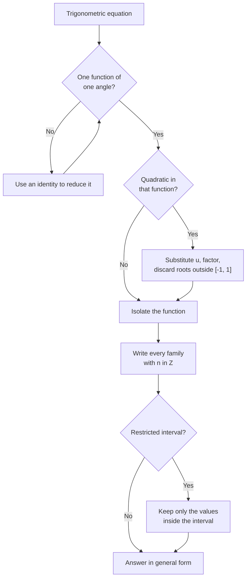

# Trigonometric Equations

> [Mathematics](../../README.md) › [Trigonometry](../README.md) · Level: Advanced · Prerequisites: [Trigonometric Functions](../01-trigonometric-functions/README.md), [The Unit Circle and Radian Measure](../02-unit-circle/README.md), [Trigonometric Identities](../03-trigonometric-identities/README.md), [Inverse Trigonometric Functions](../04-inverse-trigonometric-functions/README.md), [Quadratic Equations](../../03-algebra/08-quadratic-equations/README.md) · Estimated time: 420 min

## 1. Introduction

A trigonometric equation asks for the angles at which a periodic quantity takes a prescribed value.
"How deep is the water when the tide reaches $6.5$ metres?", "when is the daylight longer than
$12$ hours?", "at what time is the voltage zero?", "for which angles is this triangle isosceles?" —
all of these reduce to an equation such as $\sin\theta=\tfrac12$ or $2\cos^2\theta+\cos\theta-1=0$.

The answers come in **families**. Because sine repeats every $2\pi$ and tangent every $\pi$, a single
solution generates infinitely many others by adding periods. A complete answer therefore cannot be a
list of numbers; it must be a description of a set, usually written with an integer parameter $n$:

$$\theta=\frac{\pi}{6}+2n\pi \quad\text{or}\quad \theta=\frac{5\pi}{6}+2n\pi,\qquad n\in\mathbb{Z}.$$

Learning to write such a description correctly — with every family present, no duplicates, and no
extraneous angles — is the central skill of this chapter.

There is a second skill, just as important: deciding *which* representation to use. On the unit
circle, an equation is a line cutting a circle, and the solutions are the angles of the intersection
points; this geometric view never loses a family. Algebraically, the same equation is solved by
isolating a trigonometric function, substituting, factoring and reading off principal values; this
view is faster but hides the geometry, and it is where solutions get lost. The two methods should be
used together: algebra to reduce the equation to a basic one, the circle to read off the complete
solution set.

The equations in this chapter range from the immediate ($\sin\theta=\tfrac12$) to the genuinely
composite: quadratic equations in a trigonometric function, equations that require an identity before
they can be reduced, equations with different angles on the two sides, and equations whose solutions
must be filtered to a physical interval. The final section turns the process around and **fits** a
sinusoid to data — amplitude, period, phase shift and vertical shift — and then uses the equation to
answer questions about the modelled quantity.

The companion chapter [Inverse Trigonometric Functions](../04-inverse-trigonometric-functions/README.md)
supplies one representative angle for each value; this chapter supplies the reflections, periods and
restrictions that turn it into a complete solution set.

## 2. Prerequisites

* **The six trigonometric functions**, their exact values and their signs by quadrant —
  [Trigonometric Functions](../01-trigonometric-functions/README.md).
* **The unit circle**, radian measure, and the periodicities $\sin(\theta+2\pi)=\sin\theta$,
  $\cos(\theta+2\pi)=\cos\theta$, $\tan(\theta+\pi)=\tan\theta$ —
  [The Unit Circle and Radian Measure](../02-unit-circle/README.md).
* **The identities**: Pythagorean, double-angle, sum-to-product, and the phase form
  $a\sin\theta+b\cos\theta=R\sin(\theta+\varphi)$ —
  [Trigonometric Identities](../03-trigonometric-identities/README.md).
* **The inverse functions and their principal ranges**, especially
  $\arcsin:[-1,1]\to[-\pi/2,\pi/2]$, $\arccos:[-1,1]\to[0,\pi]$ and
  $\arctan:\mathbb{R}\to(-\pi/2,\pi/2)$ —
  [Inverse Trigonometric Functions](../04-inverse-trigonometric-functions/README.md).
* **Quadratic equations**, factoring and the discriminant —
  [Quadratic Equations](../../03-algebra/08-quadratic-equations/README.md).
* **Functions, graphs and transformations** — [Functions](../../03-algebra/11-functions/README.md).

## 3. Learning Objectives

After working through this tutorial you will be able to:

1. Write the complete general solution of $\sin\theta=k$, $\cos\theta=k$ and $\tan\theta=k$, including
   the degenerate cases $k=\pm1$ and the empty case $\lvert k\rvert>1$.
2. Explain, using the unit circle, why each basic equation has the stated number of families.
3. Present a solution set unambiguously with an integer parameter, and recognise two descriptions that
   denote the same set.
4. Solve equations that are quadratic in a trigonometric function, discarding roots outside $[-1,1]$
   for sine and cosine.
5. Use identities to reduce an equation to a basic one, and check that no division by a quantity that
   can vanish has lost solutions.
6. Solve multiple-angle equations such as $\sin2\theta=\sin\theta$ and equations with different
   arguments such as $\sin3\theta=\cos\theta$.
7. Choose between the unit-circle method and the algebraic method, and combine them.
8. Find all solutions in a restricted interval, and count them correctly.
9. Fit a sinusoid $A\sin(B(t-C))+D$ to data given its maximum, minimum and period, and use the fitted
   model to solve for times.
10. Recognise the standard errors: lost families, mixed units, illegitimate division, and extraneous
    roots introduced by squaring.

## 4. Intuition

**A horizontal line across a circle.** Draw the unit circle and the horizontal line $y=\tfrac12$. It
cuts the circle at two points: one in the first quadrant, at angle $\tfrac{\pi}{6}$, and one in the
second, at angle $\tfrac{5\pi}{6}$. Those are the only two angles in one full turn whose sine is
$\tfrac12$. Every other solution is one of those two plus a whole number of turns. The equation
$\sin\theta=\tfrac12$ is therefore a *picture*: a line, a circle, two intersections, and a
periodic repetition of the picture.

**A vertical line across a circle.** The equation $\cos\theta=\tfrac12$ corresponds to the vertical
line $x=\tfrac12$. It cuts the circle at $\tfrac{\pi}{3}$ and $-\tfrac{\pi}{3}$, which are mirror
images across the horizontal axis. Adding turns gives $\theta=\pm\tfrac{\pi}{3}+2n\pi$. The minus
sign is the geometric statement that cosine is even.

**A ray from the origin.** The equation $\tan\theta=1$ says that the ray from the origin has slope
$1$. A ray and its opposite have the same slope, so the solutions repeat every half-turn:
$\theta=\tfrac{\pi}{4}+n\pi$. This is why tangent's period is $\pi$ and the other two functions'
period is $2\pi$.

**Families, not lists.** If a friend asks "when is the tide at $6.5$ metres?", the answer "at 1:00,
5:00, 13:00 and 17:00" is a list valid for one day. The mathematical answer is a formula that
generates all of them, today and tomorrow. Writing the formula is not pedantry: a physical model may
need the answer next week, and a numerical solver may report only the solutions in a default window.

**Why equations are harder than identities.** An identity is true everywhere, so correct
manipulations preserve it. An equation is true only at some angles, so a manipulation can change the
solution set: dividing by $\sin\theta$ deletes solutions, and squaring adds them.

**Modelling is the payoff.** A sinusoid has four parameters — amplitude, period, phase and vertical
shift — fixed by the maximum, minimum, period and time of one maximum. Once fitted, every question
about the quantity becomes a trigonometric equation.

## 5. Formal Definition

**Definition 5.1 (Trigonometric equation).** A trigonometric equation is an equation in which the
unknown appears inside one or more trigonometric functions. A **solution** is a real number $\theta$
for which every expression in the equation is defined and the two sides are equal. The **solution
set** is the set of all solutions.

**Definition 5.2 (General solution).** A **general solution** is a description of the solution set
using an integer parameter, for example
$\{\theta:\theta=\pi/6+2n\pi,\ n\in\mathbb{Z}\}\cup\{\theta:\theta=5\pi/6+2n\pi,\ n\in\mathbb{Z}\}$.
A **particular solution** is one element of the set. Solving an equation in a restricted interval
means intersecting the solution set with that interval.

**Definition 5.3 (Basic trigonometric equations).** For a real constant $k$:

* $\sin\theta=k$ is **solvable** exactly when $-1\le k\le1$;
* $\cos\theta=k$ is **solvable** exactly when $-1\le k\le1$;
* $\tan\theta=k$ is solvable for every real $k$.

Outside those ranges the solution set is empty. This is the equation-level statement of the ranges of
sine and cosine.

**Theorem 5.4 (General solutions).** Let $n\in\mathbb{Z}$ and let $\alpha$ be any angle with
$\sin\alpha=k$, $\cos\alpha=k$ or $\tan\alpha=k$ respectively. Then

$$\sin\theta=k \iff \theta=\alpha+2n\pi \ \text{ or }\ \theta=\pi-\alpha+2n\pi
\iff \theta=(-1)^n\alpha+n\pi,$$

$$\cos\theta=k \iff \theta=\alpha+2n\pi \ \text{ or }\ \theta=-\alpha+2n\pi
\iff \theta=\pm\alpha+2n\pi,$$

$$\tan\theta=k \iff \theta=\alpha+n\pi.$$

*Proof.* The equivalences follow from the sum-to-product identities, which convert a difference of two
values into a product that vanishes exactly when one factor vanishes.

For sine, with $\sin\alpha=k$,

$$\sin\theta-\sin\alpha=2\cos\frac{\theta+\alpha}{2}\,\sin\frac{\theta-\alpha}{2}.$$

The product is zero when $\sin\frac{\theta-\alpha}{2}=0$, that is $\theta=\alpha+2n\pi$, or when
$\cos\frac{\theta+\alpha}{2}=0$, that is $\theta=\pi-\alpha+2n\pi$.

For cosine,

$$\cos\theta-\cos\alpha=-2\sin\frac{\theta+\alpha}{2}\,\sin\frac{\theta-\alpha}{2},$$

which vanishes when $\theta=-\alpha+2n\pi$ or $\theta=\alpha+2n\pi$.

For tangent, write $\tan\theta=\tan\alpha$ as $\dfrac{\sin(\theta-\alpha)}{\cos\theta\cos\alpha}=0$,
using the sine subtraction formula; this requires $\cos\theta\cos\alpha\neq0$ and gives
$\theta=\alpha+n\pi$.

The compact form for sine follows by separating even and odd $n$: for $n=2m$,
$(-1)^n\alpha+n\pi=\alpha+2m\pi$; for $n=2m+1$,
$(-1)^n\alpha+n\pi=-\alpha+(2m+1)\pi=\pi-\alpha+2m\pi$. $\blacksquare$

**Remark 5.5 (How many families?).** In one full turn, a horizontal or vertical line meets the circle
twice, so a non-degenerate sine or cosine equation has two families. The exceptional values $k=\pm1$
are tangencies, and the two families coalesce into one. A tangent equation has one family, because a
ray repeats after half a turn. The count of families is the count of intersections in one period.

**Definition 5.6 (Sinusoid).** A **sinusoid** is a function of the form

$$y(t)=A\sin\bigl(B(t-C)\bigr)+D,\qquad B>0.$$

Its **amplitude** is $\lvert A\rvert$, its **period** is $\dfrac{2\pi}{B}$, its **phase shift** is
$C$, its **vertical shift** (or mean level) is $D$, its maximum is $D+\lvert A\rvert$ and its minimum
is $D-\lvert A\rvert$. The same curve can be written with a cosine instead of a sine; the two forms
differ only by a quarter-period shift in the phase.

## 6. Mathematical Notation

| Symbol | Read as | Meaning |
|---|---|---|
| $\theta$ | theta | the unknown angle, in radians unless marked $^\circ$ |
| $n\in\mathbb{Z}$ | $n$ is an integer | the parameter that generates a solution family |
| $\{\theta:\ldots\}$ | the set of $\theta$ such that … | set-builder notation for a solution set |
| $2n\pi$ | two n pi | a whole number of full turns |
| $n\pi$ | n pi | a whole number of half-turns |
| $\alpha$ | alpha | a principal or reference angle used to describe a family |
| $\pm$ | plus or minus | two signs, taken consistently in one expression |
| $[0,2\pi)$ | the half-open interval | one full turn, with $2\pi$ excluded |
| $k$ | a constant | the prescribed value of a trigonometric function |
| $A,B,C,D$ | amplitudes and shifts | parameters of the sinusoid $A\sin(B(t-C))+D$ |
| $\omega$ | omega | angular frequency, equal to $B$ in the sinusoid above |
| $\deg$ or $^\circ$ | degrees | used only with an explicit symbol |

Two conventions keep notation unambiguous. An answer in degrees must carry the degree symbol:
$\theta=30$ without one means $30$ radians. And the parameter should be named once and used
consistently; reusing $k$ for two independent families invites errors.

## 7. Core Concepts

### 7.1 The General Solution of $\sin\theta=k$

Take $k\in[-1,1]$ and let $\alpha=\arcsin k\in[-\pi/2,\pi/2]$. The horizontal line $y=k$ meets the
unit circle at two points per turn: the point at angle $\alpha$, with coordinates
$(\cos\alpha,k)$, and its mirror image across the $y$-axis, at angle $\pi-\alpha$. Hence

$$\sin\theta=k \iff \theta=\arcsin k+2n\pi \ \text{ or }\ \theta=\pi-\arcsin k+2n\pi,
\qquad n\in\mathbb{Z}.$$

The compact form $\theta=(-1)^n\arcsin k+n\pi$ encodes the same set: even $n$ gives the first family,
odd $n$ the second. Three special cases deserve separate mention.

* $k=1$: the line is tangent at the top of the circle, $\alpha=\pi/2$, and the two families coincide:
  $\theta=\pi/2+2n\pi$.
* $k=-1$: similarly, $\theta=-\pi/2+2n\pi$.
* $\lvert k\rvert>1$: the line misses the circle and there is no solution. For example,
  $\sin\theta=1.5$ has the empty solution set.

**Example.** $\sin\theta=-\tfrac{\sqrt3}{2}$ gives $\alpha=-\pi/3$, so

$$\theta=-\frac{\pi}{3}+2n\pi \quad\text{or}\quad \theta=\pi+\frac{\pi}{3}+2n\pi=\frac{4\pi}{3}+2n\pi.$$

The two angles in one turn are $-\pi/3$ (equivalently $5\pi/3$) and $4\pi/3$, which are the two points
with height $-\sqrt3/2$. In compact form, $\theta=(-1)^n\left(-\frac{\pi}{3}\right)+n\pi$, which for
$n=0,1,2,3$ gives $-\frac{\pi}{3},\frac{4\pi}{3},\frac{5\pi}{3},\frac{10\pi}{3}$, the correct
alternating parade.

### 7.2 The General Solution of $\cos\theta=k$

Take $k\in[-1,1]$ and let $\beta=\arccos k\in[0,\pi]$. The vertical line $x=k$ meets the circle at the
point at angle $\beta$ and its mirror image across the $x$-axis, at angle $-\beta$. Hence

$$\cos\theta=k \iff \theta=\arccos k+2n\pi \ \text{ or }\ \theta=-\arccos k+2n\pi
\iff \theta=\pm\arccos k+2n\pi.$$

Again the endpoint cases are degenerate: $\cos\theta=1$ gives $\theta=2n\pi$, and $\cos\theta=-1$
gives $\theta=\pi+2n\pi$ (the two families $\pm\pi+2n\pi$ describe the same set of odd multiples of
$\pi$). The case $k=0$ gives $\theta=\pm\frac{\pi}{2}+2n\pi$, which is the same as
$\theta=\frac{\pi}{2}+n\pi$: the two descriptions coincide because the two families are half a turn
apart.

**Example.** $\cos\theta=-\tfrac12$ has $\arccos(-\tfrac12)=\tfrac{2\pi}{3}$, so

$$\theta=\pm\frac{2\pi}{3}+2n\pi.$$

In one turn the points are at $2\pi/3$ and $4\pi/3$, both with width $-\tfrac12$.

### 7.3 The General Solution of $\tan\theta=k$

For any real $k$, let $\gamma=\arctan k\in(-\pi/2,\pi/2)$. The ray from the origin with slope $k$
coincides with its opposite ray, so the picture repeats every half-turn:

$$\tan\theta=k \iff \theta=\arctan k+n\pi,\qquad n\in\mathbb{Z}.$$

There is no empty case, because the tangent takes every real value. The solution set excludes the
points where tangent is undefined, but those points never satisfy the equation anyway.

**Example.** $\tan\theta=-\sqrt3$ gives $\theta=-\tfrac{\pi}{3}+n\pi$. In one turn the solutions are
$-\pi/3$ (that is, $5\pi/3$) and $2\pi/3$, which are half a turn apart.

The difference between the three equations is worth stating in one sentence: **sine and cosine each
have two families per turn, tangent has one.** Every error in the number of families can be traced
back to ignoring this count.

### 7.4 Periodicity and How to Present Solution Families

Sine and cosine have period $2\pi$, tangent has period $\pi$. Consequently every solution set in this
chapter is invariant under adding the relevant period, and a complete answer must display that
invariance.

Three habits make an answer unambiguous.

1. **Name the parameter and its domain.** Write $n\in\mathbb{Z}$ once, at the end.
2. **List every family.** The missing one is usually the reflection $\pi-\alpha$ or $-\alpha$.
3. **Do not double-count or misread equivalent descriptions.** For instance
   $\theta=\pm\frac{\pi}{2}+2n\pi$ and $\theta=\frac{\pi}{2}+n\pi$ denote the same set, because
   $-\pi/2+2n\pi=\pi/2+(2n-1)\pi$.

The **fundamental period of the solution set** may be smaller than the period of the function:
$\sin\theta=0$ has solutions $\theta=n\pi$, a set of period $\pi$, because
$\sin(\pi-\theta)=\sin\theta$ identifies the two families when $k=0$.

### 7.5 The Unit-Circle Method

The geometric method has three steps.

1. Draw the unit circle and the line corresponding to the equation: horizontal $y=k$ for
   $\sin\theta=k$, vertical $x=k$ for $\cos\theta=k$, and the ray of slope $k$ for $\tan\theta=k$.
2. Mark every intersection in one full turn and read off its angle, using the reference angle and the
   quadrant.
3. Add whole periods to each marked angle.

The method is slower than algebra but it never loses a family and it makes signs obvious. It is the
right method when the equation has been reduced to a basic one with an awkward constant, and it is
the only reliable method for a restricted interval, where the count of intersections is what matters.

**Example.** Solve $\cos\theta=-0.4$ in $[0,2\pi)$. The vertical line $x=-0.4$ meets the circle in the
second and third quadrants. The reference angle is $\arccos0.4\approx1.1593$, so the second-quadrant
angle is $\pi-1.1593\approx1.9823$ and the third-quadrant angle is $\pi+1.1593\approx4.3009$. Both lie
in $[0,2\pi)$, and there are no others.

### 7.6 The Algebraic Method and Equations Quadratic in a Function

The algebraic method reduces an equation to one or more basic equations.

1. **Isolate** a single trigonometric function of a single argument, if that is possible.
2. **Substitute** a new variable for that function, for example $u=\sin\theta$.
3. **Solve** the resulting polynomial equation.
4. **Discard inadmissible roots**: for $u=\sin\theta$ or $u=\cos\theta$ every root must satisfy
   $\lvert u\rvert\le1$; for $u=\tan\theta$ any real root is admissible.
5. **Solve each basic equation** that remains, and collect the families.

**Example.** Solve $2\sin^2\theta+3\sin\theta+1=0$. With $u=\sin\theta$,

$$2u^2+3u+1=(2u+1)(u+1)=0,$$

so $u=-\tfrac12$ or $u=-1$, both admissible. Then $\sin\theta=-\tfrac12$ gives
$\theta=-\tfrac{\pi}{6}+2n\pi$ or $\theta=\tfrac{7\pi}{6}+2n\pi$, and $\sin\theta=-1$ gives
$\theta=-\tfrac{\pi}{2}+2n\pi$.

Two warnings: a quadratic in $\sin\theta$ may have a root such as $u=2$, which must be discarded;
and equations in secant, cosecant and cotangent should first be rewritten in cosine, sine and
tangent, with the excluded points recorded.

### 7.7 Equations That Need an Identity

Many equations contain two different trigonometric functions of the same angle, or a function of a
multiple angle. An identity converts them into a single function.

* $2\sin^2\theta=1+\cos\theta$. Replace $\sin^2\theta$ by $1-\cos^2\theta$:
  $$2-2\cos^2\theta=1+\cos\theta \iff 2\cos^2\theta+\cos\theta-1=0
  \iff (2\cos\theta-1)(\cos\theta+1)=0.$$
  Hence $\cos\theta=\tfrac12$ or $\cos\theta=-1$, giving
  $\theta=\pm\tfrac{\pi}{3}+2n\pi$ or $\theta=\pi+2n\pi$.
* $\sin2\theta=\cos2\theta$. Here $\cos2\theta\neq0$, because $\cos2\theta=0$ would force
  $\sin2\theta=\pm1$, contradicting the equation. Dividing is therefore legitimate and gives
  $\tan2\theta=1$, so $2\theta=\tfrac{\pi}{4}+n\pi$ and $\theta=\tfrac{\pi}{8}+\tfrac{n\pi}{2}$.
  Without the justification, the division would be an unproved claim.
* $\sin\theta\cos\theta=\tfrac12$. The double-angle identity gives $\sin2\theta=1$, so
  $2\theta=\tfrac{\pi}{2}+2n\pi$ and $\theta=\tfrac{\pi}{4}+n\pi$.

The pattern is always the same: **an identity is used to reduce the number of distinct functions and
arguments**, after which the algebraic method applies. Choosing the identity is the creative step;
carrying it out is mechanical.

### 7.8 Multiple-Angle Equations

An equation such as $\sin2\theta=\sin\theta$ contains the same function at two different arguments.
There are two strategies, and both must give the same set.

**Strategy A: factor.** Expand the multiple angle until a common factor appears:

$$\sin2\theta=\sin\theta \iff 2\sin\theta\cos\theta-\sin\theta=0
\iff \sin\theta\,(2\cos\theta-1)=0.$$

Hence $\sin\theta=0$, giving $\theta=n\pi$, or $\cos\theta=\tfrac12$, giving
$\theta=\pm\tfrac{\pi}{3}+2n\pi$.

**Strategy B: compare arguments.** Use $\sin A=\sin B\iff A=B+2n\pi$ or $A=\pi-B+2n\pi$. With
$A=2\theta$ and $B=\theta$,

$$2\theta=\theta+2n\pi \ \text{ or }\ 2\theta=\pi-\theta+2n\pi,$$

so $\theta=2n\pi$ or $\theta=\tfrac{\pi}{3}+\tfrac{2n\pi}{3}$.

The two descriptions denote the same set: B's first family $2n\pi$ lies inside A's $n\pi$, and B's
second family supplies the odd multiples of $\pi$ together with $\pm\tfrac{\pi}{3}+2n\pi$. What is
*not* legitimate is dividing the original equation by $\sin\theta$, which deletes every solution with
$\sin\theta=0$, including $0,\pi,2\pi,\dots$.

### 7.9 Equations with Different Arguments

When the two sides use different functions or different angles, convert both sides to the same
function and then compare arguments.

**Example 1.** $\sin3\theta=\cos\theta$. Since $\cos\theta=\sin\left(\tfrac{\pi}{2}-\theta\right)$,

$$\sin3\theta=\sin\left(\frac{\pi}{2}-\theta\right)
\iff 3\theta=\frac{\pi}{2}-\theta+2n\pi
\ \text{ or }\ 3\theta=\pi-\left(\frac{\pi}{2}-\theta\right)+2n\pi.$$

The first case gives $4\theta=\tfrac{\pi}{2}+2n\pi$, so $\theta=\tfrac{\pi}{8}+\tfrac{n\pi}{2}$. The
second gives $2\theta=\tfrac{\pi}{2}+2n\pi$, so $\theta=\tfrac{\pi}{4}+n\pi$. Both are needed.

**Example 2.** $\tan2\theta=\cot\theta$. Use $\cot\theta=\tan\left(\tfrac{\pi}{2}-\theta\right)$,
valid where $\sin\theta\neq0$. Then

$$2\theta=\frac{\pi}{2}-\theta+n\pi \iff \theta=\frac{\pi}{6}+\frac{n\pi}{3}.$$

The domain must be checked: $\theta=\tfrac{\pi}{6}+\tfrac{n\pi}{3}$ is never a multiple of $\pi$
(multiplying by $6/\pi$ gives $1+2n=6m$, impossible), and $2\theta$ is never $\tfrac{\pi}{2}+m\pi$
(multiplying by $6/\pi$ gives $2+4n=3+6m$, impossible). So no solution is lost to the domain, and the
family is complete.

**Example 3.** $\sin2\theta=\cos3\theta$ becomes
$\sin2\theta=\sin\left(\tfrac{\pi}{2}-3\theta\right)$, then the two-case rule applies.

### 7.10 Restricted Domains

A restricted domain changes only the final step: solve generally, then keep the solutions that lie in
the interval. In practice it is safer to solve inside one period and then translate, because the
count of solutions is visible.

**Example 1.** $\sin\theta=\tfrac12$ on $[0,2\pi)$. The general solution is
$\theta=\tfrac{\pi}{6}+2n\pi$ or $\theta=\tfrac{5\pi}{6}+2n\pi$. For $n=0$ both lie in the interval;
for $n=1$ both exceed $2\pi$; for $n=-1$ both are negative. There are exactly two solutions,
$\tfrac{\pi}{6}$ and $\tfrac{5\pi}{6}$.

**Example 2.** $\cos2\theta=\tfrac12$ on $[0,2\pi)$. Here $2\theta=\pm\tfrac{\pi}{3}+2n\pi$, so
$\theta=\pm\tfrac{\pi}{6}+n\pi$. Taking $n=0,1$ gives $\tfrac{\pi}{6},\tfrac{5\pi}{6},\tfrac{7\pi}{6},
\tfrac{11\pi}{6}$; larger or negative $n$ leaves the interval, so there are four solutions.

**Example 3.** $\tan3\theta=1$ on $[0,\pi)$. Then $3\theta=\tfrac{\pi}{4}+n\pi$, so
$\theta=\tfrac{\pi}{12}+\tfrac{n\pi}{3}$. The values $n=0,1,2$ give
$\tfrac{\pi}{12},\tfrac{5\pi}{12},\tfrac{3\pi}{4}$, all in $[0,\pi)$; $n=3$ gives
$\tfrac{13\pi}{12}>\pi$. Three solutions, matching the period $\pi/3$ of $\tan3\theta$.

### 7.11 Fitting a Sinusoid to Data

A periodic quantity is often modelled by

$$y(t)=A\sin\bigl(B(t-C)\bigr)+D \qquad\text{or}\qquad y(t)=A\cos\bigl(B(t-C)\bigr)+D,$$

with $B>0$. The four parameters are read from the data as follows.

| Parameter | Meaning | How to obtain it |
|---|---|---|
| $A$ | amplitude | $A=\dfrac{\text{maximum}-\text{minimum}}{2}$ |
| $D$ | mean level | $D=\dfrac{\text{maximum}+\text{minimum}}{2}$ |
| $B$ | angular frequency | $B=\dfrac{2\pi}{\text{period}}$ |
| $C$ | phase shift | the time of a maximum (cosine form) or of an upward crossing of the mean (sine form) |

**Example.** The temperature over a day has a minimum of $8^\circ$C at 04:00 and a maximum of
$20^\circ$C at 16:00. The period is $24$ hours, so $B=\tfrac{2\pi}{24}=\tfrac{\pi}{12}$. The amplitude
is $\tfrac{20-8}{2}=6$ and the mean is $\tfrac{20+8}{2}=14$. A maximum at $t=16$ suits the cosine form
with $C=16$:

$$T(t)=14+6\cos\frac{\pi(t-16)}{12}.$$

The same curve in sine form is $T(t)=14+6\sin\frac{\pi(t-10)}{12}$, because
$\cos u=\sin\left(u+\tfrac{\pi}{2}\right)$ shifts the phase by a quarter period, here $6$ hours.

Once the model is fitted, every question becomes an equation. When is the temperature $17^\circ$C?

$$14+6\cos\frac{\pi(t-16)}{12}=17
\iff \cos\frac{\pi(t-16)}{12}=\frac12
\iff \frac{\pi(t-16)}{12}=\pm\frac{\pi}{3}+2n\pi.$$

Hence $t-16=\pm4+24n$, so $t=20+24n$ or $t=12+24n$. In the first day the temperature is
$17^\circ$C at 12:00 and at 20:00, which is exactly what the graph shows: the curve crosses each
horizontal level twice per period.

## 8. Formulas and Properties

### 8.1 General Solutions

For $n\in\mathbb{Z}$ and $k$ in the stated ranges:

| Equation | General solution | Families per turn |
|---|---|---|
| $\sin\theta=k$, $\lvert k\rvert<1$ | $\theta=\arcsin k+2n\pi$ or $\theta=\pi-\arcsin k+2n\pi$ | $2$ |
| $\sin\theta=k$, $\lvert k\rvert<1$ | $\theta=(-1)^n\arcsin k+n\pi$ (compact form) | $2$ |
| $\cos\theta=k$, $\lvert k\rvert<1$ | $\theta=\pm\arccos k+2n\pi$ | $2$ |
| $\tan\theta=k$, $k\in\mathbb{R}$ | $\theta=\arctan k+n\pi$ | $1$ |
| $\sin\theta=1$ | $\theta=\dfrac{\pi}{2}+2n\pi$ | $1$ |
| $\sin\theta=-1$ | $\theta=-\dfrac{\pi}{2}+2n\pi$ | $1$ |
| $\sin\theta=0$ | $\theta=n\pi$ | $2$ families merging |
| $\cos\theta=1$ | $\theta=2n\pi$ | $1$ |
| $\cos\theta=-1$ | $\theta=\pi+2n\pi$ | $1$ |
| $\cos\theta=0$ | $\theta=\dfrac{\pi}{2}+n\pi$ | $2$ families merging |
| $\tan\theta=0$ | $\theta=n\pi$ | $1$ |

Whenever $\lvert k\rvert>1$ in a sine or cosine equation, the solution set is empty. Writing
$\arcsin k$ for such a $k$ is undefined and is a sign that the problem has no solution rather than a
harder one.

### 8.2 Comparison of Arguments

These are the tools for equations whose two sides use the same function.

$$\sin A=\sin B \iff A=B+2n\pi \ \text{ or }\ A=\pi-B+2n\pi,$$

$$\cos A=\cos B \iff A=\pm B+2n\pi,$$

$$\tan A=\tan B \iff A=B+n\pi \quad(\text{both sides defined}).$$

The sine and tangent rules are direct restatements of Theorem 5.4 with $\alpha=B$; the cosine rule is
the same theorem in the form $\theta=\pm\alpha+2n\pi$.

### 8.3 Reduction to a Quadratic

If an equation can be written

$$a\,f(\theta)^2+b\,f(\theta)+c=0,\qquad f\in\{\sin,\cos,\tan\},$$

then the substitution $u=f(\theta)$ gives a quadratic. Its roots must satisfy $\lvert u\rvert\le1$
when $f$ is sine or cosine; for tangent every real root is admissible. Each admissible root produces
one basic equation and hence its own family (or families).

### 8.4 Identities Commonly Used to Reduce Equations

| Identity | Typical use |
|---|---|
| $\sin^2\theta+\cos^2\theta=1$ | eliminate $\sin^2$ in favour of $\cos$, or the reverse |
| $\sin2\theta=2\sin\theta\cos\theta$ | create a common factor in a multiple-angle equation |
| $\cos2\theta=2\cos^2\theta-1=1-2\sin^2\theta$ | reduce a double angle to a single one |
| $\cos2\theta=\cos^2\theta-\sin^2\theta$ | convert between the two quadratic forms |
| $\sin A\pm\sin B=2\sin\frac{A\pm B}{2}\cos\frac{A\mp B}{2}$ | merge two sine terms into a product |
| $\cos A+\cos B=2\cos\frac{A+B}{2}\cos\frac{A-B}{2}$ | merge two cosine terms into a product |
| $\cos\theta=\sin\left(\frac{\pi}{2}-\theta\right)$ | compare a cosine with a sine |
| $\cot\theta=\tan\left(\frac{\pi}{2}-\theta\right)$ | compare a cotangent with a tangent |
| $a\sin\theta+b\cos\theta=R\sin(\theta+\varphi)$ | turn a sum into one sinusoid |

Every identity is valid only on its domain; the excluded points must be checked at the end, because a
reduction can hide them.

### 8.5 The Sinusoid

For $y(t)=A\sin(B(t-C))+D$ with $B>0$:

$$\text{amplitude}=\lvert A\rvert,\qquad \text{period}=\frac{2\pi}{B},\qquad
\text{frequency}=\frac{B}{2\pi},\qquad \text{phase shift}=C,\qquad \text{mean}=D.$$

If $A>0$, the maximum $D+A$ occurs at $t=C+\frac{\pi}{2B}+\frac{2n\pi}{B}$ and the minimum $D-A$ at
$t=C+\frac{3\pi}{2B}+\frac{2n\pi}{B}$; if $A<0$, the two are interchanged.

For the cosine form $y=A\cos(B(t-C))+D$, the maximum occurs at $t=C+\frac{2n\pi}{B}$. The two forms
are related by $\cos u=\sin\left(u+\frac{\pi}{2}\right)$, which shifts the phase by a quarter period.

## 9. Step-by-Step Examples

### Example 9.1: A Basic Equation with a Negative Value

Solve $2\sin\theta+\sqrt3=0$ for all real $\theta$.

**Strategy.** Isolate the sine, find the principal value, then use the two-family rule for sine.

The equation is $\sin\theta=-\tfrac{\sqrt3}{2}$. The reference angle is $\tfrac{\pi}{3}$, and the
principal value is $\alpha=-\tfrac{\pi}{3}$ because the arcsine must lie in $[-\pi/2,\pi/2]$. Then

$$\theta=-\frac{\pi}{3}+2n\pi \quad\text{or}\quad \theta=\pi-\left(-\frac{\pi}{3}\right)+2n\pi
=\frac{4\pi}{3}+2n\pi.$$

In compact form, $\theta=(-1)^n\left(-\frac{\pi}{3}\right)+n\pi$.

**Answer.** $\theta=-\dfrac{\pi}{3}+2n\pi$ or $\theta=\dfrac{4\pi}{3}+2n\pi$, $n\in\mathbb{Z}$.

**Check.** At $\theta=4\pi/3$ the point is $\left(-\frac12,-\frac{\sqrt3}{2}\right)$, whose height is
$-\frac{\sqrt3}{2}$ ✓; at $\theta=-\pi/3$ the point is $\left(\frac12,-\frac{\sqrt3}{2}\right)$ ✓.
Both satisfy $2\left(-\frac{\sqrt3}{2}\right)+\sqrt3=0$.

### Example 9.2: A Multiple Angle with a Cosine

Solve $\cos3\theta=-\tfrac12$ for all real $\theta$.

**Strategy.** Treat $3\theta$ as a single angle, apply the cosine rule, then divide by $3$.

Let $\varphi=3\theta$. Then $\cos\varphi=-\tfrac12$ gives $\varphi=\pm\tfrac{2\pi}{3}+2n\pi$, so

$$3\theta=\pm\frac{2\pi}{3}+2n\pi \quad\Longrightarrow\quad
\theta=\pm\frac{2\pi}{9}+\frac{2n\pi}{3}.$$

**Answer.** $\theta=\dfrac{2\pi}{9}+\dfrac{2n\pi}{3}$ or
$\theta=-\dfrac{2\pi}{9}+\dfrac{2n\pi}{3}$, $n\in\mathbb{Z}$.

**Check.** For $\theta=\tfrac{2\pi}{9}$ we have $3\theta=\tfrac{2\pi}{3}$, and
$\cos\tfrac{2\pi}{3}=-\tfrac12$ ✓. The six values in $[0,2\pi)$ are
$\pm\tfrac{2\pi}{9}$, $\pm\tfrac{2\pi}{9}+\tfrac{2\pi}{3}$ and $\pm\tfrac{2\pi}{9}+\tfrac{4\pi}{3}$;
the equation $\cos3\theta=-\tfrac12$ has period $\tfrac{2\pi}{3}$, so six solutions in $2\pi$ is the
expected count.

### Example 9.3: A Quadratic in the Cosine

Solve $2\cos^2\theta+3\cos\theta+1=0$ for all real $\theta$.

**Strategy.** Substitute $u=\cos\theta$, factor, keep only roots in $[-1,1]$, then solve each basic
equation.

With $u=\cos\theta$,

$$2u^2+3u+1=(2u+1)(u+1)=0,$$

so $u=-\tfrac12$ or $u=-1$. Both lie in $[-1,1]$. Now

* $\cos\theta=-\tfrac12$ gives $\theta=\pm\tfrac{2\pi}{3}+2n\pi$;
* $\cos\theta=-1$ gives $\theta=\pi+2n\pi$.

The second family is not contained in the first: at $n=0$ the first gives $\pm\tfrac{2\pi}{3}$, not
$\pi$.

**Answer.** $\theta=\pm\dfrac{2\pi}{3}+2n\pi$ or $\theta=\pi+2n\pi$, $n\in\mathbb{Z}$.

**Check.** At $\theta=\pi$: $2(1)+3(-1)+1=0$ ✓. At $\theta=\tfrac{2\pi}{3}$:
$2\cdot\tfrac14+3\left(-\tfrac12\right)+1=\tfrac12-\tfrac32+1=0$ ✓.

### Example 9.4: A Multiple-Angle Equation Solved Twice

Solve $\sin2\theta=\sin\theta$ for all real $\theta$, using both strategies of Section 7.8, and
confirm that the answers agree.

**Strategy A (factor).**

$$\sin2\theta-\sin\theta=2\sin\theta\cos\theta-\sin\theta
=\sin\theta\,(2\cos\theta-1)=0.$$

Thus $\sin\theta=0$, giving $\theta=n\pi$, or $\cos\theta=\tfrac12$, giving
$\theta=\pm\tfrac{\pi}{3}+2n\pi$.

**Strategy B (compare arguments).** With $A=2\theta$ and $B=\theta$,

$$2\theta=\theta+2n\pi \quad\text{or}\quad 2\theta=\pi-\theta+2n\pi,$$

so $\theta=2n\pi$ or $\theta=\tfrac{\pi}{3}+\tfrac{2n\pi}{3}$.

**Agreement.** B's first family lies inside A's $n\pi$; B's second supplies the odd multiples of
$\pi$ together with A's two families $\pm\tfrac{\pi}{3}+2n\pi$.

**Answer.** $\theta=n\pi$ or $\theta=\pm\dfrac{\pi}{3}+2n\pi$, $n\in\mathbb{Z}$.

**Check.** $\theta=\pi$: $\sin2\pi=0=\sin\pi$ ✓. $\theta=\tfrac{\pi}{3}$:
$\sin\tfrac{2\pi}{3}=\tfrac{\sqrt3}{2}=\sin\tfrac{\pi}{3}$ ✓. $\theta=\tfrac{2\pi}{3}$:
$\sin\tfrac{4\pi}{3}=-\tfrac{\sqrt3}{2}\neq\sin\tfrac{2\pi}{3}$ ✓ (so it is correctly absent from the
solution set).

### Example 9.5: A Sine Equal to a Cosine

Solve $\sin3\theta=\cos\theta$ for all real $\theta$.

**Strategy.** Write the cosine as a sine of a complementary angle, then compare the two arguments.

Since $\cos\theta=\sin\left(\tfrac{\pi}{2}-\theta\right)$,

$$\sin3\theta=\sin\left(\frac{\pi}{2}-\theta\right)
\iff 3\theta=\frac{\pi}{2}-\theta+2n\pi
\ \text{ or }\ 3\theta=\pi-\left(\frac{\pi}{2}-\theta\right)+2n\pi.$$

The first case: $4\theta=\tfrac{\pi}{2}+2n\pi$, so $\theta=\tfrac{\pi}{8}+\tfrac{n\pi}{2}$.
The second: $2\theta=\tfrac{\pi}{2}+2n\pi$, so $\theta=\tfrac{\pi}{4}+n\pi$.

**Answer.** $\theta=\dfrac{\pi}{8}+\dfrac{n\pi}{2}$ or $\theta=\dfrac{\pi}{4}+n\pi$,
$n\in\mathbb{Z}$.

**Check.** $\theta=\tfrac{\pi}{8}$: $3\theta=\tfrac{3\pi}{8}$, and
$\sin\tfrac{3\pi}{8}\approx0.9239=\cos\tfrac{\pi}{8}$ ✓. $\theta=\tfrac{\pi}{4}$:
$\sin\tfrac{3\pi}{4}=\tfrac{\sqrt2}{2}=\cos\tfrac{\pi}{4}$ ✓. The six values in $[0,2\pi)$ match the
six intersections of the two graphs in one turn.

### Example 9.6: A Sum Reduced to One Sinusoid

Solve $\sin\theta+\sqrt3\cos\theta=2$ for all real $\theta$.

**Strategy.** Combine the left side into a single sinusoid, then solve the resulting basic equation.

Here $a=1$ and $b=\sqrt3$, so $R=\sqrt{1+3}=2$ and $\varphi$ satisfies
$\cos\varphi=\tfrac12$, $\sin\varphi=\tfrac{\sqrt3}{2}$; hence $\varphi=\tfrac{\pi}{3}$. The equation
becomes

$$2\sin\left(\theta+\frac{\pi}{3}\right)=2 \iff \sin\left(\theta+\frac{\pi}{3}\right)=1.$$

Therefore $\theta+\tfrac{\pi}{3}=\tfrac{\pi}{2}+2n\pi$, so $\theta=\tfrac{\pi}{6}+2n\pi$.

**Answer.** $\theta=\dfrac{\pi}{6}+2n\pi$, $n\in\mathbb{Z}$.

**Check.** At $\theta=\tfrac{\pi}{6}$: $\sin\tfrac{\pi}{6}+\sqrt3\cos\tfrac{\pi}{6}
=\tfrac12+\sqrt3\cdot\tfrac{\sqrt3}{2}=\tfrac12+\tfrac32=2$ ✓. The maximum of the sinusoid is $2$, so
the equation asks for the maximum itself; that maximum is attained once per period.

### Example 9.7: A Quadratic on a Restricted Interval

Solve $2\sin^2\theta+\sin\theta-1=0$ for $\theta\in[0,2\pi)$.

**Strategy.** Factor the quadratic, solve each basic equation, and keep only the angles in the
interval.

$$2\sin^2\theta+\sin\theta-1=(2\sin\theta-1)(\sin\theta+1)=0,$$

so $\sin\theta=\tfrac12$ or $\sin\theta=-1$.

* $\sin\theta=\tfrac12$ gives $\theta=\tfrac{\pi}{6}$ or $\tfrac{5\pi}{6}$ in $[0,2\pi)$.
* $\sin\theta=-1$ gives $\theta=\tfrac{3\pi}{2}$.

**Answer.** $\theta\in\left\{\dfrac{\pi}{6},\dfrac{5\pi}{6},\dfrac{3\pi}{2}\right\}$.

**Check.** The circle confirms three intersections: the horizontal lines $y=\tfrac12$ and $y=-1$ meet
the circle at two points and one tangent point respectively ✓. Numerically, $\sin\tfrac{\pi}{6}=0.5$
and $\sin\tfrac{3\pi}{2}=-1$ both satisfy $2s^2+s-1=0$.

### Example 9.8: A Ferris Wheel

A Ferris wheel has height $h(t)=12+10\sin\dfrac{\pi t}{15}$ metres, where $t$ is in minutes. Find the
maximum and minimum heights and the times they occur, and find when the height is $17$ metres during
the first $30$ minutes.

**Strategy.** Read the amplitude, mean and period from the model; solve the basic sine equation with
the restricted interval.

The amplitude is $10$ and the mean is $12$, so the maximum is $22$ m and the minimum is $2$ m. The
angular frequency is $B=\tfrac{\pi}{15}$, so the period is $\tfrac{2\pi}{B}=30$ minutes.

The maximum occurs when $\sin\tfrac{\pi t}{15}=1$, that is $\tfrac{\pi t}{15}=\tfrac{\pi}{2}+2n\pi$,
so $t=7.5+30n$. The minimum occurs when the sine is $-1$, giving $t=22.5+30n$.

For the height $17$ m:

$$12+10\sin\frac{\pi t}{15}=17 \iff \sin\frac{\pi t}{15}=\frac12
\iff \frac{\pi t}{15}=\frac{\pi}{6}+2n\pi \ \text{ or }\ \frac{5\pi}{6}+2n\pi.$$

Hence $t=2.5+30n$ or $t=12.5+30n$. In $[0,30)$ the solutions are $t=2.5$ and $t=12.5$ minutes.

**Answer.** Maximum $22$ m at $t=7.5+30n$; minimum $2$ m at $t=22.5+30n$; height $17$ m at $t=2.5$
and $t=12.5$ minutes of each revolution.

**Check.** At $t=2.5$: $\sin\tfrac{\pi}{6}=\tfrac12$, so $h=17$ ✓. At $t=7.5$:
$\sin\tfrac{\pi}{2}=1$, so $h=22$ ✓. The two crossings per revolution are one ascending and one
descending, consistent with the two solutions found.

## 10. Visual Explanations

### 10.1 A Decision Procedure

### 10.2 Counting Solutions in One Turn

Let $B$ be a positive integer. The table gives the period in $\theta$ and the generic number of
solutions in $[0,2\pi)$ for a non-degenerate constant $k$.

| Equation | Period in $\theta$ | Solutions in $[0,2\pi)$ |
|---|---|---|
| $\sin\theta=k$, $\lvert k\rvert<1$ | $2\pi$ | $2$ |
| $\cos\theta=k$, $\lvert k\rvert<1$ | $2\pi$ | $2$ |
| $\tan\theta=k$ | $\pi$ | $2$ |
| $\sin B\theta=k$, $\lvert k\rvert<1$ | $\dfrac{2\pi}{B}$ | $2B$ |
| $\cos B\theta=k$, $\lvert k\rvert<1$ | $\dfrac{2\pi}{B}$ | $2B$ |
| $\tan B\theta=k$ | $\dfrac{\pi}{B}$ | $B$ |

For $k=\pm1$ in a sine or cosine equation the count halves, because the two families merge. The table
is a check, not a substitute for the algebra: if a computed answer has the wrong number of solutions in
a restricted interval, one family has been lost or duplicated.

## 11. Common Mistakes

**Mistake 1: dividing by a factor that can vanish.** From $\sin2\theta=\sin\theta$, dividing by
$\sin\theta$ gives $2\cos\theta=1$ and the single family $\theta=\pm\tfrac{\pi}{3}+2n\pi$, losing all
solutions with $\sin\theta=0$. Factor instead:
$\sin\theta(2\cos\theta-1)=0$. Division is legitimate only after proving the divisor is nonzero.

**Mistake 2: reporting only one family.** Writing $\sin\theta=\tfrac12\Rightarrow
\theta=\tfrac{\pi}{6}+2n\pi$ loses $\theta=\tfrac{5\pi}{6}+2n\pi$. The horizontal line cuts the circle
twice; both intersections are solutions.

**Mistake 3: mixing degrees and radians.** A solution written as $\theta=30+360n$ is in degrees;
$\theta=\tfrac{\pi}{6}+2n\pi$ is in radians. Adding $\pi/6$ to $360n$ mixes units and is meaningless.
Choose one unit, state it, and convert all constants.

**Mistake 4: giving tangent a period of $2\pi$.** The solutions of $\tan\theta=k$ are
$\theta=\arctan k+n\pi$, not $+2n\pi$. Using $2\pi$ reports only half the solutions.

**Mistake 5: squaring both sides without checking.** Squaring $\sin\theta=\cos\theta$ gives
$\sin^2\theta=\cos^2\theta$, whose solutions include $\theta=\tfrac{3\pi}{4}$, where
$\sin\theta=-\cos\theta$. Squaring can add solutions; every candidate must be tested in the original
equation.

**Mistake 6: forgetting the negative square root.** From $\sin^2\theta=\tfrac14$ the solutions come
from $\sin\theta=\tfrac12$ **and** $\sin\theta=-\tfrac12$. Writing only the positive root loses half
the answer.

**Mistake 7: keeping an inadmissible quadratic root.** From $2\sin^2\theta+5\sin\theta+2=0$ the roots
are $\sin\theta=-\tfrac12$ and $\sin\theta=-2$; the second is impossible and must be discarded, not
solved.

**Mistake 8: applying $\sin A=\sin B$ as $A=B$.** The second case $A=\pi-B+2n\pi$ is missing. This is
the same error as Mistake 2 in a different costume.

**Mistake 9: miscounting in a restricted interval.** Solving $\cos2\theta=\tfrac12$ on $[0,2\pi)$
requires $\theta=\pm\tfrac{\pi}{6}+n\pi$ with $n=0,1$, giving four solutions. Stopping after $n=0$
reports two.

**Mistake 10: rounding early, or confusing an equation with an identity.** Keep the inverse-function
form until the end; and remember that squaring, dividing or applying a non-injective function changes
a solution set, whereas an identity holds for all angles (see
[Trigonometric Identities](../03-trigonometric-identities/README.md)).

## 12. Applications

### 12.1 Tides, Ferris Wheels and Harmonic Motion

Any quantity oscillating about a mean level is modelled by a sinusoid, and questions about it are
trigonometric equations. Harbour depth, the height of a Ferris-wheel cabin and the displacement of a
mass on a spring all have the form $D+A\sin(B(t-C))$; finding when the depth reaches a safe level
requires the general solution restricted to the time interval of interest (see Example 9.8).

### 12.2 Daylight and Seasonal Cycles

The number of daylight hours at a latitude varies sinusoidally over a year, with a minimum at the
winter solstice and a maximum at the summer solstice. A model such as
$L(t)=12+4\sin\frac{2\pi(t-80)}{365}$ (with $t$ the day of the year) can be solved for the dates on
which daylight exceeds a given length. The equation produces two dates per year — one in spring and
one in autumn — which is exactly the two-family structure of a sine equation.

### 12.3 Alternating Current and Phase

A voltage $V(t)=V_0\sin(\omega t+\varphi)$ crosses zero twice per cycle, reaches its peak twice per
cycle and takes any intermediate value twice per cycle (once rising, once falling). Circuit problems
ask for the times at which the voltage equals a threshold, or for the phase difference between two
signals; both reduce to equations of the form $\sin(\omega t+\varphi)=k$. The angular frequency
$\omega=2\pi f$ converts the period $1/f$ into the period $2\pi/\omega$ used in the solutions.

### 12.4 Geometry and Triangles

Geometric conditions become trigonometric equations: a triangle is isosceles when two angles are
equal, a quadrilateral is cyclic when opposite angles sum to $\pi$, and a vector makes a prescribed
angle with an axis when $\tan\theta$ is a ratio of components. The restricted-domain discipline of
Section 7.10 is essential, because triangle angles lie in $(0,\pi)$.

## 13. Exercises

The problem set is in [exercises.md](exercises.md). It contains 38 problems, graded from direct
solution of the basic equations, through quadratics and identities, to multiple-angle equations,
restricted domains, modelling and error analysis. General solutions are required unless an interval is
specified.

Attempt the problems before opening [solutions.md](solutions.md).

## 14. Solutions

Full worked solutions are in [solutions.md](solutions.md). Each gives the general solution, states the
domain, checks a representative value on the unit circle, and gives the restricted solution set when
the problem asks for one.

## 15. Summary

* A trigonometric equation has **families** of solutions because the functions are periodic. A
  complete answer names an integer parameter and lists every family.
* **Basic solutions**, for $n\in\mathbb{Z}$:
  $$\sin\theta=k\iff\theta=\arcsin k+2n\pi\ \text{or}\ \pi-\arcsin k+2n\pi
  \iff\theta=(-1)^n\arcsin k+n\pi;$$
  $$\cos\theta=k\iff\theta=\pm\arccos k+2n\pi;\qquad
  \tan\theta=k\iff\theta=\arctan k+n\pi.$$
* Sine and cosine equations have **two families per turn** (one when $k=\pm1$); tangent equations have
  **one**, because the period is $\pi$. A sine or cosine equation with $\lvert k\rvert>1$ has no
  solutions.
* **Quadratic equations** in a trigonometric function are solved by substitution; roots outside
  $[-1,1]$ are discarded for sine and cosine.
* **Identities** reduce an equation to one function of one angle. Never divide by a factor that can
  vanish; factor instead.
* **Multiple angles** are handled either by expanding and factoring or by comparing arguments with
  $\sin A=\sin B$, $\cos A=\cos B$, $\tan A=\tan B$.
* **Different arguments** are reconciled by converting both sides to the same function.
* **Restricted domains** are handled by solving generally and filtering, or by solving inside one
  period and counting; the table of Section 10.2 checks the count.
* A **sinusoid** $A\sin(B(t-C))+D$ has amplitude $\lvert A\rvert$, period $2\pi/B$, phase shift $C$
  and mean $D$; fitting it to data turns a physical question into a trigonometric equation.
* The three classic errors are **losing a family**, **mixing degrees and radians**, and **dividing by
  a factor that can be zero**.

## 16. Further Learning

* [Inverse Trigonometric Functions](../04-inverse-trigonometric-functions/README.md) — the principal
  values that generate every family.
* [Trigonometric Identities](../03-trigonometric-identities/README.md) — the reductions used in
  Section 7.7.
* [The Unit Circle and Radian Measure](../02-unit-circle/README.md) — the geometric method in full.
* [Trigonometric Functions](../01-trigonometric-functions/README.md) — exact values and graphs.
* [Triangle Trigonometry](../05-triangle-trigonometry/README.md) — restricted-angle problems in
  geometry.
* [Quadratic Equations](../../03-algebra/08-quadratic-equations/README.md) — factoring and the
  discriminant used in Section 7.6.
* [Functions](../../03-algebra/11-functions/README.md) — graphs and transformations of sinusoids.
* [Calculus](../../07-calculus/README.md) — trigonometric equations arising from derivatives and
  optimisation.
* [Mathematical Modeling](../../22-mathematical-modeling/README.md) — fitting periodic models to real
  data.
* [Trigonometry](../README.md) — the discipline index and study order.

Standard references are I. M. Gelfand and M. Saul, *Trigonometry*, Chapters 6–7; S. L. Loney,
*Plane Trigonometry*, Part I; and the equation chapters of J. Stewart, L. Redlin and S. Watson,
*Precalculus*.
