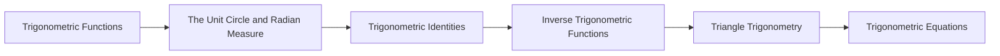

<!-- Generated by tools/build_indexes.py from tools/curriculum.json. Do not edit by hand. -->

# Trigonometry

*Angles, circles and periodic phenomena*

[Mathematics](../README.md) › Trigonometry

Trigonometry begins with right triangles and ends as the study of the functions that model every oscillation in nature. The unit circle is the bridge between the two.

## At a glance

| | |
|---|---|
| Topics | 6 (6 complete, 0 draft, 0 planned) |
| Estimated study time | ~50 hours |
| Prerequisites | [04-geometry](../04-geometry/README.md) |

## Study order

The numbers are the recommended order. Study a topic only after the ones before it —
the dependency chain below is the shortest safe route through the discipline.

## Topic inventory

| # | Topic | Level | Est. time | Status | Materials |
|---|---|---|---|---|---|
| 1 | [Trigonometric Functions](01-trigonometric-functions/README.md) | Intermediate | 10 h | Complete | [Tutorial](01-trigonometric-functions/README.md) · [Exercises](01-trigonometric-functions/exercises.md) · [Solutions](01-trigonometric-functions/solutions.md) |
| 2 | [The Unit Circle and Radian Measure](02-unit-circle/README.md) | Intermediate | 8 h | Complete | [Tutorial](02-unit-circle/README.md) · [Exercises](02-unit-circle/exercises.md) · [Solutions](02-unit-circle/solutions.md) |
| 3 | [Trigonometric Identities](03-trigonometric-identities/README.md) | Advanced | 10 h | Complete | [Tutorial](03-trigonometric-identities/README.md) · [Exercises](03-trigonometric-identities/exercises.md) · [Solutions](03-trigonometric-identities/solutions.md) |
| 4 | [Inverse Trigonometric Functions](04-inverse-trigonometric-functions/README.md) | Advanced | 7 h | Complete | [Tutorial](04-inverse-trigonometric-functions/README.md) · [Exercises](04-inverse-trigonometric-functions/exercises.md) · [Solutions](04-inverse-trigonometric-functions/solutions.md) |
| 5 | [Triangle Trigonometry](05-triangle-trigonometry/README.md) | Intermediate | 8 h | Complete | [Tutorial](05-triangle-trigonometry/README.md) · [Exercises](05-triangle-trigonometry/exercises.md) · [Solutions](05-triangle-trigonometry/solutions.md) |
| 6 | [Trigonometric Equations](06-trigonometric-equations/README.md) | Advanced | 7 h | Complete | [Tutorial](06-trigonometric-equations/README.md) · [Exercises](06-trigonometric-equations/exercises.md) · [Solutions](06-trigonometric-equations/solutions.md) |

### What each topic covers

- **Trigonometric Functions** — Right-triangle ratios, sine, cosine, tangent, exact values and applications.
- **The Unit Circle and Radian Measure** — Radians, arc length, the unit circle definition, periodicity and graphs.
- **Trigonometric Identities** — Pythagorean, sum, double-angle and half-angle identities, with proofs.
- **Inverse Trigonometric Functions** — Principal branches, domains, graphs and solving trigonometric equations.
- **Triangle Trigonometry** — The laws of sines and cosines, the ambiguous case and surveying problems.
- **Trigonometric Equations** — General solutions, periodicity, substitutions and modelling with sinusoids.

## Related disciplines

- [06-precalculus](../06-precalculus/README.md)
- [07-calculus](../07-calculus/README.md)
- [15-complex-analysis](../15-complex-analysis/README.md)

## Status key

- **Complete** — tutorial, exercises and full solutions exist and the tutorial meets the
  [authoring standard](../CONTRIBUTING.md).
- **Draft** — some material exists but the topic is not finished.
- **Planned** — identified in the curriculum, not written yet.

Overall progress and the full topic inventory live in [ROADMAP.md](../ROADMAP.md).
